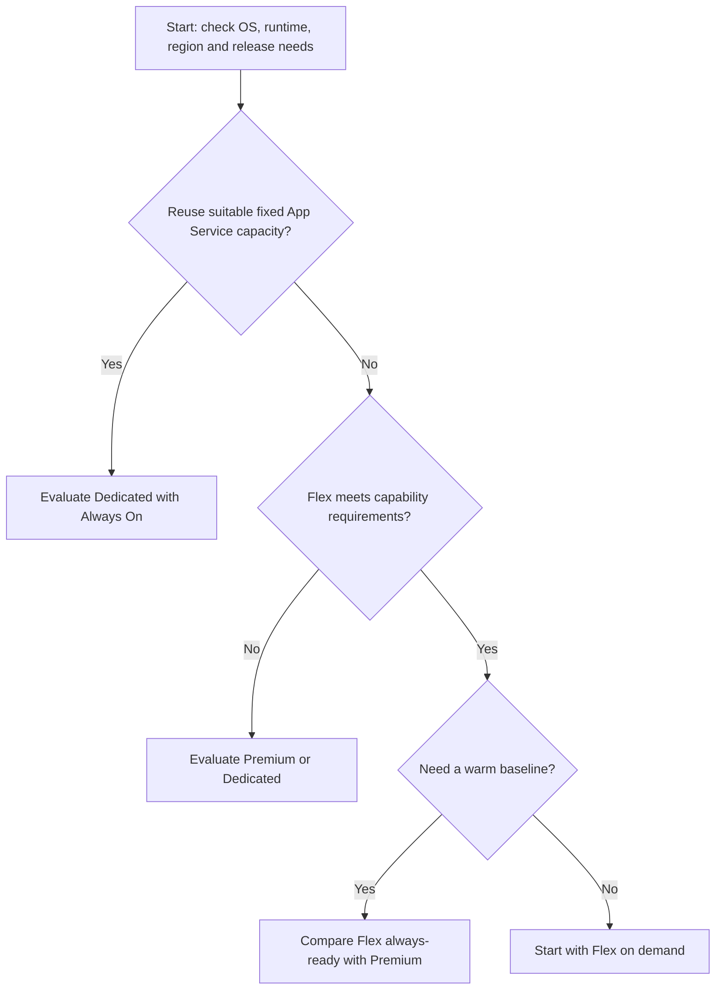

---
content_sources:
  references:
    - type: mslearn-adapted
      url: https://learn.microsoft.com/en-us/azure/azure-functions/functions-scale
    - type: mslearn-adapted
      url: https://learn.microsoft.com/en-us/azure/azure-functions/flex-consumption-plan
    - type: mslearn-adapted
      url: https://learn.microsoft.com/en-us/azure/azure-functions/performance-reliability
    - type: mslearn-adapted
      url: https://learn.microsoft.com/en-us/azure/azure-functions/functions-premium-plan
    - type: mslearn-adapted
      url: https://learn.microsoft.com/en-us/azure/azure-functions/dedicated-plan
    - type: mslearn-adapted
      url: https://learn.microsoft.com/en-us/azure/azure-functions/consumption-plan
    - type: mslearn-adapted
      url: https://learn.microsoft.com/en-us/azure/azure-functions/migration/migrate-plan-consumption-to-flex
  diagrams:
    - id: why-this-matters
      type: flowchart
      source: self-generated
      justification: Workload-fit recommendations synthesized from documented plan capabilities; not a measured latency or cost guarantee.
      based_on:
        - https://learn.microsoft.com/en-us/azure/azure-functions/functions-scale
        - https://learn.microsoft.com/en-us/azure/azure-functions/flex-consumption-plan
        - https://learn.microsoft.com/en-us/azure/azure-functions/functions-premium-plan
        - https://learn.microsoft.com/en-us/azure/azure-functions/dedicated-plan
content_validation:
  status: verified
  last_reviewed: 2026-10-25
  reviewer: agent
  core_claims:
    - claim: "Flex Consumption is Linux-only and supports optional always-ready instances per function or scale group, with a default count of zero."
      source: https://learn.microsoft.com/en-us/azure/azure-functions/flex-consumption-plan
      verified: true
    - claim: "Premium supports always-ready and prewarmed instances and bills at least one active instance per plan."
      source: https://learn.microsoft.com/en-us/azure/azure-functions/functions-premium-plan
      verified: true
    - claim: "The HTTP response limit is 230 seconds regardless of the function execution timeout setting."
      source: https://learn.microsoft.com/en-us/azure/azure-functions/functions-scale
      verified: true
    - claim: "Dedicated uses manual scaling or App Service autoscale and should have Always On enabled."
      source: https://learn.microsoft.com/en-us/azure/azure-functions/dedicated-plan
      verified: true
    - claim: "Linux Consumption retires on September 30, 2028; Windows Consumption is not affected by that retirement."
      source: https://learn.microsoft.com/en-us/azure/azure-functions/consumption-plan
      verified: true
---

# Hosting Plan Selection Best Practices

Selecting the wrong hosting plan is one of the highest-impact mistakes in Azure Functions. This guide provides a practical decision framework so plan choice matches execution behavior, trigger profile, and operational safety requirements.

**Official-source review: 2026-10-25.** Capabilities below were checked against Microsoft Learn, not executed or benchmarked in Azure. Plan recommendations are workload-fit judgments, not latency or cost guarantees. For numerical limits and their qualifications, use the shared [Platform Limits](../reference/platform-limits.md) rather than treating this selector as a second limits table.

!!! tip "Use this page with Platform"
    Read [Platform: Hosting](../platform/hosting.md) first for capability facts, then apply this guide for workload-fit decisions and migration safety.

## Why This Matters

Evaluate these factors together when choosing a hosting plan:

1. **Execution time and timeout risk**: Are handlers long-running or bursty async jobs?
2. **Latency sensitivity**: Is p95 response time strict for HTTP paths?
3. **Network boundaries**: Is private networking or private endpoint required?
4. **Event profile**: Are events sporadic, steady, or highly bursty?
5. **Cost tolerance model**: Is minimizing idle cost or stabilizing latency more important?

<!-- diagram-id: why-this-matters -->

For **new serverless apps**, Microsoft recommends Flex Consumption. For **existing Consumption apps**, assess migration rather than making an untested plan switch. Windows-dependent code can still justify legacy Windows Consumption when its constraints fit; it is not the default for new Linux workloads. [Linux Consumption retires on September 30, 2028](https://learn.microsoft.com/en-us/azure/azure-functions/consumption-plan) and receives no new features or language versions; Windows Consumption is not affected by that deadline. See the [runtime and migration reference](../reference/platform-limits.md#runtime-support-and-linux-consumption-migration).

## Recommended Practices

### Workload characteristics that should drive plan choice

The tree and recommendations below apply only after these documented capability checks:

| Requirement | Confirmed capability and caveat | Workload-fit recommendation |
|---|---|---|
| Sporadic public traffic | [Flex](https://learn.microsoft.com/en-us/azure/azure-functions/flex-consumption-plan#billing) supports scale-to-zero on demand; always-ready adds billed baseline capacity | Start new compatible apps on Flex on demand; review existing Y1 apps for migration |
| Strict p95 HTTP latency | [Flex always-ready](https://learn.microsoft.com/en-us/azure/azure-functions/flex-consumption-plan#always-ready-instances) keeps configured functions/groups running; [Premium](https://learn.microsoft.com/en-us/azure/azure-functions/functions-premium-plan#eliminate-cold-starts) combines always-ready with an HTTP prewarmed buffer | Compare both under expected bursts and concurrency; neither establishes an end-to-end SLO without workload tests |
| Private access | [Networking support](https://learn.microsoft.com/en-us/azure/azure-functions/functions-scale#networking-features) includes inbound private endpoints and outbound VNet integration on Flex/Premium and supported Dedicated configurations, not Consumption | Distinguish private ingress from private dependency access; check tier, subnet, DNS, and routing requirements |
| OS, runtime, and region | [Flex is Linux-only](https://learn.microsoft.com/en-us/azure/azure-functions/flex-consumption-plan#supported-language-stack-versions), requires .NET isolated rather than in-process, and is not available in every region; [Premium scale ceilings vary by OS/region](https://learn.microsoft.com/en-us/azure/azure-functions/functions-premium-plan#region-max-scale-out) | Check stack version, trigger compatibility (including Event Grid-based Blob triggers on Flex), region and quota before selecting; Python runs only on Linux |
| Release workflow | [Flex does not support deployment slots](https://learn.microsoft.com/en-us/azure/azure-functions/flex-consumption-plan#considerations); the Flex overview labels rolling updates public preview while the site-update guide distinguishes generally available regions from regions still rolling out; neither is a slot swap | Compare slot requirements with the existing [deployment reference](../reference/platform-limits.md#deployment-slots) and [Flex site update strategy](../operations/deployment.md#flex-site-update-strategy) |
| Existing fixed App Service capacity | [Dedicated](https://learn.microsoft.com/en-us/azure/azure-functions/dedicated-plan) shares plan resources, uses manual/App Service autoscale, and should enable Always On | Reuse only with sufficient headroom and an owned scaling strategy; it is not Functions event-driven scaling |

Flex always-ready defaults to zero and is configured per function or scale group (the HTTP functions share a group). Enabling it retains a paid warm baseline rather than zero idle cost for that group; on-demand capacity can still be added beyond that baseline. Premium always bills at least one active plan instance. Size and compare baseline cost, burst behavior, and dependency latency rather than routing every low-latency workload directly to Premium. These are documented behaviors, not benchmark results.

### Execution duration is not HTTP response time

[`functionTimeout`](https://learn.microsoft.com/en-us/azure/azure-functions/functions-scale#timeout) controls invocation execution duration, not the HTTP connection's response window. Regardless of that setting, Functions documents a **230-second maximum HTTP response wait** at the front end; clients or proxies can impose shorter limits. Raising the execution timeout or switching plans does not extend that response window.

For plan-specific defaults/maximums, use [Execution Timeout](../reference/platform-limits.md#execution-timeout). Flex and Premium support unbounded configured execution but still have scale-in and platform-update grace periods; Dedicated requires Always On for unbounded execution and is still subject to platform updates. Unbounded does not mean uninterrupted. The worker must also start successfully; runtime startup and OS/region capacity are separate constraints.

For longer HTTP work, return promptly after durably enqueueing work, or use the Durable Functions async pattern. Do not return success and leave essential work in an untracked background thread. See [performance and reliability guidance](https://learn.microsoft.com/en-us/azure/azure-functions/performance-reliability#avoid-long-running-functions).

!!! warning "Do not optimize for list price only"
    A cheaper plan can become more expensive when retries, backlog growth, or cold-start-driven latency failures increase operational load.

### Decision matrix

These are starting recommendations, not a support matrix or cost ranking. **Existing only** means reassess an existing legacy app rather than choosing Y1 by default for a new app; the Windows-dependency exception above still applies. Apply the capability checks before using any row.

| Workload type | Consumption (Y1) | Flex Consumption (FC1) | Premium (EP) | Dedicated |
|---|---|---|---|---|
| Low-volume cron jobs | Existing only | Start here | Conditional | Conditional |
| Bursty queue processing without private networking | Existing only | Start here | Conditional | Not preferred |
| Bursty queue processing with private networking | Not supported | Recommended | Recommended | Conditional |
| Public HTTP API with moderate latency tolerance | Existing only | Start here | Conditional | Conditional |
| Public HTTP API with strict low-latency SLO | Existing only; cold-start risk | Compare with always-ready | Compare warm baseline/buffer | Conditional with Always On and capacity |
| Enterprise integration with private endpoints + predictable response | Not supported | Recommended | Recommended | Conditional |
| CPU/memory-heavy continuous workloads | Not preferred | Conditional | Recommended | Recommended |
| Multi-app consolidation on shared fixed capacity | Not preferred | Not suitable (one app per plan) | Conditional | Recommended |

## Common Mistakes / Anti-Patterns

### Mistake 1: Choosing Consumption for long-running jobs

- **Symptom**: executions hit timeout boundaries or require fragile retries.
- **Safer choice**: move to Flex or Premium, and redesign to async triggers where possible.

### Mistake 2: Choosing Premium for very low-volume HTTP endpoints

- **Symptom**: baseline monthly cost dominates actual execution demand.
- **Safer choice**: start on compatible Flex on demand if cold starts fit the latency budget; add and cost always-ready only when needed.

### Mistake 3: Ignoring private networking requirements until late

- **Symptom**: re-architecture required after security review.
- **Safer choice**: if private access is probable, begin with Flex or Premium.

### Mistake 4: Treating plan selection as irreversible

- **Symptom**: teams avoid needed migration due to perceived risk.
- **Safer choice**: define migration triggers up front (latency threshold, backlog growth, security requirement changes).

!!! note "Plan selection should be revisited"
    Reassess hosting plan when trigger mix changes, dependency quotas tighten, or latency SLOs become contractual.

### Migration paths between plans

Treat these as reassessment paths, not universal in-place conversions. [Moving to or from Flex requires a new app and code redeployment](https://learn.microsoft.com/en-us/azure/azure-functions/flex-consumption-plan#considerations). [Consumption/Premium in-place migration is Windows-only](https://learn.microsoft.com/en-us/azure/azure-functions/functions-premium-plan#migration); other moves need a target-app, cutover, and rollback assessment.

| From | To | Typical trigger | Main migration check |
|---|---|---|---|
| Consumption (Y1) | Flex (FC1) | Need VNet, better burst handling, or longer timeouts | Validate Flex deployment model and storage identity configuration |
| Consumption (Y1) | Premium (EP) | Flex cannot meet OS, release, or capacity needs | Assess migration support, warm settings, and baseline cost |
| Flex (FC1) | Premium (EP) | Warm baseline alone does not meet workload needs, or Premium-only capabilities are required | First assess Flex always-ready/concurrency; compare Premium buffer and create a target app if selected |
| Premium (EP) | Dedicated | Need fixed capacity governance | Port autoscale strategy to App Service plan rules |

### Migration checklist

1. Export and review app settings, connection settings, and `host.json` scale-related values.
2. Confirm OS, regional runtime availability, trigger extensions, and binding compatibility in the target plan; use the [Python runtime reference](../language-guides/python/python-runtime.md#supported-python-versions) for Python version/build qualifications.
3. Review [package configuration by plan/OS](../operations/deployment.md#package-configuration-by-plan-and-os) and [host vs deployment storage authentication](../platform/storage-connectivity.md#host-storage-authentication-including-flex) separately; do not copy classic package/content-share settings into Flex.
4. Run staged load test to compare p95, backlog behavior, and dependency saturation.
5. Cut over with rollback path and post-cutover telemetry watch window.

### Cost and reliability guardrails while selecting plans

Use these constraints to avoid unstable designs:

- Apply max scale limits before exposure to internet traffic.
- Separate latency-sensitive HTTP handlers from heavy async processors when possible.
- Map each trigger to explicit retry and poison-message behavior.
- Model dependency throughput budgets (database connections, API rate limits) before raising scale ceilings.

!!! tip "Operations linkage"
    Pair plan decisions with [Cost Optimization](../operations/cost-optimization.md) so baseline cost and burst-cost controls are implemented from day one.

### Quick recommendation patterns

| If your first priority is... | Start with... | Re-evaluate when... |
|---|---|---|
| Avoiding idle compute baseline for a new compatible app | Flex (FC1) on demand | Cold-start latency exceeds the budget |
| Serverless + private networking | Flex (FC1), after compatibility checks | Regional capacity or required features do not fit |
| A warm HTTP baseline | Compare Flex always-ready and Premium | Burst latency, concurrency, or baseline cost misses the workload target |
| Existing fixed App Service capacity | Dedicated | Workload becomes bursty and under-utilizes fixed compute |

## Validation Checklist

Before finalizing a plan decision, hand off these concrete items to operations:

1. Document expected trigger mix and peak event profile.
2. Define acceptable cold-start behavior and user-facing latency budgets.
3. Set initial scale/concurrency limits and rollback criteria.
4. Record dependency throughput constraints and escalation contacts.
5. Link plan choice to budget alert thresholds and monthly review cadence.

!!! warning "Selection without handoff is incomplete"
    A plan decision is only production-ready when monitoring thresholds, scale limits, and rollback rules are operationalized.

---

## See Also

- [Platform: Hosting](../platform/hosting.md)
- [Platform: Scaling](../platform/scaling.md)
- [Platform Limits](../reference/platform-limits.md)
- [Deployment: Package Configuration](../operations/deployment.md#package-configuration-by-plan-and-os)
- [Deployment: Flex Site Update Strategy](../operations/deployment.md#flex-site-update-strategy)
- [Storage Connectivity](../platform/storage-connectivity.md)
- [Python Runtime](../language-guides/python/python-runtime.md)
- [Operations: Cost Optimization](../operations/cost-optimization.md)
- [Best Practices: Scaling](./scaling.md)

## Sources

- [Azure Functions hosting options and scaling (Microsoft Learn)](https://learn.microsoft.com/en-us/azure/azure-functions/functions-scale)
- [Azure Functions Flex Consumption plan (Microsoft Learn)](https://learn.microsoft.com/en-us/azure/azure-functions/flex-consumption-plan)
- [Azure Functions performance and reliability (Microsoft Learn)](https://learn.microsoft.com/en-us/azure/azure-functions/performance-reliability)
- [Azure Functions Premium plan (Microsoft Learn)](https://learn.microsoft.com/en-us/azure/azure-functions/functions-premium-plan)
- [Azure Functions Dedicated hosting (Microsoft Learn)](https://learn.microsoft.com/en-us/azure/azure-functions/dedicated-plan)
- [Consumption plan and Linux retirement (Microsoft Learn)](https://learn.microsoft.com/en-us/azure/azure-functions/consumption-plan)
- [Consumption-to-Flex migration assessment (Microsoft Learn)](https://learn.microsoft.com/en-us/azure/azure-functions/migration/migrate-plan-consumption-to-flex)
