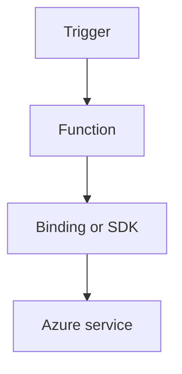
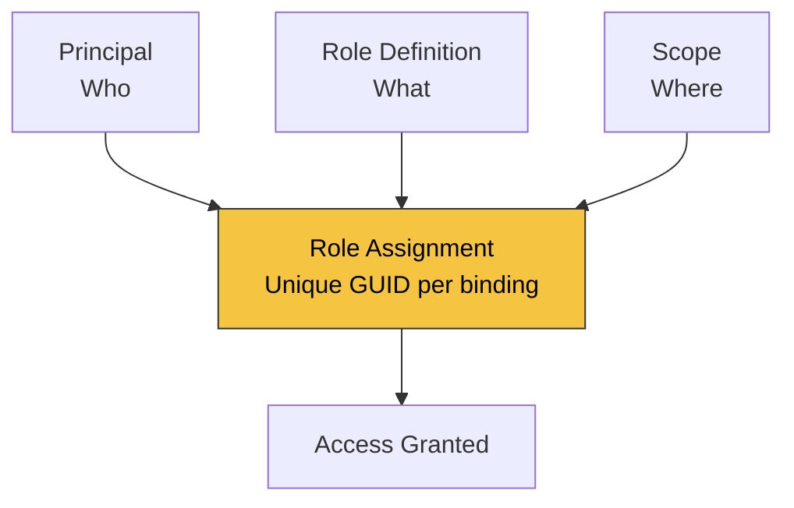

---
content_sources:

  references:
    - type: mslearn-adapted
      url: https://learn.microsoft.com/en-us/azure/azure-functions/dotnet-isolated-process-guide
    - type: mslearn-adapted
      url: https://learn.microsoft.com/en-us/azure/azure-functions/functions-triggers-bindings
  diagrams:
    - id: managed-identity
      type: flowchart
      source: self-generated
      justification: Flow view of managed identity, synthesized from Microsoft Learn documentation cited on this page.
      based_on:
        - https://learn.microsoft.com/en-us/azure/azure-functions/dotnet-isolated-process-guide
        - https://learn.microsoft.com/en-us/azure/azure-functions/functions-triggers-bindings
    - id: rbac-structure
      type: flowchart
      source: self-generated
      justification: Flow view of rbac structure, synthesized from Microsoft Learn documentation cited on this page.
      based_on:
        - https://learn.microsoft.com/en-us/azure/azure-functions/dotnet-isolated-process-guide
        - https://learn.microsoft.com/en-us/azure/azure-functions/functions-triggers-bindings
        - https://learn.microsoft.com/en-us/azure/role-based-access-control/role-assignments
        - https://learn.microsoft.com/en-us/azure/role-based-access-control/troubleshooting
---
# Managed Identity

Use system-assigned managed identity for passwordless access to Azure resources from functions.

<!-- diagram-id: managed-identity -->


## How RBAC Connects Identity to Resources

A managed identity alone does not grant access. Azure RBAC binds three elements into a **role assignment**:

<!-- diagram-id: rbac-structure -->


| Element | Question it answers | Example |
|---|---|---|
| **Principal** | Who needs access? | Function app's managed identity |
| **Role Definition** | What permission? | `Storage Blob Data Owner`, `Key Vault Secrets User` |
| **Scope** | On which resource? | A specific Storage account, Key Vault, or resource group |
| **Role Assignment** | The binding itself | Unique GUID — one per (principal + role + scope) combination |

**Reading key:** Principal = managed identity or service principal; Role Definition =
Storage Blob Data Owner, Key Vault Secrets User, or another role; Scope = subscription,
resource group, or resource. The three incoming arrows identify assignment components,
not network requests. “Access Granted” summarizes assigned permissions: applicable
conditions and permission propagation still matter; it does not promise immediate
successful data access. Managed-identity group or role membership changes can take
several hours to take effect; this is not a fixed wait for every direct role assignment.

Azure RBAC enforces a uniqueness constraint: only one role assignment can exist for the same `(principal, role definition, scope)` triple. Attempting to create a duplicate with a different assignment GUID results in a `RoleAssignmentExists` conflict.

## Topic/Command Groups

### Enable identity
```bash
az functionapp identity assign   --name "$APP_NAME"   --resource-group "$RG"
```

| CLI element | Explanation |
|---|---|
| Command(s) | `az functionapp identity assign` |
| Key flags | `--name`, `--resource-group` |
| Variables | `$APP_NAME`, `$RG` |
| Expected result | Azure CLI applies the configuration change; confirm the returned JSON or follow-up query shows the expected value. |


### Access Storage SDK with DefaultAzureCredential
```csharp
var credential = new DefaultAzureCredential();
var blobService = new BlobServiceClient(new Uri($"https://{storageName}.blob.core.windows.net"), credential);
```

## See Also
- [Recipes Index](index.md)
- [.NET Language Guide](../index.md)
- [Troubleshooting](../troubleshooting.md)

## Sources
- [Azure Functions .NET isolated worker guide](https://learn.microsoft.com/en-us/azure/azure-functions/dotnet-isolated-process-guide)
- [Azure Functions triggers and bindings](https://learn.microsoft.com/en-us/azure/azure-functions/functions-triggers-bindings)
- [Understand Azure role assignments](https://learn.microsoft.com/en-us/azure/role-based-access-control/role-assignments)
- [Troubleshoot Azure RBAC](https://learn.microsoft.com/en-us/azure/role-based-access-control/troubleshooting)
