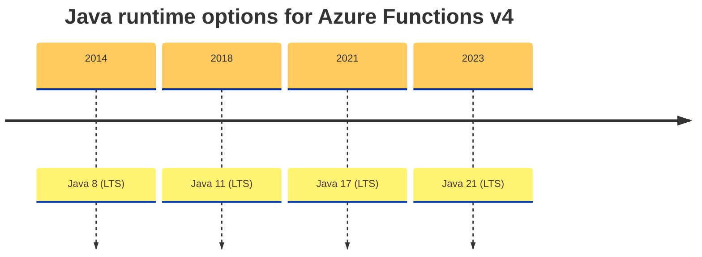
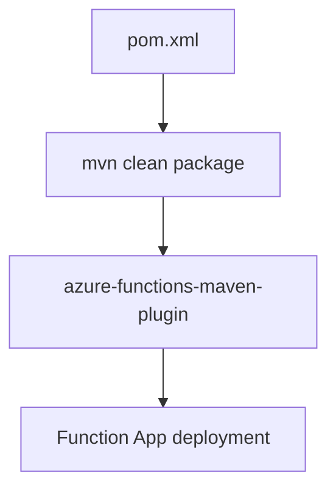

---
content_sources:

  references:
    - type: mslearn-adapted
      url: https://learn.microsoft.com/en-us/azure/azure-functions/supported-languages
    - type: mslearn-adapted
      url: https://learn.microsoft.com/en-us/azure/azure-functions/functions-reference-java
  diagrams:
    - id: supported-java-versions
      type: timeline
      source: self-generated
      justification: Timeline view of supported java versions, synthesized from Microsoft Learn documentation cited on this page.
      based_on:
        - https://learn.microsoft.com/en-us/azure/azure-functions/supported-languages
        - https://learn.microsoft.com/en-us/azure/azure-functions/functions-reference-java
    - id: maven-build-and-deployment
      type: flowchart
      source: self-generated
      justification: Flow view of maven build and deployment, synthesized from Microsoft Learn documentation cited on this page.
      based_on:
        - https://learn.microsoft.com/en-us/azure/azure-functions/supported-languages
        - https://learn.microsoft.com/en-us/azure/azure-functions/functions-reference-java
---
# Java Runtime

This reference captures supported Java versions, JVM/runtime settings, Maven dependencies, and practical tuning choices for Azure Functions Java applications.

## Supported Java Versions

<!-- diagram-id: supported-java-versions -->


**Reading note:** The figure pairs 2014 with Java 8 (LTS), 2018 with Java 11 (LTS), 2021 with Java 17 (LTS), and 2023 with Java 21 (LTS). These year markers are illustrative historical context, not Azure Functions adoption dates. The figure and table show a subset of runtime options; consult [Supported languages](https://learn.microsoft.com/en-us/azure/azure-functions/supported-languages) for the current list and hosting restrictions.

| Runtime | Status | Typical recommendation |
|---------|--------|------------------------|
| Java 8 | Supported | Legacy workloads only |
| Java 11 | Supported | Existing enterprise baselines |
| Java 17 | Supported (LTS) | Default for new projects |
| Java 21 | Supported (LTS) | Newer language/runtime features |

## Core Runtime Settings

| Setting | Purpose | Example |
|---------|---------|---------|
| `FUNCTIONS_WORKER_RUNTIME` | Select Java worker | `java` |
| `JAVA_HOME` | Java installation path on host | Set automatically |
| `JAVA_OPTS` | JVM arguments | `-Xmx512m` |
| `WEBSITE_RUN_FROM_PACKAGE` | Immutable package deployment | `1` only for local-package Windows Consumption/Premium/Dedicated; URL for Linux Consumption; absent on Flex and not manually forced for remote build. See [package matrix](../../operations/deployment.md#package-configuration-by-plan-and-os). |

```bash
az functionapp config appsettings set   --name $APP_NAME   --resource-group $RG   --settings "FUNCTIONS_WORKER_RUNTIME=java" "JAVA_OPTS=-Xmx512m"
```

| CLI element | Explanation |
|---|---|
| Command(s) | `az functionapp config appsettings set` |
| Key flags | `--name`, `--resource-group`, `--settings` |
| Variables | `$APP_NAME`, `$RG` |
| Expected result | Azure CLI applies the configuration change; confirm the returned JSON or follow-up query shows the expected value. |


## Maven Build and Deployment

<!-- diagram-id: maven-build-and-deployment -->


Required dependency:

```xml
<dependency>
    <groupId>com.microsoft.azure.functions</groupId>
    <artifactId>azure-functions-java-library</artifactId>
    <version>3.1.0</version>
</dependency>
```

Recommended plugin:

```xml
<plugin>
    <groupId>com.microsoft.azure</groupId>
    <artifactId>azure-functions-maven-plugin</artifactId>
</plugin>
```

Common commands:

```bash
mvn clean package
mvn azure-functions:deploy
```

## Project Layout (Maven)

```text
project-root/
├── src/
│   └── main/
│       └── java/
│           └── com/example/
│               ├── Function.java
│               └── ...
├── host.json
├── local.settings.json
└── pom.xml
```

## Runtime Selection in Azure CLI

```bash
az functionapp create   --name $APP_NAME   --resource-group $RG   --storage-account $STORAGE_NAME   --plan $PLAN_NAME   --runtime java   --runtime-version 17   --functions-version 4   --os-type linux
```

| CLI element | Explanation |
|---|---|
| Command(s) | `az functionapp create` |
| Key flags | `--name`, `--resource-group`, `--storage-account`, `--plan`, `--runtime`, `--runtime-version`, `--functions-version`, `--os-type` |
| Variables | `$APP_NAME`, `$RG`, `$STORAGE_NAME`, `$PLAN_NAME` |
| Expected result | Azure CLI returns provisioning details; confirm the resource name and successful provisioning state before continuing. |


## See Also

- [Annotation Programming Model](annotation-programming-model.md)
- [Tutorial Overview & Plan Chooser](tutorial/index.md)
- [Environment Variables](environment-variables.md)
- [Platform Limits](platform-limits.md)

## Sources

- [Supported languages in Azure Functions (Microsoft Learn)](https://learn.microsoft.com/en-us/azure/azure-functions/supported-languages)
- [Azure Functions Java developer guide (Microsoft Learn)](https://learn.microsoft.com/en-us/azure/azure-functions/functions-reference-java)
