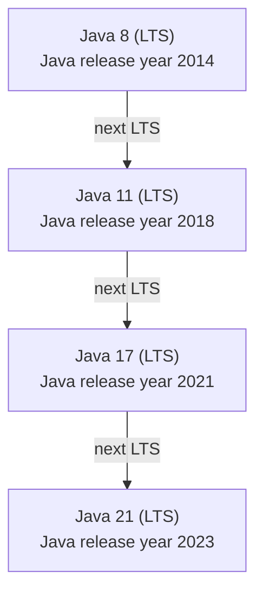
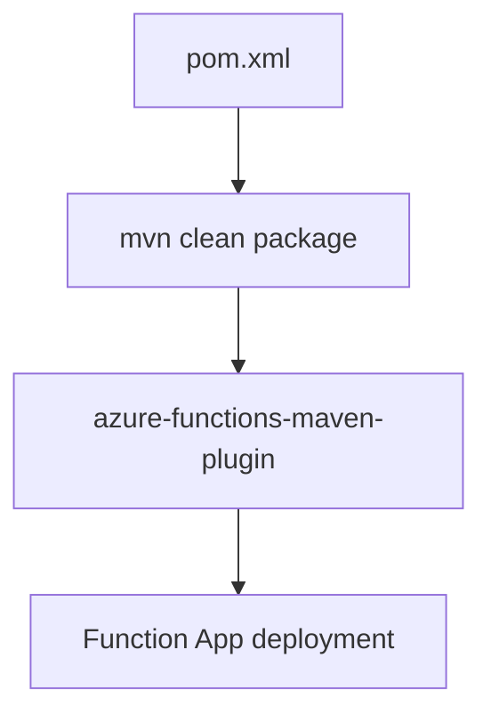

---
content_sources:

  references:
    - type: mslearn-adapted
      url: https://learn.microsoft.com/en-us/azure/azure-functions/supported-languages
    - type: mslearn-adapted
      url: https://learn.microsoft.com/en-us/azure/azure-functions/functions-reference-java
  diagrams:
    - id: supported-java-versions
      type: flowchart
      source: self-generated
      justification: Release-order view of four Java LTS versions that the Java developer guide lists for Functions 4.x. It is a subset (the supported-languages page also lists newer Java versions and plan restrictions); release years are general Java history, not Azure Functions adoption dates.
      based_on:
        - https://learn.microsoft.com/en-us/azure/azure-functions/supported-languages
        - https://learn.microsoft.com/en-us/azure/azure-functions/functions-reference-java
    - id: maven-build-and-deployment
      type: flowchart
      source: self-generated
      justification: Four-stage reading order from the Maven project to deployment, summarized from the Java quickstart, which runs mvn clean package and azure-functions:deploy with azure-functions-maven-plugin. It is not a network trace, and packaging alone does not deploy.
      based_on:
        - https://learn.microsoft.com/en-us/azure/azure-functions/supported-languages
        - https://learn.microsoft.com/en-us/azure/azure-functions/functions-reference-java
        - https://learn.microsoft.com/en-us/azure/azure-functions/create-first-function-cli-java
---
# Java Runtime

This reference captures supported Java versions, JVM/runtime settings, Maven dependencies, and practical tuning choices for Azure Functions Java applications.

## Supported Java Versions

<!-- diagram-id: supported-java-versions -->


**Reading note:** The figure orders Java 8 (LTS, 2014), Java 11 (LTS, 2018), Java 17 (LTS, 2021), and Java 21 (LTS, 2023) by Java release year. Arrows show release order, not an upgrade path. The years are illustrative historical context, not Azure Functions adoption dates. The figure and table show a subset of runtime options; consult [Supported languages](https://learn.microsoft.com/en-us/azure/azure-functions/supported-languages) for the current list and hosting restrictions.

| Runtime | Status | Typical recommendation |
|---------|--------|------------------------|
| Java 8 | Supported | Legacy workloads only |
| Java 11 | Supported | Existing enterprise baselines |
| Java 17 | Supported (LTS) | Default for new projects |
| Java 21 | Supported (LTS) | Newer language/runtime features |

## Core Runtime Settings

| Setting | Purpose | Example |
|---------|---------|---------|
| `FUNCTIONS_WORKER_RUNTIME` | Select Java worker | `java` |
| `JAVA_HOME` | Java installation path on host | Set automatically |
| `JAVA_OPTS` | JVM arguments | `-Xmx512m` |
| `WEBSITE_RUN_FROM_PACKAGE` | Immutable package deployment | `1` only for local-package Windows Consumption/Premium/Dedicated; URL for Linux Consumption; absent on Flex and not manually forced for remote build. See [package matrix](../../operations/deployment.md#package-configuration-by-plan-and-os). |

```bash
az functionapp config appsettings set   --name $APP_NAME   --resource-group $RG   --settings "FUNCTIONS_WORKER_RUNTIME=java" "JAVA_OPTS=-Xmx512m"
```

| CLI element | Explanation |
|---|---|
| Command(s) | `az functionapp config appsettings set` |
| Key flags | `--name`, `--resource-group`, `--settings` |
| Variables | `$APP_NAME`, `$RG` |
| Expected result | Azure CLI applies the configuration change; confirm the returned JSON or follow-up query shows the expected value. |


## Maven Build and Deployment

<!-- diagram-id: maven-build-and-deployment -->


Required dependency:

```xml
<dependency>
    <groupId>com.microsoft.azure.functions</groupId>
    <artifactId>azure-functions-java-library</artifactId>
    <version>3.1.0</version>
</dependency>
```

Recommended plugin:

```xml
<plugin>
    <groupId>com.microsoft.azure</groupId>
    <artifactId>azure-functions-maven-plugin</artifactId>
</plugin>
```

Common commands:

```bash
mvn clean package
mvn azure-functions:deploy
```

## Project Layout (Maven)

```text
project-root/
├── src/
│   └── main/
│       └── java/
│           └── com/example/
│               ├── Function.java
│               └── ...
├── host.json
├── local.settings.json
└── pom.xml
```

## Runtime Selection in Azure CLI

```bash
az functionapp create   --name $APP_NAME   --resource-group $RG   --storage-account $STORAGE_NAME   --plan $PLAN_NAME   --runtime java   --runtime-version 17   --functions-version 4   --os-type linux
```

| CLI element | Explanation |
|---|---|
| Command(s) | `az functionapp create` |
| Key flags | `--name`, `--resource-group`, `--storage-account`, `--plan`, `--runtime`, `--runtime-version`, `--functions-version`, `--os-type` |
| Variables | `$APP_NAME`, `$RG`, `$STORAGE_NAME`, `$PLAN_NAME` |
| Expected result | Azure CLI returns provisioning details; confirm the resource name and successful provisioning state before continuing. |


## See Also

- [Annotation Programming Model](annotation-programming-model.md)
- [Tutorial Overview & Plan Chooser](tutorial/index.md)
- [Environment Variables](environment-variables.md)
- [Platform Limits](platform-limits.md)

## Sources

- [Supported languages in Azure Functions (Microsoft Learn)](https://learn.microsoft.com/en-us/azure/azure-functions/supported-languages)
- [Azure Functions Java developer guide (Microsoft Learn)](https://learn.microsoft.com/en-us/azure/azure-functions/functions-reference-java)
