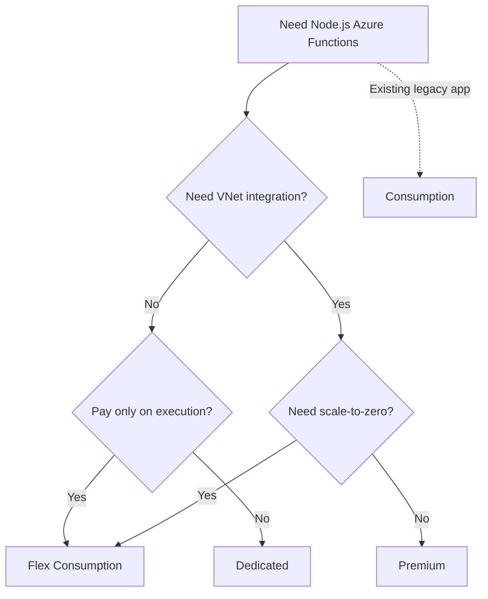

---
content_sources:

  references:
    - type: mslearn-adapted
      url: https://learn.microsoft.com/en-us/azure/azure-functions/functions-scale
    - type: mslearn-adapted
      url: https://learn.microsoft.com/en-us/azure/azure-functions/flex-consumption-plan
  diagrams:
    - id: which-plan-should-i-start-with
      type: flowchart
      source: self-generated
      justification: Flow view of which plan should i start with, synthesized from Microsoft Learn documentation cited on this page.
      based_on:
        - https://learn.microsoft.com/en-us/azure/azure-functions/functions-scale
        - https://learn.microsoft.com/en-us/azure/azure-functions/flex-consumption-plan
---
# Tutorial - Choose Your Hosting Plan

This section provides four independent Node.js tutorial tracks. Each track follows the same core steps from local development to production operations, with additional steps on some tracks.

## Which Plan Should I Start With?

<!-- diagram-id: which-plan-should-i-start-with -->

## Plan Comparison at a Glance

Use [Platform Limits](../../../reference/platform-limits.md) for plan/OS/region-qualified quotas, slots, runtime support, and timeout qualifications. Flex is Linux-only; this guide's Consumption track uses Linux. For Linux Consumption retirement and target selection, follow the [migration decision path](../../../reference/platform-limits.md#runtime-support-and-linux-consumption-migration). Tutorial runtime pins and configured scale caps are examples, not platform limits.

| Feature | Consumption | Flex Consumption | Premium | Dedicated |
|---|---:|---:|---:|---:|
| Scale to zero | Yes | Yes | No | No |
| VNet integration | No | Yes | Yes | Yes (tier-dependent) |
| Typical fit | Burst workloads | Modern serverless default | Low latency and warm capacity | Existing App Service estates |

## Tutorial Tracks

- [Consumption](consumption/01-local-run.md)
- [Flex Consumption](flex-consumption/01-local-run.md)
- [Premium](premium/01-local-run.md)
- [Dedicated](dedicated/01-local-run.md)

## What Each Step Covers

| Step | Topic |
|---|---|
| 01 | Local run |
| 02 | First deploy |
| 03 | Configuration |
| 04 | Logging and monitoring |
| 05 | Infrastructure as code |
| 06 | CI/CD |
| 07 | Extending triggers |
| 08 | Testing and debugging (Flex track) |
| 09 | Container deployment (Premium track) |

## See Also
- [Node.js Language Guide](../index.md)
- [Node.js v4 Programming Model](../v4-programming-model.md)
- [Platform: Hosting Plans](../../../platform/hosting.md)

## Sources
- [Azure Functions hosting options (Microsoft Learn)](https://learn.microsoft.com/en-us/azure/azure-functions/functions-scale)
- [Flex Consumption plan (Microsoft Learn)](https://learn.microsoft.com/en-us/azure/azure-functions/flex-consumption-plan)
