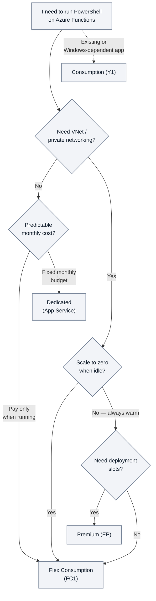
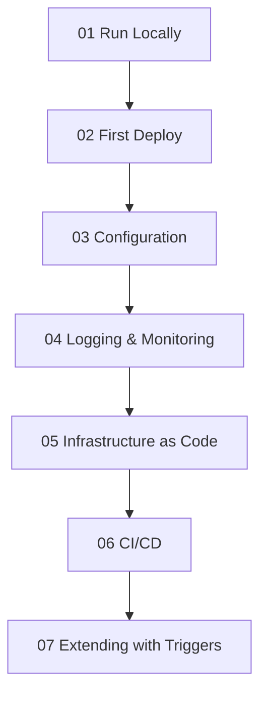

---
content_sources:
  diagrams:
    - id: which-plan-should-i-start-with
      type: flowchart
      source: self-generated
      justification: Illustrative routing to this guide's PowerShell tutorial tracks, not an exhaustive platform recommendation; Microsoft Learn supplies the plan capabilities and billing qualifications below.
      based_on:
        - https://learn.microsoft.com/en-us/azure/azure-functions/functions-scale
        - https://learn.microsoft.com/en-us/azure/azure-functions/flex-consumption-plan
        - https://learn.microsoft.com/en-us/azure/azure-functions/functions-premium-plan
        - https://learn.microsoft.com/en-us/azure/azure-functions/dedicated-plan
        - https://learn.microsoft.com/en-us/azure/azure-functions/supported-languages
    - id: powershell-plan-tracks
      type: flowchart
      source: self-generated
      justification: Navigation through this guide's seven shared PowerShell tutorial steps, not an Azure runtime sequence; Microsoft Learn provides hosting and language background.
      based_on:
        - https://learn.microsoft.com/en-us/azure/azure-functions/functions-scale
        - https://learn.microsoft.com/en-us/azure/azure-functions/functions-reference-powershell
---
# Tutorial — Choose Your Hosting Plan

This tutorial section provides **four independent, step-by-step tracks** — one for each Azure Functions hosting plan. Every track covers the same seven topics so you can follow the complete journey from local development to production on whichever plan fits your PowerShell workload.

## Which Plan Should I Start With?

<!-- diagram-id: which-plan-should-i-start-with -->

**Takeaway:** Follow these illustrative tutorial starting points, not exclusive capability tests. “Pay only when running” means **Flex on-demand compute** billing; optional always-ready instances add baseline and execution charges, so Flex can also serve the always-warm route ([Flex billing](https://learn.microsoft.com/en-us/azure/azure-functions/flex-consumption-plan#billing)). “Fixed monthly budget” refers to **Dedicated allocated compute**, not a guaranteed total bill; **Premium** keeps at least one billed plan instance even when idle ([Dedicated billing](https://learn.microsoft.com/en-us/azure/azure-functions/dedicated-plan#billing), [Premium billing](https://learn.microsoft.com/en-us/azure/azure-functions/functions-premium-plan#billing)).

> **Not sure yet?** For a new Linux-compatible serverless app, start with **Flex Consumption**, Microsoft's recommended serverless plan. Current support includes PowerShell **7.6 and 7.4 on Flex (Linux)**; **7.6** also runs on **Windows Consumption** and **Premium/Dedicated on Windows or Linux**, but not **Linux Consumption**, whose last PowerShell version is **7.4**. PowerShell 7.4 support ends **November 10, 2026**; check version support before following this guide's existing runtime pins. Windows-dependent code needs a Windows-compatible plan rather than Flex; the Consumption branch is not the only Windows option ([supported languages](https://learn.microsoft.com/en-us/azure/azure-functions/supported-languages), [hosting options](https://learn.microsoft.com/en-us/azure/azure-functions/functions-scale)).

## Plan Comparison at a Glance

Use [Platform Limits](../../../reference/platform-limits.md) for plan/OS/region-qualified quotas, slots, runtime support, and timeout qualifications. Flex is Linux-only; Windows-dependent PowerShell code needs compatibility assessment before migration. For Linux Consumption retirement and target selection, follow the [migration decision path](../../../reference/platform-limits.md#runtime-support-and-linux-consumption-migration). Tutorial runtime pins and configured scale caps are examples, not platform limits.

| Feature | Consumption (Y1) | Flex Consumption (FC1) | Premium (EP) | Dedicated (ASP) |
|---------|:-----------------:|:----------------------:|:------------:|:----------------:|
| **Scale to zero** | ✅ | ✅ | ❌ (min 1 instance) | ❌ |
| **VNet integration** | ❌ | ✅ | ✅ | ✅ (Standard+) |
| **Managed dependencies** | ✅ | ❌ (bundle `Modules`) | ✅ | ✅ |
| **OS** | Windows / Linux | Linux only | Windows / Linux | Windows / Linux |

!!! warning "Managed dependencies on Flex Consumption"
    The `requirements.psd1` managed dependency feature is **not** supported on Flex Consumption. Bundle modules in a `Modules` folder instead. See [PowerShell Runtime](../powershell-runtime.md#dependency-management).

## Tutorial Tracks

Each track contains the same seven steps. Pick your plan and follow from start to finish.

<!-- diagram-id: powershell-plan-tracks -->

### ☁️ [Consumption (Y1)](consumption/01-local-run.md)

Classic serverless — pay only when your functions execute. Best for lightweight, event-driven workloads that don't need VNet access.

| Step | Topic |
|------|-------|
| 01 | [Run Locally](consumption/01-local-run.md) |
| 02 | [First Deploy](consumption/02-first-deploy.md) |
| 03 | [Configuration](consumption/03-configuration.md) |
| 04 | [Logging & Monitoring](consumption/04-logging-monitoring.md) |
| 05 | [Infrastructure as Code](consumption/05-infrastructure-as-code.md) |
| 06 | [CI/CD](consumption/06-ci-cd.md) |
| 07 | [Extending with Triggers](consumption/07-extending-triggers.md) |

### ⚡ [Flex Consumption (FC1)](flex-consumption/01-local-run.md)

Next-generation serverless — scale-to-zero with VNet integration. Microsoft's recommended default for new projects. PowerShell 7.4 on Linux.

| Step | Topic |
|------|-------|
| 01 | [Run Locally](flex-consumption/01-local-run.md) |
| 02 | [First Deploy](flex-consumption/02-first-deploy.md) |
| 03 | [Configuration](flex-consumption/03-configuration.md) |
| 04 | [Logging & Monitoring](flex-consumption/04-logging-monitoring.md) |
| 05 | [Infrastructure as Code](flex-consumption/05-infrastructure-as-code.md) |
| 06 | [CI/CD](flex-consumption/06-ci-cd.md) |
| 07 | [Extending with Triggers](flex-consumption/07-extending-triggers.md) |
| 08 | [Testing & Debugging](flex-consumption/08-testing-and-debugging.md) |

### 🚀 [Premium (EP)](premium/01-local-run.md)

Always-warm instances with VNet support and deployment slots. Best for latency-sensitive workloads or long-running functions.

| Step | Topic |
|------|-------|
| 01 | [Run Locally](premium/01-local-run.md) |
| 02 | [First Deploy](premium/02-first-deploy.md) |
| 03 | [Configuration](premium/03-configuration.md) |
| 04 | [Logging & Monitoring](premium/04-logging-monitoring.md) |
| 05 | [Infrastructure as Code](premium/05-infrastructure-as-code.md) |
| 06 | [CI/CD](premium/06-ci-cd.md) |
| 07 | [Extending with Triggers](premium/07-extending-triggers.md) |
| 09 | [Container Deployment](premium/09-container-deployment.md) |

### 🖥️ [Dedicated (App Service Plan)](dedicated/01-local-run.md)

Traditional App Service hosting with predictable pricing. Best when you already have an App Service Plan with spare capacity.

| Step | Topic |
|------|-------|
| 01 | [Run Locally](dedicated/01-local-run.md) |
| 02 | [First Deploy](dedicated/02-first-deploy.md) |
| 03 | [Configuration](dedicated/03-configuration.md) |
| 04 | [Logging & Monitoring](dedicated/04-logging-monitoring.md) |
| 05 | [Infrastructure as Code](dedicated/05-infrastructure-as-code.md) |
| 06 | [CI/CD](dedicated/06-ci-cd.md) |
| 07 | [Extending with Triggers](dedicated/07-extending-triggers.md) |

## What Each Step Covers

| Step | Topic | You Will Learn |
|------|-------|----------------|
| 01 | **Run Locally** | Scaffold a PowerShell app, run with Core Tools, test endpoints |
| 02 | **First Deploy** | Provision Azure resources and deploy your first function app |
| 03 | **Configuration** | Manage app settings, connection strings, and module dependencies |
| 04 | **Logging & Monitoring** | Configure Application Insights and structured logging |
| 05 | **Infrastructure as Code** | Define all resources in Bicep, deploy reproducibly |
| 06 | **CI/CD** | Automate build and deploy with GitHub Actions |
| 07 | **Extending with Triggers** | Add Timer, Queue, and Blob triggers beyond HTTP |
| 08 | **Testing & Debugging** | Unit test logic, mock triggers/bindings, integration test with Azurite, attach a debugger (Flex track) |
| 09 | **Container Deployment** | Package as a Linux container, push to ACR, deploy with managed-identity pull (Premium track) |

## See Also

- [PowerShell Language Guide](../index.md)
- [Scaling and Plans](../../../platform/scaling.md)
- [Networking](../../../platform/networking.md)

## Sources

- [Azure Functions hosting options (Microsoft Learn)](https://learn.microsoft.com/en-us/azure/azure-functions/functions-scale)
- [Flex Consumption plan (Microsoft Learn)](https://learn.microsoft.com/en-us/azure/azure-functions/flex-consumption-plan)
- [PowerShell developer reference (Microsoft Learn)](https://learn.microsoft.com/en-us/azure/azure-functions/functions-reference-powershell)
- [Supported languages (Microsoft Learn)](https://learn.microsoft.com/en-us/azure/azure-functions/supported-languages)
- [Premium plan (Microsoft Learn)](https://learn.microsoft.com/en-us/azure/azure-functions/functions-premium-plan)
- [Dedicated plan (Microsoft Learn)](https://learn.microsoft.com/en-us/azure/azure-functions/dedicated-plan)
