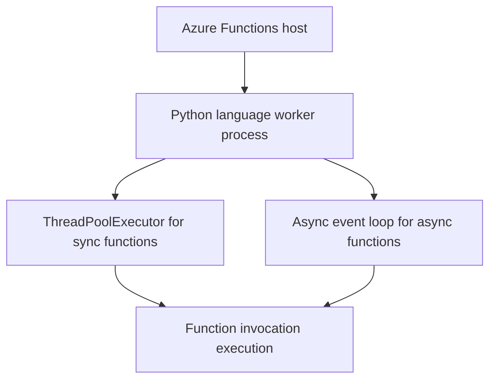

---
content_sources:

  references:
    - type: mslearn-adapted
      url: https://learn.microsoft.com/en-us/azure/azure-functions/supported-languages
    - type: mslearn-adapted
      url: https://learn.microsoft.com/en-us/azure/azure-functions/flex-consumption-how-to
    - type: mslearn-adapted
      url: https://learn.microsoft.com/en-us/azure/azure-functions/functions-reference-python
    - type: mslearn-adapted
      url: https://learn.microsoft.com/en-us/azure/azure-functions/functions-overview
    - type: mslearn-adapted
      url: https://learn.microsoft.com/en-us/azure/azure-functions/flex-consumption-plan
    - type: mslearn-adapted
      url: https://learn.microsoft.com/en-us/azure/azure-functions/functions-deployment-technologies
    - type: mslearn-adapted
      url: https://learn.microsoft.com/en-us/azure/azure-functions/python-build-options
  diagrams:
    - id: python-runtime
      type: flowchart
      source: self-generated
      justification: Flow view of python runtime, synthesized from Microsoft Learn documentation cited on this page.
      based_on:
        - https://learn.microsoft.com/en-us/azure/azure-functions/supported-languages
        - https://learn.microsoft.com/en-us/azure/azure-functions/flex-consumption-how-to
        - https://learn.microsoft.com/en-us/azure/azure-functions/functions-reference-python
        - https://learn.microsoft.com/en-us/azure/azure-functions/functions-overview
---
# Python Runtime

This reference covers the Python runtime configuration for Azure Functions — supported versions, worker process settings, async function support, dependency management, and performance tuning.

<!-- diagram-id: python-runtime -->


## Supported Python Versions

**Official-source review: 2026-10-25.** The live [supported-languages Python table](https://learn.microsoft.com/en-us/azure/azure-functions/supported-languages?pivots=programming-language-python) lists the following versions for Functions v4. These are documented support levels and expected Azure Functions end-of-support dates, not Azure execution results or a recommendation to upgrade existing apps automatically.

| Python Version | Support Status | Expected End of Support |
|---------------|---------------|-------------|
| **3.15** | 🔮 Preview | April 2030 |
| **3.14** | ✅ GA | April 2029 |
| **3.13** | ✅ GA | October 2029 |
| **3.12** | ✅ GA | October 2028 |
| **3.11** | ✅ GA | October 2027 |

The reference application and deployment tutorials retain **Python 3.11** as their example pin. Their historical `validation` metadata applies only to the recorded deployment, not every currently documented version. This refresh uses official sources and static checks only; it does not certify Python 3.13/3.14 execution in Azure.

- **OS:** Python function apps run on Linux only. Windows hosting support for other languages is not Python support.
- **Linux Consumption:** The currently listed GA versions usable within this plan's ceiling are **3.11 and 3.12**. Python 3.13/3.14 are not options on this legacy plan. Use the shared [Platform Limits runtime and migration reference](../../reference/platform-limits.md#runtime-support-and-linux-consumption-migration) for the ceiling and retirement decision path rather than treating a language release as a plan upgrade.
- **Flex Consumption:** The [Flex stack table](https://learn.microsoft.com/en-us/azure/azure-functions/flex-consumption-plan#supported-language-stack-versions) includes **3.11, 3.12, 3.13, and 3.14**, all GA in the language-support table. Confirm the target region's stack availability before provisioning. The Flex table also still lists **3.10**, while the live supported-languages table no longer lists it; do not infer current lifecycle support from that older stack entry. The Flex table does not yet list the **3.15 preview** shown in supported-languages, so do not assume Flex availability for it.
- **Premium / Dedicated (Linux):** Python **3.11–3.14** are the currently listed GA choices, without the Linux Consumption ceiling. The general table's **3.15 preview** is not a production recommendation or a guarantee of availability in a particular region or managed image.

### Build Mode and Version Availability

Language GA status, plan/region availability, and dependency-build availability are separate checks. As reviewed on **2026-10-25**, [deployment technologies](https://learn.microsoft.com/en-us/azure/azure-functions/functions-deployment-technologies#remote-build) and [Python build options](https://learn.microsoft.com/en-us/azure/azure-functions/python-build-options) describe remote build without a Python 3.14-specific Flex exclusion. The historical restriction from issue #25 is not a current support rule; absence of that restriction in current docs is **not** an Azure-tested build result.

| Linux hosting plan | Requesting remote build | Prebuilt dependency alternative |
|---|---|---|
| Flex Consumption | Deployment request parameter, not app settings. Core Tools / VS Code request it for Python; GitHub Actions uses `remote-build: true`. | Build Linux-compatible dependencies with the target Python version, include `.python_packages/lib/site-packages`, and deploy a ready-to-run package with remote build disabled using a supported tool. |
| Consumption / Premium / Dedicated | Core Tools requests remote build by default for Python. Other workflows use `SCM_DO_BUILD_DURING_DEPLOYMENT=true` and `ENABLE_ORYX_BUILD=true`; do not manually set `WEBSITE_RUN_FROM_PACKAGE` for remote build. | Use the plan/OS-specific [package configuration matrix](../../operations/deployment.md#package-configuration-by-plan-and-os); Linux Consumption requires an external package URL when not using remote build. |

If the target version cannot be built remotely, do not relabel its language support as preview or silently downgrade the app. Check tool and regional availability, then follow the documented local-build option on a matching Linux/Ubuntu build environment. Do not upload Windows-built native dependencies. Changing the app's Python version requires rebuilding and redeploying dependencies; it does not convert existing packages automatically.

### Setting the Python Version

When creating a **classic Consumption** function app in Azure:

```bash
az functionapp create \
  --name your-func \
  --resource-group your-rg \
  --storage-account yourstorage \
  --consumption-plan-location eastus \
  --runtime python \
  --runtime-version 3.11 \
  --functions-version 4 \
  --os-type linux
```

| Command/Parameter | Purpose |
|---|---|
| `az functionapp create` | Create the classic Consumption function app. |
| `--name` | Function app name. |
| `--resource-group` | Target resource group. |
| `--storage-account` | Host storage account. |
| `--consumption-plan-location` | Region for classic Consumption. |
| `--runtime` | Select Python. |
| `--runtime-version` | Select the example Python 3.11 runtime. |
| `--functions-version` | Select Functions host v4. |
| `--os-type` | Select Linux, required for Python. |


> **Flex Consumption:** The `--consumption-plan-location` flag creates a classic Consumption plan. For Flex, follow [First Deploy](tutorial/flex-consumption/02-first-deploy.md), which uses `--flexconsumption-location`, or use the Bicep template in `infra/main.bicep`. See [Flex Consumption how-to](https://learn.microsoft.com/en-us/azure/azure-functions/flex-consumption-how-to) for CLI details.

> **Important:** Azure Functions for Python only runs on Linux. The `--os-type linux` flag is required.

### Checking the Current Version

For Linux Consumption, Premium, and Dedicated, query `linuxFxVersion`:

```bash
az functionapp config show \
  --name your-func \
  --resource-group your-rg \
  --query "linuxFxVersion" --output tsv
# Output: Python|3.11
```

| Command/Parameter | Purpose |
|---|---|
| `az functionapp config show` | Read the classic Linux app configuration. |
| `--name` | Function app name. |
| `--resource-group` | Resource group containing the app. |
| `--query` | Select `linuxFxVersion`. |
| `--output` | Return the value as TSV. |

For Flex, the runtime is stored in `functionAppConfig.runtime`, not `linuxFxVersion`:

```bash
az functionapp show \
  --name "$APP_NAME" \
  --resource-group "$RG" \
  --query "functionAppConfig.runtime" --output json
```

| Command/Parameter | Purpose |
|---|---|
| `az functionapp show` | Read the Flex function app resource. |
| `--name` | Function app name. |
| `--resource-group` | Resource group containing the app. |
| `--query` | Select the configured runtime name and version. |
| `--output` | Return JSON. |

Before selecting a Flex runtime, check its availability in the intended region (run this yourself; no output is claimed here):

```bash
az functionapp list-flexconsumption-runtimes \
  --location "$LOCATION" \
  --runtime python \
  --output table
```

| Command/Parameter | Purpose |
|---|---|
| `az functionapp list-flexconsumption-runtimes` | List Flex runtime versions offered in the target region. |
| `--location` | Target Azure region. |
| `--runtime` | Filter to Python. |
| `--output` | Display a table; compare it with the lifecycle table above. |

## Worker Process Settings

### PYTHON_THREADPOOL_THREAD_COUNT

Controls the number of threads in the Python worker's thread pool. Synchronous functions execute in this thread pool, so increasing it allows more concurrent function invocations per worker process.

| Value | Behaviour |
|-------|-----------|
| Default (not set) | Python 3.9+ uses Python's `ThreadPoolExecutor` default (`min(32, os.cpu_count() + 4)`); Python 3.6-3.8 defaults to `1` |
| `1` | Single-threaded — functions execute sequentially |
| `16` | Up to 16 concurrent synchronous functions per worker process |

```bash
az functionapp config appsettings set \
  --name your-func \
  --resource-group your-rg \
  --settings "PYTHON_THREADPOOL_THREAD_COUNT=16"
```

| Command/Parameter | Purpose |
|---|---|
| `az functionapp config appsettings set` | Configure the Python thread pool. |
| `--name` | Function app name. |
| `--resource-group` | Resource group containing the app. |
| `--settings` | Set the thread count. |


**When to increase:** If your functions are I/O-bound (making HTTP calls, querying databases, reading files). The GIL is released during I/O operations, so additional threads provide real concurrency.

**When not to increase:** If your functions are CPU-bound (data processing, computation). More threads will not help due to the GIL and may increase memory usage.

### FUNCTIONS_WORKER_PROCESS_COUNT

Run multiple Python worker processes to increase throughput beyond what a single process can handle:

```bash
az functionapp config appsettings set \
  --name your-func \
  --resource-group your-rg \
  --settings "FUNCTIONS_WORKER_PROCESS_COUNT=4"
```

| Command/Parameter | Purpose |
|---|---|
| `az functionapp config appsettings set` | Configure Python worker processes. |
| `--name` | Function app name. |
| `--resource-group` | Resource group containing the app. |
| `--settings` | Set the worker process count. |

| Setting | Default | Maximum |
|---------|---------|---------|
| Worker processes | `1` | `10` |

Each worker process:

- Has its own Python interpreter and memory space
- Handles requests independently
- Consumes additional memory (typically 50–150 MB per process)

> **Memory Warning:** On the Consumption plan, each instance has **1.5 GB** of memory. On Flex Consumption, instance memory is configurable (**512 MB**, **2048 MB**, or **4096 MB**). With 4 worker processes, divide the available memory accordingly. Monitor memory usage and reduce worker count if you hit the limit.

Total concurrency per instance:

```
Max concurrent invocations = WORKER_PROCESS_COUNT × THREADPOOL_THREAD_COUNT
```

Example: 4 processes × 16 threads = 64 concurrent invocations per instance.

## Async Function Support

Azure Functions Python v2 supports `async def` functions. Async functions run on the event loop directly, bypassing the thread pool:

```python
import azure.functions as func
import json
import httpx

bp = func.Blueprint()

@bp.route(route="async-demo", methods=["GET"])
async def async_demo(req: func.HttpRequest) -> func.HttpResponse:
    """Async function — runs on the event loop, not in the thread pool."""
    async with httpx.AsyncClient() as client:
        resp = await client.get("https://api.example.com/data")
        data = resp.json()

    return func.HttpResponse(
        json.dumps(data),
        mimetype="application/json",
        status_code=200
    )
```

### When to Use Async

| Pattern | Recommendation |
|---------|---------------|
| Single outbound HTTP call | Either sync or async — minimal difference |
| Multiple concurrent outbound calls | **Async** — use `asyncio.gather` for parallelism |
| CPU-bound computation | **Sync** — async provides no benefit for CPU work |
| Database queries | **Async** if the SDK supports it (e.g., `azure-cosmos` has async) |

### Multiple Concurrent Calls

```python
import asyncio
import httpx

@bp.route(route="parallel-fetch", methods=["GET"])
async def parallel_fetch(req: func.HttpRequest) -> func.HttpResponse:
    """Fetch multiple URLs in parallel using asyncio.gather."""
    urls = [
        "https://api.example.com/users",
        "https://api.example.com/orders",
        "https://api.example.com/products"
    ]

    async with httpx.AsyncClient() as client:
        tasks = [client.get(url) for url in urls]
        responses = await asyncio.gather(*tasks, return_exceptions=True)

    results = {}
    for url, resp in zip(urls, responses):
        if isinstance(resp, Exception):
            results[url] = {"error": str(resp)}
        else:
            results[url] = {"status": resp.status_code}

    return func.HttpResponse(
        json.dumps(results),
        mimetype="application/json",
        status_code=200
    )
```

## Virtual Environment and Dependency Management

### requirements.txt

The `requirements.txt` file must be in the **root directory** of your function app (the same directory as `function_app.py`). The Azure Functions deployment process runs `pip install -r requirements.txt` during remote build.

```
azure-functions>=1.17.0
httpx>=0.25.0
azure-identity>=1.15.0
azure-storage-blob>=12.19.0
```

> **Important:** Always pin or constrain package versions to avoid unexpected breaking changes in production. Use `>=` for minimum versions or `==` for exact pins.

### Local Development

Always use a virtual environment locally:

```bash
python -m venv .venv
source .venv/bin/activate  # Linux/macOS
pip install -r requirements.txt
```

The `.venv` directory should be excluded from deployment via `.funcignore`:

```
.venv/
__pycache__/
.git/
*.pyc
local.settings.json
```

### Dependency Isolation

The `PYTHON_ISOLATE_WORKER_DEPENDENCIES` setting isolates the worker's internal dependencies from your function dependencies. Python 3.13+ enables dependency isolation by default; for earlier Python versions, set this to `1` when you need worker and app dependencies isolated to avoid version conflicts.

```bash
# Enable isolation explicitly on earlier Python versions when needed
az functionapp config appsettings set \
  --name your-func \
  --resource-group your-rg \
  --settings "PYTHON_ISOLATE_WORKER_DEPENDENCIES=1"
```

| Command/Parameter | Purpose |
|---|---|
| `az functionapp config appsettings set` | Configure dependency isolation on earlier Python versions. |
| `--name` | Function app name. |
| `--resource-group` | Resource group containing the app. |
| `--settings` | Enable worker dependency isolation. |


### Large Dependencies

If your function app uses large packages (ML libraries like `scikit-learn`, `tensorflow`, `pandas`), consider:

1. **Remote build** — recommended when available; if dependency installation exceeds build limits, use a matching Linux prebuild as described in [build-mode guidance](#build-mode-and-version-availability)
2. **Custom Docker image** — for OS-level dependencies or very large dependency trees, consider Linux Premium or Dedicated; Flex does not support custom containers
3. **Lazy imports** — import heavy packages inside function bodies to reduce cold start

## See Also
- [Environment Variables](environment-variables.md)
- [Platform Limits](platform-limits.md)
- [Shared Runtime Support and Migration Reference](../../reference/platform-limits.md#runtime-support-and-linux-consumption-migration)
- [Scaling](../../platform/scaling.md)

## Sources
- [Supported languages and Python lifecycle (Microsoft Learn)](https://learn.microsoft.com/en-us/azure/azure-functions/supported-languages)
- [Flex supported language stacks (Microsoft Learn)](https://learn.microsoft.com/en-us/azure/azure-functions/flex-consumption-plan#supported-language-stack-versions)
- [Deployment technologies and remote build (Microsoft Learn)](https://learn.microsoft.com/en-us/azure/azure-functions/functions-deployment-technologies)
- [Python build options (Microsoft Learn)](https://learn.microsoft.com/en-us/azure/azure-functions/python-build-options)
- [Flex configuration and regional runtime availability (Microsoft Learn)](https://learn.microsoft.com/en-us/azure/azure-functions/flex-consumption-how-to)
- [Python v2 Programming Model (Microsoft Learn)](https://learn.microsoft.com/en-us/azure/azure-functions/functions-reference-python)
- [Azure Functions Overview (Microsoft Learn)](https://learn.microsoft.com/en-us/azure/azure-functions/functions-overview)
