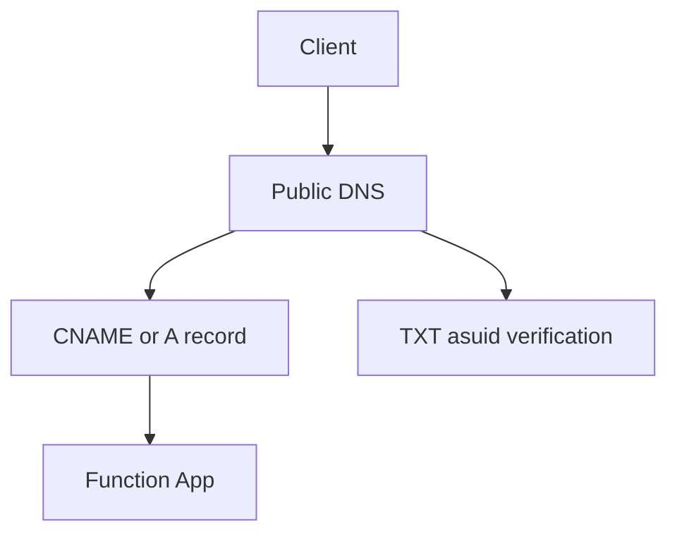
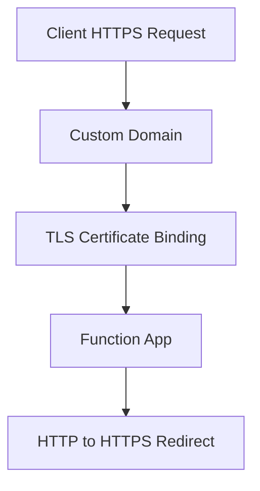

---
content_sources:

  references:
    - type: mslearn-adapted
      url: https://learn.microsoft.com/en-us/azure/app-service/app-service-web-tutorial-custom-domain
    - type: mslearn-adapted
      url: https://learn.microsoft.com/en-us/azure/app-service/configure-ssl-certificate
  diagrams:
    - id: architecture
      type: flowchart
      source: self-generated
      justification: Flow view of architecture, synthesized from Microsoft Learn documentation cited on this page.
      based_on:
        - https://learn.microsoft.com/en-us/azure/app-service/app-service-web-tutorial-custom-domain
        - https://learn.microsoft.com/en-us/azure/app-service/configure-ssl-certificate
        - https://learn.microsoft.com/en-us/azure/azure-functions/functions-scale
    - id: architecture-2
      type: flowchart
      source: self-generated
      justification: Flow view of architecture 2, synthesized from Microsoft Learn documentation cited on this page.
      based_on:
        - https://learn.microsoft.com/en-us/azure/app-service/app-service-web-tutorial-custom-domain
        - https://learn.microsoft.com/en-us/azure/app-service/configure-ssl-certificate
        - https://learn.microsoft.com/en-us/azure/app-service/configure-ssl-bindings
        - https://learn.microsoft.com/en-us/azure/azure-functions/flex-consumption-plan
        - https://learn.microsoft.com/en-us/azure/azure-functions/functions-scale
---
# Custom Domains and Certificates

Azure Function Apps support custom domains similarly to Azure App Service. For this Python v2 recipe, the app runs on Linux; the figures summarize DNS and TLS configuration, not a packet-by-packet request sequence.

## Architecture

<!-- diagram-id: architecture -->


<!-- diagram-id: architecture-2 -->


**Reading key:** TXT verifies ownership; it does not carry application requests. For Linux Consumption, custom-domain mapping uses CNAME; Premium and Dedicated support CNAME or A records. A CNAME subdomain is the example used here. TLS binding secures that hostname; HTTPS-only redirects HTTP requests separately. [Functions hosting/certificate support](https://learn.microsoft.com/en-us/azure/azure-functions/functions-scale#certificates) lists managed certificates for Consumption, Flex Consumption, Premium and Dedicated, subject to certificate prerequisites. Flex uses [site-scoped certificates](https://learn.microsoft.com/en-us/azure/azure-functions/flex-consumption-plan#considerations), rather than the webspace-scoped model used by the other three plans; do not assume the CLI provisioning steps below apply to Flex unchanged. For Dedicated in App Service Environment, [free App Service managed certificates are excluded](https://learn.microsoft.com/en-us/azure/app-service/configure-ssl-certificate#create-a-free-managed-certificate).

## Prerequisites

- An Azure Function App deployed and running.
- DNS zone control for your domain (for TXT and CNAME/A record creation).
- Premium or Dedicated plan recommended for broader custom domain options.
- Azure CLI authenticated with permissions for the resource group.

> **Note:** This recipe uses a CNAME-based subdomain; do not infer root/apex support from that example. Consumption supports CNAME only; Premium and Dedicated also support A records.

## Configure Custom Domain

1. Get the custom domain verification ID used for TXT validation:

```bash
az functionapp show \
  --name $APP_NAME \
  --resource-group $RG \
  --query customDomainVerificationId \
  --output tsv
```

| CLI element | Explanation |
|---|---|
| Command(s) | `az functionapp show` |
| Key flags | `--name`, `--resource-group`, `--query`, `--output` |
| Variables | `$APP_NAME`, `$RG` |
| Expected result | Azure CLI returns the requested resource data; verify names, IDs, status fields, or metric values match the scenario. |


2. Add DNS records at your DNS provider:
    - TXT record: `asuid.<subdomain>` with the verification ID from step 1
    - CNAME record for subdomain mapping (or A record where supported by plan and DNS scenario)

3. Add the hostname to the Function App:

```bash
az functionapp config hostname add \
  --name $APP_NAME \
  --resource-group $RG \
  --hostname api.contoso.com
```

| CLI element | Explanation |
|---|---|
| Command(s) | `az functionapp config hostname add` |
| Key flags | `--name`, `--resource-group`, `--hostname` |
| Variables | `$APP_NAME`, `$RG` |
| Expected result | Azure CLI applies the configuration change; confirm the returned JSON or follow-up query shows the expected value. |


## Create Managed Certificate

Create and bind an App Service managed certificate to the custom domain:

```bash
az functionapp config ssl create \
  --resource-group $RG \
  --name $APP_NAME \
  --hostname api.contoso.com

az functionapp config ssl bind \
  --resource-group $RG \
  --name $APP_NAME \
  --certificate-thumbprint <thumbprint> \
  --ssl-type SNI
```

| CLI element | Explanation |
|---|---|
| Command(s) | `az functionapp config ssl create`, `az functionapp config ssl bind` |
| Key flags | `--resource-group`, `--name`, `--hostname`, `--certificate-thumbprint`, `--ssl-type` |
| Variables | `$RG`, `$APP_NAME` |
| Expected result | Azure CLI returns provisioning details; confirm the resource name and successful provisioning state before continuing. |


## Enforce HTTPS

```bash
az functionapp update \
  --resource-group $RG \
  --name $APP_NAME \
  --set httpsOnly=true
```

| CLI element | Explanation |
|---|---|
| Command(s) | `az functionapp update` |
| Key flags | `--resource-group`, `--name`, `--set` |
| Variables | `$RG`, `$APP_NAME` |
| Expected result | Azure CLI applies the configuration change; confirm the returned JSON or follow-up query shows the expected value. |


## Plan Limitations

| Feature | Consumption | Flex Consumption | Premium | Dedicated |
|---------|-------------|------------------|---------|-----------|
| Custom domain | CNAME only | CNAME subdomain example | A + CNAME | A + CNAME |
| Managed certificate | Yes, subject to prerequisites | Yes, site-scoped | Yes, subject to prerequisites | Yes, subject to prerequisites; free ASMC excludes ASE |
| IP-based SSL | No | Yes, per hosting limits | Yes | Standard tier or higher |

!!! note "Flex Consumption certificate model"
    Current Microsoft Learn documents site-scoped certificates, including managed and App Service certificates, and end-to-end TLS for Flex Consumption. Certificate access from code uses a per-certificate toggle rather than `WEBSITE_LOAD_CERTIFICATES`. Follow the [Flex configuration guidance](https://learn.microsoft.com/en-us/azure/azure-functions/flex-consumption-how-to#configure-site-scoped-certificates) for provisioning instead of assuming the webspace certificate commands are interchangeable.

## Verification

- Confirm hostname binding:

```bash
az functionapp config hostname list \
  --webapp-name $APP_NAME \
  --resource-group $RG
```

| CLI element | Explanation |
|---|---|
| Command(s) | `az functionapp config hostname list` |
| Key flags | `--webapp-name`, `--resource-group` |
| Variables | `$APP_NAME`, `$RG` |
| Expected result | Azure CLI applies the configuration change; confirm the returned JSON or follow-up query shows the expected value. |


- Confirm HTTPS-only is enabled:

```bash
az functionapp show \
  --name $APP_NAME \
  --resource-group $RG \
  --query httpsOnly
```

| CLI element | Explanation |
|---|---|
| Command(s) | `az functionapp show` |
| Key flags | `--name`, `--resource-group`, `--query` |
| Variables | `$APP_NAME`, `$RG` |
| Expected result | Azure CLI returns the requested resource data; verify names, IDs, status fields, or metric values match the scenario. |


- Validate TLS in browser or with curl:

```bash
curl --head https://api.contoso.com
```

## Troubleshooting

| Symptom | Cause | Fix |
|---------|-------|-----|
| Domain verification fails | Missing or incorrect `asuid` TXT record | Recheck TXT record name and value; wait for DNS propagation |
| Hostname cannot be added | DNS record does not point to Function App | Validate CNAME/A mapping and retry |
| TLS certificate not issued | Domain not fully validated | Confirm hostname binding and DNS resolution first |
| HTTP still accessible | HTTPS-only not enabled | Run `az functionapp update --set httpsOnly=true` |

## See Also

- [Recipes Index](index.md)
- [Python Language Guide](../index.md)
- [Platform: Networking](../../../platform/networking.md)
- [Platform: Security](../../../platform/security.md)

## Sources
- [Map a custom domain to App Service (Microsoft Learn)](https://learn.microsoft.com/en-us/azure/app-service/app-service-web-tutorial-custom-domain)
- [Add and manage TLS/SSL certificates in App Service (Microsoft Learn)](https://learn.microsoft.com/en-us/azure/app-service/configure-ssl-certificate)
