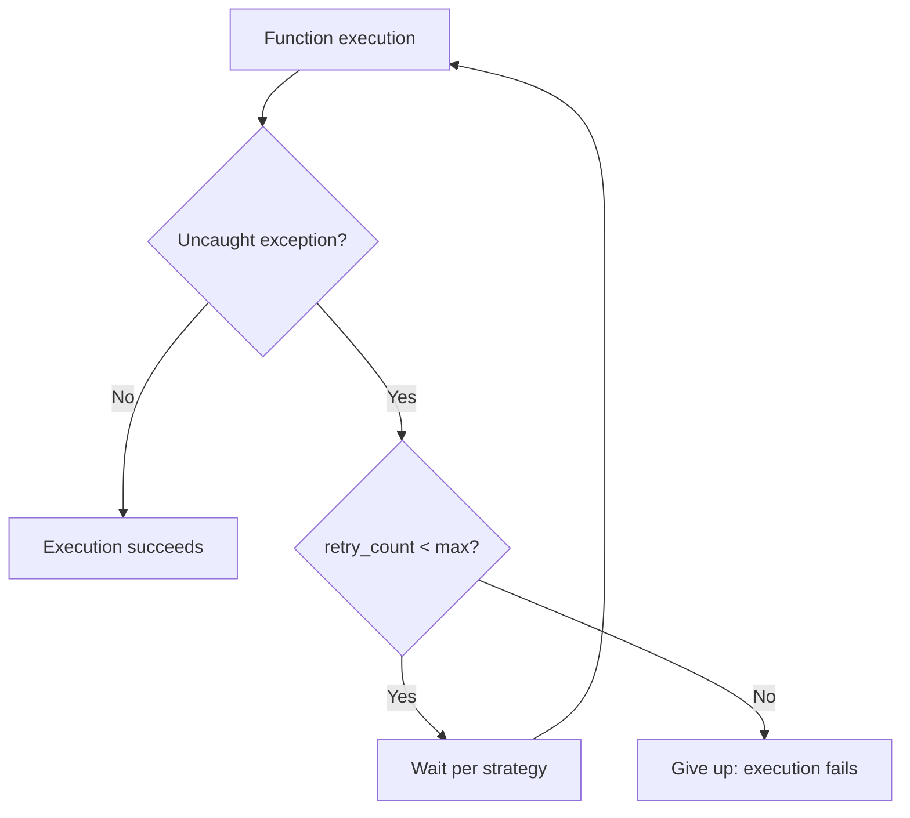

---
content_sources:
  references:
    - type: mslearn-adapted
      url: https://learn.microsoft.com/en-us/azure/azure-functions/functions-bindings-error-pages
  diagrams:
    - id: architecture
      type: flowchart
      source: self-generated
      justification: Flow view of architecture, synthesized from Microsoft Learn documentation cited on this page.
      based_on:
        - https://learn.microsoft.com/en-us/azure/azure-functions/functions-bindings-error-pages
---
# Retry Policies

Azure Functions runtime-enforced retry policies rerun a failed execution until it succeeds or the maximum retry count is reached. In the Python v2 model you attach a policy with the `@app.retry` decorator. Retry policies are only supported for a specific set of trigger types; other triggers rely on their own built-in retry behavior.

## Supported Triggers

Runtime retry policies apply only to these triggers:

| Trigger | Retry source |
|---|---|
| Timer | Retry policies |
| Event Hubs | Retry policies |
| Azure Cosmos DB | Retry policies |
| Kafka | Retry policies |

Queue Storage, Blob Storage, and Service Bus triggers do **not** use retry policies — they retry through their own binding extensions (poison-queue handling, `maxDeliveryCount`, dead-lettering). HTTP triggers have no automatic retry; the caller must retry.

## Architecture

<!-- diagram-id: architecture -->


## Fixed Delay

A fixed amount of time elapses between each retry. **Runnable example:** save this complete Python v2 example as `function_app.py` in a Functions project with `azure-functions` installed, `host.json`, and a valid `AzureWebJobsStorage` setting (Azurite can be used locally). Start the host with `func start`.

The simulated dependency fails twice by default, then succeeds on attempt 3. Set the environment variable `SIMULATED_FAILURES=4` to keep it failing through the final attempt, or `SIMULATED_FAILURES=0` for immediate success. This count-based simulation is for demonstration only: production success must depend on the actual operation completing, not the retry counter.

```python
import logging
import os

import azure.functions as func

app = func.FunctionApp()


@app.timer_trigger(schedule="0 */5 * * * *", arg_name="mytimer",
                   run_on_startup=False, use_monitor=False)
@app.retry(strategy="fixed_delay", max_retry_count="3",
           delay_interval="00:00:10")
def scheduled_job(mytimer: func.TimerRequest, context: func.Context) -> None:
    retry = context.retry_context
    retry_count = retry.retry_count
    fields = {"retry_count": retry_count, "attempt": retry_count + 1}
    try:
        if retry_count < int(os.environ.get("SIMULATED_FAILURES", "2")):
            raise ConnectionError("Simulated dependency unavailable")
    except ConnectionError:
        terminal = 0 <= retry.max_retry_count <= retry_count
        logging.exception("scheduled_job failed", extra={**fields, "terminal": terminal})
        raise
    logging.info("scheduled_job completed", extra=fields)
```

The exception is re-raised on **every failed attempt**, including the last. The host decides whether another retry is allowed. Logging an error and returning normally would report success without completing the work. Return normally only after success, or after deliberately and durably recording the failed work for a separate recovery workflow; a log entry alone is not durable failure handling.

### Retry Count Versus Attempt Count

`context` is supplied by the Python worker; do not add a binding for it. With this retry policy, `context.retry_context.retry_count` is `0` on the initial execution and increases on retries. The human-readable attempt number is `retry_count + 1`. `max_retry_count="3"` allows the initial execution plus up to three retries, not three total attempts.

| Attempt | `retry_count` | Default simulation | Persistent failure (`SIMULATED_FAILURES=4`) |
|---|---|---|---|
| 1 | 0 | Raises; eligible for retry | Raises; eligible for retry |
| 2 | 1 | Raises; eligible for retry | Raises; eligible for retry |
| 3 | 2 | Completes successfully; retries stop | Raises; eligible for retry |
| 4 | 3 | Not needed | Raises; retry budget exhausted, execution remains failed |

For this **Timer** sample, exhaustion ends the retries for that scheduled execution; the normal future schedule is separate, not a replay queue. Timer has no automatic poison queue or dead-letter queue (DLQ). Alert on failures and arrange explicit recovery for unfinished scheduled work.

For **Event Hubs**, retries hold up progress on the affected partition and checkpoints are not written until the retry policy finishes. After exhaustion, processing can advance despite the failed work; raising on the final attempt preserves the failure signal but does **not** guarantee indefinite replay or create a DLQ. Implement durable capture of failed events and a replay process when required. See [Reliable event processing](https://learn.microsoft.com/en-us/azure/azure-functions/functions-reliable-event-processing).

## Exponential Backoff

The first retry waits the minimum interval; each subsequent retry adds time exponentially (with small randomization) up to the maximum interval. **Intentionally abbreviated decorator fragment:** not standalone Python. To use it with the complete example above, replace only the `@app.retry(...)` decorator; keep the same function body and its success/failure behavior:

```python
@app.retry(strategy="exponential_backoff", max_retry_count="5",
            minimum_interval="00:00:10", maximum_interval="00:15:00")
```

## Policy Properties

| Property | Description |
|---|---|
| `strategy` | Required. `fixed_delay` or `exponential_backoff`. |
| `max_retry_count` | Required. Max retries per execution. `-1` retries indefinitely. |
| `delay_interval` | Fixed-delay interval, format `HH:mm:ss`. |
| `minimum_interval` | Exponential-backoff minimum delay, format `HH:mm:ss`. |
| `maximum_interval` | Exponential-backoff maximum delay, format `HH:mm:ss`. |

!!! warning "Max retry count is best-effort"
    The retry count is stored in instance memory. If the instance fails between retries, the count is lost — Event Hubs resumes on a new instance with the count reset, while Timer does not resume. Design your functions to be idempotent.

!!! note "Event Hubs checkpoint behavior"
    Event Hubs checkpoints are not written until the retry policy finishes, so progress on that partition is paused while retries run. Finishing the policy does not imply successful processing of every event.

## Verification

**Documentation/source review:** the linked Microsoft Learn guidance describes retry policies and checkpoint behavior. That review is not evidence of executing this sample in Azure.

**Local tests:** from the repository root, run:

```bash
uv run --with pytest --with azure-functions pytest tests/test_retry_recipe.py -q
```

The tests execute the fixed-delay code block with the real Python SDK and spec-constrained mocks for Timer/context metadata. They check transient exceptions, success after retry, failure through exhaustion, failure/success log records, and decorator indexing. They supply retry counts explicitly: they do not run a host retry loop or prove Azure telemetry ingestion, timing, restart behavior, checkpoint advancement, or poison/DLQ delivery.

**Actual Azure execution:** not performed for this change. In a deployment, verify failed/successful invocation status as well as logs; confirm the default recovery case and persistent-failure case separately. Custom logging fields are asserted locally, not guaranteed to appear as Application Insights dimensions without telemetry configuration. No Azure validation date or passing deployment status is recorded here.

## See Also

- [Event Hubs](event-hub.md)
- [Timer Trigger](timer.md)
- [Operations: Retries and Poison Handling](../../../operations/retries-and-poison-handling.md)

## Sources

- [Azure Functions error handling and retry guidance (Microsoft Learn)](https://learn.microsoft.com/en-us/azure/azure-functions/functions-bindings-error-pages)
- [Reliable event processing with Azure Functions and Event Hubs](https://learn.microsoft.com/en-us/azure/azure-functions/functions-reliable-event-processing)
