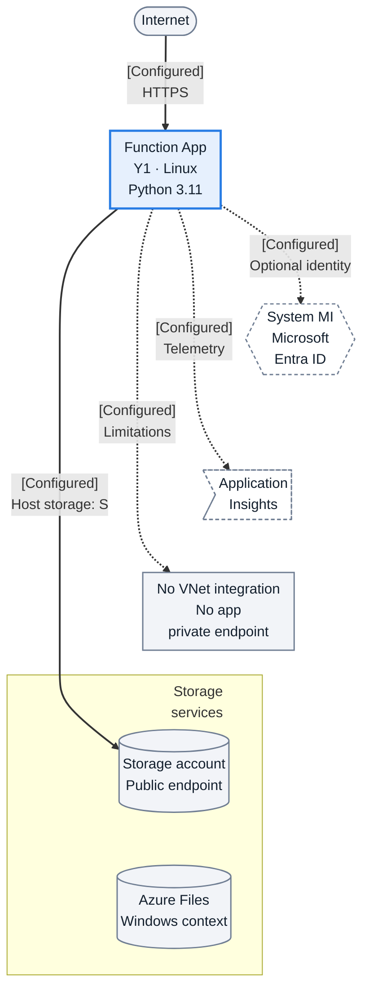
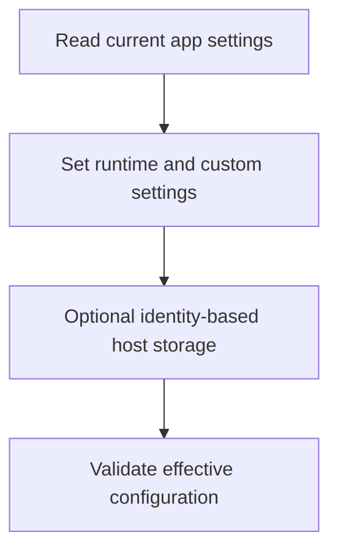

---
validation:
  az_cli:
    last_tested: 2026-04-09
    cli_version: 2.83.0
    core_tools_version: 4.8.0
    result: pass
  bicep:
    last_tested:
    result: not_tested
content_sources:

  references:
    - type: mslearn-adapted
      url: https://learn.microsoft.com/en-us/azure/azure-functions/functions-app-settings
    - type: mslearn-adapted
      url: https://learn.microsoft.com/en-us/azure/azure-functions/functions-reference#connecting-to-host-storage-with-an-identity
    - type: mslearn-adapted
      url: https://learn.microsoft.com/en-us/azure/azure-functions/functions-host-json
  diagrams:
    - id: what-you-ll-build
      type: flowchart
      source: self-generated
      justification: Intended Python Linux Y1 access and configuration context; Azure Files is retained as Windows context, not execution evidence or a Linux dependency.
      based_on:
        - https://learn.microsoft.com/en-us/azure/azure-functions/functions-reference-python
        - https://learn.microsoft.com/en-us/azure/azure-functions/storage-considerations
        - https://learn.microsoft.com/en-us/azure/azure-functions/manage-connections
        - https://learn.microsoft.com/en-us/azure/azure-functions/functions-networking-options
        - https://learn.microsoft.com/en-us/azure/app-service/overview-managed-identity
        - https://learn.microsoft.com/en-us/azure/azure-functions/functions-monitoring
        - https://learn.microsoft.com/en-us/azure/azure-functions/functions-app-settings
        - https://learn.microsoft.com/en-us/azure/azure-functions/functions-reference#connecting-to-host-storage-with-an-identity
        - https://learn.microsoft.com/en-us/azure/azure-functions/functions-host-json
    - id: what-you-ll-build-2
      type: flowchart
      source: self-generated
      justification: Flow view of what you ll build 2, synthesized from Microsoft Learn documentation cited on this page.
      based_on:
        - https://learn.microsoft.com/en-us/azure/azure-functions/functions-app-settings
        - https://learn.microsoft.com/en-us/azure/azure-functions/functions-reference#connecting-to-host-storage-with-an-identity
        - https://learn.microsoft.com/en-us/azure/azure-functions/functions-host-json
---
# 03 - Configuration (Consumption)

Configure your deployed Consumption (Y1) function app using classic `siteConfig.appSettings` semantics and CLI app settings commands.

## Prerequisites

| Tool | Version | Purpose |
|------|---------|---------|
| Azure CLI | 2.61+ | Manage function app settings |
| Deployed Function App | Y1 | Target app from tutorial 02 |
| Storage account | Standard_LRS | Runtime state and triggers |

## What You'll Build

You will configure core app settings for a Linux Consumption Function App, including storage and observability-related values, and validate the app configuration state.

!!! info "Infrastructure Context"
    **Plan**: Consumption (Y1) | **Network**: Public internet only | **VNet**: ❌ Not supported

    Linux Consumption (Y1) supports neither outbound VNet integration nor a private endpoint for the app. This tutorial starts with public Storage endpoints and connection-string host storage; managed identity is an alternative, not an additional connection string. Azure Files below is Windows Consumption context, not a Linux content-share requirement.

    <!-- diagram-id: what-you-ll-build -->


**Reading key (Linux Y1):** Solid arrows show intended request/data access; dotted arrows show identity, telemetry or a limitation association, not data-transit hops. S = `AzureWebJobsStorage` connection string **or** `AzureWebJobsStorage__accountName` with `AzureWebJobsStorage__credential=managedidentity` and appropriate permissions. For identity-based host storage on Linux Consumption, remote-build artifacts require an external deployment package. The Azure Files content-share default applies to Windows Consumption, not the Linux deployment shown here ([connections](https://learn.microsoft.com/en-us/azure/azure-functions/manage-connections), [storage](https://learn.microsoft.com/en-us/azure/azure-functions/storage-considerations)). Token acquisition uses the app's local managed-identity endpoint, not a direct app-to-Entra network hop ([identity](https://learn.microsoft.com/en-us/azure/app-service/overview-managed-identity)).

<!-- diagram-id: what-you-ll-build-2 -->


## Steps

### Step 1 - Set variables

```bash
export RG="rg-func-consumption-demo"
export APP_NAME="func-consumption-demo-001"
export STORAGE_NAME="stconsumptiondemo001"
export LOCATION="koreacentral"
```

### Step 2 - Read current app settings

```bash
az functionapp config appsettings list \
  --name "$APP_NAME" \
  --resource-group "$RG"
```

| CLI element | Explanation |
|---|---|
| Command(s) | `az functionapp config appsettings list` |
| Key flags | `--name`, `--resource-group` |
| Variables | `$APP_NAME`, `$RG` |
| Expected result | Azure CLI applies the configuration change; confirm the returned JSON or follow-up query shows the expected value. |


### Step 3 - Set required and custom app settings

```bash
az functionapp config appsettings set \
  --name "$APP_NAME" \
  --resource-group "$RG" \
  --settings \
    "FUNCTIONS_WORKER_RUNTIME=python" \
    "AzureWebJobsStorage=DefaultEndpointsProtocol=https;AccountName=$STORAGE_NAME;AccountKey=<masked-key>;EndpointSuffix=core.windows.net" \
    "APP_ENV=production" \
    "LOG_LEVEL=Information"
```

| CLI element | Explanation |
|---|---|
| Command(s) | `az functionapp config appsettings set` |
| Key flags | `--name`, `--resource-group`, `--settings` |
| Variables | `$APP_NAME`, `$RG`, `$STORAGE_NAME` |
| Expected result | Azure CLI applies the configuration change; confirm the returned JSON or follow-up query shows the expected value. |


For Consumption, app settings are handled as classic app settings (backed by `siteConfig.appSettings`), not the Flex-specific configuration model.

### Step 4 - Optional: identity-based host storage pattern

Instead of a connection string, you can configure identity-based host storage values (both models are valid on Consumption). On Linux Consumption, content share settings are still required and continue to use a shared-key-backed `WEBSITE_CONTENTAZUREFILECONNECTIONSTRING` with `WEBSITE_CONTENTSHARE`.

```bash
az functionapp config appsettings set \
  --name "$APP_NAME" \
  --resource-group "$RG" \
  --settings \
    "AzureWebJobsStorage__accountName=$STORAGE_NAME" \
    "AzureWebJobsStorage__credential=managedidentity"
```

| CLI element | Explanation |
|---|---|
| Command(s) | `az functionapp config appsettings set` |
| Key flags | `--name`, `--resource-group`, `--settings` |
| Variables | `$APP_NAME`, `$RG`, `$STORAGE_NAME` |
| Expected result | Azure CLI applies the configuration change; confirm the returned JSON or follow-up query shows the expected value. |


!!! warning "Identity-based storage requires Managed Identity and RBAC"
    Before using identity-based host storage, you must:

    1. Enable system-assigned managed identity on the Function App: `az functionapp identity assign --name "$APP_NAME" --resource-group "$RG"`
    2. Grant required data-plane roles on the storage account scope: `Storage Blob Data Owner`, `Storage Queue Data Contributor`, and `Storage Table Data Contributor`.
    3. Keep content share settings configured (`WEBSITE_CONTENTAZUREFILECONNECTIONSTRING` and `WEBSITE_CONTENTSHARE`) for Linux Consumption.
    4. Set both `AzureWebJobsStorage__accountName` and `AzureWebJobsStorage__credential=managedidentity` app settings.


### Step 5 - Confirm runtime limits relevant to configuration

- Consumption defaults to a 5-minute timeout and supports up to 10 minutes.
- Memory is fixed at 1.5 GB per instance.
- Scaling is automatic and event-driven on Consumption.
- Maximum scale-out is up to 100 instances on Linux Consumption (up to 200 on Windows Consumption).
- No always-ready instances are available; cold start is typically more noticeable than Premium.

## Verification

Verify the updated settings are applied:

```bash
az functionapp config appsettings list \
  --name "$APP_NAME" \
  --resource-group "$RG" \
  --output table
```

| CLI element | Explanation |
|---|---|
| Command(s) | `az functionapp config appsettings list` |
| Key flags | `--name`, `--resource-group`, `--output` |
| Variables | `$APP_NAME`, `$RG` |
| Expected result | Azure CLI applies the configuration change; confirm the returned JSON or follow-up query shows the expected value. |


App settings update excerpt (values are hidden by the platform for security):
```json
[
  {
    "name": "FUNCTIONS_WORKER_RUNTIME",
    "slotSetting": false,
    "value": null
  },
  {
    "name": "AzureWebJobsStorage",
    "slotSetting": false,
    "value": null
  },
  {
    "name": "APP_ENV",
    "slotSetting": false,
    "value": null
  }
]
```

Verify the app is running:

```bash
az functionapp show \
  --name "$APP_NAME" \
  --resource-group "$RG" \
  --query "{id:id,kind:kind,state:state}" \
  --output json
```

| CLI element | Explanation |
|---|---|
| Command(s) | `az functionapp show` |
| Key flags | `--name`, `--resource-group`, `--query`, `--output` |
| Variables | `$APP_NAME`, `$RG` |
| Expected result | Azure CLI returns the requested resource data; verify names, IDs, status fields, or metric values match the scenario. |


App details excerpt:

## Next Steps

Now enable operational visibility with logs and monitoring.

> **Next:** [04 - Logging and Monitoring](04-logging-monitoring.md)

## See Also

- [Tutorial Overview & Plan Chooser](../index.md)
- [Python Language Guide](../../index.md)
- [Platform: Hosting Plans](../../../../platform/hosting.md)
- [Operations: Deployment](../../../../operations/deployment.md)
- [Recipes Index](../../recipes/index.md)

## Sources

- [App settings reference for Azure Functions](https://learn.microsoft.com/en-us/azure/azure-functions/functions-app-settings)
- [Identity-based host storage for Azure Functions](https://learn.microsoft.com/en-us/azure/azure-functions/functions-reference#connecting-to-host-storage-with-an-identity)
- [host.json reference](https://learn.microsoft.com/en-us/azure/azure-functions/functions-host-json)
