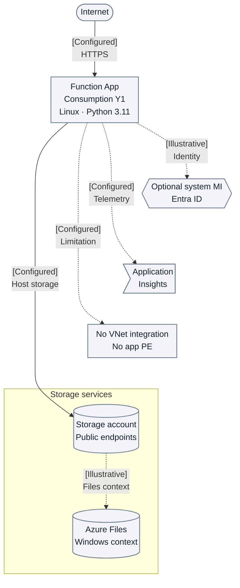
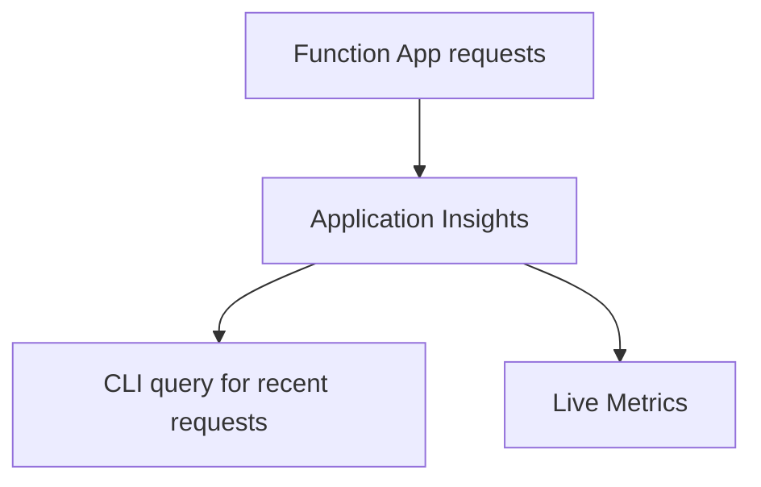

---
validation:
  az_cli:
    last_tested: 2026-04-09
    cli_version: 2.83.0
    core_tools_version: 4.8.0
    result: pass
  bicep:
    last_tested:
    result: not_tested
content_sources:

  references:
    - type: mslearn-adapted
      url: https://learn.microsoft.com/en-us/azure/azure-functions/monitor-functions
    - type: mslearn-adapted
      url: https://learn.microsoft.com/en-us/cli/azure/monitor/app-insights?view=azure-cli-latest
    - type: mslearn-adapted
      url: https://learn.microsoft.com/en-us/cli/azure/webapp/log
  diagrams:
    - id: what-you-ll-build
      type: flowchart
      source: self-generated
      justification: Python Linux plan-specific infrastructure context with full adjacent reading key; not deployment evidence.
      based_on:
        - https://learn.microsoft.com/en-us/azure/azure-functions/monitor-functions
        - https://learn.microsoft.com/en-us/cli/azure/monitor/app-insights?view=azure-cli-latest
        - https://learn.microsoft.com/en-us/cli/azure/webapp/log
        - https://learn.microsoft.com/en-us/azure/azure-functions/functions-reference-python
        - https://learn.microsoft.com/en-us/azure/azure-functions/configure-monitoring
        - https://learn.microsoft.com/en-us/azure/azure-functions/streaming-logs
        - https://learn.microsoft.com/en-us/azure/azure-functions/functions-networking-options
        - https://learn.microsoft.com/en-us/azure/azure-functions/storage-considerations
        - https://learn.microsoft.com/en-us/azure/azure-monitor/app/create-workspace-resource
        - https://learn.microsoft.com/en-us/azure/app-service/overview-managed-identity
        - https://learn.microsoft.com/en-us/azure/app-service/overview-access-restrictions#app-access
        - https://learn.microsoft.com/en-us/azure/azure-functions/deployment-zip-push
        - https://learn.microsoft.com/en-us/azure/azure-functions/opentelemetry-howto
        - https://learn.microsoft.com/en-us/azure/azure-functions/monitor-functions-reference
        - https://learn.microsoft.com/en-us/azure/azure-functions/functions-deployment-technologies
    - id: what-you-ll-build-2
      type: flowchart
      source: self-generated
      justification: Python plan-specific monitoring verification relationships; analysis arrows are not network-transit claims.
      based_on:
        - https://learn.microsoft.com/en-us/azure/azure-functions/monitor-functions
        - https://learn.microsoft.com/en-us/cli/azure/monitor/app-insights?view=azure-cli-latest
        - https://learn.microsoft.com/en-us/cli/azure/webapp/log
        - https://learn.microsoft.com/en-us/azure/azure-functions/functions-reference-python
        - https://learn.microsoft.com/en-us/azure/azure-functions/configure-monitoring
        - https://learn.microsoft.com/en-us/azure/azure-functions/streaming-logs
        - https://learn.microsoft.com/en-us/azure/azure-functions/functions-networking-options
        - https://learn.microsoft.com/en-us/azure/azure-functions/storage-considerations
        - https://learn.microsoft.com/en-us/azure/azure-monitor/app/create-workspace-resource
        - https://learn.microsoft.com/en-us/azure/app-service/overview-managed-identity
        - https://learn.microsoft.com/en-us/azure/app-service/overview-access-restrictions#app-access
        - https://learn.microsoft.com/en-us/azure/azure-functions/deployment-zip-push
        - https://learn.microsoft.com/en-us/azure/azure-functions/opentelemetry-howto
        - https://learn.microsoft.com/en-us/azure/azure-functions/monitor-functions-reference
        - https://learn.microsoft.com/en-us/azure/azure-functions/functions-deployment-technologies
---
# 04 - Logging and Monitoring (Consumption)

Set up baseline observability for a Consumption (Y1) Function App with Application Insights and CLI log queries.

## Prerequisites

| Tool | Version | Purpose |
|------|---------|---------|
| Azure CLI | 2.61+ | Configure diagnostics and query logs |
| Deployed Function App | Y1 | Existing app from tutorial 02 |
| Application Insights | Workspace-based | Telemetry destination |

## What You'll Build

You will connect the Function App to Application Insights, generate sample traffic, and verify request telemetry and use the separate Live Metrics view for a Linux Consumption deployment.

!!! info "Infrastructure Context"
    **Plan**: Consumption (Y1) | **Network**: Public internet only | **VNet**: ❌ Not supported

    Linux Consumption has no outbound VNet integration or app private endpoints. This example uses public Storage endpoints and a host-storage connection string; Azure Files below is Windows context, not a Linux content dependency.

    <!-- diagram-id: what-you-ll-build -->


**Reading key:** Solid arrows are request/data access; dotted arrows are contextual associations, not a route through identity or telemetry. `AzureWebJobsStorage` holds this example's connection string; `AzureWebJobsStorage__accountName` instead belongs to identity-based host configuration, not an additional connection-string component. The optional system identity uses the app-local token endpoint. Azure Files content shares apply to Windows Consumption context; this Linux remote-build path stores its package in Blob storage ([storage](https://learn.microsoft.com/en-us/azure/azure-functions/storage-considerations), [identity](https://learn.microsoft.com/en-us/azure/app-service/overview-managed-identity), [deployment](https://learn.microsoft.com/en-us/azure/azure-functions/functions-deployment-technologies)).

<!-- diagram-id: what-you-ll-build-2 -->


**Python telemetry:** With the default built-in integration enabled, Python `logging` records follow worker → Functions host → Application Insights, subject to filtering and sampling; `APPLICATIONINSIGHTS_CONNECTION_STRING` selects the destination ([Python reference](https://learn.microsoft.com/en-us/azure/azure-functions/functions-reference-python#logging-and-monitoring), [configuration](https://learn.microsoft.com/en-us/azure/azure-functions/configure-monitoring)). Workspace-based Application Insights stores telemetry in its linked Log Analytics workspace; `FunctionAppLogs` instead belongs to diagnostic-settings resource logs, not an intermediate worker-log hop ([workspace](https://learn.microsoft.com/en-us/azure/azure-monitor/app/create-workspace-resource), [resource logs](https://learn.microsoft.com/en-us/azure/azure-functions/monitor-functions#azure-monitor-resource-logs)).

This describes the default route, not every exporter in the reference app: `apps/python/config/telemetry.py` also attempts Azure Monitor distro setup with a named logger when a connection string is present. Python OpenTelemetry requires its own worker instrumentation/settings; it is not enabled merely by renaming a destination box ([Functions OpenTelemetry](https://learn.microsoft.com/en-us/azure/azure-functions/opentelemetry-howto)).

## Steps

### Step 1 - Set variables

```bash
export RG="rg-func-consumption-demo"
export APP_NAME="func-consumption-demo-001"
export STORAGE_NAME="stconsumptiondemo001"
export LOCATION="koreacentral"
```

### Step 2 - Create Application Insights

!!! tip "Auto-created Application Insights"
    When you create a Function App via `az functionapp create`, an Application Insights resource is often auto-created with the same name as the app. Check your resource group first with `az resource list --resource-group "$RG" --query "[?type=='Microsoft.Insights/components']" --output table`. If one already exists, skip this step and use its name in Step 3.

```bash
az monitor app-insights component create \
  --app "appi-func-consumption-demo" \
  --resource-group "$RG" \
  --location "$LOCATION" \
  --application-type web
```

| CLI element | Explanation |
|---|---|
| Command(s) | `az monitor app-insights component create` |
| Key flags | `--app`, `--resource-group`, `--location`, `--application-type` |
| Variables | `$RG`, `$LOCATION` |
| Expected result | Azure CLI returns provisioning details; confirm the resource name and successful provisioning state before continuing. |


### Step 3 - Link Function App to Application Insights

```bash
export APPINSIGHTS_CONNECTION_STRING=$(az monitor app-insights component show \
  --app "appi-func-consumption-demo" \
  --resource-group "$RG" \
  --query "connectionString" \
  --output tsv)

az functionapp config appsettings set \
  --name "$APP_NAME" \
  --resource-group "$RG" \
  --settings "APPLICATIONINSIGHTS_CONNECTION_STRING=$APPINSIGHTS_CONNECTION_STRING"
```

| CLI element | Explanation |
|---|---|
| Command(s) | `az monitor app-insights component show`, `az functionapp config appsettings set` |
| Key flags | `--app`, `--resource-group`, `--query`, `--output`, `--name`, `--settings` |
| Variables | `$RG`, `$APP_NAME`, `$APPINSIGHTS_CONNECTION_STRING` |
| Expected result | Azure CLI applies the configuration change; confirm the returned JSON or follow-up query shows the expected value. |


### Step 4 - Generate test traffic

For exception traffic only, complete [controlled lab endpoint setup](../../../../reference/lab-endpoint-safety.md) first (`LAB_ENDPOINTS_ENABLED=true` and a protected `FUNCTION_KEY`). Disable the switch and rotate the experiment key afterward; health remains anonymous.

```bash
curl --request GET "https://$APP_NAME.azurewebsites.net/api/health"
curl --request GET "https://$APP_NAME.azurewebsites.net/api/requests/log-levels"
curl --request GET --header "x-functions-key: $FUNCTION_KEY" "https://$APP_NAME.azurewebsites.net/api/exceptions/test-error"
```

### Step 5 - Query recent requests

```bash
az monitor app-insights query \
  --app "appi-func-consumption-demo" \
  --resource-group "$RG" \
  --analytics-query "requests | take 5 | project timestamp, name, resultCode, success" \
  --output table
```

| CLI element | Explanation |
|---|---|
| Command(s) | `az monitor app-insights query` |
| Key flags | `--app`, `--resource-group`, `--analytics-query`, `--output` |
| Variables | `$RG` |
| Expected result | Azure CLI returns the requested resource data; verify names, IDs, status fields, or metric values match the scenario. |


!!! tip "Telemetry ingestion delay"
    Application Insights has a 2-5 minute ingestion delay. If Step 5 returns empty results immediately after Step 4, wait a few minutes and retry.

### Step 6 - Live monitoring on Linux Consumption

Built-in log streaming is unavailable on Linux Consumption. Use the connected Application Insights Live Metrics view instead; the retained log-tail command and historical excerpt below are not supported verification for this Linux plan ([streaming methods](https://learn.microsoft.com/en-us/azure/azure-functions/streaming-logs)).

```bash
az webapp log tail \
  --name "$APP_NAME" \
  --resource-group "$RG"
```

| CLI element | Explanation |
|---|---|
| Command(s) | `az webapp log tail` |
| Key flags | `--name`, `--resource-group` |
| Variables | `$APP_NAME`, `$RG` |
| Expected result | Azure CLI completes successfully and returns JSON, table, or no output depending on the command; verify the next documented check before continuing. |


!!! tip "Cold start and log streaming"
    A Linux Consumption app can scale to zero; generate requests for live observations. Waking it does not enable the unsupported built-in log-tail method.

Use Application Insights queries and its separate Live Metrics view for this Linux Consumption scenario.
## Verification

Application Insights query output excerpt:

```text
Timestamp                    Name                    ResultCode    Success
---------------------------  ----------------------  ------------  --------
2026-04-03T09:37:10.123456Z GET /api/health         200           True
2026-04-03T09:37:13.012345Z GET /api/requests/...   200           True
2026-04-03T09:37:16.456789Z GET /api/exceptions/... 200           True
```

Log tail excerpt:

```text
2026-04-03T09:37:10.100Z  Executing 'Functions.health' (Reason='This function was programmatically called...')
2026-04-03T09:37:10.123Z  Executed 'Functions.health' (Succeeded, Duration=23ms)
2026-04-03T09:37:16.430Z  Executed 'Functions.test_error' (Succeeded, Duration=44ms)
```

## Next Steps

Use Infrastructure as Code to make this setup repeatable.

> **Next:** [05 - Infrastructure as Code](05-infrastructure-as-code.md)

## See Also

- [Tutorial Overview & Plan Chooser](../index.md)
- [Python Language Guide](../../index.md)
- [Platform: Hosting Plans](../../../../platform/hosting.md)
- [Operations: Deployment](../../../../operations/deployment.md)
- [Recipes Index](../../recipes/index.md)

## Sources

- [Functions deployment technologies](https://learn.microsoft.com/en-us/azure/azure-functions/functions-deployment-technologies)

- [Functions OpenTelemetry configuration](https://learn.microsoft.com/en-us/azure/azure-functions/opentelemetry-howto)
- [Functions monitoring data reference](https://learn.microsoft.com/en-us/azure/azure-functions/monitor-functions-reference)

- [functions-reference-python](https://learn.microsoft.com/en-us/azure/azure-functions/functions-reference-python)
- [configure-monitoring](https://learn.microsoft.com/en-us/azure/azure-functions/configure-monitoring)
- [streaming-logs](https://learn.microsoft.com/en-us/azure/azure-functions/streaming-logs)
- [functions-networking-options](https://learn.microsoft.com/en-us/azure/azure-functions/functions-networking-options)
- [storage-considerations](https://learn.microsoft.com/en-us/azure/azure-functions/storage-considerations)
- [create-workspace-resource](https://learn.microsoft.com/en-us/azure/azure-monitor/app/create-workspace-resource)
- [overview-managed-identity](https://learn.microsoft.com/en-us/azure/app-service/overview-managed-identity)
- [overview-access-restrictions](https://learn.microsoft.com/en-us/azure/app-service/overview-access-restrictions#app-access)
- [deployment-zip-push](https://learn.microsoft.com/en-us/azure/azure-functions/deployment-zip-push)

- [Monitor Azure Functions](https://learn.microsoft.com/en-us/azure/azure-functions/monitor-functions)
- [Application Insights query with Azure CLI](https://learn.microsoft.com/en-us/cli/azure/monitor/app-insights?view=azure-cli-latest)
- [Stream logs with Azure CLI](https://learn.microsoft.com/en-us/cli/azure/webapp/log)
