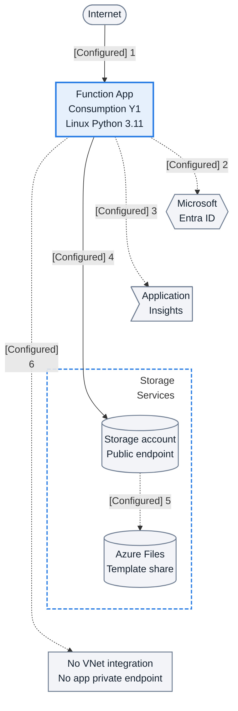
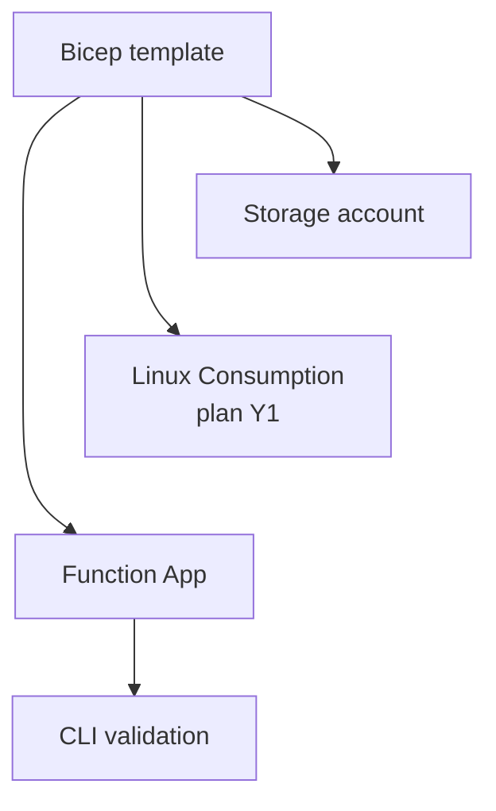

---
validation:
  az_cli:
    last_tested: 2026-04-09
    cli_version: 2.83.0
    core_tools_version: 4.8.0
    result: pass
  bicep:
    last_tested: '2026-06-06'
    result: syntax_validated
content_sources:

  references:
    - type: mslearn-adapted
      url: https://learn.microsoft.com/en-us/azure/azure-functions/functions-infrastructure-as-code
    - type: mslearn-adapted
      url: https://learn.microsoft.com/en-us/azure/azure-resource-manager/bicep/
    - type: mslearn-adapted
      url: https://learn.microsoft.com/en-us/azure/azure-functions/consumption-plan
  diagrams:
    - id: what-you-ll-build
      type: flowchart
      source: self-generated
      justification: Illustrative topology of the template's public Consumption configuration (public app and storage endpoints, identity, telemetry, Files content share) with no outbound VNet integration or inbound app private endpoint, not a measured trace or deployment evidence.
      based_on:
        - https://learn.microsoft.com/en-us/azure/azure-functions/supported-languages
        - https://learn.microsoft.com/en-us/azure/azure-functions/storage-considerations
        - https://learn.microsoft.com/en-us/azure/azure-functions/functions-networking-options
        - https://learn.microsoft.com/en-us/azure/app-service/overview-managed-identity
        - https://learn.microsoft.com/en-us/azure/azure-functions/functions-monitoring
        - https://learn.microsoft.com/en-us/azure/azure-functions/functions-deployment-technologies
        - https://learn.microsoft.com/en-us/azure/azure-functions/functions-infrastructure-as-code
        - https://learn.microsoft.com/en-us/azure/azure-resource-manager/bicep/
        - https://learn.microsoft.com/en-us/azure/azure-functions/consumption-plan
    - id: what-you-ll-build-2
      type: flowchart
      source: self-generated
      justification: Resource map of the Bicep template (storage, Linux Y1 plan, Function App) and CLI validation, arrows show template resources, not creation order.
      based_on:
        - https://learn.microsoft.com/en-us/azure/azure-resource-manager/bicep/overview
        - https://learn.microsoft.com/en-us/azure/azure-functions/functions-infrastructure-as-code
        - https://learn.microsoft.com/en-us/azure/azure-resource-manager/bicep/
        - https://learn.microsoft.com/en-us/azure/azure-functions/consumption-plan
---
# 05 - Infrastructure as Code (Consumption)

Define and deploy a complete Consumption (Y1) environment with Bicep. This plan is simpler than Flex: no VNet integration requirement, no private endpoints, and no mandatory managed identity (recommended for app access patterns).

## Prerequisites

| Tool | Version | Purpose |
|------|---------|---------|
| Azure CLI | 2.61+ | Run Bicep deployments |
| Bicep | latest | Author ARM resources as code |
| Target path | `infra/consumption/main.bicep` | Consumption IaC template location |

## What You'll Build

You will deploy storage, a Linux Consumption plan, and a Python Function App via Bicep, then validate the deployed app metadata with Azure CLI.

!!! info "Infrastructure Context"
    **Plan**: Consumption (Y1) | **Network**: Public internet only | **VNet**: ❌ Not supported

    Consumption has no outbound VNet integration or inbound app private endpoint support. This example uses public endpoints; the standalone snippet uses a host-storage connection string, while the repository template configures identity-based host storage.

<!-- diagram-id: what-you-ll-build -->


**Reading key:** Solid arrows show request/data access; dotted arrows identify identity, telemetry, configuration or a limitation, not extra data-transit hops. Python 3.11 is the template default, not a recommendation to change your runtime.

| Key | Relationship retained or clarified |
|---|---|
| 1 | HTTPS requests to the public Consumption app endpoint. |
| 2 | System-assigned managed identity in Microsoft Entra ID; token retrieval uses the app's managed-identity endpoint. |
| 3 | Telemetry to configured Application Insights, separate from request handling. |
| 4 | Host storage: the repository template uses `AzureWebJobsStorage__accountName` and `AzureWebJobsStorage__credential=managedidentity`; the standalone snippet below instead uses `AzureWebJobsStorage` with a connection string. These are alternative host connections, not combined credentials. |
| 5 | The repository template creates an Azure Files content share in the same account and supplies `WEBSITE_CONTENTSHARE` / `WEBSITE_CONTENTAZUREFILECONNECTIONSTRING` with shared-key access enabled. This template inventory does not imply Linux Consumption remote-build output runs from Files; that output is stored in Blob storage ([deployment technologies](https://learn.microsoft.com/en-us/azure/azure-functions/functions-deployment-technologies)). |
| 6 | Consumption lacks outbound VNet integration and inbound app private endpoints ([networking options](https://learn.microsoft.com/en-us/azure/azure-functions/functions-networking-options)). |

<!-- diagram-id: what-you-ll-build-2 -->


## Steps

### Step 1 - Set variables

```bash
export RG="rg-func-consumption-demo"
export APP_NAME="func-consumption-demo-001"
export STORAGE_NAME="stconsumptiondemo001"
export LOCATION="koreacentral"
```

### Step 2 - Create the resource group

```bash
az group create --name "$RG" --location "$LOCATION"
```

| CLI element | Explanation |
|---|---|
| Command(s) | `az group create` |
| Key flags | `--name`, `--location` |
| Variables | `$RG`, `$LOCATION` |
| Expected result | Azure CLI returns provisioning details; confirm the resource name and successful provisioning state before continuing. |


### Step 3 - Author `infra/consumption/main.bicep`

Use a Consumption plan resource with Y1/Dynamic SKU and classic app settings on the Function App:

```bicep
param location string = resourceGroup().location
param appName string
param storageName string

resource storage 'Microsoft.Storage/storageAccounts@2023-01-01' = {
  name: storageName
  location: location
  sku: {
    name: 'Standard_LRS'
  }
  kind: 'StorageV2'
}

resource plan 'Microsoft.Web/serverfarms@2023-12-01' = {
  name: 'asp-${appName}'
  location: location
  kind: 'linux'
  sku: {
    name: 'Y1'
    tier: 'Dynamic'
  }
  properties: {
    reserved: true
  }
}

resource app 'Microsoft.Web/sites@2023-12-01' = {
  name: appName
  location: location
  kind: 'functionapp,linux'
  properties: {
    serverFarmId: plan.id
    siteConfig: {
      linuxFxVersion: 'Python|3.11'
      appSettings: [
        {
          name: 'FUNCTIONS_EXTENSION_VERSION'
          value: '~4'
        }
        {
          name: 'FUNCTIONS_WORKER_RUNTIME'
          value: 'python'
        }
        {
          name: 'AzureWebJobsStorage'
          value: 'DefaultEndpointsProtocol=https;AccountName=${storage.name};AccountKey=${listKeys(storage.id, storage.apiVersion).keys[0].value};EndpointSuffix=${environment().suffixes.storage}'
        }
        {
          name: 'WEBSITE_CONTENTAZUREFILECONNECTIONSTRING'
          value: 'DefaultEndpointsProtocol=https;AccountName=${storage.name};AccountKey=${listKeys(storage.id, storage.apiVersion).keys[0].value};EndpointSuffix=${environment().suffixes.storage}'
        }
        {
          name: 'WEBSITE_CONTENTSHARE'
          value: toLower('cs-${appName}')
        }
      ]
    }
    httpsOnly: true
  }
}
!!! info "Simplified vs production template"
    The Bicep template above is a simplified standalone example for learning. The repository's production template at `infra/consumption/main.bicep` uses shared modules, identity-based host storage with RBAC role assignments, Application Insights, and a `baseName` parameter convention. For production deployments, use the full template.

To deploy using the repository's production template instead:

```bash
az deployment group create \
  --resource-group "$RG" \
  --template-file "infra/consumption/main.bicep" \
  --parameters baseName="func-consumption-demo"
```
| Command/Parameter | Purpose |
| --- | --- |
| `az deployment group create` | Deploy a Bicep/ARM template to a resource group. |
| `--resource-group` | Resource group that contains the resource. |
| `--template-file` | Path to the Bicep/ARM template. |
| `--parameters` | Template parameter values. |

### Step 4 - Deploy the Bicep template

```bash
az deployment group create \
  --resource-group "$RG" \
  --template-file "infra/consumption/main.bicep" \
  --parameters baseName="func-consumption-demo"
```
| Command/Parameter | Purpose |
| --- | --- |
| `az deployment group create` | Deploy a Bicep/ARM template to a resource group. |
| `--resource-group` | Resource group that contains the resource. |
| `--template-file` | Path to the Bicep/ARM template. |
| `--parameters` | Template parameter values. |

!!! tip "Parameter names"
    The simplified template above uses `appName` and `storageName` parameters. The production template at `infra/consumption/main.bicep` uses a single `baseName` parameter that derives all resource names automatically.

### Step 5 - Validate resulting host plan

```bash
az functionapp show \
  --name "$APP_NAME" \
  --resource-group "$RG" \
  --query "{kind:kind,state:state,defaultHostName:defaultHostName}" \
  --output json
```
| Command/Parameter | Purpose |
| --- | --- |
| `az functionapp show` | Show details of the function app. |
| `--name` | Name of the target resource. |
| `--resource-group` | Resource group that contains the resource. |
| `--query` | JMESPath query selecting fields from the response. |
| `--output` | Output format. |

!!! info "Not available on Consumption"
    VNet integration requires Flex Consumption, Premium, or Dedicated plan.

!!! info "Not available on Consumption"
    Private endpoints require Flex Consumption, Premium, or Dedicated plan.

## Verification

Deployment output excerpt:

```json
{
  "id": "/subscriptions/<subscription-id>/resourceGroups/rg-func-consumption-demo/providers/Microsoft.Resources/deployments/main",
  "name": "main",
  "properties": {
    "provisioningState": "Succeeded"
  }
}
```

Function app validation output:

```json
{
  "defaultHostName": "func-consumption-demo-001.azurewebsites.net",
  "kind": "functionapp,linux",
  "state": "Running"
}
```

## Next Steps

Automate deployments in CI/CD with GitHub Actions.

> **Next:** [06 - CI/CD](06-ci-cd.md)

## See Also

- [Tutorial Overview & Plan Chooser](../index.md)
- [Python Language Guide](../../index.md)
- [Platform: Hosting Plans](../../../../platform/hosting.md)
- [Operations: Deployment](../../../../operations/deployment.md)
- [Recipes Index](../../recipes/index.md)

## Sources

- [Bicep for Azure Functions](https://learn.microsoft.com/en-us/azure/azure-functions/functions-infrastructure-as-code)
- [Bicep language reference](https://learn.microsoft.com/en-us/azure/azure-resource-manager/bicep/)
- [Azure Functions Consumption plan](https://learn.microsoft.com/en-us/azure/azure-functions/consumption-plan)
- [Python version and operating-system support](https://learn.microsoft.com/en-us/azure/azure-functions/supported-languages)
- [Storage considerations](https://learn.microsoft.com/en-us/azure/azure-functions/storage-considerations)
- [Networking options](https://learn.microsoft.com/en-us/azure/azure-functions/functions-networking-options)
- [Managed identities](https://learn.microsoft.com/en-us/azure/app-service/overview-managed-identity)
- [Functions monitoring](https://learn.microsoft.com/en-us/azure/azure-functions/functions-monitoring)
