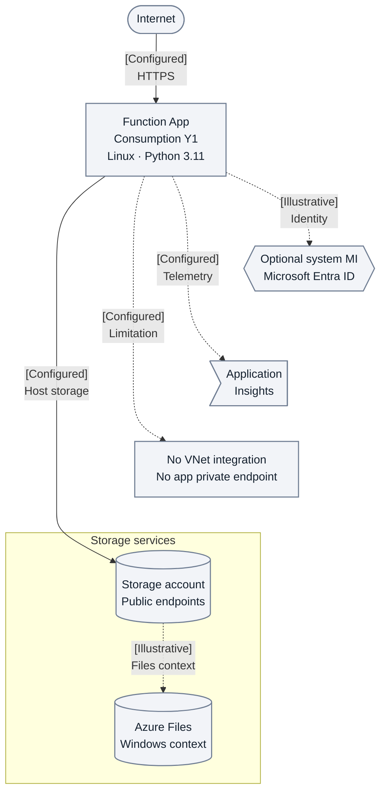
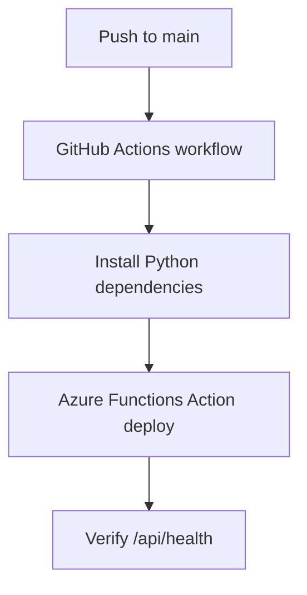

---
validation:
  az_cli:
    last_tested: 2026-04-09
    cli_version: 2.83.0
    core_tools_version: 4.8.0
    result: pass
  bicep:
    last_tested:
    result: not_tested
content_sources:

  references:
    - type: mslearn-adapted
      url: https://learn.microsoft.com/en-us/azure/azure-functions/functions-how-to-github-actions
    - type: mslearn-adapted
      url: https://learn.microsoft.com/en-us/azure/azure-functions/deployment-zip-push
    - type: mslearn-adapted
      url: https://learn.microsoft.com/en-us/azure/azure-functions/functions-how-to-github-actions#download-your-publish-profile
  diagrams:
    - id: what-you-ll-build
      type: flowchart
      source: self-generated
      justification: Logical Linux Y1 storage context; identity and Windows Files context are not data-transit dependencies of this Python deployment.
      based_on:
        - https://learn.microsoft.com/en-us/azure/azure-functions/functions-how-to-github-actions
        - https://learn.microsoft.com/en-us/azure/azure-functions/deployment-zip-push
        - https://learn.microsoft.com/en-us/azure/azure-functions/functions-how-to-github-actions#download-your-publish-profile
        - https://learn.microsoft.com/en-us/azure/azure-functions/storage-considerations
        - https://learn.microsoft.com/en-us/azure/azure-functions/functions-networking-options
        - https://learn.microsoft.com/en-us/azure/app-service/overview-managed-identity
        - https://learn.microsoft.com/en-us/azure/azure-functions/functions-monitoring
        - https://learn.microsoft.com/en-us/azure/azure-functions/supported-languages
        - https://learn.microsoft.com/en-us/azure/azure-functions/manage-connections
        - https://learn.microsoft.com/en-us/azure/azure-functions/functions-deployment-technologies
    - id: what-you-ll-build-2
      type: flowchart
      source: self-generated
      justification: Intended stages of the embedded Python deployment workflow and separate health check; not an executed release.
      based_on:
        - https://learn.microsoft.com/en-us/azure/azure-functions/functions-how-to-github-actions
        - https://learn.microsoft.com/en-us/azure/azure-functions/deployment-zip-push
        - https://learn.microsoft.com/en-us/azure/azure-functions/functions-how-to-github-actions#download-your-publish-profile
        - https://learn.microsoft.com/en-us/azure/azure-functions/python-build-options
---
# 06 - CI/CD (Consumption)

Set up GitHub Actions deployment for Consumption (Y1) using `azure/functions-action@v1` and Linux-compatible Zip Deploy behavior.

## Prerequisites

| Tool | Version | Purpose |
|------|---------|---------|
| GitHub repository | Actions enabled | Host CI/CD workflow |
| Function App | Consumption (Y1) | Deployment target |
| Azure CLI | 2.61+ | Generate publish profile |

## What You'll Build

You will create a GitHub Actions workflow that installs Python dependencies and deploys the app from `apps/python` to a Linux Consumption Function App.

!!! info "Infrastructure Context"
    **Plan**: Consumption (Y1) | **Network**: Public internet only | **VNet**: ❌ Not supported

    Linux Consumption has no outbound VNet integration or app private endpoints. This example uses public Storage endpoints and a host-storage connection string. Its remote-built Python package uses Blob storage, not a Linux Azure Files content-share dependency.

    <!-- diagram-id: what-you-ll-build -->


**Reading key:** Solid arrows are request/data access; dotted arrows are contextual associations, not a route through identity or telemetry. `AzureWebJobsStorage` holds this example's connection string; `AzureWebJobsStorage__accountName` instead belongs to identity-based host configuration, not an additional connection-string component. The optional system identity uses the app-local token endpoint. Azure Files content shares apply to Windows Consumption context; this Linux remote-build path stores its package in Blob storage ([storage](https://learn.microsoft.com/en-us/azure/azure-functions/storage-considerations), [identity](https://learn.microsoft.com/en-us/azure/app-service/overview-managed-identity), [deployment](https://learn.microsoft.com/en-us/azure/azure-functions/functions-deployment-technologies)).

<!-- diagram-id: what-you-ll-build-2 -->


**Build distinction:** The workflow's global runner install does not vendor dependencies into `apps/python`. The two build inputs request Linux remote build, which installs the project's `requirements.txt` into the deployment package ([Python build options](https://learn.microsoft.com/en-us/azure/azure-functions/python-build-options)).

## Steps

### Step 1 - Set variables

```bash
export RG="rg-func-consumption-demo"
export APP_NAME="func-consumption-demo-001"
export STORAGE_NAME="stconsumptiondemo001"
export LOCATION="koreacentral"
```

### Step 2 - Download publish profile

```bash
az functionapp deployment list-publishing-profiles \
  --name "$APP_NAME" \
  --resource-group "$RG" \
  --xml
```

| CLI element | Explanation |
|---|---|
| Command(s) | `az functionapp deployment list-publishing-profiles` |
| Key flags | `--name`, `--resource-group`, `--xml` |
| Variables | `$APP_NAME`, `$RG` |
| Expected result | Azure CLI returns provisioning details; confirm the resource name and successful provisioning state before continuing. |


Copy the XML output into GitHub secret `AZURE_FUNCTIONAPP_PUBLISH_PROFILE`.

### Step 3 - Create workflow file

Create `.github/workflows/consumption-deploy.yml`:

```yaml
name: Deploy Function App (Consumption)

on:
  push:
    branches:
      - main

jobs:
  build-and-deploy:
    runs-on: ubuntu-latest
    steps:
      - name: Checkout
        uses: actions/checkout@v4

      - name: Set up Python
        uses: actions/setup-python@v5
        with:
          python-version: '3.11'

      - name: Install dependencies
        run: |
          python -m pip install --upgrade pip
          python -m pip install --requirement apps/python/requirements.txt

      - name: Deploy with Azure Functions Action
        uses: azure/functions-action@v1
        with:
          app-name: func-consumption-demo-001
          package: apps/python
          scm-do-build-during-deployment: true
          enable-oryx-build: true
          publish-profile: ${{ secrets.AZURE_FUNCTIONAPP_PUBLISH_PROFILE }}
```

### Step 4 - Commit and push

```bash
git add ".github/workflows/consumption-deploy.yml"
git commit --message "docs: add consumption CI/CD workflow"
git push --set-upstream origin main
```

### Step 5 - Verify deployment from Actions

```bash
curl --request GET "https://$APP_NAME.azurewebsites.net/api/health"
```

Linux Consumption supports Zip Deploy for this workflow, while Kudu advanced tools are not exposed.

## Verification

GitHub Actions log excerpt:

```text
Run azure/functions-action@v1
Successfully parsed publish profile
Using SCM credential for deployment
Uploading package to function app...
Deployment completed successfully.
```

Health response:

```json
{"status":"healthy","timestamp":"2026-04-03T10:10:00Z","version":"1.0.0"}
```

## Next Steps

Add non-HTTP triggers and verify scaling behavior for Consumption.

> **Next:** [07 - Extending Triggers](07-extending-triggers.md)

## See Also

- [Tutorial Overview & Plan Chooser](../index.md)
- [Python Language Guide](../../index.md)
- [Platform: Hosting Plans](../../../../platform/hosting.md)
- [Operations: Deployment](../../../../operations/deployment.md)
- [Recipes Index](../../recipes/index.md)

## Sources

- [Use GitHub Actions to deploy a function app](https://learn.microsoft.com/en-us/azure/azure-functions/functions-how-to-github-actions)
- [Deploy Azure Functions with Zip Deploy](https://learn.microsoft.com/en-us/azure/azure-functions/deployment-zip-push)
- [Manage app-level deployment credentials in Azure Functions](https://learn.microsoft.com/en-us/azure/azure-functions/functions-how-to-github-actions#download-your-publish-profile)
- [Python build and dependency packaging](https://learn.microsoft.com/en-us/azure/azure-functions/python-build-options)
- [Supported languages and operating systems](https://learn.microsoft.com/en-us/azure/azure-functions/supported-languages)
- [Functions storage considerations](https://learn.microsoft.com/en-us/azure/azure-functions/storage-considerations)
- [Functions networking options](https://learn.microsoft.com/en-us/azure/azure-functions/functions-networking-options)
- [Managed identities](https://learn.microsoft.com/en-us/azure/app-service/overview-managed-identity)
- [Host connections](https://learn.microsoft.com/en-us/azure/azure-functions/manage-connections)
- [Deployment technologies](https://learn.microsoft.com/en-us/azure/azure-functions/functions-deployment-technologies)
- [Application Insights integration](https://learn.microsoft.com/en-us/azure/azure-functions/functions-monitoring)
