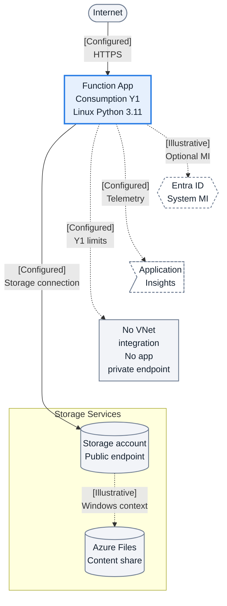
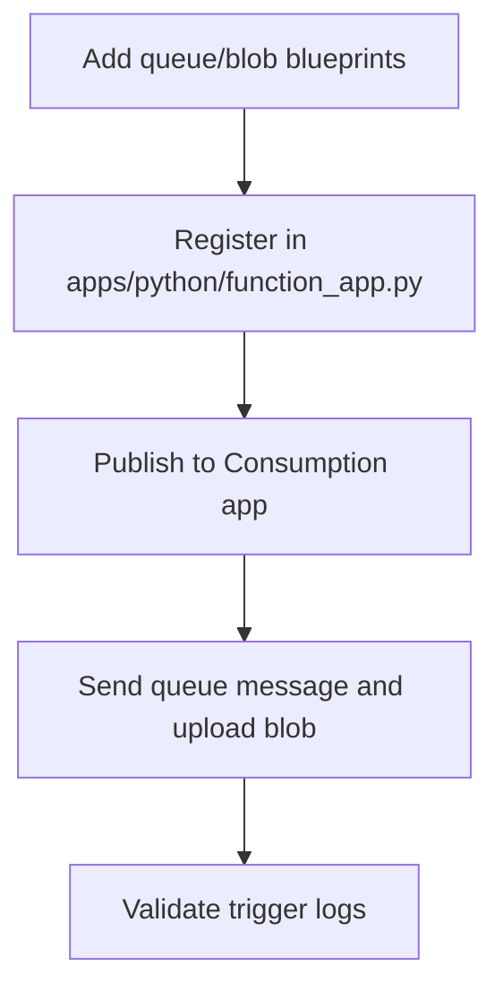

---
validation:
  az_cli:
    last_tested: 2026-04-09
    cli_version: 2.83.0
    core_tools_version: 4.8.0
    result: pass
  bicep:
    last_tested:
    result: not_tested
content_sources:

  references:
    - type: mslearn-adapted
      url: https://learn.microsoft.com/en-us/azure/azure-functions/functions-triggers-bindings
    - type: mslearn-adapted
      url: https://learn.microsoft.com/en-us/azure/azure-functions/functions-bindings-storage-queue-trigger
    - type: mslearn-adapted
      url: https://learn.microsoft.com/en-us/azure/azure-functions/functions-bindings-storage-blob-trigger
  diagrams:
    - id: what-you-ll-build
      type: flowchart
      source: self-generated
      justification: Flow view of what you ll build, synthesized from Microsoft Learn documentation cited on this page.
      based_on:
        - https://learn.microsoft.com/en-us/azure/azure-functions/functions-networking-options
        - https://learn.microsoft.com/en-us/azure/azure-functions/storage-considerations
        - https://learn.microsoft.com/en-us/azure/azure-functions/manage-connections
        - https://learn.microsoft.com/en-us/azure/app-service/overview-managed-identity
        - https://learn.microsoft.com/en-us/azure/azure-functions/functions-triggers-bindings
        - https://learn.microsoft.com/en-us/azure/azure-functions/functions-bindings-storage-queue-trigger
        - https://learn.microsoft.com/en-us/azure/azure-functions/functions-bindings-storage-blob-trigger
    - id: what-you-ll-build-2
      type: flowchart
      source: self-generated
      justification: Flow view of what you ll build 2, synthesized from Microsoft Learn documentation cited on this page.
      based_on:
        - https://learn.microsoft.com/en-us/azure/azure-functions/functions-triggers-bindings
        - https://learn.microsoft.com/en-us/azure/azure-functions/functions-bindings-storage-queue-trigger
        - https://learn.microsoft.com/en-us/azure/azure-functions/functions-bindings-storage-blob-trigger
---
# 07 - Extending Triggers (Consumption)

Extend your Consumption (Y1) app with queue and blob triggers. On this plan, scaling is app-level (not per-function), and the standard blob trigger polling model works well.

## Prerequisites

| Tool | Version | Purpose |
|------|---------|---------|
| Azure CLI | 2.61+ | Create storage queues/containers and test messages |
| Azure Functions Core Tools | v4 | Publish updated functions |
| Function App | Consumption (Y1) | Existing deployed app |

## What You'll Build

You will extend the existing blueprint-based Python app with queue and blob triggers, publish the update, and validate trigger execution from live logs.

!!! info "Infrastructure Context"
    **Plan**: Consumption (Y1) | **Network**: Public internet only | **VNet**: ❌ Not supported

    This Linux Y1 example uses public endpoints, without outbound VNet integration or an app private endpoint. The storage connection and optional identity association are separate choices, not a requirement to combine connection-string and identity settings.

<!-- diagram-id: what-you-ll-build -->


**Reading key:** Solid arrows show request/data access; dotted arrows show identity, telemetry, limitations or account membership, not transit through those roles. Entra ID / System MI = Microsoft Entra ID / system-assigned managed identity. `AzureWebJobsStorage` can hold a connection string, **or** identity-based host settings can use `AzureWebJobsStorage__accountName` with the appropriate identity and permissions; these are not one combined credential. On Linux Consumption, identity-based host storage requires deploying and running the app from an [external deployment package](https://learn.microsoft.com/en-us/azure/azure-functions/manage-connections?pivots=functions-auth-identity&tabs=host#define-connections) instead of the remote-build publishing path (`--build remote`) used here, so these tutorial steps keep the connection string. Tokens are obtained through the app's local identity endpoint ([connections](https://learn.microsoft.com/en-us/azure/azure-functions/manage-connections), [identity](https://learn.microsoft.com/en-us/azure/app-service/overview-managed-identity)). The Azure Files node preserves Windows Consumption context: Linux Consumption remote builds use Blob package storage, not that content-share requirement ([storage](https://learn.microsoft.com/en-us/azure/azure-functions/storage-considerations), [networking](https://learn.microsoft.com/en-us/azure/azure-functions/functions-networking-options)).

<!-- diagram-id: what-you-ll-build-2 -->


## Steps

### Step 1 - Set variables

```bash
export RG="rg-func-consumption-demo"
export APP_NAME="func-consumption-demo-001"
export STORAGE_NAME="stconsumptiondemo001"
export LOCATION="koreacentral"
```

### Step 2 - Add a queue trigger

```python
import logging
import azure.functions as func

bp = func.Blueprint()

@bp.function_name(name="queue_worker")
@bp.queue_trigger(arg_name="msg", queue_name="work-items", connection="AzureWebJobsStorage")
def queue_worker(msg: func.QueueMessage) -> None:
    payload = msg.get_body().decode("utf-8")
    logging.info("Queue item processed: %s", payload)
```

Save this in `apps/python/blueprints/queue_blob_worker.py`, then register it in `apps/python/function_app.py` with:

```python
from blueprints.queue_blob_worker import bp as queue_blob_worker_bp
app.register_blueprint(queue_blob_worker_bp)
```

### Step 3 - Add a blob trigger (standard polling)

```python
@bp.function_name(name="blob_worker")
@bp.blob_trigger(arg_name="blob", path="uploads/{name}", connection="AzureWebJobsStorage")
def blob_worker(blob: func.InputStream) -> None:
    logging.info("Blob processed: %s (%s bytes)", blob.name, blob.length)
```

Standard polling blob trigger is supported on Consumption. Event Grid-based blob trigger is an optional upgrade for event-driven routing scenarios.

### Step 4 - Publish changes

```bash
cd apps/python
func azure functionapp publish "$APP_NAME" --build remote --python
```

!!! warning "Use `--build remote` on Linux Consumption"
    The `--build remote` flag is required for Linux Consumption to ensure Python dependencies are installed on the server. Without it, the publish may fail or produce incomplete deployments.

### Step 5 - Send queue message and upload blob

```bash
az storage queue create \
  --name "work-items" \
  --account-name "$STORAGE_NAME" \
  --auth-mode login
az storage message put \
  --queue-name "work-items" \
  --content '{"id":"1001","action":"reindex"}' \
  --account-name "$STORAGE_NAME" \
  --auth-mode login

az storage container create \
  --name "uploads" \
  --account-name "$STORAGE_NAME" \
  --auth-mode login

az storage blob upload \
  --container-name "uploads" \
  --name "sample.txt" \
  --file "apps/python/host.json" \
  --account-name "$STORAGE_NAME" \
  --auth-mode login
```

| CLI element | Explanation |
|---|---|
| Command(s) | `az storage queue create`, `az storage message put`, `az storage container create`, `az storage blob upload` |
| Key flags | `--name`, `--account-name`, `--auth-mode`, `--queue-name`, `--content`, `--container-name`, `--file` |
| Variables | `$STORAGE_NAME` |
| Expected result | Azure CLI returns provisioning details; confirm the resource name and successful provisioning state before continuing. |


### Step 6 - Confirm trigger activity

```bash
az webapp log tail \
  --name "$APP_NAME" \
  --resource-group "$RG"
```

| CLI element | Explanation |
|---|---|
| Command(s) | `az webapp log tail` |
| Key flags | `--name`, `--resource-group` |
| Variables | `$APP_NAME`, `$RG` |
| Expected result | Azure CLI completes successfully and returns JSON, table, or no output depending on the command; verify the next documented check before continuing. |


Consumption scaling reminder:

- Scale-to-zero when idle.
- App-level scaling up to 100 instances on Linux Consumption.
- Queue and blob workloads scale together at app scope (not per-function scaling).
- Default timeout is 5 minutes, maximum 10 minutes.

!!! info "Not available on Consumption"
    VNet integration requires Flex Consumption, Premium, or Dedicated plan.

!!! info "Not available on Consumption"
    Private endpoints require Flex Consumption, Premium, or Dedicated plan.

## Verification

Publish output excerpt:

```text
Deployment successful.
Functions in func-consumption-demo-001:
    queue_worker - [queueTrigger]
    blob_worker - [blobTrigger]
```

Log stream excerpt:

```text
Executing 'Functions.queue_worker' (Reason='New queue message detected on work-items.', Id=xxxxxxxx-xxxx-xxxx-xxxx-xxxxxxxxxxxx)
Queue item processed: {"id":"1001","action":"reindex"}
Executed 'Functions.queue_worker' (Succeeded, Duration=42ms)

Executing 'Functions.blob_worker' (Reason='New blob detected(uploads/sample.txt)', Id=xxxxxxxx-xxxx-xxxx-xxxx-xxxxxxxxxxxx)
Blob processed: uploads/sample.txt (1234 bytes)
Executed 'Functions.blob_worker' (Succeeded, Duration=58ms)
```

## Next Steps

You completed the Consumption tutorial track. Continue with core runtime concepts.

> **Next:** [How Functions Works](../../../../platform/architecture/index.md)

## See Also

- [Tutorial Overview & Plan Chooser](../index.md)
- [Python Language Guide](../../index.md)
- [Platform: Hosting Plans](../../../../platform/hosting.md)
- [Operations: Deployment](../../../../operations/deployment.md)
- [Recipes Index](../../recipes/index.md)

## Sources

- [Functions networking options](https://learn.microsoft.com/en-us/azure/azure-functions/functions-networking-options)
- [Functions storage considerations](https://learn.microsoft.com/en-us/azure/azure-functions/storage-considerations)
- [Functions connection settings](https://learn.microsoft.com/en-us/azure/azure-functions/manage-connections)
- [App Service and Functions managed identity](https://learn.microsoft.com/en-us/azure/app-service/overview-managed-identity)
- [Azure Functions triggers and bindings](https://learn.microsoft.com/en-us/azure/azure-functions/functions-triggers-bindings)
- [Azure Queue Storage trigger for Azure Functions](https://learn.microsoft.com/en-us/azure/azure-functions/functions-bindings-storage-queue-trigger)
- [Azure Blob Storage trigger for Azure Functions](https://learn.microsoft.com/en-us/azure/azure-functions/functions-bindings-storage-blob-trigger)
