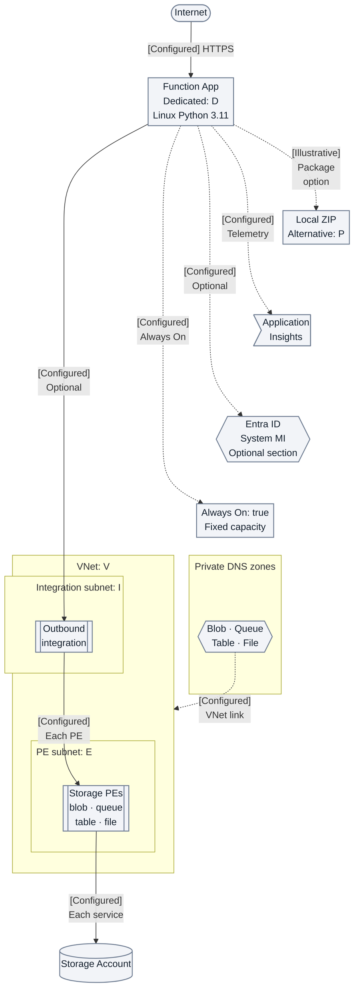
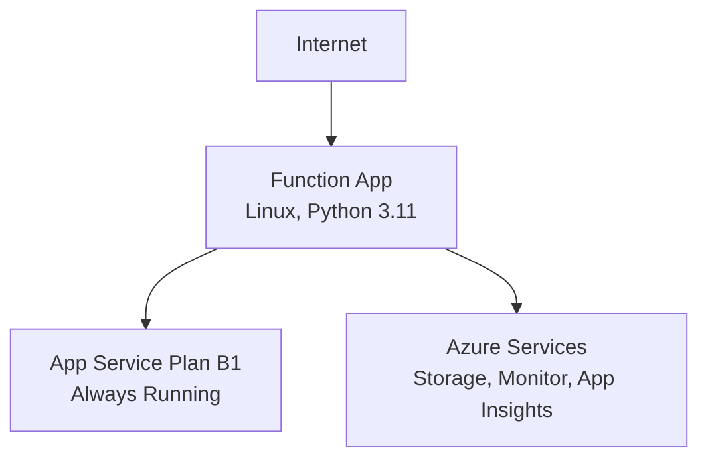

---
validation:
  az_cli:
    last_tested: 2026-04-12
    cli_version: 2.70.0
    core_tools_version: 4.6.0
    result: pass
  bicep:
    last_tested:
    result: not_tested
content_sources:

  references:
    - type: mslearn-adapted
      url: https://learn.microsoft.com/en-us/azure/azure-functions/functions-how-to-use-azure-function-app-settings
    - type: mslearn-adapted
      url: https://learn.microsoft.com/en-us/azure/app-service/configure-common
    - type: mslearn-adapted
      url: https://learn.microsoft.com/en-us/azure/app-service/overview-vnet-integration
    - type: mslearn-adapted
      url: https://learn.microsoft.com/en-us/azure/app-service/networking/private-endpoint
  diagrams:
    - id: what-you-ll-build
      type: flowchart
      source: self-generated
      justification: Illustrative Python Dedicated topology for the public B1 tutorial and its optional S1 Storage private-endpoint section; outbound integration is not compute in the subnet, and Always On is a configuration association, not a request hop or verification result.
      based_on:
        - https://learn.microsoft.com/en-us/azure/azure-functions/supported-languages
        - https://learn.microsoft.com/en-us/azure/azure-functions/dedicated-plan
        - https://learn.microsoft.com/en-us/azure/azure-functions/functions-networking-options
        - https://learn.microsoft.com/en-us/azure/storage/common/storage-private-endpoints
        - https://learn.microsoft.com/en-us/azure/azure-functions/storage-considerations
        - https://learn.microsoft.com/en-us/azure/azure-functions/functions-deployment-technologies
        - https://learn.microsoft.com/en-us/azure/azure-functions/functions-monitoring
        - https://learn.microsoft.com/en-us/azure/app-service/overview-managed-identity
        - https://learn.microsoft.com/en-us/azure/azure-functions/functions-how-to-use-azure-function-app-settings
        - https://learn.microsoft.com/en-us/azure/app-service/configure-common
        - https://learn.microsoft.com/en-us/azure/app-service/overview-vnet-integration
        - https://learn.microsoft.com/en-us/azure/app-service/networking/private-endpoint
    - id: step-6-verify-deployment
      type: flowchart
      source: self-generated
      justification: Dedicated hosting association and service dependencies for the verification step; the plan arrow is hosting, not a request hop, and a health request does not prove each dependency or non-HTTP trigger.
      based_on:
        - https://learn.microsoft.com/en-us/azure/azure-functions/dedicated-plan
        - https://learn.microsoft.com/en-us/azure/azure-functions/supported-languages
        - https://learn.microsoft.com/en-us/azure/azure-functions/functions-how-to-use-azure-function-app-settings
        - https://learn.microsoft.com/en-us/azure/app-service/configure-common
        - https://learn.microsoft.com/en-us/azure/app-service/overview-vnet-integration
        - https://learn.microsoft.com/en-us/azure/app-service/networking/private-endpoint
---
# 02 - First Deploy (Dedicated)

In this tutorial you deploy the Function App to a Dedicated App Service Plan using Basic B1. Dedicated plans are always running (no scale-to-zero), support Linux and Windows, and use fixed monthly pricing regardless of executions.

**Runtime/build review (2026-10-25, official sources and static checks only):** Python function apps are **Linux-only**, even though Dedicated also hosts other languages on Windows. Keep Python **3.11** locally to match the command below; see [supported versions](../../python-runtime.md#supported-python-versions) for Python 3.13/3.14 GA and [build-mode guidance](../../python-runtime.md#build-mode-and-version-availability) for remote Oryx build versus prebuilt Linux packages. The historical `validation` metadata does not establish execution on newer versions and has not been restamped.

## Prerequisites

- Completed [01 - Run Locally](01-local-run.md)
- Variables exported in your shell:

```bash
export RG="rg-func-dedicated-dev"
export APP_NAME="func-dedi-<unique-suffix>"
export PLAN_NAME="asp-dedi-b1-dev"
export STORAGE_NAME="stdedidev<unique>"
export LOCATION="koreacentral"
```

| Command/Parameter | Purpose |
|-------------------|---------|
| `export RG="rg-func-dedicated-dev"` | Defines the resource group name for the deployment. |
| `export APP_NAME="func-dedi-<unique-suffix>"` | Sets the unique name for the Azure Function App. |
| `export PLAN_NAME="asp-dedi-b1-dev"` | Defines the App Service Plan name. |
| `export STORAGE_NAME="stdedidev<unique>"` | Sets the storage account name. |
| `export LOCATION="koreacentral"` | Specifies the Azure region for deployment. |

## What You'll Build

You will provision a Basic (B1) Linux App Service Plan, create a Python Function App on that plan, deploy from `apps/python`, and validate live endpoints.

!!! tip "Network Scenario Choices"
    This tutorial deploys with **public networking** on B1. Basic supports App Service VNet integration and private endpoints, but this guide uses Standard (S1+) for private networking walkthroughs to match the production-oriented validation path.

    | Scenario | Description | Guide |
    |----------|-------------|-------|
    | **Public Only** | No VNet (this tutorial, B1) | Current page |
    | **Private Egress** | VNet + Storage PE (guide validates S1+) | [Private Egress](../../../../platform/networking-scenarios/private-egress.md) |
    | **Private Ingress** | + Site Private Endpoint (guide validates S1+) | [Private Ingress](../../../../platform/networking-scenarios/private-ingress.md) |
    | **Fixed Outbound IP** | + NAT Gateway (guide validates S1+) | [Fixed Outbound](../../../../platform/networking-scenarios/fixed-outbound-nat.md) |

!!! info "Infrastructure Context"
    **Plan**: Dedicated (B1) | **Network**: Public internet in this tutorial | **VNet**: Supported by platform, not configured here

    The app runs on a fixed App Service Plan (always on, no scale-to-zero). Basic B1 supports App Service VNet integration and private endpoints, but this guide uses Standard (S1+) for private networking scenarios to provide scale headroom, deployment slots, and a production-oriented validation path.

    <!-- diagram-id: what-you-ll-build -->


**Reading key:** This keeps the original B1–P3v3 Dedicated context; the base commands create B1, and the optional section upgrades to S1. Solid arrows show request/data access; dotted arrows show configuration, authorization, telemetry or DNS associations. Outbound VNet integration does not deploy compute into its subnet. Step 4 sets Always On for reliable non-HTTP triggering; without it, an idle app can wake on HTTP/Portal access. System-assigned identity is assigned only in the optional section; its local token endpoint and target RBAC are not Storage transit hops ([networking](https://learn.microsoft.com/en-us/azure/azure-functions/functions-networking-options), [Dedicated](https://learn.microsoft.com/en-us/azure/azure-functions/dedicated-plan#always-on), [identity](https://learn.microsoft.com/en-us/azure/app-service/overview-managed-identity)).

| Key | Original configuration retained |
|---|---|
| D | Dedicated B1–P3v3 context; base B1, optional S1 |
| V | VNet `10.0.0.0/16` |
| I | Integration subnet `10.0.1.0/24`; delegation `Microsoft.Web/serverFarms` |
| E | Private endpoint subnet `10.0.2.0/24` |
| P | Local ZIP alternative: `WEBSITE_RUN_FROM_PACKAGE=1`; do not force for remote build. Core Tools requests remote build for Python; Dedicated has no default Azure Files content-share dependency |

The bundles represent **four distinct endpoints and four distinct zones**, not serial service hops. Each row retains the original endpoint → Storage relationship and endpoint → DNS zone-group association; the zones are linked to the VNet. Private DNS must resolve normal Storage hostnames to the corresponding endpoint IPs ([Storage endpoints/DNS](https://learn.microsoft.com/en-us/azure/storage/common/storage-private-endpoints), [storage](https://learn.microsoft.com/en-us/azure/azure-functions/storage-considerations), [deployment](https://learn.microsoft.com/en-us/azure/azure-functions/functions-deployment-technologies)).

| Endpoint → Storage service | Private DNS zone |
|---|---|
| `PE_BLOB` → Blob | `privatelink.blob.core.windows.net` |
| `PE_QUEUE` → Queue | `privatelink.queue.core.windows.net` |
| `PE_TABLE` → Table | `privatelink.table.core.windows.net` |
| `PE_FILE` → File | `privatelink.file.core.windows.net` |

## Steps

### Step 1 - Create resource group and storage account

```bash
az group create \
  --name $RG \
  --location $LOCATION

az storage account create \
  --name $STORAGE_NAME \
  --resource-group $RG \
  --location $LOCATION \
  --sku Standard_LRS \
  --kind StorageV2
```

| Command/Parameter | Purpose |
|-------------------|---------|
| `az group create` | Provisions a new resource group. |
| `--name $RG` | Sets the resource group name. |
| `--location $LOCATION` | Places the resource group in the selected region. |
| `az storage account create` | Creates a new storage account for the function app. |
| `--sku Standard_LRS` | Selects Standard Locally Redundant Storage. |
| `--kind StorageV2` | Specifies the storage account type as General Purpose v2. |

### Step 2 - Create a Dedicated App Service Plan (B1)

```bash
az appservice plan create \
  --name $PLAN_NAME \
  --resource-group $RG \
  --location $LOCATION \
  --sku B1 \
  --is-linux
```

| Command/Parameter | Purpose |
|-------------------|---------|
| `az appservice plan create` | Provisions a Dedicated App Service plan. |
| `--sku B1` | Selects the Basic B1 pricing tier. |
| `--is-linux` | Configures the plan for Linux hosting. |

For production workloads, use `S1` or `P1v2` when you need higher scale limits, autoscale rules, deployment slots, or the same private networking path validated by this guide.

### Step 3 - Create the Function App on the plan

```bash
az functionapp create \
  --name $APP_NAME \
  --resource-group $RG \
  --plan $PLAN_NAME \
  --storage-account $STORAGE_NAME \
  --runtime python \
  --runtime-version 3.11 \
  --functions-version 4 \
  --os-type Linux
```

| Command/Parameter | Purpose |
|-------------------|---------|
| `az functionapp create` | Provisions the function app within the Dedicated plan. |
| `--plan $PLAN_NAME` | Links the app to the specific App Service plan. |
| `--runtime python` | Sets the language runtime to Python. |
| `--runtime-version 3.11` | Specifies the Python version. |
| `--functions-version 4` | Selects version 4.x of the runtime. |
| `--os-type Linux` | Deploys the app on a Linux host. |

### Step 4 - Enable Always On (recommended)

```bash
az functionapp config set \
  --name $APP_NAME \
  --resource-group $RG \
  --always-on true
```

| Command/Parameter | Purpose |
|-------------------|---------|
| `az functionapp config set` | Modifies configuration settings for the function app. |
| `--always-on true` | Keeps the function host loaded to prevent cold start delays. |

### Step 5 - Deploy code

```bash
cd apps/python
func azure functionapp publish $APP_NAME --python
```

| Command/Parameter | Purpose |
|-------------------|---------|
| `cd apps/python` | Navigates to the project directory. |
| `func azure functionapp publish $APP_NAME` | Deploys the local project to Azure. |
| `--python` | Sets the application language. |

Dedicated deployment here requests remote Oryx build via `func azure functionapp publish --python`. Do not manually set `WEBSITE_RUN_FROM_PACKAGE=1` when requesting remote build; let the supported deployment workflow manage its output. The `1` mode is an alternative for a ready-to-run locally built ZIP, not a remote-build prerequisite. Azure Files provisioning and host-storage authentication are separate concerns; this B1 workflow does not require `WEBSITE_CONTENTAZUREFILECONNECTIONSTRING`. See the [package matrix](../../../../operations/deployment.md#package-configuration-by-plan-and-os). Existing diagram labels showing `1` describe the local-package alternative, not this remote-build step. This correction is official-source/static review only, not a new Azure test.

!!! warning "Set placeholder trigger settings before first request"
    The reference app includes EventHub, Queue, and Timer triggers that need connection settings. If these are missing, the function host may report errors. Set placeholder values immediately after first deploy:

    ```bash
    az functionapp config appsettings set \
      --name $APP_NAME \
      --resource-group $RG \
      --settings \
        EventHubConnection="Endpoint=sb://placeholder.servicebus.windows.net/;SharedAccessKeyName=placeholder;SharedAccessKey=placeholder=;EntityPath=placeholder" \
        QueueStorage="UseDevelopmentStorage=true" \
        TIMER_LAB_SCHEDULE="0 0 0 1 1 *"

    az functionapp restart --name $APP_NAME --resource-group $RG
    ```

    | Command/Parameter | Purpose |
    |-------------------|---------|
    | `az functionapp config appsettings set` | Configures key-value pairs in the environment. |
    | `--settings "..."` | Sets trigger-specific placeholder settings. |
    | `az functionapp restart` | Restarts the function app to apply configuration changes. |

    After restart, wait 60–90 seconds for the host to become ready on B1 tier.
### Step 6 - Verify deployment

```bash
az functionapp show \
  --name $APP_NAME \
  --resource-group $RG \
  --query "{state:state,defaultHostName:defaultHostName,kind:kind}" \
  --output json

curl --request GET "https://$APP_NAME.azurewebsites.net/api/health"
```

| Command/Parameter | Purpose |
|-------------------|---------|
| `az functionapp show` | Retrieves current status of the app. |
| `--query "{...}"` | Selects relevant status fields. |
| `curl --request GET` | Tests the public HTTP health endpoint. |

<!-- diagram-id: step-6-verify-deployment -->


!!! info "B1 network support and guide scope"
    Basic (B1) supports App Service VNet integration and private endpoints, but this tutorial intentionally remains public-only. Use the optional section when you want to test private networking; use Standard (S1+) if you want to match the guide-tested production path.

### Optional: VNet and Private Endpoints

??? example "Optional: VNet and Private Endpoints"
    Basic (B1) can use these platform networking features. This walkthrough upgrades to `S1` to align with the guide-tested private networking path and provide more production headroom.

    #### Step A: Upgrade Plan (recommended guide path)

    ```bash
    az appservice plan update \
      --name $PLAN_NAME \
      --resource-group $RG \
      --sku S1
    ```

    | Command/Parameter | Purpose |
    |-------------------|---------|
    | `az appservice plan update` | Modifies plan properties. |
    | `--sku S1` | Upgrades the tier to Standard S1 for the guide-tested private networking path. |

    #### Step B: Create VNet and Subnets

    ```bash
    export VNET_NAME="vnet-dedicated-demo"

    az network vnet create \
      --name "$VNET_NAME" \
      --resource-group "$RG" \
      --location "$LOCATION" \
      --address-prefixes "10.0.0.0/16" \
      --subnet-name "snet-integration" \
      --subnet-prefixes "10.0.1.0/24"

    az network vnet subnet create \
      --name "snet-private-endpoints" \
      --resource-group "$RG" \
      --vnet-name "$VNET_NAME" \
      --address-prefixes "10.0.2.0/24"

    az network vnet subnet update \
      --name "snet-integration" \
      --resource-group "$RG" \
      --vnet-name "$VNET_NAME" \
      --delegations "Microsoft.Web/serverFarms"
    ```

    | Command/Parameter | Purpose |
    |-------------------|---------|
    | `az network vnet create` | Provisions a new virtual network. |
    | `az network vnet subnet create` | Adds a subnet for private endpoints. |
    | `az network vnet subnet update` | Configures the integration subnet delegation. |

    #### Step C: Enable VNet Integration

    ```bash
    az functionapp vnet-integration add \
      --name "$APP_NAME" \
      --resource-group "$RG" \
      --vnet "$VNET_NAME" \
      --subnet "snet-integration"
    ```

    | Command/Parameter | Purpose |
    |-------------------|---------|
    | `az functionapp vnet-integration add` | Connects the app to the virtual network. |

    #### Step D: Enable System-Assigned Managed Identity

    ```bash
    az functionapp identity assign \
      --name "$APP_NAME" \
      --resource-group "$RG"

    export MI_PRINCIPAL_ID=$(az functionapp identity show \
      --name "$APP_NAME" \
      --resource-group "$RG" \
      --query "principalId" \
      --output tsv)
    ```

    | Command/Parameter | Purpose |
    |-------------------|---------|
    | `az functionapp identity assign` | Enables managed identity for the app. |
    | `az functionapp identity show` | Retrieves the app's identity properties. |

    #### Step E: Assign RBAC Roles

    ```bash
    export STORAGE_ID=$(az storage account show \
      --name "$STORAGE_NAME" \
      --resource-group "$RG" \
      --query "id" \
      --output tsv)

    az role assignment create \
      --assignee "$MI_PRINCIPAL_ID" \
      --role "Storage Blob Data Owner" \
      --scope "$STORAGE_ID"

    az role assignment create \
      --assignee "$MI_PRINCIPAL_ID" \
      --role "Storage Account Contributor" \
      --scope "$STORAGE_ID"

    az role assignment create \
      --assignee "$MI_PRINCIPAL_ID" \
      --role "Storage Queue Data Contributor" \
      --scope "$STORAGE_ID"
    ```

    | Command/Parameter | Purpose |
    |-------------------|---------|
    | `az role assignment create` | Grants specified permissions to the managed identity. |
    | `--role "..."` | Selects a specific storage data or contributor role. |

    !!! tip "RBAC roles explained"
        - **Storage Blob Data Owner**: Read/write blob data (used by the Functions runtime for triggers, bindings, and internal state)
        - **Storage Account Contributor**: Manage storage account properties
        - **Storage Queue Data Contributor**: Read/write queue messages (used by durable functions, queue triggers)

    #### Step F: Lock Down Storage

    ```bash
    az storage account update \
      --name "$STORAGE_NAME" \
      --resource-group "$RG" \
      --allow-blob-public-access false
    ```

    | Command/Parameter | Purpose |
    |-------------------|---------|
    | `az storage account update` | Modifies storage properties. |
    | `--allow-blob-public-access false` | Disables public anonymous access. |

    #### Step G: Create Storage Private Endpoints (×4)

    ```bash
    for SVC in blob queue table file; do
      az network private-endpoint create \
        --name "pe-st-$SVC" \
        --resource-group "$RG" \
        --location "$LOCATION" \
        --vnet-name "$VNET_NAME" \
        --subnet "snet-private-endpoints" \
        --private-connection-resource-id "$STORAGE_ID" \
        --group-ids "$SVC" \
        --connection-name "conn-st-$SVC"
    done
    ```

    | Command/Parameter | Purpose |
    |-------------------|---------|
    | `az network private-endpoint create` | Provisions private endpoints for each storage sub-resource. |

    #### Step H: Create Private DNS Zones and Link to VNet (×4)

    ```bash
    for SVC in blob queue table file; do
      az network private-dns zone create \
        --resource-group "$RG" \
        --name "privatelink.$SVC.core.windows.net"

      az network private-dns link vnet create \
        --resource-group "$RG" \
        --zone-name "privatelink.$SVC.core.windows.net" \
        --name "link-$SVC" \
        --virtual-network "$VNET_NAME" \
        --registration-enabled false

      az network private-endpoint dns-zone-group create \
        --resource-group "$RG" \
        --endpoint-name "pe-st-$SVC" \
        --name "$SVC-dns-zone-group" \
        --private-dns-zone "privatelink.$SVC.core.windows.net" \
        --zone-name "$SVC"
    done
    ```

    | Command/Parameter | Purpose |
    |-------------------|---------|
    | `az network private-dns zone create` | Provisions private DNS zones for storage services. |
    | `az network private-dns link vnet create` | Links DNS zones to the virtual network. |
    | `az network private-endpoint dns-zone-group create` | Configures automatic IP registration in DNS. |

    #### Step I: Configure Identity-Based Storage

    ```bash
    az functionapp config appsettings set \
      --name "$APP_NAME" \
      --resource-group "$RG" \
      --settings \
        "AzureWebJobsStorage__accountName=$STORAGE_NAME" \
        "AzureWebJobsStorage__credential=managedidentity"
    ```

    | Command/Parameter | Purpose |
    |-------------------|---------|
    | `az functionapp config appsettings set` | Configures identity-based storage access. |

    #### Step J: Verify VNet Integration

    ```bash
    az functionapp show \
      --name "$APP_NAME" \
      --resource-group "$RG" \
      --query "virtualNetworkSubnetId" \
      --output tsv
    ```

    | Command/Parameter | Purpose |
    |-------------------|---------|
    | `az functionapp show` | Retrieves current VNet integration details. |


## Verification

`az appservice plan create ... --sku B1`:

```json
{
  "id": "/subscriptions/<subscription-id>/resourceGroups/rg-func-dedicated-dev/providers/Microsoft.Web/serverfarms/asp-dedi-b1-dev",
  "kind": "linux",
  "location": "koreacentral",
  "name": "asp-dedi-b1-dev",
  "resourceGroup": "rg-func-dedicated-dev",
  "sku": {
    "name": "B1",
    "tier": "Basic"
  },
  "status": "Ready"
}
```

`az functionapp config set --always-on true`:

```json
{
  "alwaysOn": true,
  "linuxFxVersion": "Python|3.11",
  "numberOfWorkers": 1,
  "scmType": "None"
}
```

`curl --request GET "https://$APP_NAME.azurewebsites.net/api/health"`:

```json
{
  "status": "healthy",
  "timestamp": "2026-04-04T05:38:46Z",
  "version": "1.0.0"
}
```

### Deployment Verification Results

Endpoint test results from the Korea Central deployment (all returned HTTP 200):

- `GET /api/health` → `{"status": "healthy", "timestamp": "2026-04-04T05:38:46Z", "version": "1.0.0"}`
- `GET /api/info` → `{"name": "azure-functions-field-guide", "version": "1.0.0", "python": "3.11.13", "environment": "development", "telemetryMode": "basic"}`
- `GET /api/requests/log-levels` → `{"message": "Logged at all levels", "levels": ["DEBUG", "INFO", "WARNING", "ERROR", "CRITICAL"]}`
- `GET /api/dependencies/external` → `{"status": "success", "statusCode": 200, "responseTime": "1143ms", "url": "https://httpbin.org/get"}`
- `GET /api/exceptions/test-error` → `{"error": "Handled exception", "type": "ValueError", "message": "Simulated error for testing"}` only after [controlled lab opt-in and key setup](../../../../reference/lab-endpoint-safety.md). Otherwise the route is absent; disable it again after testing.

## Next Steps

Your first Dedicated deployment is live. Next you will configure app settings, storage options, and runtime behavior with `siteConfig.appSettings` conventions.

> **Next:** [03 - Configuration](03-configuration.md)

## See Also

- [Tutorial Overview & Plan Chooser](../index.md)
- [Python Language Guide](../../index.md)
- [Platform: Hosting Plans](../../../../platform/hosting.md)
- [Operations: Deployment](../../../../operations/deployment.md)
- [Recipes Index](../../recipes/index.md)

## Sources

- [Python versions and OS support](https://learn.microsoft.com/en-us/azure/azure-functions/supported-languages)
- [Dedicated hosting and Always On](https://learn.microsoft.com/en-us/azure/azure-functions/dedicated-plan)
- [Functions networking](https://learn.microsoft.com/en-us/azure/azure-functions/functions-networking-options)
- [Storage endpoints and DNS](https://learn.microsoft.com/en-us/azure/storage/common/storage-private-endpoints)
- [Functions storage](https://learn.microsoft.com/en-us/azure/azure-functions/storage-considerations)
- [Functions deployment](https://learn.microsoft.com/en-us/azure/azure-functions/functions-deployment-technologies)
- [Functions monitoring](https://learn.microsoft.com/en-us/azure/azure-functions/functions-monitoring)
- [App managed identity](https://learn.microsoft.com/en-us/azure/app-service/overview-managed-identity)
- [Work with Azure Functions app settings (Microsoft Learn)](https://learn.microsoft.com/en-us/azure/azure-functions/functions-how-to-use-azure-function-app-settings)
- [App Service Always On (Microsoft Learn)](https://learn.microsoft.com/en-us/azure/app-service/configure-common)
- [Use private endpoints for Azure App Service apps (Microsoft Learn)](https://learn.microsoft.com/en-us/azure/app-service/networking/private-endpoint)
