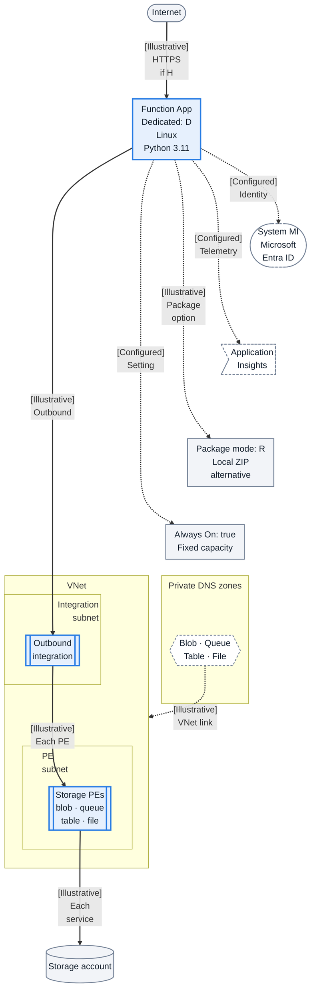
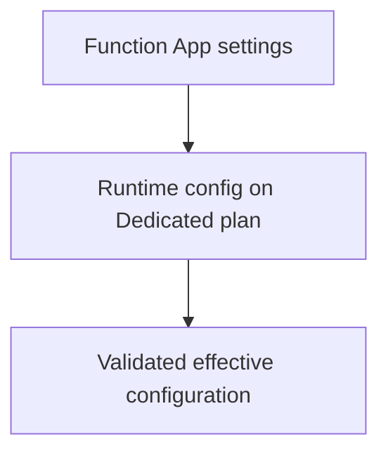

---
validation:
  az_cli:
    last_tested: 2026-04-09
    cli_version: 2.83.0
    core_tools_version: 4.8.0
    result: pass
  bicep:
    last_tested:
    result: not_tested
content_sources:

  references:
    - type: mslearn-adapted
      url: https://learn.microsoft.com/en-us/azure/azure-functions/functions-app-settings
    - type: mslearn-adapted
      url: https://learn.microsoft.com/en-us/azure/app-service/configure-common
    - type: mslearn-adapted
      url: https://learn.microsoft.com/en-us/azure/app-service/overview-vnet-integration
    - type: mslearn-adapted
      url: https://learn.microsoft.com/en-us/azure/app-service/networking/private-endpoint
    - type: mslearn-adapted
      url: https://learn.microsoft.com/en-us/azure/azure-functions/functions-scale
  diagrams:
    - id: what-you-ll-build
      type: flowchart
      source: self-generated
      justification: Optional Python Linux Dedicated private Storage context, with individual service and DNS mappings in the adjacent key; not deployment evidence.
      based_on:
        - https://learn.microsoft.com/en-us/azure/azure-functions/functions-reference-python
        - https://learn.microsoft.com/en-us/azure/storage/common/storage-private-endpoints
        - https://learn.microsoft.com/en-us/azure/azure-functions/storage-considerations
        - https://learn.microsoft.com/en-us/azure/azure-functions/deployment-zip-push
        - https://learn.microsoft.com/en-us/azure/azure-functions/dedicated-plan
        - https://learn.microsoft.com/en-us/azure/azure-functions/functions-host-json
        - https://learn.microsoft.com/en-us/azure/app-service/overview-managed-identity
        - https://learn.microsoft.com/en-us/azure/azure-functions/functions-monitoring
        - https://learn.microsoft.com/en-us/azure/app-service/overview-access-restrictions#app-access
        - https://learn.microsoft.com/en-us/azure/azure-functions/functions-app-settings
        - https://learn.microsoft.com/en-us/azure/app-service/configure-common
        - https://learn.microsoft.com/en-us/azure/app-service/overview-vnet-integration
        - https://learn.microsoft.com/en-us/azure/app-service/networking/private-endpoint
        - https://learn.microsoft.com/en-us/azure/azure-functions/functions-scale
    - id: what-you-ll-build-2
      type: flowchart
      source: self-generated
      justification: Flow view of what you ll build 2, synthesized from Microsoft Learn documentation cited on this page.
      based_on:
        - https://learn.microsoft.com/en-us/azure/azure-functions/functions-app-settings
        - https://learn.microsoft.com/en-us/azure/app-service/configure-common
        - https://learn.microsoft.com/en-us/azure/app-service/overview-vnet-integration
        - https://learn.microsoft.com/en-us/azure/app-service/networking/private-endpoint
        - https://learn.microsoft.com/en-us/azure/azure-functions/functions-scale
---
# 03 - Configuration (Dedicated)

This tutorial configures runtime settings for a Dedicated Function App using classic App Service configuration patterns. On Dedicated, use `siteConfig.appSettings` style settings and remember the plan is always running and billed 24/7.

## Prerequisites

- Completed [02 - First Deploy](02-first-deploy.md)
- Environment variables set:

```bash
export RG="rg-func-dedicated-dev"
export APP_NAME="func-dedi-<unique-suffix>"
export PLAN_NAME="asp-dedi-b1-dev"
export STORAGE_NAME="stdedidev<unique>"
export LOCATION="koreacentral"
```

## What You'll Build

You will configure required app settings, apply runtime options such as Always On, and validate Dedicated-specific scaling and timeout behavior.

!!! info "Infrastructure Context"
    **Plan**: Dedicated (B1) | **Network**: Public internet in this tutorial | **VNet**: Supported by platform, not configured here

    The app uses fixed App Service plan capacity. Enable Always On for reliable non-HTTP triggering. The diagram retains an optional private-Storage configuration for Dedicated B1–P3v3; the steps here use public networking, while the repository's private-network template defaults to S1. Regional VNet integration is outbound-only and does not deploy the app into the integration subnet.

    <!-- diagram-id: what-you-ll-build -->


**Reading key (Linux Dedicated):** Solid arrows show illustrative request/data access; dotted arrows show configuration, identity, telemetry or DNS-link associations. The four-service bundle is not four serial hops. Identity tokens are acquired through the app's local endpoint; appropriate target permissions are separate from network access ([identity](https://learn.microsoft.com/en-us/azure/app-service/overview-managed-identity), [networking](https://learn.microsoft.com/en-us/azure/app-service/overview-vnet-integration)).

| Key | Full configuration / qualification |
|---|---|
| D | Dedicated B1–P3v3 scope from the original figure; this page uses B1, while the private-network template defaults to S1. |
| H | Public HTTPS is subject to app access restrictions. If a separate site private endpoint is added with `publicNetworkAccess` unset, public ingress defaults to disabled; explicitly enable it to retain this public path. No site endpoint is configured on this page. |
| VNet / integration / PE subnet | `10.0.0.0/16` / `10.0.1.0/24` / `10.0.2.0/24`; integration delegation `Microsoft.Web/serverFarms`. App compute is not contained in the integration subnet. |
| R | `WEBSITE_RUN_FROM_PACKAGE=1` is the ready-to-run ZIP alternative on Linux Dedicated; do not set it when requesting a Python remote build. |
| Always On | Enable for reliable non-HTTP triggering; without it an idled app can wake on an HTTP request or portal access. `functionTimeout` remains a separate `host.json` setting and can be overridden with `AzureFunctionsJobHost__functionTimeout`. |

The bundled endpoints preserve each original endpoint → Storage service and endpoint → DNS zone-group association. DNS zones are outside the VNet and linked to it; clients keep normal Storage hostnames, resolved to private IPs for this private path.

| Endpoint → Storage service | Private DNS zone |
|---|---|
| `PE_BLOB` → Blob | `privatelink.blob.core.windows.net` |
| `PE_QUEUE` → Queue | `privatelink.queue.core.windows.net` |
| `PE_TABLE` → Table | `privatelink.table.core.windows.net` |
| `PE_FILE` → File (optional workload access, not required host content) | `privatelink.file.core.windows.net` |

This is the retained optional network context, not a claim that the public B1 steps deploy it. Dedicated has no default Azure Files content-share dependency ([Storage endpoints/DNS](https://learn.microsoft.com/en-us/azure/storage/common/storage-private-endpoints), [storage](https://learn.microsoft.com/en-us/azure/azure-functions/storage-considerations), [package deployment](https://learn.microsoft.com/en-us/azure/azure-functions/deployment-zip-push), [Always On](https://learn.microsoft.com/en-us/azure/azure-functions/dedicated-plan#always-on), [host overrides](https://learn.microsoft.com/en-us/azure/azure-functions/functions-host-json#override-hostjson-values), [app access](https://learn.microsoft.com/en-us/azure/app-service/overview-access-restrictions#app-access)).

<!-- diagram-id: what-you-ll-build-2 -->


## Steps

### Step 1 - Review current app settings

```bash
az functionapp config appsettings list \
  --name $APP_NAME \
  --resource-group $RG \
  --output table
```

| CLI element | Explanation |
|---|---|
| Command(s) | `az functionapp config appsettings list` |
| Key flags | `--name`, `--resource-group`, `--output` |
| Variables | `$APP_NAME`, `$RG` |
| Expected result | Azure CLI applies the configuration change; confirm the returned JSON or follow-up query shows the expected value. |


### Step 2 - Set required and custom app settings

Dedicated supports both connection-string and identity-based host storage configuration.

Connection-string option:

```bash
STORAGE_CONNECTION_STRING=$(az storage account show-connection-string \
  --name $STORAGE_NAME \
  --resource-group $RG \
  --query connectionString \
  --output tsv)

az functionapp config appsettings set \
  --name $APP_NAME \
  --resource-group $RG \
  --settings \
    FUNCTIONS_WORKER_RUNTIME=python \
    AzureWebJobsStorage="$STORAGE_CONNECTION_STRING" \
    APP_ENV=dedicated-dev
```

| CLI element | Explanation |
|---|---|
| Command(s) | `az storage account show-connection-string`, `az functionapp config appsettings set` |
| Key flags | `--name`, `--resource-group`, `--query`, `--output`, `--settings` |
| Variables | `$STORAGE_NAME`, `$RG`, `$APP_NAME`, `$STORAGE_CONNECTION_STRING` |
| Expected result | Azure CLI applies the configuration change; confirm the returned JSON or follow-up query shows the expected value. |


Identity-based option (alternative):

```bash
az functionapp identity assign \
  --name $APP_NAME \
  --resource-group $RG

az functionapp config appsettings set \
  --name $APP_NAME \
  --resource-group $RG \
  --settings \
    AzureWebJobsStorage__accountName=$STORAGE_NAME \
    AzureWebJobsStorage__credential=managedidentity
```

| CLI element | Explanation |
|---|---|
| Command(s) | `az functionapp identity assign`, `az functionapp config appsettings set` |
| Key flags | `--name`, `--resource-group`, `--settings` |
| Variables | `$APP_NAME`, `$RG`, `$STORAGE_NAME` |
| Expected result | Azure CLI applies the configuration change; confirm the returned JSON or follow-up query shows the expected value. |


!!! warning "Identity-based storage requires Managed Identity and RBAC"
    Before using identity-based host storage, you must:

    1. Enable system-assigned managed identity on the Function App (as shown above).
    2. Grant host storage data-plane roles on the storage account scope. At minimum include **Storage Blob Data Owner**, **Storage Queue Data Contributor**, and **Storage Table Data Contributor** (the host uses blobs, queues, and tables): `az role assignment create --assignee-object-id "<principal-id>" --role "Storage Blob Data Owner" --scope "/subscriptions/<subscription-id>/resourceGroups/$RG/providers/Microsoft.Storage/storageAccounts/$STORAGE_NAME"`
    3. Set both `AzureWebJobsStorage__accountName` and `AzureWebJobsStorage__credential=managedidentity` app settings.

### Step 3 - Configure runtime behavior

```bash
az functionapp config set \
  --name $APP_NAME \
  --resource-group $RG \
  --always-on true \
  --number-of-workers 1
```

| CLI element | Explanation |
|---|---|
| Command(s) | `az functionapp config set` |
| Key flags | `--name`, `--resource-group`, `--always-on`, `--number-of-workers` |
| Variables | `$APP_NAME`, `$RG` |
| Expected result | Azure CLI applies the configuration change; confirm the returned JSON or follow-up query shows the expected value. |


### Step 4 - Set function timeout in host.json

Update `apps/python/host.json` with a Dedicated-friendly timeout value:

```json
{
  "version": "2.0",
  "functionTimeout": "00:30:00"
}
```

On Dedicated, default timeout is 30 minutes and maximum timeout is unlimited.

### Step 5 - Understand plan behavior and scaling

- Dedicated does not scale to zero.
- Scaling on Basic (B1) is manual only. Autoscale rules are available on Standard and higher tiers.
- Typical maximum instance limits by Dedicated tier are Basic: 3, Standard: 10, Premium: 30.
- Memory and CPU are determined by plan SKU (B1, S1, P1v2, and others).
- Windows and Linux are both supported.

### Step 6 - Confirm effective configuration

```bash
az functionapp config show \
  --name $APP_NAME \
  --resource-group $RG \
  --query "{alwaysOn:alwaysOn,linuxFxVersion:linuxFxVersion,numberOfWorkers:numberOfWorkers}" \
  --output json
```

| CLI element | Explanation |
|---|---|
| Command(s) | `az functionapp config show` |
| Key flags | `--name`, `--resource-group`, `--query`, `--output` |
| Variables | `$APP_NAME`, `$RG` |
| Expected result | Azure CLI applies the configuration change; confirm the returned JSON or follow-up query shows the expected value. |


!!! info "Dedicated uses classic configuration model"
    For Dedicated (App Service Plan), configure settings through classic App Service app settings (`siteConfig.appSettings`). Do not use `functionAppConfig` in this plan.

## Verification

`az functionapp config appsettings set ...`:

```json
{
  "id": "/subscriptions/<subscription-id>/resourceGroups/rg-func-dedicated-dev/providers/Microsoft.Web/sites/func-dedi-<unique-suffix>/config/appsettings",
  "location": "Korea Central",
  "name": "appsettings",
  "properties": {
    "APP_ENV": "dedicated-dev",
    "AzureWebJobsStorage": "DefaultEndpointsProtocol=https;AccountName=<masked>;AccountKey=<masked>;EndpointSuffix=core.windows.net",
    "FUNCTIONS_WORKER_RUNTIME": "python"
  }
}
```

`az functionapp config show ... --query ...`:

```json
{
  "alwaysOn": true,
  "linuxFxVersion": "Python|3.11",
  "numberOfWorkers": 1
}
```

## Next Steps

You now have a correctly configured Dedicated app with explicit runtime settings and Always On enabled. Next you will add observability with logs, metrics, and alerts.

> **Next:** [04 - Logging & Monitoring](04-logging-monitoring.md)

## See Also

- [Tutorial Overview & Plan Chooser](../index.md)
- [Python Language Guide](../../index.md)
- [Platform: Hosting Plans](../../../../platform/hosting.md)
- [Operations: Deployment](../../../../operations/deployment.md)
- [Recipes Index](../../recipes/index.md)

## Sources

- [App settings reference for Azure Functions](https://learn.microsoft.com/en-us/azure/azure-functions/functions-app-settings)
- [Configure App Service app settings](https://learn.microsoft.com/en-us/azure/app-service/configure-common)
- [Functions scale and hosting behavior](https://learn.microsoft.com/en-us/azure/azure-functions/functions-scale)
