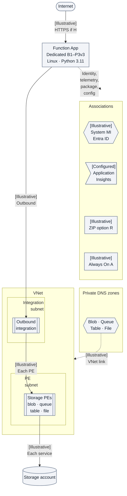
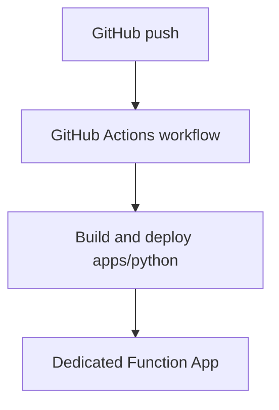

---
validation:
  az_cli:
    last_tested: 2026-04-09
    cli_version: 2.83.0
    core_tools_version: 4.8.0
    result: pass
  bicep:
    last_tested:
    result: not_tested
content_sources:

  references:
    - type: mslearn-adapted
      url: https://learn.microsoft.com/en-us/azure/azure-functions/deployment-zip-push
    - type: mslearn-adapted
      url: https://learn.microsoft.com/en-us/azure/azure-functions/functions-how-to-github-actions
    - type: mslearn-adapted
      url: https://learn.microsoft.com/en-us/azure/azure-functions/functions-deployment-slots
    - type: mslearn-adapted
      url: https://learn.microsoft.com/en-us/azure/app-service/overview-vnet-integration
    - type: mslearn-adapted
      url: https://learn.microsoft.com/en-us/azure/app-service/networking/private-endpoint
  diagrams:
    - id: what-you-ll-build
      type: flowchart
      source: self-generated
      justification: Optional Dedicated private Storage context, separate from the public deployment workflow; bundled endpoints retain each service and DNS mapping in the adjacent key.
      based_on:
        - https://learn.microsoft.com/en-us/azure/azure-functions/deployment-zip-push
        - https://learn.microsoft.com/en-us/azure/azure-functions/functions-how-to-github-actions
        - https://learn.microsoft.com/en-us/azure/azure-functions/functions-deployment-slots
        - https://learn.microsoft.com/en-us/azure/app-service/overview-vnet-integration
        - https://learn.microsoft.com/en-us/azure/app-service/networking/private-endpoint
        - https://learn.microsoft.com/en-us/azure/storage/common/storage-private-endpoints
        - https://learn.microsoft.com/en-us/azure/app-service/overview-managed-identity
        - https://learn.microsoft.com/en-us/azure/azure-functions/functions-monitoring
        - https://learn.microsoft.com/en-us/azure/azure-functions/dedicated-plan
        - https://learn.microsoft.com/en-us/azure/azure-functions/supported-languages
        - https://learn.microsoft.com/en-us/azure/azure-functions/python-build-options
        - https://learn.microsoft.com/en-us/azure/app-service/overview-access-restrictions#app-access
    - id: what-you-ll-build-2
      type: flowchart
      source: self-generated
      justification: Intended Python GitHub Actions deployment stages for Dedicated; remote build is distinct from runner dependency installation.
      based_on:
        - https://learn.microsoft.com/en-us/azure/azure-functions/deployment-zip-push
        - https://learn.microsoft.com/en-us/azure/azure-functions/functions-how-to-github-actions
        - https://learn.microsoft.com/en-us/azure/azure-functions/functions-deployment-slots
        - https://learn.microsoft.com/en-us/azure/app-service/overview-vnet-integration
        - https://learn.microsoft.com/en-us/azure/app-service/networking/private-endpoint
        - https://learn.microsoft.com/en-us/azure/azure-functions/python-build-options
        - https://learn.microsoft.com/en-us/azure/app-service/deploy-staging-slots
---
# 06 - CI/CD (Dedicated)

This tutorial sets up CI/CD for Dedicated with standard zip deployment. Dedicated supports Kudu/SCM and zipdeploy workflows, which makes GitHub Actions integration straightforward.

## Prerequisites

- Completed [05 - Infrastructure as Code](05-infrastructure-as-code.md)
- Function App deployed on Dedicated
- Variables set:

```bash
export RG="rg-func-dedicated-dev"
export APP_NAME="func-dedi-<unique-suffix>"
export PLAN_NAME="asp-dedi-b1-dev"
export STORAGE_NAME="stdedidev<unique>"
export LOCATION="koreacentral"
```

## What You'll Build

You will package the Python Function App from `apps/python`, deploy it with Zip Deploy and remote build settings, and implement an automated GitHub Actions deployment workflow.

!!! info "Infrastructure Context"
    **Plan**: Dedicated (B1) | **Network**: Public internet in this tutorial | **VNet**: Supported by platform, not configured here

    Dedicated provides fixed plan capacity; enable Always On for reliable non-HTTP triggering. The figure retains optional private Storage context, not networking configured by this page. The baseline B1 workflow has no staging slot; Standard, Premium or Isolated tiers support slots.

    <!-- diagram-id: what-you-ll-build -->


**Reading key:** Solid arrows show intended request/data access; dotted arrows are associations. The **Associations** box groups identity, telemetry, package option R and Always On A under one dotted association from the app, each keeping its evidence tag. The private network is **optional illustrative context**, not an assertion that these steps configure it. Outbound VNet integration does not deploy compute into its subnet. The DNS link targets the VNet boundary; the table retains endpoint-to-zone-group associations, not endpoint-originated DNS queries ([integration](https://learn.microsoft.com/en-us/azure/app-service/overview-vnet-integration), [Storage endpoints](https://learn.microsoft.com/en-us/azure/storage/common/storage-private-endpoints)).

| Key | Context / qualification |
|---|---|
| H | Public HTTPS is available only when app public-network access and access restrictions permit it; a prerequisite deployment with a site private endpoint can change that default |
| VNet / integration / PE subnet | `10.0.0.0/16` / `10.0.1.0/24` / `10.0.2.0/24`; delegation `Microsoft.Web/serverFarms` |
| R | Local ready-to-run ZIP alternative: `WEBSITE_RUN_FROM_PACKAGE=1`; do not force this setting for remote build |
| A | Enable `Always On: true` for reliable non-HTTP triggering on Dedicated; fixed plan capacity alone does not prevent app idling |
| Identity | Optional system-assigned identity in Microsoft Entra ID; token acquisition uses the app-local identity endpoint, not direct app-to-Entra transit |

The bundled endpoints and zones expand into four independent service associations, not serial hops:

| Endpoint → Storage service | Associated private DNS zone |
|---|---|
| `PE_BLOB` → Blob | `privatelink.blob.core.windows.net` |
| `PE_QUEUE` → Queue | `privatelink.queue.core.windows.net` |
| `PE_TABLE` → Table | `privatelink.table.core.windows.net` |
| `PE_FILE` → File | `privatelink.file.core.windows.net` |

These are contextual choices, not a universal four-endpoint requirement. See [Dedicated Always On](https://learn.microsoft.com/en-us/azure/azure-functions/dedicated-plan#always-on), [package configuration](https://learn.microsoft.com/en-us/azure/azure-functions/deployment-zip-push), [identity](https://learn.microsoft.com/en-us/azure/app-service/overview-managed-identity) and [app access defaults](https://learn.microsoft.com/en-us/azure/app-service/overview-access-restrictions#app-access).

<!-- diagram-id: what-you-ll-build-2 -->


## Steps

### Step 1 - Build a deployable zip package

```bash
python -m venv .venv
source .venv/bin/activate
pip install --requirement apps/python/requirements.txt

cd apps/python
zip --recurse-paths ../functionapp.zip .
cd ..
```

### Step 2 - Deploy with zipdeploy

```bash
az functionapp config appsettings set \
  --name $APP_NAME \
  --resource-group $RG \
  --settings \
    SCM_DO_BUILD_DURING_DEPLOYMENT=true \
    ENABLE_ORYX_BUILD=true

az functionapp deployment source config-zip \
  --name $APP_NAME \
  --resource-group $RG \
  --src functionapp.zip
```

| CLI element | Explanation |
|---|---|
| Command(s) | `az functionapp config appsettings set`, `az functionapp deployment source config-zip` |
| Key flags | `--name`, `--resource-group`, `--settings`, `--src` |
| Variables | `$APP_NAME`, `$RG` |
| Expected result | Azure CLI returns provisioning details; confirm the resource name and successful provisioning state before continuing. |


!!! warning "CLI overrides `SCM_DO_BUILD_DURING_DEPLOYMENT`"
    The `az functionapp deployment source config-zip` command automatically sets `SCM_DO_BUILD_DURING_DEPLOYMENT=false`, which prevents pip install from running during deployment. For Python apps on Dedicated, prefer `func azure functionapp publish $APP_NAME --python` instead of manual zip deploy — it handles the remote build correctly.

### Step 3 - Verify deployment and endpoint health

```bash
az functionapp deployment list-publishing-profiles \
  --name $APP_NAME \
  --resource-group $RG \
  --output table

curl --request GET "https://$APP_NAME.azurewebsites.net/api/health"
```

| CLI element | Explanation |
|---|---|
| Command(s) | `az functionapp deployment list-publishing-profiles` |
| Key flags | `--name`, `--resource-group`, `--output`, `--request` |
| Variables | `$APP_NAME`, `$RG` |
| Expected result | Azure CLI returns provisioning details; confirm the resource name and successful provisioning state before continuing. |


### Step 4 - Add GitHub Actions workflow (recommended)

Create `.github/workflows/deploy-dedicated.yml`:

```yaml
name: deploy-dedicated

on:
  push:
    branches: [ main ]

jobs:
  build-and-deploy:
    runs-on: ubuntu-latest
    steps:
      - name: Checkout
        uses: actions/checkout@v4

      - name: Deploy Azure Functions app
        uses: Azure/functions-action@v1
        with:
          app-name: ${{ vars.AZURE_FUNCTIONAPP_NAME }}
          package: apps/python
          publish-profile: ${{ secrets.AZURE_FUNCTIONAPP_PUBLISH_PROFILE }}
          scm-do-build-during-deployment: true
          enable-oryx-build: true
```

### Step 5 - Deployment slots (S1+ only)

Deployment slots are unavailable on B1. Upgrade to S1 or P1v2, then create and use a staging slot:

```bash
az appservice plan update \
  --name $PLAN_NAME \
  --resource-group $RG \
  --sku S1

az functionapp deployment slot create \
  --name $APP_NAME \
  --resource-group $RG \
  --slot staging

az functionapp deployment source config-zip \
  --name $APP_NAME \
  --resource-group $RG \
  --slot staging \
  --src functionapp.zip

az functionapp deployment slot swap \
  --name $APP_NAME \
  --resource-group $RG \
  --slot staging \
  --target-slot production
```

| CLI element | Explanation |
|---|---|
| Command(s) | `az appservice plan update`, `az functionapp deployment slot create`, `az functionapp deployment source config-zip`, `az functionapp deployment slot swap` |
| Key flags | `--name`, `--resource-group`, `--sku`, `--slot`, `--src`, `--target-slot` |
| Variables | `$PLAN_NAME`, `$RG`, `$APP_NAME` |
| Expected result | Azure CLI returns provisioning details; confirm the resource name and successful provisioning state before continuing. |


!!! info "Requires Standard tier or higher"
    Deployment slots are not available on Basic (B1) tier. Upgrade to Standard (S1) or Premium (P1v2) before using slots.

## Verification

`az functionapp deployment source config-zip ...`:

```json
{
  "active": true,
  "author": "N/A",
  "complete": true,
  "deployer": "ZipDeploy",
  "id": "xxxxxxxxxxxxxxxx",
  "message": "Created via a push deployment",
  "status": 4,
  "url": "https://func-dedi-<unique-suffix>.scm.azurewebsites.net/api/deployments/xxxxxxxxxxxxxxxx"
}
```

`curl --request GET "https://$APP_NAME.azurewebsites.net/api/health"`:

```json
{
  "status": "healthy",
  "timestamp": "2026-04-03T11:20:00Z",
  "version": "1.0.0"
}
```

`az functionapp deployment slot create ...` (after S1 upgrade):

```json
{
  "hostNames": [
    "func-dedi-<unique-suffix>-staging.azurewebsites.net"
  ],
  "name": "func-dedi-<unique-suffix>/slots/staging",
  "state": "Running"
}
```

## Next Steps

You now have a repeatable Dedicated deployment pipeline with optional slot-based release flow on S1/P1v2.

> **Next:** [07 - Extending with Triggers](07-extending-triggers.md)

## See Also

- [Tutorial Overview & Plan Chooser](../index.md)
- [Python Language Guide](../../index.md)
- [Platform: Hosting Plans](../../../../platform/hosting.md)
- [Operations: Deployment](../../../../operations/deployment.md)
- [Recipes Index](../../recipes/index.md)

## Sources

- [Zip deployment for Azure Functions](https://learn.microsoft.com/en-us/azure/azure-functions/deployment-zip-push)
- [Deploy Azure Functions with GitHub Actions](https://learn.microsoft.com/en-us/azure/azure-functions/functions-how-to-github-actions)
- [Deployment slots in Azure Functions](https://learn.microsoft.com/en-us/azure/azure-functions/functions-deployment-slots)
- [Python build and dependency packaging](https://learn.microsoft.com/en-us/azure/azure-functions/python-build-options)
- [Supported languages and operating systems](https://learn.microsoft.com/en-us/azure/azure-functions/supported-languages)
- [Dedicated hosting and Always On](https://learn.microsoft.com/en-us/azure/azure-functions/dedicated-plan)
- [App Service integration](https://learn.microsoft.com/en-us/azure/app-service/overview-vnet-integration)
- [Storage endpoints and DNS](https://learn.microsoft.com/en-us/azure/storage/common/storage-private-endpoints)
- [Managed identities](https://learn.microsoft.com/en-us/azure/app-service/overview-managed-identity)
- [App access defaults](https://learn.microsoft.com/en-us/azure/app-service/overview-access-restrictions#app-access)
- [Deployment-slot tiers](https://learn.microsoft.com/en-us/azure/app-service/deploy-staging-slots)
- [Application Insights integration](https://learn.microsoft.com/en-us/azure/azure-functions/functions-monitoring)
