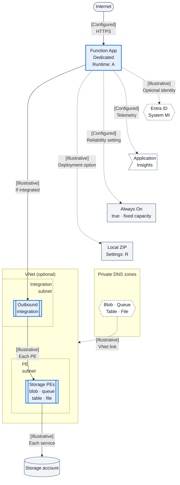
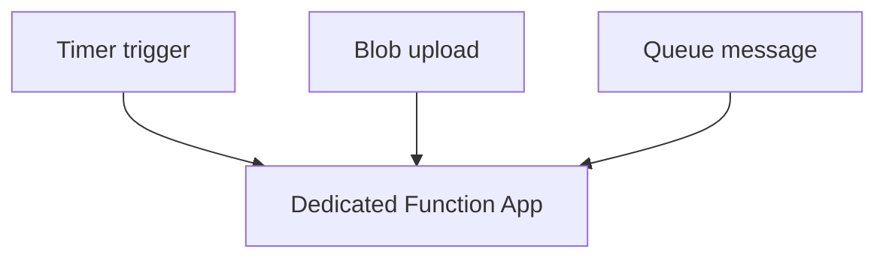

---
validation:
  az_cli:
    last_tested: 2026-04-09
    cli_version: 2.83.0
    core_tools_version: 4.8.0
    result: pass
  bicep:
    last_tested:
    result: not_tested
content_sources:

  references:
    - type: mslearn-adapted
      url: https://learn.microsoft.com/en-us/azure/azure-functions/functions-triggers-bindings
    - type: mslearn-adapted
      url: https://learn.microsoft.com/en-us/azure/azure-functions/functions-bindings-timer
    - type: mslearn-adapted
      url: https://learn.microsoft.com/en-us/azure/azure-functions/functions-bindings-storage-blob-trigger
    - type: mslearn-adapted
      url: https://learn.microsoft.com/en-us/azure/azure-functions/functions-bindings-storage-queue-trigger
    - type: mslearn-adapted
      url: https://learn.microsoft.com/en-us/azure/app-service/overview-vnet-integration
    - type: mslearn-adapted
      url: https://learn.microsoft.com/en-us/azure/app-service/networking/private-endpoint
  diagrams:
    - id: what-you-ll-build
      type: flowchart
      source: self-generated
      justification: Flow view of what you ll build, synthesized from Microsoft Learn documentation cited on this page.
      based_on:
        - https://learn.microsoft.com/en-us/azure/azure-functions/functions-networking-options
        - https://learn.microsoft.com/en-us/azure/storage/common/storage-private-endpoints
        - https://learn.microsoft.com/en-us/azure/app-service/overview-managed-identity
        - https://learn.microsoft.com/en-us/azure/azure-functions/dedicated-plan
        - https://learn.microsoft.com/en-us/azure/azure-functions/functions-deployment-technologies
        - https://learn.microsoft.com/en-us/azure/azure-functions/functions-triggers-bindings
        - https://learn.microsoft.com/en-us/azure/azure-functions/functions-bindings-timer
        - https://learn.microsoft.com/en-us/azure/azure-functions/functions-bindings-storage-blob-trigger
        - https://learn.microsoft.com/en-us/azure/azure-functions/functions-bindings-storage-queue-trigger
        - https://learn.microsoft.com/en-us/azure/app-service/overview-vnet-integration
        - https://learn.microsoft.com/en-us/azure/app-service/networking/private-endpoint
    - id: what-you-ll-build-2
      type: flowchart
      source: self-generated
      justification: Flow view of what you ll build 2, synthesized from Microsoft Learn documentation cited on this page.
      based_on:
        - https://learn.microsoft.com/en-us/azure/azure-functions/dedicated-plan
        - https://learn.microsoft.com/en-us/azure/azure-functions/functions-triggers-bindings
        - https://learn.microsoft.com/en-us/azure/azure-functions/functions-bindings-timer
        - https://learn.microsoft.com/en-us/azure/azure-functions/functions-bindings-storage-blob-trigger
        - https://learn.microsoft.com/en-us/azure/azure-functions/functions-bindings-storage-queue-trigger
        - https://learn.microsoft.com/en-us/azure/app-service/overview-vnet-integration
        - https://learn.microsoft.com/en-us/azure/app-service/networking/private-endpoint
---
# 07 - Extending with Triggers (Dedicated)

This tutorial extends your Dedicated Function App beyond HTTP with timer, blob, and queue triggers. On Dedicated, all standard triggers are supported, timer workloads benefit from Always On, and blob trigger polling works normally.

## Prerequisites

- Completed [06 - CI/CD](06-ci-cd.md)
- Variables exported:

```bash
export RG="rg-func-dedicated-dev"
export APP_NAME="func-dedi-<unique-suffix>"
export PLAN_NAME="asp-dedi-b1-dev"
export STORAGE_NAME="stdedidev<unique>"
export LOCATION="koreacentral"
```

## What You'll Build

You will add timer, blob, and queue-triggered functions under `apps/python/blueprints/`, register them in the app entry point, and validate trigger execution after deployment.

!!! info "Infrastructure Context"
    **Plan**: Dedicated (B1) | **Network**: Public internet in this tutorial | **VNet**: Supported by platform, not configured here

    The app uses fixed App Service Plan capacity, not event-driven scale-to-zero; enable Always On for reliable non-HTTP triggering. Basic B1 supports App Service VNet integration and private endpoints, but this guide uses Standard (S1+) for private networking scenarios to provide scale headroom, deployment slots, and a production-oriented validation path.

<!-- diagram-id: what-you-ll-build -->


**Reading key (Dedicated):** The optional private-network extension is context, not a result of these public-network trigger steps. Solid arrows show intended request/data access; dotted arrows show configuration, identity, telemetry or VNet-link associations, not transit. Outbound VNet integration does not deploy app compute into the integration subnet ([networking](https://learn.microsoft.com/en-us/azure/azure-functions/functions-networking-options)).

| Key | Configuration / meaning |
|---|---|
| A / App | Dedicated B1 through P3v3, Linux Python 3.11; this tutorial starts on B1, not an ASE deployment |
| VNet / integration / PE subnet | `10.0.0.0/16` / `10.0.1.0/24` / `10.0.2.0/24`; delegation `Microsoft.Web/serverFarms` |
| R | Local ZIP alternative `WEBSITE_RUN_FROM_PACKAGE=1`; do not force this setting for a remote build ([deployment](https://learn.microsoft.com/en-us/azure/azure-functions/functions-deployment-technologies)) |
| Always On | Enable for reliable non-HTTP triggering on Dedicated hosting; an idled app without it can wake on an HTTP request or portal access ([Dedicated](https://learn.microsoft.com/en-us/azure/azure-functions/dedicated-plan#always-on)) |
| Entra ID / System MI | Microsoft Entra ID / optional system-assigned managed identity; tokens come from the app's local identity endpoint, not a direct app-to-Entra network hop ([identity](https://learn.microsoft.com/en-us/azure/app-service/overview-managed-identity)) |

The bundled endpoint and DNS nodes expand to **four distinct paths**, not serial Storage services. Each row retains endpoint → Storage service and the endpoint's DNS zone-group association; zones are outside and linked to the VNet ([Storage endpoints/DNS](https://learn.microsoft.com/en-us/azure/storage/common/storage-private-endpoints)).

| Endpoint → Storage service | Private DNS zone |
|---|---|
| `PE_BLOB` → Blob | `privatelink.blob.core.windows.net` |
| `PE_QUEUE` → Queue | `privatelink.queue.core.windows.net` |
| `PE_TABLE` → Table | `privatelink.table.core.windows.net` |
| `PE_FILE` → File | `privatelink.file.core.windows.net` |

<!-- diagram-id: what-you-ll-build-2 -->


## Steps

### Step 1 - Keep Always On enabled for background reliability

```bash
az functionapp config set \
  --name $APP_NAME \
  --resource-group $RG \
  --always-on true
```

| CLI element | Explanation |
|---|---|
| Command(s) | `az functionapp config set` |
| Key flags | `--name`, `--resource-group`, `--always-on` |
| Variables | `$APP_NAME`, `$RG` |
| Expected result | Azure CLI applies the configuration change; confirm the returned JSON or follow-up query shows the expected value. |


Timer triggers are most reliable when Always On is enabled on Dedicated.

### Step 2 - Add a timer trigger

Create `apps/python/blueprints/scheduled_jobs.py`:

```python
import datetime
import logging
import azure.functions as func

bp = func.Blueprint()

@bp.function_name(name="cleanup_timer")
@bp.timer_trigger(schedule="0 */5 * * * *", arg_name="timer")
def cleanup_timer(timer: func.TimerRequest) -> None:
    logging.info("Cleanup timer executed at %s", datetime.datetime.utcnow().isoformat())
```

Register the blueprint in `apps/python/function_app.py`.

### Step 3 - Add a blob trigger (standard polling)

Create `apps/python/blueprints/blob_processor.py`:

```python
import logging
import azure.functions as func

bp = func.Blueprint()

@bp.function_name(name="blob_ingest")
@bp.blob_trigger(arg_name="input_blob", path="uploads/{name}", connection="AzureWebJobsStorage")
def blob_ingest(input_blob: func.InputStream) -> None:
    logging.info("Blob trigger fired for %s (%s bytes)", input_blob.name, input_blob.length)
```

Blob polling works on Dedicated App Service Plan.

### Step 4 - Add a queue trigger

Create `apps/python/blueprints/queue_processor.py`:

```python
import logging
import azure.functions as func

bp = func.Blueprint()

@bp.function_name(name="queue_worker")
@bp.queue_trigger(arg_name="msg", queue_name="jobs", connection="AzureWebJobsStorage")
def queue_worker(msg: func.QueueMessage) -> None:
    logging.info("Queue message processed: %s", msg.get_body().decode("utf-8"))
```

### Step 5 - Deploy and test triggers

```bash
cd apps/python && func azure functionapp publish $APP_NAME --python

az storage container create \
  --name uploads \
  --account-name $STORAGE_NAME

az storage queue create \
  --name jobs \
  --account-name $STORAGE_NAME

az storage blob upload \
  --account-name $STORAGE_NAME \
  --container-name uploads \
  --name sample.txt \
  --file ./README.md

az storage message put \
  --account-name $STORAGE_NAME \
  --queue-name jobs \
  --content "run-job-001"
```

| CLI element | Explanation |
|---|---|
| Command(s) | `az storage container create`, `az storage queue create`, `az storage blob upload`, `az storage message put` |
| Key flags | `--python`, `--name`, `--account-name`, `--container-name`, `--file`, `--queue-name`, `--content` |
| Variables | `$APP_NAME`, `$STORAGE_NAME` |
| Expected result | Azure CLI returns provisioning details; confirm the resource name and successful provisioning state before continuing. |


### Step 6 - Review runtime and scale behavior

- Dedicated is always running and does not scale to zero.
- Autoscale on Basic (B1) is manual only; autoscale rules are available on Standard and higher tiers.
- Typical maximum instance limits by Dedicated tier are Basic: 3, Standard: 10, Premium: 30.
- Timeout default is 30 minutes and max is unlimited.
- Memory depends on selected plan SKU.

!!! info "B1 network support and guide scope"
    Basic (B1) supports App Service VNet integration. This guide's private networking scenarios use Standard (S1+) as the validated production path, so upgrade when you want to follow those walkthroughs exactly.

!!! info "Private endpoints on Dedicated"
    App Service private endpoints are supported on Basic (B1) and higher tiers. When enabled, validate private DNS resolution for the app hostname.

## Verification

`cd apps/python && func azure functionapp publish $APP_NAME --python`:

```text
Getting site publishing info...
Creating archive for current directory...
Uploading 8.4 MB [########################################################]
Deployment successful.
Syncing triggers...
Functions in func-dedi-<unique-suffix>:
    health - [httpTrigger]
    info - [httpTrigger]
    cleanup_timer - [timerTrigger]
    blob_ingest - [blobTrigger]
    queue_worker - [queueTrigger]
```

`az storage message put ...`:

```json
{
  "content": "run-job-001",
  "dequeueCount": 0,
  "expirationTime": "2026-04-10T11:55:17+00:00",
  "id": "xxxxxxxx-xxxx-xxxx-xxxx-xxxxxxxxxxxx",
  "insertionTime": "2026-04-03T11:55:17+00:00",
  "popReceipt": "<masked>",
  "timeNextVisible": "2026-04-03T11:55:17+00:00"
}
```

Application log sample (Kudu/Log Stream):

```text
[Information] Cleanup timer executed at 2026-04-03T11:55:00.102341
[Information] Blob trigger fired for uploads/sample.txt (12457 bytes)
[Information] Queue message processed: run-job-001
```

## Next Steps

You now have a full Dedicated track implementation with HTTP, timer, blob, and queue triggers, plus deployment and operations foundations.

> **Next:** [How Azure Functions Works](../../../../platform/architecture/index.md)

## See Also

- [Tutorial Overview & Plan Chooser](../index.md)
- [Python Language Guide](../../index.md)
- [Platform: Hosting Plans](../../../../platform/hosting.md)
- [Operations: Deployment](../../../../operations/deployment.md)
- [Recipes Index](../../recipes/index.md)

## Sources

- [Functions networking options](https://learn.microsoft.com/en-us/azure/azure-functions/functions-networking-options)
- [Storage private endpoints and DNS](https://learn.microsoft.com/en-us/azure/storage/common/storage-private-endpoints)
- [App Service and Functions managed identity](https://learn.microsoft.com/en-us/azure/app-service/overview-managed-identity)
- [Dedicated hosting and Always On](https://learn.microsoft.com/en-us/azure/azure-functions/dedicated-plan#always-on)
- [Functions deployment technologies](https://learn.microsoft.com/en-us/azure/azure-functions/functions-deployment-technologies)
- [Azure Functions triggers and bindings concepts](https://learn.microsoft.com/en-us/azure/azure-functions/functions-triggers-bindings)
- [Timer trigger for Azure Functions](https://learn.microsoft.com/en-us/azure/azure-functions/functions-bindings-timer)
- [Blob trigger for Azure Functions](https://learn.microsoft.com/en-us/azure/azure-functions/functions-bindings-storage-blob-trigger)
- [Queue trigger for Azure Functions](https://learn.microsoft.com/en-us/azure/azure-functions/functions-bindings-storage-queue-trigger)
