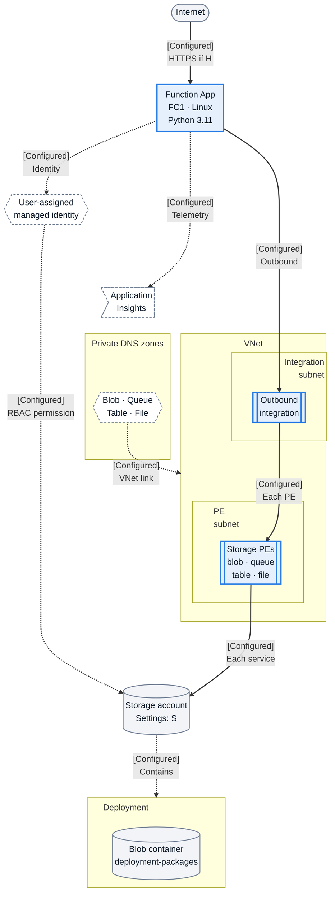
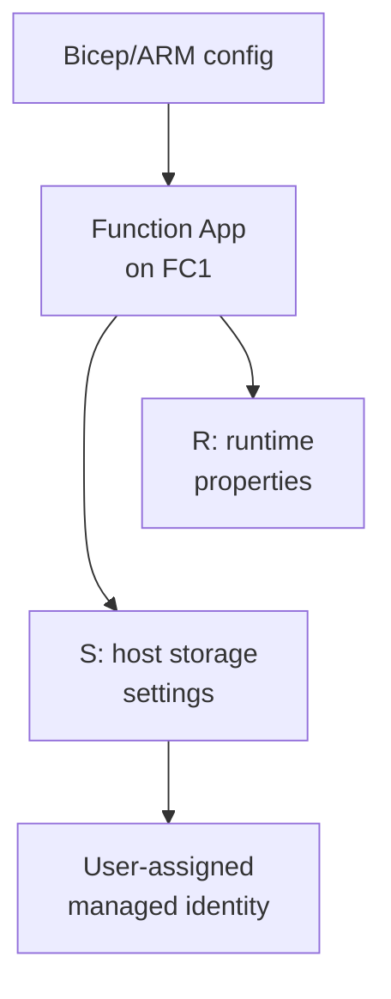

---
validation:
  az_cli:
    last_tested: 2026-04-09
    cli_version: 2.83.0
    core_tools_version: 4.8.0
    result: pass
  bicep:
    last_tested:
    result: not_tested
content_sources:

  references:
    - type: mslearn-adapted
      url: https://learn.microsoft.com/en-us/azure/azure-functions/functions-app-settings
    - type: mslearn-adapted
      url: https://learn.microsoft.com/en-us/azure/azure-functions/flex-consumption-how-to
    - type: mslearn-adapted
      url: https://learn.microsoft.com/en-us/azure/azure-functions/functions-reference#connecting-to-host-storage-with-an-identity
  diagrams:
    - id: what-you-ll-build
      type: flowchart
      source: self-generated
      justification: Intended Python Linux FC1 private Storage configuration, with distinct endpoint and DNS mappings in the adjacent key; identity is authorization, not a transport hop or execution result.
      based_on:
        - https://learn.microsoft.com/en-us/azure/azure-functions/functions-reference-python
        - https://learn.microsoft.com/en-us/azure/azure-functions/functions-networking-options
        - https://learn.microsoft.com/en-us/azure/storage/common/storage-private-endpoints
        - https://learn.microsoft.com/en-us/azure/azure-functions/storage-considerations
        - https://learn.microsoft.com/en-us/azure/azure-functions/manage-connections
        - https://learn.microsoft.com/en-us/azure/app-service/overview-managed-identity
        - https://learn.microsoft.com/en-us/azure/azure-functions/functions-monitoring
        - https://learn.microsoft.com/en-us/azure/app-service/overview-access-restrictions#app-access
        - https://learn.microsoft.com/en-us/azure/azure-functions/functions-app-settings
        - https://learn.microsoft.com/en-us/azure/azure-functions/flex-consumption-how-to
        - https://learn.microsoft.com/en-us/azure/azure-functions/functions-reference#connecting-to-host-storage-with-an-identity
    - id: what-you-ll-build-2
      type: flowchart
      source: self-generated
      justification: Flow view of what you ll build 2, synthesized from Microsoft Learn documentation cited on this page.
      based_on:
        - https://learn.microsoft.com/en-us/azure/azure-functions/functions-app-settings
        - https://learn.microsoft.com/en-us/azure/azure-functions/flex-consumption-how-to
        - https://learn.microsoft.com/en-us/azure/azure-functions/functions-reference#connecting-to-host-storage-with-an-identity
---
# 03 - Configuration (Flex Consumption)

Configure runtime, app settings, and host storage correctly for Flex Consumption so your app deploys cleanly and scales predictably.

## Prerequisites

| Tool | Minimum version | Purpose |
|---|---|---|
| Azure CLI | 2.60+ | Manage app configuration |
| jq | Latest | Read JSON output |
| Existing FC1 app | Deployed | Target for configuration |

## What You'll Build

You will configure a deployed Flex Consumption app to use identity-based host storage and validate that runtime settings come from `functionAppConfig`.

!!! info "Infrastructure Context"
    **Plan**: Flex Consumption (FC1) | **Network**: Full private network | **VNet**: ✅

    The production Bicep context uses outbound VNet integration, four Storage private endpoints, linked private DNS zones and a user-assigned managed identity with shared keys disabled. These are this example's choices, not prerequisites of every FC1 app, and the settings-only steps below do not provision the network. VNet integration does not deploy app compute into the integration subnet.

    <!-- diagram-id: what-you-ll-build -->


**Reading key (Linux FC1):** Solid arrows show intended request/data access; dotted arrows show identity, permissions, telemetry, VNet-link association or membership. RBAC grants access to the identity; data does not traverse the identity node. Token acquisition uses the app's local identity endpoint ([identity](https://learn.microsoft.com/en-us/azure/app-service/overview-managed-identity)). The bundled endpoints are parallel service paths, not serial hops.

| Key | Full configuration / qualification |
|---|---|
| H | Public HTTPS requires app public access to be enabled and permitted by access restrictions. This figure shows Storage endpoints, not a site private endpoint. If a separate site endpoint is added with `publicNetworkAccess` unset, public ingress defaults to disabled. |
| VNet / integration / PE subnet | `10.0.0.0/16` / `10.0.1.0/24` / `10.0.2.0/24`; integration delegation `Microsoft.App/environments`. |
| S | The production template's module maps `allowPublicAccess: false` to Storage `publicNetworkAccess: Disabled`; `allowSharedKeyAccess: false` rejects Shared Key authorization. The app's host and deployment settings separately configure its managed identity. Network access and authorization are separate controls ([Shared Key](https://learn.microsoft.com/en-us/azure/storage/common/shared-key-authorization-prevent)). |
| Host identity | This tutorial chooses `AzureWebJobsStorage__accountName`, `AzureWebJobsStorage__credential=managedidentity` and `AzureWebJobsStorage__clientId` for its UAMI. Host storage can instead use a connection string; UAMI selection can also use `__managedIdentityResourceId`, not both selectors. |
| Runtime / deployment | Python name/version come from `functionAppConfig.runtime`; `FUNCTIONS_WORKER_RUNTIME` is not set on Flex. Blob deployment storage has its own `functionAppConfig.deployment.storage` authentication configuration, which can use a connection string or managed identity. Flex has no Azure Files content-share dependency. |

The four distinct endpoint → service and endpoint → DNS zone-group associations remain enumerated below. DNS zones are external to and linked to the VNet; clients use normal Storage hostnames resolving to PE IPs for this path. File is retained as optional workload access, not an FC1 content requirement.

| Endpoint → Storage service | Private DNS zone |
|---|---|
| `PE_BLOB` → Blob | `privatelink.blob.core.windows.net` |
| `PE_QUEUE` → Queue | `privatelink.queue.core.windows.net` |
| `PE_TABLE` → Table | `privatelink.table.core.windows.net` |
| `PE_FILE` → File | `privatelink.file.core.windows.net` |

Sources: [network/delegation](https://learn.microsoft.com/en-us/azure/azure-functions/functions-networking-options), [Storage endpoints/DNS](https://learn.microsoft.com/en-us/azure/storage/common/storage-private-endpoints), [host connections](https://learn.microsoft.com/en-us/azure/azure-functions/manage-connections), [settings](https://learn.microsoft.com/en-us/azure/azure-functions/functions-app-settings), [Flex deployment](https://learn.microsoft.com/en-us/azure/azure-functions/flex-consumption-how-to#configure-deployment-settings), [storage](https://learn.microsoft.com/en-us/azure/azure-functions/storage-considerations), [app access](https://learn.microsoft.com/en-us/azure/app-service/overview-access-restrictions#app-access).

<!-- diagram-id: what-you-ll-build-2 -->


R = `functionAppConfig.runtime`; S = the `AzureWebJobsStorage__*` settings expanded in the preceding key. All four configuration relationships are retained; the invisible tier is only for layout.

## Steps

### Step 1: Set Variables

```bash
export BASE_NAME="flexdemo"
export RG="rg-flexdemo"
export APP_NAME="flexdemo-func"
export PLAN_NAME="flexdemo-plan"
export STORAGE_NAME="flexdemostorage"
export APPINSIGHTS_NAME="flexdemo-insights"
export LOCATION="koreacentral"
```

Expected output:


```text
```

### Step 2: Configure Identity-Based Host Storage

Flex Consumption host storage must be identity-based. Use `AzureWebJobsStorage__accountName` and related identity keys, not connection strings.


```bash
az functionapp config appsettings set \
  --name "$APP_NAME" \
  --resource-group "$RG" \
  --settings \
    "AzureWebJobsStorage__accountName=$STORAGE_NAME" \
    "AzureWebJobsStorage__credential=managedidentity" \
    "AzureWebJobsStorage__clientId=<managed-identity-client-id>" \
  --output json
```

| CLI element | Explanation |
|---|---|
| Command(s) | `az functionapp config appsettings set` |
| Key flags | `--name`, `--resource-group`, `--settings`, `--output` |
| Variables | `$APP_NAME`, `$RG`, `$STORAGE_NAME` |
| Expected result | Azure CLI applies the configuration change; confirm the returned JSON or follow-up query shows the expected value. |


!!! tip "Why __clientId is required"
    When using a **user-assigned managed identity** (UAMI), you must provide `AzureWebJobsStorage__clientId` so the Functions host knows which identity to authenticate with. Without it, the host cannot resolve which UAMI to use and storage operations will fail. The reference template sets this value in `infra/flex-consumption/main.bicep` under `functionAppSettings.properties.AzureWebJobsStorage__clientId`.

Expected output:


```json
[
  {
    "name": "AzureWebJobsStorage__accountName",
    "slotSetting": false,
    "value": null
  },
  {
    "name": "AzureWebJobsStorage__credential",
    "slotSetting": false,
    "value": null
  },
  {
    "name": "AzureWebJobsStorage__clientId",
    "slotSetting": false,
    "value": null
  }
]
```

### Step 3: Set Additional App Settings

On Flex Consumption, the runtime name and version are defined in `functionAppConfig` (not in `FUNCTIONS_WORKER_RUNTIME`). Set only the remaining app-level settings here.


```bash
az functionapp config appsettings set \
  --name "$APP_NAME" \
  --resource-group "$RG" \
  --settings \
    "AZURE_FUNCTIONS_ENVIRONMENT=Production" \
  --output json
```

| CLI element | Explanation |
|---|---|
| Command(s) | `az functionapp config appsettings set` |
| Key flags | `--name`, `--resource-group`, `--settings`, `--output` |
| Variables | `$APP_NAME`, `$RG` |
| Expected result | Azure CLI applies the configuration change; confirm the returned JSON or follow-up query shows the expected value. |


!!! warning "Do not set FUNCTIONS_WORKER_RUNTIME on Flex"
    `FUNCTIONS_WORKER_RUNTIME` is **not supported** on Flex Consumption. The runtime is configured via `functionAppConfig.runtime` (see Step 4). Setting it as an app setting may cause unexpected behavior.

Expected output:


```json
[
  {
    "name": "AZURE_FUNCTIONS_ENVIRONMENT",
    "slotSetting": false,
    "value": null
  }
]
```

### Step 4: Validate Runtime Configuration Source

On Flex, runtime/version and scale settings are defined in `functionAppConfig` (resource properties), not classic `siteConfig.appSettings` for runtime identity.


```bash
az functionapp show --name "$APP_NAME" --resource-group "$RG" --query "properties.functionAppConfig" --output json
```

| CLI element | Explanation |
|---|---|
| Command(s) | `az functionapp show` |
| Key flags | `--name`, `--resource-group`, `--query`, `--output` |
| Variables | `$APP_NAME`, `$RG` |
| Expected result | Azure CLI returns the requested resource data; verify names, IDs, status fields, or metric values match the scenario. |


Expected output:


```json
{
  "deployment": {
    "storage": {
      "type": "blobContainer"
    }
  },
  "runtime": {
    "name": "python",
    "version": "3.11"
  },
  "scaleAndConcurrency": {
    "instanceMemoryMB": 2048,
    "maximumInstanceCount": 100
  }
}
```

### Step 5: Confirm Flex Plan Characteristics

!!! warning "Auto-generated plan name"
    When using `--flexconsumption-location` to create the Function App (Step 12 in Tutorial 02), Azure auto-generates the App Service Plan name (e.g., `ASP-rgflexdemo-376c`) instead of using `$PLAN_NAME`. Query the actual plan name first:

    ```bash
    PLAN_NAME_ACTUAL=$(az functionapp show --name "$APP_NAME" --resource-group "$RG" \
      --query "properties.serverFarmId" --output tsv | awk -F/ '{print $NF}')
    echo "Actual plan name: $PLAN_NAME_ACTUAL"
    ```

    | CLI element | Explanation |
    |---|---|
    | Command(s) | `az functionapp show` |
    | Key flags | `--name`, `--resource-group`, `--query`, `--output` |
    | Variables | `$APP_NAME`, `$RG`, `$NF`, `$PLAN_NAME_ACTUAL` |
    | Expected result | Azure CLI returns the requested resource data; verify names, IDs, status fields, or metric values match the scenario. |


```bash
az appservice plan show --name "$PLAN_NAME_ACTUAL" --resource-group "$RG" --query "{sku:sku,reserved:reserved,kind:kind}" --output json
```

| CLI element | Explanation |
|---|---|
| Command(s) | `az appservice plan show` |
| Key flags | `--name`, `--resource-group`, `--query`, `--output` |
| Variables | `$PLAN_NAME_ACTUAL`, `$RG` |
| Expected result | Azure CLI returns the requested resource data; verify names, IDs, status fields, or metric values match the scenario. |


Expected output:


```json
{
  "kind": "functionapp",
  "reserved": null,
  "sku": {
    "name": "FC1",
    "tier": "FlexConsumption"
  }
}
```

### Step 6: Configuration Checklist for Flex

- Linux only (`reserved: true`).
- Host storage uses identity (`AzureWebJobsStorage__accountName`, `__credential`, `__clientId` for UAMI).
- Deployment package source is blob container (`functionAppConfig.deployment.storage.type = blobContainer`).
- Blob triggers in production must use Event Grid integration.
- No deployment slots.

## Verification

- `az functionapp show --query "properties.functionAppConfig.runtime"` returns Python runtime metadata.
- `az functionapp config appsettings list` includes `AzureWebJobsStorage__accountName`, `AzureWebJobsStorage__credential`, and `AzureWebJobsStorage__clientId`.
- `az appservice plan show` reports `sku.name` as `FC1` and `sku.tier` as `FlexConsumption`.

## Next Steps

> **Next:** [04 - Logging and Monitoring](04-logging-monitoring.md)

## See Also

- [Tutorial Overview & Plan Chooser](../index.md)
- [Python Language Guide](../../index.md)
- [Platform: Hosting Plans](../../../../platform/hosting.md)
- [Operations: Deployment](../../../../operations/deployment.md)
- [Recipes Index](../../recipes/index.md)

## Sources

- [App settings reference for Azure Functions](https://learn.microsoft.com/en-us/azure/azure-functions/functions-app-settings)
- [Flex Consumption how-to](https://learn.microsoft.com/en-us/azure/azure-functions/flex-consumption-how-to)
- [Identity-based connections for Azure Functions](https://learn.microsoft.com/en-us/azure/azure-functions/functions-reference#connecting-to-host-storage-with-an-identity)
