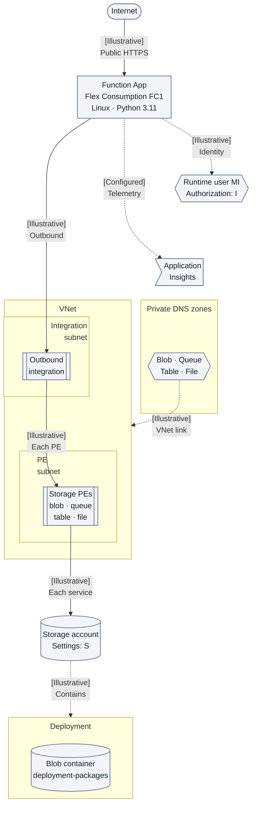
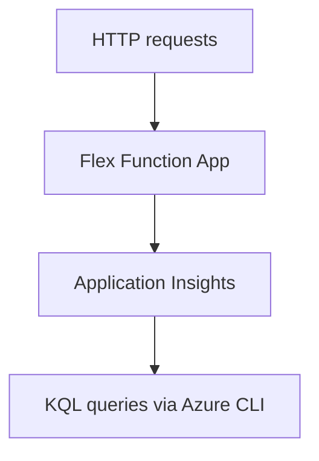

---
validation:
  az_cli:
    last_tested: 2026-04-09
    cli_version: 2.83.0
    core_tools_version: 4.8.0
    result: pass
  bicep:
    last_tested:
    result: not_tested
content_sources:

  references:
    - type: mslearn-adapted
      url: https://learn.microsoft.com/en-us/azure/azure-functions/monitor-functions
    - type: mslearn-adapted
      url: https://learn.microsoft.com/en-us/azure/azure-monitor/logs/log-query-overview
    - type: mslearn-adapted
      url: https://learn.microsoft.com/en-us/azure/azure-monitor/app/app-insights-overview
  diagrams:
    - id: what-you-ll-build
      type: flowchart
      source: self-generated
      justification: Python Linux plan-specific infrastructure context with full adjacent reading key; not deployment evidence.
      based_on:
        - https://learn.microsoft.com/en-us/azure/azure-functions/monitor-functions
        - https://learn.microsoft.com/en-us/azure/azure-monitor/logs/log-query-overview
        - https://learn.microsoft.com/en-us/azure/azure-monitor/app/app-insights-overview
        - https://learn.microsoft.com/en-us/azure/azure-functions/functions-reference-python
        - https://learn.microsoft.com/en-us/azure/azure-functions/configure-monitoring
        - https://learn.microsoft.com/en-us/azure/azure-functions/streaming-logs
        - https://learn.microsoft.com/en-us/azure/azure-functions/functions-networking-options
        - https://learn.microsoft.com/en-us/azure/azure-functions/storage-considerations
        - https://learn.microsoft.com/en-us/azure/azure-monitor/app/create-workspace-resource
        - https://learn.microsoft.com/en-us/azure/app-service/overview-managed-identity
        - https://learn.microsoft.com/en-us/azure/app-service/overview-access-restrictions#app-access
        - https://learn.microsoft.com/en-us/azure/azure-functions/deployment-zip-push
        - https://learn.microsoft.com/en-us/azure/storage/common/storage-private-endpoints
        - https://learn.microsoft.com/en-us/azure/azure-functions/opentelemetry-howto
        - https://learn.microsoft.com/en-us/azure/azure-functions/monitor-functions-reference
    - id: what-you-ll-build-2
      type: flowchart
      source: self-generated
      justification: Python plan-specific monitoring verification relationships; analysis arrows are not network-transit claims.
      based_on:
        - https://learn.microsoft.com/en-us/azure/azure-functions/monitor-functions
        - https://learn.microsoft.com/en-us/azure/azure-monitor/logs/log-query-overview
        - https://learn.microsoft.com/en-us/azure/azure-monitor/app/app-insights-overview
        - https://learn.microsoft.com/en-us/azure/azure-functions/functions-reference-python
        - https://learn.microsoft.com/en-us/azure/azure-functions/configure-monitoring
        - https://learn.microsoft.com/en-us/azure/azure-functions/streaming-logs
        - https://learn.microsoft.com/en-us/azure/azure-functions/functions-networking-options
        - https://learn.microsoft.com/en-us/azure/azure-functions/storage-considerations
        - https://learn.microsoft.com/en-us/azure/azure-monitor/app/create-workspace-resource
        - https://learn.microsoft.com/en-us/azure/app-service/overview-managed-identity
        - https://learn.microsoft.com/en-us/azure/app-service/overview-access-restrictions#app-access
        - https://learn.microsoft.com/en-us/azure/azure-functions/deployment-zip-push
        - https://learn.microsoft.com/en-us/azure/storage/common/storage-private-endpoints
        - https://learn.microsoft.com/en-us/azure/azure-functions/opentelemetry-howto
        - https://learn.microsoft.com/en-us/azure/azure-functions/monitor-functions-reference
---
# 04 - Logging and Monitoring (Flex Consumption)

Set up observability for your Flex Consumption app so you can verify deployments, inspect failures, and monitor scale behavior.

## Prerequisites

| Tool | Minimum version | Purpose |
|---|---|---|
| Azure CLI | 2.60+ | Query Function App + App Insights |
| Application Insights resource | Existing | Telemetry backend |
| Deployed FC1 app | Existing | Live target to inspect |

## What You'll Build

You will generate real requests and exception telemetry from a Flex Consumption app and validate the data path in Application Insights.

!!! info "Infrastructure Context"
    **Plan**: Flex Consumption (FC1) | **Network**: Private Storage context | **VNet**: ✅

    The figure retains an illustrative private Storage context with user-assigned identity; this monitoring page does not provision it. Four Storage endpoints and disabled shared keys are scenario choices, not Flex requirements.

    <!-- diagram-id: what-you-ll-build -->


**Reading key:** Solid arrows are intended request/data access; dotted arrows are identity, telemetry, VNet-link or membership associations. `[Illustrative]` marks surrounding network choices, not configuration executed by this page. VNet integration is outbound-only and does not deploy compute into its subnet; the DNS link targets the actual VNet boundary ([networking](https://learn.microsoft.com/en-us/azure/azure-functions/functions-networking-options)).

| Key | Context / qualification |
|---|---|
| VNet / integration / PE subnet | `10.0.0.0/16` / `10.0.1.0/24` / `10.0.2.0/24`; Flex delegation `Microsoft.App/environments` |
| S | The repository Storage module maps `allowPublicAccess: false` to `publicNetworkAccess: Disabled` and firewall default Deny. Separately, `allowBlobPublicAccess: false` blocks anonymous Blob access, and `allowSharedKeyAccess: false` disables Shared Key authorization. These are this context's settings, not universal Flex requirements |
| I | Runtime user-assigned managed identity requires appropriate Storage RBAC roles; token acquisition uses the app-local identity endpoint. This is authorization, not a Storage data-transit hop |
| Deployment | `deployment-packages` is the contextual Blob container name; check the app's selected deployment container. Direct upload to a container alone is not deployment |

Each bundle expands into **four distinct endpoints and four zones**, with endpoint → matching service access and endpoint → zone-group association:

| Endpoint → Storage service | Associated private DNS zone |
|---|---|
| `PE_BLOB` → Blob | `privatelink.blob.core.windows.net` |
| `PE_QUEUE` → Queue | `privatelink.queue.core.windows.net` |
| `PE_TABLE` → Table | `privatelink.table.core.windows.net` |
| `PE_FILE` → File | `privatelink.file.core.windows.net` |

The File path is optional context, not a Flex content-share requirement. Clients retain normal Storage hostnames with DNS resolution to the private endpoint IPs; endpoint creation alone does not block public Storage access ([Storage endpoints](https://learn.microsoft.com/en-us/azure/storage/common/storage-private-endpoints), [storage](https://learn.microsoft.com/en-us/azure/azure-functions/storage-considerations), [identity](https://learn.microsoft.com/en-us/azure/app-service/overview-managed-identity), [deployment](https://learn.microsoft.com/en-us/azure/azure-functions/functions-deployment-technologies)).

<!-- diagram-id: what-you-ll-build-2 -->


**Reading the monitoring flow:** The connection-string setting selects Application Insights. For default Python `logging`, the worker forwards records through the Functions host, subject to filtering/sampling; a configured worker exporter is a separate choice, not implied by the FC1 label ([Python reference](https://learn.microsoft.com/en-us/azure/azure-functions/functions-reference-python#logging-and-monitoring), [configuration](https://learn.microsoft.com/en-us/azure/azure-functions/configure-monitoring)). KQL analyzes workspace-based telemetry in the linked Log Analytics workspace, not a required `FunctionAppLogs` intermediate ([workspace storage](https://learn.microsoft.com/en-us/azure/azure-monitor/app/create-workspace-resource), [resource-log routing](https://learn.microsoft.com/en-us/azure/azure-functions/monitor-functions#azure-monitor-resource-logs)).

## Steps

### Step 1: Set Variables

```bash
export BASE_NAME="flexdemo"
export RG="rg-flexdemo"
export APP_NAME="flexdemo-func"
export PLAN_NAME="flexdemo-plan"
export STORAGE_NAME="flexdemostorage"
export APPINSIGHTS_NAME="flexdemo-insights"
export LOCATION="koreacentral"
```

Expected output:


```text
```

### Step 2: Confirm Application Insights Wiring


```bash
az monitor app-insights component show --app "$APPINSIGHTS_NAME" --resource-group "$RG" --output json
az functionapp config appsettings list --name "$APP_NAME" --resource-group "$RG" --query "[?name=='APPLICATIONINSIGHTS_CONNECTION_STRING']" --output json
```

| CLI element | Explanation |
|---|---|
| Command(s) | `az monitor app-insights component show`, `az functionapp config appsettings list` |
| Key flags | `--app`, `--resource-group`, `--output`, `--name`, `--query` |
| Variables | `$APPINSIGHTS_NAME`, `$RG`, `$APP_NAME` |
| Expected result | Azure CLI applies the configuration change; confirm the returned JSON or follow-up query shows the expected value. |


Expected output:


```json
{
  "appId": "xxxxxxxxxxxxxxxxxxxxxxxxxxxxxxxx",
  "id": "/subscriptions/<subscription-id>/resourceGroups/rg-flexdemo/providers/microsoft.insights/components/flexdemo-insights",
  "name": "flexdemo-insights",
  "type": "microsoft.insights/components"
}
```


```json
[
  {
    "name": "APPLICATIONINSIGHTS_CONNECTION_STRING",
    "slotSetting": false,
    "value": null
  }
]
```

### Step 3: Generate Traffic

For exception traffic only, complete [controlled lab endpoint setup](../../../../reference/lab-endpoint-safety.md) first (`LAB_ENDPOINTS_ENABLED=true` and a protected `FUNCTION_KEY`). Disable the switch and rotate the experiment key afterward; health remains anonymous.


```bash
curl --request GET "https://$APP_NAME.azurewebsites.net/api/health"
curl --request GET "https://$APP_NAME.azurewebsites.net/api/info"
curl --request GET --header "x-functions-key: $FUNCTION_KEY" "https://$APP_NAME.azurewebsites.net/api/exceptions/test-error"
```

Expected output:


```json
{"status":"healthy","timestamp":"2026-01-01T00:00:00Z","version":"1.0.0"}
```


```json
{"error":"Handled exception","type":"ValueError","message":"Simulated error for testing"}
```

### Step 4: Query Request and Exception Telemetry


```bash
az monitor app-insights query --app "$APPINSIGHTS_NAME" --analytics-query "requests | where timestamp > ago(30m) | project timestamp, name, resultCode, duration | order by timestamp desc | take 20" --output json
az monitor app-insights query --app "$APPINSIGHTS_NAME" --analytics-query "exceptions | where timestamp > ago(30m) | project timestamp, type, outerMessage | order by timestamp desc | take 20" --output json
```

| CLI element | Explanation |
|---|---|
| Command(s) | `az monitor app-insights query` |
| Key flags | `--app`, `--analytics-query`, `--output` |
| Variables | `$APPINSIGHTS_NAME` |
| Expected result | Azure CLI returns the requested resource data; verify names, IDs, status fields, or metric values match the scenario. |


!!! tip "App Insights query by name vs appId"
    If `--app "$APPINSIGHTS_NAME"` fails with `PathNotFoundError`, use the appId instead:

    ```bash
    APPINSIGHTS_ID=$(az monitor app-insights component show \
      --app "$APPINSIGHTS_NAME" --resource-group "$RG" \
      --query "appId" --output tsv)
    az monitor app-insights query --apps "$APPINSIGHTS_ID" --analytics-query "..."
    ```

    | CLI element | Explanation |
    |---|---|
    | Command(s) | `az monitor app-insights component show`, `az monitor app-insights query` |
    | Key flags | `--app`, `--resource-group`, `--query`, `--output`, `--apps`, `--analytics-query` |
    | Variables | `$APPINSIGHTS_NAME`, `$RG`, `$APPINSIGHTS_ID` |
    | Expected result | Azure CLI returns the requested resource data; verify names, IDs, status fields, or metric values match the scenario. |


    Telemetry ingestion can take 2-5 minutes after requests. Wait and retry if results are empty.

Expected output:


```json
{
  "tables": [
    {
      "name": "PrimaryResult",
      "rows": [
        [
          "2026-01-01T00:00:00Z",
          "GET /api/health",
          "200",
          "00:00:00.0430000"
        ]
      ]
    }
  ]
}
```

### Step 5: Check Scale-Sensitive Telemetry

Flex can scale to zero and out to 1000 instances, so monitor cold starts, errors, and dependency latency.


```bash
az monitor app-insights query --app "$APPINSIGHTS_NAME" --analytics-query "traces | where timestamp > ago(30m) | where message contains 'Function started' or message contains 'Host lock lease acquired' | project timestamp, severityLevel, message | order by timestamp desc | take 50" --output json
```

| CLI element | Explanation |
|---|---|
| Command(s) | `az monitor app-insights query` |
| Key flags | `--app`, `--analytics-query`, `--output` |
| Variables | `$APPINSIGHTS_NAME` |
| Expected result | Azure CLI returns the requested resource data; verify names, IDs, status fields, or metric values match the scenario. |


Expected output:


```json
{
  "tables": [
    {
      "name": "PrimaryResult",
      "rows": [
        [
          "2026-01-01T00:01:12Z",
          1,
          "Function started (Id=xxxxxxxx-xxxx-xxxx-xxxx-xxxxxxxxxxxx)"
        ]
      ]
    }
  ]
}
```

### Step 6: Logging Guidance for Flex

- Keep structured logs in Python (`logging.info(..., extra={...})`) for KQL filtering.
- Treat deployment verification as: workflow logs + health checks + App Insights (not Kudu).
- Track trigger-specific behavior separately; queue-triggered functions scale per function.

## Verification

- `GET /api/health` and `GET /api/info` appear in the `requests` table with `resultCode` `200`.
- `GET /api/exceptions/test-error` appears in traces/requests and returns a handled exception payload.
- KQL output confirms recent telemetry ingestion within the last 15-30 minutes.

## Next Steps

> **Next:** [05 - Infrastructure as Code](05-infrastructure-as-code.md)

## See Also

- [Tutorial Overview & Plan Chooser](../index.md)
- [Python Language Guide](../../index.md)
- [Platform: Hosting Plans](../../../../platform/hosting.md)
- [Operations: Deployment](../../../../operations/deployment.md)
- [Recipes Index](../../recipes/index.md)

## Sources

- [Functions OpenTelemetry configuration](https://learn.microsoft.com/en-us/azure/azure-functions/opentelemetry-howto)
- [Functions monitoring data reference](https://learn.microsoft.com/en-us/azure/azure-functions/monitor-functions-reference)

- [functions-reference-python](https://learn.microsoft.com/en-us/azure/azure-functions/functions-reference-python)
- [configure-monitoring](https://learn.microsoft.com/en-us/azure/azure-functions/configure-monitoring)
- [streaming-logs](https://learn.microsoft.com/en-us/azure/azure-functions/streaming-logs)
- [functions-networking-options](https://learn.microsoft.com/en-us/azure/azure-functions/functions-networking-options)
- [storage-considerations](https://learn.microsoft.com/en-us/azure/azure-functions/storage-considerations)
- [create-workspace-resource](https://learn.microsoft.com/en-us/azure/azure-monitor/app/create-workspace-resource)
- [overview-managed-identity](https://learn.microsoft.com/en-us/azure/app-service/overview-managed-identity)
- [overview-access-restrictions](https://learn.microsoft.com/en-us/azure/app-service/overview-access-restrictions#app-access)
- [deployment-zip-push](https://learn.microsoft.com/en-us/azure/azure-functions/deployment-zip-push)
- [storage-private-endpoints](https://learn.microsoft.com/en-us/azure/storage/common/storage-private-endpoints)

- [Monitor Azure Functions](https://learn.microsoft.com/en-us/azure/azure-functions/monitor-functions)
- [Azure Monitor Logs query overview](https://learn.microsoft.com/en-us/azure/azure-monitor/logs/log-query-overview)
- [Application Insights overview](https://learn.microsoft.com/en-us/azure/azure-monitor/app/app-insights-overview)
