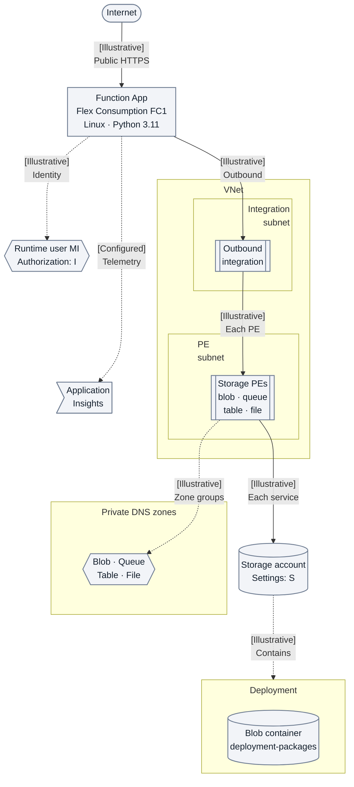
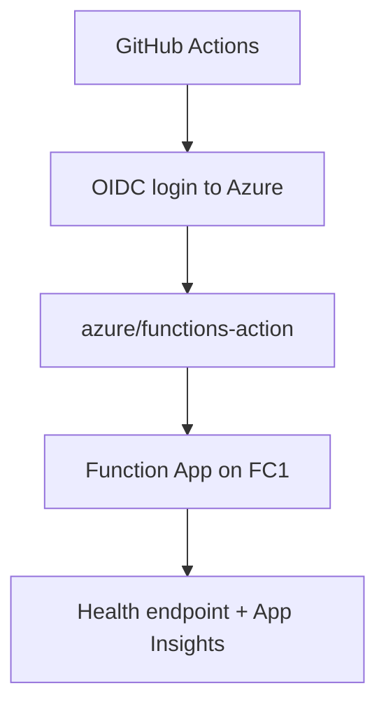

---
validation:
  az_cli:
    last_tested: 2026-04-09
    cli_version: 2.83.0
    core_tools_version: 4.8.0
    result: pass
  bicep:
    last_tested:
    result: not_tested
content_sources:

  references:
    - type: mslearn-adapted
      url: https://learn.microsoft.com/en-us/azure/azure-functions/functions-how-to-github-actions
    - type: mslearn-adapted
      url: https://learn.microsoft.com/en-us/azure/developer/github/connect-from-azure-openid-connect
    - type: mslearn-adapted
      url: https://learn.microsoft.com/en-us/azure/azure-functions/functions-deployment-technologies
  diagrams:
    - id: what-you-ll-build
      type: flowchart
      source: self-generated
      justification: Logical Linux FC1 private Storage context; bundled endpoints preserve four independent service and DNS mappings without treating runtime identity as transit.
      based_on:
        - https://learn.microsoft.com/en-us/azure/azure-functions/functions-how-to-github-actions
        - https://learn.microsoft.com/en-us/azure/developer/github/connect-from-azure-openid-connect
        - https://learn.microsoft.com/en-us/azure/azure-functions/functions-deployment-technologies
        - https://learn.microsoft.com/en-us/azure/azure-functions/functions-networking-options
        - https://learn.microsoft.com/en-us/azure/storage/common/storage-private-endpoints
        - https://learn.microsoft.com/en-us/azure/azure-functions/storage-considerations
        - https://learn.microsoft.com/en-us/azure/app-service/overview-managed-identity
        - https://learn.microsoft.com/en-us/azure/azure-functions/functions-monitoring
        - https://learn.microsoft.com/en-us/azure/azure-functions/supported-languages
        - https://learn.microsoft.com/en-us/azure/storage/blobs/anonymous-read-access-prevent
        - https://learn.microsoft.com/en-us/azure/storage/common/shared-key-authorization-prevent
    - id: what-you-ll-build-2
      type: flowchart
      source: self-generated
      justification: Intended OIDC login, Python package deployment and verification stages of the embedded FC1 example, not execution evidence.
      based_on:
        - https://learn.microsoft.com/en-us/azure/azure-functions/functions-how-to-github-actions
        - https://learn.microsoft.com/en-us/azure/developer/github/connect-from-azure-openid-connect
        - https://learn.microsoft.com/en-us/azure/azure-functions/functions-deployment-technologies
        - https://learn.microsoft.com/en-us/azure/azure-functions/python-build-options
---
# 06 - CI/CD (Flex Consumption)

Automate build and deployment for your Flex Consumption Function App with GitHub Actions and OIDC authentication.

## Prerequisites

| Tool | Minimum version | Purpose |
|---|---|---|
| GitHub repository | Actions enabled | CI/CD execution |
| Azure CLI | 2.60+ | Create app registration and role assignments |
| Deployed FC1 Function App | Existing | Deployment target |

## What You'll Build

You will configure OIDC-based GitHub Actions deployment to a Flex Consumption Function App and validate deployment telemetry without relying on Kudu.

!!! info "Infrastructure Context"
    **Plan**: Flex Consumption (FC1) | **Network**: Public ingress / private Storage context | **VNet**: ✅

    The figure retains a private Storage scenario with outbound integration, four service endpoints/DNS zones and runtime user-assigned identity. This is not a universal FC1 configuration: Flex uses a Blob deployment container, does not depend on Azure Files content storage and has no deployment slots. The pipeline's federated service principal is separate from the runtime identity.

    <!-- diagram-id: what-you-ll-build -->


**Reading key:** Solid arrows are intended request/data access; dotted arrows are identity, telemetry, zone-group or membership associations. `[Illustrative]` marks surrounding network choices, not configuration executed by this page. VNet integration is outbound-only and does not deploy compute into its subnet ([networking](https://learn.microsoft.com/en-us/azure/azure-functions/functions-networking-options)).

| Key | Context / qualification |
|---|---|
| VNet / integration / PE subnet | `10.0.0.0/16` / `10.0.1.0/24` / `10.0.2.0/24`; Flex delegation `Microsoft.App/environments` |
| S | Intended anonymous-Blob restriction: `allowBlobPublicAccess: false`; `allowSharedKeyAccess: false` is this context's authentication choice, not a universal Flex requirement. Neither property means public networking is disabled |
| I | Runtime user-assigned managed identity requires appropriate Storage RBAC roles; token acquisition uses the app-local identity endpoint. The OIDC deployment service principal is a different identity |
| Deployment | `deployment-packages` is the contextual Blob container name; check the app's selected deployment container. Direct upload to a container alone is not deployment |

Each bundle expands into **four distinct endpoints and four zones**, with endpoint → matching service access and endpoint → zone-group association:

| Endpoint → Storage service | Associated private DNS zone |
|---|---|
| `PE_BLOB` → Blob | `privatelink.blob.core.windows.net` |
| `PE_QUEUE` → Queue | `privatelink.queue.core.windows.net` |
| `PE_TABLE` → Table | `privatelink.table.core.windows.net` |
| `PE_FILE` → File | `privatelink.file.core.windows.net` |

The File path is optional context, not a Flex content-share requirement. Clients retain normal Storage hostnames with DNS resolution to the private endpoint IPs; endpoint creation alone does not block public Storage access ([Storage endpoints](https://learn.microsoft.com/en-us/azure/storage/common/storage-private-endpoints), [storage](https://learn.microsoft.com/en-us/azure/azure-functions/storage-considerations), [identity](https://learn.microsoft.com/en-us/azure/app-service/overview-managed-identity), [deployment](https://learn.microsoft.com/en-us/azure/azure-functions/functions-deployment-technologies)).

<!-- diagram-id: what-you-ll-build-2 -->


**Build distinction:** `remote-build: true` requests installation of project `requirements.txt` in the Flex deployment build. The workflow's global runner install does not itself vendor packages into `apps/python/.python_packages` ([Python build options](https://learn.microsoft.com/en-us/azure/azure-functions/python-build-options)).

## Steps

### Step 1: Set Variables

```bash
export BASE_NAME="flexdemo"
export RG="rg-flexdemo"
export APP_NAME="flexdemo-func"
export PLAN_NAME="flexdemo-plan"
export STORAGE_NAME="flexdemostorage"
export APPINSIGHTS_NAME="flexdemo-insights"
export LOCATION="koreacentral"
export SUBSCRIPTION_ID="<subscription-id>"
```

Expected output:


```text
```

### Step 2: Create Azure AD App and Service Principal

```bash
az ad app create --display-name "github-flex-functions" --output json
az ad sp create --id "xxxxxxxx-xxxx-xxxx-xxxx-xxxxxxxxxxxx" --output json
```

| CLI element | Explanation |
|---|---|
| Command(s) | `az ad app create`, `az ad sp create` |
| Key flags | `--display-name`, `--output`, `--id` |
| Variables | None |
| Expected result | Azure CLI returns provisioning details; confirm the resource name and successful provisioning state before continuing. |


Expected output:


```json
{
  "appId": "xxxxxxxx-xxxx-xxxx-xxxx-xxxxxxxxxxxx",
  "id": "xxxxxxxx-xxxx-xxxx-xxxx-xxxxxxxxxxxx",
  "displayName": "github-flex-functions"
}
```

### Step 3: Add Federated Credential for GitHub OIDC


```bash
az ad app federated-credential create --id "xxxxxxxx-xxxx-xxxx-xxxx-xxxxxxxxxxxx" --parameters '{"name":"github-main","issuer":"https://token.actions.githubusercontent.com","subject":"repo:your-org/azure-functions-python-guide:ref:refs/heads/main","audiences":["api://AzureADTokenExchange"]}' --output json
```

| CLI element | Explanation |
|---|---|
| Command(s) | `az ad app federated-credential create` |
| Key flags | `--id`, `--parameters`, `--output` |
| Variables | None |
| Expected result | Azure CLI returns provisioning details; confirm the resource name and successful provisioning state before continuing. |


Expected output:


```json
{
  "name": "github-main",
  "issuer": "https://token.actions.githubusercontent.com",
  "subject": "repo:your-org/azure-functions-python-guide:ref:refs/heads/main"
}
```

### Step 4: Grant Deployment Permissions


```bash
az role assignment create --assignee "xxxxxxxx-xxxx-xxxx-xxxx-xxxxxxxxxxxx" --role "Contributor" --scope "/subscriptions/$SUBSCRIPTION_ID/resourceGroups/$RG" --output json
```

| CLI element | Explanation |
|---|---|
| Command(s) | `az role assignment create` |
| Key flags | `--assignee`, `--role`, `--scope`, `--output` |
| Variables | `$SUBSCRIPTION_ID`, `$RG` |
| Expected result | Azure CLI returns provisioning details; confirm the resource name and successful provisioning state before continuing. |


Expected output:


```json
{
  "id": "/subscriptions/<subscription-id>/resourceGroups/rg-flexdemo/providers/Microsoft.Authorization/roleAssignments/xxxxxxxx-xxxx-xxxx-xxxx-xxxxxxxxxxxx",
  "principalId": "xxxxxxxx-xxxx-xxxx-xxxx-xxxxxxxxxxxx",
  "scope": "/subscriptions/<subscription-id>/resourceGroups/rg-flexdemo"
}
```

### Step 5: Configure GitHub Variables

Set these repository or environment variables in GitHub Actions:

| Name | Value |
|---|---|
| `AZURE_CLIENT_ID` | `xxxxxxxx-xxxx-xxxx-xxxx-xxxxxxxxxxxx` |
| `AZURE_TENANT_ID` | `<tenant-id>` |
| `AZURE_SUBSCRIPTION_ID` | `<subscription-id>` |
| `AZURE_FUNCTIONAPP_NAME` | `flexdemo-func` |

### Step 6: Add Flex Deployment Workflow

Create `.github/workflows/deploy-flex.yml`:


```yaml
name: Deploy Flex Consumption Function App

on:
  push:
    branches:
      - main
  workflow_dispatch:

permissions:
  id-token: write
  contents: read

jobs:
  deploy:
    runs-on: ubuntu-latest
    steps:
      - name: Checkout
        uses: actions/checkout@v4

      - name: Setup Python
        uses: actions/setup-python@v5
        with:
          python-version: "3.11"

      - name: Install dependencies
        run: |
          pip install --upgrade pip
          pip install --requirement apps/python/requirements.txt

      - name: Azure login with OIDC
        uses: azure/login@v2
        with:
          client-id: ${{ vars.AZURE_CLIENT_ID }}
          tenant-id: ${{ vars.AZURE_TENANT_ID }}
          subscription-id: ${{ vars.AZURE_SUBSCRIPTION_ID }}

      - name: Deploy function app
        uses: azure/functions-action@v1
        with:
          app-name: ${{ vars.AZURE_FUNCTIONAPP_NAME }}
          package: apps/python
          remote-build: true
```

For Flex Consumption, `azure/functions-action@v1` should use remote build (or pre-vendored `.python_packages`) to ensure Python dependencies are built in a Linux-compatible environment. Do not assume Kudu/SCM endpoints are available.

### Step 7: Verify Deployment Health


```bash
curl --request GET "https://$APP_NAME.azurewebsites.net/api/health"
az monitor app-insights query --app "$APPINSIGHTS_NAME" --analytics-query "requests | where timestamp > ago(15m) | project timestamp, name, resultCode | order by timestamp desc | take 10" --output json
```

| CLI element | Explanation |
|---|---|
| Command(s) | `az monitor app-insights query` |
| Key flags | `--request`, `--app`, `--analytics-query`, `--output` |
| Variables | `$APP_NAME`, `$APPINSIGHTS_NAME` |
| Expected result | Azure CLI returns the requested resource data; verify names, IDs, status fields, or metric values match the scenario. |


Expected output:


```json
{"status":"healthy","timestamp":"2026-01-01T00:00:00Z","version":"1.0.0"}
```

## Verification

- The workflow authenticates with OIDC (`azure/login@v2`) and does not use publish profiles.
- Deployment step uses `package: apps/python` and `remote-build: true`.
- Post-deploy health check returns HTTP 200 and recent requests appear in Application Insights.

## Next Steps

> **Next:** [07 - Extending Triggers](07-extending-triggers.md)

## See Also

- [Tutorial Overview & Plan Chooser](../index.md)
- [Python Language Guide](../../index.md)
- [Platform: Hosting Plans](../../../../platform/hosting.md)
- [Operations: Deployment](../../../../operations/deployment.md)
- [Recipes Index](../../recipes/index.md)

## Sources

- [Deploy Azure Functions with GitHub Actions](https://learn.microsoft.com/en-us/azure/azure-functions/functions-how-to-github-actions)
- [Use OIDC with GitHub Actions and Azure](https://learn.microsoft.com/en-us/azure/developer/github/connect-from-azure-openid-connect)
- [Azure Functions deployment technologies](https://learn.microsoft.com/en-us/azure/azure-functions/functions-deployment-technologies)
- [Python build and dependency packaging](https://learn.microsoft.com/en-us/azure/azure-functions/python-build-options)
- [Supported languages and operating systems](https://learn.microsoft.com/en-us/azure/azure-functions/supported-languages)
- [Functions networking options](https://learn.microsoft.com/en-us/azure/azure-functions/functions-networking-options)
- [Storage endpoints and DNS](https://learn.microsoft.com/en-us/azure/storage/common/storage-private-endpoints)
- [Functions storage considerations](https://learn.microsoft.com/en-us/azure/azure-functions/storage-considerations)
- [Managed identities](https://learn.microsoft.com/en-us/azure/app-service/overview-managed-identity)
- [Anonymous Blob access](https://learn.microsoft.com/en-us/azure/storage/blobs/anonymous-read-access-prevent)
- [Shared-key authorization](https://learn.microsoft.com/en-us/azure/storage/common/shared-key-authorization-prevent)
- [Application Insights integration](https://learn.microsoft.com/en-us/azure/azure-functions/functions-monitoring)
