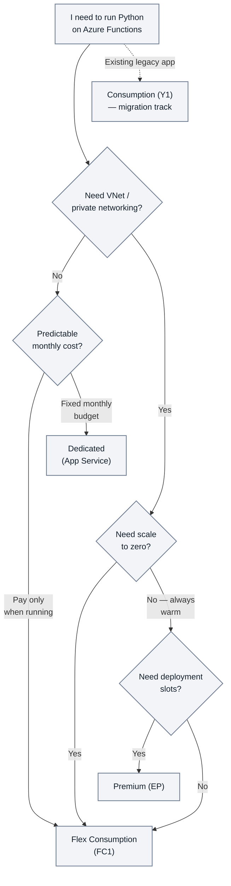
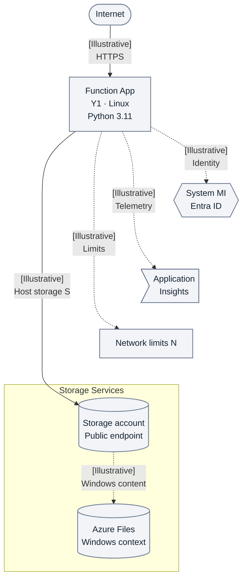
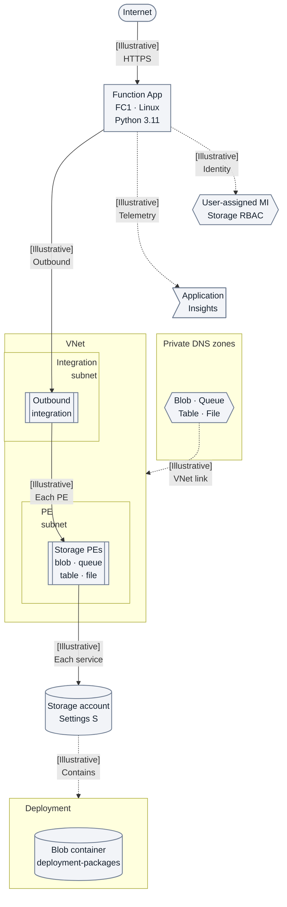
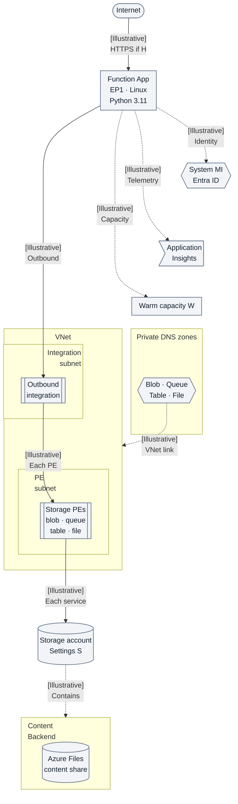
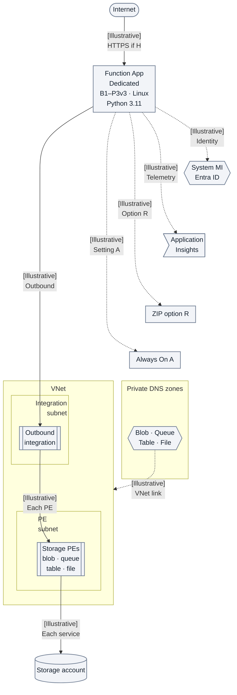

---
content_sources:

  references:
    - type: mslearn-adapted
      url: https://learn.microsoft.com/en-us/azure/azure-functions/migration/migrate-plan-consumption-to-flex
    - type: mslearn-adapted
      url: https://learn.microsoft.com/en-us/azure/azure-functions/functions-scale
    - type: mslearn-adapted
      url: https://learn.microsoft.com/en-us/azure/azure-functions/flex-consumption-plan
    - type: mslearn-adapted
      url: https://learn.microsoft.com/en-us/azure/azure-functions/functions-premium-plan
    - type: mslearn-adapted
      url: https://learn.microsoft.com/en-us/azure/azure-functions/pricing
  diagrams:
    - id: which-plan-should-i-start-with
      type: flowchart
      source: self-generated
      justification: Illustrative routing to this tutorial's Python plan tracks, not an exhaustive platform recommendation or billing guarantee.
      based_on:
        - https://learn.microsoft.com/en-us/azure/azure-functions/migration/migrate-plan-consumption-to-flex
        - https://learn.microsoft.com/en-us/azure/azure-functions/functions-scale
        - https://learn.microsoft.com/en-us/azure/azure-functions/flex-consumption-plan
        - https://learn.microsoft.com/en-us/azure/azure-functions/functions-premium-plan
        - https://learn.microsoft.com/en-us/azure/azure-functions/pricing
        - https://learn.microsoft.com/en-us/azure/azure-functions/dedicated-plan
    - id: consumption-y1-public-network
      type: flowchart
      source: self-generated
      justification: Python Linux Y1 public-network context, distinguishing host storage, optional identity and Windows-only Files context; not executed evidence.
      based_on:
        - https://learn.microsoft.com/en-us/azure/azure-functions/migration/migrate-plan-consumption-to-flex
        - https://learn.microsoft.com/en-us/azure/azure-functions/functions-scale
        - https://learn.microsoft.com/en-us/azure/azure-functions/flex-consumption-plan
        - https://learn.microsoft.com/en-us/azure/azure-functions/functions-premium-plan
        - https://learn.microsoft.com/en-us/azure/azure-functions/pricing
        - https://learn.microsoft.com/en-us/azure/azure-functions/storage-considerations
        - https://learn.microsoft.com/en-us/azure/azure-functions/manage-connections
        - https://learn.microsoft.com/en-us/azure/azure-functions/functions-networking-options
        - https://learn.microsoft.com/en-us/azure/azure-functions/supported-languages
        - https://learn.microsoft.com/en-us/azure/app-service/overview-managed-identity
        - https://learn.microsoft.com/en-us/azure/azure-functions/functions-monitoring
    - id: flex-consumption-fc1-full-private-network
      type: flowchart
      source: self-generated
      justification: Python Linux FC1 private Storage context with public ingress, four recoverably bundled endpoint/DNS pairs and separately represented identity authorization; not a universal deployment requirement.
      based_on:
        - https://learn.microsoft.com/en-us/azure/azure-functions/migration/migrate-plan-consumption-to-flex
        - https://learn.microsoft.com/en-us/azure/azure-functions/functions-scale
        - https://learn.microsoft.com/en-us/azure/azure-functions/flex-consumption-plan
        - https://learn.microsoft.com/en-us/azure/azure-functions/functions-premium-plan
        - https://learn.microsoft.com/en-us/azure/azure-functions/pricing
        - https://learn.microsoft.com/en-us/azure/azure-functions/functions-networking-options
        - https://learn.microsoft.com/en-us/azure/storage/common/storage-private-endpoints
        - https://learn.microsoft.com/en-us/azure/azure-functions/storage-considerations
        - https://learn.microsoft.com/en-us/azure/azure-functions/manage-connections
        - https://learn.microsoft.com/en-us/azure/azure-functions/supported-languages
        - https://learn.microsoft.com/en-us/azure/app-service/overview-managed-identity
        - https://learn.microsoft.com/en-us/azure/azure-functions/functions-monitoring
        - https://learn.microsoft.com/en-us/azure/storage/common/storage-network-security-set-default-access
        - https://learn.microsoft.com/en-us/azure/storage/common/shared-key-authorization-prevent
    - id: premium-ep-private-network-with-warm-instances
      type: flowchart
      source: self-generated
      justification: Python Linux EP1 private Storage and warm-capacity context; ingress is conditional, endpoint/DNS pairs remain individually keyed, and capacity is not data transit.
      based_on:
        - https://learn.microsoft.com/en-us/azure/azure-functions/migration/migrate-plan-consumption-to-flex
        - https://learn.microsoft.com/en-us/azure/azure-functions/functions-scale
        - https://learn.microsoft.com/en-us/azure/azure-functions/flex-consumption-plan
        - https://learn.microsoft.com/en-us/azure/azure-functions/functions-premium-plan
        - https://learn.microsoft.com/en-us/azure/azure-functions/pricing
        - https://learn.microsoft.com/en-us/azure/azure-functions/functions-networking-options
        - https://learn.microsoft.com/en-us/azure/storage/common/storage-private-endpoints
        - https://learn.microsoft.com/en-us/azure/azure-functions/storage-considerations
        - https://learn.microsoft.com/en-us/azure/app-service/overview-access-restrictions#app-access
        - https://learn.microsoft.com/en-us/azure/azure-functions/supported-languages
        - https://learn.microsoft.com/en-us/azure/app-service/overview-managed-identity
        - https://learn.microsoft.com/en-us/azure/azure-functions/functions-monitoring
        - https://learn.microsoft.com/en-us/azure/storage/common/storage-network-security-set-default-access
        - https://learn.microsoft.com/en-us/azure/storage/common/shared-key-authorization-prevent
    - id: dedicated-app-service-plan-fixed-capacity-with-vnet
      type: flowchart
      source: self-generated
      justification: Python Linux Dedicated B1 through P3v3 optional-network context, preserving package/Always On choices and four endpoint/DNS mappings without placing compute in the integration subnet.
      based_on:
        - https://learn.microsoft.com/en-us/azure/azure-functions/migration/migrate-plan-consumption-to-flex
        - https://learn.microsoft.com/en-us/azure/azure-functions/functions-scale
        - https://learn.microsoft.com/en-us/azure/azure-functions/flex-consumption-plan
        - https://learn.microsoft.com/en-us/azure/azure-functions/functions-premium-plan
        - https://learn.microsoft.com/en-us/azure/azure-functions/pricing
        - https://learn.microsoft.com/en-us/azure/app-service/overview-vnet-integration
        - https://learn.microsoft.com/en-us/azure/app-service/networking/private-endpoint
        - https://learn.microsoft.com/en-us/azure/storage/common/storage-private-endpoints
        - https://learn.microsoft.com/en-us/azure/azure-functions/dedicated-plan
        - https://learn.microsoft.com/en-us/azure/azure-functions/deployment-zip-push
        - https://learn.microsoft.com/en-us/azure/azure-functions/supported-languages
        - https://learn.microsoft.com/en-us/azure/app-service/overview-managed-identity
        - https://learn.microsoft.com/en-us/azure/azure-functions/functions-monitoring
        - https://learn.microsoft.com/en-us/azure/app-service/overview-access-restrictions#app-access
---
# Tutorial — Choose Your Hosting Plan

This tutorial section provides **four independent, step-by-step tracks** — one for each Azure Functions hosting plan. Every track covers the same seven topics so you can follow the complete journey from local development to production on whichever plan fits your workload.

## Which Plan Should I Start With?

<!-- diagram-id: which-plan-should-i-start-with -->

**Reading key:** This is the tutorial's illustrative routing, not an exhaustive capability or cost classifier. “Pay only when running” means **Flex on-demand compute**; optional always-ready instances have baseline and execution charges. Flex remains an option when scale to zero is not required, including an always-ready baseline; it does not support deployment slots. Premium retains at least one billed plan instance even when idle. Dedicated's budget branch means allocated plan compute, not a guaranteed total bill ([Flex](https://learn.microsoft.com/en-us/azure/azure-functions/flex-consumption-plan#billing), [Premium](https://learn.microsoft.com/en-us/azure/azure-functions/functions-premium-plan#billing), [Dedicated](https://learn.microsoft.com/en-us/azure/azure-functions/dedicated-plan#billing)).

> **Not sure yet?** Start new Python serverless apps with **Flex Consumption**, Microsoft's recommended serverless plan with VNet integration, scale-to-zero and configurable memory. Python is Linux-only; the topology pins below retain Python 3.11, currently GA, rather than asserting all Python versions run on every plan. Linux Consumption supports at most Python 3.12. Migration can require a new app and redeployment — see [Migrate apps from Consumption to Flex Consumption](https://learn.microsoft.com/en-us/azure/azure-functions/migration/migrate-plan-consumption-to-flex) and [supported languages](https://learn.microsoft.com/en-us/azure/azure-functions/supported-languages).

## Plan Comparison at a Glance

Use [Platform Limits](../../../reference/platform-limits.md) for plan/OS/region-qualified quotas, slots, runtime support, and timeout qualifications. Python apps are **Linux-only**; Windows quotas are not Python options. For Linux Consumption retirement and target selection, follow the [migration decision path](../../../reference/platform-limits.md#runtime-support-and-linux-consumption-migration). Tutorial runtime pins and configured scale caps are examples, not platform limits.

| Feature | Consumption (Y1) | Flex Consumption (FC1) | Premium (EP) | Dedicated (ASP) |
|---------|:-----------------:|:----------------------:|:------------:|:----------------:|
| **Scale to zero** | ✅ | ✅ | ❌ (min 1 instance) | ❌ |
| **VNet integration** | ❌ | ✅ | ✅ | ✅ (Basic+) |
| **Private endpoints** | ❌ | ✅ | ✅ | ✅ (Basic+) |
| **Python OS** | Linux (legacy) | Linux | Linux | Linux |
| **Deployment content** | Linux deployment-specific | Blob container | Azure Files by default; exceptions apply | No default Azure Files dependency |
| **Kudu / SCM** | ❌ (Linux Python) | ❌ | Limited Linux site | Limited Linux site |
| **Pricing model** | Per-execution | Per-execution | Pre-allocated | Pre-allocated |

**Runtime and build notes (official-source review: 2026-10-25):** Keep all comparison rows above together; notes apply after the complete table. Use [Python Runtime](../python-runtime.md#supported-python-versions) for current language GA status and Python-specific plan availability, and [build-mode guidance](../python-runtime.md#build-mode-and-version-availability) for remote versus prebuilt dependencies. Python 3.13/3.14 GA does not remove the Linux Consumption ceiling or prove a successful remote build. The tracks retain Python 3.11 example pins; this source/static refresh does not extend their historical Azure validation to other versions.

For deployment storage and build settings, use the [plan/OS package matrix](../../../operations/deployment.md#package-configuration-by-plan-and-os). Linux Consumption has no companion deployment site even though remote build is supported; Premium/Dedicated Linux sites are limited compared with Windows. See [deployment technologies](https://learn.microsoft.com/en-us/azure/azure-functions/functions-deployment-technologies#remote-build).

## Network Architecture by Plan

These are **plan-specific tutorial contexts**, not a claim that every step deploys all depicted resources. They retain VNet, subnet, Storage endpoint/DNS, identity and content choices. Solid arrows show intended request/data access; dotted arrows show associations, not data transit through identity, DNS or telemetry. All four figures retain Linux / Python 3.11. The private-network headings below refer to **Storage egress**, not automatically private HTTP ingress.

### ☁️ Consumption (Y1) — Public Network

<!-- diagram-id: consumption-y1-public-network -->

| Key | Python Linux Y1 context |
|---|---|
| S | `AzureWebJobsStorage` connection string is distinct from identity-based `AzureWebJobsStorage__accountName` configuration. On Linux Consumption, identity-based host storage requires an external deployment package instead of the remote-build path |
| Identity | Optional system-assigned identity in Microsoft Entra ID; app-local token retrieval and target permissions are separate from Storage transport |
| Files | Windows Consumption uses an Azure Files content share by default. Linux Consumption uses Blob package storage; the retained Files role is not a Python dependency |
| N | Consumption has no outbound VNet integration or private endpoint for the app |

See [host connections](https://learn.microsoft.com/en-us/azure/azure-functions/manage-connections), [Storage](https://learn.microsoft.com/en-us/azure/azure-functions/storage-considerations), [identity](https://learn.microsoft.com/en-us/azure/app-service/overview-managed-identity), [monitoring](https://learn.microsoft.com/en-us/azure/azure-functions/functions-monitoring) and [networking](https://learn.microsoft.com/en-us/azure/azure-functions/functions-networking-options).

### ⚡ Flex Consumption (FC1) — Full Private Network

<!-- diagram-id: flex-consumption-fc1-full-private-network -->

**Reading key (FC1):** VNet integration is outbound-only; it does not deploy compute into the integration subnet. The DNS association targets the VNet boundary, not a DNS query from an endpoint. This view retains private Storage egress with public HTTP ingress, not a fully private app ([networking](https://learn.microsoft.com/en-us/azure/azure-functions/functions-networking-options)).

| Key | Context / qualification |
|---|---|
| VNet / integration / PE subnet | `10.0.0.0/16` / `10.0.1.0/24` / `10.0.2.0/24`; delegation `Microsoft.App/environments` |
| S | The repository Storage module maps `allowPublicAccess: false` to `publicNetworkAccess: Disabled` and firewall default Deny. `allowSharedKeyAccess: false` separately disables Shared Key authorization; these are context choices, not universal Flex requirements |
| Identity / RBAC | User-assigned identity with target Storage permissions; authorization is not an extra data hop |
| Deployment | Blob container `deployment-packages`; Flex uses configurable Blob deployment storage and has no Azure Files content-share dependency |

The bundles expand into four independent endpoint → Storage service paths and endpoint → DNS zone-group associations, not serial hops or a universal four-endpoint requirement:

| Endpoint → Storage service | Associated private DNS zone |
|---|---|
| `PE_BLOB` → Blob | `privatelink.blob.core.windows.net` |
| `PE_QUEUE` → Queue | `privatelink.queue.core.windows.net` |
| `PE_TABLE` → Table | `privatelink.table.core.windows.net` |
| `PE_FILE` → File | `privatelink.file.core.windows.net` |

Clients keep normal Storage hostnames; with appropriate private DNS resolution configured for their network, these resolve to PE IPs ([Storage endpoints](https://learn.microsoft.com/en-us/azure/storage/common/storage-private-endpoints), [storage](https://learn.microsoft.com/en-us/azure/azure-functions/storage-considerations), [network controls](https://learn.microsoft.com/en-us/azure/storage/common/storage-network-security-set-default-access), [Shared Key](https://learn.microsoft.com/en-us/azure/storage/common/shared-key-authorization-prevent)).

### 🚀 Premium (EP) — Private Network with Warm Instances

<!-- diagram-id: premium-ep-private-network-with-warm-instances -->

**Reading key (EP1):** Outbound integration does not deploy compute into its subnet. Private Storage egress does not itself make app ingress private. Dotted identity, telemetry, capacity and membership links are associations; the DNS link targets the VNet ([networking](https://learn.microsoft.com/en-us/azure/azure-functions/functions-networking-options)).

| Key | Context / qualification |
|---|---|
| H | Public HTTPS requires permitted app public access/restrictions. With `publicNetworkAccess` unset, a site private endpoint changes the default from enabled to disabled; the Premium private-egress tutorial/template adds a site endpoint, so this public route then requires explicit `Enabled` |
| VNet / integration / PE subnet | Illustrative `10.0.0.0/16` / `10.0.1.0/24` / `10.0.2.0/24`; delegation `Microsoft.Web/serverFarms`. Follow the chosen tutorial/template's actual address ranges |
| S | The repository module maps `allowPublicAccess: false` to public-network `Disabled` and firewall default Deny; `allowSharedKeyAccess: true` separately permits Shared Key authorization |
| Identity / content | Optional system-assigned identity in Entra; host-storage identity does not replace the default Azure Files content connection string. Supported no-Files alternatives exist; private Files access also needs content-share routing |
| W | App always-ready baseline (`minimumElasticInstanceCount`) differs from the HTTP prewarm buffer (`preWarmedInstanceCount`) and app/plan maximum burst settings. Premium keeps at least one billed plan instance; prewarming buffers HTTP scale-out, not every trigger |

Four distinct Storage endpoint/service and zone-group associations remain recoverable below; workloads can use several together:

| Endpoint → Storage service | Associated private DNS zone |
|---|---|
| `PE_BLOB` → Blob | `privatelink.blob.core.windows.net` |
| `PE_QUEUE` → Queue | `privatelink.queue.core.windows.net` |
| `PE_TABLE` → Table | `privatelink.table.core.windows.net` |
| `PE_FILE` → File | `privatelink.file.core.windows.net` |

Clients retain normal Storage hostnames with network-appropriate private resolution. See [endpoints/DNS](https://learn.microsoft.com/en-us/azure/storage/common/storage-private-endpoints), [app access defaults](https://learn.microsoft.com/en-us/azure/app-service/overview-access-restrictions#app-access), [Storage/content](https://learn.microsoft.com/en-us/azure/azure-functions/storage-considerations), [content routing](https://learn.microsoft.com/en-us/azure/app-service/overview-vnet-integration#content-share), [network controls](https://learn.microsoft.com/en-us/azure/storage/common/storage-network-security-set-default-access), [Shared Key](https://learn.microsoft.com/en-us/azure/storage/common/shared-key-authorization-prevent) and [Premium capacity](https://learn.microsoft.com/en-us/azure/azure-functions/functions-premium-plan).

### 🖥️ Dedicated (App Service Plan) — Fixed Capacity with VNet

<!-- diagram-id: dedicated-app-service-plan-fixed-capacity-with-vnet -->

**Reading key (Dedicated):** Optional private Storage context retains all four boundaries; outbound integration does not deploy app compute into its subnet. The DNS link is to the VNet boundary. Identity and telemetry are not request-transit hops ([integration](https://learn.microsoft.com/en-us/azure/app-service/overview-vnet-integration)).

| Key | Context / qualification |
|---|---|
| H | Public HTTPS depends on app public-network access and restrictions; adding a site endpoint with unset `publicNetworkAccess` disables public access by default |
| VNet / integration / PE subnet | `10.0.0.0/16` / `10.0.1.0/24` / `10.0.2.0/24`; delegation `Microsoft.Web/serverFarms` |
| R | Local ready-to-run ZIP alternative: `WEBSITE_RUN_FROM_PACKAGE=1`; do not force this setting for remote build |
| A | Enable `Always On: true` for reliable non-HTTP triggering on Dedicated; fixed plan capacity alone does not prevent app idling |
| Identity | Optional system-assigned identity in Entra; token acquisition uses the app-local identity endpoint, with separately granted target permissions |

The plural bundles retain four separate endpoint → service and endpoint → zone-group associations, not serial hops or a universal four-endpoint requirement:

| Endpoint → Storage service | Associated private DNS zone |
|---|---|
| `PE_BLOB` → Blob | `privatelink.blob.core.windows.net` |
| `PE_QUEUE` → Queue | `privatelink.queue.core.windows.net` |
| `PE_TABLE` → Table | `privatelink.table.core.windows.net` |
| `PE_FILE` → File | `privatelink.file.core.windows.net` |

See [Storage endpoints/DNS](https://learn.microsoft.com/en-us/azure/storage/common/storage-private-endpoints), [app access](https://learn.microsoft.com/en-us/azure/app-service/overview-access-restrictions#app-access), [Always On](https://learn.microsoft.com/en-us/azure/azure-functions/dedicated-plan#always-on) and [package deployment](https://learn.microsoft.com/en-us/azure/azure-functions/deployment-zip-push).

!!! tip "VNet is optional for Dedicated"
    Current App Service documentation includes Basic (B1) in supported VNet-integration and app-private-endpoint tiers. These are optional capabilities, not resources configured by every beginner step. The four-service map is illustrative; the repository Dedicated template has Blob/Queue/Table Storage endpoints, not File ([VNet integration](https://learn.microsoft.com/en-us/azure/app-service/overview-vnet-integration), [app endpoints](https://learn.microsoft.com/en-us/azure/app-service/networking/private-endpoint)).

## Tutorial Tracks

Each track contains the same seven steps. Pick your plan and follow from start to finish.

### ☁️ [Consumption (Y1)](consumption/01-local-run.md)

Legacy Linux serverless track for existing workloads and migration comparison. Start new Python serverless apps with Flex; use the linked migration decision path before retaining Consumption.

| Step | Topic |
|------|-------|
| 01 | [Run Locally](consumption/01-local-run.md) |
| 02 | [First Deploy](consumption/02-first-deploy.md) |
| 03 | [Configuration](consumption/03-configuration.md) |
| 04 | [Logging & Monitoring](consumption/04-logging-monitoring.md) |
| 05 | [Infrastructure as Code](consumption/05-infrastructure-as-code.md) |
| 06 | [CI/CD](consumption/06-ci-cd.md) |
| 07 | [Extending with Triggers](consumption/07-extending-triggers.md) |
### ⚡ [Flex Consumption (FC1)](flex-consumption/01-local-run.md)

Next-generation serverless — scale-to-zero with VNet integration, configurable instance memory, and per-function scaling. Microsoft's recommended default for new projects.

| Step | Topic |
|------|-------|
| 01 | [Run Locally](flex-consumption/01-local-run.md) |
| 02 | [First Deploy](flex-consumption/02-first-deploy.md) |
| 03 | [Configuration](flex-consumption/03-configuration.md) |
| 04 | [Logging & Monitoring](flex-consumption/04-logging-monitoring.md) |
| 05 | [Infrastructure as Code](flex-consumption/05-infrastructure-as-code.md) |
| 06 | [CI/CD](flex-consumption/06-ci-cd.md) |
| 07 | [Extending with Triggers](flex-consumption/07-extending-triggers.md) |
| 08 | [Testing & Debugging](flex-consumption/08-testing-and-debugging.md) |

### 🚀 [Premium (EP)](premium/01-local-run.md)

Always-warm instances with VNet support and deployment slots. Best for latency-sensitive workloads or long-running functions that need guaranteed capacity.

| Step | Topic |
|------|-------|
| 01 | [Run Locally](premium/01-local-run.md) |
| 02 | [First Deploy](premium/02-first-deploy.md) |
| 03 | [Configuration](premium/03-configuration.md) |
| 04 | [Logging & Monitoring](premium/04-logging-monitoring.md) |
| 05 | [Infrastructure as Code](premium/05-infrastructure-as-code.md) |
| 06 | [CI/CD](premium/06-ci-cd.md) |
| 07 | [Extending with Triggers](premium/07-extending-triggers.md) |
| 09 | [Container Deployment](premium/09-container-deployment.md) |

### 🖥️ [Dedicated (App Service Plan)](dedicated/01-local-run.md)

Traditional App Service hosting with predictable pricing. Best when you already have an App Service Plan with spare capacity, or need features like deployment slots on a fixed budget.

| Step | Topic |
|------|-------|
| 01 | [Run Locally](dedicated/01-local-run.md) |
| 02 | [First Deploy](dedicated/02-first-deploy.md) |
| 03 | [Configuration](dedicated/03-configuration.md) |
| 04 | [Logging & Monitoring](dedicated/04-logging-monitoring.md) |
| 05 | [Infrastructure as Code](dedicated/05-infrastructure-as-code.md) |
| 06 | [CI/CD](dedicated/06-ci-cd.md) |
| 07 | [Extending with Triggers](dedicated/07-extending-triggers.md) |

## What Each Step Covers

| Step | Topic | You Will Learn |
|------|-------|----------------|
| 01 | **Run Locally** | Set up local dev environment, run functions with Core Tools, test endpoints |
| 02 | **First Deploy** | Provision Azure resources and deploy your first function app |
| 03 | **Configuration** | Manage app settings, connection strings, and environment-specific config |
| 04 | **Logging & Monitoring** | Configure Application Insights, structured logging, and live metrics |
| 05 | **Infrastructure as Code** | Define all resources in Bicep, deploy reproducibly |
| 06 | **CI/CD** | Automate build, test, and deploy with GitHub Actions |
| 07 | **Extending with Triggers** | Add Timer, Blob, Queue, and Event Grid triggers beyond HTTP |
| 08 | **Testing & Debugging** | Unit test logic, mock triggers/bindings, integration test with Azurite, attach a debugger (Flex track) |
| 09 | **Container Deployment** | Package as a Linux container, push to ACR, deploy with managed-identity pull (Premium track) |

## See Also

- [Scaling and Plans](../../../platform/scaling.md) — Deep comparison of all hosting plans
- [Networking](../../../platform/networking.md) — VNet integration and private endpoint concepts
- [Cost Optimization](../../../start-here/hosting-options.md) — Choosing the right plan for your budget
- [Deployment Scenarios](../../../platform/deployment-scenarios.md) — Cross-plan comparison of VNet, PE, identity, and deployment patterns

## Sources

- [Azure Functions supported languages (Microsoft Learn)](https://learn.microsoft.com/en-us/azure/azure-functions/supported-languages)
- [Azure Functions deployment technologies (Microsoft Learn)](https://learn.microsoft.com/en-us/azure/azure-functions/functions-deployment-technologies)
- [Azure Functions hosting options (Microsoft Learn)](https://learn.microsoft.com/en-us/azure/azure-functions/functions-scale)
- [Flex Consumption plan (Microsoft Learn)](https://learn.microsoft.com/en-us/azure/azure-functions/flex-consumption-plan)
- [Azure Functions Premium plan (Microsoft Learn)](https://learn.microsoft.com/en-us/azure/azure-functions/functions-premium-plan)
- [Azure Functions pricing (Microsoft Learn)](https://learn.microsoft.com/en-us/azure/azure-functions/pricing)
