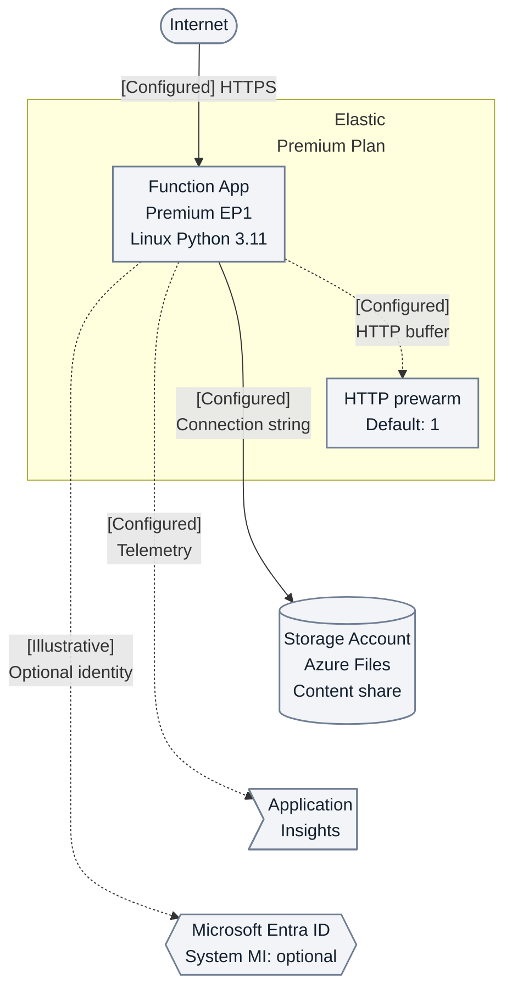

---
validation:
  az_cli:
    last_tested: 2026-04-11
    cli_version: 2.70.0
    core_tools_version: 4.6.0
    result: pass
  bicep:
    last_tested:
    result: not_tested
content_sources:

  references:
    - type: mslearn-adapted
      url: https://learn.microsoft.com/en-us/azure/azure-functions/functions-reference-python
    - type: mslearn-adapted
      url: https://learn.microsoft.com/en-us/azure/azure-functions/create-first-function-cli-python
    - type: mslearn-adapted
      url: https://learn.microsoft.com/en-us/azure/azure-functions/functions-premium-plan
  diagrams:
    - id: what-you-ll-build
      type: flowchart
      source: self-generated
      justification: Illustrative Python 3.11 Linux Elastic Premium (EP1) public topology; the HTTP prewarm buffer differs from billed minimum capacity, and identity is optional and not assigned by these steps.
      based_on:
        - https://learn.microsoft.com/en-us/azure/azure-functions/supported-languages
        - https://learn.microsoft.com/en-us/azure/azure-functions/storage-considerations
        - https://learn.microsoft.com/en-us/azure/azure-functions/functions-deployment-technologies
        - https://learn.microsoft.com/en-us/azure/azure-functions/functions-monitoring
        - https://learn.microsoft.com/en-us/azure/app-service/overview-managed-identity
        - https://learn.microsoft.com/en-us/azure/azure-functions/functions-reference-python
        - https://learn.microsoft.com/en-us/azure/azure-functions/create-first-function-cli-python
        - https://learn.microsoft.com/en-us/azure/azure-functions/functions-premium-plan
---
# 02 - First Deploy (Premium)

Deploy a Python Function App to an Elastic Premium plan (`EP1`) with always-warm instances, then publish code and verify the app is live.

**Runtime/build review (2026-10-25, official sources and static checks only):** Use Python **3.11** locally to match this track's deployment pin. The [supported-version guidance](../../python-runtime.md#supported-python-versions) covers Python 3.13/3.14 GA on Linux Premium; Windows Premium is not a Python target. Follow [build-mode guidance](../../python-runtime.md#build-mode-and-version-availability) for Core Tools' default remote build, alternative prebuilt Linux dependencies, and package-setting constraints. The existing `validation` dates/results remain historical; no new runtime execution or upgrade was tested.

## Prerequisites

- You completed [01 - Run Locally](01-local-run.md).
- You are signed in to Azure CLI and have Contributor access.
- You already exported: `$RG`, `$APP_NAME`, `$PLAN_NAME`, `$STORAGE_NAME`, `$LOCATION` (use `koreacentral` for this guide).

## What You'll Build

- A Linux Python Function App on Elastic Premium (`EP1`) with runtime settings.
- Always-warm instances for production latency requirements.
- A first deployment pipeline (`func azure functionapp publish`) and endpoint verification.

!!! tip "Network Scenario Choices"
    This tutorial deploys with **public networking**. Premium supports VNet integration:

    | Scenario | Description | Guide |
    |----------|-------------|-------|
    | **Public Only** | No VNet (this tutorial) | Current page |
    | **Private Egress** | VNet + Storage PE | [Private Egress](../../../../platform/networking-scenarios/private-egress.md) |
    | **Private Ingress** | + Site Private Endpoint | [Private Ingress](../../../../platform/networking-scenarios/private-ingress.md) |
    | **Fixed Outbound IP** | + NAT Gateway | [Fixed Outbound](../../../../platform/networking-scenarios/fixed-outbound-nat.md) |

    Looking for a **complete private networking deployment**? See [02 - First Deploy (Private Networking)](02a-first-deploy-private-egress.md).

!!! info "Infrastructure Context"
    **Plan**: Premium (EP1) | **Network**: Public (VNet optional) | **Always warm**: ✅

    This Linux EP1 workflow uses the default Azure Files content share and connection-string storage settings. Premium's default prewarmed buffer is one instance for HTTP scale-out, distinct from its minimum one active billed instance and app always-ready settings. VNet integration is optional and is not configured on this page.

    <!-- diagram-id: what-you-ll-build -->


**Reading key:** Solid arrows show configured HTTPS/data access; dotted arrows show HTTP capacity, telemetry or optional identity. Prewarm default 1, minimum active billed instance 1 and app always-ready configuration are different concepts. Default Files content uses a connection string; identity-based host storage and documented no-Files deployment alternatives are separate choices. If identity is configured, token acquisition uses the app-local endpoint, not direct app-to-Entra transport. Python Core Tools publishing requests remote build; do not force `WEBSITE_RUN_FROM_PACKAGE=1` for that build ([Premium](https://learn.microsoft.com/en-us/azure/azure-functions/functions-premium-plan), [storage](https://learn.microsoft.com/en-us/azure/azure-functions/storage-considerations), [identity](https://learn.microsoft.com/en-us/azure/app-service/overview-managed-identity), [deployment](https://learn.microsoft.com/en-us/azure/azure-functions/functions-deployment-technologies)).

## Steps

1. Set environment variables for the deployment.

    ```bash
    export RG="rg-func-python-prem-demo"
    export LOCATION="koreacentral"
    export STORAGE_NAME="stpyprem0411"
    export PLAN_NAME="plan-pyprem-04110001"
    export APP_NAME="func-pyprem-04110001"
    ```

    | Command/Parameter | Purpose |
    |-------------------|---------|
    | `export RG="..."` | Sets the resource group name for the deployment. |
    | `export LOCATION="..."` | Chooses the Azure region for the deployment. |
    | `export STORAGE_NAME="..."` | Defines a unique name for the storage account. |
    | `export PLAN_NAME="..."` | Sets the name for the Elastic Premium plan. |
    | `export APP_NAME="..."` | Defines a globally unique name for the Function App. |

    !!! tip "Globally unique names required"
        Both `$APP_NAME` and `$STORAGE_NAME` must be globally unique across all Azure subscriptions. If you get a naming conflict, append a random suffix (e.g., `func-pyprem-04111234`).

2. Authenticate and set subscription context.

    ```bash
    az login
    az account set --subscription "<subscription-id>"
    ```

    | Command/Parameter | Purpose |
    |-------------------|---------|
    | `az login` | Authenticates your CLI session with Azure. |
    | `az account set --subscription` | Targets the specific Azure subscription for resource creation. |

3. Create resource group.

    ```bash
    az group create \
      --name "$RG" \
      --location "$LOCATION"
    ```

    | Command/Parameter | Purpose |
    |-------------------|---------|
    | `az group create` | Provisions a new Azure resource group container. |
    | `--name "$RG"` | Specifies the resource group name. |
    | `--location "$LOCATION"` | Sets the geographical region for the group. |

    Expected output (abridged):

    ```json
    {
      "name": "rg-func-python-prem-demo",
      "location": "koreacentral",
      "properties": {
        "provisioningState": "Succeeded"
      }
    }
    ```

4. Create storage account.

    ```bash
    az storage account create \
      --name "$STORAGE_NAME" \
      --resource-group "$RG" \
      --location "$LOCATION" \
      --sku "Standard_LRS" \
      --kind "StorageV2" \
      --allow-blob-public-access false
    ```

    | Command/Parameter | Purpose |
    |-------------------|---------|
    | `az storage account create` | Provisions a new Azure Storage account. |
    | `--sku "Standard_LRS"` | Selects locally-redundant storage for cost-efficiency. |
    | `--kind "StorageV2"` | Uses the general-purpose v2 storage account type. |
    | `--allow-blob-public-access false` | Disables public access to blobs for better security. |

    Expected output (abridged):

    ```json
    {
      "name": "<storage-account-name>",
      "location": "koreacentral",
      "kind": "StorageV2",
      "provisioningState": "Succeeded"
    }
    ```

5. Create the Premium plan (EP1, Linux).

    ```bash
    az functionapp plan create \
      --name "$PLAN_NAME" \
      --resource-group "$RG" \
      --location "$LOCATION" \
      --sku "EP1" \
      --is-linux
    ```

    | Command/Parameter | Purpose |
    |-------------------|---------|
    | `az functionapp plan create` | Provisions an Elastic Premium hosting plan. |
    | `--sku "EP1"` | Selects the entry-level Premium tier. |
    | `--is-linux` | Configures the plan for Linux-based workers. |

    Expected output (abridged):

    ```json
    {
      "name": "<plan-name>",
      "location": "koreacentral",
      "sku": {
        "name": "EP1",
        "tier": "ElasticPremium"
      },
      "provisioningState": "Succeeded"
    }
    ```

6. Create the Function App on the Premium plan.

    ```bash
    az functionapp create \
      --name "$APP_NAME" \
      --resource-group "$RG" \
      --plan "$PLAN_NAME" \
      --storage-account "$STORAGE_NAME" \
      --runtime "python" \
      --runtime-version "3.11" \
      --functions-version "4" \
      --os-type "Linux"
    ```

    | Command/Parameter | Purpose |
    |-------------------|---------|
    | `az functionapp create` | Provisions the core Function App resource. |
    | `--plan "$PLAN_NAME"` | Links the app to the Elastic Premium plan. |
    | `--runtime "python"` | Selects the Python execution environment. |
    | `--runtime-version "3.11"` | Pins the Python version to 3.11. |
    | `--functions-version "4"` | Uses version 4 of the Azure Functions runtime host. |
    | `--os-type "Linux"` | Deploys the app on a Linux infrastructure. |

    Expected output (abridged):

    ```json
    {
      "name": "func-pyprem-04110001",
      "state": "Running",
      "kind": "functionapp,linux",
      "defaultHostName": "func-pyprem-04110001.azurewebsites.net"
    }
    ```

    !!! info "Application Insights auto-created"
        `az functionapp create` automatically creates an Application Insights resource with the **same name** as the function app. The `APPLICATIONINSIGHTS_CONNECTION_STRING` app setting is auto-configured.

    !!! warning "Enterprise policy: Shared key access"
        Some enterprise subscriptions enforce Azure Policy that sets `allowSharedKeyAccess: false` on all storage accounts. Premium (EP1) requires `WEBSITE_CONTENTAZUREFILECONNECTIONSTRING` with a connection string that uses shared key access to create the content file share during provisioning. If your subscription has this policy, the Function App creation will fail with a 403 error. Solutions:

        - Request a policy exemption from your Azure administrator
        - Use Flex Consumption (FC1) which supports identity-based blob storage without shared keys
        - Use Dedicated (B1) which uses `WEBSITE_RUN_FROM_PACKAGE` without a content file share

7. Publish the app.

    ```bash
    cd apps/python
    func azure functionapp publish "$APP_NAME"
    ```

    | Command/Parameter | Purpose |
    |-------------------|---------|
    | `cd apps/python` | Moves the terminal into the source code directory. |
    | `func azure functionapp publish` | Bundles, uploads, and deploys the app source code. |

    Expected output (abridged):

    ```text
    Getting site publishing info...
    Creating archive for current directory...
    Uploading 6.51 MB [##############################################################]
    Upload completed successfully.
    Deployment completed successfully.
    Syncing triggers...
    ```

8. Validate deployment.

    ```bash
    az functionapp function list \
      --name "$APP_NAME" \
      --resource-group "$RG" \
      --output table
    ```

    | Command/Parameter | Purpose |
    |-------------------|---------|
    | `az functionapp function list` | Queries ARM to retrieve the list of indexed functions. |
    | `--output table` | Formats the function list as a readable text table. |

    !!! tip "Function indexing delay"
        After the first publish, it may take 30–60 seconds for all functions to appear in the ARM API. If the list is empty, wait and retry.

    Expected output (abridged — showing key functions):

    ```text
    Name                                          Language
    --------------------------------------------  ----------
    func-pyprem-04110001/helloHttp                python
    func-pyprem-04110001/health                   python
    func-pyprem-04110001/info                     python
    func-pyprem-04110001/queueProcessor           python
    func-pyprem-04110001/blobProcessor            python
    func-pyprem-04110001/scheduledCleanup         python
    ```

9. Test the deployed endpoints.

    ```bash
    curl --request GET "https://$APP_NAME.azurewebsites.net/api/health"
    ```

    | Command/Parameter | Purpose |
    |-------------------|---------|
    | `curl --request GET` | Sends an HTTP GET request to verify the health endpoint. |

    Expected output:

    ```json
    {"status":"healthy","timestamp":"2026-04-11T10:00:00.000Z","version":"1.0.0"}
    ```

    ```bash
    curl --request GET "https://$APP_NAME.azurewebsites.net/api/hello/Azure"
    ```

    | Command/Parameter | Purpose |
    |-------------------|---------|
    | `curl --request GET` | Sends an HTTP GET request to verify the hello endpoint. |


    Expected output:

    ```json
    {"message":"Hello, Azure"}
    ```

## Verification

The output confirms that Azure indexed your function definitions and the app serves requests. Verify:

- `az functionapp function list` shows functions with language `python`
- `curl` to the health endpoint returns `200 OK` with `{"status":"healthy",...}`
- `curl` to `/api/hello/Azure` returns `{"message":"Hello, Azure"}`

## Next Steps

- **Add VNet integration**: See [Private Egress](../../../../platform/networking-scenarios/private-egress.md) for VNet + Storage PE
- **Full private deployment**: See [02 - First Deploy (Private Networking)](02a-first-deploy-private-egress.md)

## See Also

- [Tutorial Overview & Plan Chooser](../index.md)
- [Python Language Guide](../../index.md)
- [Platform: Hosting Plans](../../../../platform/hosting.md)
- [Operations: Deployment](../../../../operations/deployment.md)
- [Recipes Index](../../recipes/index.md)

## Sources

- [Python versions and OS support](https://learn.microsoft.com/en-us/azure/azure-functions/supported-languages)
- [Functions storage](https://learn.microsoft.com/en-us/azure/azure-functions/storage-considerations)
- [Functions deployment](https://learn.microsoft.com/en-us/azure/azure-functions/functions-deployment-technologies)
- [Functions monitoring](https://learn.microsoft.com/en-us/azure/azure-functions/functions-monitoring)
- [App managed identity](https://learn.microsoft.com/en-us/azure/app-service/overview-managed-identity)
- [Azure Functions Python developer guide (Microsoft Learn)](https://learn.microsoft.com/en-us/azure/azure-functions/functions-reference-python)
- [Create your first Azure Function with Core Tools (Microsoft Learn)](https://learn.microsoft.com/en-us/azure/azure-functions/create-first-function-cli-python)
- [Azure Functions Premium plan (Microsoft Learn)](https://learn.microsoft.com/en-us/azure/azure-functions/functions-premium-plan)
