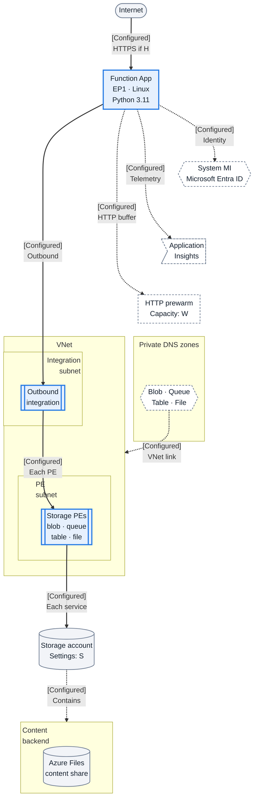
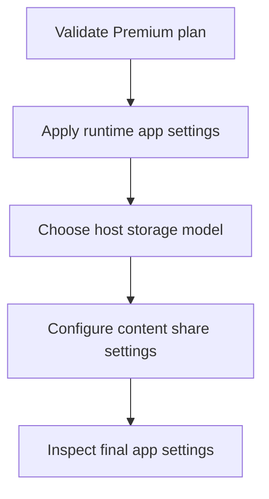

---
validation:
  az_cli:
    last_tested: 2026-04-09
    cli_version: 2.83.0
    core_tools_version: 4.8.0
    result: pass
  bicep:
    last_tested:
    result: not_tested
content_sources:

  references:
    - type: mslearn-adapted
      url: https://learn.microsoft.com/en-us/azure/azure-functions/functions-app-settings
    - type: mslearn-adapted
      url: https://learn.microsoft.com/en-us/azure/azure-functions/functions-scale
    - type: mslearn-adapted
      url: https://learn.microsoft.com/en-us/azure/azure-functions/functions-networking-options
  diagrams:
    - id: what-you-ll-build
      type: flowchart
      source: self-generated
      justification: Intended Python Linux EP1 Storage, content, identity and capacity relationships, with distinct endpoint and DNS mappings in the adjacent key; not deployment evidence.
      based_on:
        - https://learn.microsoft.com/en-us/azure/azure-functions/functions-reference-python
        - https://learn.microsoft.com/en-us/azure/storage/common/storage-private-endpoints
        - https://learn.microsoft.com/en-us/azure/azure-functions/storage-considerations
        - https://learn.microsoft.com/en-us/azure/azure-functions/functions-premium-plan
        - https://learn.microsoft.com/en-us/azure/app-service/overview-managed-identity
        - https://learn.microsoft.com/en-us/azure/azure-functions/functions-monitoring
        - https://learn.microsoft.com/en-us/azure/app-service/overview-access-restrictions#app-access
        - https://learn.microsoft.com/en-us/azure/azure-functions/functions-app-settings
        - https://learn.microsoft.com/en-us/azure/azure-functions/functions-scale
        - https://learn.microsoft.com/en-us/azure/azure-functions/functions-networking-options
    - id: what-you-ll-build-2
      type: flowchart
      source: self-generated
      justification: Flow view of what you ll build 2, synthesized from Microsoft Learn documentation cited on this page.
      based_on:
        - https://learn.microsoft.com/en-us/azure/azure-functions/functions-app-settings
        - https://learn.microsoft.com/en-us/azure/azure-functions/functions-scale
        - https://learn.microsoft.com/en-us/azure/azure-functions/functions-networking-options
---
# 03 - Configuration (Premium)

Configure runtime settings, storage options, and networking-related app configuration for Azure Functions on Elastic Premium.

## Prerequisites

- You completed [02 - First Deploy](02-first-deploy.md).
- You exported `$RG`, `$APP_NAME`, `$PLAN_NAME`, `$STORAGE_NAME`, `$LOCATION`.
- Your Function App is running on `EP1`, `EP2`, or `EP3` (`ElasticPremium`).

## What You'll Build

- A validated Premium runtime configuration for Python on Linux.
- Host storage configured with either connection string or managed identity.
- Premium content-share settings aligned with Azure Files-based content storage.

!!! info "Infrastructure Context"
    **Plan**: Premium (EP1) | **Network**: VNet + Private Endpoints | **Always warm**: ✅

    The production Bicep context combines outbound VNet integration with separate site and Storage private endpoints; the settings-only steps here do not provision them. Host storage supports a connection string or managed identity, while the default Azure Files content share uses its connection string. Prewarmed instances buffer HTTP scale-out, separately from minimum active plan capacity. Public HTTPS after adding the site endpoint requires explicit `publicNetworkAccess: Enabled`.

    <!-- diagram-id: what-you-ll-build -->


**Reading key (Linux EP1):** Solid arrows show intended request/data access; dotted arrows show identity, telemetry, capacity, VNet-link association or membership. VNet integration is outbound-only; it does not deploy the app into the integration subnet. Identity tokens use the app's local endpoint, not a direct app-to-Entra network hop ([networking](https://learn.microsoft.com/en-us/azure/azure-functions/functions-networking-options), [identity](https://learn.microsoft.com/en-us/azure/app-service/overview-managed-identity)).

| Key | Full configuration / qualification |
|---|---|
| H | Public HTTPS is subject to app access restrictions. With `publicNetworkAccess` unset (`null`), adding the separate site endpoint disables public ingress by default; explicitly set `Enabled` to retain this public path. The production template does not enable it. |
| VNet / integration / PE subnet | `10.0.0.0/16` / `10.0.1.0/24` / `10.0.2.0/24`; integration delegation `Microsoft.Web/serverFarms`. |
| S | The template's module maps `allowPublicAccess: false` to Storage `publicNetworkAccess: Disabled`; `allowSharedKeyAccess: true` allows the content-share connection string. Network access and authorization are separate controls. |
| W | Premium minimum active billed instance: 1; default prewarmed HTTP buffer: 1; Linux regional maximum scale-out: 20–100, Korea Central: 20. These are distinct limits, not a prewarm minimum/maximum. |
| Content / host storage | This Azure Files content-share example uses `WEBSITE_CONTENTAZUREFILECONNECTIONSTRING` and `WEBSITE_CONTENTSHARE`; optional identity-based `AzureWebJobsStorage__*` settings do not replace that content connection. Supported no-Files deployment alternatives exist. |

The bundled node represents **four distinct endpoints**. Each row preserves integration → endpoint → matching Storage service and endpoint → DNS zone-group association, not serial hops through all services. Zones sit outside the VNet and link to it; clients retain normal Storage hostnames resolving to PE IPs for this path. Secured Premium content storage also needs content-share routing.

| Endpoint → Storage service | Private DNS zone |
|---|---|
| `PE_BLOB` → Blob | `privatelink.blob.core.windows.net` |
| `PE_QUEUE` → Queue | `privatelink.queue.core.windows.net` |
| `PE_TABLE` → Table | `privatelink.table.core.windows.net` |
| `PE_FILE` → File | `privatelink.file.core.windows.net` |

Sources: [Storage endpoints/DNS](https://learn.microsoft.com/en-us/azure/storage/common/storage-private-endpoints), [storage and content routing](https://learn.microsoft.com/en-us/azure/azure-functions/storage-considerations), [Premium capacity](https://learn.microsoft.com/en-us/azure/azure-functions/functions-premium-plan), [app access](https://learn.microsoft.com/en-us/azure/app-service/overview-access-restrictions#app-access). This topology retains the production network context, not a claim that the settings-only steps below provision it or that a public request succeeds.

<!-- diagram-id: what-you-ll-build-2 -->


## Steps

1. Confirm plan SKU and operating system.

    ```bash
    az functionapp plan show \
      --name "$PLAN_NAME" \
      --resource-group "$RG" \
      --query "{sku:sku.name,tier:sku.tier,kind:kind,reserved:reserved}" \
      --output json
    ```

    | CLI element | Explanation |
    |---|---|
    | Command(s) | `az functionapp plan show` |
    | Key flags | `--name`, `--resource-group`, `--query`, `--output` |
    | Variables | `$PLAN_NAME`, `$RG` |
    | Expected result | Azure CLI returns the requested resource data; verify names, IDs, status fields, or metric values match the scenario. |


2. Set required runtime app settings (classic app settings path).

    ```bash
    az functionapp config appsettings set \
      --name "$APP_NAME" \
      --resource-group "$RG" \
      --settings \
        "FUNCTIONS_WORKER_RUNTIME=python" \
        "FUNCTIONS_EXTENSION_VERSION=~4"
    ```

    | CLI element | Explanation |
    |---|---|
    | Command(s) | `az functionapp config appsettings set` |
    | Key flags | `--name`, `--resource-group`, `--settings` |
    | Variables | `$APP_NAME`, `$RG` |
    | Expected result | Azure CLI applies the configuration change; confirm the returned JSON or follow-up query shows the expected value. |


    Do not manually set `WEBSITE_RUN_FROM_PACKAGE` when requesting remote build in this Premium track. Azure Files content-share settings are independent; they do not prohibit local-package value `1` for a ready-to-run ZIP. See the [package matrix](../../../../operations/deployment.md#package-configuration-by-plan-and-os).

3. Configure host storage as a connection string.

    ```bash
    STORAGE_CONNECTION_STRING=$(az storage account show-connection-string \
      --name "$STORAGE_NAME" \
      --resource-group "$RG" \
      --query "connectionString" \
      --output tsv)

    az functionapp config appsettings set \
      --name "$APP_NAME" \
      --resource-group "$RG" \
      --settings "AzureWebJobsStorage=$STORAGE_CONNECTION_STRING"
    ```

    | CLI element | Explanation |
    |---|---|
    | Command(s) | `az storage account show-connection-string`, `az functionapp config appsettings set` |
    | Key flags | `--name`, `--resource-group`, `--query`, `--output`, `--settings` |
    | Variables | `$STORAGE_NAME`, `$RG`, `$APP_NAME`, `$STORAGE_CONNECTION_STRING` |
    | Expected result | Azure CLI applies the configuration change; confirm the returned JSON or follow-up query shows the expected value. |


4. (Alternative) configure host storage as identity-based.

    ```bash
    az functionapp config appsettings set \
      --name "$APP_NAME" \
      --resource-group "$RG" \
      --settings \
        "AzureWebJobsStorage__accountName=$STORAGE_NAME" \
        "AzureWebJobsStorage__credential=managedidentity"
    ```

    | CLI element | Explanation |
    |---|---|
    | Command(s) | `az functionapp config appsettings set` |
    | Key flags | `--name`, `--resource-group`, `--settings` |
    | Variables | `$APP_NAME`, `$RG`, `$STORAGE_NAME` |
    | Expected result | Azure CLI applies the configuration change; confirm the returned JSON or follow-up query shows the expected value. |


    !!! warning "Identity-based storage requires Managed Identity and RBAC"
        Before using identity-based host storage, you must:

        1. Enable system-assigned managed identity on the Function App:
           `az functionapp identity assign --name "$APP_NAME" --resource-group "$RG"`

        2. Get the managed identity principal ID:
           `az functionapp identity show --name "$APP_NAME" --resource-group "$RG" --query "principalId" --output tsv`

        3. Grant required storage-account scoped RBAC roles:
           - `Storage Blob Data Owner`
           - `Storage Queue Data Contributor`
           - `Storage Table Data Contributor`
        4. Set both `AzureWebJobsStorage__accountName` and `AzureWebJobsStorage__credential=managedidentity` app settings.


5. Configure file share-based content settings (Premium-supported).

    ```bash
    az functionapp config appsettings set \
      --name "$APP_NAME" \
      --resource-group "$RG" \
      --settings \
        "WEBSITE_CONTENTSHARE=$APP_NAME" \
        "WEBSITE_CONTENTAZUREFILECONNECTIONSTRING=$STORAGE_CONNECTION_STRING"
    ```

    | CLI element | Explanation |
    |---|---|
    | Command(s) | `az functionapp config appsettings set` |
    | Key flags | `--name`, `--resource-group`, `--settings` |
    | Variables | `$APP_NAME`, `$RG`, `$STORAGE_CONNECTION_STRING` |
    | Expected result | Azure CLI applies the configuration change; confirm the returned JSON or follow-up query shows the expected value. |


6. Set Premium behavior settings and environment values.

    ```bash
    az functionapp config appsettings set \
      --name "$APP_NAME" \
      --resource-group "$RG" \
      --settings \
        "AZURE_FUNCTIONS_ENVIRONMENT=Production" \
        "WEBSITE_CONTENTOVERVNET=1" \
        "WEBSITE_VNET_ROUTE_ALL=1"
    ```

    | CLI element | Explanation |
    |---|---|
    | Command(s) | `az functionapp config appsettings set` |
    | Key flags | `--name`, `--resource-group`, `--settings` |
    | Variables | `$APP_NAME`, `$RG` |
    | Expected result | Azure CLI applies the configuration change; confirm the returned JSON or follow-up query shows the expected value. |


7. Inspect current app settings and verify key values.

    ```bash
    az functionapp config appsettings list \
      --name "$APP_NAME" \
      --resource-group "$RG" \
      --output table
    ```

    | CLI element | Explanation |
    |---|---|
    | Command(s) | `az functionapp config appsettings list` |
    | Key flags | `--name`, `--resource-group`, `--output` |
    | Variables | `$APP_NAME`, `$RG` |
    | Expected result | Azure CLI applies the configuration change; confirm the returned JSON or follow-up query shows the expected value. |


8. Review Premium configuration constraints.

    - Premium uses plan-level scaling and keeps at least one warm instance running.
    - Maximum scale is 100 instances for the plan.
    - Execution timeout default is 30 minutes; maximum is unlimited.
    - Kudu/SCM endpoint is available at `https://$APP_NAME.scm.azurewebsites.net`.
    - File share-based deployment/content is supported on Premium.

## Verification

```json
{
  "sku": "EP1",
  "tier": "ElasticPremium",
  "kind": "elastic",
  "reserved": true
}
```

```text
[
  {
    "name": "FUNCTIONS_WORKER_RUNTIME",
    "slotSetting": false,
    "value": "python"
  },
  {
    "name": "AzureWebJobsStorage",
    "slotSetting": false,
    "value": "DefaultEndpointsProtocol=https;AccountName=stpremdemo123;AccountKey=<masked>;EndpointSuffix=core.windows.net"
  }
]
```

## Next Steps

> **Next:** [04 - Logging and Monitoring](04-logging-monitoring.md)

## See Also

- [Tutorial Overview & Plan Chooser](../index.md)
- [Python Language Guide](../../index.md)
- [Platform: Hosting Plans](../../../../platform/hosting.md)
- [Operations: Deployment](../../../../operations/deployment.md)
- [Recipes Index](../../recipes/index.md)

## Sources

- [App settings reference for Azure Functions](https://learn.microsoft.com/en-us/azure/azure-functions/functions-app-settings)
- [Functions scale and hosting](https://learn.microsoft.com/en-us/azure/azure-functions/functions-scale)
- [Azure Functions networking options](https://learn.microsoft.com/en-us/azure/azure-functions/functions-networking-options)
