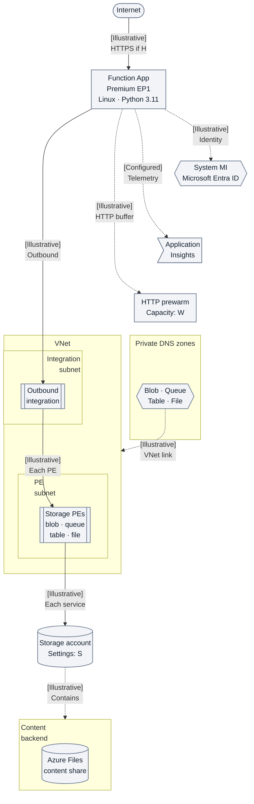
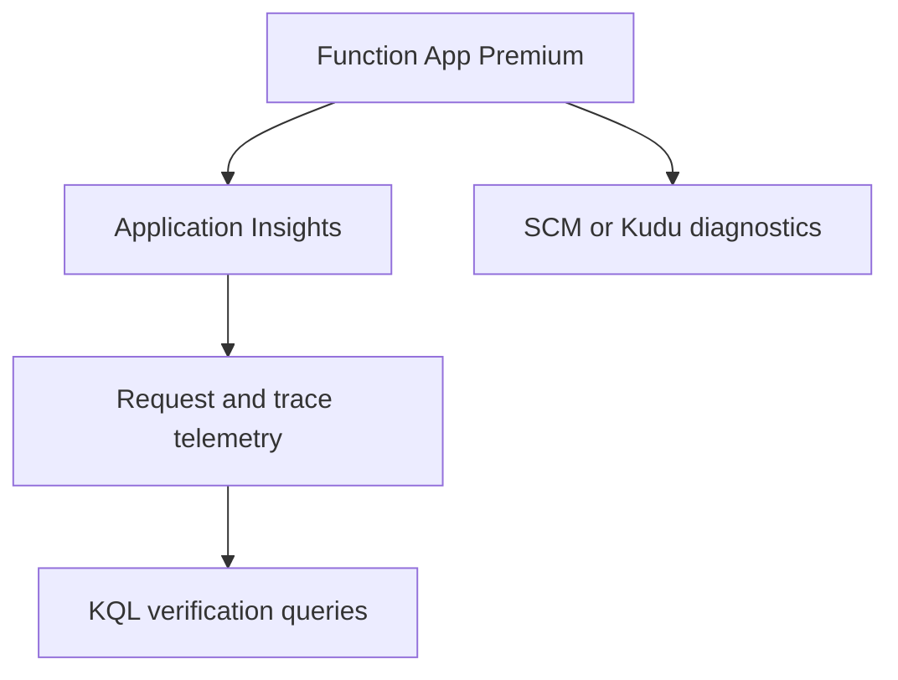

---
validation:
  az_cli:
    last_tested: 2026-04-09
    cli_version: 2.83.0
    core_tools_version: 4.8.0
    result: pass
  bicep:
    last_tested:
    result: not_tested
content_sources:

  references:
    - type: mslearn-adapted
      url: https://learn.microsoft.com/en-us/azure/azure-functions/monitor-functions
    - type: mslearn-adapted
      url: https://learn.microsoft.com/en-us/cli/azure/monitor/app-insights?view=azure-cli-latest
  diagrams:
    - id: what-you-ll-build
      type: flowchart
      source: self-generated
      justification: Python Linux plan-specific infrastructure context with full adjacent reading key; not deployment evidence.
      based_on:
        - https://learn.microsoft.com/en-us/azure/azure-functions/monitor-functions
        - https://learn.microsoft.com/en-us/cli/azure/monitor/app-insights?view=azure-cli-latest
        - https://learn.microsoft.com/en-us/azure/azure-functions/functions-reference-python
        - https://learn.microsoft.com/en-us/azure/azure-functions/configure-monitoring
        - https://learn.microsoft.com/en-us/azure/azure-functions/streaming-logs
        - https://learn.microsoft.com/en-us/azure/azure-functions/functions-networking-options
        - https://learn.microsoft.com/en-us/azure/azure-functions/storage-considerations
        - https://learn.microsoft.com/en-us/azure/azure-functions/functions-premium-plan
        - https://learn.microsoft.com/en-us/azure/azure-monitor/app/create-workspace-resource
        - https://learn.microsoft.com/en-us/azure/app-service/overview-managed-identity
        - https://learn.microsoft.com/en-us/azure/app-service/overview-access-restrictions#app-access
        - https://learn.microsoft.com/en-us/azure/azure-functions/deployment-zip-push
        - https://learn.microsoft.com/en-us/azure/storage/common/storage-private-endpoints
        - https://learn.microsoft.com/en-us/azure/azure-functions/opentelemetry-howto
        - https://learn.microsoft.com/en-us/azure/azure-functions/monitor-functions-reference
    - id: what-you-ll-build-2
      type: flowchart
      source: self-generated
      justification: Python plan-specific monitoring verification relationships; analysis arrows are not network-transit claims.
      based_on:
        - https://learn.microsoft.com/en-us/azure/azure-functions/monitor-functions
        - https://learn.microsoft.com/en-us/cli/azure/monitor/app-insights?view=azure-cli-latest
        - https://learn.microsoft.com/en-us/azure/azure-functions/functions-reference-python
        - https://learn.microsoft.com/en-us/azure/azure-functions/configure-monitoring
        - https://learn.microsoft.com/en-us/azure/azure-functions/streaming-logs
        - https://learn.microsoft.com/en-us/azure/azure-functions/functions-networking-options
        - https://learn.microsoft.com/en-us/azure/azure-functions/storage-considerations
        - https://learn.microsoft.com/en-us/azure/azure-functions/functions-premium-plan
        - https://learn.microsoft.com/en-us/azure/azure-monitor/app/create-workspace-resource
        - https://learn.microsoft.com/en-us/azure/app-service/overview-managed-identity
        - https://learn.microsoft.com/en-us/azure/app-service/overview-access-restrictions#app-access
        - https://learn.microsoft.com/en-us/azure/azure-functions/deployment-zip-push
        - https://learn.microsoft.com/en-us/azure/storage/common/storage-private-endpoints
        - https://learn.microsoft.com/en-us/azure/azure-functions/opentelemetry-howto
        - https://learn.microsoft.com/en-us/azure/azure-functions/monitor-functions-reference
---
# 04 - Logging and Monitoring (Premium)

Enable observability for a Premium Function App using Application Insights, Log Analytics queries, and Kudu/SCM diagnostics.

## Prerequisites

- You completed [03 - Configuration](03-configuration.md).
- You exported `$RG`, `$APP_NAME`, `$PLAN_NAME`, `$STORAGE_NAME`, `$LOCATION`.
- Your Function App is deployed and returning `200` from `/api/health`.

## What You'll Build

- Application Insights and Log Analytics integration for a Premium Function App.
- Live log streaming and KQL query checks for requests, traces, and exceptions.
- A repeatable diagnostics workflow using SCM/Kudu endpoints.

!!! info "Infrastructure Context"
    **Plan**: Premium (EP1) | **Network**: VNet + Private Endpoints | **Always warm**: ✅

    The figure retains Premium network and content context, not infrastructure provisioned by this monitoring page. A prerequisite site private endpoint makes public HTTPS conditional (H); prewarmed instances buffer HTTP scale-out (W).

    <!-- diagram-id: what-you-ll-build -->


**Reading key:** Solid arrows are intended request/data access; dotted arrows are identity, telemetry, capacity, VNet-link or membership associations. `[Illustrative]` identifies surrounding infrastructure choices, not a deployment performed here. Outbound integration does not deploy the app into its subnet; identity acquisition uses the app-local token endpoint, not direct app-to-Entra transit. The DNS link targets the actual VNet boundary ([networking](https://learn.microsoft.com/en-us/azure/azure-functions/functions-networking-options), [identity](https://learn.microsoft.com/en-us/azure/app-service/overview-managed-identity)).

| Key | Context / qualification |
|---|---|
| H | After a site private endpoint, public HTTPS requires `publicNetworkAccess: Enabled` and permitting access restrictions. With the property unset (`null`), adding that endpoint disables public ingress by default; the prerequisite Premium Bicep does not explicitly enable it |
| VNet / integration / PE subnet | `10.0.0.0/16` / `10.0.1.0/24` / `10.0.2.0/24`; delegation `Microsoft.Web/serverFarms` |
| S | The prerequisite repository Storage module maps `allowPublicAccess: false` to `publicNetworkAccess: Disabled` and firewall default Deny. Separately, `allowBlobPublicAccess: false` blocks anonymous Blob access, while `allowSharedKeyAccess: true` permits Shared Key authorization |
| W | Premium minimum active billed instance: 1; default prewarmed HTTP buffer: 1; Linux regional maximum scale-out: 20–100, Korea Central: 20. These are different settings, not prewarm minimum/maximum |
| Content / identity | Default Azure Files content access uses its connection string; supported identity-based host storage and Storage RBAC are separate. No-Files deployment alternatives exist |

The bundles retain **four distinct endpoints and four zones**, with endpoint → matching service access and endpoint → zone-group association:

| Endpoint → Storage service | Associated private DNS zone |
|---|---|
| `PE_BLOB` → Blob | `privatelink.blob.core.windows.net` |
| `PE_QUEUE` → Queue | `privatelink.queue.core.windows.net` |
| `PE_TABLE` → Table | `privatelink.table.core.windows.net` |
| `PE_FILE` → File | `privatelink.file.core.windows.net` |

These are independent service paths, not serial hops or a universal endpoint requirement. Use normal Storage hostnames with appropriate private DNS resolution; secured Premium content storage also needs content-share routing. Private ingress and diagnostic clients need appropriate network/DNS reachability; the conditional public arrow is not a way around disabled public ingress ([Storage endpoints](https://learn.microsoft.com/en-us/azure/storage/common/storage-private-endpoints), [storage](https://learn.microsoft.com/en-us/azure/azure-functions/storage-considerations), [app access](https://learn.microsoft.com/en-us/azure/app-service/overview-access-restrictions#app-access), [Premium capacity](https://learn.microsoft.com/en-us/azure/azure-functions/functions-premium-plan), [deployment networking](https://learn.microsoft.com/en-us/azure/azure-functions/functions-deployment-technologies#secured-virtual-networks)).

<!-- diagram-id: what-you-ll-build-2 -->


**Telemetry versus diagnostics:** Premium does not change Python's default worker → Functions host → Application Insights logging route. The configured connection string identifies its destination, and filtering/sampling can exclude records; a separately configured distro exporter is not shown as a default bypass ([Python logging](https://learn.microsoft.com/en-us/azure/azure-functions/functions-reference-python#logging-and-monitoring), [configuration](https://learn.microsoft.com/en-us/azure/azure-functions/configure-monitoring)). Application Insights telemetry resides in its linked workspace, independently of diagnostic-settings `FunctionAppLogs` collection ([workspace](https://learn.microsoft.com/en-us/azure/azure-monitor/app/create-workspace-resource), [resource logs](https://learn.microsoft.com/en-us/azure/azure-functions/monitor-functions#azure-monitor-resource-logs)). SCM diagnostics and supported single-instance built-in streaming are distinct from Application Insights Live Metrics; warm capacity alone does not guarantee idle log entries ([streaming](https://learn.microsoft.com/en-us/azure/azure-functions/streaming-logs)).

## Steps

1. Create a Log Analytics workspace and Application Insights component.

    ```bash
    az monitor log-analytics workspace create \
      --workspace-name "log-$APP_NAME" \
      --resource-group "$RG" \
      --location "$LOCATION"

    az monitor app-insights component create \
      --app "appi-$APP_NAME" \
      --resource-group "$RG" \
      --location "$LOCATION" \
      --workspace "/subscriptions/<subscription-id>/resourceGroups/$RG/providers/Microsoft.OperationalInsights/workspaces/log-$APP_NAME" \
      --application-type "web"
    ```

    | CLI element | Explanation |
    |---|---|
    | Command(s) | `az monitor log-analytics workspace create`, `az monitor app-insights component create` |
    | Key flags | `--workspace-name`, `--resource-group`, `--location`, `--app`, `--workspace`, `--application-type` |
    | Variables | `$APP_NAME`, `$RG`, `$LOCATION` |
    | Expected result | Azure CLI returns provisioning details; confirm the resource name and successful provisioning state before continuing. |


2. Attach Application Insights connection string to the Function App.

    ```bash
    APPINSIGHTS_CONNECTION_STRING=$(az monitor app-insights component show \
      --app "appi-$APP_NAME" \
      --resource-group "$RG" \
      --query "connectionString" \
      --output tsv)

    az functionapp config appsettings set \
      --name "$APP_NAME" \
      --resource-group "$RG" \
      --settings "APPLICATIONINSIGHTS_CONNECTION_STRING=$APPINSIGHTS_CONNECTION_STRING"
    ```

    | CLI element | Explanation |
    |---|---|
    | Command(s) | `az monitor app-insights component show`, `az functionapp config appsettings set` |
    | Key flags | `--app`, `--resource-group`, `--query`, `--output`, `--name`, `--settings` |
    | Variables | `$APP_NAME`, `$RG`, `$APPINSIGHTS_CONNECTION_STRING` |
    | Expected result | Azure CLI applies the configuration change; confirm the returned JSON or follow-up query shows the expected value. |


    !!! tip "Restart after attaching Application Insights"
        After setting `APPLICATIONINSIGHTS_CONNECTION_STRING`, restart the Function App to pick up the new telemetry configuration:

        ```bash
        az functionapp restart --name "$APP_NAME" --resource-group "$RG"
        ```

        | CLI element | Explanation |
        |---|---|
        | Command(s) | `az functionapp restart` |
        | Key flags | `--name`, `--resource-group` |
        | Variables | `$APP_NAME`, `$RG` |
        | Expected result | Azure CLI completes successfully and returns JSON, table, or no output depending on the command; verify the next documented check before continuing. |


        Telemetry may take 2–5 minutes to appear in Application Insights after the restart.

3. Stream live logs from the app.

    ```bash
    az webapp log tail \
      --name "$APP_NAME" \
      --resource-group "$RG"
    ```

    | CLI element | Explanation |
    |---|---|
    | Command(s) | `az webapp log tail` |
    | Key flags | `--name`, `--resource-group` |
    | Variables | `$APP_NAME`, `$RG` |
    | Expected result | Azure CLI completes successfully and returns JSON, table, or no output depending on the command; verify the next documented check before continuing. |


4. Query recent request telemetry.

    ```bash
    az monitor app-insights query \
      --app "appi-$APP_NAME" \
      --resource-group "$RG" \
      --analytics-query "requests | where timestamp > ago(15m) | project timestamp, name, resultCode, duration | order by timestamp desc | take 20" \
      --output table
    ```

    | CLI element | Explanation |
    |---|---|
    | Command(s) | `az monitor app-insights query` |
    | Key flags | `--app`, `--resource-group`, `--analytics-query`, `--output` |
    | Variables | `$APP_NAME`, `$RG` |
    | Expected result | Azure CLI returns the requested resource data; verify names, IDs, status fields, or metric values match the scenario. |


    !!! tip "Empty query results"
        If `--output table` returns no rows, the data may not have been ingested yet. Wait 2–5 minutes after the restart and retry. Use `--output json` instead of `--output table` to see raw results including empty arrays.

5. Query exceptions and traces.

    ```bash
    az monitor app-insights query \
      --app "appi-$APP_NAME" \
      --resource-group "$RG" \
      --analytics-query "exceptions | where timestamp > ago(24h) | project timestamp, type, outerMessage | order by timestamp desc | take 20" \
      --output table

    az monitor app-insights query \
      --app "appi-$APP_NAME" \
      --resource-group "$RG" \
      --analytics-query "traces | where timestamp > ago(15m) | project timestamp, severityLevel, message | order by timestamp desc | take 20" \
      --output table
    ```

    | CLI element | Explanation |
    |---|---|
    | Command(s) | `az monitor app-insights query` |
    | Key flags | `--app`, `--resource-group`, `--analytics-query`, `--output` |
    | Variables | `$APP_NAME`, `$RG` |
    | Expected result | Azure CLI returns the requested resource data; verify names, IDs, status fields, or metric values match the scenario. |


6. Use Kudu/SCM for runtime diagnostics (Premium supports SCM).

    ```bash
    az functionapp deployment list-publishing-profiles \
      --name "$APP_NAME" \
      --resource-group "$RG" \
      --output table
    ```

    | CLI element | Explanation |
    |---|---|
    | Command(s) | `az functionapp deployment list-publishing-profiles` |
    | Key flags | `--name`, `--resource-group`, `--output` |
    | Variables | `$APP_NAME`, `$RG` |
    | Expected result | Azure CLI returns provisioning details; confirm the resource name and successful provisioning state before continuing. |


    Then open `https://$APP_NAME.scm.azurewebsites.net` and inspect:
    - `LogFiles/Application/Functions/Function/*`
    - `Debug console` for filesystem checks
    - deployed artifacts (file share-based content)

7. Confirm Premium monitoring expectations.

    - Pre-warmed instances reduce trigger and HTTP cold-start latency.
    - Because at least one instance always runs, baseline telemetry remains active.
    - Scaling events occur at plan level across functions in the same app plan.

## Verification

```text
Live Log Stream --- Connected
2026-01-01T00:01:02.345 [Information] Executing 'Functions.health' (Reason='This function was programmatically called via the host APIs.', Id=xxxxxxxx-xxxx-xxxx-xxxx-xxxxxxxxxxxx)
2026-01-01T00:01:02.512 [Information] Executed 'Functions.health' (Succeeded, Id=xxxxxxxx-xxxx-xxxx-xxxx-xxxxxxxxxxxx, Duration=167ms)
```

```text
Timestamp                  Name    ResultCode    Duration
-------------------------  ------  ----------    --------
2026-01-01T00:01:02.512Z   health  200           00:00:00.167
```

## Next Steps

> **Next:** [05 - Infrastructure as Code](05-infrastructure-as-code.md)

## See Also

- [Tutorial Overview & Plan Chooser](../index.md)
- [Python Language Guide](../../index.md)
- [Platform: Hosting Plans](../../../../platform/hosting.md)
- [Operations: Deployment](../../../../operations/deployment.md)
- [Recipes Index](../../recipes/index.md)

## Sources

- [Functions OpenTelemetry configuration](https://learn.microsoft.com/en-us/azure/azure-functions/opentelemetry-howto)
- [Functions monitoring data reference](https://learn.microsoft.com/en-us/azure/azure-functions/monitor-functions-reference)

- [functions-reference-python](https://learn.microsoft.com/en-us/azure/azure-functions/functions-reference-python)
- [configure-monitoring](https://learn.microsoft.com/en-us/azure/azure-functions/configure-monitoring)
- [streaming-logs](https://learn.microsoft.com/en-us/azure/azure-functions/streaming-logs)
- [functions-networking-options](https://learn.microsoft.com/en-us/azure/azure-functions/functions-networking-options)
- [storage-considerations](https://learn.microsoft.com/en-us/azure/azure-functions/storage-considerations)
- [functions-premium-plan](https://learn.microsoft.com/en-us/azure/azure-functions/functions-premium-plan)
- [create-workspace-resource](https://learn.microsoft.com/en-us/azure/azure-monitor/app/create-workspace-resource)
- [overview-managed-identity](https://learn.microsoft.com/en-us/azure/app-service/overview-managed-identity)
- [overview-access-restrictions](https://learn.microsoft.com/en-us/azure/app-service/overview-access-restrictions#app-access)
- [deployment-zip-push](https://learn.microsoft.com/en-us/azure/azure-functions/deployment-zip-push)
- [storage-private-endpoints](https://learn.microsoft.com/en-us/azure/storage/common/storage-private-endpoints)

- [Monitor Azure Functions](https://learn.microsoft.com/en-us/azure/azure-functions/monitor-functions)
- [Application Insights query with Azure CLI](https://learn.microsoft.com/en-us/cli/azure/monitor/app-insights?view=azure-cli-latest)
- [Kudu service overview](https://github.com/projectkudu/kudu/wiki)
