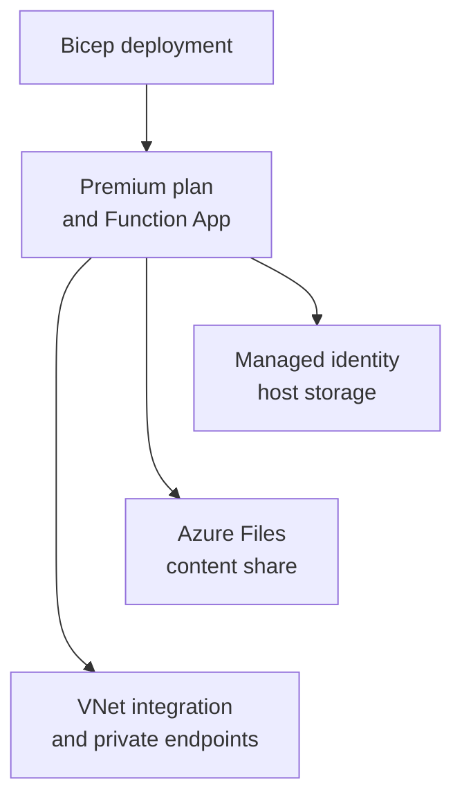

---
validation:
  az_cli:
    last_tested: 2026-04-09
    cli_version: 2.83.0
    core_tools_version: 4.8.0
    result: pass
  bicep:
    last_tested: '2026-06-06'
    result: syntax_validated
content_sources:

  references:
    - type: mslearn-adapted
      url: https://learn.microsoft.com/en-us/azure/azure-functions/functions-infrastructure-as-code
    - type: mslearn-adapted
      url: https://learn.microsoft.com/en-us/azure/azure-functions/functions-premium-plan
    - type: mslearn-adapted
      url: https://learn.microsoft.com/en-us/azure/private-link/private-endpoint-overview
  diagrams:
    - id: what-you-ll-build
      type: flowchart
      source: self-generated
      justification: Illustrative topology of the Premium template - outbound VNet integration, storage and site private endpoint network interfaces in a subnet, VNet-linked Private DNS zones, Azure Files content share and HTTP prewarming, not a measured trace or deployment evidence.
      based_on:
        - https://learn.microsoft.com/en-us/azure/private-link/private-endpoint-overview
        - https://learn.microsoft.com/en-us/azure/dns/private-dns-virtual-network-links
        - https://learn.microsoft.com/en-us/azure/azure-functions/supported-languages
        - https://learn.microsoft.com/en-us/azure/azure-functions/functions-monitoring
        - https://learn.microsoft.com/en-us/azure/azure-functions/functions-networking-options
        - https://learn.microsoft.com/en-us/azure/storage/common/storage-private-endpoints
        - https://learn.microsoft.com/en-us/azure/app-service/overview-managed-identity
        - https://learn.microsoft.com/en-us/azure/app-service/overview-access-restrictions#app-access
        - https://learn.microsoft.com/en-us/azure/azure-functions/storage-considerations
        - https://learn.microsoft.com/en-us/azure/azure-functions/functions-infrastructure-as-code
        - https://learn.microsoft.com/en-us/azure/azure-functions/functions-premium-plan
        - https://learn.microsoft.com/en-us/azure/private-link/private-endpoint-overview
    - id: what-you-ll-build-2
      type: flowchart
      source: self-generated
      justification: Resource map of the Premium Bicep template (EP1 plan, app, identity-based host storage, Files content share, VNet and private endpoints), arrows show template resources, not creation order.
      based_on:
        - https://learn.microsoft.com/en-us/azure/azure-resource-manager/bicep/overview
        - https://learn.microsoft.com/en-us/azure/azure-functions/functions-infrastructure-as-code
        - https://learn.microsoft.com/en-us/azure/azure-functions/functions-premium-plan
        - https://learn.microsoft.com/en-us/azure/private-link/private-endpoint-overview
---
# 05 - Infrastructure as Code (Premium)

Deploy Azure Functions Premium infrastructure with Bicep from `infra/premium/main.bicep`, including Elastic Premium plan settings, VNet integration, private endpoints, identity-based host storage, and Azure Files content share.

## Prerequisites

- You completed [04 - Logging and Monitoring](04-logging-monitoring.md).
- You exported `$RG`, `$APP_NAME`, `$PLAN_NAME`, `$STORAGE_NAME`, `$LOCATION`.
- Azure CLI is authenticated to your target subscription.

## What You'll Build

- A Premium (`EP1`) Function App infrastructure model defined with Bicep.
- VNet integration, private endpoints, and private DNS links for core dependencies.
- Identity-based host storage settings plus Azure Files content-share configuration.

!!! info "Infrastructure Context"
    **Plan**: Premium (EP1) | **Network**: VNet + Private Endpoints | **Always warm**: ✅

    This example includes outbound VNet integration, storage private endpoints and a site private endpoint for inbound access. The repository template uses identity-based host storage and an Azure Files content-share connection string. Premium's prewarmed buffer is for HTTP scale-out; it is distinct from always-ready instances and the plan's maximum burst limit.

```mermaid
%%{init: {'flowchart': {'nodeSpacing': 10, 'rankSpacing': 85, 'padding': 8, 'subGraphTitleMargin': {'top': 8, 'bottom': 32}}}}%%
flowchart TD
    accTitle: Python Linux Premium EP1 infrastructure topology
    accDescr: Private endpoints are network interfaces in the PE subnet and Private DNS zones are VNet-linked. Python 3.11 is this example's runtime configuration, not a version recommendation. The app is outside the integration subnet; outbound storage paths are separate from inbound site Private Link. Public HTTPS requires publicNetworkAccess Enabled when the site endpoint exists. Identity and Files credentials, DNS and HTTP prewarming are distinct; this is not Azure execution evidence.
    INET([Internet]) -->|"[Configured] 1"| FA["Function App<br/>Premium EP1<br/>Linux Python 3.11"]
    FA -.->|"[Configured] 2"| ENTRA{{"Microsoft<br/>Entra ID"}}
    FA -.->|"[Configured] 3"| AI>"Application<br/>Insights"]
    FA -->|"[Configured] 4"| INT
    subgraph VNET["VNet"]
        subgraph INT_SUB["<div style='width:140px;text-align:left'>Integration<br/>subnet</div>"]
            INT[["Outbound<br/>integration"]]
        end
        subgraph PE_SUB["<div style='width:110px;text-align:right'>PE<br/>subnet</div>"]
            PE[["Storage PE NICs 1–4<br/>Site PE: key 10"]]
        end
    end
    INT -->|"[Configured] 5"| PE
    PE -->|"[Configured] 6"| ST[("Storage account<br/>Key 6")]
    subgraph DNS["<div style='width:150px;text-align:left'>Private DNS<br/>zones<br/>VNet-linked</div>"]
        ZONES{{"Storage zones 1–4<br/>Site zone: key 10"}}
    end
    PE -.->|"[Configured] 7"| ZONES
    subgraph STORAGE["<div style='width:180px;text-align:right'>Content<br/>Backend</div>"]
        SHARE[("Azure Files<br/>Content share")]
    end
    ST -.->|"[Configured] 8"| SHARE
    FA -.->|"[Configured]<br/>9"| WARM["HTTP prewarmed buffer<br/>Scale limits: key 9"]
    %% Layout-only tiers; add no data hops, dependencies or visible arrows.
    ENTRA ~~~ AI
    AI ~~~ INT
    ST ~~~ ZONES
    ZONES ~~~ SHARE
    SHARE ~~~ WARM
    classDef baseNeutral fill:#f2f4f8,stroke:#707e93,stroke-width:1.5px,color:#14202e;
    classDef focusActive fill:#e6f0fd,stroke:#287ce4,stroke-width:2.5px,color:#14202e;
    classDef netBox fill:transparent,stroke:#287ce4,stroke-width:2px,stroke-dasharray:6 3;
    class INET,ENTRA,AI,ST,ZONES,SHARE,WARM baseNeutral;
    class FA,INT,PE focusActive;
    class VNET,INT_SUB,PE_SUB,DNS,STORAGE netBox;
```

<!-- diagram-id: what-you-ll-build -->


**Reading key:** Solid arrows show request/data access; dotted arrows show identity, telemetry, DNS/resource configuration or settings, not data-transit hops. Python 3.11 / EP1 / Linux identify this example. The network view uses the repository template's addresses; the simplified inline Bicep below instead uses `10.20.0.0/16`, `10.20.1.0/24` and `10.20.2.0/24`.

| Key | Relationship or configuration |
|---|---|
| 1 | Conditional public HTTPS: with a site private endpoint, enable `publicNetworkAccess: Enabled` explicitly and satisfy access rules to keep this path. With the property unset, the site endpoint changes the default to public access disabled; neither shown Bicep variant sets it ([app access](https://learn.microsoft.com/en-us/azure/app-service/overview-access-restrictions#app-access)). This is not a claim that the private deployment is publicly reachable. |
| 2 | System-assigned managed identity in Microsoft Entra ID; logical token acquisition uses the app's managed-identity endpoint, not a direct Entra network hop. |
| 3 | Telemetry to configured Application Insights, off the storage data path. |
| 4 | Outbound VNet integration does not deploy the app into the subnet. Repository addresses: VNet `10.0.0.0/16`, integration `10.0.1.0/24`, private endpoints `10.0.2.0/24`; integration delegation `Microsoft.Web/serverFarms`. |
| 5–6 | Four parallel service paths reach the matching storage private endpoints. Module parameter `allowPublicAccess: false` sets Storage `publicNetworkAccess: Disabled`; this example keeps `allowSharedKeyAccess: true` for its Files connection string while host storage uses `AzureWebJobsStorage__accountName` / `AzureWebJobsStorage__credential=managedidentity`. |
| 7 | Endpoint DNS zone-group associations map to the matching numbered zones below; private zones are linked to the VNet, not contained in its subnets. These dotted links are not DNS queries initiated by an endpoint. Each private endpoint is a network interface that uses a private IP address from the PE subnet; zones are shown VNet-linked ([private endpoint overview](https://learn.microsoft.com/en-us/azure/private-link/private-endpoint-overview), [virtual network links](https://learn.microsoft.com/en-us/azure/dns/private-dns-virtual-network-links)). |
| 8 | Same-account Azure Files content share: `WEBSITE_CONTENTSHARE` and shared-key `WEBSITE_CONTENTAZUREFILECONNECTIONSTRING`; this is the template's content backend, not a claim that every Premium app must use Files ([storage alternatives](https://learn.microsoft.com/en-us/azure/azure-functions/storage-considerations#create-an-app-without-azure-files)). |
| 9 | Prewarmed instances buffer HTTP scale-out; default count is 1, distinct from always-ready minimum instances. The original 20–100 range describes Linux Premium regional maximum instance limits, not the prewarmed buffer maximum or this template's configured burst setting ([Premium plan](https://learn.microsoft.com/en-us/azure/azure-functions/functions-premium-plan#prewarmed-instances)). |
| 10 | The endpoint and zone bundles also include the tutorial/repository template's inbound app `sites` private endpoint and `privatelink.azurewebsites.net` zone. This is a fifth endpoint/zone pair, not another storage service: private-reachable client → site endpoint → app; site endpoint → site zone-group association. The storage arrows 5–7 apply only to pairs 1–4, not the inbound site pair. |

| Endpoint / zone key | Storage private endpoint | Matching private DNS zone |
|---|---|---|
| 1 | `blob` | `privatelink.blob.core.windows.net` |
| 2 | `queue` | `privatelink.queue.core.windows.net` |
| 3 | `table` | `privatelink.table.core.windows.net` |
| 4 | `file` | `privatelink.file.core.windows.net` |

Each [Storage endpoint/zone pair](https://learn.microsoft.com/en-us/azure/storage/common/storage-private-endpoints) remains separate despite the bundled symbols.

<!-- diagram-id: what-you-ll-build-2 -->


## Steps

1. Create the Premium IaC folder.

    ```bash
    mkdir --parents "infra/premium"
    ```

2. Create `infra/premium/main.bicep` with Premium plan and storage resources.

    ```bicep
    targetScope = 'resourceGroup'

    param location string = resourceGroup().location
    param planName string
    param appName string
    param storageName string

    resource plan 'Microsoft.Web/serverfarms@2023-12-01' = {
      name: planName
      location: location
      sku: {
        name: 'EP1'
        tier: 'ElasticPremium'
      }
      kind: 'elastic'
      properties: {
        reserved: true
      }
    }

    resource storage 'Microsoft.Storage/storageAccounts@2023-01-01' = {
      name: storageName
      location: location
      sku: {
        name: 'Standard_LRS'
      }
      kind: 'StorageV2'
      properties: {
        supportsHttpsTrafficOnly: true
      }
    }

    resource fileService 'Microsoft.Storage/storageAccounts/fileServices@2023-01-01' = {
      name: '${storage.name}/default'
    }

    resource contentShare 'Microsoft.Storage/storageAccounts/fileServices/shares@2023-01-01' = {
      name: '${storage.name}/default/${toLower(appName)}'
      properties: {
        accessTier: 'TransactionOptimized'
      }
    }
    ```

3. Add VNet, delegated subnet, and private endpoint resources.

    ```bicep
    resource vnet 'Microsoft.Network/virtualNetworks@2023-09-01' = {
      name: 'vnet-premium-demo'
      location: location
      properties: {
        addressSpace: {
          addressPrefixes: [
            '10.20.0.0/16'
          ]
        }
        subnets: [
          {
            name: 'snet-integration'
            properties: {
              addressPrefix: '10.20.1.0/24'
              delegations: [
                {
                  name: 'web-farms'
                  properties: {
                    serviceName: 'Microsoft.Web/serverFarms'
                  }
                }
              ]
            }
          }
          {
            name: 'snet-private-endpoints'
            properties: {
              addressPrefix: '10.20.2.0/24'
              privateEndpointNetworkPolicies: 'Disabled'
            }
          }
        ]
      }
    }

    resource privateEndpoint 'Microsoft.Network/privateEndpoints@2023-09-01' = {
      name: 'pe-${appName}'
      location: location
      properties: {
        subnet: {
          id: resourceId('Microsoft.Network/virtualNetworks/subnets', vnet.name, 'snet-private-endpoints')
        }
        privateLinkServiceConnections: [
          {
            name: 'conn-${appName}'
            properties: {
              privateLinkServiceId: functionApp.id
              groupIds: [
                'sites'
              ]
            }
          }
        ]
      }
    }
    ```

4. Add Function App configuration with identity-based host storage.

    ```bicep
    resource functionApp 'Microsoft.Web/sites@2024-04-01' = {
      name: appName
      location: location
      kind: 'functionapp,linux'
      properties: {
        serverFarmId: plan.id
        httpsOnly: true
        virtualNetworkSubnetId: resourceId('Microsoft.Network/virtualNetworks/subnets', vnet.name, 'snet-integration')
        siteConfig: {
          linuxFxVersion: 'Python|3.11'
          minTlsVersion: '1.2'
          ftpsState: 'Disabled'
          appSettings: [
            {
              name: 'FUNCTIONS_EXTENSION_VERSION'
              value: '~4'
            }
            {
              name: 'FUNCTIONS_WORKER_RUNTIME'
              value: 'python'
            }
            {
              name: 'WEBSITE_CONTENTSHARE'
              value: toLower(appName)
            }
            {
              name: 'WEBSITE_CONTENTAZUREFILECONNECTIONSTRING'
              value: 'DefaultEndpointsProtocol=https;AccountName=${storageName};AccountKey=<resolved-at-deploy>;EndpointSuffix=core.windows.net'
            }
            {
              name: 'AzureWebJobsStorage__accountName'
              value: storageName
            }
            {
              name: 'AzureWebJobsStorage__credential'
              value: 'managedidentity'
            }
            {
              name: 'APPLICATIONINSIGHTS_CONNECTION_STRING'
              value: '<resolved-at-deploy>'
            }
          ]
        }
      }
    }
    ```

    !!! note "Connection strings vs identity-based storage"
        The repository Premium template uses **identity-based host storage** (`AzureWebJobsStorage__accountName` + `AzureWebJobsStorage__credential=managedidentity`) and **Azure Files** for content share deployment (`WEBSITE_CONTENTSHARE` + `WEBSITE_CONTENTAZUREFILECONNECTIONSTRING`). This matches `infra/premium/main.bicep`.

        Premium uses classic `siteConfig.appSettings` and does not use `functionAppConfig`.

5. Deploy the template.

    ```bash
    az group create \
      --name "$RG" \
      --location "$LOCATION"

    az deployment group create \
      --resource-group "$RG" \
      --name "premium-main" \
      --template-file "infra/premium/main.bicep" \
      --parameters \
        baseName="premdemo" \
        location="$LOCATION"
    ```

    | CLI element | Explanation |
    |---|---|
    | Command(s) | `az group create`, `az deployment group create` |
    | Key flags | `--name`, `--location`, `--resource-group`, `--template-file`, `--parameters` |
    | Variables | `$RG`, `$LOCATION` |
    | Expected result | Azure CLI returns provisioning details; confirm the resource name and successful provisioning state before continuing. |


    !!! note "Tutorial snippet vs actual infra/"
        The Bicep snippets above are simplified for learning. The actual `infra/premium/main.bicep` uses a `baseName` parameter and shared modules (`infra/modules/`). Use the deployment command in this section to deploy the repository template directly.

6. Verify Premium resources and SKU.

    ```bash
    az resource list \
      --resource-group "$RG" \
      --output table

    az functionapp plan show \
      --name "$PLAN_NAME" \
      --resource-group "$RG" \
      --query "{sku:sku.name,tier:sku.tier,maxWorkers:maximumElasticWorkerCount}" \
      --output json
    ```

    | CLI element | Explanation |
    |---|---|
    | Command(s) | `az resource list`, `az functionapp plan show` |
    | Key flags | `--resource-group`, `--output`, `--name`, `--query` |
    | Variables | `$RG`, `$PLAN_NAME` |
    | Expected result | Azure CLI returns the requested resource data; verify names, IDs, status fields, or metric values match the scenario. |


### Option B: Deploy with Azure CLI (No Bicep)

Use this sequence when you want to provision the same Premium architecture directly with Azure CLI commands.

```bash
export VNET_NAME="vnet-premium-demo"
export CONTENT_SHARE_NAME="${APP_NAME}-content"
export APPINSIGHTS_NAME="appi-${APP_NAME}"
```

#### B-1: Resource group and storage account

```bash
az group create \
  --name "$RG" \
  --location "$LOCATION"

az storage account create \
  --name "$STORAGE_NAME" \
  --resource-group "$RG" \
  --location "$LOCATION" \
  --sku Standard_LRS \
  --kind StorageV2 \
  --allow-blob-public-access false
```

| CLI element | Explanation |
|---|---|
| Command(s) | `az group create`, `az storage account create` |
| Key flags | `--name`, `--location`, `--resource-group`, `--sku`, `--kind`, `--allow-blob-public-access` |
| Variables | `$RG`, `$LOCATION`, `$STORAGE_NAME` |
| Expected result | Azure CLI returns provisioning details; confirm the resource name and successful provisioning state before continuing. |


#### B-2: Azure Files content share

```bash
az storage share-rm create \
  --storage-account "$STORAGE_NAME" \
  --resource-group "$RG" \
  --name "$CONTENT_SHARE_NAME" \
  --access-tier TransactionOptimized
```

| CLI element | Explanation |
|---|---|
| Command(s) | `az storage share-rm create` |
| Key flags | `--storage-account`, `--resource-group`, `--name`, `--access-tier` |
| Variables | `$STORAGE_NAME`, `$RG`, `$CONTENT_SHARE_NAME` |
| Expected result | Azure CLI returns provisioning details; confirm the resource name and successful provisioning state before continuing. |


#### B-3: Premium plan (EP1) and Function App

```bash
az functionapp plan create \
  --name "$PLAN_NAME" \
  --resource-group "$RG" \
  --location "$LOCATION" \
  --sku EP1 \
  --is-linux

az functionapp create \
  --name "$APP_NAME" \
  --resource-group "$RG" \
  --plan "$PLAN_NAME" \
  --storage-account "$STORAGE_NAME" \
  --runtime python \
  --runtime-version 3.11 \
  --functions-version 4 \
  --os-type Linux
```

| CLI element | Explanation |
|---|---|
| Command(s) | `az functionapp plan create`, `az functionapp create` |
| Key flags | `--name`, `--resource-group`, `--location`, `--sku`, `--is-linux`, `--plan`, `--storage-account`, `--runtime`, `--runtime-version`, `--functions-version`, plus 1 more |
| Variables | `$PLAN_NAME`, `$RG`, `$LOCATION`, `$APP_NAME`, `$STORAGE_NAME` |
| Expected result | Azure CLI returns provisioning details; confirm the resource name and successful provisioning state before continuing. |


#### B-4: Enable system-assigned managed identity

```bash
az functionapp identity assign \
  --name "$APP_NAME" \
  --resource-group "$RG"
```

| CLI element | Explanation |
|---|---|
| Command(s) | `az functionapp identity assign` |
| Key flags | `--name`, `--resource-group` |
| Variables | `$APP_NAME`, `$RG` |
| Expected result | Azure CLI applies the configuration change; confirm the returned JSON or follow-up query shows the expected value. |


#### B-5: RBAC role assignments

```bash
export PRINCIPAL_ID=$(az functionapp identity show \
  --name "$APP_NAME" \
  --resource-group "$RG" \
  --query principalId \
  --output tsv)

export STORAGE_ID=$(az storage account show \
  --name "$STORAGE_NAME" \
  --resource-group "$RG" \
  --query id \
  --output tsv)

for ROLE in \
  "Storage Blob Data Owner" \
  "Storage Account Contributor" \
  "Storage Queue Data Contributor" \
  "Storage File Data Privileged Contributor"
do
  az role assignment create \
    --assignee-object-id "$PRINCIPAL_ID" \
    --assignee-principal-type ServicePrincipal \
    --role "$ROLE" \
    --scope "$STORAGE_ID"
done
```

| CLI element | Explanation |
|---|---|
| Command(s) | `az functionapp identity show`, `az storage account show`, `az role assignment create` |
| Key flags | `--name`, `--resource-group`, `--query`, `--output`, `--assignee-object-id`, `--assignee-principal-type`, `--role`, `--scope` |
| Variables | `$APP_NAME`, `$RG`, `$STORAGE_NAME`, `$PRINCIPAL_ID`, `$ROLE`, `$STORAGE_ID` |
| Expected result | Azure CLI returns provisioning details; confirm the resource name and successful provisioning state before continuing. |


#### B-6: VNet and subnets

```bash
az network vnet create \
  --resource-group "$RG" \
  --name "$VNET_NAME" \
  --location "$LOCATION" \
  --address-prefixes "10.20.0.0/16" \
  --subnet-name "snet-integration" \
  --subnet-prefixes "10.20.1.0/24"

az network vnet subnet update \
  --resource-group "$RG" \
  --vnet-name "$VNET_NAME" \
  --name "snet-integration" \
  --delegations Microsoft.Web/serverFarms

az network vnet subnet create \
  --resource-group "$RG" \
  --vnet-name "$VNET_NAME" \
  --name "snet-private-endpoints" \
  --address-prefixes "10.20.2.0/24" \
  --disable-private-endpoint-network-policies true
```

| CLI element | Explanation |
|---|---|
| Command(s) | `az network vnet create`, `az network vnet subnet update`, `az network vnet subnet create` |
| Key flags | `--resource-group`, `--name`, `--location`, `--address-prefixes`, `--subnet-name`, `--subnet-prefixes`, `--vnet-name`, `--delegations`, `--disable-private-endpoint-network-policies` |
| Variables | `$RG`, `$VNET_NAME`, `$LOCATION` |
| Expected result | Azure CLI returns provisioning details; confirm the resource name and successful provisioning state before continuing. |


#### B-7: VNet integration

```bash
az functionapp vnet-integration add \
  --name "$APP_NAME" \
  --resource-group "$RG" \
  --vnet "$VNET_NAME" \
  --subnet "snet-integration"
```

| CLI element | Explanation |
|---|---|
| Command(s) | `az functionapp vnet-integration add` |
| Key flags | `--name`, `--resource-group`, `--vnet`, `--subnet` |
| Variables | `$APP_NAME`, `$RG`, `$VNET_NAME` |
| Expected result | Azure CLI completes successfully and returns JSON, table, or no output depending on the command; verify the next documented check before continuing. |


#### B-8: Storage private endpoints (blob, queue, table, file)

```bash
for SUBRESOURCE in blob queue table file
do
  az network private-endpoint create \
    --name "pe-${STORAGE_NAME}-${SUBRESOURCE}" \
    --resource-group "$RG" \
    --location "$LOCATION" \
    --vnet-name "$VNET_NAME" \
    --subnet "snet-private-endpoints" \
    --private-connection-resource-id "$STORAGE_ID" \
    --group-ids "$SUBRESOURCE" \
    --connection-name "conn-${STORAGE_NAME}-${SUBRESOURCE}"
done
```

| CLI element | Explanation |
|---|---|
| Command(s) | `az network private-endpoint create` |
| Key flags | `--name`, `--resource-group`, `--location`, `--vnet-name`, `--subnet`, `--private-connection-resource-id`, `--group-ids`, `--connection-name` |
| Variables | `$RG`, `$LOCATION`, `$VNET_NAME`, `$STORAGE_ID`, `$SUBRESOURCE` |
| Expected result | Azure CLI returns provisioning details; confirm the resource name and successful provisioning state before continuing. |


#### B-9: Private DNS zones and VNet links (storage)

```bash
export VNET_ID=$(az network vnet show \
  --resource-group "$RG" \
  --name "$VNET_NAME" \
  --query id \
  --output tsv)

for ZONE in \
  "privatelink.blob.core.windows.net" \
  "privatelink.queue.core.windows.net" \
  "privatelink.table.core.windows.net" \
  "privatelink.file.core.windows.net"
do
  az network private-dns zone create \
    --resource-group "$RG" \
    --name "$ZONE"

  az network private-dns link vnet create \
    --resource-group "$RG" \
    --zone-name "$ZONE" \
    --name "link-${VNET_NAME}-${ZONE%%.*}" \
    --virtual-network "$VNET_ID" \
    --registration-enabled false
done

for SUBRESOURCE in blob queue table file
do
  ZONE="privatelink.${SUBRESOURCE}.core.windows.net"
  ZONE_ID=$(az network private-dns zone show \
    --resource-group "$RG" \
    --name "$ZONE" \
    --query id \
    --output tsv)

  az network private-endpoint dns-zone-group create \
    --resource-group "$RG" \
    --endpoint-name "pe-${STORAGE_NAME}-${SUBRESOURCE}" \
    --name "zg-${SUBRESOURCE}" \
    --private-dns-zone "$ZONE_ID" \
    --zone-name "$ZONE"
done
```

| CLI element | Explanation |
|---|---|
| Command(s) | `az network vnet show`, `az network private-dns zone create`, `az network private-dns link vnet`, `az network private-dns zone show`, plus 1 more |
| Key flags | `--resource-group`, `--name`, `--query`, `--output`, `--zone-name`, `--virtual-network`, `--registration-enabled`, `--endpoint-name`, `--private-dns-zone` |
| Variables | `$RG`, `$VNET_NAME`, `$ZONE`, `$VNET_ID`, `$ZONE_ID` |
| Expected result | Azure CLI returns provisioning details; confirm the resource name and successful provisioning state before continuing. |


#### B-10: Site private endpoint (inbound private access)

```bash
export APP_ID=$(az functionapp show \
  --name "$APP_NAME" \
  --resource-group "$RG" \
  --query id \
  --output tsv)

az network private-endpoint create \
  --name "pe-${APP_NAME}-sites" \
  --resource-group "$RG" \
  --location "$LOCATION" \
  --vnet-name "$VNET_NAME" \
  --subnet "snet-private-endpoints" \
  --private-connection-resource-id "$APP_ID" \
  --group-ids sites \
  --connection-name "conn-${APP_NAME}-sites"
```

| CLI element | Explanation |
|---|---|
| Command(s) | `az functionapp show`, `az network private-endpoint create` |
| Key flags | `--name`, `--resource-group`, `--query`, `--output`, `--location`, `--vnet-name`, `--subnet`, `--private-connection-resource-id`, `--group-ids`, `--connection-name` |
| Variables | `$APP_NAME`, `$RG`, `$LOCATION`, `$VNET_NAME`, `$APP_ID` |
| Expected result | Azure CLI returns provisioning details; confirm the resource name and successful provisioning state before continuing. |


#### B-11: Site private DNS zone (`privatelink.azurewebsites.net`)

```bash
az network private-dns zone create \
  --resource-group "$RG" \
  --name "privatelink.azurewebsites.net"

az network private-dns link vnet create \
  --resource-group "$RG" \
  --zone-name "privatelink.azurewebsites.net" \
  --name "link-${VNET_NAME}-azurewebsites" \
  --virtual-network "$VNET_ID" \
  --registration-enabled false

export SITE_ZONE_ID=$(az network private-dns zone show \
  --resource-group "$RG" \
  --name "privatelink.azurewebsites.net" \
  --query id \
  --output tsv)

az network private-endpoint dns-zone-group create \
  --resource-group "$RG" \
  --endpoint-name "pe-${APP_NAME}-sites" \
  --name "zg-sites" \
  --private-dns-zone "$SITE_ZONE_ID" \
  --zone-name "privatelink.azurewebsites.net"
```

| CLI element | Explanation |
|---|---|
| Command(s) | `az network private-dns zone create`, `az network private-dns link vnet`, `az network private-dns zone show`, `az network private-endpoint dns-zone-group create` |
| Key flags | `--resource-group`, `--name`, `--zone-name`, `--virtual-network`, `--registration-enabled`, `--query`, `--output`, `--endpoint-name`, `--private-dns-zone` |
| Variables | `$RG`, `$VNET_ID`, `$SITE_ZONE_ID` |
| Expected result | Azure CLI returns provisioning details; confirm the resource name and successful provisioning state before continuing. |


#### B-12: App settings (identity-based storage + content share connection string)

```bash
export STORAGE_CONN=$(az storage account show-connection-string \
  --name "$STORAGE_NAME" \
  --resource-group "$RG" \
  --output tsv)

az functionapp config appsettings set \
  --name "$APP_NAME" \
  --resource-group "$RG" \
  --settings \
    "FUNCTIONS_WORKER_RUNTIME=python" \
    "AzureWebJobsStorage__accountName=$STORAGE_NAME" \
    "AzureWebJobsStorage__credential=managedidentity" \
    "WEBSITE_CONTENTAZUREFILECONNECTIONSTRING=$STORAGE_CONN" \
    "WEBSITE_CONTENTSHARE=$CONTENT_SHARE_NAME" \
    "APPLICATIONINSIGHTS_CONNECTION_STRING=$APPINSIGHTS_CONN"
```

| CLI element | Explanation |
|---|---|
| Command(s) | `az storage account show-connection-string`, `az functionapp config appsettings set` |
| Key flags | `--name`, `--resource-group`, `--output`, `--settings` |
| Variables | `$STORAGE_NAME`, `$RG`, `$APP_NAME`, `$STORAGE_CONN`, `$CONTENT_SHARE_NAME`, `$APPINSIGHTS_CONN` |
| Expected result | Azure CLI applies the configuration change; confirm the returned JSON or follow-up query shows the expected value. |


!!! note "Premium host storage + content share requirements"
    Premium requires both identity-based storage (for `AzureWebJobsStorage`) AND a connection string (for `WEBSITE_CONTENTAZUREFILECONNECTIONSTRING`). The content share connection string uses shared key access.

#### B-13: Application Insights

```bash
az monitor app-insights component create \
  --app "$APPINSIGHTS_NAME" \
  --location "$LOCATION" \
  --resource-group "$RG" \
  --application-type web

export APPINSIGHTS_CONN=$(az monitor app-insights component show \
  --app "$APPINSIGHTS_NAME" \
  --resource-group "$RG" \
  --query connectionString \
  --output tsv)

az functionapp config appsettings set \
  --name "$APP_NAME" \
  --resource-group "$RG" \
  --settings "APPLICATIONINSIGHTS_CONNECTION_STRING=$APPINSIGHTS_CONN"
```

| CLI element | Explanation |
|---|---|
| Command(s) | `az monitor app-insights component create`, `az monitor app-insights component show`, `az functionapp config appsettings set` |
| Key flags | `--app`, `--location`, `--resource-group`, `--application-type`, `--query`, `--output`, `--name`, `--settings` |
| Variables | `$APPINSIGHTS_NAME`, `$LOCATION`, `$RG`, `$APP_NAME`, `$APPINSIGHTS_CONN` |
| Expected result | Azure CLI returns provisioning details; confirm the resource name and successful provisioning state before continuing. |


#### B-14: Validate resources

```bash
az resource list \
  --resource-group "$RG" \
  --output table

az functionapp plan show \
  --name "$PLAN_NAME" \
  --resource-group "$RG" \
  --query "{sku:sku.name,tier:sku.tier,maxWorkers:maximumElasticWorkerCount}" \
  --output json

az network private-endpoint list \
  --resource-group "$RG" \
  --query "[].name" \
  --output table
```

| CLI element | Explanation |
|---|---|
| Command(s) | `az resource list`, `az functionapp plan show`, `az network private-endpoint list` |
| Key flags | `--resource-group`, `--output`, `--name`, `--query` |
| Variables | `$RG`, `$PLAN_NAME` |
| Expected result | Azure CLI returns the requested resource data; verify names, IDs, status fields, or metric values match the scenario. |


## Verification

```text
Name                              ResourceType
--------------------------------  --------------------------------------
plan-premium-demo                 Microsoft.Web/serverfarms
func-premium-demo                 Microsoft.Web/sites
stpremdemo123                     Microsoft.Storage/storageAccounts
vnet-premium-demo                 Microsoft.Network/virtualNetworks
pe-func-premium-demo              Microsoft.Network/privateEndpoints
```

```json
{
  "sku": "EP1",
  "tier": "ElasticPremium",
  "maxWorkers": 20
}
```

!!! note "`maximumElasticWorkerCount` default"
    Without the `--max-burst` flag, `az functionapp plan create` sets `maximumElasticWorkerCount` to `1`, not `100`. To set a higher value, use the Bicep template or update manually via `az functionapp plan update --max-burst 20`.

## Next Steps

> **Next:** [06 - CI/CD](06-ci-cd.md)

## See Also

- [Tutorial Overview & Plan Chooser](../index.md)
- [Python Language Guide](../../index.md)
- [Platform: Hosting Plans](../../../../platform/hosting.md)
- [Operations: Deployment](../../../../operations/deployment.md)
- [Recipes Index](../../recipes/index.md)

## Sources

- [Azure Functions infrastructure as code](https://learn.microsoft.com/en-us/azure/azure-functions/functions-infrastructure-as-code)
- [Azure Functions Premium plan](https://learn.microsoft.com/en-us/azure/azure-functions/functions-premium-plan)
- [Azure private endpoints](https://learn.microsoft.com/en-us/azure/private-link/private-endpoint-overview)
- [Python version and operating-system support](https://learn.microsoft.com/en-us/azure/azure-functions/supported-languages)
- [Functions networking options](https://learn.microsoft.com/en-us/azure/azure-functions/functions-networking-options)
- [Storage private endpoints and DNS](https://learn.microsoft.com/en-us/azure/storage/common/storage-private-endpoints)
- [Managed identities](https://learn.microsoft.com/en-us/azure/app-service/overview-managed-identity)
- [App access](https://learn.microsoft.com/en-us/azure/app-service/overview-access-restrictions#app-access)
- [Storage considerations](https://learn.microsoft.com/en-us/azure/azure-functions/storage-considerations)
- [Functions monitoring](https://learn.microsoft.com/en-us/azure/azure-functions/functions-monitoring)
- [Private endpoint overview](https://learn.microsoft.com/en-us/azure/private-link/private-endpoint-overview)
- [Virtual network links for private DNS zones](https://learn.microsoft.com/en-us/azure/dns/private-dns-virtual-network-links)
