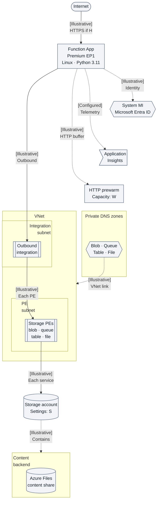
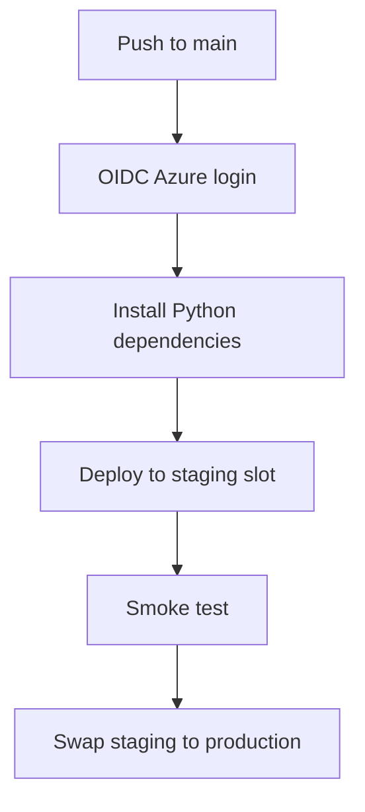

---
validation:
  az_cli:
    last_tested: 2026-04-09
    cli_version: 2.83.0
    core_tools_version: 4.8.0
    result: pass
  bicep:
    last_tested:
    result: not_tested
content_sources:

  references:
    - type: mslearn-adapted
      url: https://learn.microsoft.com/en-us/azure/azure-functions/functions-how-to-github-actions
    - type: mslearn-adapted
      url: https://learn.microsoft.com/en-us/azure/azure-functions/functions-deployment-slots
    - type: mslearn-adapted
      url: https://learn.microsoft.com/en-us/azure/azure-functions/functions-deployment-slots#swap-slots
  diagrams:
    - id: what-you-ll-build
      type: flowchart
      source: self-generated
      justification: Logical Linux EP1 Storage context with conditional public ingress, distinct authorization/telemetry/capacity associations and four expanded endpoint-zone mappings.
      based_on:
        - https://learn.microsoft.com/en-us/azure/azure-functions/functions-how-to-github-actions
        - https://learn.microsoft.com/en-us/azure/azure-functions/functions-deployment-slots
        - https://learn.microsoft.com/en-us/azure/azure-functions/functions-deployment-slots#swap-slots
        - https://learn.microsoft.com/en-us/azure/azure-functions/functions-networking-options
        - https://learn.microsoft.com/en-us/azure/storage/common/storage-private-endpoints
        - https://learn.microsoft.com/en-us/azure/azure-functions/storage-considerations
        - https://learn.microsoft.com/en-us/azure/app-service/overview-managed-identity
        - https://learn.microsoft.com/en-us/azure/azure-functions/functions-monitoring
        - https://learn.microsoft.com/en-us/azure/azure-functions/functions-premium-plan
        - https://learn.microsoft.com/en-us/azure/azure-functions/supported-languages
        - https://learn.microsoft.com/en-us/azure/app-service/overview-access-restrictions#app-access
        - https://learn.microsoft.com/en-us/azure/storage/blobs/anonymous-read-access-prevent
        - https://learn.microsoft.com/en-us/azure/storage/common/shared-key-authorization-prevent
        - https://learn.microsoft.com/en-us/azure/azure-functions/functions-deployment-technologies
    - id: what-you-ll-build-2
      type: flowchart
      source: self-generated
      justification: Conceptual Python Premium staging, smoke-test and swap stages; the key distinguishes the diagram order from the embedded YAML and does not certify dependency packaging.
      based_on:
        - https://learn.microsoft.com/en-us/azure/azure-functions/functions-how-to-github-actions
        - https://learn.microsoft.com/en-us/azure/azure-functions/functions-deployment-slots
        - https://learn.microsoft.com/en-us/azure/azure-functions/functions-deployment-slots#swap-slots
        - https://learn.microsoft.com/en-us/azure/azure-functions/python-build-options
        - https://learn.microsoft.com/en-us/azure/developer/github/connect-from-azure-openid-connect
---
# 06 - CI/CD (Premium)

Build a GitHub Actions pipeline for Azure Functions Premium, then add safe production rollout with deployment slots.

## Prerequisites

- You completed [05 - Infrastructure as Code](05-infrastructure-as-code.md).
- You exported `$RG`, `$APP_NAME`, `$PLAN_NAME`, `$STORAGE_NAME`, `$LOCATION`.
- GitHub repository admin access for Actions variables and environments.

## What You'll Build

- A GitHub Actions workflow that deploys Python Functions from `apps/python` to a staging slot.
- OIDC-based Azure authentication and slot swap rollout for Premium.
- A CI check step that installs Python dependencies from `apps/python/requirements.txt`.

!!! info "Infrastructure Context"
    **Plan**: Premium (EP1) | **Network**: VNet + Private Endpoints | **Always warm**: ✅

    This context combines outbound integration and separate Storage endpoints. A prerequisite site private endpoint affects public ingress (H below). Identity-based host storage is distinct from the default Azure Files content-share connection string; prewarmed instances buffer HTTP scale-out rather than defining the plan's minimum/maximum capacity.

    <!-- diagram-id: what-you-ll-build -->


**Reading key:** Solid arrows are intended request/data access; dotted arrows are identity, telemetry, capacity, VNet-link or membership associations. `[Illustrative]` identifies surrounding infrastructure choices, not a deployment performed here. Outbound integration does not deploy the app into its subnet; identity acquisition uses the app-local token endpoint, not direct app-to-Entra transit. The DNS link targets the actual VNet boundary ([networking](https://learn.microsoft.com/en-us/azure/azure-functions/functions-networking-options), [identity](https://learn.microsoft.com/en-us/azure/app-service/overview-managed-identity)).

| Key | Context / qualification |
|---|---|
| H | After a site private endpoint, public HTTPS requires `publicNetworkAccess: Enabled` and permitting access restrictions. With the property unset (`null`), adding that endpoint disables public ingress by default; the prerequisite Premium Bicep does not explicitly enable it |
| VNet / integration / PE subnet | `10.0.0.0/16` / `10.0.1.0/24` / `10.0.2.0/24`; delegation `Microsoft.Web/serverFarms` |
| S | Intended anonymous-Blob restriction: `allowBlobPublicAccess: false`; `allowSharedKeyAccess: true`. Anonymous-Blob blocking is distinct from disabling public networking |
| W | Premium minimum active billed instance: 1; default prewarmed HTTP buffer: 1; Linux regional maximum scale-out: 20–100, Korea Central: 20. These are different settings, not prewarm minimum/maximum |
| Content / identity | Default Azure Files content access uses its connection string; supported identity-based host storage and Storage RBAC are separate. No-Files deployment alternatives exist |

The bundles retain **four distinct endpoints and four zones**, with endpoint → matching service access and endpoint → zone-group association:

| Endpoint → Storage service | Associated private DNS zone |
|---|---|
| `PE_BLOB` → Blob | `privatelink.blob.core.windows.net` |
| `PE_QUEUE` → Queue | `privatelink.queue.core.windows.net` |
| `PE_TABLE` → Table | `privatelink.table.core.windows.net` |
| `PE_FILE` → File | `privatelink.file.core.windows.net` |

These are independent service paths, not serial hops or a universal endpoint requirement. Use normal Storage hostnames with appropriate private DNS resolution; secured Premium content storage also needs content-share routing. Private ingress and deployment runners need appropriate network/DNS reachability; the conditional public arrow is not a way around disabled public ingress ([Storage endpoints](https://learn.microsoft.com/en-us/azure/storage/common/storage-private-endpoints), [storage](https://learn.microsoft.com/en-us/azure/azure-functions/storage-considerations), [app access](https://learn.microsoft.com/en-us/azure/app-service/overview-access-restrictions#app-access), [Premium capacity](https://learn.microsoft.com/en-us/azure/azure-functions/functions-premium-plan), [deployment networking](https://learn.microsoft.com/en-us/azure/azure-functions/functions-deployment-technologies#secured-virtual-networks)).

<!-- diagram-id: what-you-ll-build-2 -->


**Build distinction:** A global runner install does not put dependencies into the deployment package's `.python_packages/lib/site-packages`. The embedded action does not request remote build; configure a supported Python build/package strategy before relying on this pipeline. A slot swap does not repair missing dependencies or guarantee zero downtime ([Python build options](https://learn.microsoft.com/en-us/azure/azure-functions/python-build-options), [slots](https://learn.microsoft.com/en-us/azure/azure-functions/functions-deployment-slots)).

## Steps

1. Configure OIDC service principal for GitHub Actions.

    ```bash
    az ad app create \
      --display-name "github-$APP_NAME"

    az ad sp create \
      --id "<app-id-from-previous-command>"

    az ad app federated-credential create \
      --id "<app-id-from-previous-command>" \
      --parameters '{
        "name": "github-main",
        "issuer": "https://token.actions.githubusercontent.com",
        "subject": "repo:<org>/<repo>:ref:refs/heads/main",
        "audiences": ["api://AzureADTokenExchange"]
      }'

    az role assignment create \
      --assignee "<app-id-from-previous-command>" \
      --role "Contributor" \
      --scope "/subscriptions/<subscription-id>/resourceGroups/$RG"
    ```

    | CLI element | Explanation |
    |---|---|
    | Command(s) | `az ad app create`, `az ad sp create`, `az ad app federated-credential create`, `az role assignment create` |
    | Key flags | `--display-name`, `--id`, `--parameters`, `--assignee`, `--role`, `--scope` |
    | Variables | `$APP_NAME`, `$RG` |
    | Expected result | Azure CLI returns provisioning details; confirm the resource name and successful provisioning state before continuing. |


2. Create deployment slots for Premium staging and warm-up.

    ```bash
    az functionapp deployment slot create \
      --name "$APP_NAME" \
      --resource-group "$RG" \
      --slot "staging"

    az functionapp deployment slot list \
      --name "$APP_NAME" \
      --resource-group "$RG" \
      --output table
    ```

    | CLI element | Explanation |
    |---|---|
    | Command(s) | `az functionapp deployment slot create`, `az functionapp deployment slot list` |
    | Key flags | `--name`, `--resource-group`, `--slot`, `--output` |
    | Variables | `$APP_NAME`, `$RG` |
    | Expected result | Azure CLI returns provisioning details; confirm the resource name and successful provisioning state before continuing. |


    !!! warning "Staging slot requires separate configuration"
        The staging slot starts as a blank app. You must configure it separately:

        - Assign a system-assigned managed identity
        - Grant the same 4 storage RBAC roles as the production slot
        - Set all required app settings (`FUNCTIONS_WORKER_RUNTIME`, `AzureWebJobsStorage__accountName`, etc.)
        - Create the content share for the slot

        The first deployment to a new slot may fail with "Application Error (ServiceUnavailable)" if the slot is not fully initialized. Wait 30–60 seconds after creation before deploying.

3. Mark slot-specific app settings.

    ```bash
    az functionapp config appsettings set \
      --name "$APP_NAME" \
      --resource-group "$RG" \
      --slot "staging" \
      --slot-settings \
        "AZURE_FUNCTIONS_ENVIRONMENT=Staging"
    ```

    | CLI element | Explanation |
    |---|---|
    | Command(s) | `az functionapp config appsettings set` |
    | Key flags | `--name`, `--resource-group`, `--slot`, `--slot-settings` |
    | Variables | `$APP_NAME`, `$RG` |
    | Expected result | Azure CLI applies the configuration change; confirm the returned JSON or follow-up query shows the expected value. |


4. Define required GitHub Actions repository variables before workflow execution.

    - `AZURE_CLIENT_ID`
    - `AZURE_TENANT_ID`
    - `AZURE_SUBSCRIPTION_ID`
    - `AZURE_FUNCTIONAPP_NAME`
    - `AZURE_RESOURCE_GROUP`

5. Create a GitHub Actions workflow for deploy-to-slot then swap.

    ```yaml
    name: Deploy Premium Function App

    on:
      push:
        branches:
          - main
      workflow_dispatch:

    permissions:
      id-token: write
      contents: read

    jobs:
      deploy:
        runs-on: ubuntu-latest
        steps:
          - name: Checkout
            uses: actions/checkout@v4

          - name: Setup Python
            uses: actions/setup-python@v5
            with:
              python-version: '3.11'

          - name: Install dependencies
            run: |
              python -m pip install --upgrade pip
              pip install --requirement requirements.txt
            working-directory: apps/python

          - name: Azure login
            uses: azure/login@v2
            with:
              client-id: ${{ vars.AZURE_CLIENT_ID }}
              tenant-id: ${{ vars.AZURE_TENANT_ID }}
              subscription-id: ${{ vars.AZURE_SUBSCRIPTION_ID }}

          - name: Deploy to staging slot
            uses: azure/functions-action@v1
            with:
              app-name: ${{ vars.AZURE_FUNCTIONAPP_NAME }}
              slot-name: staging
              package: apps/python

          - name: Smoke test staging
            run: |
              curl --request GET "https://${{ vars.AZURE_FUNCTIONAPP_NAME }}-staging.azurewebsites.net/api/health"

          - name: Swap staging to production
            run: |
              az functionapp deployment slot swap \
                --name "${{ vars.AZURE_FUNCTIONAPP_NAME }}" \
                --resource-group "${{ vars.AZURE_RESOURCE_GROUP }}" \
                --slot "staging" \
                --target-slot "production"
    ```

    | CLI element | Explanation |
    |---|---|
    | Command(s) | `az functionapp deployment slot swap` |
    | Key flags | `--upgrade`, `--requirement`, `--request`, `--name`, `--resource-group`, `--slot`, `--target-slot` |
    | Variables | None |
    | Expected result | Azure CLI returns provisioning details; confirm the resource name and successful provisioning state before continuing. |


6. Deploy from local terminal to staging slot (manual fallback).

    ```bash
    cd apps/python
    func azure functionapp publish "$APP_NAME" --python --slot "staging"
    ```

7. Validate staging and swap to production with Azure CLI.

    ```bash
    curl --request GET "https://$APP_NAME-staging.azurewebsites.net/api/health"

    az functionapp deployment slot swap \
      --name "$APP_NAME" \
      --resource-group "$RG" \
      --slot "staging" \
      --target-slot "production"

    curl --request GET "https://$APP_NAME.azurewebsites.net/api/health"
    ```

    | CLI element | Explanation |
    |---|---|
    | Command(s) | `az functionapp deployment slot swap` |
    | Key flags | `--request`, `--name`, `--resource-group`, `--slot`, `--target-slot` |
    | Variables | `$APP_NAME`, `$RG` |
    | Expected result | Azure CLI returns provisioning details; confirm the resource name and successful provisioning state before continuing. |


8. Verify deployment history and SCM endpoints.

    ```bash
    az functionapp deployment slot list \
      --name "$APP_NAME" \
      --resource-group "$RG" \
      --output table
    ```

    | CLI element | Explanation |
    |---|---|
    | Command(s) | `az functionapp deployment slot list` |
    | Key flags | `--name`, `--resource-group`, `--output` |
    | Variables | `$APP_NAME`, `$RG` |
    | Expected result | Azure CLI returns provisioning details; confirm the resource name and successful provisioning state before continuing. |


    Premium includes SCM/Kudu endpoints per slot:
    - Production: `https://$APP_NAME.scm.azurewebsites.net`
    - Staging: `https://$APP_NAME-staging.scm.azurewebsites.net`

## Verification

```text
Name       Status
---------  ---------
production Running
staging    Running
```

```text
Deploying to function app slot...
Deployment completed successfully.
Syncing triggers...
```

```json
{"status":"healthy","timestamp":"2026-01-01T00:00:00Z","version":"1.0.0"}
```

## Next Steps

> **Next:** [07 - Extending Triggers](07-extending-triggers.md)

## See Also

- [Tutorial Overview & Plan Chooser](../index.md)
- [Python Language Guide](../../index.md)
- [Platform: Hosting Plans](../../../../platform/hosting.md)
- [Operations: Deployment](../../../../operations/deployment.md)
- [Recipes Index](../../recipes/index.md)

## Sources

- [Deploy to Azure Functions using GitHub Actions](https://learn.microsoft.com/en-us/azure/azure-functions/functions-how-to-github-actions)
- [Deployment slots for Azure Functions](https://learn.microsoft.com/en-us/azure/azure-functions/functions-deployment-slots)
- [Swap deployment slots](https://learn.microsoft.com/en-us/azure/azure-functions/functions-deployment-slots#swap-slots)
- [Python build and dependency packaging](https://learn.microsoft.com/en-us/azure/azure-functions/python-build-options)
- [Supported languages and operating systems](https://learn.microsoft.com/en-us/azure/azure-functions/supported-languages)
- [Functions networking options](https://learn.microsoft.com/en-us/azure/azure-functions/functions-networking-options)
- [Storage endpoints and DNS](https://learn.microsoft.com/en-us/azure/storage/common/storage-private-endpoints)
- [Functions storage considerations](https://learn.microsoft.com/en-us/azure/azure-functions/storage-considerations)
- [Managed identities](https://learn.microsoft.com/en-us/azure/app-service/overview-managed-identity)
- [Premium capacity](https://learn.microsoft.com/en-us/azure/azure-functions/functions-premium-plan)
- [App access defaults](https://learn.microsoft.com/en-us/azure/app-service/overview-access-restrictions#app-access)
- [Anonymous Blob access](https://learn.microsoft.com/en-us/azure/storage/blobs/anonymous-read-access-prevent)
- [Shared-key authorization](https://learn.microsoft.com/en-us/azure/storage/common/shared-key-authorization-prevent)
- [Deployment technologies](https://learn.microsoft.com/en-us/azure/azure-functions/functions-deployment-technologies)
- [GitHub OIDC authentication](https://learn.microsoft.com/en-us/azure/developer/github/connect-from-azure-openid-connect)
- [Application Insights integration](https://learn.microsoft.com/en-us/azure/azure-functions/functions-monitoring)
