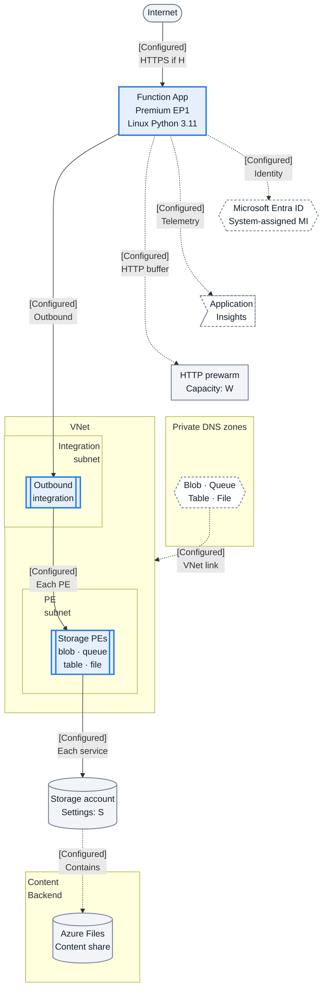
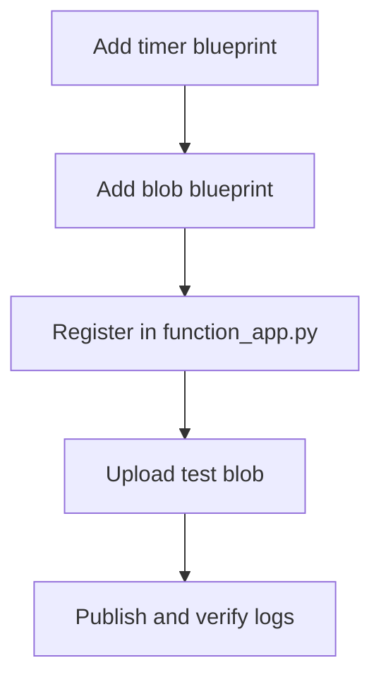

---
validation:
  az_cli:
    last_tested: 2026-04-09
    cli_version: 2.83.0
    core_tools_version: 4.8.0
    result: pass
  bicep:
    last_tested:
    result: not_tested
content_sources:

  references:
    - type: mslearn-adapted
      url: https://learn.microsoft.com/en-us/azure/azure-functions/functions-triggers-bindings
    - type: mslearn-adapted
      url: https://learn.microsoft.com/en-us/azure/azure-functions/functions-bindings-storage-blob-trigger
    - type: mslearn-adapted
      url: https://learn.microsoft.com/en-us/azure/azure-functions/functions-event-grid-blob-trigger
  diagrams:
    - id: what-you-ll-build
      type: flowchart
      source: self-generated
      justification: Flow view of what you ll build, synthesized from Microsoft Learn documentation cited on this page.
      based_on:
        - https://learn.microsoft.com/en-us/azure/azure-functions/functions-networking-options
        - https://learn.microsoft.com/en-us/azure/storage/common/storage-private-endpoints
        - https://learn.microsoft.com/en-us/azure/app-service/overview-managed-identity
        - https://learn.microsoft.com/en-us/azure/azure-functions/functions-premium-plan
        - https://learn.microsoft.com/en-us/azure/azure-functions/storage-considerations
        - https://learn.microsoft.com/en-us/azure/app-service/overview-access-restrictions
        - https://learn.microsoft.com/en-us/azure/azure-functions/functions-triggers-bindings
        - https://learn.microsoft.com/en-us/azure/azure-functions/functions-bindings-storage-blob-trigger
        - https://learn.microsoft.com/en-us/azure/azure-functions/functions-event-grid-blob-trigger
    - id: what-you-ll-build-2
      type: flowchart
      source: self-generated
      justification: Flow view of what you ll build 2, synthesized from Microsoft Learn documentation cited on this page.
      based_on:
        - https://learn.microsoft.com/en-us/azure/azure-functions/functions-bindings-timer
        - https://learn.microsoft.com/en-us/azure/azure-functions/functions-triggers-bindings
        - https://learn.microsoft.com/en-us/azure/azure-functions/functions-bindings-storage-blob-trigger
        - https://learn.microsoft.com/en-us/azure/azure-functions/functions-event-grid-blob-trigger
---
# 07 - Extending Triggers (Premium)

Add non-HTTP triggers to a Premium Function App, focusing on Blob polling and production-safe trigger behavior on always-warm Elastic Premium instances.

## Prerequisites

- You completed [06 - CI/CD](06-ci-cd.md).
- You exported `$RG`, `$APP_NAME`, `$PLAN_NAME`, `$STORAGE_NAME`, `$LOCATION`.
- Your app settings include `AzureWebJobsStorage` (connection string or identity-based).

## What You'll Build

- Two additional triggers (Timer and Blob) using Python blueprints.
- Updated blueprint registration in `apps/python/function_app.py`.
- A trigger validation flow using blob upload and live log checks.

!!! info "Infrastructure Context"
    **Plan**: Premium (EP1) | **Network**: VNet + Private Endpoints | **Always warm**: ✅

    This EP1 scenario retains outbound VNet integration, private Storage endpoints/DNS and a default Azure Files content share. The referenced Premium template also creates a site private endpoint: public HTTPS then requires `publicNetworkAccess: Enabled`; leaving that property unset disables public access once the endpoint exists. HTTP prewarm capacity is separate from always-ready instances and minimum billed plan capacity.

<!-- diagram-id: what-you-ll-build -->


**Reading key (Linux EP1):** Solid arrows show intended request/data access; dotted arrows show identity, telemetry, capacity, VNet-link or membership associations, not transit. Outbound integration does not deploy app compute into the integration subnet ([networking](https://learn.microsoft.com/en-us/azure/azure-functions/functions-networking-options)).

| Key | Configuration / meaning |
|---|---|
| VNet / integration / PE subnet | `10.0.0.0/16` / `10.0.1.0/24` / `10.0.2.0/24`; delegation `Microsoft.Web/serverFarms` |
| H | Public HTTPS after the template's site endpoint requires explicit app `publicNetworkAccess: Enabled`, subject to access restrictions; unset defaults to disabled when a site endpoint exists ([app access](https://learn.microsoft.com/en-us/azure/app-service/overview-access-restrictions#app-access)) |
| S | Template Storage `publicNetworkAccess: Disabled`, `allowSharedKeyAccess: true`; `allowPublicAccess` was the Bicep module parameter, not a Storage ARM property |
| W | Prewarmed default of 1 buffers **HTTP scale**, not timer/blob executions. Always-ready instances are separate; an active Premium plan has at least one billed instance. Linux maximum scale is region-dependent (20–100), not the prewarm count ([Premium](https://learn.microsoft.com/en-us/azure/azure-functions/functions-premium-plan)) |
| Identity / content | System-assigned identity for supported host-storage access; token acquisition uses the local identity endpoint. The default Files content-share connection uses a connection string, not identity; documented deployments can avoid the Files dependency ([identity](https://learn.microsoft.com/en-us/azure/app-service/overview-managed-identity), [storage](https://learn.microsoft.com/en-us/azure/azure-functions/storage-considerations)) |

The bundled nodes retain **four distinct endpoints**, with integration → endpoint → matching Storage service and each endpoint's DNS zone-group association. DNS zones are outside and linked to the VNet; clients retain normal Storage hostnames with private DNS resolving to endpoint IPs ([Storage endpoints/DNS](https://learn.microsoft.com/en-us/azure/storage/common/storage-private-endpoints)).

| Endpoint → Storage service | Private DNS zone |
|---|---|
| `PE_BLOB` → Blob | `privatelink.blob.core.windows.net` |
| `PE_QUEUE` → Queue | `privatelink.queue.core.windows.net` |
| `PE_TABLE` → Table | `privatelink.table.core.windows.net` |
| `PE_FILE` → File | `privatelink.file.core.windows.net` |

<!-- diagram-id: what-you-ll-build-2 -->


## Steps

1. Add a Timer trigger blueprint.

    ```python
    # apps/python/blueprints/scheduled.py
    import azure.functions as func
    import logging

    bp = func.Blueprint()

    @bp.timer_trigger(schedule="0 */5 * * * *", arg_name="timer", run_on_startup=False)
    def scheduled_cleanup(timer: func.TimerRequest) -> None:
        if timer.past_due:
            logging.warning("Timer trigger is past due")
        logging.info("Scheduled cleanup executed")
    ```

2. Add a standard polling Blob trigger (supported on Premium).

    ```python
    # apps/python/blueprints/blob_processor.py
    import azure.functions as func
    import logging

    bp = func.Blueprint()

    @bp.blob_trigger(arg_name="blob", path="uploads/{name}", connection="AzureWebJobsStorage")
    def process_blob(blob: func.InputStream) -> None:
        logging.info("Processing blob: %s", blob.name)
        logging.info("Blob size: %d bytes", blob.length)
    ```

    On Premium, polling blob trigger works by default. Event Grid is optional when you need lower-latency eventing.

3. Register new blueprints in `apps/python/function_app.py`.

    ```python
    from blueprints.scheduled import bp as scheduled_bp
    from blueprints.blob_processor import bp as blob_bp

    app.register_blueprint(scheduled_bp)
    app.register_blueprint(blob_bp)
    ```

4. Create containers and upload a blob for trigger testing.

    ```bash
    az storage container create \
      --name "uploads" \
      --account-name "$STORAGE_NAME" \
      --auth-mode login

    az storage container create \
      --name "processed" \
      --account-name "$STORAGE_NAME" \
      --auth-mode login

    python3 -c "from pathlib import Path; Path('/tmp/sample.txt').write_text('hello premium blob\n', encoding='utf-8')"

    az storage blob upload \
      --container-name "uploads" \
      --name "sample.txt" \
      --file "/tmp/sample.txt" \
      --account-name "$STORAGE_NAME" \
      --auth-mode login
    ```

    | Command/Parameter | Purpose |
    | --- | --- |
    | `az storage container create` | Create a blob container in the storage account. |
    | `az storage blob upload` | Upload a local file to a blob container. |
    | `--name` | Name of the target resource (container or blob). |
    | `--account-name` | Storage account that hosts the container. |
    | `--auth-mode` | Authentication mode; `login` uses your Microsoft Entra identity. |
    | `--container-name` | Container to upload the blob into. |
    | `--file` | Local file path to upload. |

5. Publish updated code to Premium.

    ```bash
    cd apps/python
    func azure functionapp publish "$APP_NAME" --python
    ```

6. Verify trigger execution with log stream.

    ```bash
    az webapp log tail \
      --name "$APP_NAME" \
      --resource-group "$RG"
    ```

    | Command/Parameter | Purpose |
    | --- | --- |
    | `az webapp log tail` | Stream live log output from the app. |
    | `--name` | Name of the target resource. |
    | `--resource-group` | Resource group that contains the resource. |

7. Validate Premium trigger behavior.

    - Always-ready instances keep the app running; prewarmed instances separately buffer HTTP scale-out, not timer/blob processing.
    - Scale remains plan-level for Premium apps (not per-function).
    - Standard blob polling trigger is supported; Event Grid trigger remains optional.
    - Keep timeout-sensitive jobs aware of Premium defaults (30 minutes default, unlimited max).

## Verification

```text
Functions in func-premium-demo:
    scheduled_cleanup - [timerTrigger]
    process_blob - [blobTrigger]
```

```text
2026-01-01T00:05:00.000 [Information] Executing 'Functions.scheduled_cleanup' (Reason='Timer fired', Id=xxxxxxxx-xxxx-xxxx-xxxx-xxxxxxxxxxxx)
2026-01-01T00:05:00.120 [Information] Executed 'Functions.scheduled_cleanup' (Succeeded, Id=xxxxxxxx-xxxx-xxxx-xxxx-xxxxxxxxxxxx, Duration=120ms)
2026-01-01T00:05:10.000 [Information] Processing blob: uploads/sample.txt
```

## Next Steps

> **Next:** [How Azure Functions Works](../../../../platform/architecture/index.md)

## See Also

- [Tutorial Overview & Plan Chooser](../index.md)
- [Python Language Guide](../../index.md)
- [Platform: Hosting Plans](../../../../platform/hosting.md)
- [Operations: Deployment](../../../../operations/deployment.md)
- [Recipes Index](../../recipes/index.md)

## Sources

- [Functions networking options](https://learn.microsoft.com/en-us/azure/azure-functions/functions-networking-options)
- [Storage private endpoints and DNS](https://learn.microsoft.com/en-us/azure/storage/common/storage-private-endpoints)
- [App Service and Functions managed identity](https://learn.microsoft.com/en-us/azure/app-service/overview-managed-identity)
- [Premium capacity settings](https://learn.microsoft.com/en-us/azure/azure-functions/functions-premium-plan)
- [Functions storage considerations](https://learn.microsoft.com/en-us/azure/azure-functions/storage-considerations)
- [App public access restrictions](https://learn.microsoft.com/en-us/azure/app-service/overview-access-restrictions#app-access)
- [Python Timer trigger](https://learn.microsoft.com/en-us/azure/azure-functions/functions-bindings-timer)
- [Azure Functions triggers and bindings](https://learn.microsoft.com/en-us/azure/azure-functions/functions-triggers-bindings)
- [Blob trigger for Azure Functions](https://learn.microsoft.com/en-us/azure/azure-functions/functions-bindings-storage-blob-trigger)
- [Event Grid-based blob trigger](https://learn.microsoft.com/en-us/azure/azure-functions/functions-event-grid-blob-trigger)
