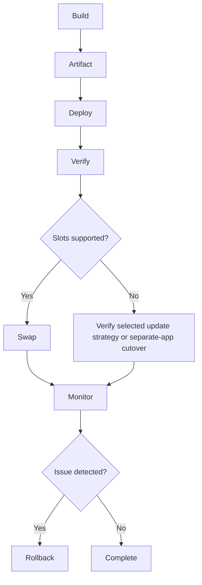

---
content_sources:
  references:
    - type: mslearn-adapted
      url: https://learn.microsoft.com/en-us/azure/azure-functions/deployment-zip-push
    - type: mslearn-adapted
      url: https://learn.microsoft.com/en-us/azure/azure-functions/functions-how-to-github-actions
    - type: mslearn-adapted
      url: https://learn.microsoft.com/en-us/azure/azure-functions/functions-deployment-slots
    - type: mslearn-adapted
      url: https://learn.microsoft.com/en-us/azure/azure-functions/functions-run-local
    - type: mslearn-adapted
      url: https://learn.microsoft.com/en-us/azure/azure-functions/functions-deployment-technologies
    - type: mslearn-adapted
      url: https://learn.microsoft.com/en-us/azure/azure-functions/flex-consumption-how-to
    - type: mslearn-adapted
      url: https://learn.microsoft.com/en-us/azure/azure-functions/flex-consumption-plan
    - type: mslearn-adapted
      url: https://learn.microsoft.com/en-us/azure/azure-functions/flex-consumption-site-updates
    - type: mslearn-adapted
      url: https://learn.microsoft.com/en-us/azure/azure-functions/functions-rollback-deployments
  diagrams:
    - id: deployment-workflow
      type: flowchart
      source: self-generated
      justification: Deployment workflow, synthesized from Microsoft Learn documentation cited on this page.
      based_on:
        - https://learn.microsoft.com/en-us/azure/azure-functions/deployment-zip-push
        - https://learn.microsoft.com/en-us/azure/azure-functions/functions-how-to-github-actions
        - https://learn.microsoft.com/en-us/azure/azure-functions/functions-deployment-slots
        - https://learn.microsoft.com/en-us/azure/azure-functions/functions-run-local
content_validation:
  status: verified
  last_reviewed: 2026-09-11
  reviewer: agent
  core_claims:
    - claim: "Running a function app from a deployment package supports immutable artifact deployment behavior."
      source: https://learn.microsoft.com/en-us/azure/azure-functions/deployment-zip-push
      verified: true
    - claim: "GitHub Actions is a supported CI/CD deployment method for Azure Functions."
      source: https://learn.microsoft.com/en-us/azure/azure-functions/functions-how-to-github-actions
      verified: true
    - claim: "Deployment slots are used for safer releases and rollback on supported Azure Functions hosting plans."
      source: https://learn.microsoft.com/en-us/azure/azure-functions/functions-deployment-slots
      verified: true
    - claim: "Flex site updates default to Recreate; RollingUpdate is opt-in, and rollback requires another site update with the previous code or configuration."
      source: https://learn.microsoft.com/en-us/azure/azure-functions/flex-consumption-site-updates
      verified: true
    - claim: "Flex Consumption runs from a package by default without WEBSITE_RUN_FROM_PACKAGE; Linux Consumption uses a URL instead of the local-package value 1."
      source: https://learn.microsoft.com/en-us/azure/azure-functions/deployment-zip-push
      verified: true
---

# Deployment
This guide covers operational deployment execution for Azure Functions.
It focuses on release methods, slot strategy, and rollback safety.

!!! tip "Platform Guide"
    For scaling architecture and plan comparison, see [Scaling](../platform/scaling.md).

!!! tip "Language Guide"
    For Python deployment specifics, see the [Python Tutorial](../language-guides/python/tutorial/index.md).

## Prerequisites
Validate access, artifact quality, and hosting plan constraints before deployment.

### CLI access
```bash
az --version
func --version
```

| Command/Parameter | Purpose |
|-------------------|---------|
| `az --version` | Checks the Azure CLI version |
| `func --version` | Checks the Azure Functions Core Tools version |

```bash
az account show --output table
```

| Command/Parameter | Purpose |
|-------------------|---------|
| `az account show` | Shows the current Azure subscription details |
| `--output table` | Formats the output as a table |

### RBAC permissions
Minimum deployment role is `Contributor` on the target resource group.

```bash
az role assignment list \
    --assignee <object-id> \
    --resource-group <resource-group> \
    --output table
```

| Command/Parameter | Purpose |
|-------------------|---------|
| `az role assignment list` | Lists role assignments |
| `--assignee <object-id>` | Filters by the user, group, or service principal object ID |
| `--resource-group <resource-group>` | Filters by the resource group name |
| `--output table` | Formats the output as a table |

### Artifact ready
Build once and deploy one immutable artifact.

```bash
ls -lh <path-to-artifact-zip>
sha256sum <path-to-artifact-zip>
```

| Command/Parameter | Purpose |
|-------------------|---------|
| `ls -lh` | Lists file details with human-readable sizes |
| `sha256sum` | Computes the SHA256 hash of the artifact for integrity verification |

### Hosting plan check
```bash
az functionapp show \
    --resource-group <resource-group> \
    --name <app-name> \
    --query "{name:name,kind:kind,reserved:reserved,state:state}" \
    --output table
```

| Command/Parameter | Purpose |
|-------------------|---------|
| `az functionapp show` | Gets the details of a function app |
| `--resource-group <resource-group>` | Specifies the resource group |
| `--name <app-name>` | Specifies the function app name |
| `--query` | JMESPath query to filter specific properties |
| `--output table` | Formats the output as a table |

### Package configuration precheck (read-only)

Before changing an existing Linux Consumption app, confirm its OS and the linked plan's SKU; `kind` alone does not distinguish Y1 from Premium. These commands only read configuration and suppress package URLs, SAS tokens, and connection strings:

```bash
PLAN_ID=$(az functionapp show --resource-group "$RG" --name "$APP_NAME" --query serverFarmId --output tsv)
az appservice plan show --ids "$PLAN_ID" --query "{sku:sku.name,tier:sku.tier,reserved:reserved}" --output table
az functionapp config appsettings list --resource-group "$RG" --name "$APP_NAME" \
    --query "{packageSettingPresent:contains([].name, 'WEBSITE_RUN_FROM_PACKAGE'),localPackage:contains([?name=='WEBSITE_RUN_FROM_PACKAGE'].value, '1'),remoteBuild:[?name=='SCM_DO_BUILD_DURING_DEPLOYMENT' || name=='ENABLE_ORYX_BUILD'].{name:name,value:value}}" \
    --output json
```

| Command/Parameter | Purpose |
| --- | --- |
| `az functionapp show` | Read the app's linked plan ID. |
| `az appservice plan show` | Confirm SKU (`Y1` for Consumption) and Linux reservation. |
| `az functionapp config appsettings list` | Inspect package mode and remote-build flags without printing secrets. |
| `--resource-group` | Target resource group. |
| `--name` | Target app name. |
| `--ids` | Linked plan resource ID. |
| `--query` | Select safe metadata; package presence is not proof of a valid URL. |
| `--output` | Return TSV for the local variable, table for the SKU, JSON for the flags. |

Also retain the exact current package reference (including prior absence), artifact hash, build method, identity/access configuration, and settings in an access-controlled release record using the [playbook baseline](../troubleshooting/playbooks/deployment-failures.md#4-what-to-check-first). Inspect any URL privately for artifact existence, authorization and SAS expiry; do not paste it into tickets or CI logs. No command in this precheck changes deployment mode or tests Azure runtime behavior.

## Portal Walkthrough

### Deployment Center

[Observed] The **Deployment Center** blade provides a **Source** dropdown to connect the Function App to a CI/CD provider (GitHub, Azure Repos, Local Git, etc.). The banner warns "You are now in the production slot, which is not recommended for setting up CI/CD" — indicating slot-based deployment is preferred when available:


[Inferred] For Consumption plans, this is the expected view since Consumption supports only 2 slots (production + 1 staging, Windows only). Flex has no slots, but supports a configurable site update strategy and separate-app validation; see the [release strategy decision table](../best-practices/deployment.md#release-strategy-decision-table). Premium and Dedicated plans should configure CI/CD against a staging slot instead.

## When to Use
Choose deployment method by governance level, release frequency, and plan capability.

| Method | When to use it | Notes |
|---|---|---|
| `func azure functionapp publish` | Emergency/operator-run deployment | Fast, manual, low governance |
| Zip deploy (`az functionapp deployment source config-zip`) | Scripted artifact deployment | Standard on Consumption, Premium, Dedicated |
| GitHub Actions | Repository-native CI/CD | Recommended for PR-to-main flow |
| Azure DevOps | Enterprise gated release | Useful for approvals and stage controls |

1. **Fast mitigation**
    - Use Core Tools publish when pipelines are unavailable.
2. **Routine production release**
    - Use immutable zip artifact and verification gate.
3. **Regulated environments**
    - Use Azure DevOps approvals and governed service connections.
4. **Flex Consumption**
    - Choose recreate, rolling update, or separate-app cutover using the [strategy comparison](../best-practices/deployment.md#release-strategy-decision-table); none uses Flex slots.
    - Prefer remote build when dependency compilation is platform-sensitive.

## Procedure

### Package configuration by plan and OS

For code-based apps, use this matrix before selecting a publish command. It summarizes [official package guidance](https://learn.microsoft.com/en-us/azure/azure-functions/deployment-zip-push) and [deployment technologies](https://learn.microsoft.com/en-us/azure/azure-functions/functions-deployment-technologies), not measured deployment results.

| Hosting plan / OS | Deployment mechanism | Package setting | Read-only content behavior |
| --- | --- | --- | --- |
| Windows Consumption (Y1) | ZIP deployment through supported tools | `WEBSITE_RUN_FROM_PACKAGE=1` for a ready-to-run local package | Package mounts as read-only `wwwroot`; no in-place edits. |
| Linux Consumption (Y1) | Remote build through supported tools, or external URL for a locally built package | Never `1`. For remote build, do not manually set it; the deployment process manages the output package URL. For a locally built package, use the actual uploaded artifact URL. | Runs from a package with read-only `wwwroot`; not a writable deployment directory. |
| Flex Consumption (FC1, Linux) | Managed package deployment (OneDeploy) through Core Tools, Azure CLI or supported CI/CD | Do **not** set `WEBSITE_RUN_FROM_PACKAGE`; use `functionAppConfig.deployment.storage` | Runs from the deployment container's package by default; read-only `wwwroot`. |
| Premium (EP, Windows/Linux) | ZIP deployment; remote build where needed | `1` for a ready-to-run local package; do not manually set the package setting for remote build | Read-only `wwwroot` when running from package. |
| Dedicated (Windows/Linux) | ZIP deployment; remote build where needed | `1` for a ready-to-run local package; do not manually set the package setting for remote build | Read-only `wwwroot` when running from package. |

For Linux remote build on Consumption, Premium or Dedicated, the supported tooling configures `SCM_DO_BUILD_DURING_DEPLOYMENT=true` and `ENABLE_ORYX_BUILD=true`; do not combine a remote-build request with manually forced package mode. Flex requests remote build as a deployment parameter instead, not these app settings. External package URL workflows require manual trigger synchronization; updating bytes at the same URL also requires a restart. Keep runtime-generated files outside `wwwroot` and use durable external storage for persisted data.

**Infrastructure boundary:** `infra/consumption/main.bicep` provisions Linux Y1 without a package setting until a compatible deployment establishes one; it does not upload code or invent a URL. Its Azure Files content-share settings are provisioning concerns, separate from package selection. `AzureWebJobsStorage__*` configures identity-based host storage, not package-blob authorization or remote build. The template retains creation-time runtime/content settings and activates identity-based host storage only after RBAC. Its later appsettings resource replaces the complete collection: reapplying this infrastructure to an already-published app can remove deployment-managed settings. Review the captured baseline and plan an approved compatible redeployment rather than applying it as an incident repair.

Follow the language-specific deployment tracks: [Linux Consumption](../language-guides/python/tutorial/consumption/02-first-deploy.md), [Flex](../language-guides/python/tutorial/flex-consumption/02-first-deploy.md), [Premium](../language-guides/python/tutorial/premium/02-first-deploy.md), and [Dedicated](../language-guides/python/tutorial/dedicated/02-first-deploy.md). Python examples target Linux; use the [official Windows Consumption configuration](https://learn.microsoft.com/en-us/azure/azure-functions/deployment-zip-push#consumption-package-configuration) for Windows apps.

**Verification boundary:** the matrix and package/storage guidance were checked against Microsoft Learn on 2026-10-25. Bicep compilation and consistency gates are static checks, not Azure deployment, authorization, trigger, or latency tests. No new Azure-tested tutorial result is claimed; retain each tutorial's own validation metadata.

### Deployment workflow
<!-- diagram-id: deployment-workflow -->


### Deploy with Core Tools
```bash
func azure functionapp publish <app-name>
```

| Command/Parameter | Purpose |
|-------------------|---------|
| `func azure functionapp publish` | Deploys the local function project to Azure |
| `<app-name>` | Specifies the target function app name |

Use this for operator-driven release or emergency recovery deployment.

!!! note "Production practice"
    Prefer pipeline deployment for repeatability and auditability.

### Deploy with zip artifact
Use a ready-to-run artifact for the compatible workflow in the matrix. Linux Consumption source projects needing remote build must use the plan tutorial's remote-build procedure instead. On Flex, supported tools select managed package deployment, not the classic Kudu ZIP API; request remote build explicitly when required.

```bash
az functionapp deployment source config-zip \
    --resource-group <resource-group> \
    --name <app-name> \
    --src <path-to-artifact-zip>
```

| Command/Parameter | Purpose |
|-------------------|---------|
| `az functionapp deployment source config-zip` | Deploys a zip artifact to the function app |
| `--resource-group <resource-group>` | Specifies the resource group |
| `--name <app-name>` | Specifies the function app name |
| `--src <path-to-artifact-zip>` | Path to the local zip file to deploy |

!!! warning "Preserve the established deployment mode during recovery"
    Do not follow ZIP deployment with an unconditional `WEBSITE_RUN_FROM_PACKAGE=1` update. That value is for local-package workflows on Windows Consumption, Premium, and Dedicated only. Linux Consumption uses a package URL; remote-build deployments manage their output and must not be forced into a manually configured package mode. Flex uses managed package deployment and `functionAppConfig.runtime` / `.deployment.storage`, not `WEBSITE_RUN_FROM_PACKAGE` or legacy worker-setting repairs. Before an incident write, capture the read-only baseline and restore only proven drift as described in the [deployment failure playbook](../troubleshooting/playbooks/deployment-failures.md#8-immediate-mitigations). Settings changes restart the app by default and can interrupt executions; validate readiness, discovery, and actual trigger completion after recovery.

    This replacement safeguard and its added core claim were checked against [official package guidance](https://learn.microsoft.com/en-us/azure/azure-functions/deployment-zip-push) and [deployment technologies](https://learn.microsoft.com/en-us/azure/azure-functions/functions-deployment-technologies) on 2026-10-25. This was source review only, not CLI/live Azure execution or a new full-page validation; the prior page-wide review date is preserved.

### GitHub Actions pipeline
```yaml
name: deploy-functions

on:
  push:
    branches: [ main ]

jobs:
  deploy:
    runs-on: ubuntu-latest
    steps:
      - name: Checkout
        uses: actions/checkout@v4

      - name: Azure login with OIDC
        uses: azure/login@v2
        with:
          client-id: ${{ secrets.AZURE_CLIENT_ID }}
          tenant-id: ${{ secrets.AZURE_TENANT_ID }}
          subscription-id: ${{ secrets.AZURE_SUBSCRIPTION_ID }}

      - name: Deploy function app
        uses: azure/functions-action@v1
        with:
          app-name: <app-name>
          package: <artifact-directory-or-zip>
```

Use OIDC where possible to avoid long-lived deployment secrets.

### Azure DevOps pipeline
```yaml
trigger:
  branches:
    include:
      - main

steps:
  - task: AzureFunctionApp@2
    displayName: Deploy Azure Function App
    inputs:
      azureSubscription: <service-connection>
      appType: functionAppLinux
      appName: <app-name>
      package: <artifact-path>
```

### Deployment slots (Windows Consumption, Premium, and Dedicated)
Use slots for safe cutover and fast rollback.

> **Note:** Windows Consumption supports 2 slots total (including production). Linux Consumption and Flex Consumption do not support deployment slots.

#### Create staging slot
```bash
az functionapp deployment slot create \
    --resource-group <resource-group> \
    --name <app-name> \
    --slot staging
```

| Command/Parameter | Purpose |
|-------------------|---------|
| `az functionapp deployment slot create` | Creates a new deployment slot for the function app |
| `--resource-group <resource-group>` | Specifies the resource group |
| `--name <app-name>` | Specifies the function app name |
| `--slot staging` | Names the slot "staging" |

#### Configure slot-specific settings
```bash
az functionapp config appsettings set \
    --resource-group <resource-group> \
    --name <app-name> \
    --slot staging \
    --slot-settings AZURE_FUNCTIONS_ENVIRONMENT=Staging
```

| Command/Parameter | Purpose |
|-------------------|---------|
| `az functionapp config appsettings set` | Configures app settings for the specified slot |
| `--slot staging` | Target slot for the setting change |
| `--slot-settings` | Defines settings as "sticky" to the slot (doesn't swap with production) |

#### Swap staging into production
```bash
az functionapp deployment slot swap \
    --resource-group <resource-group> \
    --name <app-name> \
    --slot staging \
    --target-slot production
```

| Command/Parameter | Purpose |
|-------------------|---------|
| `az functionapp deployment slot swap` | Swaps the traffic between two slots |
| `--slot staging` | Specifies the source slot |
| `--target-slot production` | Specifies the target slot for cutover |

### Flex Consumption deployment specifics
Deployment storage is configured on the site resource through `properties.functionAppConfig.deployment.storage`: `type: blobContainer`, the container `value`, and `authentication` (for example, a user-assigned identity with its `userAssignedIdentityResourceId`). Check the container, authentication identity, storage RBAC, and network reachability separately from host storage. See [Configure deployment settings](https://learn.microsoft.com/en-us/azure/azure-functions/flex-consumption-how-to#configure-deployment-settings).

Use **Settings > Deployment settings** to inspect the package location, and **Diagnose and solve problems > Flex Consumption Deployment** for deployment history, package status and recommendations. Flex does not provide the classic Kudu console or its `/api/deployments` diagnostics. A deployment endpoint on an `scm` host is not a Kudu management surface; let supported tools select the API. Uploading a blob directly into the container does not deploy it. Retain release artifacts outside that container because its current package is overwritten.

1. **No deployment slots**
    - Validate in a separate app; choose the production site's update strategy below.
    - A second app is not a slot: HTTP traffic routing and non-HTTP trigger ownership need their own cutover plan.
2. **Remote build requirements**
    - Use remote build when runtime-specific dependencies must compile in Azure.
    - Validate runtime version and lockfile before publish.
3. **Rollback approach**
    - Redeploy the last-known-good artifact because swap-back is unavailable.

### Flex site update strategy

The package/storage mechanism above is unchanged by this setting. Code deployment, app-setting changes and other configuration changes can trigger a site update. `properties.functionAppConfig.siteUpdateStrategy.type` defaults to `Recreate`; opt-in `RollingUpdate` drains and replaces instances in platform-controlled batches, not a user-configurable canary percentage. See the [decision table and regional availability caveat](../best-practices/deployment.md#release-strategy-decision-table) before choosing it.

1. Capture the existing strategy, artifact hash/build identity, expected function inventory and scoped configuration baseline. Check compatibility in both directions: old instances must tolerate new settings/messages/schema, and the retained release must tolerate state written by the new release.
2. Use **Azure CLI 2.87.0 or later** for these documented commands. Bicep/ARM supports this property with API version **2023-12-01 or later**. Read the current strategy before an approved write:

```bash
az functionapp update-strategy config show \
    --resource-group "$RG" \
    --name "$APP_NAME"
```

| Command/Parameter | Purpose |
| --- | --- |
| `az functionapp update-strategy config show` | Read the configured site update strategy; not rollout progress. |
| `--resource-group` | Target resource group. |
| `--name` | Target Flex Function App. |

3. Configure the strategy ahead of the release under change control:

```bash
az functionapp update-strategy config set \
    --resource-group "$RG" \
    --name "$APP_NAME" \
    --type RollingUpdate
```

| Command/Parameter | Purpose |
| --- | --- |
| `az functionapp update-strategy config set` | Select the strategy used for subsequent site updates. |
| `--resource-group` | Target resource group. |
| `--name` | Target Flex Function App. |
| `--type` | `RollingUpdate` opts in; `Recreate` selects restart behavior, not a package rollback. |

4. In GA regions, changing the strategy alone is a no-op for running instances and applies to the next deployment. Where the feature is still rolling out, that change itself triggers an update using the **previous** strategy; the new strategy applies starting with the next deployment. Plan for interruption if the previous strategy is `Recreate`.
5. Deploy through the established [plan-compatible package workflow](#package-configuration-by-plan-and-os) and verify below. Code and configuration writes can initiate separate overlapping updates; do not treat them as one atomic release or use a fixed sleep as proof of completion. Avoid unnecessary overlapping releases while investigating a regression.

#### In-flight work and trigger readiness

- **Invocations:** `Recreate` forcefully restarts live and draining instances. `RollingUpdate` stops new events on draining instances and allows in-progress executions within the documented **60-minute scale-in grace period**; HTTP responses remain limited to **230 seconds**, and configured function timeouts still apply. This is not unlimited execution protection or a guarantee against crashes/dependency failures. Single-instance apps can have brief downtime even with rolling updates.
- **Indexing/listeners:** replacement instances still have to load the package, start the worker, discover/index the expected functions and initialize bindings/listeners. A deployment API success or HTTP health response does not demonstrate all triggers are indexed or processing. Compare the function inventory, inspect startup/indexing errors and exercise each critical trigger path; do not apply external-package manual-sync assumptions to Flex's managed deployment path.
- **Queue processing:** old/new consumers can overlap during rolling updates. Keep message contracts backward compatible and side effects idempotent. For Azure Storage queues, successful execution deletes a message; failure or a host crash can make it visible for reprocessing according to visibility/retry rules. Inspect dequeue/retry and poison counts plus age/backlog, not just HTTP request success. Service Bus settlement and Event Hubs checkpointing have different semantics; follow the existing [trigger guidance](../best-practices/trigger-and-binding.md), not a universal drain/acknowledgment assumption.
- **Durable business completion:** a healthy host or invocation return is not evidence of a committed downstream transaction or completed orchestration. Verify the application-owned completion record using a synthetic correlation key. For Durable Functions, use an explicit [orchestration version match strategy](https://learn.microsoft.com/en-us/azure/durable-task/common/durable-orchestration-versioning) because versions overlap; package rollback does not rewind orchestration history or external state.

**Verification boundary:** the strategy, CLI syntax, limitations and added core claim were checked against Microsoft Learn on 2026-10-25 by official-source review only. Commands are procedures, not executed results. No Azure deployment, invocation/drain timing, queue processing or rollback test was performed; the existing page-wide review date and tutorial validation metadata are unchanged.

### Post-deploy checks
- Health endpoint is successful.
- Failure ratio does not regress.
- Duration percentiles stay within expected range.
- Queue backlog does not grow unexpectedly.

Expanded CLI checks:

```bash
az functionapp function list \
    --resource-group <resource-group> \
    --name <app-name> \
    --output table
```

| Command/Parameter | Purpose |
|-------------------|---------|
| `az functionapp function list` | Lists all functions within the app |
| `--resource-group <resource-group>` | Specifies the resource group |
| `--name <app-name>` | Specifies the function app name |
| `--output table` | Formats the list as a table |

```bash
az monitor app-insights metrics show \
    --app <app-insights-name> \
    --resource-group <resource-group> \
    --metrics requests/failed \
    --interval PT5M \
    --offset 30m \
    --output table
```

| Command/Parameter | Purpose |
|-------------------|---------|
| `az monitor app-insights metrics show` | Retrieves metrics from Application Insights |
| `--app <app-insights-name>` | Specifies the Application Insights resource |
| `--metrics requests/failed` | Filters for failed request counts |
| `--interval PT5M` | Aggregates data in 5-minute intervals |
| `--offset 30m` | Looks back at the last 30 minutes of data |
| `--output table` | Formats metrics as a table |

## Verification
Validate deployment state, slot inventory, runtime health, and release identity.

### Deployment status and slot listing
`az functionapp deployment source show` returns source-control deployment configuration (for example, GitHub or Local Git integration). For zip deploy/Core Tools deployment verification, use deployment logs and app health checks instead.

```bash
az functionapp deployment source show \
    --resource-group <resource-group> \
    --name <app-name> \
    --output json
```

| Command/Parameter | Purpose |
|-------------------|---------|
| `az functionapp deployment source show` | Shows the source control deployment configuration |
| `--resource-group <resource-group>` | Specifies the resource group |
| `--name <app-name>` | Specifies the function app name |
| `--output json` | Formats output as JSON to see detail |

```json
{
  "branch": "main",
  "deploymentRollbackEnabled": true,
  "isGitHubAction": true,
  "repoUrl": "https://github.com/<org>/<repo>",
  "isManualIntegration": false
}
```

```bash
az functionapp deployment slot list \
    --resource-group <resource-group> \
    --name <app-name> \
    --output table
```

| Command/Parameter | Purpose |
|-------------------|---------|
| `az functionapp deployment slot list` | Lists all deployment slots for the app |
| `--resource-group <resource-group>` | Specifies the resource group |
| `--name <app-name>` | Specifies the function app name |
| `--output table` | Formats the slot list as a table |

```text
Name         Status     Traffic %
-----------  ---------  ---------
production   Running    100
staging      Running    0
```

### Runtime and endpoint checks
```bash
az functionapp show \
    --resource-group <resource-group> \
    --name <app-name> \
    --query "{state:state,hostNames:defaultHostName,lastModifiedTimeUtc:lastModifiedTimeUtc}" \
    --output table
```

| Command/Parameter | Purpose |
|-------------------|---------|
| `az functionapp show` | Gets the status and metadata for the function app |
| `--query` | Extracts state, hostname, and last modified timestamp |
| `--output table` | Formats the output as a table |

```bash
curl --silent --show-error --fail https://<app-name>.azurewebsites.net/api/health
```

| Command/Parameter | Purpose |
|-------------------|---------|
| `curl --silent` | Suppresses progress meter and error messages |
| `--show-error` | Shows error message if it fails |
| `--fail` | Returns a non-zero exit code if the HTTP response is 4xx or 5xx |
| `https://<app-name>.azurewebsites.net/api/health` | URL of the health check endpoint |

```text
{"status":"ok","version":"2026.01.15","commit":"a1b2c3d4"}
```

Expected output:

1. Function App state is `Running`.
2. Health endpoint returns HTTP `200`.
3. Version and commit match the released artifact.
4. Failure and duration metrics remain within baseline.

## Rollback / Troubleshooting
### Flex package rollback is another update

Flex has no built-in site-update undo, package revision history or slot swap-back. Preserve approved artifacts outside the overwritten deployment container, as described in [Flex deployment specifics](#flex-consumption-deployment-specifics). Recovery redeploys the retained known-good package through the supported pipeline/tooling; it is subject to the configured strategy and can overlap the failed release while instances drain. Uploading an old blob alone or changing the strategy to `Recreate` does not select an old package.

Use the existing [recovery sequence](#recovery-sequence): first compare captured state, then restore only demonstrated code/configuration drift. The [official CI/CD recovery guide](https://learn.microsoft.com/en-us/azure/azure-functions/functions-rollback-deployments) also describes re-running an old successful run, but that **rebuilds** from its original commit, does not reuse the original binary, and resolves secrets/variables at their current values. Prefer a retained validated artifact when exact bytes matter; review rebuild dependencies and configuration diffs otherwise. Do not copy full-settings replacement or undeclared-key deletion into incident recovery. Neither method reverses database migrations, message side effects, external resources or secret rotation. If the old release cannot read current state safely, contain the incident and assess a forward fix rather than force an unsafe rollback.

### Flex update and rollback acceptance criteria

Before release, record a workload-specific observation window and error, latency and queue-age thresholds against a known-good baseline. After a release or approved recovery, collect these signals; these are **criteria to execute**, not results measured by this guide:

| Layer | Observable evidence | Acceptance / limitation |
| --- | --- | --- |
| Artifact and configuration | Pipeline artifact hash/commit, package status in Flex Deployment diagnostics, reviewed scoped config diff | Matches the intended release (or retained recovery release); strategy selection alone proves neither code identity nor health |
| Host and function discovery | Startup/worker/indexing logs and expected function inventory using the post-deploy checks | Required functions present, no unresolved indexing/listener failures; `Running` alone is insufficient |
| Actual trigger execution | Correlated synthetic HTTP and queue/event invocations, where applicable, including application-owned committed outcome | Expected version handles new work; durable business outcome confirmed, not merely a health `200` or enqueue acknowledgment |
| In-flight and retry safety | Correlated pre-update work records, retry/dequeue and poison/dead-letter metrics appropriate to the trigger | Interrupted/retried work reconciled without duplicate business effects; unresolved work remains an incident item |
| Recovery stability | Failure ratio, latency, backlog/oldest-message age and completed-work rate over the agreed window | Within agreed thresholds and backlog recovering; stop repeated recovery writes and escalate if not |
| Version turnover | Version-tagged invocation/instance telemetry during the observation window | No observed unexpected version handling new work; absence of logs is only best-effort evidence, not proof every old instance stopped |

Microsoft Learn documents **no built-in completion signal or real-time batch progress** for Flex site updates. Its instance-log KQL estimates can falsely indicate completion because quiet instances or original-version scale-out are missed; do not promote those estimates to a production automation gate. Accept recovery based on release identity, trigger outcomes and stability together, document unresolved pre-update work, and keep the incident open when business completion is unproven.

### Existing Linux Consumption package changes

Complete the [read-only precheck](#package-configuration-precheck-read-only) before approving any change. Removing the invalid `1` from this template is **not** a live-app migration. Microsoft Learn says an existing app using `WEBSITE_RUN_FROM_PACKAGE=1` cannot be converted in place to an external package URL: use a new app configured for that workflow, validate it in isolation, and plan traffic/trigger cutover without duplicate consumers. Do not blindly replace `1` with a URL on a running app.

For a supported URL-based app, retain the last-known-good artifact and accessible reference before a release. Recovery restores that artifact through the established deployment workflow and only proven configuration drift; account for package identity permissions or SAS expiry, restart requirements, and manual trigger sync for external URLs. If switching to remote build, plan a compatible republish rather than merely deleting the setting and assuming code will appear. Linux Consumption has no slot swap-back: use an approved recovery window, validate discovery and real trigger completion, and keep the old app/artifact until cutover is accepted. Never restore unsupported `1` as a Linux Y1 repair; escalate if the prior working workflow cannot be established.

### Recovery sequence
Preferred sequence:

1. Capture current state and diff it against captured pre-release known-good state using the [playbook's scoped recovery procedure](../troubleshooting/playbooks/deployment-failures.md#8-immediate-mitigations).
2. Consider swap-back only where supported and after verifying that the other slot still contains the previous release with safe settings, including slot stickiness. Otherwise, redeploy a retained, validated last-known-good artifact through the established deployment method; if none is available, investigate or escalate rather than substitute a configuration snapshot.
3. Restore only the keys or resource properties whose release-induced drift the scoped diff proves. Preserve unrelated settings, prior key absence, and slot stickiness; do not replay an entire previous baseline.
4. Validate host readiness, function discovery, trigger execution, and recovery metrics after each approved action.

### Slot swap-back
```bash
az functionapp deployment slot swap \
    --resource-group <resource-group> \
    --name <function-app-name> \
    --slot staging \
    --target-slot production
```

| Command/Parameter | Purpose |
|-------------------|---------|
| `az functionapp deployment slot swap` | Swaps the traffic between two slots |
| `--slot staging` | Specifies the source slot |
| `--target-slot production` | Specifies the target slot for cutover |

### Artifact rollback
```bash
az functionapp deployment source config-zip \
    --resource-group <resource-group> \
    --name <app-name> \
    --src <last-known-good-zip>
```

| Command/Parameter | Purpose |
|-------------------|---------|
| `az functionapp deployment source config-zip` | Redeploys a known-good artifact to the function app |
| `--src <last-known-good-zip>` | Path to the stable zip file to restore |

### Diagnostics during rollback
```bash
az functionapp log tail \
    --resource-group <resource-group> \
    --name <app-name>
```

| Command/Parameter | Purpose |
|-------------------|---------|
| `az functionapp log tail` | Streams the real-time log output for the function app |
| `--resource-group <resource-group>` | Specifies the resource group |
| `--name <app-name>` | Specifies the function app name |

```text
2026-01-15T12:02:11Z [Information] Host started (Id=xxxxxxxx-xxxx-xxxx-xxxx-xxxxxxxxxxxx)
2026-01-15T12:02:15Z [Warning] Function 'QueueProcessor' timeout threshold near limit
2026-01-15T12:02:18Z [Information] HTTP trigger processed with status 200
```

```bash
az monitor log-analytics query \
    --workspace "$WORKSPACE_ID" \
    --analytics-query "AppRequests | where TimeGenerated > ago(30m) | summarize total=count(), failed=countif(Success == false)"
```

| Command/Parameter | Purpose |
|-------------------|---------|
| `az monitor log-analytics query` | Executes a KQL query against Log Analytics |
| `--workspace "$WORKSPACE_ID"` | ID of the target Log Analytics workspace |
| `--analytics-query` | The Kusto query string |

```text
TableName      total    failed
-------------  -------  ------
PrimaryResult  1845     11
```

Troubleshooting checks: compare artifact hash with release manifest, diff app settings against baseline,
verify runtime compatibility, and validate trigger dependency identity/access.

## See Also
- [Deployment strategy decision table](../best-practices/deployment.md#release-strategy-decision-table)
- [Configuration](configuration.md)
- [Monitoring](monitoring.md)
- [Recovery](recovery.md)

## Sources
- [Package-based deployment for Azure Functions](https://learn.microsoft.com/en-us/azure/azure-functions/deployment-zip-push)
- [Deploy Azure Functions with GitHub Actions](https://learn.microsoft.com/en-us/azure/azure-functions/functions-how-to-github-actions)
- [Deployment slots in Azure Functions](https://learn.microsoft.com/en-us/azure/azure-functions/functions-deployment-slots)
- [Functions Core Tools reference](https://learn.microsoft.com/en-us/azure/azure-functions/functions-run-local)
- [Deployment technologies and remote build](https://learn.microsoft.com/en-us/azure/azure-functions/functions-deployment-technologies)
- [Configure Flex deployment settings](https://learn.microsoft.com/en-us/azure/azure-functions/flex-consumption-how-to#configure-deployment-settings)
- [Flex Consumption deployment model and availability](https://learn.microsoft.com/en-us/azure/azure-functions/flex-consumption-plan)
- [Flex site update strategies](https://learn.microsoft.com/en-us/azure/azure-functions/flex-consumption-site-updates)
- [Update strategy CLI reference](https://learn.microsoft.com/en-us/cli/azure/functionapp/update-strategy/config)
- [Recover from a bad Flex deployment](https://learn.microsoft.com/en-us/azure/azure-functions/functions-rollback-deployments)
- [Azure Storage queue trigger processing and retries](https://learn.microsoft.com/en-us/azure/azure-functions/functions-bindings-storage-queue-trigger#peek-lock)
- [Durable orchestration versioning](https://learn.microsoft.com/en-us/azure/durable-task/common/durable-orchestration-versioning)
