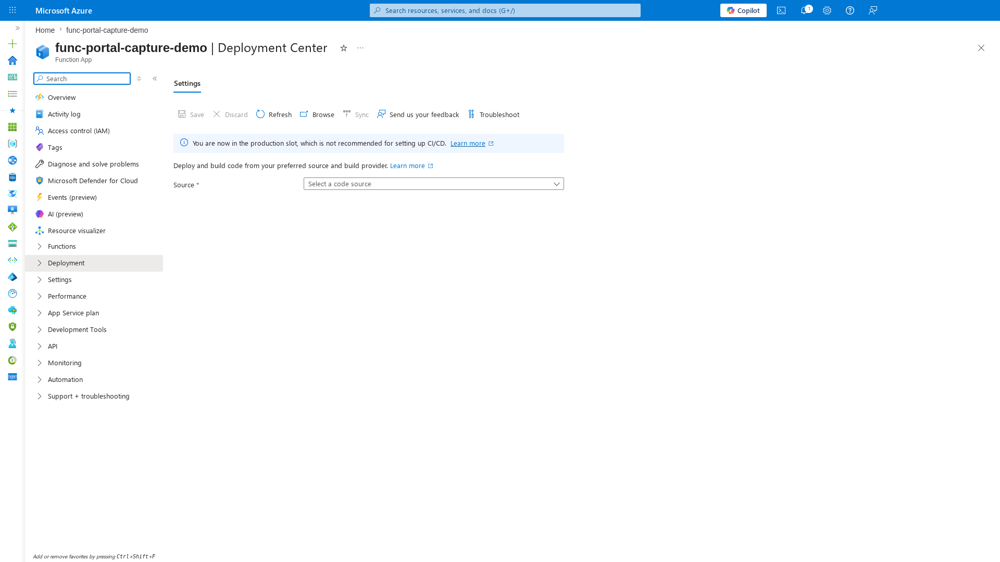
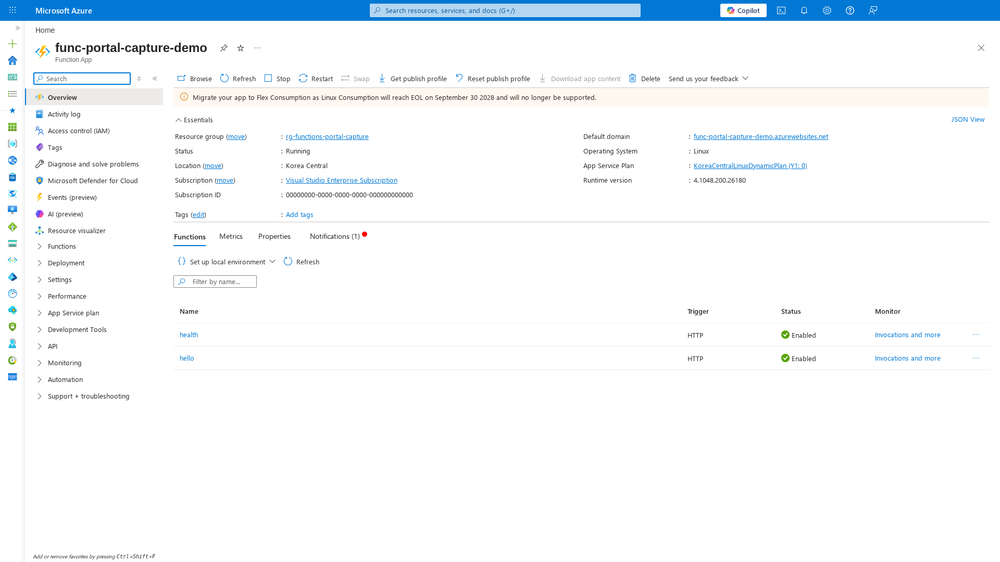
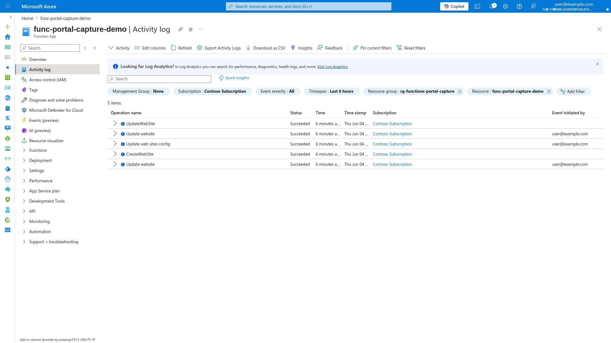
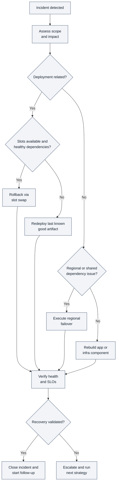
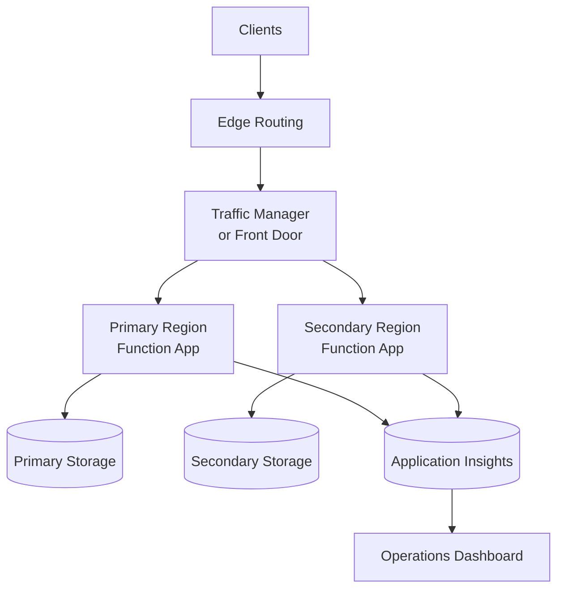

---
content_sources:
  references:
    - type: mslearn-adapted
      url: https://learn.microsoft.com/en-us/azure/azure-functions/functions-best-practices
    - type: mslearn-adapted
      url: https://learn.microsoft.com/en-us/azure/well-architected/reliability/disaster-recovery
    - type: mslearn-adapted
      url: https://learn.microsoft.com/en-us/azure/storage/common/storage-redundancy
    - type: mslearn-adapted
      url: https://learn.microsoft.com/en-us/azure/azure-functions/functions-deployment-slots
    - type: mslearn-adapted
      url: https://learn.microsoft.com/en-us/azure/traffic-manager/traffic-manager-monitoring
    - type: mslearn-adapted
      url: https://learn.microsoft.com/en-us/azure/frontdoor/health-probes
  diagrams:
    - id: recovery-decision-flow
      type: flowchart
      source: self-generated
      justification: Recovery decision flow, synthesized from Microsoft Learn documentation cited on this page.
      based_on:
        - https://learn.microsoft.com/en-us/azure/azure-functions/flex-consumption-site-updates
        - https://learn.microsoft.com/en-us/azure/app-service/deploy-staging-slots
        - https://learn.microsoft.com/en-us/azure/reliability/reliability-functions
        - https://learn.microsoft.com/en-us/azure/azure-functions/functions-best-practices
        - https://learn.microsoft.com/en-us/azure/well-architected/reliability/disaster-recovery
        - https://learn.microsoft.com/en-us/azure/storage/common/storage-redundancy
        - https://learn.microsoft.com/en-us/azure/azure-functions/functions-deployment-slots
        - https://learn.microsoft.com/en-us/azure/traffic-manager/traffic-manager-monitoring
        - https://learn.microsoft.com/en-us/azure/frontdoor/health-probes
    - id: regional-recovery-planning
      type: flowchart
      source: self-generated
      justification: Flow view of regional recovery planning, synthesized from Microsoft Learn documentation cited on this page.
      based_on:
        - https://learn.microsoft.com/en-us/azure/reliability/reliability-functions
        - https://learn.microsoft.com/en-us/azure/traffic-manager/traffic-manager-routing-methods
        - https://learn.microsoft.com/en-us/azure/frontdoor/routing-methods
        - https://learn.microsoft.com/en-us/azure/azure-monitor/app/app-map
        - https://learn.microsoft.com/en-us/azure/azure-functions/functions-best-practices
        - https://learn.microsoft.com/en-us/azure/well-architected/reliability/disaster-recovery
        - https://learn.microsoft.com/en-us/azure/storage/common/storage-redundancy
        - https://learn.microsoft.com/en-us/azure/azure-functions/functions-deployment-slots
        - https://learn.microsoft.com/en-us/azure/traffic-manager/traffic-manager-monitoring
        - https://learn.microsoft.com/en-us/azure/frontdoor/health-probes
content_validation:
  status: verified
  last_reviewed: 2026-09-11
  reviewer: agent
  core_claims:
    - claim: "Azure Functions recovery planning should define RTO and RPO before incidents occur."
      source: https://learn.microsoft.com/en-us/azure/well-architected/reliability/disaster-recovery
      verified: true
    - claim: "Deployment slots provide a fast rollback path for supported Azure Functions hosting plans."
      source: https://learn.microsoft.com/en-us/azure/azure-functions/functions-deployment-slots
      verified: true
    - claim: "Regional recovery design depends on storage redundancy and multi-region resiliency planning."
      source: https://learn.microsoft.com/en-us/azure/storage/common/storage-redundancy
      verified: true
    - claim: "Traffic Manager and Front Door health probes can be used to monitor and steer traffic during failover."
      source: https://learn.microsoft.com/en-us/azure/frontdoor/health-probes
      verified: true
---

# Recovery
This guide covers operational recovery for Azure Functions: rollback, backup planning, and regional resilience.
It focuses on practical runbook execution for minimizing downtime and data loss.
!!! tip "Platform Guide"
    For scaling architecture and plan comparison, see [Scaling](../platform/scaling.md).
!!! tip "Language Guide"
    For Python deployment specifics, see the [Python Tutorial](../language-guides/python/tutorial/index.md).
## Prerequisites
Prepare these baseline capabilities before an incident:

- Azure CLI installed and authenticated with rights to the target subscription.
- Release artifacts stored in immutable storage with version identifiers.
- Monitoring available in Application Insights or Log Analytics.
- Documented RTO and RPO values approved by service owners.
- Primary and secondary region deployments provisioned with infrastructure as code.
Use consistent variable names in all runbooks:
```bash
RG_PRIMARY="rg-functions-prod-krc"
RG_SECONDARY="rg-functions-prod-jpe"
APP_PRIMARY="func-orders-prod-krc"
APP_SECONDARY="func-orders-prod-jpe"
STORAGE_ARTIFACTS="stfuncartifactsprod"
TM_PROFILE="tm-functions-prod"
FD_PROFILE="afd-functions-prod"
HEALTH_PATH="/api/health"
```

| Command/Parameter | Purpose |
|-------------------|---------|
| `RG_PRIMARY` | Resource group for the primary region |
| `RG_SECONDARY` | Resource group for the secondary region |
| `APP_PRIMARY` | Function app name in the primary region |
| `APP_SECONDARY` | Function app name in the secondary region |
| `STORAGE_ARTIFACTS` | Storage account for build artifacts |
| `TM_PROFILE` | Traffic Manager profile name |
| `FD_PROFILE` | Front Door profile name |
| `HEALTH_PATH` | API path for health checks |

## Portal Walkthrough

This section shows portal blades relevant to recovery operations for a live Function App (Consumption Y1, Korea Central). PII is masked.

### Deployment Center Blade

[Observed] The **Deployment Center** blade shows the deployment source configuration. The **Source** dropdown allows selecting CI/CD providers (GitHub Actions, Azure DevOps, etc.) for automated deployment and rollback:



[Inferred] For fast rollback during incidents, configure a deployment source and use deployment slots (Premium/Dedicated). On Consumption, rollback requires redeploying a previous artifact version via CI/CD pipeline. Keep release artifacts in immutable storage with version identifiers for reliable rollback.

### Function App Overview

[Observed] The **Overview** blade shows the runtime status, plan details, and function list. The **Stop** and **Restart** buttons in the toolbar provide emergency controls during incidents:



[Inferred] During recovery, verify function status (Enabled/Disabled) and runtime version after rollback. The "Stop" button can be used as an emergency circuit breaker to halt all executions during cascading failures, but note that on Consumption plans, stopping and restarting may incur cold-start delays.

### Activity Log Blade

[Observed] The **Activity log** shows timestamped control-plane operations, useful for correlating deployment events with incidents:



[Inferred] During recovery, check the Activity log to identify what changed before the incident started. Filter by Timespan to narrow the window around the failure onset.

## When to Use
Use rollback, failover, or rebuild based on blast radius and dependency health.
### Rollback
Rollback is the default for deployment-induced incidents where infrastructure is healthy.
- Trigger condition: elevated failures begin right after a release.
- Typical scope: single app, single region, no regional dependency outage.
- Expected speed: minutes (fastest option when slots are available).

### Failover
Failover is preferred when region-level or shared dependency instability affects availability.
- Trigger condition: sustained platform or dependency failures in the primary region.
- Typical scope: multiple apps or critical dependencies in one geography.
- Expected speed: minutes to tens of minutes based on DNS and warm capacity.

### Rebuild
Rebuild is used when both deployment state and environment integrity are uncertain.
- Trigger condition: configuration drift, corrupted runtime state, or failed rollback attempts.
- Typical scope: app plus supporting resources requiring controlled rehydration.
- Expected speed: longer; prioritize data consistency and security posture.

### Recovery objectives
Define service objectives before incidents occur:

- **RTO** (Recovery Time Objective): target time to restore service.
- **RPO** (Recovery Point Objective): acceptable data loss window.
RTO and RPO determine architecture, replication, and operational tooling.

## Procedure
Use the runbook that matches observed symptoms and dependency status.

### Recovery decision flow
Use this decision path to choose rollback, failover, or rebuild.

<!-- diagram-id: recovery-decision-flow -->


**Reading key:** This is an illustrative strategy order, not an exhaustive cause
classifier. “Slots available” includes plan/OS support, a known-good slot and
compatible binding settings: use the slot path for Windows Consumption, Elastic
Premium, or Dedicated on Standard/Premium/Isolated tiers. Flex Consumption and
Linux Consumption use the no-slot path here. [Reversing a swap](https://learn.microsoft.com/en-us/azure/azure-functions/functions-deployment-slots#roll-back-a-swap)
can restore the previous app, but swaps can terminate running executions and do
not guarantee zero downtime. For [Flex recovery](https://learn.microsoft.com/en-us/azure/azure-functions/flex-consumption-site-updates#how-do-i-roll-back-a-site-update),
redeploy previous code/configuration as another site update using its supported
deployment mechanism (default Recreate or opt-in RollingUpdate), not a slot swap
or an assumption that Scenario B's command works on every plan.

“Regional failover” means executing an **operator-designed** recovery plan after
checking the secondary app, dependencies and data readiness. [Azure Functions is
a single-region service](https://learn.microsoft.com/en-us/azure/reliability/reliability-functions#resilience-to-region-wide-failures):
it provides no built-in cross-region failover for an app. Moving compute alone
does not repair a shared dependency or establish data consistency.

### Scenario A: deployment regression with slots available
1. Confirm release timing aligns with error spike.
2. Validate staging slot is last known good version.
3. Run slot swap rollback.
4. Execute health checks and smoke tests.
5. Pause further releases until root cause is documented.

Where the plan supports slots and a compatible known-good slot is ready, reversing
the swap is a rollback option; use the plan/OS qualifications in the reading key.

```bash
az functionapp deployment slot swap \
    --resource-group "$RG_PRIMARY" \
    --name "$APP_PRIMARY" \
    --slot staging \
    --target-slot production
```

| Command/Parameter | Purpose |
|-------------------|---------|
| `az functionapp deployment slot swap` | Swaps the staging slot with the production slot |
| `--resource-group "$RG_PRIMARY"` | Specifies the primary resource group |
| `--name "$APP_PRIMARY"` | Specifies the function app name |
| `--slot staging` | The source slot for the swap |
| `--target-slot production` | The destination slot for the swap |

Example output:
```json
{
  "changed": true,
  "name": "func-orders-prod-krc",
  "resourceGroup": "rg-functions-prod-krc",
  "slotSwapStatus": {
    "sourceSlotName": "staging",
    "destinationSlotName": "production",
    "timestampUtc": "2026-04-04T09:11:23Z"
  },
  "status": "Succeeded"
}
```
### Scenario B: deployment regression without slots
1. Identify immutable artifact version to restore.
2. Redeploy artifact with `config-zip`.
3. Re-apply known-good settings baseline if drift is detected.
4. Restart function app if runtime remains unhealthy.
5. Validate queue/trigger processing catch-up.

For plans without slot support, redeploy the last known good artifact.

```bash
az functionapp deployment source config-zip \
    --resource-group "$RG_PRIMARY" \
    --name "$APP_PRIMARY" \
    --src "/tmp/orders-api-2026.03.28.zip"
```

| Command/Parameter | Purpose |
|-------------------|---------|
| `az functionapp deployment source config-zip` | Redeploys a specific zip artifact to the function app |
| `--src` | Path to the known-good artifact zip file |

Example output:
```json
{
  "active": true,
  "author": "<deployment-identity>",
  "complete": true,
  "deployer": "az_cli_functions",
  "id": "xxxxxxxx-xxxx-xxxx-xxxx-xxxxxxxxxxxx",
  "lastSuccessEndTime": "2026-04-04T09:18:44Z",
  "message": "Deployment successful",
  "status": 4
}
```
### Artifact and configuration backup
Maintain these backups for every release:

- Immutable build artifact with version metadata.
- Infrastructure templates and parameter sets.
- Exported app settings baseline (with secret values protected).
- Runbook steps for redeploy and validation.
Keep backup assets in secured, versioned storage.

### Data and state resilience
Most Azure Functions apps depend on storage and messaging services for state.
Recovery depends on those services' durability configuration:

- Use geo-redundant options where business continuity requires cross-region resilience.
- Align queue/topic retention and replay capability with RPO targets.
- Protect durable workflow state with storage redundancy and backup policy.

### Scenario C: regional outage or severe dependency instability
1. Confirm primary region dependency or platform degradation.
2. Verify secondary region app and dependencies are healthy.
3. Trigger Traffic Manager or Front Door failover action.
4. Monitor client success rate and latency during convergence.
5. Update incident channel with effective failover time.

### Regional recovery planning
Region-level recovery usually requires pre-provisioned secondary environment.
Recommended pattern:

1. Provision primary and secondary environments with infrastructure as code.
2. Replicate critical configuration and secrets strategy.
3. Use traffic management or DNS failover process.
4. Exercise failover and failback drills on a schedule.

Multi-region failover architecture:

<!-- diagram-id: regional-recovery-planning -->


**Planning key:** Edge Routing is the role implemented by the named service, not
an additional appliance. These are logical planning associations:
[Traffic Manager selects endpoints in DNS responses](https://learn.microsoft.com/en-us/azure/traffic-manager/traffic-manager-routing-methods),
whereas [Front Door forwards HTTP/HTTPS requests](https://learn.microsoft.com/en-us/azure/frontdoor/routing-methods).
For HTTP workloads, priorities can implement active-passive failover; routing to
both eligible regions can implement active-active, subject to health, priority,
latency and weighting configuration. Two outgoing arrows alone do not select a
mode. Non-HTTP trigger failover requires a trigger/dependency-specific design,
not just this client-routing layer.

Primary Storage and Secondary Storage represent per-region resources, not an
automatic replication pair. Define data synchronization and RPO separately;
[GRS/GZRS replicate asynchronously within a storage account](https://learn.microsoft.com/en-us/azure/storage/common/storage-redundancy#redundancy-in-a-secondary-region)
and can lose recent writes during a regional disaster, rather than automatically
synchronizing two separately provisioned accounts. Shared Application Insights
is an illustrative monitoring choice, configured for both apps; distinguish them
with [cloud role names](https://learn.microsoft.com/en-us/azure/azure-monitor/app/app-map#understand-components).
It is not a second telemetry region or a monitoring-availability guarantee.

Concrete failover patterns:

- **Traffic Manager Priority Routing**
    - Configure endpoint priority: primary = `1`, secondary = `2`.
    - Use endpoint monitoring path aligned to app health endpoint.
    - Keep DNS TTL low enough for acceptable failover convergence.
- **Front Door Origin Group Failover**
    - Place both regional function origins in one origin group.
    - Configure health probes with low interval for faster detection.
    - Use weighted or priority routing based on active-passive vs active-active.

Traffic Manager example:

```bash
az network traffic-manager endpoint update \
    --resource-group "$RG_PRIMARY" \
    --profile-name "$TM_PROFILE" \
    --type azureEndpoints \
    --name primary-endpoint \
    --endpoint-status Disabled
```

| Command/Parameter | Purpose |
|-------------------|---------|
| `az network traffic-manager endpoint update` | Updates an endpoint in the Traffic Manager profile |
| `--profile-name "$TM_PROFILE"` | Target Traffic Manager profile |
| `--name primary-endpoint` | Name of the endpoint to update |
| `--endpoint-status Disabled` | Disables the primary endpoint to force failover to secondary |

Example output:
```json
{
  "endpointStatus": "Disabled",
  "name": "primary-endpoint",
  "priority": 1,
  "targetResourceId": "/subscriptions/<subscription-id>/resourceGroups/rg-functions-prod-krc/providers/Microsoft.Web/sites/func-orders-prod-krc",
  "type": "Microsoft.Network/trafficManagerProfiles/azureEndpoints"
}
```

Front Door example:

```bash
az afd origin update \
    --resource-group "$RG_PRIMARY" \
    --profile-name "$FD_PROFILE" \
    --origin-group-name "functions-origins" \
    --origin-name "origin-primary" \
    --enabled-state Disabled
```

| Command/Parameter | Purpose |
|-------------------|---------|
| `az afd origin update` | Updates an origin within the Front Door profile |
| `--origin-group-name` | Target origin group |
| `--origin-name "origin-primary"` | Name of the primary origin to update |
| `--enabled-state Disabled` | Disables the primary origin to force traffic to others in the group |

### Scenario D: rebuild from clean infrastructure baseline
1. Freeze change pipeline and snapshot forensic evidence.
2. Deploy infrastructure templates into clean target scope.
3. Deploy last known good application artifact.
4. Restore non-secret configuration and key vault references.
5. Run full verification checklist before reopening traffic.

### Health-based decision gates
Before failover or rollback, validate:

- Current incident scope (app-only or dependency-wide).
- Secondary environment readiness.
- Data consistency and queue lag status.
- Alert suppression or rerouting during controlled switch.

## Verification
After recovery action:

- Confirm health endpoint and key user journeys.
- Verify failure rate and latency return to baseline.
- Validate message processing catch-up.
- Re-enable normal alert thresholds and dashboards.

Health check verification command:

```bash
az rest \
    --method get \
    --url "https://$APP_PRIMARY.azurewebsites.net$HEALTH_PATH"
```

| Command/Parameter | Purpose |
|-------------------|---------|
| `az rest --method get` | Sends an authenticated GET request to the health endpoint |
| `--url` | The full URL of the function app health check |

Example output:
```json
{
  "checks": {
    "application": "Healthy",
    "storage": "Healthy",
    "queue": "Healthy"
  },
  "durationMs": 38,
  "status": "Healthy",
  "timestampUtc": "2026-04-04T09:22:10Z",
  "version": "2026.03.28"
}
```

## Rollback / Troubleshooting
If recovery does not stabilize service, apply these controls.
- Revert traffic decision and isolate failing component path.
- Compare app settings and connection references between regions.
- Check dependency health (storage, messaging, downstream APIs) before app-level retries.
- Review deployment history and pin known-good release hash.
- Escalate to platform support for region-level anomalies.

## Advanced Topics
### Recovery drill checklist
- Documented owner and escalation path.
- Tested rollback command set.
- Tested region failover procedure.
- Measured achieved RTO/RPO versus targets.
- Action items tracked for gaps found during drill.

## See Also
- [Deployment](deployment.md)
- [Alerts](alerts.md)
- [Troubleshooting Methodology](../troubleshooting/methodology.md)

## Sources
- [Azure Functions reliability and custom multiregion solutions](https://learn.microsoft.com/en-us/azure/reliability/reliability-functions)
- [Flex Consumption site updates and recovery](https://learn.microsoft.com/en-us/azure/azure-functions/flex-consumption-site-updates)
- [App Service staging tiers](https://learn.microsoft.com/en-us/azure/app-service/deploy-staging-slots)
- [Traffic Manager routing methods](https://learn.microsoft.com/en-us/azure/traffic-manager/traffic-manager-routing-methods)
- [Front Door routing methods](https://learn.microsoft.com/en-us/azure/frontdoor/routing-methods)
- [Application Insights components and roles](https://learn.microsoft.com/en-us/azure/azure-monitor/app/app-map)
- [Reliability in Azure Functions](https://learn.microsoft.com/en-us/azure/azure-functions/functions-best-practices)
- [Business continuity and disaster recovery for Azure applications](https://learn.microsoft.com/en-us/azure/well-architected/reliability/disaster-recovery)
- [Azure Storage redundancy options](https://learn.microsoft.com/en-us/azure/storage/common/storage-redundancy)
- [Deployment slots in Azure Functions](https://learn.microsoft.com/en-us/azure/azure-functions/functions-deployment-slots)
- [Azure Traffic Manager endpoint monitoring](https://learn.microsoft.com/en-us/azure/traffic-manager/traffic-manager-monitoring)
- [Azure Front Door health probes](https://learn.microsoft.com/en-us/azure/frontdoor/health-probes)
