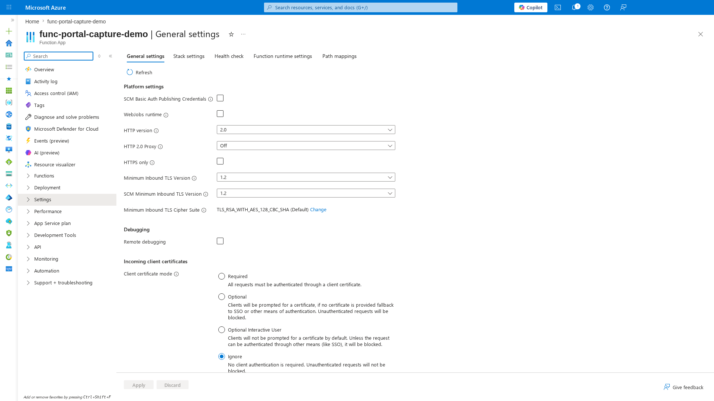
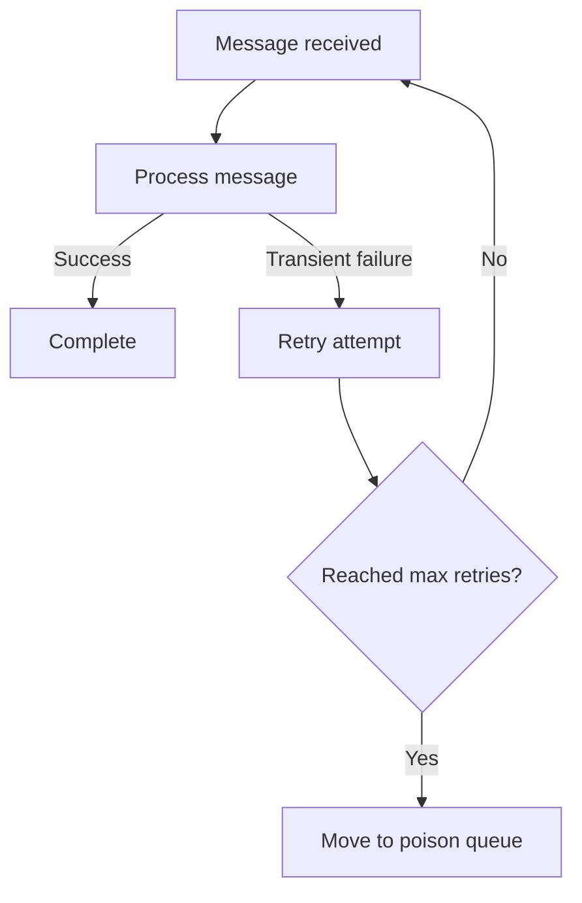
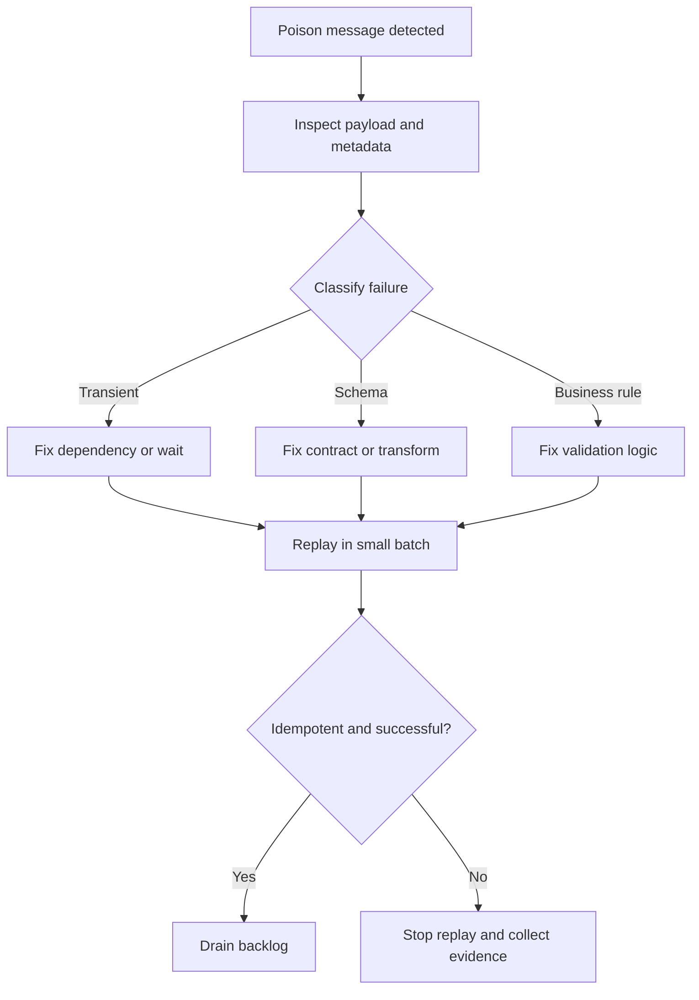

---
content_sources:
  references:
    - type: mslearn-adapted
      url: https://learn.microsoft.com/en-us/azure/azure-functions/functions-bindings-error-pages
    - type: mslearn-adapted
      url: https://learn.microsoft.com/en-us/azure/azure-functions/functions-bindings-storage-queue-trigger
    - type: mslearn-adapted
      url: https://learn.microsoft.com/en-us/azure/azure-functions/functions-bindings-service-bus-trigger
    - type: mslearn-adapted
      url: https://learn.microsoft.com/en-us/azure/azure-functions/functions-bindings-event-hubs-trigger
    - type: mslearn-adapted
      url: https://learn.microsoft.com/en-us/azure/azure-functions/functions-bindings-service-bus
    - type: mslearn-adapted
      url: https://learn.microsoft.com/en-us/azure/service-bus-messaging/message-transfers-locks-settlement
    - type: mslearn-adapted
      url: https://learn.microsoft.com/en-us/azure/service-bus-messaging/service-bus-dead-letter-queues
  diagrams:
    - id: poison-queue-behavior-storage-queue
      type: flowchart
      source: self-generated
      justification: Flow view of poison queue behavior storage queue, synthesized from Microsoft Learn documentation cited on this page.
      based_on:
        - https://learn.microsoft.com/en-us/azure/azure-functions/functions-bindings-error-pages
        - https://learn.microsoft.com/en-us/azure/azure-functions/functions-bindings-storage-queue-trigger
        - https://learn.microsoft.com/en-us/azure/azure-functions/functions-bindings-service-bus-trigger
        - https://learn.microsoft.com/en-us/azure/azure-functions/functions-bindings-event-hubs-trigger
    - id: operational-triage-workflow
      type: flowchart
      source: self-generated
      justification: Operational triage workflow, synthesized from Microsoft Learn documentation cited on this page.
      based_on:
        - https://learn.microsoft.com/en-us/azure/azure-functions/functions-bindings-error-pages
        - https://learn.microsoft.com/en-us/azure/azure-functions/functions-bindings-storage-queue-trigger
        - https://learn.microsoft.com/en-us/azure/azure-functions/functions-bindings-service-bus-trigger
        - https://learn.microsoft.com/en-us/azure/azure-functions/functions-bindings-event-hubs-trigger
content_validation:
  status: verified
  last_reviewed: 2026-10-25
  reviewer: agent
  core_claims:
    - claim: "Service Bus extension 5.x defaults autoCompleteMessages to true; clientRetryOptions apply to service interactions, not function execution retries."
      source: https://learn.microsoft.com/en-us/azure/azure-functions/functions-bindings-service-bus
      verified: true
    - claim: "For Storage Queue triggers, maxDequeueCount determines when a message is treated as poison and moved to the poison queue."
      source: https://learn.microsoft.com/en-us/azure/azure-functions/functions-bindings-storage-queue-trigger
      verified: true
    - claim: "C# isolated ServiceBusMessageActions bindings require Microsoft.Azure.Functions.Worker.Extensions.ServiceBus 5.14.1 or later and AutoCompleteMessages set to false."
      source: https://learn.microsoft.com/en-us/azure/azure-functions/functions-bindings-service-bus-trigger
      verified: true
    - claim: "Service Bus increments delivery count on explicit abandon or lock expiry and dead-letters messages when the maximum delivery count is exceeded; the default maximum is 10."
      source: https://learn.microsoft.com/en-us/azure/service-bus-messaging/service-bus-dead-letter-queues
      verified: true
    - claim: "Event Hubs trigger clientRetryOptions control SDK transport retries and are distinct from Azure Functions invocation retry policy."
      source: https://learn.microsoft.com/en-us/azure/azure-functions/functions-bindings-event-hubs-trigger
      verified: true
---

# Retries and Poison Handling
This guide explains retry execution and poison/dead-letter handling for Azure Functions event-driven workloads.
Use these patterns to protect reliability under transient failures and malformed messages.
!!! tip "Platform Guide"
    For scaling architecture and plan comparison, see [Scaling](../platform/scaling.md).
!!! tip "Language Guide"
    For Python deployment specifics, see the [Python Tutorial](../language-guides/python/tutorial/index.md).
## Prerequisites
- Access to a Function App with Queue, Service Bus, or Event Hubs triggers.
- Azure CLI 2.55+ and access to `az monitor`, `az storage`, and `az servicebus` command groups.
- Permissions to read metrics, inspect queue/subscription state, and deploy `host.json` updates.
- Application Insights connected to the Function App for KQL validation.
- A rollback path for retry configuration (slot swap or previous artifact).
## When to Use
Use this runbook when retries, poison queues, or dead-letter counts start increasing and delivery latency grows.

Choose the retry layer intentionally:

1. **Trigger/runtime retries** for transient infrastructure issues.
2. **Application-level retries** for dependency-specific failures where business logic can decide what is retryable.
3. **Both layers** only when cumulative retry budget is explicitly bounded.
## Portal Walkthrough

This section shows portal blades relevant to retry and poison handling for a live Function App (Consumption Y1, Korea Central). PII is masked.

### Log Stream Blade

[Observed] The **Log stream** blade provides real-time log output from the Function App, showing trigger execution, retry attempts, and error messages as they occur:


[Inferred] Use the Log stream during active debugging to observe retry behavior in real time. Repeated execution attempts for the same message ID can indicate retries. If attempts stop, inspect invocation status and the trigger-specific failure path: Storage Queue poison handling, Service Bus dead-letter handling, or an application-owned recovery store for Event Hubs. Silence alone does not prove successful processing or dead-letter delivery.

### Configuration General Settings Blade

[Observed] The **Configuration** blade's **General settings** tab shows platform settings including HTTP version, TLS, and runtime configuration that affect trigger behavior:



[Inferred] Retry configuration depends on the trigger: binding-extension settings can live in `host.json`, while Python v2 runtime policies use `@app.retry`. Platform-level settings such as timeout values and TLS configuration can affect trigger connectivity. Verify these settings after infrastructure changes that might impact trigger reliability.

## Procedure

### Reliability model
Azure Functions reliability for triggers combines delivery semantics, retry behavior, and trigger-specific recovery after exhaustion. A poison queue or dead-letter destination exists only where the trigger/service provides one; it is not a universal runtime retry feature. Design for idempotency first, then tune retries.

Never suppress an unresolved processing exception simply because the retry budget is exhausted. A normal return reports success; logging alone does not preserve the failed work. Let the exception escape on the final failed attempt too, unless failure has been deliberately and durably handled by a recovery workflow. The [Python retry recipe](../language-guides/python/recipes/retry.md) demonstrates both successful recovery and terminal failure.

Timer runtime retries stop after exhaustion without creating a poison queue or DLQ. Event Hubs delays checkpoints until the retry policy finishes, but processing can advance after exhaustion even when work failed; preserve failed events in an application-owned durable recovery store when needed. Neither behavior should be described as Service Bus dead-lettering or Storage Queue poison handling.

### Built-in retry support
Azure Functions supports retry behavior for selected triggers.
Common trigger categories with retry support include:

- Azure Storage Queue trigger.
- Azure Service Bus trigger.
- Azure Event Hubs trigger.

Configure retry behavior according to binding/runtime model for your language and extension.

### `host.json` and trigger extension settings
Some retry and poison behavior is controlled in `host.json` extension sections.

Example storage queue extension settings:
```json
{
  "version": "2.0",
  "extensions": {
    "queues": {
      "maxDequeueCount": 5,
      "visibilityTimeout": "00:00:30",
      "batchSize": 16,
      "newBatchThreshold": 8
    }
  }
}
```
`maxDequeueCount` determines when a message is treated as poison for Storage Queue trigger processing.

#### Service Bus: automatic completion (default)

Retain `autoCompleteMessages: true` (or omit it, since `true` is the default) when the handler relies on invocation success or failure to settle a message. With automatic completion, Functions receives in PeekLock mode, completes after successful execution, and abandons after failed execution. Do not catch and merely log unresolved errors: a normal return can cause the failed work to be completed and removed.

The following `host.json` example uses **Service Bus extension 5.x**. Its `clientRetryOptions` tune service communication, not the number of handler executions:
```json
{
  "version": "2.0",
  "extensions": {
    "serviceBus": {
      "prefetchCount": 0,
      "maxConcurrentCalls": 16,
      "autoCompleteMessages": true,
      "maxAutoLockRenewalDuration": "00:05:00",
      "clientRetryOptions": {
        "mode": "exponential",
        "tryTimeout": "00:01:00",
        "delay": "00:00:01",
        "maxDelay": "00:00:30",
        "maxRetries": 5
      }
    }
  }
}
```

For **Python v2 on Functions 4.x**, use the `azure-functions` package and [extension bundle 4.x](https://learn.microsoft.com/en-us/azure/azure-functions/functions-bindings-service-bus#install-bundle) (`Microsoft.Azure.Functions.ExtensionBundle`, version range `[4.0.0, 5.0.0)`) for the Service Bus 5.x binding. Add that `extensionBundle` configuration alongside `extensions` in `host.json`. Configure `ServiceBusConnection` as an app setting or identity-based setting collection; never put credentials in source code.

<!-- service-bus-automatic-example -->
```python
import json

import azure.functions as func

app = func.FunctionApp()

@app.service_bus_queue_trigger(
    arg_name="msg", queue_name="orders", connection="ServiceBusConnection"
)
def process_order(msg: func.ServiceBusMessage) -> None:
    payload = json.loads(msg.get_body().decode("utf-8"))
    if not isinstance(payload, dict) or not payload.get("orderId"):
        raise ValueError("An orderId is required")
```

This minimal handler validates an order; it does not execute a business side effect. Valid input returns normally, allowing automatic completion. Invalid JSON or a missing `orderId` escapes as a failed invocation and is eligible for redelivery. In a real handler, await durable, idempotent business work before returning. No manual settlement API is assumed for this Python binding.

#### Service Bus: explicit manual settlement (C# isolated only here)

Disable automatic completion **only for a handler that owns settlement through a supported binding**. This separate example is for **C# isolated on Functions 4.x with `Microsoft.Azure.Functions.Worker.Extensions.ServiceBus` 5.14.1 or later**, plus the [SDK-type binding dependencies](https://learn.microsoft.com/en-us/azure/azure-functions/dotnet-isolated-process-guide#sdk-types). It is not a language-neutral pattern or an instruction to disable completion for ordinary Python, Java, or Node.js bindings.

Keep the app-wide `host.json` default above. Override it on this trigger with `AutoCompleteMessages = false`, so unrelated triggers retain automatic completion. The [supported `ServiceBusMessageActions` binding](https://learn.microsoft.com/en-us/azure/azure-functions/functions-bindings-service-bus-trigger#usage) exposes complete, abandon, and dead-letter operations; its [official API implementation linked by Microsoft Learn](https://github.com/Azure/azure-functions-dotnet-worker/blob/main/extensions/Worker.Extensions.ServiceBus/src/ServiceBusMessageActions.cs) documents the exact signatures.

```csharp
using System.Text.Json;
using System.Threading.Tasks;
using Azure.Messaging.ServiceBus;
using Microsoft.Azure.Functions.Worker;

public sealed class ManualOrders
{
    private readonly IOrderProcessor processor;

    public ManualOrders(IOrderProcessor processor) => this.processor = processor;

    [Function(nameof(ManualOrders))]
    public async Task Run(
        [ServiceBusTrigger("orders-manual", Connection = "ServiceBusConnection",
            AutoCompleteMessages = false)] ServiceBusReceivedMessage message,
        ServiceBusMessageActions actions)
    {
        try
        {
            using var order = JsonDocument.Parse(message.Body.ToString());
            await processor.ProcessAsync(order.RootElement, message.MessageId);
        }
        catch (JsonException)
        {
            await actions.DeadLetterMessageAsync(message,
                deadLetterReason: "InvalidJson",
                deadLetterErrorDescription: "The order body is not valid JSON.");
            return;
        }
        catch (System.TimeoutException)
        {
            await actions.AbandonMessageAsync(message);
            throw;
        }

        await actions.CompleteMessageAsync(message);
    }
}

public interface IOrderProcessor
{
    Task ProcessAsync(JsonElement order, string messageId);
}
```

Supply and register an idempotent `IOrderProcessor` implementation in the isolated worker's dependency injection setup. This is a settlement excerpt, not a complete deployable application. Its contract treats `JsonException` as permanent invalid input and `TimeoutException` as a transient processing timeout. Other processing errors propagate; do not assume a normal return without settlement will remove the message.

| Processing outcome | Explicit action | Meaning |
| --- | --- | --- |
| Durable business work succeeds | Await `CompleteMessageAsync` | Remove the processed message. Completion is outside the processing `try`, so its failure is not misclassified as a processing timeout. |
| Invalid JSON | Await `DeadLetterMessageAsync` and return | Preserve unprocessable input in the DLQ with a sanitized reason, not raw payload or exception details. |
| Transient processing timeout | Await `AbandonMessageAsync` and rethrow | Release for redelivery and report a failed invocation; abandon does not provide a backoff delay. |
| Settlement fails or another error escapes | Propagate the exception | Do not attempt a second settlement blindly or log success. Inspect lock state and redelivery evidence. |

**Locks and redelivery:** `maxAutoLockRenewalDuration` defaults to five minutes for single-message handlers in extension 5.x; it is a renewal budget, not the queue/subscription lock duration or an unlimited processing guarantee. It does not apply to batched handlers. Budget processing and dependency retries within the lock/renewal window, and await settlement before returning. A successful manual invocation with no settlement leaves the message uncompleted; lock expiry can cause redelivery and eventual DLQ accumulation. Locks can also be lost early through connection or service events. Even after successful business work, completion can fail, so use durable idempotency keyed by a stable business/message identifier before side effects, not merely an in-memory duplicate check. See [locks and settlement](https://learn.microsoft.com/en-us/azure/service-bus-messaging/message-transfers-locks-settlement).

#### Service Bus retry layers are independent

| Layer | Control | What it does not mean |
| --- | --- | --- |
| Broker delivery attempts | Queue/subscription `MaxDeliveryCount` (default 10), message `DeliveryCount` | Abandon or ordinary lock expiry increments the count; exceeding the limit causes `MaxDeliveryCountExceeded` dead-lettering. It is not a transport retry counter. Certain volatile lock-loss conditions do not increment delivery count. |
| SDK/service transport retries | `extensions.serviceBus.clientRetryOptions` | `maxRetries: 5` retries an interaction with Service Bus, not five invocations or five business-processing attempts. |
| Invocation/application processing retries | Service Bus redelivery after failure, plus any explicitly bounded retries inside business code | Service Bus 5.x is not in the Functions runtime retry-policy trigger list; do not apply Timer/Event Hubs fixed-delay or exponential-backoff invocation attributes/decorators to it. In-code retries occur within one delivery and consume lock time. |

Use the [Functions retry support table](https://learn.microsoft.com/en-us/azure/azure-functions/functions-bindings-error-pages#retries) and [Service Bus delivery-count rules](https://learn.microsoft.com/en-us/azure/service-bus-messaging/service-bus-dead-letter-queues#maximum-delivery-count) rather than treating these counters as interchangeable.

#### Event Hubs transport retries
`clientRetryOptions` controls Event Hubs SDK transport retries (service communication behavior), not Azure Functions invocation retry policy. Configure function-level retries separately with the language's function metadata or decorators (`@app.retry` in Python v2), not the Event Hubs `host.json` transport settings.

```json
{
  "version": "2.0",
  "extensions": {
    "eventHubs": {
      "batchCheckpointFrequency": 1,
      "prefetchCount": 300,
      "maxBatchSize": 64,
      "clientRetryOptions": {
        "mode": "exponential",
        "tryTimeout": "00:01:00",
        "delay": "00:00:00.80",
        "maxDelay": "00:00:30",
        "maxRetries": 5
      }
    }
  }
}
```

### Poison queue behavior (Storage Queue)
For Storage Queue triggers, messages that exceed `maxDequeueCount` are moved to a poison queue.

Operational pattern:

- Main queue: `orders`.
- Poison queue: `orders-poison`.
- Build a dedicated poison-message processor for triage and replay.

This prevents infinite reprocessing loops and preserves failed payloads for investigation.

<!-- diagram-id: poison-queue-behavior-storage-queue -->


### Dead-letter behavior (Service Bus)
Service Bus uses dead-lettering semantics.
Messages can be moved to the dead-letter subqueue after max delivery attempts or explicit dead-letter action.

Operational responsibilities:

- Monitor dead-letter message count.
- Capture reason and error metadata.
- Provide controlled replay tools or manual remediation workflow.

### Retry strategy design
Use layered retry design:

1. **Trigger/runtime retries** for transient infrastructure issues.
2. **Application-level retries** for outbound dependencies when safe.
3. **Circuit breaker/timeouts** to avoid cascading failure.

Keep overall retry budget bounded to avoid queue starvation.

Custom retry in function code can use .NET Polly, Python retry decorators, or Node.js policy-based utilities.
Avoid duplicate retry layering: if trigger-level retries are already active, excessive in-code retries can amplify latency and cost.

### Idempotency requirements
Because retries and at-least-once delivery are common, handlers should be idempotent:

- Use deterministic operation keys.
- Record processed message identifiers where required.
- Make writes safe for duplicate delivery.

Without idempotency, retries can create duplicate side effects.

Python idempotent handling example:
```python
import hashlib
import json
import os

import azure.functions as func
from azure.core.exceptions import ResourceExistsError
from azure.data.tables import TableServiceClient

app = func.FunctionApp()
table = TableServiceClient.from_connection_string(os.environ["AzureWebJobsStorage"]).get_table_client("ProcessedMessages")
table.create_table_if_not_exists()

def seen_before(payload: dict) -> bool:
    try:
        key = hashlib.sha256(json.dumps(payload, sort_keys=True).encode("utf-8")).hexdigest()
        table.create_entity(entity={"PartitionKey": "orders", "RowKey": key})
        return False
    except ResourceExistsError:
        return True

@app.queue_trigger(arg_name="msg", queue_name="orders", connection="AzureWebJobsStorage")
def process_order(msg: func.QueueMessage) -> None:
    payload = json.loads(msg.get_body().decode("utf-8"))
    if seen_before(payload):
        return
    # Execute side effects exactly once for this payload key.
```

### Monitoring retry and poison health
Track these operational signals:

- Retry attempt trend by function.
- Poison queue message count growth.
- Dead-letter count and age.
- Processing lag between enqueue and completion.

Use alerts when poison/dead-letter counts grow continuously.

### Operational triage workflow
1. Inspect message payload and metadata.
2. Classify failure type (transient, schema, business rule, dependency outage).
3. Fix root cause.
4. Replay safely from poison/dead-letter store.
5. Verify no duplicate side effects.

<!-- diagram-id: operational-triage-workflow -->


### CLI investigation examples
Peek poison queue messages (Storage Queue):
```bash
az storage message peek \
    --account-name $STORAGE_NAME \
    --queue-name orders-poison \
    --auth-mode login \
    --num-messages 5
```

| Command/Parameter | Purpose |
|-------------------|---------|
| `az storage message peek` | Retrieves messages from the queue without removing them |
| `--account-name $STORAGE_NAME` | Specifies the storage account |
| `--queue-name orders-poison` | Target poison queue for inspection |
| `--auth-mode login` | Uses Microsoft Entra ID for authentication |
| `--num-messages 5` | Number of messages to peek |

Example output (PII masked):
```json
[
  {
    "id": "<message-id>",
    "dequeueCount": 5,
    "insertionTime": "2026-03-18T09:42:11+00:00",
    "content": "eyJvcmRlcklkIjoiT1JELTEwMDEifQ=="
  }
]
```

Check queue metrics (poison queue growth):
```bash
az monitor metrics list \
    --resource "/subscriptions/<subscription-id>/resourceGroups/$RG/providers/Microsoft.Storage/storageAccounts/$STORAGE_NAME" \
    --metric QueueMessageCount \
    --interval PT5M \
    --aggregation Average
```

| Command/Parameter | Purpose |
|-------------------|---------|
| `az monitor metrics list` | Retrieves metrics for the storage account |
| `--resource` | Identifies the storage account resource to query |
| `--metric QueueMessageCount` | Tracks the number of messages in the queues |
| `--interval PT5M` | Aggregates data in 5-minute intervals |
| `--aggregation Average` | Calculates the average message count |

Example output (PII masked):
```json
{
  "interval": "PT5M",
  "value": [
    {
      "name": {"value": "QueueMessageCount"},
      "timeseries": [{"data": [{"timeStamp": "2026-03-18T09:45:00Z", "average": 21.0}]}]
    }
  ]
}
```

Check Service Bus dead-letter count:
```bash
az servicebus queue show \
    --resource-group $RG \
    --namespace-name $SERVICEBUS_NAMESPACE \
    --name orders \
    --query "countDetails"
```

| Command/Parameter | Purpose |
|-------------------|---------|
| `az servicebus queue show` | Displays details for the specified Service Bus queue |
| `--resource-group` | Resource group containing the Service Bus namespace |
| `--namespace-name` | Specifies the Service Bus namespace |
| `--name orders` | Target queue name |
| `--query "countDetails"` | Extracts active, dead-letter, and scheduled message counts |

Example output (PII masked):
```json
{
  "activeMessageCount": 24,
  "deadLetterMessageCount": 17,
  "scheduledMessageCount": 0
}
```

## Verification
Service Bus settlement verification for this change is **official-source review and local static/SDK contract checks only**. Azure integration behavior is **NOT_TESTED**: no Function App was deployed and no completion, abandon, lock-renewal, redelivery, or DLQ result was observed. Existing Portal illustrations are not settlement evidence. The C# excerpt is source-reviewed, not compiled or host-tested by the Python checks.

Run the executable contract from the repository root:

```bash
uv run --with pytest --with azure-functions pytest tests/test_service_bus_settlement.py -q
```

The tests load the actual Python example using the real Functions SDK, inspect generated Service Bus binding metadata, exercise valid and malformed input, and parse the automatic-completion `host.json` setting. They do not simulate the broker or claim that returning normally proves settlement. Azure verification, when authorized separately, must observe message removal, failed delivery counts, lock loss/renewal, and DLQ reason independently.

For the terminal-failure guidance added here, verification is Microsoft Learn source review plus the recipe's local SDK tests, not a new Azure experiment. Existing Portal illustrations do not establish the sample's invocation or checkpoint outcomes. In Azure, verify failed invocation status after exhaustion separately from poison/dead-letter delivery, and verify Event Hubs recovery-store writes and replay independently.

Validate that retry tuning reduces failure amplification and poison/dead-letter growth stabilizes.

KQL query: retry rates by function (last 60 minutes):
```kusto
traces
| where timestamp > ago(60m)
| where message has_any ("Retrying", "retry attempt", "dequeueCount")
| extend FunctionName = tostring(customDimensions["FunctionName"])
| summarize RetryEvents = count() by bin(timestamp, 5m), FunctionName
| order by timestamp asc
```

KQL query: poison queue and dead-letter growth signal:
```kusto
traces
| where timestamp > ago(60m)
| where message has_any ("orders-poison", "dead-letter", "deadletter")
| extend QueueName = coalesce(tostring(customDimensions["QueueName"]), tostring(customDimensions["EntityName"]), "unknown")
| summarize Events = count() by bin(timestamp, 5m), QueueName
| order by timestamp asc
```

Verification checklist:

- Retry event frequency declines after policy update.
- Poison/dead-letter growth is non-monotonic or decreasing.

## Rollback / Troubleshooting
Use this section when retries trigger cascading failures (dependency saturation, lock churn, rising latency).

Immediate containment:

1. Reduce trigger concurrency before increasing retries.
2. Roll back `host.json` retry settings to known-good values.
3. Pause replay workers if poison/dead-letter growth accelerates.
4. Tighten timeout and circuit breaker policies for weak dependencies.

Troubleshooting sequence:

1. Confirm whether failures are transient or deterministic from sampled payloads.
2. Compare retry volume with downstream dependency error rates.
3. Validate visibility timeout or lock duration versus actual processing time.
4. Resume replay in controlled batches and monitor duplication signals.

Common anti-patterns:

- Raising retry counts without reducing concurrency.
- Replaying poison queues before fixing schema/business-rule defects.
- Combining trigger-level and in-code retries without total budget limits.
- Returning normally after logging an unresolved terminal failure, or assuming every exhausted runtime policy creates a poison/DLQ message.

## See Also
- [Monitoring](monitoring.md)
- [Alerts](alerts.md)
- [Platform Reliability](../platform/reliability.md)

## Sources
- [Azure Functions error handling and retries](https://learn.microsoft.com/en-us/azure/azure-functions/functions-bindings-error-pages)
- [Azure Queue Storage trigger for Azure Functions](https://learn.microsoft.com/en-us/azure/azure-functions/functions-bindings-storage-queue-trigger)
- [Azure Service Bus trigger for Azure Functions](https://learn.microsoft.com/en-us/azure/azure-functions/functions-bindings-service-bus-trigger)
- [Service Bus binding configuration and host.json defaults](https://learn.microsoft.com/en-us/azure/azure-functions/functions-bindings-service-bus#hostjson-settings)
- [Service Bus message transfers, locks, and settlement](https://learn.microsoft.com/en-us/azure/service-bus-messaging/message-transfers-locks-settlement)
- [Service Bus dead-letter queues and maximum delivery count](https://learn.microsoft.com/en-us/azure/service-bus-messaging/service-bus-dead-letter-queues)
- [Azure Event Hubs trigger for Azure Functions](https://learn.microsoft.com/en-us/azure/azure-functions/functions-bindings-event-hubs-trigger)
