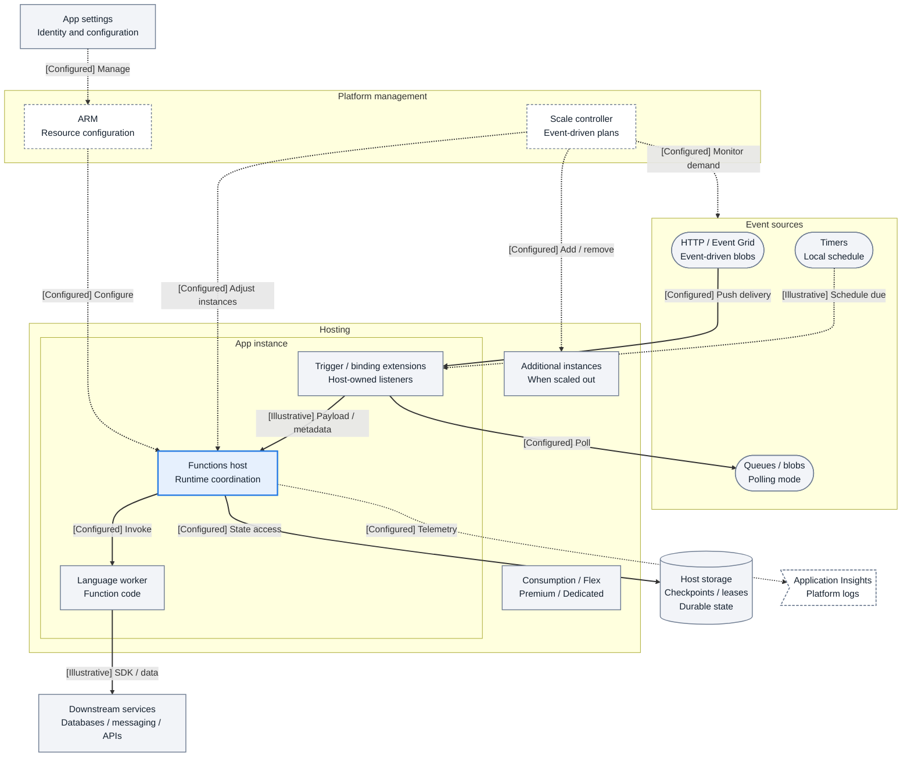
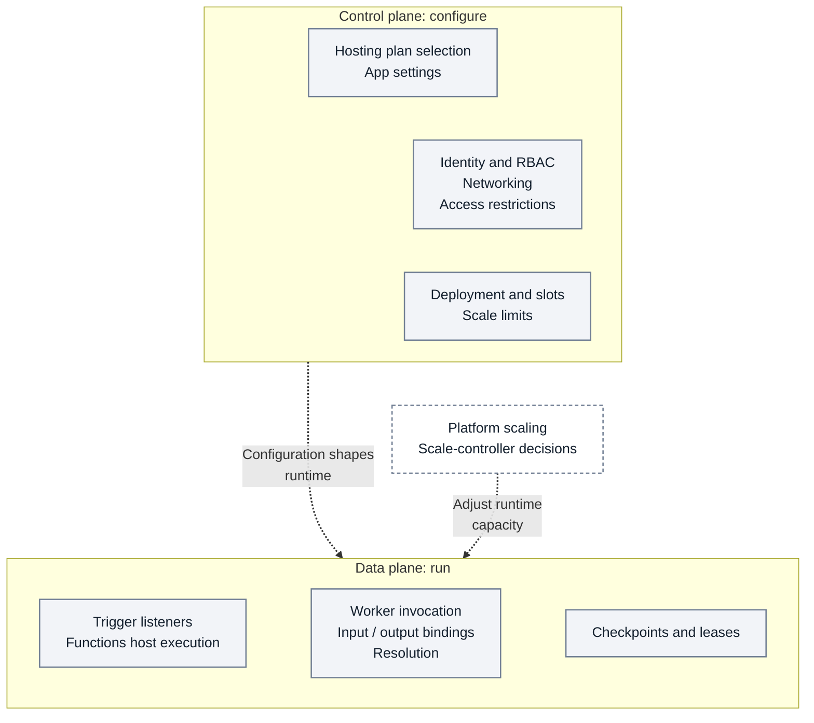
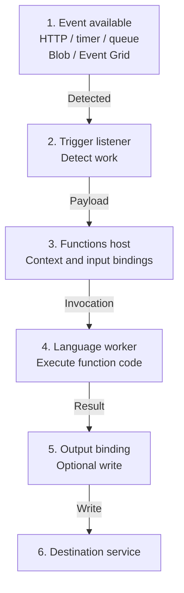
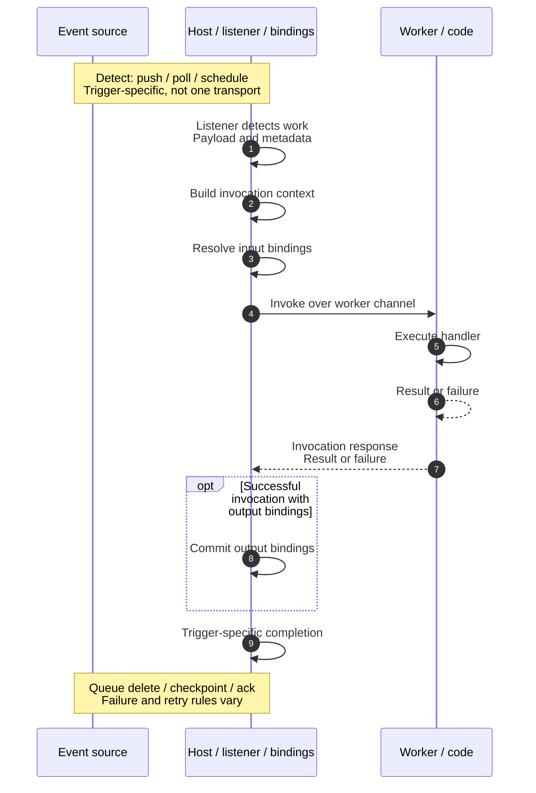
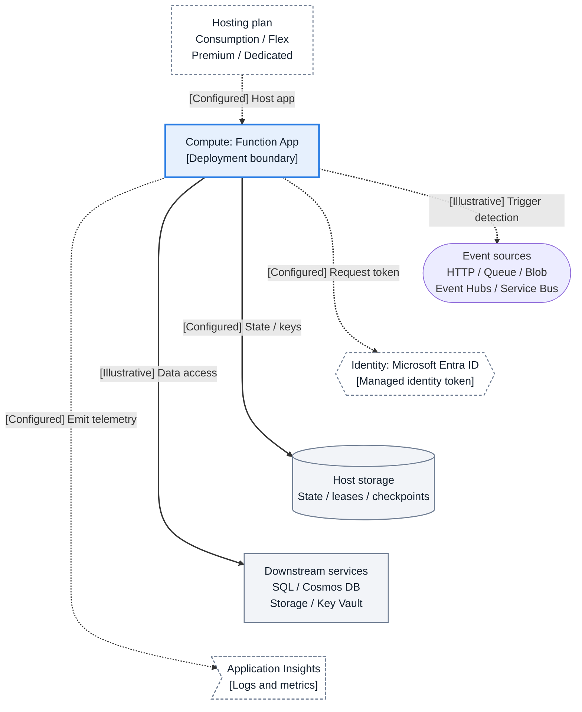
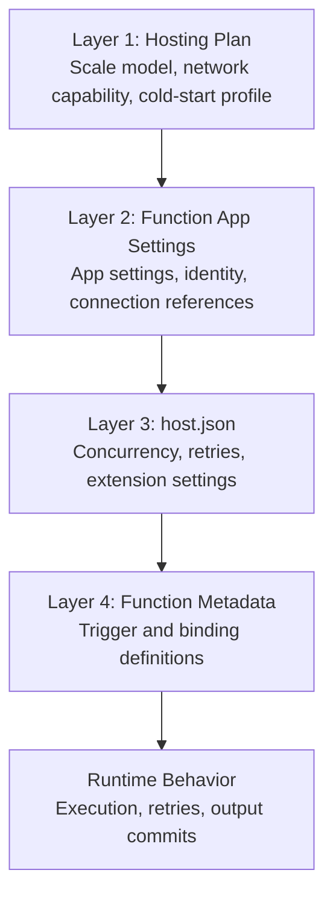
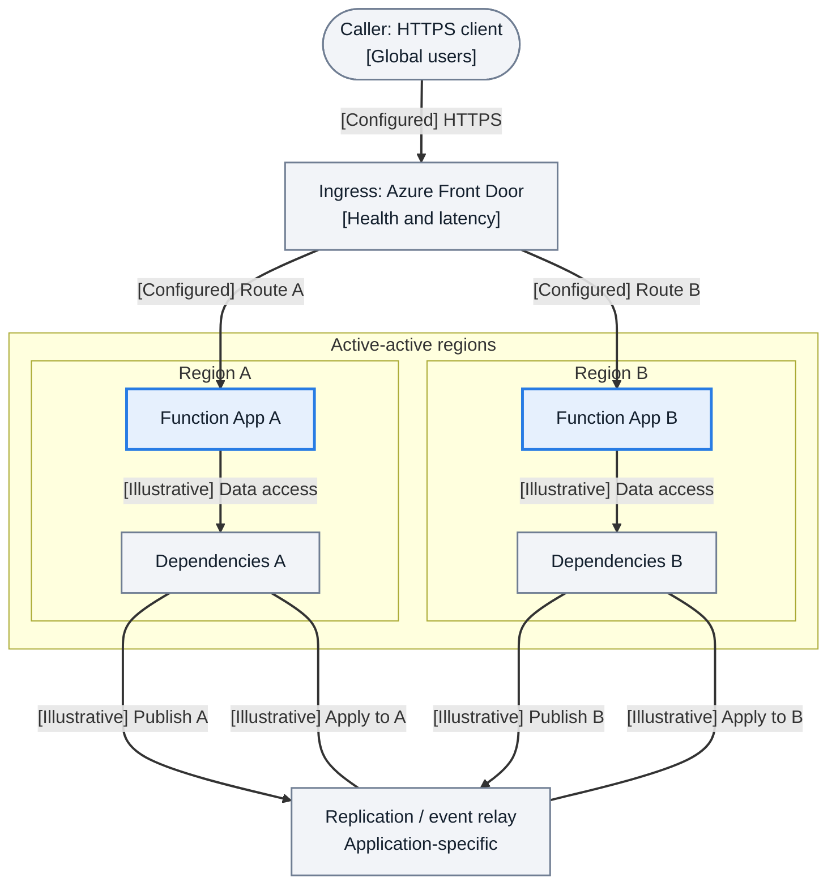
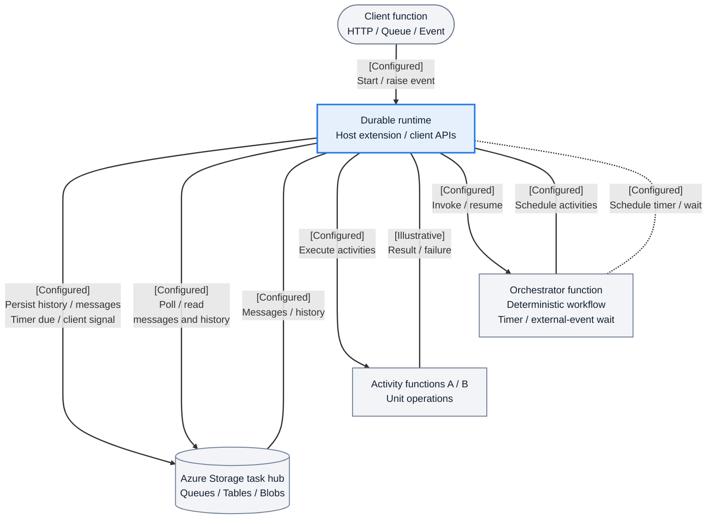

---
content_sources:
  references:
    - type: mslearn-adapted
      url: https://learn.microsoft.com/en-us/azure/azure-functions/functions-overview
    - type: mslearn-adapted
      url: https://learn.microsoft.com/en-us/azure/azure-functions/functions-scale
    - type: mslearn-adapted
      url: https://learn.microsoft.com/en-us/azure/azure-functions/functions-networking-options
    - type: mslearn-adapted
      url: https://learn.microsoft.com/en-us/azure/azure-functions/functions-triggers-bindings
    - type: mslearn-adapted
      url: https://learn.microsoft.com/en-us/azure/azure-functions/durable/durable-functions-overview
    - type: mslearn-adapted
      url: https://learn.microsoft.com/en-us/azure/azure-functions/functions-custom-handlers
  diagrams:
    - id: functions-architecture-overview
      type: flowchart
      source: self-generated
      justification: "Synthesized end-to-end runtime view from Azure Functions overview, hosting, and networking documentation"
      based_on:
        - https://learn.microsoft.com/en-us/azure/azure-functions/functions-overview
        - https://learn.microsoft.com/en-us/azure/azure-functions/functions-scale
        - https://learn.microsoft.com/en-us/azure/azure-functions/functions-networking-options
        - https://learn.microsoft.com/en-us/azure/azure-resource-manager/management/control-plane-and-data-plane
        - https://learn.microsoft.com/en-us/azure/azure-functions/event-driven-scaling
        - https://learn.microsoft.com/en-us/azure/azure-functions/functions-bindings-storage-queue-trigger
        - https://learn.microsoft.com/en-us/azure/azure-functions/dotnet-isolated-process-guide
        - https://learn.microsoft.com/en-us/azure/azure-functions/storage-considerations
        - https://learn.microsoft.com/en-us/azure/azure-functions/functions-monitoring
        - https://learn.microsoft.com/en-us/azure/azure-functions/functions-triggers-bindings
    - id: control-data-plane
      type: flowchart
      source: self-generated
      justification: "Synthesized control plane versus runtime execution model from Azure Functions management, scale, and networking documentation"
      based_on:
        - https://learn.microsoft.com/en-us/azure/azure-functions/functions-overview
        - https://learn.microsoft.com/en-us/azure/azure-functions/functions-scale
        - https://learn.microsoft.com/en-us/azure/azure-functions/functions-networking-options
        - https://learn.microsoft.com/en-us/azure/azure-resource-manager/management/control-plane-and-data-plane
        - https://learn.microsoft.com/en-us/azure/azure-functions/event-driven-scaling
        - https://learn.microsoft.com/en-us/azure/azure-functions/functions-bindings-storage-queue-trigger
        - https://learn.microsoft.com/en-us/azure/azure-functions/storage-considerations
        - https://learn.microsoft.com/en-us/azure/azure-functions/dotnet-isolated-process-guide
    - id: runtime-execution-path
      type: flowchart
      source: self-generated
      justification: "Summarizes the documented trigger-to-host-to-worker execution model"
      based_on:
        - https://learn.microsoft.com/en-us/azure/azure-functions/functions-overview
        - https://learn.microsoft.com/en-us/azure/azure-functions/functions-triggers-bindings
        - https://learn.microsoft.com/en-us/azure/azure-functions/dotnet-isolated-process-guide
    - id: detailed-host-worker-communication-sequence
      type: sequenceDiagram
      source: self-generated
      justification: "Expanded invocation sequence based on Functions host, worker, and binding concepts"
      based_on:
        - https://learn.microsoft.com/en-us/azure/azure-functions/functions-overview
        - https://learn.microsoft.com/en-us/azure/azure-functions/functions-triggers-bindings
        - https://learn.microsoft.com/en-us/azure/azure-functions/dotnet-isolated-process-guide
        - https://learn.microsoft.com/en-us/azure/azure-functions/functions-bindings-storage-queue-trigger
    - id: core-resource-relationships
      type: flowchart
      source: self-generated
      justification: "Synthesizes core Function App dependencies around hosting, storage, identity, and monitoring"
      based_on:
        - https://learn.microsoft.com/en-us/azure/azure-functions/functions-overview
        - https://learn.microsoft.com/en-us/azure/azure-functions/functions-scale
        - https://learn.microsoft.com/en-us/azure/azure-functions/functions-networking-options
        - https://learn.microsoft.com/en-us/azure/app-service/overview-managed-identity
        - https://learn.microsoft.com/en-us/azure/azure-functions/storage-considerations
        - https://learn.microsoft.com/en-us/azure/azure-functions/functions-monitoring
        - https://learn.microsoft.com/en-us/azure/azure-functions/functions-triggers-bindings
    - id: configuration-layers-diagram
      type: flowchart
      source: self-generated
      justification: "Shows the configuration hierarchy described across hosting, app settings, host.json, and bindings documentation"
      based_on:
        - https://learn.microsoft.com/en-us/azure/azure-functions/functions-overview
        - https://learn.microsoft.com/en-us/azure/azure-functions/functions-triggers-bindings
        - https://learn.microsoft.com/en-us/azure/azure-functions/functions-host-json
        - https://learn.microsoft.com/en-us/azure/azure-functions/functions-scale
    - id: pattern-b-active-active-with-regional-affinity
      type: flowchart
      source: self-generated
      justification: "Adapted multi-region pattern based on Azure traffic management and replicated dependency guidance"
      based_on:
        - https://learn.microsoft.com/en-us/azure/azure-functions/functions-overview
        - https://learn.microsoft.com/en-us/azure/azure-functions/functions-scale
        - https://learn.microsoft.com/en-us/azure/frontdoor/routing-methods
        - https://learn.microsoft.com/en-us/azure/traffic-manager/traffic-manager-routing-methods
    - id: durable-functions-orchestration-architecture
      type: flowchart
      source: self-generated
      justification: "Summarizes Durable Functions orchestration, activities, timers, and state persistence"
      based_on:
        - https://learn.microsoft.com/en-us/azure/azure-functions/durable/durable-functions-overview
        - https://learn.microsoft.com/en-us/azure/durable-task/durable-functions/durable-functions-azure-storage-provider
        - https://learn.microsoft.com/en-us/azure/durable-task/common/durable-task-timers
        - https://learn.microsoft.com/en-us/azure/durable-task/common/durable-task-external-events
content_validation:
  status: verified
  last_reviewed: 2026-09-11
  reviewer: agent
  core_claims:
    - claim: "Azure Functions uses a host/worker architecture so multiple languages can run on one platform"
      source: https://learn.microsoft.com/en-us/azure/azure-functions/functions-overview
      verified: true
    - claim: "The Function App is the primary deployment and configuration boundary in Azure Functions"
      source: https://learn.microsoft.com/en-us/azure/azure-functions/functions-overview
      verified: true
    - claim: "Flex Consumption supports VNet integration and inbound private endpoints"
      source: https://learn.microsoft.com/en-us/azure/azure-functions/functions-networking-options
      verified: true
    - claim: "Flex Consumption requires identity-based host storage and uses Event Grid for blob triggers"
      source: https://learn.microsoft.com/en-us/azure/azure-functions/functions-scale
      verified: true
---

# Azure Functions Architecture
Azure Functions is an event-driven runtime built around a host/worker architecture. This model lets multiple languages share one platform for triggers, bindings, scaling, and operations.

## Prerequisites

### Reading prerequisites
- Understand Azure Functions core concepts: function app, trigger, binding, and hosting plan.
- Understand the difference between control plane and data plane in cloud runtimes.
- Know basic Azure networking terms: virtual network integration, private endpoint, DNS resolution.
- Know identity basics: system-assigned/user-assigned managed identity and Microsoft Entra ID.

### Hands-on prerequisites (optional but recommended)
1. Azure CLI 2.56+ installed and authenticated.
2. Contributor or higher access to a test subscription.
3. A sample Function App (any language) deployed in a non-production resource group.
4. Application Insights connected to the app for runtime telemetry checks.

```bash
# Set context variables for architecture validation commands
RG="rg-functions-arch-demo"
APP_NAME="func-arch-demo"
SUBSCRIPTION_ID="<subscription-id>"

az account set --subscription "$SUBSCRIPTION_ID"
```

| CLI element | Explanation |
|---|---|
| Command(s) | `az account set` |
| Key flags | `--subscription` |
| Variables | `$SUBSCRIPTION_ID` |
| Expected result | Azure CLI applies the configuration change; confirm the returned JSON or follow-up query shows the expected value. |


!!! note
    All command examples in this page use long CLI flags and sanitized output. Replace placeholders with your own values.

## Main Content

### Architecture at a Glance
This view gives you the end-to-end mental model before you dive into individual runtime, scaling, networking, and deployment details.

<!-- diagram-id: functions-architecture-overview -->


- **Takeaway:** Trigger-specific detection leads to host coordination and worker execution; configuration and scaling are separate responsibilities. Solid arrows show invocation and resource access with the initiator at the tail; dotted arrows show management, scheduling or off-path telemetry. `[Configured]` means documented/intended behavior; `[Illustrative]` marks a logical teaching exchange, not a measured trace.
- HTTP and Event Grid use push delivery; queues and polling-mode blobs are polled; timers use a local schedule, not a remote event endpoint. The grouping is a logical model, not an HTTP ingress path for every trigger. This worker is out-of-process; in-process .NET executes code in the host. Consumption and Premium scale apps; Flex scales functions with HTTP, Blob (Event Grid), and Durable Functions groups; Dedicated uses App Service scaling ([event-driven scaling](https://learn.microsoft.com/en-us/azure/azure-functions/event-driven-scaling)). Downstream access can use optional bindings coordinated by the host or SDK calls from code.
- The hosting plan defines the runtime boundary where the Functions host, extensions, and language worker actually run.
- Storage is a runtime dependency for checkpoints, leases, and durable state, not just a deployment prerequisite.
- Observability flows out of the host into Application Insights and platform logs, which is why host health is central to troubleshooting.

### Control Plane vs Data Plane
Azure Functions works best when you separate what you configure from what executes during live traffic processing.

<!-- diagram-id: control-data-plane -->


**Takeaway:** The two categories distinguish configured resource choices from runtime work, not a sequence of network hops. Solid arrows show runtime invocation and resource data access in the surrounding architecture figures. Scale-controller decisions are platform-managed orchestration outside these categories; Dedicated uses App Service scaling. Checkpoint and lease access is runtime storage work, not ARM traffic.

| Operation | Plane | Example |
|---|---|---|
| Create Function App | Control | `az functionapp create` |
| Change app setting | Control (triggers host restart) | `az functionapp config appsettings set` |
| Process queue message | Data | Event → Trigger → Host → Worker → Output |
| Scale out instances | Control (scale controller adds instances to data plane) | Automatic based on event backlog |
| Deploy function code | Control/Data boundary | `az functionapp deployment source config-zip` |
| Assign managed identity | Control | `az functionapp identity assign` |

In practice, Azure manages scale-controller policy as platform orchestration, while the visible effect of that decision is more or fewer active data-plane instances.

### Why architecture matters
Architecture decisions in Azure Functions determine:

- how events are received and dispatched,
- where code executes,
- how resources are connected,
- and where reliability and security controls are enforced.
Understanding these layers helps you choose the right hosting plan and avoid design mismatches later.

### Runtime execution path
At a high level, an out-of-process invocation with an output binding follows this logical order:
`Event source -> Trigger listener -> Functions host -> Language worker -> Function code -> Output binding`

<!-- diagram-id: runtime-execution-path -->


**Takeaway:** These arrows show stage order, not connection initiators: a queue listener polls its source. The host is a .NET runtime process. Worker and function-code stages share one box; the language models are listed below. Output bindings are optional, and code can call SDKs directly.

### Host process responsibilities
The Functions host coordinates runtime execution for your app instance; it is not the ARM control plane. It is responsible for:

- loading trigger and binding extensions,
- maintaining trigger listeners,
- routing invocation payloads,
- applying host-level configuration (`host.json`),
- coordinating with the scale controller,
- and writing runtime logs/telemetry.
Even when your function code is not .NET, the host still orchestrates the runtime behavior.

### Worker process responsibilities
Language workers execute your function code and return outputs to the host. Workers are language-specific runtimes with independent dependency graphs.

#### Worker model by language
| Language | Model |
|---|---|
| Python | Out-of-process worker |
| Node.js | Out-of-process worker |
| Java | Out-of-process worker |
| .NET | In-process or isolated worker (depending on app model) |

!!! note
    The host/worker split is why platform behavior (triggers, bindings, scaling) is consistent across languages, while coding experience differs by language guide.

### Detailed host/worker communication sequence
Use this sequence to distinguish trigger detection, host coordination, worker execution and trigger-specific completion.

<!-- diagram-id: detailed-host-worker-communication-sequence -->


**Takeaway:** Listener-to-host handoff and output binding coordination share the host lifeline; handler execution and its result or exception share the worker lifeline. Messages show logical order, not exact RPC response envelopes or guaranteed eager input resolution for every SDK-binding mode. Detection and completion depend on the trigger: polling, push delivery and timer schedules differ, and queue deletion on success is not a universal acknowledgement rule.

### Invocation lifecycle (request to completion)
1. An event source emits a trigger event.
2. The host trigger listener detects available work.
3. The host creates an invocation context.
4. Input bindings are resolved.
5. The invocation is dispatched to the worker.
6. Your function runs.
7. Output bindings are committed.
8. Completion state is reported to the trigger source (ack/checkpoint/delete).

### Deployment unit and boundaries
The **Function App** is the primary deployment and configuration boundary. It contains:

- one or more functions,
- app settings,
- host settings,
- identity configuration,
- networking and auth policy.
Most platform choices are applied at Function App scope, then interpreted at function scope by triggers/bindings.

### Core resource relationships
<!-- diagram-id: core-resource-relationships -->


**Takeaway:** Hosting is a resource association, not a customer-subnet boundary. The dotted trigger relationship means incoming work detected by app listeners; HTTP/push, polling and schedule mechanisms differ as shown in the overview, so it is not a universal app-to-source request. Downstream services use SDKs or supported bindings. The token arrow summarizes acquisition through the app's managed-identity endpoint, not a direct network hop to Entra ID; each target still needs appropriate permissions. Flex is Linux-only; other classic plans have plan/OS-specific capabilities ([hosting options](https://learn.microsoft.com/en-us/azure/azure-functions/functions-scale)).

#### Important design implication
Host storage is a foundational runtime dependency for state, leases, and checkpoints. Managed identity is an authentication option that requires configuration and target permissions, not a prerequisite for every trigger.

### Plan-specific architectural differences
| Area | Consumption | Flex Consumption | Premium | Dedicated |
|---|---|---|---|---|
| Scale to zero | Yes | Yes | No | No |
| VNet integration | No | Yes | Yes | Yes |
| Inbound private endpoint | No | Yes | Yes | Yes |
| Apps per plan | Multiple | One | Multiple | Multiple |
| Kudu/SCM site | Available | Not available | Available | Available |

### Flex Consumption architectural constraints
When you choose Flex Consumption, account for these platform constraints early:

- **No Kudu/SCM endpoint** for debugging/deployment workflows.
- **Identity-based host storage is required** (for example, `AzureWebJobsStorage__accountName`).
- **Blob trigger uses Event Grid source on Flex**; polling blob trigger mode is not supported.
These constraints are design-time decisions, not post-deployment tweaks.

### Configuration layers
Azure Functions behavior is controlled through layered configuration:

1. Hosting plan capabilities (hard platform boundaries).
2. Function App settings (runtime/environment behavior).
3. `host.json` (extension and concurrency behavior).
4. Function-level trigger/binding metadata.

#### Configuration layers diagram
<!-- diagram-id: configuration-layers-diagram -->


**Takeaway:** Read these layers as configuration scope, not network hops or a strict override order. App settings can override `host.json`; function metadata selects triggers/bindings within the hosting plan's capabilities.

#### Example host-level setting (cross-language)
```json
{
  "version": "2.0",
  "functionTimeout": "00:10:00",
  "extensionBundle": {
    "id": "Microsoft.Azure.Functions.ExtensionBundle",
    "version": "[4.*, 5.0.0)"
  }
}
```

### Trigger processing patterns in architecture
- **Synchronous path**: HTTP trigger returns response to client.
- **Asynchronous path**: queue/event trigger acknowledges only after successful processing.
This distinction influences timeout, retry, and scaling behavior across the whole architecture.

### Inspect architecture with Azure CLI
Use these commands to validate architecture assumptions directly from deployed resources.

#### Inspect Function App shape
```bash
az functionapp show \
  --name "$APP_NAME" \
  --resource-group "$RG" \
  --query "{name:name, kind:kind, state:state, location:location, hostNames:hostNames, serverFarmId:serverFarmId}" \
  --output json
```

| CLI element | Explanation |
|---|---|
| Command(s) | `az functionapp show` |
| Key flags | `--name`, `--resource-group`, `--query`, `--output` |
| Variables | `$APP_NAME`, `$RG` |
| Expected result | Azure CLI returns the requested resource data; verify names, IDs, status fields, or metric values match the scenario. |


Example output (sanitized):
```json
{
  "hostNames": [
    "func-arch-demo.azurewebsites.net",
    "func-arch-demo.scm.azurewebsites.net"
  ],
  "kind": "functionapp,linux",
  "location": "koreacentral",
  "name": "func-arch-demo",
  "serverFarmId": "/subscriptions/<subscription-id>/resourceGroups/rg-functions-arch-demo/providers/Microsoft.Web/serverfarms/asp-arch-demo",
  "state": "Running"
}
```

#### Inspect runtime and platform configuration
```bash
az functionapp config show \
  --name "$APP_NAME" \
  --resource-group "$RG" \
  --query "{linuxFxVersion:linuxFxVersion, alwaysOn:alwaysOn, ftpsState:ftpsState, minTlsVersion:minTlsVersion, vnetRouteAllEnabled:vnetRouteAllEnabled}" \
  --output json
```

| CLI element | Explanation |
|---|---|
| Command(s) | `az functionapp config show` |
| Key flags | `--name`, `--resource-group`, `--query`, `--output` |
| Variables | `$APP_NAME`, `$RG` |
| Expected result | Azure CLI applies the configuration change; confirm the returned JSON or follow-up query shows the expected value. |


Example output (sanitized):
```json
{
  "alwaysOn": false,
  "ftpsState": "FtpsOnly",
  "linuxFxVersion": "Python|3.11",
  "minTlsVersion": "1.2",
  "vnetRouteAllEnabled": true
}
```

### Operational domains vs platform domains
Keep these concerns separate:

- **Platform docs (this section):** what to design and why.
- **Operations docs:** how to deploy, monitor, and recover.

!!! tip "Operations Guide"
    For implementation and day-2 procedures, see [Deployment](../../operations/deployment.md) and [Monitoring](../../operations/monitoring.md).

!!! tip "Language Guide"
    For Python worker indexing and decorator model specifics, see [v2 Programming Model](../../language-guides/python/v2-programming-model.md).

### Troubleshooting matrix
Use this matrix to map symptoms to architecture layers before making changes.

| Symptom | Likely Cause | Validation Path |
|---|---|---|
| Functions are discovered locally but not in Azure | Deployment package mismatch or build output missing function metadata | Check deployment mode, inspect package structure, confirm function indexing logs in Application Insights |
| Queue trigger backlog keeps growing | Concurrency limit, poison queue retries, storage throttling, or scale ceiling | Review trigger metrics, host logs, and storage account metrics; compare inflow vs processed rate |
| HTTP function latency spikes after idle periods | Cold start behavior on scale-to-zero plan | Correlate first-request latency with instance startup events and plan type |
| Blob trigger does not fire on Flex | Architecture mismatch: polling assumptions on Flex Consumption | Confirm Event Grid based trigger configuration and storage event flow |
| Intermittent storage authorization failures | Missing RBAC role assignment for managed identity or wrong connection mode | Validate identity assignment, role scope, and related `AzureWebJobsStorage*` settings |
| App starts but outbound dependencies fail privately | DNS or route configuration mismatch with VNet integration/private endpoints | Validate DNS zone links, name resolution path, and `vnetRouteAllEnabled` setting |

### Architecture checklist
- Select hosting plan before coding integration assumptions.
- Validate trigger types against plan support.
- Define storage + identity strategy first.
- Define public/private network path per dependency.
- Separate sync API functions from async processing functions where possible.
- Validate retry and timeout expectations per trigger type.
- Validate observability baseline before load testing.

## Advanced Topics

### Multi-region architecture patterns
Use multi-region only when you have explicit resilience or latency goals that justify added operational complexity.

#### Pattern A: Active-passive with traffic failover
- Primary region serves all traffic in normal state.
- Secondary region is warm or cold standby.
- DNS or edge routing performs health-based failover.
Best fit: strict recovery goals with predictable write paths.

#### Pattern B: Active-active with regional affinity
- Both regions serve traffic simultaneously.
- Routing steers users by proximity and health.
- Eventing/data tiers must support replication or partition tolerance.
Best fit: latency-sensitive workloads with region-tolerant data architecture.

<!-- diagram-id: pattern-b-active-active-with-regional-affinity -->


**Takeaway:** Front Door proxies HTTP to healthy origins using latency/routing policy; session affinity is optional. Traffic Manager is a DNS-routing alternative, not a proxy in this path. Replication/relay requires a separate data strategy; the illustrated arrows do not promise conflict resolution or automatic replication.

!!! caution
    Multi-region function apps without multi-region data strategy often produce partial outages instead of resilience.

### Durable Functions orchestration architecture
Durable Functions adds a workflow orchestration layer above standard trigger execution. The architecture introduces deterministic orchestration and checkpointed state transitions.
Core components:

- **Orchestrator function** defines workflow state machine.
- **Activity functions** execute unit operations.
- **Durable storage provider** persists orchestration history and checkpoints.
- **Client trigger** starts, queries, or terminates orchestration instances.

<!-- diagram-id: durable-functions-orchestration-architecture -->


**Takeaway:** Orchestrator code requests activity work and timers through the runtime, and waits for external events raised by clients. The framework schedules timer messages with future visibility; client raise-event operations enqueue signals, not the waiting task. The runtime polls task-hub messages and reads history, records outcomes, and resumes the orchestrator; the storage-to-runtime arrow is a response, not a Storage-initiated push. The runtime resumes the orchestrator from recorded history, normally by replay; supported caching can avoid a full replay. Activities do not independently own orchestration checkpoints. Queues, tables and blobs here describe the Azure Storage provider, not every Durable provider.

Architecture considerations:

1. Orchestrator code must remain deterministic.
2. Activity idempotency is critical for replay safety.
3. Storage throughput and latency directly affect orchestration performance.
4. Plan choice affects throughput, scale behavior, and cold start characteristics.

### Custom handler model
Custom handlers let you run unsupported or specialized runtimes behind the Functions host contract.
How it works:

1. The Functions host receives trigger events.
2. The host forwards invocation payloads to your custom executable over HTTP.
3. Your executable returns response payloads following handler contract.
4. The host applies output binding and completion semantics.

Best when:

- you need a language/runtime not covered by built-in workers,
- you need strict runtime control,
- or you are wrapping an existing service binary into the Functions model.

Trade-offs:

- more ownership for startup behavior and diagnostics,
- fewer language-specific developer conveniences,
- and stricter validation required for contract compatibility.

## Language-Specific Details
Platform architecture is consistent, but implementation details vary by language worker and programming model.

### Where to continue by language
- Python overview: [Python Guide](../../language-guides/python/index.md)
- Python worker/runtime details: [Python Runtime](../../language-guides/python/python-runtime.md)
- Python programming model: [v2 Programming Model](../../language-guides/python/v2-programming-model.md)
- Node.js status and roadmap: [Node.js Guide](../../language-guides/nodejs/index.md)
- Java status and roadmap: [Java Guide](../../language-guides/java/index.md)
- .NET status and roadmap: [.NET Guide](../../language-guides/dotnet/index.md)

### Architecture interpretation tips per language
| Language | Architecture focus | Practical check |
|---|---|---|
| Python | Worker indexing, dependency isolation, cold start profile | Verify package layout and startup logs for worker load |
| Node.js | Event loop behavior, async I/O pressure | Validate concurrency behavior under burst load |
| Java | JVM startup profile and memory overhead | Validate warm-up behavior and plan sizing |
| .NET isolated | Worker process separation and middleware pipeline | Validate host/worker boundary logging and dependency injection startup |

## See Also
- [Hosting](../hosting.md)
- [Triggers and bindings](../triggers-and-bindings.md)
- [Scaling](../scaling.md)
- [Networking](../networking.md)
- [Security](../security.md)
- [Deployment](../../operations/deployment.md)
- [Monitoring](../../operations/monitoring.md)
- [Language Guides Home](../../language-guides/index.md)

## Sources
- [Microsoft Learn: Event-driven scaling](https://learn.microsoft.com/en-us/azure/azure-functions/event-driven-scaling)
- [Microsoft Learn: Host storage](https://learn.microsoft.com/en-us/azure/azure-functions/storage-considerations)
- [Microsoft Learn: Control and data planes](https://learn.microsoft.com/en-us/azure/azure-resource-manager/management/control-plane-and-data-plane)
- [Microsoft Learn: Isolated worker](https://learn.microsoft.com/en-us/azure/azure-functions/dotnet-isolated-process-guide)
- [Microsoft Learn: Queue trigger](https://learn.microsoft.com/en-us/azure/azure-functions/functions-bindings-storage-queue-trigger)
- [Microsoft Learn: Managed identity](https://learn.microsoft.com/en-us/azure/app-service/overview-managed-identity)
- [Microsoft Learn: Monitoring](https://learn.microsoft.com/en-us/azure/azure-functions/functions-monitoring)
- [Microsoft Learn: host.json](https://learn.microsoft.com/en-us/azure/azure-functions/functions-host-json)
- [Microsoft Learn: Front Door routing](https://learn.microsoft.com/en-us/azure/frontdoor/routing-methods)
- [Microsoft Learn: Traffic Manager routing](https://learn.microsoft.com/en-us/azure/traffic-manager/traffic-manager-routing-methods)
- [Microsoft Learn: Durable Azure Storage provider](https://learn.microsoft.com/en-us/azure/durable-task/durable-functions/durable-functions-azure-storage-provider)
- [Microsoft Learn: Durable timers](https://learn.microsoft.com/en-us/azure/durable-task/common/durable-task-timers)
- [Microsoft Learn: Durable external events](https://learn.microsoft.com/en-us/azure/durable-task/common/durable-task-external-events)
- [Microsoft Learn: Azure Functions overview](https://learn.microsoft.com/en-us/azure/azure-functions/functions-overview)
- [Microsoft Learn: Azure Functions hosting options](https://learn.microsoft.com/en-us/azure/azure-functions/functions-scale)
- [Microsoft Learn: Azure Functions networking options](https://learn.microsoft.com/en-us/azure/azure-functions/functions-networking-options)
- [Microsoft Learn: Azure Functions triggers and bindings concepts](https://learn.microsoft.com/en-us/azure/azure-functions/functions-triggers-bindings)
- [Microsoft Learn: Durable Functions overview](https://learn.microsoft.com/en-us/azure/azure-functions/durable/durable-functions-overview)
- [Microsoft Learn: Azure Functions custom handlers](https://learn.microsoft.com/en-us/azure/azure-functions/functions-custom-handlers)
