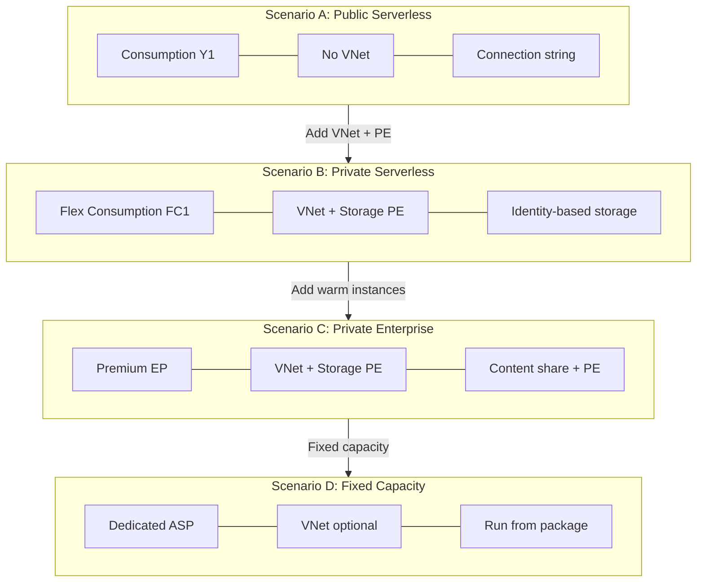
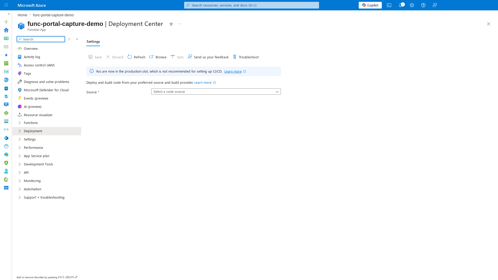
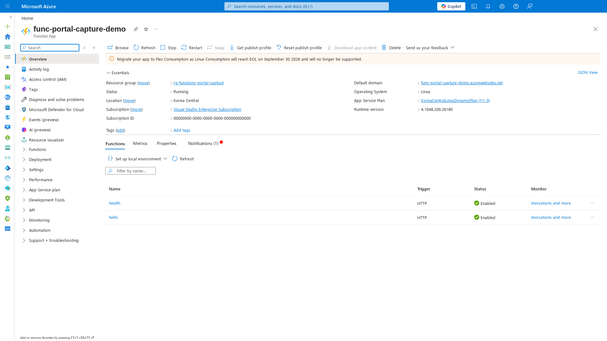
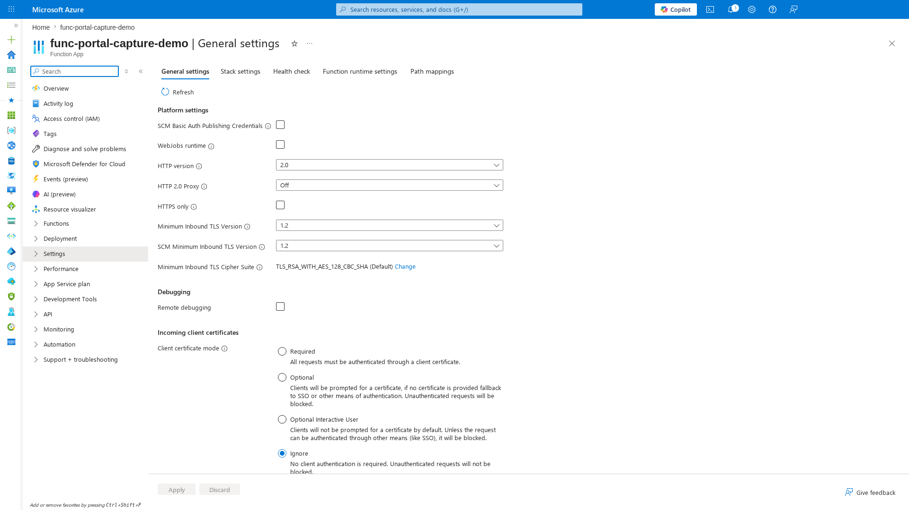
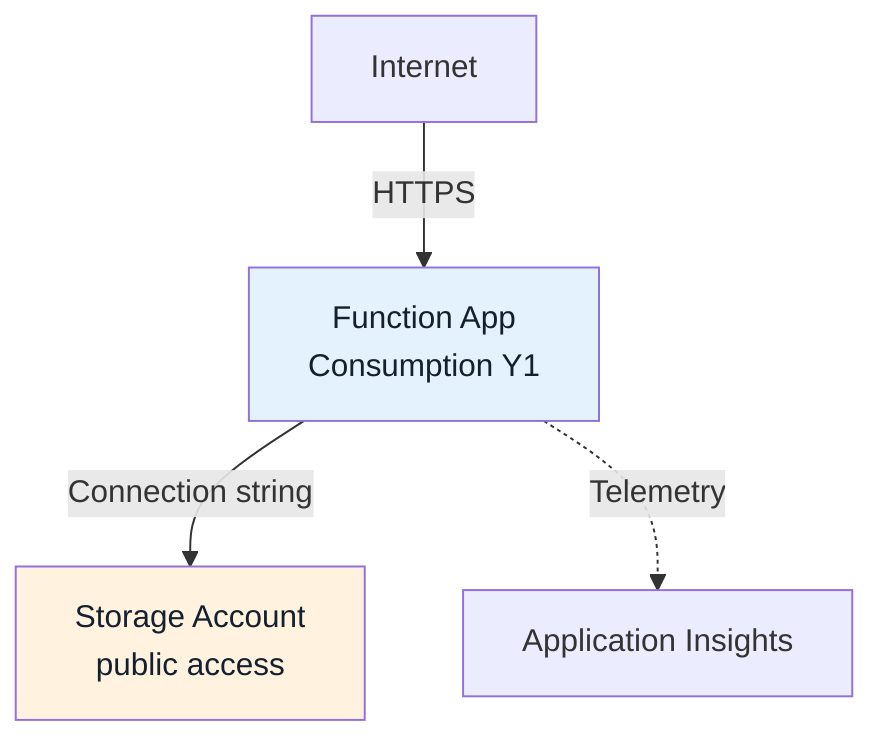
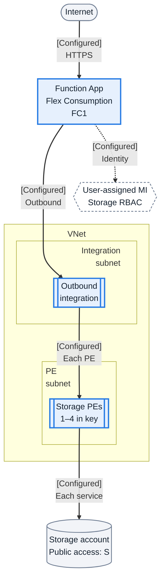
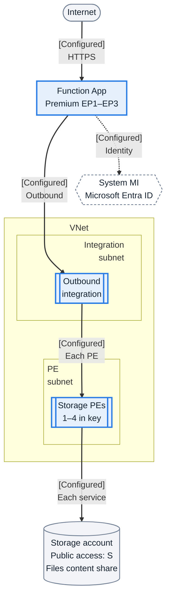
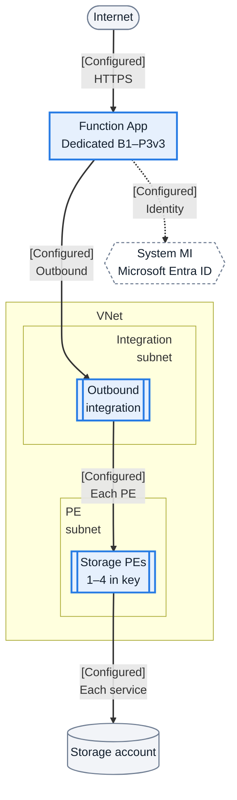

---
content_sources:
  references:
    - type: mslearn-adapted
      url: https://learn.microsoft.com/en-us/azure/azure-functions/functions-scale
    - type: mslearn-adapted
      url: https://learn.microsoft.com/en-us/azure/azure-functions/functions-networking-options
    - type: mslearn-adapted
      url: https://learn.microsoft.com/en-us/azure/azure-functions/flex-consumption-plan
    - type: mslearn-adapted
      url: https://learn.microsoft.com/en-us/azure/azure-functions/functions-create-vnet
    - type: mslearn-adapted
      url: https://learn.microsoft.com/en-us/azure/azure-functions/functions-deployment-technologies
    - type: mslearn-adapted
      url: https://learn.microsoft.com/en-us/azure/azure-functions/functions-reference?tabs=blob#configure-an-identity-based-connection
  diagrams:
    - id: scenario-overview
      type: flowchart
      source: self-generated
      justification: Comparison of four guide reference patterns; arrows describe requirement changes, not in-place migration operations or exclusive plan features.
      based_on:
        - https://learn.microsoft.com/en-us/azure/azure-functions/functions-scale
        - https://learn.microsoft.com/en-us/azure/azure-functions/functions-networking-options
        - https://learn.microsoft.com/en-us/azure/azure-functions/flex-consumption-plan
        - https://learn.microsoft.com/en-us/azure/azure-functions/functions-create-vnet
        - https://learn.microsoft.com/en-us/azure/azure-functions/functions-deployment-technologies
        - https://learn.microsoft.com/en-us/azure/azure-functions/functions-reference?tabs=blob#configure-an-identity-based-connection
        - https://learn.microsoft.com/en-us/azure/azure-functions/storage-considerations
    - id: scenario-a-public-serverless-consumption-y1
      type: flowchart
      source: self-generated
      justification: Public Y1 reference variant with connection-string Storage and telemetry; identity context does not establish Application Insights authentication.
      based_on:
        - https://learn.microsoft.com/en-us/azure/azure-functions/storage-considerations
        - https://learn.microsoft.com/en-us/azure/azure-functions/functions-monitoring
        - https://learn.microsoft.com/en-us/azure/app-service/overview-managed-identity
        - https://learn.microsoft.com/en-us/azure/azure-functions/functions-scale
        - https://learn.microsoft.com/en-us/azure/azure-functions/functions-networking-options
        - https://learn.microsoft.com/en-us/azure/azure-functions/flex-consumption-plan
        - https://learn.microsoft.com/en-us/azure/azure-functions/functions-create-vnet
        - https://learn.microsoft.com/en-us/azure/azure-functions/functions-deployment-technologies
        - https://learn.microsoft.com/en-us/azure/azure-functions/functions-reference?tabs=blob#configure-an-identity-based-connection
    - id: scenario-b-private-serverless-flex-consumption-fc1
      type: flowchart
      source: self-generated
      justification: Intended FC1 outbound Storage relationships; four endpoints expand in the immediate service key, with identity authorization separate from transport, not an observed deployment.
      based_on:
        - https://learn.microsoft.com/en-us/azure/azure-functions/storage-considerations
        - https://learn.microsoft.com/en-us/azure/storage/common/storage-private-endpoints
        - https://learn.microsoft.com/en-us/azure/app-service/overview-managed-identity
        - https://learn.microsoft.com/en-us/azure/azure-functions/functions-scale
        - https://learn.microsoft.com/en-us/azure/azure-functions/functions-networking-options
        - https://learn.microsoft.com/en-us/azure/azure-functions/flex-consumption-plan
        - https://learn.microsoft.com/en-us/azure/azure-functions/functions-create-vnet
        - https://learn.microsoft.com/en-us/azure/azure-functions/functions-deployment-technologies
        - https://learn.microsoft.com/en-us/azure/azure-functions/functions-reference?tabs=blob#configure-an-identity-based-connection
    - id: scenario-c-private-enterprise-premium-ep
      type: flowchart
      source: self-generated
      justification: Intended EP1–EP3 outbound Storage and Files-content relationships; individual endpoints and authentication/routing scope remain in the immediate key, not deployment evidence.
      based_on:
        - https://learn.microsoft.com/en-us/azure/azure-functions/storage-considerations
        - https://learn.microsoft.com/en-us/azure/storage/common/storage-private-endpoints
        - https://learn.microsoft.com/en-us/azure/app-service/overview-managed-identity
        - https://learn.microsoft.com/en-us/azure/azure-functions/configure-networking-how-to
        - https://learn.microsoft.com/en-us/azure/app-service/overview-access-restrictions#app-access
        - https://learn.microsoft.com/en-us/azure/azure-functions/functions-scale
        - https://learn.microsoft.com/en-us/azure/azure-functions/functions-networking-options
        - https://learn.microsoft.com/en-us/azure/azure-functions/flex-consumption-plan
        - https://learn.microsoft.com/en-us/azure/azure-functions/functions-create-vnet
        - https://learn.microsoft.com/en-us/azure/azure-functions/functions-deployment-technologies
        - https://learn.microsoft.com/en-us/azure/azure-functions/functions-reference?tabs=blob#configure-an-identity-based-connection
    - id: scenario-d-fixed-capacity-dedicated-asp
      type: flowchart
      source: self-generated
      justification: Optional private Storage egress for multitenant Dedicated B1–P3v3 reference hosting; four endpoints retain their mappings without implying a universal Files dependency or ASE placement.
      based_on:
        - https://learn.microsoft.com/en-us/azure/azure-functions/storage-considerations
        - https://learn.microsoft.com/en-us/azure/storage/common/storage-private-endpoints
        - https://learn.microsoft.com/en-us/azure/app-service/overview-managed-identity
        - https://learn.microsoft.com/en-us/azure/azure-functions/dedicated-plan
        - https://learn.microsoft.com/en-us/azure/azure-functions/functions-scale
        - https://learn.microsoft.com/en-us/azure/azure-functions/functions-networking-options
        - https://learn.microsoft.com/en-us/azure/azure-functions/flex-consumption-plan
        - https://learn.microsoft.com/en-us/azure/azure-functions/functions-create-vnet
        - https://learn.microsoft.com/en-us/azure/azure-functions/functions-deployment-technologies
        - https://learn.microsoft.com/en-us/azure/azure-functions/functions-reference?tabs=blob#configure-an-identity-based-connection
content_validation:
  status: verified
  last_reviewed: 2026-09-11
  reviewer: agent
  core_claims:
    - claim: "Consumption plan does not support VNet integration, while Flex Consumption, Premium, and Dedicated do"
      source: https://learn.microsoft.com/en-us/azure/azure-functions/functions-networking-options
      verified: true
    - claim: "Flex Consumption configures deployment storage through functionAppConfig and uses managed package deployment, not the classic Kudu console or ZIP API"
      source: https://learn.microsoft.com/en-us/azure/azure-functions/flex-consumption-plan
      verified: true
    - claim: "Premium and Dedicated plans can host multiple apps per plan"
      source: https://learn.microsoft.com/en-us/azure/azure-functions/functions-scale
      verified: true
    - claim: "Identity-based binding connections use app settings with service URIs instead of a single connection string secret"
      source: https://learn.microsoft.com/en-us/azure/azure-functions/functions-reference?tabs=blob#configure-an-identity-based-connection
      verified: true
---

# Deployment Scenarios

This page compares the reference deployment patterns used in this guide across the four Azure Functions hosting plans.

!!! info "Guide defaults, not platform limits"
    The tables below reflect the deployment patterns implemented in this repository's [Bicep templates](https://github.com/yeongseon/azure-functions-practical-guide/tree/main/infra) and tutorials. Azure supports additional configurations beyond what is shown here.

## Scenario Overview

<!-- diagram-id: scenario-overview -->

**Reading key:** These are reference-pattern comparisons, not an in-place migration procedure. “Add warm instances” identifies the Premium pattern here, not a feature exclusive to Premium: Flex also offers always-ready instances. Consumption connection strings, Premium content shares and Dedicated run-from-package are the depicted choices, not universal plan requirements ([hosting](https://learn.microsoft.com/en-us/azure/azure-functions/functions-scale), [Flex](https://learn.microsoft.com/en-us/azure/azure-functions/flex-consumption-plan), [storage](https://learn.microsoft.com/en-us/azure/azure-functions/storage-considerations)).

## Portal Walkthrough

This section shows portal blades illustrating deployment configuration for a live Function App (Consumption Y1, Korea Central). PII is masked.

### Deployment Center Blade

[Observed] The **Deployment Center** blade shows the deployment source configuration with a **Source** dropdown set to "Select a code source". An info banner notes that the production slot is not recommended for CI/CD setup:

[Inferred] The Deployment Center is the portal's primary interface for configuring CI/CD pipelines. For Consumption and Premium plans, it supports GitHub Actions, Azure DevOps, and other source providers. For Flex Consumption, deployment uses `func azure functionapp publish` or One Deploy instead of Kudu/SCM-based flows shown here.

### Function App Overview

[Observed] The **Overview** blade shows the Function App's current deployment state: **Status: Running**, **App Service Plan: Y1**, **Operating System: Linux**, and two deployed functions (`health`, `hello`) with Enabled status:

[Inferred] After deployment, verify function status and count in the Overview blade. The plan type visible here determines which deployment scenarios from the matrix below are applicable. The runtime version confirms the Functions host version running in production.

### Configuration (General Settings) Blade

[Observed] The **General settings** blade shows platform settings including **HTTP version**, **HTTPS only**, **TLS versions**, **FTPS state**, **Remote debugging**, and **Client certificate mode**:

[Inferred] These settings should be part of deployment validation. Verify HTTPS-only is enabled, TLS 1.2 minimum is set, and remote debugging is disabled after each deployment scenario change. FTPS state should be "Disabled" when not using FTP-based deployment.

## Matrix A — Networking and Security

| Feature | Consumption (Y1) | Flex Consumption (FC1) | Premium (EP) | Dedicated (ASP) |
|---|---|---|---|---|
| **SKU** | `Y1` / Dynamic | `FC1` / FlexConsumption | `EP1`–`EP3` / ElasticPremium | `B1`–`P3v3` / Standard+ |
| **VNet integration** | :material-close: No | :material-check: Yes | :material-check: Yes | :material-check: Yes (Standard+) |
| **Subnet delegation** | N/A | `Microsoft.App/environments` | `Microsoft.Web/serverFarms` | `Microsoft.Web/serverFarms` |
| **Storage private endpoints** | :material-close: No | :material-check: blob, queue, table, file | :material-check: blob, queue, table, file | :material-check: blob, queue, table, file |
| **Site private endpoint** | :material-close: No | :material-check: Optional | :material-check: Optional | :material-check: Optional |
| **Identity type (guide default)** | System-Assigned MI | User-Assigned MI | System-Assigned MI | System-Assigned MI |
| **Shared key access** | Required (`allowSharedKeyAccess: true`) | Disabled (`allowSharedKeyAccess: false`) | Required (content share) | Required (content share) |
| **Host storage auth** | `AzureWebJobsStorage__accountName` + MI | `AzureWebJobsStorage__accountName` + MI | `AzureWebJobsStorage__accountName` + MI | `AzureWebJobsStorage__accountName` + MI |

!!! tip "Why Flex Consumption uses User-Assigned MI"
    Flex Consumption requires the managed identity to exist **before** the function app is created, because `functionAppConfig.deployment.storage.authentication` references it at deploy time. System-Assigned MI is only available after resource creation, creating a circular dependency.

## Matrix B — Deployment and Storage Mechanics

For code-based apps, the [package matrix](../operations/deployment.md#package-configuration-by-plan-and-os) is authoritative for plan/OS and build-mode distinctions. Linux Y1 never supports `1`; remote build manages its output or a locally built package uses its actual URL. Dedicated value `1` below is the local-ready-to-run ZIP option, not a remote-build prerequisite. This clarification is official-source review only, not a new deployment result.

| Feature | Consumption (Y1) | Flex Consumption (FC1) | Premium (EP) | Dedicated (ASP) |
|---|---|---|---|---|
| **Content backend** | Linux Y1 package URL; Azure Files provisioning separate | Blob container | Azure Files content share | Local-package option (`WEBSITE_RUN_FROM_PACKAGE=1`) |
| **Config surface** | `siteConfig.appSettings` | `functionAppConfig` | `siteConfig.appSettings` | `siteConfig.appSettings` |
| **Key config settings** | `WEBSITE_CONTENTAZUREFILECONNECTIONSTRING`, `WEBSITE_CONTENTSHARE`, `WEBSITE_RUN_FROM_PACKAGE` | `functionAppConfig.deployment.storage.type: blobContainer` | `WEBSITE_CONTENTAZUREFILECONNECTIONSTRING`, `WEBSITE_CONTENTSHARE` | `WEBSITE_RUN_FROM_PACKAGE` |
| **Deployment method** | `func azure functionapp publish` / ZIP deploy | `func azure functionapp publish` (no Kudu) | `func azure functionapp publish` / ZIP deploy / Kudu | `func azure functionapp publish` / ZIP deploy / Kudu |
| **Classic Kudu console** | Windows only; no companion site for Linux Y1 | No; tool-managed deployment endpoint is separate | Yes (Linux limited) | Yes (Linux limited) |
| **Apps per plan** | 1 (implicit) | 1 (implicit) | Multiple | Multiple |
| **Key gotcha** | No `1` on Linux Y1; content provisioning and package access are separate from host MI | Configure deployment container/authentication; use supported tooling and Flex deployment diagnostics | Content share requires shared key for mount | `1` only for local-package deployment; do not force it for remote build |

## Scenario A — Public Serverless (Consumption Y1)

The simplest deployment pattern. No VNet, no private endpoints, public storage access.

<!-- diagram-id: scenario-a-public-serverless-consumption-y1 -->

**Reading key:** Public Storage access still needs authorization; the connection string is this figure's variant, not a Consumption requirement. The app's system-assigned managed identity (`System MI` in the original reference pattern) is separate context: assigning identity alone does not configure Application Insights authentication. The dotted Insights arrow denotes telemetry, not a request-processing hop ([storage](https://learn.microsoft.com/en-us/azure/azure-functions/storage-considerations), [identity](https://learn.microsoft.com/en-us/azure/app-service/overview-managed-identity), [monitoring](https://learn.microsoft.com/en-us/azure/azure-functions/functions-monitoring)).

**When to use**: Development, prototyping, low-traffic workloads without compliance requirements.

**Reference template**: [`infra/consumption/main.bicep`](https://github.com/yeongseon/azure-functions-practical-guide/tree/main/infra/consumption/main.bicep)

**Tutorial**: [Consumption plan tutorial track](../language-guides/python/tutorial/consumption/01-local-run.md)

## Scenario B — Private Serverless (Flex Consumption FC1)

Private Storage egress with identity-based access and blob-container deployment; the depicted HTTP ingress remains public, not fully isolated.

<!-- diagram-id: scenario-b-private-serverless-flex-consumption-fc1 -->

**Reading key (FC1):** Solid arrows show intended access, dotted identity shows the app's local token-acquisition context, not data passing through an identity resource. RBAC grants the identity permission for the selected Storage operations; the figure does not specify a role or prove access. VNet integration is outbound-only and does not deploy the app into the integration subnet; Flex uses subnet-dedicated shared gateways. The VNet address `10.0.0.0/16` is illustrative; integration delegation is `Microsoft.App/environments` ([networking](https://learn.microsoft.com/en-us/azure/azure-functions/functions-networking-options), [identity](https://learn.microsoft.com/en-us/azure/app-service/overview-managed-identity)).

| PE key | Distinct endpoint → service in the Storage account |
|---|---|
| 1 (`PE_BLOB`) | Blob; includes the configured deployment-container path |
| 2 (`PE_QUEUE`) | Queue |
| 3 (`PE_TABLE`) | Table |
| 4 (`PE_FILE`) | File; retained scenario endpoint, not a Flex content-share requirement |

Each row expands integration → endpoint → matching service, not four serial hops. Select endpoints for the services the workload uses: Flex deployment uses Blob and does not depend on an Azure Files content share; Queue/Table usage depends on features such as Azure Storage-backed Durable Functions. A File endpoint does not imply identity-authenticated Files mounting. **S** retains the intended disabled-public-Storage variant: explicitly configure Storage public-network restrictions; creating a PE alone does not disable public access. Normal Storage hostnames must resolve to PE IPs from the app's network using appropriate DNS; DNS resources are not drawn ([Storage endpoints](https://learn.microsoft.com/en-us/azure/storage/common/storage-private-endpoints), [storage by plan](https://learn.microsoft.com/en-us/azure/azure-functions/storage-considerations)).

**When to use**: Production serverless workloads that require network isolation and identity-based storage.

**Reference template**: [`infra/flex-consumption/main.bicep`](https://github.com/yeongseon/azure-functions-practical-guide/tree/main/infra/flex-consumption/main.bicep)

**Tutorial**: [Flex Consumption plan tutorial track](../language-guides/python/tutorial/flex-consumption/01-local-run.md)

## Scenario C — Private Enterprise (Premium EP)

VNet-integrated with always-warm instances, private endpoints, and Azure Files content share.

<!-- diagram-id: scenario-c-private-enterprise-premium-ep -->

**Reading key (EP1–EP3):** Solid arrows show intended access; the dotted system-identity association summarizes the app's local token endpoint, not a direct app-to-Entra network hop. Outbound VNet integration does not deploy the app into its integration subnet. The original `10.0.0.0/16` VNet address is illustrative; integration delegation is `Microsoft.Web/serverFarms` ([networking](https://learn.microsoft.com/en-us/azure/azure-functions/functions-networking-options), [identity](https://learn.microsoft.com/en-us/azure/app-service/overview-managed-identity)).

| PE key | Distinct endpoint → service in the Storage account |
|---|---|
| 1 (`PE_BLOB`) | Blob |
| 2 (`PE_QUEUE`) | Queue; needed for Azure Storage-backed Durable Functions |
| 3 (`PE_TABLE`) | Table |
| 4 (`PE_FILE`) | File; the depicted app → integration → File PE → content-share mount |

These are separate service paths, not serial hops. This Premium variant uses the default Azure Files content share and its connection string, distinct from optional identity-based host storage; secured content storage also needs content-share routing. Learn's secured-storage example configures File/Blob/Table, plus Queue for Durable Functions; deployments without the Files dependency also exist. **S** means explicitly restrict public Storage networking, not that PEs automatically disable it. Appropriate DNS must resolve normal Storage hostnames to PE IPs from the app network; DNS resources are not drawn ([secured storage](https://learn.microsoft.com/en-us/azure/azure-functions/configure-networking-how-to), [storage](https://learn.microsoft.com/en-us/azure/azure-functions/storage-considerations), [Storage endpoints](https://learn.microsoft.com/en-us/azure/storage/common/storage-private-endpoints)).

The public HTTPS arrow is the depicted ingress variant, not private app ingress. If a separate site private endpoint is added and `publicNetworkAccess` is unset (`null`), public app access becomes disabled by default; retaining public HTTPS then requires explicitly `Enabled`, subject to site restrictions ([app access](https://learn.microsoft.com/en-us/azure/app-service/overview-access-restrictions#app-access)).

**When to use**: Enterprise workloads that need warm instances (no cold start), VNet integration, and private storage.

**Reference template**: [`infra/premium/main.bicep`](https://github.com/yeongseon/azure-functions-practical-guide/tree/main/infra/premium/main.bicep)

**Tutorial**: [Premium plan tutorial track](../language-guides/python/tutorial/premium/01-local-run.md)

## Scenario D — Fixed Capacity (Dedicated ASP)

Traditional App Service plan with fixed compute, full VNet support, and run-from-package deployment.

<!-- diagram-id: scenario-d-fixed-capacity-dedicated-asp -->

**Reading key (Dedicated ASP):** This shows the optional regional-integration variant on supported multitenant Dedicated tiers, not an App Service Environment. Integration is outbound-only and does not deploy the app into its subnet; the system-identity association summarizes local token acquisition, not direct Entra transport. `10.0.0.0/16` is an illustrative VNet range; the integration subnet is delegated to `Microsoft.Web/serverFarms` ([networking](https://learn.microsoft.com/en-us/azure/azure-functions/functions-networking-options), [identity](https://learn.microsoft.com/en-us/azure/app-service/overview-managed-identity)).

| PE key | Distinct endpoint → service in the Storage account |
|---|---|
| 1 (`PE_BLOB`) | Blob |
| 2 (`PE_QUEUE`) | Queue |
| 3 (`PE_TABLE`) | Table |
| 4 (`PE_FILE`) | File; retained illustrative endpoint, not required by run-from-package |

Each row expands integration → endpoint → matching service. Dedicated apps do not have Premium's default Files content-share dependency; retain only the endpoints the selected features use (for example, Azure Storage-backed Durable Functions uses Blob/Queue/Table). Public Storage restrictions and private DNS resolution are separate configuration requirements, not consequences of creating a PE. The fixed-capacity/run-from-package pattern remains a choice, not a claim that Dedicated cannot use manual scale or autoscale ([storage](https://learn.microsoft.com/en-us/azure/azure-functions/storage-considerations), [Dedicated](https://learn.microsoft.com/en-us/azure/azure-functions/dedicated-plan), [Storage endpoints](https://learn.microsoft.com/en-us/azure/storage/common/storage-private-endpoints)).

**When to use**: Workloads with predictable load, existing App Service plans, or requirements for dedicated compute (compliance, GPU, large VM sizes).

**Reference template**: [`infra/dedicated/main.bicep`](https://github.com/yeongseon/azure-functions-practical-guide/tree/main/infra/dedicated/main.bicep)

**Tutorial**: [Dedicated plan tutorial track](../language-guides/python/tutorial/dedicated/01-local-run.md)

## Pre-Deployment Checklist

Before deploying any scenario, verify:

- [ ] **Resource group** exists in the target subscription
- [ ] **Storage account name** is globally unique (3–24 lowercase alphanumeric characters)
- [ ] **VNet address space** does not overlap with existing networks (Scenarios B, C, D)
- [ ] **Subnet size** is `/24` or larger for integration subnet
- [ ] **Private DNS zones** are linked to the VNet (Scenarios B, C, D)
- [ ] **RBAC role assignments** propagated (may take up to 10 minutes after deployment)
- [ ] **Application Insights** connection string is set

!!! warning "Deployment order matters"
    For Flex Consumption (Scenario B), the managed identity and RBAC assignments must be created **before** the function app. The `dependsOn` chain in the Bicep template enforces this order.

## See Also

- [Hosting Plans](hosting.md) — detailed plan characteristics and scaling behavior
- [Networking](networking.md) — VNet integration, private endpoints, and DNS configuration
- [Security](security.md) — managed identity, RBAC, and key management
- [Hosting Plan Selection](../best-practices/hosting-plan-selection.md) — decision guide for choosing a plan
- [Hosting Plan Comparison Matrix (Lab)](../troubleshooting/lab-guides/hosting-plan-comparison-matrix.md) — hands-on comparison lab
- [Infrastructure as Code tutorials](../language-guides/python/tutorial/consumption/05-infrastructure-as-code.md) — step-by-step Bicep deployment

## Sources

- [Storage considerations by hosting plan](https://learn.microsoft.com/en-us/azure/azure-functions/storage-considerations)
- [Storage private endpoints and DNS](https://learn.microsoft.com/en-us/azure/storage/common/storage-private-endpoints)
- [Managed identities for Functions and App Service](https://learn.microsoft.com/en-us/azure/app-service/overview-managed-identity)
- [Secured storage configuration](https://learn.microsoft.com/en-us/azure/azure-functions/configure-networking-how-to)
- [Dedicated hosting](https://learn.microsoft.com/en-us/azure/azure-functions/dedicated-plan)
- [App access and public-network defaults](https://learn.microsoft.com/en-us/azure/app-service/overview-access-restrictions#app-access)
- [Functions monitoring](https://learn.microsoft.com/en-us/azure/azure-functions/functions-monitoring)
- [Azure Functions hosting options (Microsoft Learn)](https://learn.microsoft.com/en-us/azure/azure-functions/functions-scale)
- [Azure Functions networking options (Microsoft Learn)](https://learn.microsoft.com/en-us/azure/azure-functions/functions-networking-options)
- [Azure Functions Flex Consumption plan (Microsoft Learn)](https://learn.microsoft.com/en-us/azure/azure-functions/flex-consumption-plan)
- [Secure Azure Functions with virtual networks (Microsoft Learn)](https://learn.microsoft.com/en-us/azure/azure-functions/functions-create-vnet)
- [Azure Functions deployment technologies (Microsoft Learn)](https://learn.microsoft.com/en-us/azure/azure-functions/functions-deployment-technologies)
- [Identity-based connections for Azure Functions (Microsoft Learn)](https://learn.microsoft.com/en-us/azure/azure-functions/functions-reference?tabs=blob#configure-an-identity-based-connection)
