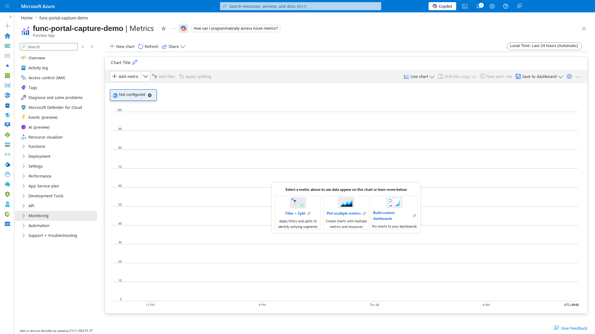
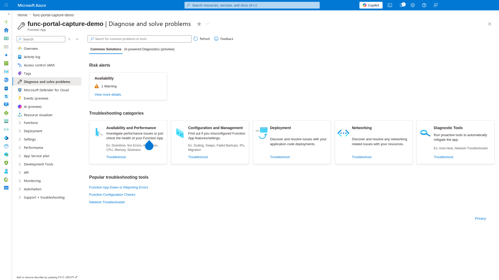
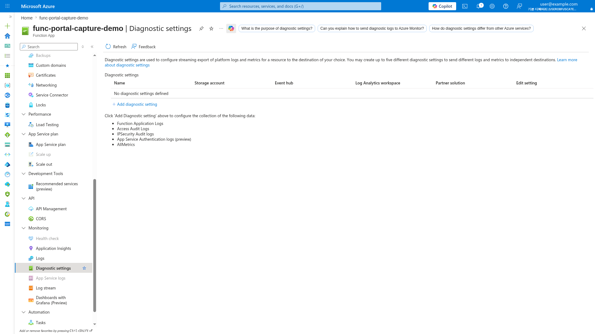
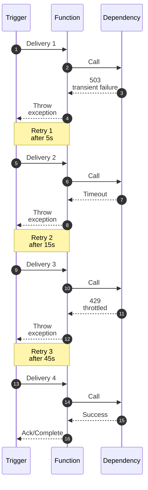
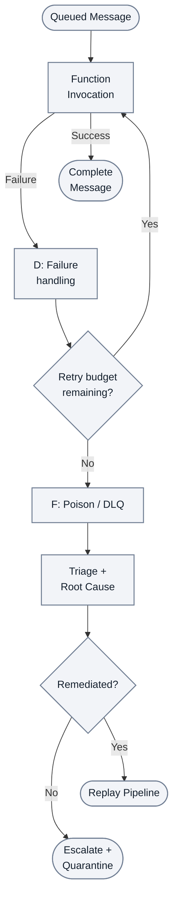
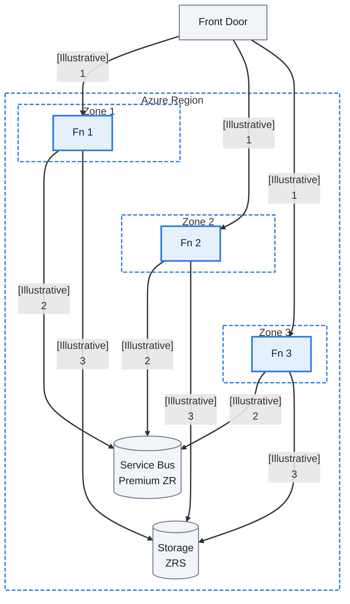
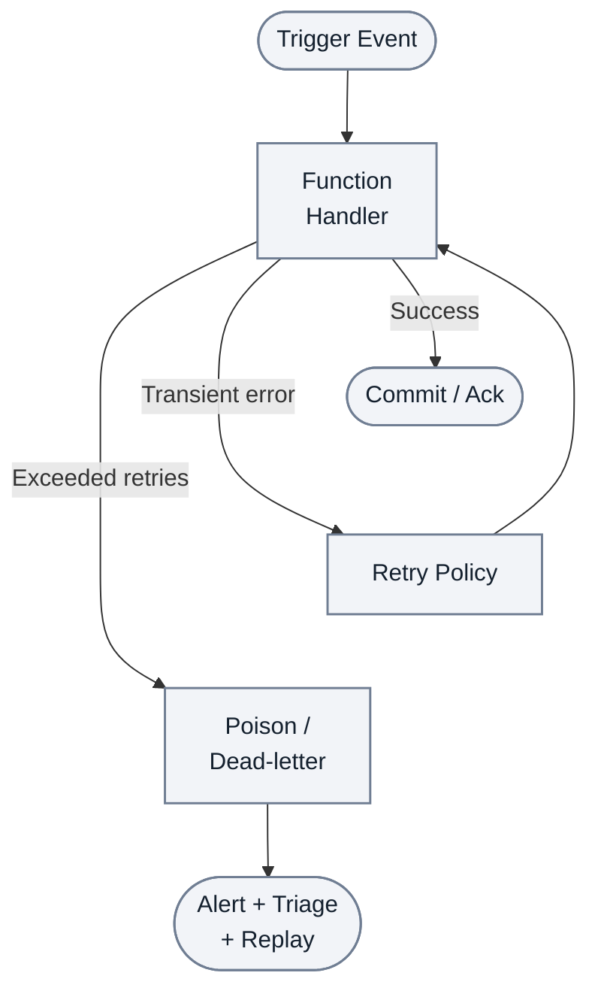

---
content_sources:
  references:
    - type: mslearn-adapted
      url: https://learn.microsoft.com/en-us/azure/azure-functions/performance-reliability
    - type: mslearn-adapted
      url: https://learn.microsoft.com/en-us/azure/reliability/reliability-functions
    - type: mslearn-adapted
      url: https://learn.microsoft.com/en-us/azure/azure-functions/functions-host-json
    - type: mslearn-adapted
      url: https://learn.microsoft.com/en-us/azure/azure-functions/functions-bindings-storage-queue
    - type: mslearn-adapted
      url: https://learn.microsoft.com/en-us/azure/azure-functions/functions-bindings-service-bus
  diagrams:
    - id: retry-flow-with-exponential-backoff-timing
      type: sequenceDiagram
      source: self-generated
      justification: Interaction sequence for retry flow with exponential backoff timing, synthesized from Microsoft Learn documentation cited on this page.
      based_on:
        - https://learn.microsoft.com/en-us/azure/azure-functions/functions-bindings-error-pages
    - id: queue-specific-poison-behaviors
      type: flowchart
      source: self-generated
      justification: Flow view of queue specific poison behaviors, synthesized from Microsoft Learn documentation cited on this page.
      based_on:
        - https://learn.microsoft.com/en-us/azure/azure-functions/functions-bindings-storage-queue-trigger
        - https://learn.microsoft.com/en-us/azure/service-bus-messaging/message-transfers-locks-settlement
    - id: availability-zones-and-high-availability
      type: flowchart
      source: self-generated
      justification: Flow view of availability zones and high availability, synthesized from Microsoft Learn documentation cited on this page.
      based_on:
        - https://learn.microsoft.com/en-us/azure/reliability/reliability-functions
        - https://learn.microsoft.com/en-us/azure/reliability/reliability-service-bus
        - https://learn.microsoft.com/en-us/azure/storage/common/storage-redundancy
        - https://learn.microsoft.com/en-us/azure/frontdoor/front-door-overview
        - https://learn.microsoft.com/en-us/azure/traffic-manager/traffic-manager-overview
    - id: reliability-architecture-pattern
      type: flowchart
      source: self-generated
      justification: Flow view of reliability architecture pattern, synthesized from Microsoft Learn documentation cited on this page.
      based_on:
        - https://learn.microsoft.com/en-us/azure/azure-functions/functions-bindings-error-pages
content_validation:
  status: verified
  last_reviewed: 2026-09-11
  reviewer: agent
  core_claims:
    - claim: "Reliable Azure Functions designs depend on trigger semantics, function behavior, platform behavior, and dependency behavior"
      source: https://learn.microsoft.com/en-us/azure/azure-functions/performance-reliability
      verified: true
    - claim: "Azure Functions supports built-in retries for supported triggers and retries should target transient failures"
      source: https://learn.microsoft.com/en-us/azure/azure-functions/performance-reliability
      verified: true
    - claim: "Storage Queue triggers move messages to a poison queue after maxDequeueCount is exceeded"
      source: https://learn.microsoft.com/en-us/azure/azure-functions/functions-bindings-storage-queue
      verified: true
    - claim: "Service Bus trigger reliability behavior includes dead-letter handling after delivery failures"
      source: https://learn.microsoft.com/en-us/azure/azure-functions/functions-bindings-service-bus
      verified: true
---

# Reliability
Reliability in Azure Functions is a design concern, not only an operations concern. Your trigger model, hosting plan, retry policy, and network topology jointly determine failure behavior.
## Prerequisites
Before you finalize reliability design decisions, verify these prerequisites:

- You know the trigger semantics for each workload (at-most-once, at-least-once, checkpoint-driven).
- You have a defined business SLO/SLA for latency, recovery time, and acceptable data loss.
- You can map each critical dependency (storage, messaging, identity, database, DNS, network).
- You have access to Azure CLI (`az`) and monitoring telemetry (Application Insights, Metrics, Log Analytics).
- You have ownership for poison/dead-letter triage and replay procedures.

## Portal Walkthrough

This section shows portal blades relevant to reliability design for a live Function App (Consumption Y1, Korea Central). PII is masked.

### Metrics Explorer

[Observed] The **Metrics** blade provides platform metrics for reliability analysis: execution counts, error rates, HTTP status codes, and duration percentiles:



[Inferred] Use these metrics to establish reliability baselines. Monitor `Http5xx` and `FunctionExecutionCount` trends to detect degradation. Set alerts on error rate thresholds before they breach SLO boundaries.

### Log Stream

[Observed] The **Log stream** blade shows real-time function execution output, including trigger processing, retries, and error messages:


[Inferred] Log stream is valuable for real-time debugging of retry behavior and trigger failures. Watch for repeated processing of the same message ID (indicating retries) and unhandled exceptions that may lead to poison queue routing.

### Diagnose and Solve Problems

[Observed] The **Diagnose and solve problems** blade provides built-in diagnostics for availability, performance, and function execution issues:



[Inferred] Use this blade as a first-response tool for reliability incidents. It provides automated analysis of common failure patterns and can identify issues that may not be visible through metrics alone.

### Diagnostic Settings Blade

[Observed] The **Diagnostic settings** blade lists available platform log categories (Function Application Logs, Access Audit, IPSecurity Audit, AllMetrics) for export configuration:



[Inferred] Streaming platform logs to Log Analytics enables KQL-based reliability analysis beyond Application Insights telemetry.

## Main Content
### Reliability layers
Design for reliability across four layers:

1. **Trigger semantics** (delivery guarantees, retries, checkpointing)
2. **Function behavior** (idempotency, timeout, exception handling)
3. **Platform behavior** (scale transitions, zone support, host restarts)
4. **Dependency behavior** (throttling, transient failure, private network reachability)

### Retry strategy
Azure Functions supports built-in retry behavior for supported triggers.
Common retry models:

- Fixed delay retry
- Exponential backoff retry
Use retries for transient failures only. Non-transient failures should route to dead-letter/poison handling paths.

#### Cross-language retry annotation patterns
=== "Python"
    ```python
    import azure.functions as func
    app = func.FunctionApp()

    @app.function_name(name="ProcessQueue")
    @app.queue_trigger(arg_name="msg", queue_name="orders", connection="AzureWebJobsStorage")
    def process_queue(msg: func.QueueMessage) -> None:
        # Handle message idempotently; raise on transient failures
        pass
    ```
=== "Node.js"
    ```javascript
    const { app } = require('@azure/functions');

    app.storageQueue('processQueue', {
      queueName: 'orders',
      connection: 'AzureWebJobsStorage',
      handler: async (message, context) => {
        // Handle idempotently
      }
    });
    ```
=== ".NET (Isolated)"
    ```csharp
    using Microsoft.Azure.Functions.Worker;

    public class ProcessQueue
    {
        [Function("ProcessQueue")]
        public void Run([QueueTrigger("orders", Connection = "AzureWebJobsStorage")] string message)
        {
            // Handle idempotently
        }
    }
    ```

#### Retry flow with exponential backoff timing
<!-- diagram-id: retry-flow-with-exponential-backoff-timing -->


**Reading key — illustrative timing:** The three lifelines retain trigger
delivery, function execution and dependency calls. The 5/15/45-second waits are
example backoff intervals, not a platform schedule. Functions exponential-backoff retry policies add randomization; fixed-delay policies use a specified interval. Extension retries are distinct.
“Ack/Complete”
summarizes trigger-specific successful completion, not a settlement API shared by
every trigger. See [retry strategies and support](https://learn.microsoft.com/en-us/azure/azure-functions/functions-bindings-error-pages#retry-strategies).

#### host.json retry configuration examples
Use these examples as host-level reliability templates. Trigger-level retry declarations still apply where supported by language/runtime bindings.

**Fixed delay retry config**
```json
{
  "version": "2.0",
  "extensions": {
    "serviceBus": {
      "clientRetryOptions": {
        "mode": "fixed",
        "tryTimeout": "00:01:00",
        "delay": "00:00:05",
        "maxDelay": "00:00:05",
        "maxRetries": 5
      }
    }
  }
}
```

**Exponential backoff retry config**
```json
{
  "version": "2.0",
  "extensions": {
    "serviceBus": {
      "clientRetryOptions": {
        "mode": "exponential",
        "tryTimeout": "00:01:00",
        "delay": "00:00:02",
        "maxDelay": "00:01:00",
        "maxRetries": 8
      }
    }
  }
}
```

**Max retry count settings**
```json
{
  "version": "2.0",
  "extensions": {
    "queues": {
      "maxDequeueCount": 8,
      "visibilityTimeout": "00:00:30",
      "batchSize": 16,
      "newBatchThreshold": 8
    }
  }
}
```

!!! note "Retry scope matters"
    `clientRetryOptions` affects communication between the Functions host and the messaging service client.
    Trigger execution retries are configured by trigger/runtime support.

### Poison message handling
For queue-based triggers, repeated failure eventually moves messages to poison/dead-letter paths (service-specific behavior).
Design requirements:

- preserve original payload and correlation metadata,
- alert on poison queue growth,
- provide replay workflow after remediation,
- prevent infinite retry loops.

!!! warning "Do not drop poison messages"
    Poison events are high-signal reliability data. Route them to explicit triage and replay pipelines.

#### Queue-specific poison behaviors
**Storage Queue trigger**
- Every failed processing attempt increments `dequeueCount`.
- When `dequeueCount` exceeds `maxDequeueCount`, the runtime moves the message to `<queue-name>-poison`.
- Preserve these fields for replay and forensics:
    - `id`
    - `dequeueCount`
    - `insertionTime`
    - `nextVisibleTime`
    - custom `correlationId` (if present)

**Service Bus trigger**
- Messages are dead-lettered after max delivery count or explicit dead-letter action.
- Capture `deadLetterReason` and `deadLetterErrorDescription` before replay.
- Typical reasons include lock lost, deserialization failure, or business validation failure.

<!-- diagram-id: queue-specific-poison-behaviors -->


**Reading key:** D distinguishes Storage Queue's failed-processing visibility
delay from Service Bus abandon or lock expiry; the original “release lock” label
is not a common API. F means `<queue>-poison` for Storage Queue or the entity's
dead-letter queue for Service Bus. Limits are service-specific, not one shared
runtime counter ([Queue trigger](https://learn.microsoft.com/en-us/azure/azure-functions/functions-bindings-storage-queue-trigger#peek-lock),
[Service Bus settlement](https://learn.microsoft.com/en-us/azure/service-bus-messaging/message-transfers-locks-settlement#peeklock)).

### Timeout design
Timeout boundaries are part of reliability behavior.

| Plan | Default | Maximum |
|---|---:|---:|
| Consumption (classic) | 5 min | 10 min |
| Flex Consumption | 30 min | Unbounded |
| Premium | 30 min (common default) | Unbounded |
| Dedicated | 30 min (common default) | Unbounded |

If your business process exceeds timeout bounds, redesign to asynchronous orchestration.

### Availability zones and high availability
Zone-aware architecture options are strongest on Premium, Dedicated, and Flex Consumption plans.
- Premium, Dedicated, and Flex Consumption can be designed for zone-resilient deployments (region permitting).
- Zone-resilient design should include zone-redundant dependencies (storage, messaging, data stores).
- Consumption designs should emphasize retry/idempotency and multi-region recovery patterns where needed.

<!-- diagram-id: availability-zones-and-high-availability -->


**Reading key — illustrative architecture, not a deployment or network trace:**

| Key | Relationship and scope |
|---|---|
| 1 — HTTP routing | Optional global Front Door forwards HTTP requests to a regional function app; the platform distributes requests across its instances. The three arrows summarize this relationship, not direct routing to individually addressable workers. Traffic Manager is an alternative DNS endpoint selector, not an HTTP proxy or a zone selector ([Front Door](https://learn.microsoft.com/en-us/azure/frontdoor/front-door-overview), [Traffic Manager](https://learn.microsoft.com/en-us/azure/traffic-manager/traffic-manager-overview)). |
| 2 — Messaging | Each instance initiates illustrative Service Bus operations against the shared Premium zone-redundant namespace. Event delivery is not routed through Front Door ([Service Bus reliability](https://learn.microsoft.com/en-us/azure/reliability/reliability-service-bus)). |
| 3 — Storage | Each instance accesses the shared ZRS storage account; ZRS replicates across availability zones ([Storage redundancy](https://learn.microsoft.com/en-us/azure/storage/common/storage-redundancy#zone-redundant-storage)). |
| Region / Zone 1–3; Fn 1–3 | Availability boundaries, not VNets or subnets. Fn means Function app instance (the original workers). Three instances show distribution conceptually, not a guaranteed count or placement. Flex Consumption, Premium and Dedicated support zone redundancy subject to plan/region requirements; Consumption does not. When zone redundancy is enabled, Flex/Premium host storage requires ZRS. ([Functions reliability](https://learn.microsoft.com/en-us/azure/reliability/reliability-functions#resilience-to-availability-zone-failures)). |

### Idempotency is mandatory
Because retries and duplicate deliveries are normal in distributed systems, handlers must be idempotent.
Idempotency patterns:

- deterministic operation keys,
- upsert instead of blind insert,
- de-duplication table/cache,
- exactly-once effects at domain boundary where feasible.

#### Python idempotency example
```python
import json
from datetime import datetime, timezone
import azure.functions as func
from azure.data.tables import TableServiceClient

app = func.FunctionApp()

@app.function_name(name="ProcessOrder")
@app.queue_trigger(arg_name="msg", queue_name="orders", connection="AzureWebJobsStorage")
def process_order(msg: func.QueueMessage) -> None:
    payload = json.loads(msg.get_body().decode("utf-8"))
    operation_id = payload["operationId"]

    table_service = TableServiceClient.from_connection_string("UseDevelopmentStorage=true")
    table_client = table_service.get_table_client("processedoperations")
    table_client.create_table_if_not_exists()

    try:
        table_client.create_entity({
            "PartitionKey": "order-processing",
            "RowKey": operation_id,
            "processedAt": datetime.now(timezone.utc).isoformat()
        })
    except Exception:
        # Duplicate delivery: idempotent no-op
        return

    # Side effect executes once per operation_id
```

### Dependency resilience
Protect downstream dependencies using:

- timeout budgets per call,
- transient retry with jitter,
- circuit breaking,
- and bulkheading (separate processing lanes for critical/non-critical work).

### Reliability architecture pattern
<!-- diagram-id: reliability-architecture-pattern -->


**Reading key:** The retry loop preserves the same handler and all three
outcomes. Poison/dead-letter destinations apply only where provided by the
trigger/service; otherwise preserve failures in an application-owned recovery
workflow. Exhausting a runtime retry policy does not universally create a DLQ
message ([retry support](https://learn.microsoft.com/en-us/azure/azure-functions/functions-bindings-error-pages#retries)).

### CLI validation examples (PII masked)
Use CLI checks during reviews and incidents to confirm reliability-related configuration and telemetry.

**Inspect function app reliability settings**
```bash
az functionapp config show   --resource-group "rg-functions-prod"   --name "func-reliability-prod"   --query "{alwaysOn:alwaysOn,http20Enabled:http20Enabled,ftpsState:ftpsState,minTlsVersion:minTlsVersion}"   --output json
```
| Command/Parameter | Purpose |
| --- | --- |
| `az functionapp config show` | Show the function app's site configuration. |
| `--resource-group` | Resource group that contains the resource. |
| `--name` | Name of the target resource. |
| `--query` | JMESPath query selecting fields from the response. |
| `--output` | Output format. |

**Query failure and retry metrics**
```bash
az monitor metrics list   --resource "/subscriptions/<subscription-id>/resourceGroups/rg-functions-prod/providers/Microsoft.Web/sites/func-reliability-prod"   --metric "FunctionExecutionCount,FunctionExecutionUnits,FunctionExecutionFailureCount"   --interval "PT5M"   --aggregation "Total"   --output table
```
| Command/Parameter | Purpose |
| --- | --- |
| `az monitor metrics list` | List platform metrics for a resource. |
| `--resource` | Resource ID to query metrics for. |
| `--metric` | Metric(s) to retrieve. |
| `--interval` | Aggregation interval. |
| `--aggregation` | Aggregation type. |
| `--output` | Output format. |

```bash
az monitor metrics list   --resource "/subscriptions/<subscription-id>/resourceGroups/rg-functions-prod/providers/Microsoft.ServiceBus/namespaces/sb-functions-prod"   --metric "DeadletteredMessages,IncomingMessages,SuccessfulRequests,ServerErrors"   --interval "PT5M"   --aggregation "Total"   --output table
```
| Command/Parameter | Purpose |
| --- | --- |
| `az monitor metrics list` | List platform metrics for a resource. |
| `--resource` | Resource ID to query metrics for. |
| `--metric` | Metric(s) to retrieve. |
| `--interval` | Aggregation interval. |
| `--aggregation` | Aggregation type. |
| `--output` | Output format. |

### Troubleshooting matrix
| Symptom | Likely Cause | Validation Path |
|---|---|---|
| Sudden spike in retries with eventual success | Downstream transient throttling | Check dependency 429/503 in traces and compare with retry timing |
| Messages accumulate in poison queue | Non-transient exception or schema mismatch | Inspect poison payload and verify handler version + contract changes |
| Duplicate business records | Missing idempotency key or non-atomic side effects | Correlate duplicate entities by operation key and retry attempts |
| Frequent timeout failures | Function timeout too low or dependency latency regression | Review timeout settings and dependency latency percentile |
| Dead-letter growth in Service Bus | Lock lost, max delivery exceeded, or explicit dead-letter | Query `deadLetterReason` and check lock duration |
| Regional incident causes prolonged outage | Single-region architecture with no failover path | Validate multi-region topology and failover runbook |

### Reliability checklist
- Define retry policy per trigger type.
- Enforce idempotency in every async handler.
- Define poison queue alert + replay process.
- Align timeout with business SLA.
- Validate zone strategy on Premium/Dedicated where required.

!!! tip "Operations Guide"
    For runbook details, see [Operations: Retries and Poison Handling](../operations/retries-and-poison-handling.md).

## Advanced Topics
### Durable Functions reliability patterns
Durable Functions improves reliability for long-running orchestration, but reliability still depends on deterministic orchestrator logic and safe activity retries.
- Keep orchestrator functions deterministic.
- Put side effects in activity functions, not orchestrators.
- Configure activity retry policies with bounded max attempts and backoff.
- Use compensation activities for partially completed workflows.

### Exactly-once processing patterns
Exactly-once transport is rarely available end-to-end; achieve exactly-once effects by combining idempotency and atomic state transitions.

1. **Inbox table pattern**
    - Record processed event key before side effect.
    - Skip side effect when key already exists.
2. **Outbox pattern**
    - Persist state change and outbound event atomically.
    - Publish from outbox worker with retry and dedupe.
3. **Upsert + version check**
    - Require expected version/etag for updates.
    - Reject stale duplicates safely.

### Multi-region failover
Choose strategy based on workload criticality and recovery objectives:

- **Active-passive**: lower cost, simpler operations, longer failover time.
- **Active-active**: higher complexity, better regional fault tolerance.

### Health check probes
Health endpoints and synthetic probes improve early detection of reliability regressions.
- Provide a lightweight `/api/healthz` endpoint for liveness checks.
- Add readiness checks for critical dependencies.

## Language-Specific Details
Use language-specific guidance for runtime nuances, extension bundles, and host configuration details:

- Python: [Python Guide](../language-guides/python/index.md), [host.json for Python](../language-guides/python/host-json.md), [Python troubleshooting](../language-guides/python/troubleshooting.md)
- Node.js: [Node.js Guide](../language-guides/nodejs/index.md)
- .NET: [.NET Guide](../language-guides/dotnet/index.md)
- Java: [Java Guide](../language-guides/java/index.md)

## See Also
- [Triggers and bindings](triggers-and-bindings.md)
- [Scaling](scaling.md)
- [Security](security.md)
- [Operations: Retries and Poison Handling](../operations/retries-and-poison-handling.md)
- [Troubleshooting methodology](../troubleshooting/methodology.md)

## Sources
- [Functions retry support and error handling](https://learn.microsoft.com/en-us/azure/azure-functions/functions-bindings-error-pages)
- [Queue trigger poison and visibility behavior](https://learn.microsoft.com/en-us/azure/azure-functions/functions-bindings-storage-queue-trigger)
- [Service Bus settlement](https://learn.microsoft.com/en-us/azure/service-bus-messaging/message-transfers-locks-settlement)
- [Service Bus reliability](https://learn.microsoft.com/en-us/azure/reliability/reliability-service-bus)
- [Storage redundancy](https://learn.microsoft.com/en-us/azure/storage/common/storage-redundancy)
- [Front Door overview](https://learn.microsoft.com/en-us/azure/frontdoor/front-door-overview)
- [Traffic Manager overview](https://learn.microsoft.com/en-us/azure/traffic-manager/traffic-manager-overview)
- [Microsoft Learn: Design reliable Azure Functions applications](https://learn.microsoft.com/en-us/azure/azure-functions/performance-reliability)
- [Microsoft Learn: Azure Functions reliability in Azure Well-Architected Framework](https://learn.microsoft.com/en-us/azure/reliability/reliability-functions)
- [Microsoft Learn: Azure Functions host.json reference](https://learn.microsoft.com/en-us/azure/azure-functions/functions-host-json)
- [Microsoft Learn: Azure Queue Storage trigger and bindings](https://learn.microsoft.com/en-us/azure/azure-functions/functions-bindings-storage-queue)
- [Microsoft Learn: Azure Service Bus trigger and bindings](https://learn.microsoft.com/en-us/azure/azure-functions/functions-bindings-service-bus)
