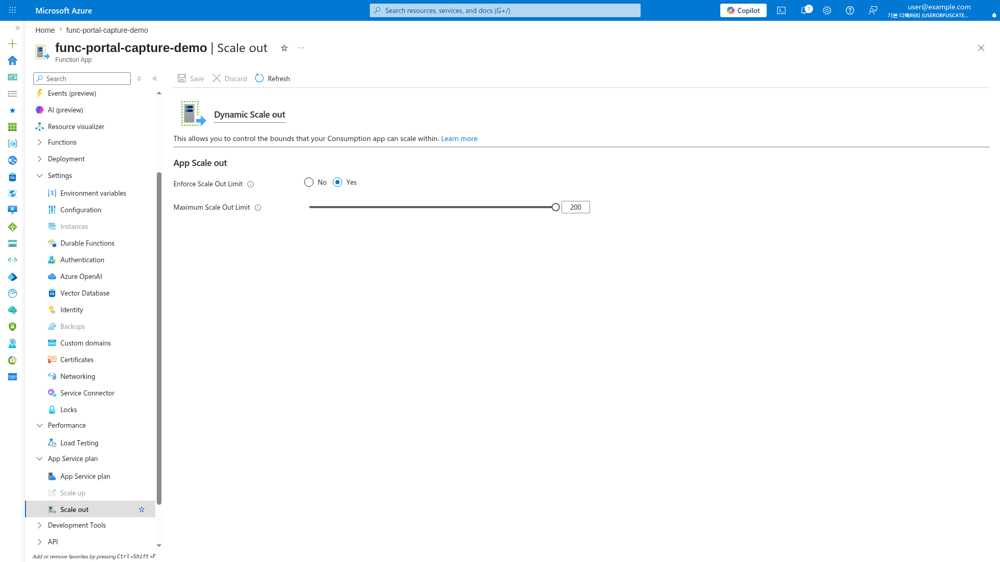
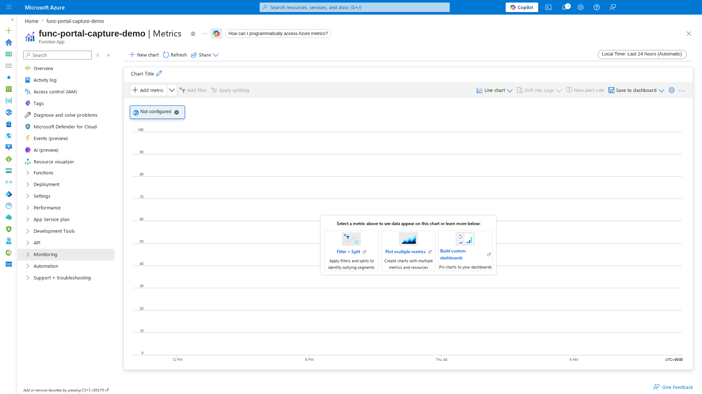
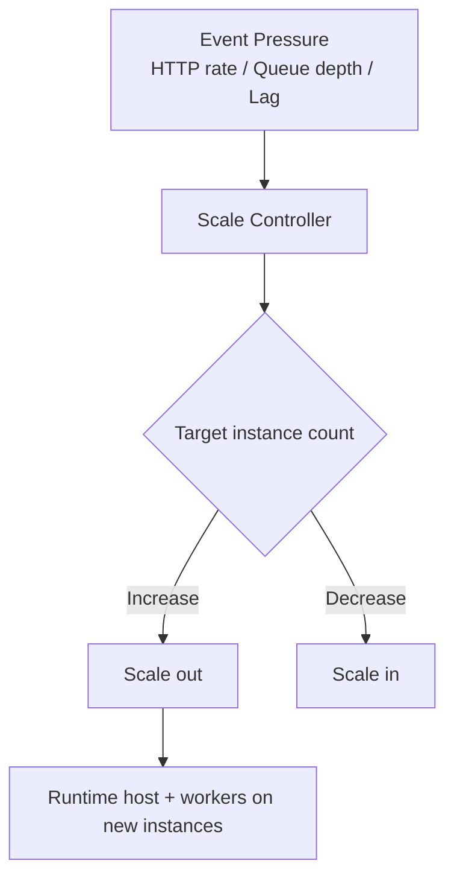
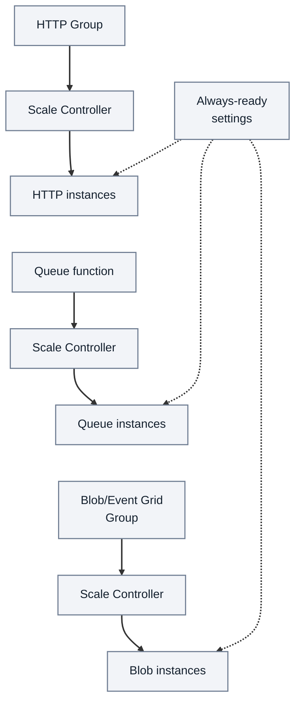
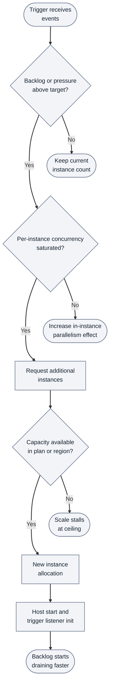
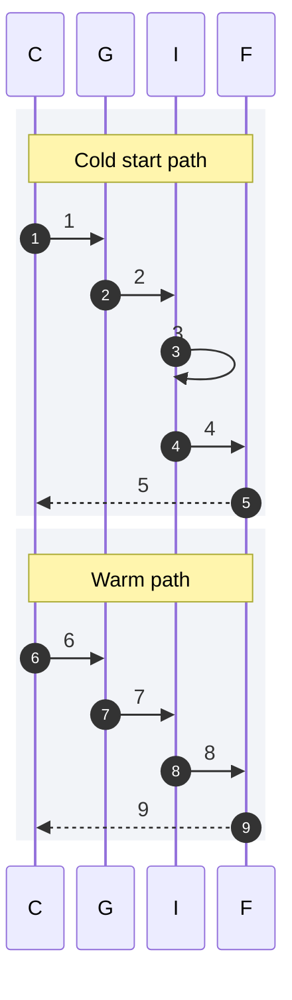

---
content_sources:
  references:
    - type: mslearn-adapted
      url: https://learn.microsoft.com/en-us/azure/azure-functions/functions-scale
    - type: mslearn-adapted
      url: https://learn.microsoft.com/en-us/azure/azure-functions/event-driven-scaling
    - type: mslearn-adapted
      url: https://learn.microsoft.com/en-us/azure/azure-functions/flex-consumption-plan
    - type: mslearn-adapted
      url: https://learn.microsoft.com/en-us/azure/azure-functions/functions-premium-plan
    - type: mslearn-adapted
      url: https://learn.microsoft.com/en-us/azure/azure-functions/functions-concurrency
    - type: mslearn-adapted
      url: https://learn.microsoft.com/en-us/azure/azure-functions/durable/durable-functions-perf-and-scale
  diagrams:
    - id: scale-controller-fundamentals
      type: flowchart
      source: self-generated
      justification: Conceptual summary of event-driven scaling - the scale controller monitors event sources and adjusts instance count. Not an exact algorithm, and Dedicated plans scale differently.
      based_on:
        - https://learn.microsoft.com/en-us/azure/azure-functions/functions-scale
        - https://learn.microsoft.com/en-us/azure/azure-functions/event-driven-scaling
        - https://learn.microsoft.com/en-us/azure/azure-functions/flex-consumption-plan
        - https://learn.microsoft.com/en-us/azure/azure-functions/functions-premium-plan
        - https://learn.microsoft.com/en-us/azure/azure-functions/functions-concurrency
        - https://learn.microsoft.com/en-us/azure/azure-functions/durable/durable-functions-perf-and-scale
    - id: flex-specific-operational-constraints-affecting-scale
      type: flowchart
      source: self-generated
      justification: Flex Consumption per-function scaling - HTTP, Blob (Event Grid) and Durable triggers scale as groups, other functions individually, and always-ready settings apply per group or function. Examples are selective; the repeated controller boxes are logical, not separate services.
      based_on:
        - https://learn.microsoft.com/en-us/azure/azure-functions/functions-scale
        - https://learn.microsoft.com/en-us/azure/azure-functions/event-driven-scaling
        - https://learn.microsoft.com/en-us/azure/azure-functions/flex-consumption-plan
        - https://learn.microsoft.com/en-us/azure/azure-functions/functions-premium-plan
        - https://learn.microsoft.com/en-us/azure/azure-functions/functions-concurrency
        - https://learn.microsoft.com/en-us/azure/azure-functions/durable/durable-functions-perf-and-scale
    - id: autoscale-decision-flow
      type: flowchart
      source: self-generated
      justification: Illustrative reasoning model for why scale-out did or did not occur; not the scale controller's exact algorithm. Uses Learn concepts of event-driven scale-out, per-instance concurrency and plan instance limits, which vary by plan.
      based_on:
        - https://learn.microsoft.com/en-us/azure/azure-functions/functions-scale
        - https://learn.microsoft.com/en-us/azure/azure-functions/event-driven-scaling
        - https://learn.microsoft.com/en-us/azure/azure-functions/flex-consumption-plan
        - https://learn.microsoft.com/en-us/azure/azure-functions/functions-premium-plan
        - https://learn.microsoft.com/en-us/azure/azure-functions/functions-concurrency
        - https://learn.microsoft.com/en-us/azure/azure-functions/durable/durable-functions-perf-and-scale
    - id: cold-start-versus-warm-path-comparison
      type: sequenceDiagram
      source: self-generated
      justification: Illustrative logical comparison of a cold and warm HTTP path; not a protocol trace or latency benchmark. Learn supports that new instances incur startup delay and that always-ready or pre-warmed instances mitigate it on plans that offer them.
      based_on:
        - https://learn.microsoft.com/en-us/azure/azure-functions/functions-scale
        - https://learn.microsoft.com/en-us/azure/azure-functions/event-driven-scaling
        - https://learn.microsoft.com/en-us/azure/azure-functions/flex-consumption-plan
        - https://learn.microsoft.com/en-us/azure/azure-functions/functions-premium-plan
        - https://learn.microsoft.com/en-us/azure/azure-functions/functions-concurrency
        - https://learn.microsoft.com/en-us/azure/azure-functions/durable/durable-functions-perf-and-scale
content_validation:
  status: verified
  last_reviewed: 2026-09-11
  reviewer: agent
  core_claims:
    - claim: "Scaling is trigger-specific with plan-dependent limits"
      source: https://learn.microsoft.com/en-us/azure/azure-functions/event-driven-scaling
      verified: true
    - claim: "Consumption plan can scale to 200 instances (Linux) or 100 (Windows)"
      source: https://learn.microsoft.com/en-us/azure/azure-functions/functions-scale
      verified: true
    - claim: "HTTP triggers scale based on concurrent request rate"
      source: https://learn.microsoft.com/en-us/azure/azure-functions/event-driven-scaling
      verified: true
---

# Scaling Behavior
Azure Functions scaling is plan-dependent and trigger-dependent. You do not configure a single universal autoscaler; instead, the platform applies trigger-specific heuristics within plan limits.
## Prerequisites

Before tuning scale behavior, make sure the following prerequisites are in place:

- You know the selected hosting plan (`Consumption`, `Flex Consumption`, `Premium`, or `Dedicated`) and its operational limits.
- You have access to Azure CLI, and your environment is authenticated with `az login`.
- You have Reader or Contributor access to the Function App, plan, storage account, and Application Insights.
- You collect trigger-specific telemetry (HTTP latency, queue depth, event lag, failures) in Application Insights.
- You understand downstream service limits (database connections, API rate limits, NAT port limits).

Optional but recommended:

- A repeatable load test path to validate scale decisions before production rollout.
- A rollback plan for host-level concurrency and timeout changes.
- Baseline metrics from a known healthy period for comparison.
## Portal Walkthrough

This section shows portal blades illustrating scale behavior for a live Function App (Consumption Y1, Korea Central). PII is masked.

### Scale Out Blade

[Observed] The **Scale out** blade shows the **Dynamic Scale out** configuration. **Enforce Scale Out Limit** is set to **Yes** with the **Maximum Scale Out Limit** slider at **200** (the Consumption platform maximum):



[Inferred] This is the primary portal control for setting `functionAppScaleLimit`. On Consumption, the scale controller manages instance allocation automatically — the slider sets the upper bound. For Premium plans, this blade would show different controls (minimum/maximum elastic instances). For Dedicated plans, scale-out is managed through App Service autoscale rules instead.

### Metrics Explorer

[Observed] The **Metrics** blade provides access to platform metrics that reflect scaling behavior, including `FunctionExecutionCount`, `FunctionExecutionUnits`, and HTTP-related metrics:



[Inferred] Use the Metrics blade to observe actual scale-out behavior during load tests. Key metrics for scaling analysis: `FunctionExecutionCount` for invocation rate, `Http5xx` for error pressure during scale events, and `ActiveInstanceCount` (when available) for instance trend. Compare against the scale limit configured in the Scale out blade.

## Main Content
### Scale controller fundamentals
For serverless plans, Azure Functions scale controller evaluates event pressure and target throughput, then adds or removes instances.
Primary signals include:

- HTTP concurrency and request backlog,
- queue/topic/event backlog,
- partition lag (streaming sources),
- and observed processing rate.
<!-- diagram-id: scale-controller-fundamentals -->

Notes:

- Scale-out is not instant; host startup and binding initialization introduce delay.
- The controller optimizes for throughput and reliability, not one-request-per-instance behavior.
### Plan-level scaling model
| Plan | Baseline | Scale style | Common max profile |
|---|---|---|---|
| Consumption | 0 | App-level serverless scaling | Lower than Flex; classic dynamic ceiling |
| Flex Consumption | 0 (or always-ready) | Per-function/group scaling | Up to high serverless ceiling |
| Premium | Warm minimum instances | Elastic above warm floor | Bounded by Premium plan settings |
| Dedicated | Fixed/Autoscale rules | App Service autoscale | Plan VM and rule dependent |
Practical implications by plan:

- **Consumption**: cost-first workloads where occasional cold start is acceptable.
- **Flex/Premium**: stronger low-latency and burst handling with warm strategies.
- **Dedicated**: deterministic capacity and App Service-aligned operations.
### Consumption scaling
#### Behavior
- Scales to zero when idle.
- Scales out on demand from trigger signals.
- Cold starts occur after idle or during sudden scale-out.

#### Timeout and impact
- Default function timeout: **5 minutes**.
- Maximum function timeout: **10 minutes**.
Long-running work should be modeled with asynchronous triggers and durable patterns.
Common usage pattern: keep HTTP handlers thin, offload heavy work to queue-driven functions, and return early with correlation IDs.

### Flex Consumption scaling
Flex introduces the most significant scaling architecture changes.

#### Key scaling behaviors
- **Per-function or function-group scaling** rather than one shared app-scale behavior.
- Optional **always-ready** instances to reduce startup latency.
- High scale ceiling suitable for bursty event streams.

#### Critical timeout values
- Default timeout: **30 minutes**.
- Maximum timeout: **unbounded**.

#### Flex-specific operational constraints affecting scale
- No Kudu/SCM endpoint.
- Identity-based storage required for host storage.
- Blob trigger requires Event Grid source on Flex.
<!-- diagram-id: flex-specific-operational-constraints-affecting-scale -->


**Workload key:** HTTP and Blob (Event Grid) are shared scale groups; Q is one
independently scaled queue function, not a shared queue-trigger group. Durable
Functions also has a shared group, outside these three selected examples.
The repeated controller boxes are logical decisions, not separate services;
solid arrows summarize demand-to-capacity relationships, not event delivery.
[Flex per-function scaling and always-ready settings](https://learn.microsoft.com/en-us/azure/azure-functions/flex-consumption-plan#per-function-scaling)
apply to groups or individual functions.

Operational guidance:

- Assign always-ready instances to latency-sensitive paths first (usually HTTP).
- Validate cost delta between always-ready floor and observed latency gain.
- Keep trigger groups isolated if one workload has highly variable burst behavior.
### Premium scaling
Premium is designed for low-latency scale with warm capacity.

#### Behavior
- Configured minimum warm instances are always running.
- Additional instances are added elastically under load.
- VNet integration is supported.
#### Architectural implication
Premium reduces startup latency by maintaining permanently warm capacity, suitable for strict response-time requirements.

Typical fit:

- Low-latency APIs with enterprise network controls.
- Dependency chains sensitive to cold initialization.
- Workloads prioritizing latency predictability over minimum idle cost.
### Dedicated scaling
Dedicated follows App Service scaling rules:

- manual instance count,
- or autoscale based on CPU/memory/schedules,
- no scale-to-zero behavior.
This model trades serverless elasticity for deterministic capacity planning.

When to consider Dedicated: existing App Service governance, stable baseline demand, and explicit instance control requirements.

### Trigger-specific scaling patterns
#### HTTP triggers
- Scale based on concurrency, queueing, and response pressure.
- Latency-sensitive; warm capacity strategies matter.

#### Queue and messaging triggers
- Scale based on backlog and processing throughput.
- Better for burst absorption and deferred processing.

#### Timer triggers
- Schedule-driven; generally not throughput-scaled like backlog triggers.

Design reminder:

- Prefer queue decoupling when dependency latency can cascade into HTTP saturation.

### Concurrency and throughput design
Throughput is a function of both instance count and per-instance concurrency.

Design guidance:

- keep handlers idempotent,
- avoid long blocking calls on HTTP paths,
- isolate heavy async processing from public API functions,
- validate downstream service quotas before increasing scale limits.

Concurrency tuning checklist:

1. Baseline queue drain rate at current settings.
2. Increase concurrency gradually and measure error or timeout impact.
3. Confirm downstream services stay below throttling thresholds.
4. Keep retry strategy aligned with increased fan-out.

### Scale and networking dependency
Scaling faster than your network or backend quotas can increase failures.
Check before raising scale ceilings:

- subnet address capacity,
- NAT or firewall throughput,
- service throttling limits,
- database connection limits.

!!! tip "Networking Guide"
    Pair scaling design with [Networking](networking.md) to avoid backend bottlenecks from successful scale-out.

### Autoscale decision flow
Use this model to reason about why scale-out did or did not happen in a short time window.

<!-- diagram-id: autoscale-decision-flow -->


Interpretation: if pressure remains high without scale-out, inspect ceilings and concurrency caps before blaming the trigger source.

### Cold start versus warm path comparison
The path difference explains why warm floors or always-ready instances can materially improve p95 and p99 latencies.

<!-- diagram-id: cold-start-versus-warm-path-comparison -->


**Sequence key:** C = client; G = gateway; I = instance; F = function. This is a
logical comparison, not physical allocation ownership or an exact protocol trace.
The warm path omits the depicted startup work, not all scheduling or dependency
delay. [Cold-start behavior](https://learn.microsoft.com/en-us/azure/azure-functions/functions-scale#cold-start-behavior)
depends on the hosting plan and warm capacity.

| Exchange | Full meaning |
|---|---|
| 1: C → G | Cold path: HTTP request. |
| 2: G → I | Route request to a new instance. |
| 3: I → I | Allocate host and load worker (logical startup stage). |
| 4: I → F | Initialize runtime and bindings. |
| 5: F → C | Response with additional startup latency. |
| 6: C → G | Warm path: HTTP request. |
| 7: G → I | Route request to a warm instance. |
| 8: I → F | Invoke handler without the depicted cold-start stages; not a guarantee of immediate execution. |
| 9: F → C | Response with lower startup overhead, not a guaranteed total latency. |

### CLI inspection examples for scaling configuration
Use CLI inspection to confirm expected scaling settings before and after load tests.

Inspect Function App `siteConfig`:
```bash
az functionapp show \
    --resource-group $RG \
    --name $APP_NAME \
    --query siteConfig
```
| Command/Parameter | Purpose |
| --- | --- |
| `az functionapp show` | Show details of the function app. |
| `--resource-group` | Resource group that contains the resource. |
| `--name` | Name of the target resource. |
| `--query` | JMESPath query selecting fields from the response. |

Example output (PII masked):
```json
{
  "alwaysOn": false,
  "linuxFxVersion": "Python|3.11",
  "minimumElasticInstanceCount": 0,
  "numberOfWorkers": 1,
  "preWarmedInstanceCount": 0
}
```

Inspect scale profile details:
```bash
az functionapp scale config show \
    --resource-group $RG \
    --name $APP_NAME
```
| Command/Parameter | Purpose |
| --- | --- |
| `az functionapp scale config show` | Show the scale configuration of the function app. |
| `--resource-group` | Resource group that contains the resource. |
| `--name` | Name of the target resource. |

Example output (PII masked):
```json
{
  "alwaysReadyInstanceCount": 1,
  "functionAppName": "func-prod-xxxx",
  "maximumInstanceCount": 100,
  "minimumInstanceCount": 0,
  "subscriptionId": "<subscription-id>"
}
```

Query scaling-related metrics:
```bash
az monitor metrics list \
    --resource "/subscriptions/<subscription-id>/resourceGroups/$RG/providers/Microsoft.Web/sites/$APP_NAME" \
    --metric "Requests" "Http5xx" "AverageResponseTime" \
    --interval PT1M \
    --aggregation Average Total \
    --start-time 2026-01-10T09:00:00Z \
    --end-time 2026-01-10T10:00:00Z
```
| Command/Parameter | Purpose |
| --- | --- |
| `az monitor metrics list` | List platform metrics for a resource. |
| `--resource` | Resource ID to query metrics for. |
| `--metric` | Metric(s) to retrieve. |
| `--interval` | Aggregation interval. |
| `--aggregation` | Aggregation type. |
| `--start-time` | Start of the time range. |
| `--end-time` | End of the time range. |

Example output (PII masked):
```json
{
  "interval": "PT1M",
  "namespace": "Microsoft.Web/sites",
  "resourceregion": "koreacentral",
  "value": [
    {
      "name": { "value": "Requests" },
      "timeseries": [
        {
          "data": [
            {
              "timeStamp": "2026-01-10T09:12:00Z",
              "total": 842,
              "average": 14.03
            }
          ]
        }
      ]
    }
  ]
}
```

### Troubleshooting matrix
Use this matrix for fast triage when observed scaling does not match expectation.

| Symptom | Likely Cause | Validation Path |
|---|---|---|
| Functions not scaling out | Scale controller backlog signal not detected | Check trigger metrics and execution traces in Application Insights; verify backlog source has new messages or events |
| Instances scale out but latency remains high | Downstream service saturation | Compare dependency duration, throttling, and error rates against instance growth window |
| Sudden 5xx increase during burst | Cold start plus dependency timeout coupling | Correlate startup latency, timeout logs, and first-request failures by timestamp |
| Queue backlog drains slowly despite high instance count | Per-instance concurrency too low or message processing too heavy | Review host concurrency settings and processing-duration distribution |
| Flex Blob trigger not processing | Event Grid integration path missing or misconfigured | Validate Blob trigger source configuration and Event Grid subscription health |

### Scale decision matrix
| Requirement | Recommended plan |
|---|---|
| Lowest idle cost, simple public endpoints | Consumption |
| Serverless + private networking + high burst scale | Flex Consumption |
| Low latency with warm floor + enterprise networking | Premium |
| Fixed predictable capacity or existing App Service estate | Dedicated |

### Validation checklist
- Define expected peak events/second.
- Choose sync vs async trigger split.
- Set plan and timeout boundaries.
- Validate downstream limits at target scale.
- Run load tests and observe cold or warm behavior.

!!! tip "Operations Guide"
    For runtime tuning and monitoring KQL, see [Operations: Monitoring](../operations/monitoring.md).

## Advanced Topics

### Warm instance strategy for Flex Consumption
Always-ready instances reduce cold-path impact for latency-critical entry points, but they also establish a cost floor.

Recommended approach:

1. Start with one always-ready instance on the most latency-sensitive function group.
2. Measure p95 and p99 improvement over at least one full traffic cycle.
3. Increase only when SLO gain justifies added baseline cost.

Signals to watch:

- First-request latency after idle periods.
- Burst ramp-up duration before steady-state throughput.
- Cost per successful request under mixed idle and burst traffic.

### Target-based scaling
Target-based scaling means the platform aims to keep each instance near a processing target derived from trigger type and workload shape.

Practical consequences:

- If per-message processing time rises, instance demand rises for the same arrival rate.
- If concurrency increases safely, fewer additional instances may be required.
- If target signals are noisy, short-term oscillation can occur during sudden traffic changes.

Operational practice: use stable test windows (10 to 30 minutes) and compare before/after with the same payload profile.

### Concurrency tuning in host.json
Host-level concurrency settings can improve throughput, but aggressive values can amplify retries and downstream throttling.

Tuning guidance:

- Increase one dimension at a time (batch size, concurrency, or downstream connection pool).
- Keep idempotency and poison-message handling robust before increasing throughput targets.
- Revalidate alert thresholds after concurrency changes because baseline metric ranges shift.

### Scaling with Durable Functions
Durable Functions adds orchestrator and activity behavior that changes scaling characteristics.

Key points:

- Orchestrators replay state and should remain deterministic.
- Activity functions carry heavy work and are primary throughput drivers.
- Storage and task-hub throughput become part of scale constraints.

Design recommendations:

- Keep orchestrator logic lightweight and deterministic.
- Move external calls and CPU-heavy work into activity functions.
- Validate storage account and task-hub throughput under projected fan-out patterns.

## Language-Specific Details
Scaling principles are platform-level, but runtime behavior and tuning levers differ by language worker and ecosystem.

- Python guide: [Python language guides](../language-guides/python/index.md)
- Node.js guide: [Node.js language guides](../language-guides/nodejs/index.md)
- Java guide: [Java language guides](../language-guides/java/index.md)
- .NET guide: [.NET language guides](../language-guides/dotnet/index.md)

Cross-reference for implementation decisions:

- Trigger model and binding behavior: [Triggers and bindings](triggers-and-bindings.md)
- Hosting trade-offs and limits: [Hosting](hosting.md)
- Reliability and resiliency patterns: [Reliability](reliability.md)

## See Also
- [Hosting](hosting.md)
- [Triggers and bindings](triggers-and-bindings.md)
- [Networking](networking.md)
- [Reliability](reliability.md)
- [Operations: Monitoring](../operations/monitoring.md)
- [Troubleshooting: Playbooks](../troubleshooting/playbooks/index.md)

## Sources
- [Microsoft Learn: Azure Functions hosting options](https://learn.microsoft.com/en-us/azure/azure-functions/functions-scale)
- [Microsoft Learn: Event-driven scaling in Azure Functions](https://learn.microsoft.com/en-us/azure/azure-functions/event-driven-scaling)
- [Microsoft Learn: Azure Functions Flex Consumption plan](https://learn.microsoft.com/en-us/azure/azure-functions/flex-consumption-plan)
- [Microsoft Learn: Azure Functions Premium plan](https://learn.microsoft.com/en-us/azure/azure-functions/functions-premium-plan)
- [Microsoft Learn: Concurrency in Azure Functions](https://learn.microsoft.com/en-us/azure/azure-functions/functions-concurrency)
- [Microsoft Learn: Durable Functions performance and scale](https://learn.microsoft.com/en-us/azure/azure-functions/durable/durable-functions-perf-and-scale)
