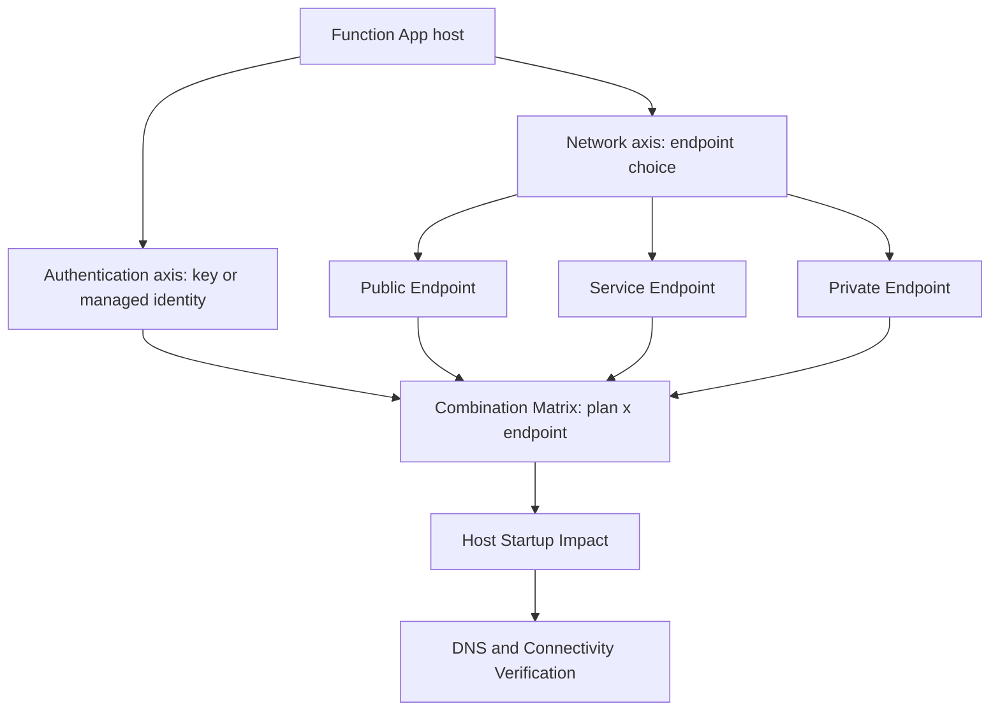

---
content_sources:
  diagrams:
    - id: platform-storage-connectivity-axes
      type: flowchart
      source: mslearn-adapted
      mslearn_url: https://learn.microsoft.com/en-us/azure/storage/common/storage-network-security
      based_on:
        - https://learn.microsoft.com/en-us/azure/storage/common/storage-network-security
        - https://learn.microsoft.com/en-us/azure/azure-functions/manage-connections
  references:
    - type: mslearn-adapted
      url: https://learn.microsoft.com/en-us/azure/storage/common/storage-network-security
    - type: mslearn-adapted
      url: https://learn.microsoft.com/en-us/azure/azure-functions/functions-networking-options
    - type: mslearn-adapted
      url: https://learn.microsoft.com/en-us/azure/azure-functions/storage-considerations
    - type: mslearn-adapted
      url: https://learn.microsoft.com/en-us/azure/storage/common/storage-private-endpoints
    - type: mslearn-adapted
      url: https://learn.microsoft.com/en-us/azure/azure-functions/flex-consumption-plan
    - type: mslearn-adapted
      url: https://learn.microsoft.com/en-us/azure/azure-functions/manage-connections
    - type: mslearn-adapted
      url: https://learn.microsoft.com/en-us/azure/azure-functions/flex-consumption-how-to#configure-deployment-settings
    - type: mslearn-adapted
      url: https://learn.microsoft.com/en-us/azure/azure-functions/functions-infrastructure-as-code#configure-the-deployment-container
    - type: mslearn-adapted
      url: https://learn.microsoft.com/en-us/troubleshoot/azure/azure-storage/blobs/authentication/storage-troubleshoot-403-errors
content_validation:
  status: verified
  last_reviewed: 2026-10-25
  reviewer: agent
  core_claims:
    - claim: "AzureWebJobsStorage supports a connection string or identity-based connection; managed identity is supported for Flex, Dedicated, Consumption, and Elastic Premium host storage."
      source: https://learn.microsoft.com/en-us/azure/azure-functions/manage-connections
      verified: true
    - claim: "Flex deployment storage supports connection-string, system-assigned identity, or user-assigned identity authentication; deployment identities need Storage Blob Data Contributor on the deployment storage account."
      source: https://learn.microsoft.com/en-us/azure/azure-functions/flex-consumption-how-to#configure-deployment-settings
      verified: true
    - claim: "Windows Consumption and Elastic Premium use Azure Files by default, with a connection string; Flex and Dedicated do not have that default content-share dependency."
      source: https://learn.microsoft.com/en-us/azure/azure-functions/storage-considerations#create-an-app-without-azure-files
      verified: true
    - claim: "Identity-based host storage requires Storage Blob Data Owner; diagnostic events require Storage Table Data Contributor, while extensions can require additional roles."
      source: https://learn.microsoft.com/en-us/azure/azure-functions/manage-connections#grant-permissions-to-an-identity
      verified: true
    - claim: "A Storage 403 AuthorizationFailure can result from public network access or firewall restrictions, not only missing RBAC."
      source: https://learn.microsoft.com/en-us/troubleshoot/azure/azure-storage/blobs/authentication/storage-troubleshoot-403-errors
      verified: true
---

# Storage Connectivity

Azure Functions has a deeper storage dependency than a typical web app: the runtime itself relies on storage for host operations. This page is the central reference for **how the Function App reaches storage**, independent of **how it authenticates** to it. It covers every network posture — public endpoint, service endpoint, and private endpoint — and maps them against the different storage **roles** a Function App uses.

Use the scenario pages for step-by-step procedures:

- [Public Only](networking-scenarios/public-only.md)
- [Storage Service Endpoint](networking-scenarios/storage-service-endpoint.md)
- [Private Egress (Private Endpoint)](networking-scenarios/private-egress.md)

The two independent axes of Functions-to-Storage connectivity:

<!-- diagram-id: platform-storage-connectivity-axes -->


## 1. Storage Roles in Azure Functions

Unlike a plain web app, "the storage account" for Functions is really several distinct roles. Each has its own network path and must be verified independently.

| Storage role | Example / setting | What breaks if the network path fails |
|--------------|-------------------|----------------------------------------|
| **Host Storage** | `AzureWebJobsStorage` | Host startup, trigger management, leases, timers, queue state — the **host itself** can go unhealthy, not just one function |
| **Content Share** | `WEBSITE_CONTENTAZUREFILECONNECTIONSTRING`, `WEBSITE_CONTENTSHARE`, `WEBSITE_CONTENTOVERVNET` | App content (the deployed files) becomes unreachable — requires the Storage **file** endpoint and TCP **445** |
| **Trigger / Binding Storage** | Blob/Queue trigger `Connection` prefix (may be a separate account); Durable storage connection | Listener/indexing or function execution fails; host impact depends on whether the extension also uses host storage |
| **Deployment Storage** | Flex: `functionAppConfig.deployment.storage`; other plans: deployment-specific package location, possibly a `WEBSITE_RUN_FROM_PACKAGE` URL | Deployments fail or the package cannot be mounted at runtime |
| **Application Data Storage** | Accounts accessed directly from function code / SDK | Business logic fails; host and triggers may look fine |

!!! danger "Host Storage is not just another dependency"
    If `AzureWebJobsStorage` connectivity is blocked, the Functions host can fail to start or become **Unhealthy** — this is qualitatively different from a single downstream call failing. See the [Storage Access Failure lab](../troubleshooting/lab-guides/storage-access-failure.md).

## 2. Authentication vs Network — Two Independent Axes

Storage access has **two** independent controls. Confusing them is the most common source of misconfiguration.

- **Authentication** — *who* is allowed: shared key (connection string) vs **managed identity + RBAC**.
- **Network** — *from where* access is allowed: public endpoint, service endpoint (subnet rule), or private endpoint.

A request must satisfy **both**. Managed identity with correct RBAC still fails if the network firewall denies the source. A permissive network still fails if the identity lacks the right data-plane role. Always diagnose them separately.

### Host storage authentication (including Flex)

The [storage connection guidance](https://learn.microsoft.com/en-us/azure/azure-functions/storage-considerations#storage-account-connection-setting) permits either a connection string in `AzureWebJobsStorage` or an identity-based connection. Flex does **not** require identity-based host storage, but Microsoft recommends managed identity to avoid secrets. An account-key connection string requires Shared Key access to remain permitted; do not weaken enterprise policy to make that form work.

For Functions v4 identity-based host storage:

| Setting / requirement | Meaning |
|---|---|
| `AzureWebJobsStorage__accountName` | Account name for standard Azure DNS endpoints; this shortcut is specific to host storage, not a generic binding setting. |
| `AzureWebJobsStorage__blobServiceUri`, `__queueServiceUri`, `__tableServiceUri` | Use the full service-specific HTTPS URIs instead of `__accountName` for sovereign clouds or custom storage DNS. Each key has the full `AzureWebJobsStorage` prefix. |
| `AzureWebJobsStorage__credential=managedidentity` | Use an identity enabled/attached on the Azure-hosted app. Without an identity selector, use its system-assigned identity. |
| `AzureWebJobsStorage__clientId` **or** `AzureWebJobsStorage__managedIdentityResourceId` | Select an attached user-assigned identity; use one selector, not both. These are different from Flex deployment's `userAssignedIdentityResourceId`. |
| Extension compatibility | Verify identity support in every extension that uses host storage, including Blob, Event Hubs, Timer, and Durable. Linux Consumption remote builds have an additional restriction (see the plan matrix). |

Treat the connection-string and identity-prefixed forms as alternatives; do not assume that adding `AzureWebJobsStorage__*` migrates an existing nonempty connection string. Inspect the configured form before an approved migration. Local development uses developer credentials, not the Azure-hosted managed identity settings. See [Define connections](https://learn.microsoft.com/en-us/azure/azure-functions/manage-connections#define-connections).

### Deployment and binding authentication are separate

Flex's `properties.functionAppConfig.deployment.storage` selects an existing Blob container (`type: blobContainer`, `value: <container-https-url>`) and an `authentication` object:

| `authentication.type` | Additional configuration |
|---|---|
| `StorageAccountConnectionString` | `storageAccountConnectionStringName` names an existing app setting containing the deployment account connection string (commonly `DEPLOYMENT_STORAGE_CONNECTION_STRING`). It is a setting **name**, not the secret itself. |
| `SystemAssignedIdentity` | Enable the app's system-assigned identity and grant it deployment-account access. |
| `UserAssignedIdentity` | Attach the identity and set `userAssignedIdentityResourceId` to its resource ID; grant that identity deployment-account access. |

Host and deployment storage can share an account but need not share authentication or identity. Changing `AzureWebJobsStorage__*` does not migrate the deployment connection. Configure and verify both, using [Flex deployment settings](https://learn.microsoft.com/en-us/azure/azure-functions/flex-consumption-how-to#configure-deployment-settings) and the existing [Flex deployment diagnostic guidance](../operations/deployment.md#flex-consumption-deployment-specifics). Do not set `WEBSITE_RUN_FROM_PACKAGE` on Flex or look for a Kudu/SCM site.

Trigger/binding connections need their own connection prefix, endpoints, compatible extension version, and permissions. For example, Queue identity connections use `<prefix>__queueServiceUri`, not host-only `__accountName`. Durable's Azure Storage provider uses host storage by default but can select another connection; this adds Blob/Queue/Table permissions rather than inheriting deployment-container permissions.

### Identity permission boundaries

| Consumer | Documented roles and scope |
|---|---|
| Host operations | `Storage Blob Data Owner` on the host storage account. Add `Storage Table Data Contributor` for diagnostic events; this is not a blanket claim that every host needs Queue/Table for basic startup. |
| Flex deployment container | `Storage Blob Data Contributor` scoped to the deployment storage account for the selected deployment identity, per the Flex how-to. This alone does not satisfy host storage permissions. |
| Triggers/bindings | Use the extension-specific roles on its target account/resource. Blob triggers can also require `Storage Queue Data Contributor` and `Storage Account Contributor` on host storage; do not assume host Blob permissions cover every extension. |
| Durable Azure Storage provider | `Storage Blob Data Contributor`, `Storage Queue Data Contributor`, and `Storage Table Data Contributor` on the selected Durable storage account. When shared with host storage, host `Storage Blob Data Owner` covers the Blob requirement. |

Use [Microsoft's connection role table](https://learn.microsoft.com/en-us/azure/azure-functions/manage-connections#grant-permissions-to-an-identity) and the existing [Durable RBAC prerequisites](networking-scenarios/private-egress.md#step-8-configure-storage-authentication-and-content-routing), rather than adding broad Owner permissions. `Storage Account Contributor` is management-plane access, not a substitute for Table data-plane permissions. Role assignment provisioning is not proof of immediate access; allow for RBAC propagation and check the identity actually selected by **each** connection. None of these roles bypasses Storage networking/firewall controls.

## 3. Public Endpoint

The storage account is reachable over its public endpoint. This is the default and requires no VNet integration.

- DNS resolves to a **public IP**.
- `publicNetworkAccess = Enabled`, `defaultAction = Allow`.
- Suitable for dev/test; for production, layer on IP rules or move to service/private endpoints.

See [Public Only](networking-scenarios/public-only.md).

## 4. Service Endpoint

The storage account keeps its **public endpoint**, but only accepts traffic from an authorized **subnet** (`Microsoft.Storage` service endpoint + VNet rule on Selected networks).

- DNS still resolves to a **public IP** (this is expected).
- `publicNetworkAccess = Enabled`, `defaultAction = Deny`, plus a VNet rule for the integration subnet.
- No Private DNS zone; Route All not required.

See [Storage Service Endpoint](networking-scenarios/storage-service-endpoint.md).

## 5. Private Endpoint

A private endpoint places a NIC with a **private IP** into the VNet for the storage account.

- Requires Private DNS zones (`privatelink.blob|queue|table|file.core.windows.net`) so the storage FQDN resolves to the **private IP**.
- For a fully private posture, set `publicNetworkAccess = Disabled`.
- Functions typically need private endpoints for **blob, queue, table, and file** depending on plan and features.

See [Private Egress](networking-scenarios/private-egress.md).

## 6. Hosting Plan Differences

| Plan | Host Storage auth | Content share | Notable settings |
|------|-------------------|---------------|------------------|
| Consumption (Y1), Windows | Connection string or identity for host Blob/Queue/Table | Azure Files by default; removing it requires the documented external-package workflow and can limit scaling | No VNet integration; network-secured host storage is unsupported |
| Consumption (Y1), Linux | Connection string or identity; identity-based host storage requires an external deployment package instead of the host-storage remote-build path | Deployment-specific; do not generalize Windows Azure Files behavior | No VNet integration; URL-based package setting, not `WEBSITE_RUN_FROM_PACKAGE=1` |
| Flex Consumption (FC1) | Connection string or identity (recommended) | No classic content share; separate Blob deployment container and authentication | `AzureWebJobsStorage__*` for host; `functionAppConfig.deployment.storage` for deployment; supports VNet integration |
| Premium (EP), Windows/Linux | Connection string or identity for host Blob/Queue/Table | Azure Files by default; external-package exception can limit scaling | Files connection remains secret-based; use `vnetContentShareEnabled` (legacy `WEBSITE_CONTENTOVERVNET`) for secured content routing |
| Dedicated (ASP) | Connection string or identity | No default Azure Files content-share dependency | Supports VNet integration on eligible tiers; select deployment/package settings independently |

The [deployment mechanism matrix](../operations/deployment.md#package-configuration-by-plan-and-os) owns the full package-setting guidance. Host identity does not remove an existing Azure Files dependency. For Windows Consumption/Elastic Premium, a Key Vault reference can protect the Files connection string but does not turn it into an identity-based Files connection; the documented no-Files exception requires an external Blob package, not merely `WEBSITE_RUN_FROM_PACKAGE=1`.

!!! warning "Enterprise policy: allowSharedKeyAccess=false"
    Do not interpret host managed identity as proof that an app satisfies a no-Shared-Key policy. Audit host, deployment, content, and binding connections separately against the policy's service coverage. Flex or Dedicated avoids the default Files dependency, but a remaining account-key Blob connection still fails when Shared Key is disallowed. Key Vault hides a key; it does not change the authentication method. Do not create a policy exception or enable Shared Key as an incident shortcut.

## 7. Storage Network Settings Combination Matrix

This is the central table. It separates the **storage setting**, the **Function App network config**, what **DNS returns**, the **actual endpoint** used, and the **expected result**.

Successful rows assume valid authentication/authorization for that storage role, correct routing, and a plan supporting the specified VNet path. Classic Consumption cannot use the VNet/private-endpoint rows for host storage; managed identity does not change that limitation.

| Storage setting | Function App config | DNS result | Actual endpoint | Expected result |
|-----------------|---------------------|------------|-----------------|-----------------|
| All networks | No VNet integration | Public IP | Public endpoint | Works |
| All networks | VNet integration | Public IP | Public endpoint | Works — VNet integration alone does **not** make storage private |
| All networks | VNet integration + Route All | Public IP | Public endpoint | Traffic can traverse the VNet, but the storage endpoint is still public |
| Selected networks + IP rule | Allow function outbound IP | Public IP | Public endpoint | Plan/region dependent — outbound IP must be stable and allowlisted. **Consumption (Y1) outbound IPs are shared and can change; Flex Consumption IPs are not stable without a NAT Gateway**, making IP-rule access unreliable |
| Selected networks + Service Endpoint | Integration subnet allowed | Public IP | Public endpoint + service endpoint | Works — subnet identity grants access |
| Private Endpoint + All networks | Private DNS correct | Private IP | Private endpoint | Function uses private path; other clients can still reach the public endpoint |
| Private Endpoint + All networks | Private DNS **missing** | Public IP | Public endpoint | Connection may still succeed publicly, **masking** the DNS misconfiguration |
| Public network access Disabled | Private endpoint + Private DNS | Private IP | Private endpoint | Correct private-only configuration |
| Public network access Disabled | No private endpoint | Public IP | Unreachable | Host startup or trigger failure |

Here, “Works” means the network configuration can permit access, not that a live request was tested or RBAC is automatically satisfied. A subnet rule permits a network source; it grants no data-plane role.

!!! tip "The dangerous row"
    *Private Endpoint + All networks + missing Private DNS* is the silent failure: because the public endpoint is still open, the app keeps working while resolving to a public IP. The private path is not actually in use, and the day you set `publicNetworkAccess = Disabled` it breaks. Always verify DNS returns a private IP.

## 8. Host Startup Impact

Because `AzureWebJobsStorage` participates in host startup, a storage network change that blocks it does not degrade gracefully — the host may fail to initialize. When tightening storage networking:

1. Configure private/service endpoints and DNS **first**.
2. Verify the app still resolves and reaches storage.
3. Only then set `defaultAction = Deny` or `publicNetworkAccess = Disabled`.

Reversing this order is a leading cause of self-inflicted outages. See [Private Egress — Order Matters](networking-scenarios/private-egress.md).

## 9. DNS and Connectivity Verification

### Read-only settings precheck

Run these queries only with authorized configuration-read access. Set `$RG`, `$APP_NAME`, and `$STORAGE_NAME` to the intended app and host account; repeat the storage-account query for a separate deployment/binding account. These commands do not modify Azure resources. App-settings list reads sensitive configuration internally, so the query deliberately prints **names only**, not values; do not use debug logging or publish raw responses.

```bash
# Presence check only: never print connection strings, SAS URLs, or identity identifiers.
az functionapp config appsettings list \
  --resource-group "$RG" \
  --name "$APP_NAME" \
  --query "[?starts_with(name, 'AzureWebJobsStorage') || name=='DEPLOYMENT_STORAGE_CONNECTION_STRING' || name=='WEBSITE_CONTENTAZUREFILECONNECTIONSTRING' || name=='WEBSITE_CONTENTSHARE' || name=='WEBSITE_RUN_FROM_PACKAGE'].name" \
  --output json

APP_RESOURCE_ID=$(az functionapp show \
  --resource-group "$RG" \
  --name "$APP_NAME" \
  --query id \
  --output tsv)

# Flex only: print deployment types and the referenced setting name, not container/identity URLs.
az rest \
  --method get \
  --url "https://management.azure.com${APP_RESOURCE_ID}?api-version=2024-04-01" \
  --query "{storageType:properties.functionAppConfig.deployment.storage.type,authType:properties.functionAppConfig.deployment.storage.authentication.type,connectionSetting:properties.functionAppConfig.deployment.storage.authentication.storageAccountConnectionStringName}" \
  --output json

az storage account show \
  --resource-group "$RG" \
  --name "$STORAGE_NAME" \
  --query "{sharedKeyAllowed:allowSharedKeyAccess,publicNetworkAccess:publicNetworkAccess,firewallDefault:networkRuleSet.defaultAction}" \
  --output json
```

| Command/Parameter | Purpose |
| --- | --- |
| `az functionapp config appsettings list` | Read app settings, projecting only relevant setting names. |
| `az functionapp show` | Obtain the app resource ID into a local variable without printing it. |
| `az rest` | Read the Flex site resource, including `functionAppConfig`. |
| `az storage account show` | Read host/deployment/binding account security properties. |
| `--resource-group` | Resource group containing the requested app or account. |
| `--name` | Function App or storage account name. |
| `--query` | Limit output to names or non-secret configuration fields. |
| `--output` | JSON for inspection, or TSV for the local resource-ID variable. |
| `--method` | HTTP `get`; no write operation. |
| `--url` | ARM site URL with explicit API version; not a storage data-plane request. |

Interpretation (no sample live output is asserted):

- A nonempty `AzureWebJobsStorage` plus `AzureWebJobsStorage__*` is ambiguous intent: inspect privately for the configured connection form, empty values, and resolved Key Vault references. Names alone do not prove the selected connection works.
- An identity-based host connection needs the endpoints/account and an attached identity with host permissions. Check selector values and effective role scopes privately; redact identifiers from shared evidence.
- Flex should report `storageType=blobContainer` and one of the three deployment authentication types above. A connection-string deployment can reference a **custom** setting name: verify that name exists, not only the conventional `DEPLOYMENT_STORAGE_CONNECTION_STRING` name. Identity-based deployment needs its own selected identity/roles even when host authentication differs.
- `sharedKeyAllowed=false` rules out an account-key Blob connection. A null/unset property is not evidence of an explicit deny policy. Public-network/firewall fields are only the baseline: inspect allowed subnet rules, private-endpoint approval, and DNS independently.
- Successful ARM reads prove configuration visibility only, not host startup, package download, or trigger processing. Do not change settings, restart the app, or relax a firewall as part of this precheck.

### Separate DNS, transport, and authorization evidence

Run DNS/transport probes in the app's network context, or on an approved diagnostic host with equivalent DNS and routes. A developer laptop or Cloud Shell result alone does not prove the app's path; Flex has no Kudu console. Probe only the services actually used by each storage role, repeating for separate accounts.

```bash
# Storage FQDNs should resolve to PRIVATE IPs when private endpoints + Private DNS are configured
for SVC in blob queue table file; do
  echo "== $SVC =="
  nslookup "$STORAGE_NAME.$SVC.core.windows.net"
done
```

Interpretation:

- **Private IP (10.x / VNet range)** → private endpoint + Private DNS working.
- **Public IP** → either public/service-endpoint scenario (expected there), or a **missing Private DNS zone** in a private-endpoint scenario (misconfiguration).

For content share (Azure Files) also verify the **file** endpoint resolves and that TCP **445** egress is permitted.

| Failure layer | Specific evidence to collect | Interpretation / next check |
|---|---|---|
| DNS | Timestamp, service FQDN, resolver, CNAME chain and resolved IP; `NXDOMAIN`, lookup timeout, or a public IP where a private endpoint was intended | Check Private DNS zones, VNet links and custom forwarders before changing RBAC. A public IP is normal for service endpoints. |
| Transport | TCP connection result to the resolved address: 443 for Blob/Queue/Table HTTPS, 445 for the Files content share; route/NSG/firewall and TLS-handshake errors | Timeout/refused connection or TLS failure is not proof of missing RBAC. Check egress routing and endpoint reachability. An HTTP response shows transport reached a responder, not necessarily the intended private endpoint. |
| Authentication / authorization | Storage response `x-ms-error-code`, HTTP status, UTC timestamp, request ID, service/operation, authentication type, selected principal and effective role scope (keep identifiers private) | `AuthenticationFailed` suggests invalid credentials/signature; `KeyBasedAuthenticationNotPermitted` identifies a disallowed key path; `AuthorizationPermissionMismatch` points to insufficient operation permissions. Check RBAC scope/propagation for OAuth, or SAS permissions if SAS was used. |
| Storage network denial | `403 AuthorizationFailure`, resolved endpoint, caller network and matching Storage resource-log entry when logging is enabled | A firewall/public-access restriction can also return 403. Correlate network rules and the actual path before labeling every 403 a role-assignment failure. |

Use [Microsoft's Storage 403 diagnostic guide](https://learn.microsoft.com/en-us/troubleshoot/azure/azure-storage/blobs/authentication/storage-troubleshoot-403-errors) for response-code interpretation. A bare 403 is insufficient evidence to distinguish RBAC from firewall denial. Record only sanitized task-relevant facts; never include authorization headers, connection strings, SAS query strings, or real account/identity identifiers in shared artifacts.

### Verification record

| Verification type | Result / boundary |
|---|---|
| Official references, reviewed 2026-10-25 | Host connection forms, plan caveats, identity settings/roles, Flex deployment authentication, and 403 interpretation traced to the Microsoft Learn references below. |
| Static checks | Repository validators and strict documentation build check source/metadata/rendering integrity; they cannot prove Azure data-plane access. See the associated PR for executed commands and results. |
| Live Azure behavior | **Not tested for this correction.** The read-only examples are procedures, not captured results. No deployment, role assignment, settings change, package retrieval, or orchestration run was performed. |

## See Also

- [Networking Scenarios Overview](networking-scenarios/index.md)
- [Public Only](networking-scenarios/public-only.md)
- [Storage Service Endpoint](networking-scenarios/storage-service-endpoint.md)
- [Private Egress](networking-scenarios/private-egress.md)
- [Platform: Networking](networking.md)
- [Hosting Plans](hosting.md)
- [Operations: Deployment](../operations/deployment.md)
- [Troubleshooting: Storage Access Failure](../troubleshooting/lab-guides/storage-access-failure.md)

## Sources

- [Azure Functions storage considerations (Microsoft Learn)](https://learn.microsoft.com/en-us/azure/azure-functions/storage-considerations)
- [Azure Functions networking options (Microsoft Learn)](https://learn.microsoft.com/en-us/azure/azure-functions/functions-networking-options)
- [Configure Azure Storage firewalls and virtual networks (Microsoft Learn)](https://learn.microsoft.com/en-us/azure/storage/common/storage-network-security)
- [Use private endpoints for Azure Storage (Microsoft Learn)](https://learn.microsoft.com/en-us/azure/storage/common/storage-private-endpoints)
- [Azure Functions Flex Consumption plan (Microsoft Learn)](https://learn.microsoft.com/en-us/azure/azure-functions/flex-consumption-plan)
- [Configure connections and grant identity permissions (Microsoft Learn)](https://learn.microsoft.com/en-us/azure/azure-functions/manage-connections)
- [Configure Flex deployment settings (Microsoft Learn)](https://learn.microsoft.com/en-us/azure/azure-functions/flex-consumption-how-to#configure-deployment-settings)
- [Configure the deployment container in IaC (Microsoft Learn)](https://learn.microsoft.com/en-us/azure/azure-functions/functions-infrastructure-as-code#configure-the-deployment-container)
- [Troubleshoot Storage 403 errors (Microsoft Learn)](https://learn.microsoft.com/en-us/troubleshoot/azure/azure-storage/blobs/authentication/storage-troubleshoot-403-errors)
