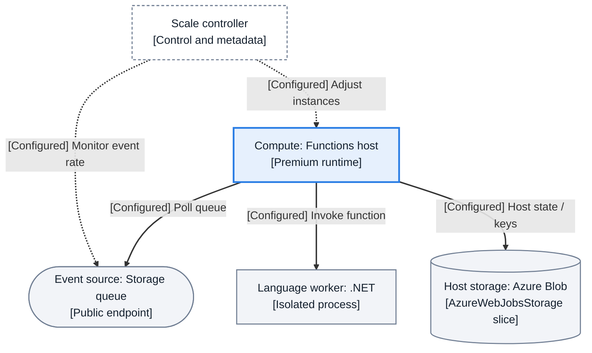
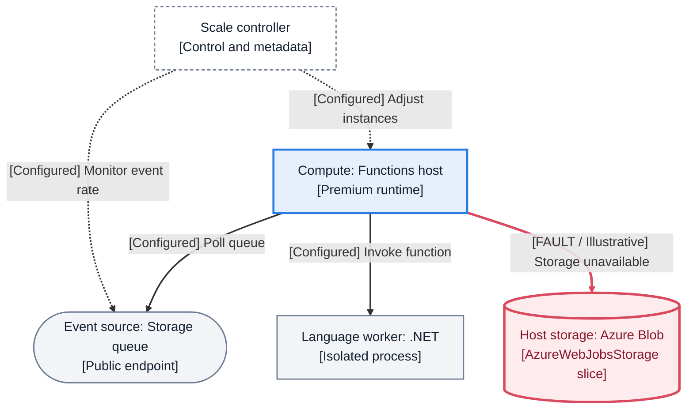
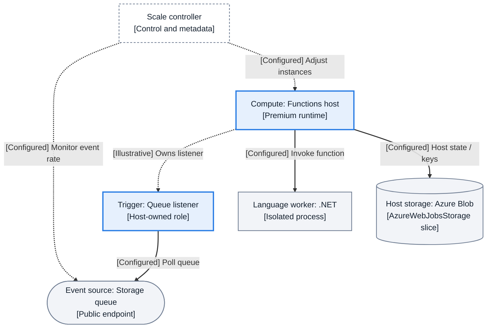
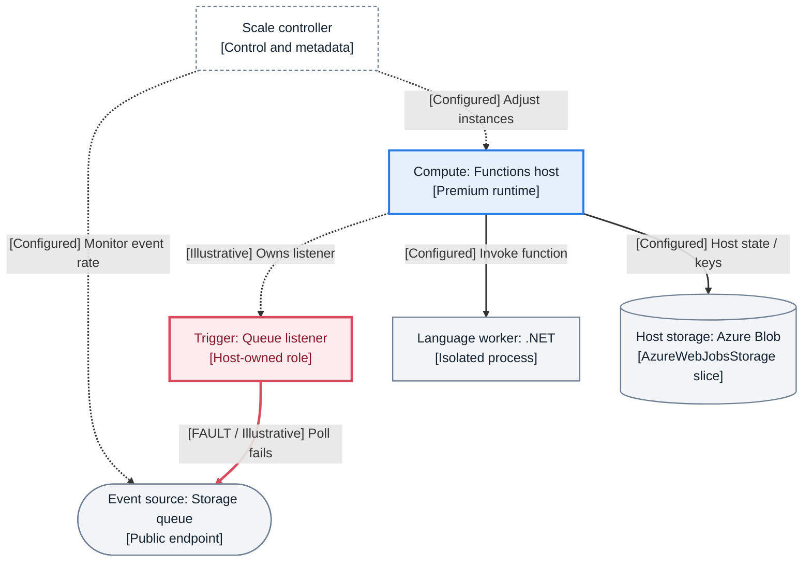
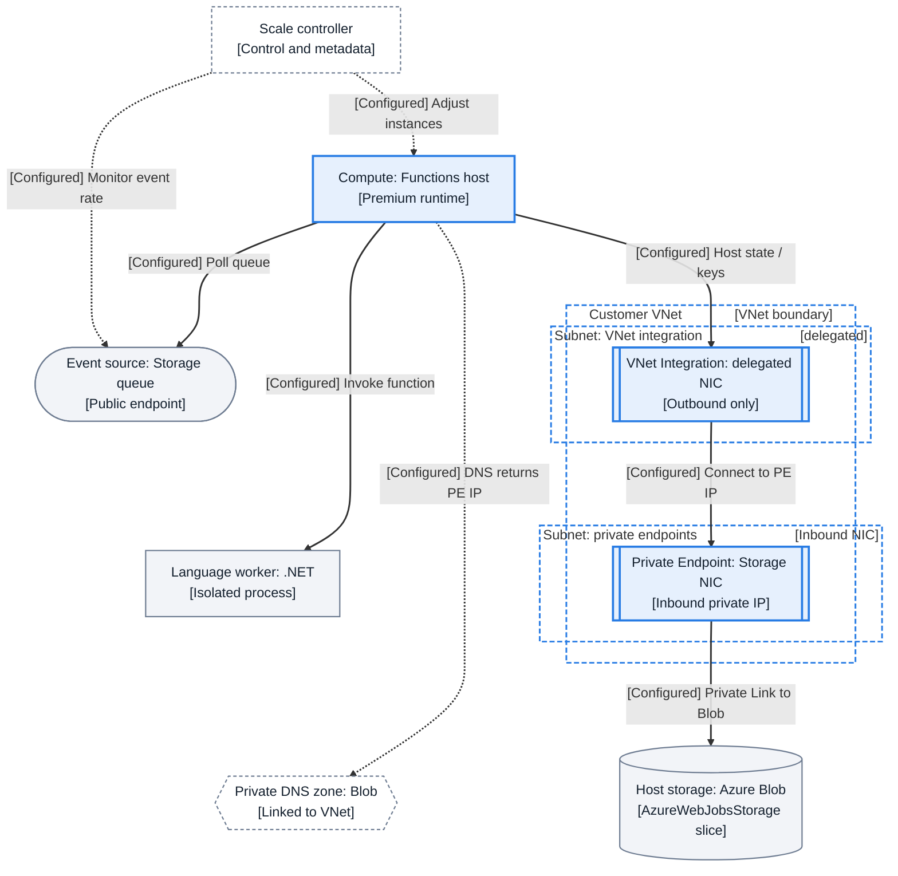
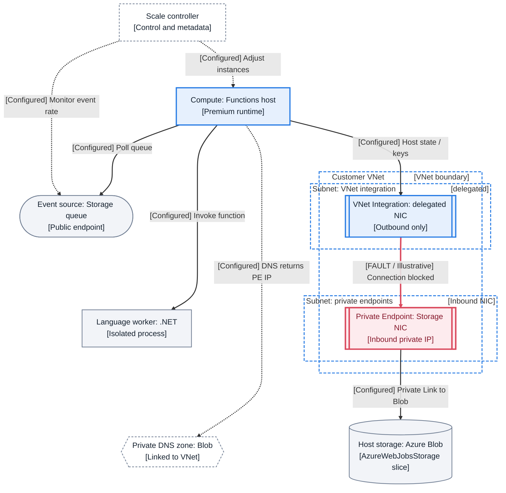
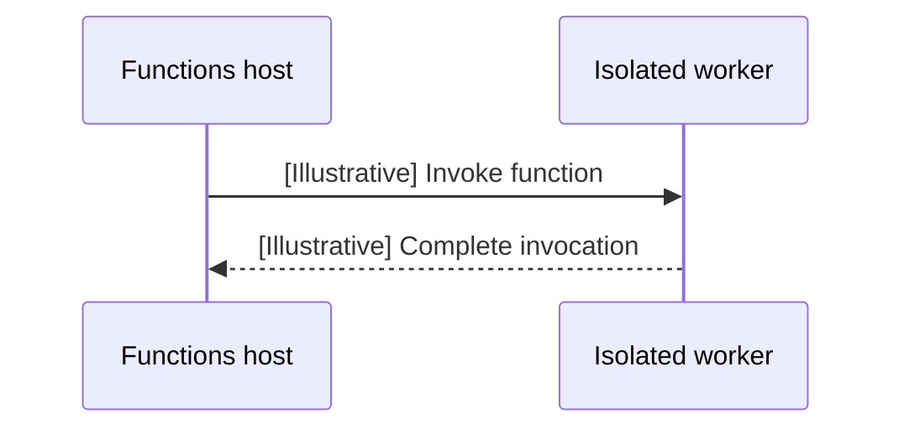

# Functions Topology Templates

Copy these literal Mermaid fences to explain one Functions mechanism at a time.
The [local ADR choice](adr-diagram-composition.md#functions-local-choice-2026-11-04)
uses typed templates, not generated output. These are source-reviewed teaching
fixtures, **not Azure-executed evidence or human-approved visuals**.

## Contract and Functions Bindings

Adopt [Azure topology grammar v1](https://github.com/yeongseon/azure-app-service-practical-guide/blob/3429ca0/docs/reference/diagram-topology-grammar.md)
by reference (upstream **Proposed**, merged in App Service #297). Its component
shapes, claim prefixes, edge legend, palette and boundary semantics are normative
for this template family; this page adds only the Functions bindings below.
The seed is upstream `topology-grammar-v1-adapter-functions`, not the optional
App Service generator. No cross-guide composition decision is implied.

| Reserved ID | Functions binding and source |
|---|---|
| `scale_controller` | Upper control/metadata band: monitors event rate and adjusts host instances ([event-driven scaling](https://learn.microsoft.com/en-us/azure/azure-functions/event-driven-scaling)); not an invocation router. |
| `client` | Event source in this family: a publicly reachable Storage queue, polled by the runtime ([queue trigger](https://learn.microsoft.com/en-us/azure/azure-functions/functions-bindings-storage-queue-trigger#polling-algorithm)). Retains the shared external-source stadium. |
| `app_runtime` | Compute rectangle: Functions host, logically separate from the language worker ([isolated process](https://learn.microsoft.com/en-us/azure/azure-functions/dotnet-isolated-process-guide#benefits-of-the-isolated-worker-model)). |
| `language_worker` | Application execution rectangle: .NET isolated worker in these fixtures; not an extra Azure resource or network hop. |
| `storage_db` | Cylinder: `AzureWebJobsStorage`, showing the Blob path only ([storage considerations](https://learn.microsoft.com/en-us/azure/azure-functions/storage-considerations)). |
| `trigger_listener` | Host-owned queue polling role made explicit by the trigger extension; not an HTTP endpoint. |

**Scope:** Elastic Premium, .NET isolated worker, publicly reachable queue source.
The network extension secures only the host-storage Blob path. It does **not**
secure the queue source. Dedicated uses different scaling, Flex has different
scaling/delegation, and legacy Consumption lacks VNet integration; adapt the
[hosting-specific sources](https://learn.microsoft.com/en-us/azure/azure-functions/functions-networking-options)
before reusing these views for another plan. In-process .NET needs a different
host/worker model. A full secured-storage deployment needs additional endpoints
and DNS zones, potentially Files/Table/Queue, and content-share routing where
applicable ([secured storage](https://learn.microsoft.com/en-us/azure/azure-functions/configure-networking-how-to)).

**Reading key:** solid single-headed edges carry polling/invocation/data; dotted
edges carry scaling/control or DNS queries; thick red `==>` edges also
say `[FAULT / Illustrative]`, so colour is never the only fault cue. Arrows name
the initiator, not the direction of the returned message. Host state and keys
use a solid Storage data-plane path, **not ARM control plane**. Dashed scaling links
are a logical summary, not undocumented Azure-managed transport. No `[Observed]`
claims are used: that prefix requires a named retained lab artifact.

## Base: What Does the Host Coordinate?

### Normal: polling and execution are separate from scaling

<!-- diagram-id: functions-v1-base-normal -->


**Takeaway:** The host polls the queue and invokes the worker; the scale controller
monitors demand rather than forwarding events. Host storage is a distinct runtime
dependency, not the queue invocation itself.

### Failure: host storage is unavailable

<!-- diagram-id: functions-v1-base-failure -->


**Takeaway:** A storage-dependent host failure can precede application execution;
the other arrows describe configured relationships, not proof they still run.
**Illustrative diagnosis:** symptom: host startup or execution fails → collect
host startup errors and Storage response codes → decide whether the account is
missing, access is denied, or connectivity fails. Successful access to the same
Blob endpoint from the app weakens a connectivity hypothesis; it does not prove
all storage services work ([storage troubleshooting](https://learn.microsoft.com/en-us/azure/azure-functions/functions-recover-storage-account)).

## Trigger Extension: Who Initiates Queue Delivery?

### Normal: make the host-owned listener explicit

<!-- diagram-id: functions-v1-trigger-normal -->


**Takeaway:** Replace the base's host-to-queue poll with the listener-to-queue poll,
not an inbound HTTP edge. The ownership arrow is a logical teaching annotation,
not a second transport. Queue polling/backoff and bindings are documented in the
[queue trigger reference](https://learn.microsoft.com/en-us/azure/azure-functions/functions-bindings-storage-queue-trigger).

### Failure: polling cannot reach the source

<!-- diagram-id: functions-v1-trigger-failure -->


**Takeaway:** The fault belongs to the source connection, not HTTP ingress.
**Illustrative diagnosis:** symptom: messages wait without invocations → collect
listener errors, queue connection settings and invocation timestamps → decide
between listener access failure and worker throughput. Successful dequeues with
slow completed invocations falsify the simple “poll cannot connect” hypothesis;
backlog alone does not establish a scaling fault.

## Networking/Storage Extension: Where Is the Private Boundary?

### Shared private-dependency network topology (cross-guide)

**Scope: outbound access to an Azure Storage Blob private endpoint from a hosted application.** This is the same **network-side topology** in App Service, Functions and Container Apps, not an assertion that their managed runtimes occupy the same network location. Apply the following geometry and meaning to matching published diagrams:

| Common position | Network element / mandatory interpretation |
|---|---|
| Runtime (outside or within managed environment as appropriate) | Source of outbound connection, explicitly labeled with its service/hosting plan. **Multitenant App Service** and **Functions in Elastic Premium or multitenant Dedicated plans** remain outside customer VNet containers; **ASE-hosted Dedicated** deployments are already VNet-hosted and do not use this regional integration scene. A **Container Apps environment with a custom VNet** has its *dedicated environment subnet* inside the VNet; its ingress/revisions/replicas are managed/logical workload roles, not customer-deployed VMs or a second outbound integration NIC. |
| Customer VNet / outbound-side subnet | One `Customer VNet` network container. App Service and supported Functions plans attach to a **dedicated, delegated VNet integration subnet** for outbound access; Container Apps instead uses its **dedicated environment subnet**. Never draw the Function App or web app in the integration subnet, or invent a distinct App Service-style outbound integration subnet for Container Apps. |
| Customer VNet / destination-side subnet | A **separate private endpoint subnet** containing only the **private endpoint NIC/private IP for the downstream Blob service** (and other actual subnet resources when sourced). The target Azure Storage resource is **outside** the VNet. Do not mistake this for the service's own *inbound application* private endpoint. |
| Linked DNS (outside VNet container in this drawing convention) | `Private DNS zone: privatelink.blob.core.windows.net [linked to VNet]`. Show a **dotted lookup** from the initiating runtime or its documented resolver path, with the **PE private IP** result in the label. A DNS lookup is not the packet/data transit path. |
| Data path | A **solid, one-way, labeled** flow: runtime → outbound attachment/environment subnet → **Storage PE private IP** → **Private Link to Azure Storage Blob**. Show the outbound subnet as an attachment/boundary rather than an extra user-managed proxy. A failure/evidence overlay marks only the proven or explicitly illustrative failed hop. |

**Reuse rules:** Keep the same nested VNet/PE boundary shape, relative network positions, Azure Storage and PE naming, neutral colors, arrow/legend taxonomy and DNS placement across the three guides. Do not require pixel-identical application/runtime boxes, or convert a decision/sequence diagram into network topology. No CIDR values in subnet titles: **plan/environment-specific size and delegation belong in adjacent sourced prose.**

**Distinct inbound scenario:** A private endpoint for the **App Service/Function App** is an *inbound* NIC, independent of outbound VNet integration and in a different subnet from App Service-style integration. For **Container Apps**, an *environment-level inbound* private endpoint is supported in **workload profiles environments** with **public network access disabled**; it is **not** the downstream Storage PE, nor proof of identical VNet Integration mechanics. Legacy Functions Consumption has no regional VNet integration or inbound PE; Flex Consumption uses different delegation/requirements. Do not generalize the Premium fixture to those plans.

**Grounding:** [App Service networking features](https://learn.microsoft.com/en-us/azure/app-service/networking-features), [App Service private endpoints](https://learn.microsoft.com/en-us/azure/app-service/overview-private-endpoint), [Functions networking and plan requirements](https://learn.microsoft.com/en-us/azure/azure-functions/functions-networking-options), [Container Apps environment networking](https://learn.microsoft.com/en-us/azure/container-apps/networking), and [Container Apps environment private endpoints](https://learn.microsoft.com/en-us/azure/container-apps/how-to-use-private-endpoint).

**Review gate:** For each relevant migrated diagram, check that the actual node containment, arrow initiators, DNS/data separation, inbound-vs-outbound PE identity and plan/environment caveats follow this scene. Verify an actual narrow/desktop, light/dark rendered figure and compare the same network-side layout against a counterpart guide. A written contract alone does not certify that existing diagrams or the site are consistent.

### Normal: outbound integration reaches a Storage inbound NIC

<!-- diagram-id: functions-v1-network-storage-normal -->


**Takeaway:** Only subnet interfaces are contained in the VNet; neither the
Function app nor the Storage service is placed there. `dns_fn` abbreviates
`privatelink.blob.core.windows.net`; the DNS arrow means resolution to the PE's
private IP, not data passing through the zone. Premium integration is delegated
to `Microsoft.Web/serverFarms`. It provides **outbound-only** access, not private
HTTP ingress ([Functions networking](https://learn.microsoft.com/en-us/azure/azure-functions/functions-networking-options),
[DNS zone values](https://learn.microsoft.com/en-us/azure/private-link/private-endpoint-dns)).

### Failure: the private connection is blocked

<!-- diagram-id: functions-v1-network-storage-failure -->


**Takeaway:** Private name resolution is necessary but does not prove a usable
connection. **Illustrative diagnosis:** symptom: host-storage calls time out →
collect the app's resolved address, connection-test result, effective routes,
subnet policies and PE connection state → decide whether transport is blocked
or Storage rejects an established request. A successful connection followed by
an authorization error weakens a transport-block hypothesis; do not rename every
failure “DNS” ([network troubleshooting](https://learn.microsoft.com/en-us/azure/azure-functions/functions-networking-options#troubleshooting)).

## Typed Sequence: In What Order Does Work Run?

<!-- diagram-id: functions-v1-worker-sequence -->


**Takeaway:** A sequence conveys time, unlike a subnet diagram. The isolated
worker runs separately from the Functions host; this abbreviated exchange does
not specify RPC messages, scheduling or response timing ([isolated worker guide](https://learn.microsoft.com/en-us/azure/azure-functions/dotnet-isolated-process-guide)).

## Usage Notes

1. Copy the complete base fence and its source entry. Keep the five reserved base
   IDs in their existing declaration order. Give the new fence a page-local
   `diagram-id` and matching `content_sources.diagrams[]` entry. Fences stay at
   column zero, never in lists or admonitions. There is no generated artifact.
2. Select one question and a named extension. Replace, rather than double, the
   affected edge: trigger replaces polling ownership; networking replaces the
   direct storage edge. Keep shared shapes/IDs; declare added nodes after the
   base. For HTTP views reserve `client` for the caller and `ingress` for HTTP
   entry, then connect ingress to `app_runtime`; do not reuse that spine for a
   polling trigger. Add ARM management as `control_plane`, separately from
   `scale_controller` and data-plane invocation.
3. Copy the corresponding failure variant. Anchor `==>` on the failing edge,
   retain its `[FAULT / Illustrative]` prefix and fault style, and provide symptom
   → evidence → next decision in prose. Recalculate zero-based `linkStyle`
   indices in **edge declaration order** (including invisible links). Never use
   semantic arrows to steer layout; optional layout anchors are `~~~` only.
4. Preserve shared boundary rules by reference: no Function app inside a customer
   VNet/subnet, separate dedicated integration/PE subnets, DNS zone outside VNets,
   no CIDR in titles. NSG/UDR/NAT are subnet tags, not transit nodes. Source each
   plan-specific change from Learn; mark unsourced teaching paths `[Illustrative]`.
5. Run the existing checks below from the repository root. The guard deliberately
   accepts a narrow, one-declaration/edge-per-line subset, not arbitrary Mermaid.
   Extend its negative cases when extending that subset; it does not render or
   prove Azure behavior. The inventory scanner/schema remain shared and unchanged;
   their target fields remain provisional, not a composition API.

```bash
python -m pytest tests/test_functions_topology_templates.py -q --disable-socket --allow-unix-socket
python scripts/validate_mermaid_format.py
python scripts/validate_mermaid_syntax.py
python scripts/validate_content_sources.py
python scripts/normalize_yaml_frontmatter.py --check
python scripts/diagram_inventory.py --write
python scripts/diagram_inventory.py --check
python scripts/test_diagram_inventory.py
mkdocs build --strict
mkdocs serve
```

Open `/reference/functions-topology-templates/` in the preview. Inspect all seven
figures at 1440 and 390 CSS pixels in `default` and `slate`, then click to zoom
and pan. Check titles, captions, arrowheads, fault labels, container-title clearance
and SVG viewBox; record actual observations, not just parse success. Normal/failure
pairs retain IDs and declaration order, **not guaranteed pixel positions**: Dagre
reflows as edges/subgraphs change. **Known limitation:** the network figures are
not legible as full graphs at 390 CSS pixels; narrow-view acceptance remains open.
Use a wider viewport to read them; zoom is not evidence that responsive acceptance
has passed.
Sequence messages use their native return-arrow convention, not topology edge
weights. These are explicit layout/type exceptions, not Azure topology exceptions.
Human visual approval is still required before broad migration.

## See Also

- [Diagram composition ADR](adr-diagram-composition.md)
- [Diagram inventory](diagram-inventory.md)
- [Functions architecture](../platform/architecture/index.md)
- [Documentation content contract](../contributing/content-contract.md)

## Sources

- [Shared topology grammar v1 (Proposed)](https://github.com/yeongseon/azure-app-service-practical-guide/blob/3429ca0/docs/reference/diagram-topology-grammar.md)
- [Event-driven scaling](https://learn.microsoft.com/en-us/azure/azure-functions/event-driven-scaling)
- [Queue storage trigger](https://learn.microsoft.com/en-us/azure/azure-functions/functions-bindings-storage-queue-trigger)
- [Isolated worker process](https://learn.microsoft.com/en-us/azure/azure-functions/dotnet-isolated-process-guide)
- [Storage considerations](https://learn.microsoft.com/en-us/azure/azure-functions/storage-considerations)
- [Recover from storage issues](https://learn.microsoft.com/en-us/azure/azure-functions/functions-recover-storage-account)
- [Functions networking options](https://learn.microsoft.com/en-us/azure/azure-functions/functions-networking-options)
- [Secured host storage](https://learn.microsoft.com/en-us/azure/azure-functions/configure-networking-how-to)
- [Private endpoint DNS zone values](https://learn.microsoft.com/en-us/azure/private-link/private-endpoint-dns)
