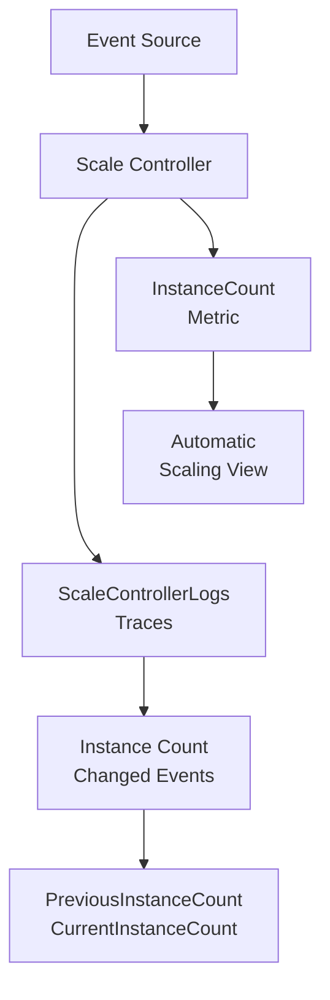

---
content_sources:

  references:
    - type: mslearn-adapted
      url: https://learn.microsoft.com/en-us/azure/azure-functions/monitor-functions-reference
    - type: mslearn-adapted
      url: https://learn.microsoft.com/en-us/azure/azure-functions/analyze-telemetry-data
    - type: mslearn-adapted
      url: https://learn.microsoft.com/en-us/azure/azure-functions/event-driven-scaling
  diagrams:
    - id: scaling-and-instances
      type: flowchart
      source: self-generated
      justification: Reference associations between event-driven scaling and plan-scoped metric or configured log views; not a universal signal-availability matrix or event-delivery pipeline.
      based_on:
        - https://learn.microsoft.com/en-us/azure/azure-functions/monitor-functions-reference
        - https://learn.microsoft.com/en-us/azure/azure-functions/analyze-telemetry-data
        - https://learn.microsoft.com/en-us/azure/azure-functions/event-driven-scaling
        - https://learn.microsoft.com/en-us/azure/azure-functions/configure-monitoring
        - https://learn.microsoft.com/en-us/azure/azure-functions/flex-consumption-plan
        - https://learn.microsoft.com/en-us/azure/azure-functions/functions-premium-plan
        - https://learn.microsoft.com/en-us/azure/azure-functions/dedicated-plan
        - https://learn.microsoft.com/en-us/azure/azure-monitor/autoscale/autoscale-get-started
---
# Scaling and Instances

Event-driven scaling applies to Consumption, Flex Consumption and Premium; Dedicated uses App Service scaling. This reference associates two different signal types: the Flex `InstanceCount` platform metric and configured preview **scale controller logs**. Their presence together is not guaranteed by choosing a hosting plan; correlate only signals actually available for the app.

<!-- diagram-id: scaling-and-instances -->


**Plan key:** The figure retains both reference branches; it is not a shared monitoring pipeline or a promise of per-plan signal parity.

| Plan | Scaling and capacity meaning | Signal scope for this reference |
|---|---|---|
| Consumption | [Event-driven, app-level scaling](https://learn.microsoft.com/en-us/azure/azure-functions/event-driven-scaling); no configurable always-ready capacity | Do not assume Flex `InstanceCount`. For existing Linux Consumption apps, `Microsoft.Web/sites` platform metrics are [unavailable](https://learn.microsoft.com/en-us/azure/azure-functions/monitor-functions-reference#metrics); collected Application Insights telemetry is a separate view. |
| Flex Consumption | [Per-function scaling](https://learn.microsoft.com/en-us/azure/azure-functions/flex-consumption-plan#per-function-scaling), with HTTP, Blob (Event Grid) and Durable trigger groups; optional always-ready capacity per function/group | The monitoring reference documents `InstanceCount` for the app at 30-second emission intervals; it is not a guaranteed per-function, always-ready or instantaneous count. Do not infer preview scale-log support merely from this metric's presence. |
| Premium | [App-level event-driven scaling](https://learn.microsoft.com/en-us/azure/azure-functions/functions-premium-plan), app always-ready capacity and a distinct prewarmed **HTTP-scale buffer** | Do not reuse the Flex metric as a guaranteed Premium count, or equate active telemetry instances with allocated/prewarmed capacity. |
| Dedicated (including ASE) | [Manual scaling](https://learn.microsoft.com/en-us/azure/azure-functions/dedicated-plan#scaling), or configured [Azure Monitor autoscale on Standard or higher](https://learn.microsoft.com/en-us/azure/azure-monitor/autoscale/autoscale-get-started) | Use plan instance configuration and autoscale run history where configured, not the Functions event-driven scale-controller branch. Autoscale acts on the whole plan. |

The log branch uses [preview scale-controller logging](https://learn.microsoft.com/en-us/azure/azure-functions/configure-monitoring#configure-scale-controller-logs) where supported and enabled: Application Insights integration plus `AppInsights:Verbose` provides the documented `ScaleControllerLogs` queries and count-change fields. The cited guidance does not establish an exhaustive Flex/plan compatibility matrix; confirm emitted data rather than promise it. Missing logs can also reflect configuration, collection or sampling, not absent scaling. `cloud_RoleInstance` in collected invocation telemetry identifies reporting instances, not all allocated or idle capacity.

## InstanceCount Metric

| Property | Value |
|----------|-------|
| REST name | `InstanceCount` |
| Display name | Automatic Scaling Instance Count |
| Unit | Count |
| Aggregation | Average |
| Emission interval | Every 30 seconds |
| Scope | Flex Consumption |

Because the metric is emitted every 30 seconds and scaling can be rapid, choose aggregation deliberately:

- **Minimum** over a short grain reveals scale-to-zero (idle) periods.
- **Maximum** reveals peak fan-out during bursts.
- **Average** is useful only for long-horizon capacity trends.

## Scale Controller Logs

The scale controller makes the scale-out and scale-in decisions. Its reasoning can be captured in Application Insights (a **preview** capability) by enabling scale controller logging and Application Insights integration. Once enabled, entries land in the `traces` table under the `ScaleControllerLogs` category.

### Enabling Scale Controller Logging

Set the `SCALE_CONTROLLER_LOGGING_ENABLED` application setting to route scale controller logs to Application Insights. The value controls verbosity (`AppInsights:Verbose` for full detail). The function app must already have Application Insights integration configured.

### Querying All Scale Controller Activity

```kusto
traces
| extend CustomDimensions = todynamic(tostring(customDimensions))
| where CustomDimensions.Category == "ScaleControllerLogs"
| project timestamp, message, logLevel = CustomDimensions.LogLevel
| order by timestamp desc
```

!!! tip "How to read this"
    Each row is a scale controller decision or observation. A high volume of these logs during a load event confirms the scale controller is actively evaluating your app; their absence during load can indicate that scaling is constrained (for example by a plan instance limit).

### Detecting Instance Count Changes

```kusto
traces
| extend CustomDimensions = todynamic(tostring(customDimensions))
| where CustomDimensions.Category == "ScaleControllerLogs"
| where message == "Instance count changed"
| extend previous = CustomDimensions.PreviousInstanceCount, current = CustomDimensions.CurrentInstanceCount
| project timestamp, previous, current
| order by timestamp asc
```

Pair this query with the `InstanceCount` metric chart: the metric shows *how many* instances existed, while the logs show *when and why* the count changed.

## Event-Driven Scaling Context

On Consumption and Flex Consumption plans, the scale controller monitors the event source (queue depth, event hub lag, HTTP demand) and adds instances accordingly. Key behaviors to keep in mind when interpreting the metrics:

- New instances are added at a bounded rate; the metric will ramp rather than jump instantly to peak.
- Scale-in is gradual and lags the drop in load, so `InstanceCount` stays elevated briefly after a burst ends.
- The maximum reachable value is capped by the plan's scale-out limit — see [Platform Limits](../platform-limits.md).

## See Also

- [Metrics Reference](index.md)
- [Flex Consumption Metrics](flex-consumption-metrics.md)
- [Application Insights Telemetry](application-insights-telemetry.md)
- [Platform Limits](../platform-limits.md)

## Sources

- [Monitoring Azure Functions data reference (Microsoft Learn)](https://learn.microsoft.com/en-us/azure/azure-functions/monitor-functions-reference)
- [Analyze Azure Functions telemetry data (Microsoft Learn)](https://learn.microsoft.com/en-us/azure/azure-functions/analyze-telemetry-data)
- [Event-driven scaling in Azure Functions (Microsoft Learn)](https://learn.microsoft.com/en-us/azure/azure-functions/event-driven-scaling)
- [Configure scale controller logs (Microsoft Learn)](https://learn.microsoft.com/en-us/azure/azure-functions/configure-monitoring#configure-scale-controller-logs)
- [Flex Consumption scaling and always-ready instances (Microsoft Learn)](https://learn.microsoft.com/en-us/azure/azure-functions/flex-consumption-plan)
- [Premium always-ready and prewarmed capacity (Microsoft Learn)](https://learn.microsoft.com/en-us/azure/azure-functions/functions-premium-plan)
- [Dedicated scaling (Microsoft Learn)](https://learn.microsoft.com/en-us/azure/azure-functions/dedicated-plan)
- [App Service plan autoscale and history (Microsoft Learn)](https://learn.microsoft.com/en-us/azure/azure-monitor/autoscale/autoscale-get-started)
