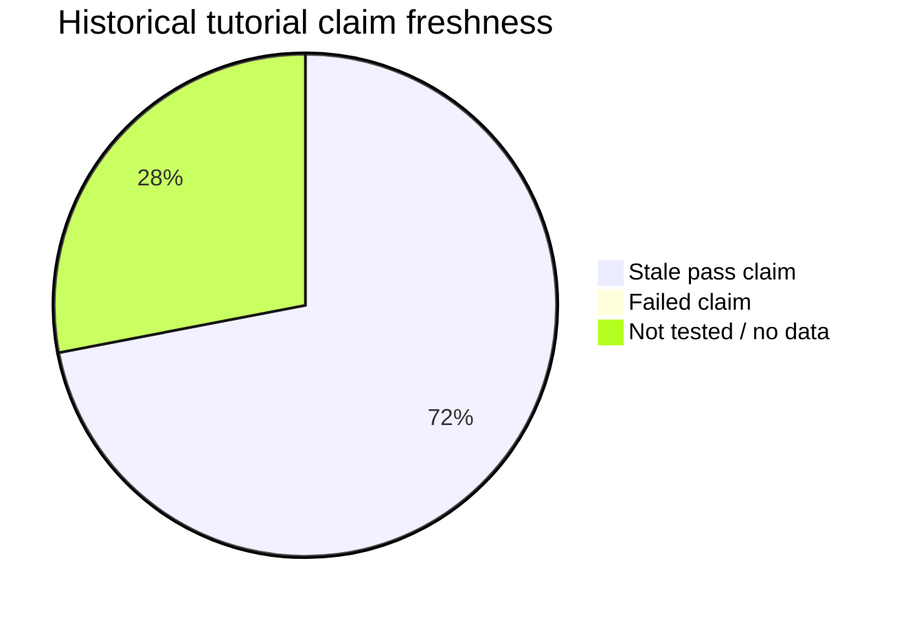

---
content_sources:
  references:
    - type: mslearn-adapted
      url: https://learn.microsoft.com/en-us/azure/azure-functions/functions-overview
  diagrams:
    - id: tutorial-validation-status-pie
      type: pie
      source: self-generated
      justification: Generated historical claim freshness, not proof of Azure execution.
      based_on:
        - https://learn.microsoft.com/en-us/azure/azure-functions/functions-overview
---

# Tutorial Validation Status

This is an **offline audit of reported tutorial results**, not a current Azure-verified pass count. Historical `pass`/`fail` claims and attempt dates are preserved; absent run-owned evidence stays **unverified**.

## Scope

Leaf runbooks under `docs/language-guides/*/tutorial/<hosting-plan>/*.md` are included; `index.md` chooser pages are excluded. Labs use the [existing lab evidence audit](validation-evidence-audit.md), not tutorial validation or factual-claim `content_validation` counts.

## Summary

The June snapshot counted 120 tutorials; this inventory counts 158. At the 2026-10-25 inventory (158 tutorials) the 38 additional pages (30 PowerShell and 8 testing/container pages) already existed but were absent from the June snapshot; they were not newly executed tutorials. A different count at another date reflects the pages inventoried, not new executions.

*Generated / freshness as of: 2026-10-30*

This is a dated snapshot, not a rolling live badge. Regenerate to assess a later date. Fresh means age ≤90 days; stale means age >90 days, including failed attempts. Freshness never upgrades evidence trust. Invalid metadata takes precedence, then failures, in tutorial totals; per-method counts below include the failed attempt's age.

| Historical tutorial claim | Count |
|---|---:|
| Total tutorials | 158 |
| Fresh pass claim | 0 |
| Stale pass claim | 113 |
| Failed claim | 1 |
| Not tested / no data | 44 |
| Invalid metadata | 0 |

| Method freshness / evidence | Count |
|---|---:|
| fresh | 0 |
| stale | 115 |
| NOT_RUN | 186 |
| static-only | 15 |
| unknown | 0 |
| invalid | 0 |
| Methods with unverified evidence trust | 316 |
| Methods carrying a run or evidence locator (pointers, not attestations) | 0 |

<!-- diagram-id: tutorial-validation-status-pie -->


## What Each Term Means

| Field | Meaning / limits |
|---|---|
| Source review | [Content Validation Status](content-validation-status.md) tracks Learn-source review for its own factual-page scope, not tutorial execution. |
| Code/static check | Legacy `syntax_validated` means static-only, not a live Azure pass; its historical date is retained but never counted as Azure freshness. Offline pytest, lint and builds check code/docs only; see PR/CI results. |
| Live Azure run | `pass`/`fail` and `last_tested` below are historical author-entered claims; `not_tested` with no date means NOT_RUN. Missing history is unknown, not proof no run happened. |
| Evidence trust | `unverified` until run identity, executed revision, method, captured environment and retained sanitized artifacts/digests are checked. A resolving reference is not an attestation. |
| Reproduction status | Not independently reproduced by this audit; source review and offline replay are not new live runs. |
| Recovery | Not established by a tutorial pass; needs a post-mitigation probe/window where relevant. |
| Cleanup | Not established by deployment success or a cleanup command example; needs its own retained outcome or explicit non-applicability. |

Vocabulary and provenance requirements follow the [evidence and hypothesis contract](../troubleshooting/methodology/troubleshooting-method.md#evidence-and-hypothesis-contract). No method record currently carries a run or evidence locator in its metadata, so no tutorial binds a run, environment or artifact set. Inline output excerpts and tool versions may be useful reported history, but cannot by themselves bind an end-to-end run. Method records without a locator remain audit gaps, not evidence that the historical runs were fabricated.

## Per-Method Validation and Evidence Audit

Tool versions are reported metadata, not a complete environment capture. Each row keeps its own date; a later Bicep run cannot refresh CLI freshness (or vice versa). Recovery, cleanup and independent reproduction are **not established** for all tutorial rows in this audit.

### dotnet

| Tutorial / plan | Method | Reported result | Last tested / attempted | Freshness | Reported tools | Evidence trust | Run / environment / retained artifacts |
|---|---|---|---|---|---|---|---|
| [01 Local Run](../language-guides/dotnet/tutorial/consumption/01-local-run.md) / Consumption (Y1) | az_cli | pass | 2026-04-10 | stale | cli_version=2.83.0; core_tools_version=4.8.0 | unverified | No run/environment/artifact binding retained in metadata |
| [01 Local Run](../language-guides/dotnet/tutorial/consumption/01-local-run.md) / Consumption (Y1) | bicep | not_tested | — | NOT_RUN | unknown | unverified | No run/environment/artifact binding retained in metadata |
| [02 First Deploy](../language-guides/dotnet/tutorial/consumption/02-first-deploy.md) / Consumption (Y1) | az_cli | pass | 2026-04-12 | stale | cli_version=2.70.0; core_tools_version=4.6.0 | unverified | No run/environment/artifact binding retained in metadata |
| [02 First Deploy](../language-guides/dotnet/tutorial/consumption/02-first-deploy.md) / Consumption (Y1) | bicep | not_tested | — | NOT_RUN | unknown | unverified | No run/environment/artifact binding retained in metadata |
| [03 Configuration](../language-guides/dotnet/tutorial/consumption/03-configuration.md) / Consumption (Y1) | az_cli | pass | 2026-04-10 | stale | cli_version=2.83.0; core_tools_version=4.8.0 | unverified | No run/environment/artifact binding retained in metadata |
| [03 Configuration](../language-guides/dotnet/tutorial/consumption/03-configuration.md) / Consumption (Y1) | bicep | not_tested | — | NOT_RUN | unknown | unverified | No run/environment/artifact binding retained in metadata |
| [04 Logging Monitoring](../language-guides/dotnet/tutorial/consumption/04-logging-monitoring.md) / Consumption (Y1) | az_cli | pass | 2026-04-10 | stale | cli_version=2.83.0; core_tools_version=4.8.0 | unverified | No run/environment/artifact binding retained in metadata |
| [04 Logging Monitoring](../language-guides/dotnet/tutorial/consumption/04-logging-monitoring.md) / Consumption (Y1) | bicep | not_tested | — | NOT_RUN | unknown | unverified | No run/environment/artifact binding retained in metadata |
| [05 Infrastructure As Code](../language-guides/dotnet/tutorial/consumption/05-infrastructure-as-code.md) / Consumption (Y1) | az_cli | pass | 2026-04-10 | stale | cli_version=2.83.0; core_tools_version=4.8.0 | unverified | No run/environment/artifact binding retained in metadata |
| [05 Infrastructure As Code](../language-guides/dotnet/tutorial/consumption/05-infrastructure-as-code.md) / Consumption (Y1) | bicep | syntax_validated | 2026-06-06 | static-only | unknown | unverified | No run/environment/artifact binding retained in metadata |
| [06 Ci Cd](../language-guides/dotnet/tutorial/consumption/06-ci-cd.md) / Consumption (Y1) | az_cli | pass | 2026-04-10 | stale | cli_version=2.83.0; core_tools_version=4.8.0 | unverified | No run/environment/artifact binding retained in metadata |
| [06 Ci Cd](../language-guides/dotnet/tutorial/consumption/06-ci-cd.md) / Consumption (Y1) | bicep | not_tested | — | NOT_RUN | unknown | unverified | No run/environment/artifact binding retained in metadata |
| [07 Extending Triggers](../language-guides/dotnet/tutorial/consumption/07-extending-triggers.md) / Consumption (Y1) | az_cli | pass | 2026-04-10 | stale | cli_version=2.83.0; core_tools_version=4.8.0 | unverified | No run/environment/artifact binding retained in metadata |
| [07 Extending Triggers](../language-guides/dotnet/tutorial/consumption/07-extending-triggers.md) / Consumption (Y1) | bicep | not_tested | — | NOT_RUN | unknown | unverified | No run/environment/artifact binding retained in metadata |
| [01 Local Run](../language-guides/dotnet/tutorial/dedicated/01-local-run.md) / Dedicated (App Service) | az_cli | pass | 2026-04-10 | stale | cli_version=2.83.0; core_tools_version=4.8.0 | unverified | No run/environment/artifact binding retained in metadata |
| [01 Local Run](../language-guides/dotnet/tutorial/dedicated/01-local-run.md) / Dedicated (App Service) | bicep | not_tested | — | NOT_RUN | unknown | unverified | No run/environment/artifact binding retained in metadata |
| [02 First Deploy](../language-guides/dotnet/tutorial/dedicated/02-first-deploy.md) / Dedicated (App Service) | az_cli | pass | 2026-04-12 | stale | cli_version=2.70.0; core_tools_version=4.6.0 | unverified | No run/environment/artifact binding retained in metadata |
| [02 First Deploy](../language-guides/dotnet/tutorial/dedicated/02-first-deploy.md) / Dedicated (App Service) | bicep | not_tested | — | NOT_RUN | unknown | unverified | No run/environment/artifact binding retained in metadata |
| [03 Configuration](../language-guides/dotnet/tutorial/dedicated/03-configuration.md) / Dedicated (App Service) | az_cli | pass | 2026-04-10 | stale | cli_version=2.83.0; core_tools_version=4.8.0 | unverified | No run/environment/artifact binding retained in metadata |
| [03 Configuration](../language-guides/dotnet/tutorial/dedicated/03-configuration.md) / Dedicated (App Service) | bicep | not_tested | — | NOT_RUN | unknown | unverified | No run/environment/artifact binding retained in metadata |
| [04 Logging Monitoring](../language-guides/dotnet/tutorial/dedicated/04-logging-monitoring.md) / Dedicated (App Service) | az_cli | pass | 2026-04-10 | stale | cli_version=2.83.0; core_tools_version=4.8.0 | unverified | No run/environment/artifact binding retained in metadata |
| [04 Logging Monitoring](../language-guides/dotnet/tutorial/dedicated/04-logging-monitoring.md) / Dedicated (App Service) | bicep | not_tested | — | NOT_RUN | unknown | unverified | No run/environment/artifact binding retained in metadata |
| [05 Infrastructure As Code](../language-guides/dotnet/tutorial/dedicated/05-infrastructure-as-code.md) / Dedicated (App Service) | az_cli | pass | 2026-04-10 | stale | cli_version=2.83.0; core_tools_version=4.8.0 | unverified | No run/environment/artifact binding retained in metadata |
| [05 Infrastructure As Code](../language-guides/dotnet/tutorial/dedicated/05-infrastructure-as-code.md) / Dedicated (App Service) | bicep | syntax_validated | 2026-06-06 | static-only | unknown | unverified | No run/environment/artifact binding retained in metadata |
| [06 Ci Cd](../language-guides/dotnet/tutorial/dedicated/06-ci-cd.md) / Dedicated (App Service) | az_cli | pass | 2026-04-10 | stale | cli_version=2.83.0; core_tools_version=4.8.0 | unverified | No run/environment/artifact binding retained in metadata |
| [06 Ci Cd](../language-guides/dotnet/tutorial/dedicated/06-ci-cd.md) / Dedicated (App Service) | bicep | not_tested | — | NOT_RUN | unknown | unverified | No run/environment/artifact binding retained in metadata |
| [07 Extending Triggers](../language-guides/dotnet/tutorial/dedicated/07-extending-triggers.md) / Dedicated (App Service) | az_cli | pass | 2026-04-10 | stale | cli_version=2.83.0; core_tools_version=4.8.0 | unverified | No run/environment/artifact binding retained in metadata |
| [07 Extending Triggers](../language-guides/dotnet/tutorial/dedicated/07-extending-triggers.md) / Dedicated (App Service) | bicep | not_tested | — | NOT_RUN | unknown | unverified | No run/environment/artifact binding retained in metadata |
| [01 Local Run](../language-guides/dotnet/tutorial/flex-consumption/01-local-run.md) / Flex Consumption (FC1) | az_cli | pass | 2026-04-10 | stale | cli_version=2.83.0; core_tools_version=4.8.0 | unverified | No run/environment/artifact binding retained in metadata |
| [01 Local Run](../language-guides/dotnet/tutorial/flex-consumption/01-local-run.md) / Flex Consumption (FC1) | bicep | not_tested | — | NOT_RUN | unknown | unverified | No run/environment/artifact binding retained in metadata |
| [02 First Deploy](../language-guides/dotnet/tutorial/flex-consumption/02-first-deploy.md) / Flex Consumption (FC1) | az_cli | pass | 2026-04-11 | stale | cli_version=2.70.0; core_tools_version=4.6.0 | unverified | No run/environment/artifact binding retained in metadata |
| [02 First Deploy](../language-guides/dotnet/tutorial/flex-consumption/02-first-deploy.md) / Flex Consumption (FC1) | bicep | not_tested | — | NOT_RUN | unknown | unverified | No run/environment/artifact binding retained in metadata |
| [02A First Deploy Private Egress](../language-guides/dotnet/tutorial/flex-consumption/02a-first-deploy-private-egress.md) / Flex Consumption (FC1) | az_cli | not_tested | — | NOT_RUN | cli_version=2.83.0; core_tools_version=4.8.0 | unverified | No run/environment/artifact binding retained in metadata |
| [02A First Deploy Private Egress](../language-guides/dotnet/tutorial/flex-consumption/02a-first-deploy-private-egress.md) / Flex Consumption (FC1) | bicep | not_tested | — | NOT_RUN | unknown | unverified | No run/environment/artifact binding retained in metadata |
| [03 Configuration](../language-guides/dotnet/tutorial/flex-consumption/03-configuration.md) / Flex Consumption (FC1) | az_cli | pass | 2026-04-10 | stale | cli_version=2.83.0; core_tools_version=4.8.0 | unverified | No run/environment/artifact binding retained in metadata |
| [03 Configuration](../language-guides/dotnet/tutorial/flex-consumption/03-configuration.md) / Flex Consumption (FC1) | bicep | not_tested | — | NOT_RUN | unknown | unverified | No run/environment/artifact binding retained in metadata |
| [04 Logging Monitoring](../language-guides/dotnet/tutorial/flex-consumption/04-logging-monitoring.md) / Flex Consumption (FC1) | az_cli | pass | 2026-04-10 | stale | cli_version=2.83.0; core_tools_version=4.8.0 | unverified | No run/environment/artifact binding retained in metadata |
| [04 Logging Monitoring](../language-guides/dotnet/tutorial/flex-consumption/04-logging-monitoring.md) / Flex Consumption (FC1) | bicep | not_tested | — | NOT_RUN | unknown | unverified | No run/environment/artifact binding retained in metadata |
| [05 Infrastructure As Code](../language-guides/dotnet/tutorial/flex-consumption/05-infrastructure-as-code.md) / Flex Consumption (FC1) | az_cli | pass | 2026-04-10 | stale | cli_version=2.83.0; core_tools_version=4.8.0 | unverified | No run/environment/artifact binding retained in metadata |
| [05 Infrastructure As Code](../language-guides/dotnet/tutorial/flex-consumption/05-infrastructure-as-code.md) / Flex Consumption (FC1) | bicep | syntax_validated | 2026-06-06 | static-only | unknown | unverified | No run/environment/artifact binding retained in metadata |
| [06 Ci Cd](../language-guides/dotnet/tutorial/flex-consumption/06-ci-cd.md) / Flex Consumption (FC1) | az_cli | pass | 2026-04-10 | stale | cli_version=2.83.0; core_tools_version=4.8.0 | unverified | No run/environment/artifact binding retained in metadata |
| [06 Ci Cd](../language-guides/dotnet/tutorial/flex-consumption/06-ci-cd.md) / Flex Consumption (FC1) | bicep | not_tested | — | NOT_RUN | unknown | unverified | No run/environment/artifact binding retained in metadata |
| [07 Extending Triggers](../language-guides/dotnet/tutorial/flex-consumption/07-extending-triggers.md) / Flex Consumption (FC1) | az_cli | pass | 2026-04-10 | stale | cli_version=2.83.0; core_tools_version=4.8.0 | unverified | No run/environment/artifact binding retained in metadata |
| [07 Extending Triggers](../language-guides/dotnet/tutorial/flex-consumption/07-extending-triggers.md) / Flex Consumption (FC1) | bicep | not_tested | — | NOT_RUN | unknown | unverified | No run/environment/artifact binding retained in metadata |
| [08 Testing And Debugging](../language-guides/dotnet/tutorial/flex-consumption/08-testing-and-debugging.md) / Flex Consumption (FC1) | az_cli | not_tested | — | NOT_RUN | unknown | unverified | No run/environment/artifact binding retained in metadata |
| [08 Testing And Debugging](../language-guides/dotnet/tutorial/flex-consumption/08-testing-and-debugging.md) / Flex Consumption (FC1) | bicep | not_tested | — | NOT_RUN | unknown | unverified | No run/environment/artifact binding retained in metadata |
| [01 Local Run](../language-guides/dotnet/tutorial/premium/01-local-run.md) / Premium (EP) | az_cli | pass | 2026-04-10 | stale | cli_version=2.83.0; core_tools_version=4.8.0 | unverified | No run/environment/artifact binding retained in metadata |
| [01 Local Run](../language-guides/dotnet/tutorial/premium/01-local-run.md) / Premium (EP) | bicep | not_tested | — | NOT_RUN | unknown | unverified | No run/environment/artifact binding retained in metadata |
| [02 First Deploy](../language-guides/dotnet/tutorial/premium/02-first-deploy.md) / Premium (EP) | az_cli | pass | 2026-04-11 | stale | cli_version=2.70.0; core_tools_version=4.6.0 | unverified | No run/environment/artifact binding retained in metadata |
| [02 First Deploy](../language-guides/dotnet/tutorial/premium/02-first-deploy.md) / Premium (EP) | bicep | not_tested | — | NOT_RUN | unknown | unverified | No run/environment/artifact binding retained in metadata |
| [02A First Deploy Private Egress](../language-guides/dotnet/tutorial/premium/02a-first-deploy-private-egress.md) / Premium (EP) | az_cli | not_tested | — | NOT_RUN | cli_version=2.83.0; core_tools_version=4.8.0 | unverified | No run/environment/artifact binding retained in metadata |
| [02A First Deploy Private Egress](../language-guides/dotnet/tutorial/premium/02a-first-deploy-private-egress.md) / Premium (EP) | bicep | not_tested | — | NOT_RUN | unknown | unverified | No run/environment/artifact binding retained in metadata |
| [03 Configuration](../language-guides/dotnet/tutorial/premium/03-configuration.md) / Premium (EP) | az_cli | pass | 2026-04-10 | stale | cli_version=2.83.0; core_tools_version=4.8.0 | unverified | No run/environment/artifact binding retained in metadata |
| [03 Configuration](../language-guides/dotnet/tutorial/premium/03-configuration.md) / Premium (EP) | bicep | not_tested | — | NOT_RUN | unknown | unverified | No run/environment/artifact binding retained in metadata |
| [04 Logging Monitoring](../language-guides/dotnet/tutorial/premium/04-logging-monitoring.md) / Premium (EP) | az_cli | pass | 2026-04-10 | stale | cli_version=2.83.0; core_tools_version=4.8.0 | unverified | No run/environment/artifact binding retained in metadata |
| [04 Logging Monitoring](../language-guides/dotnet/tutorial/premium/04-logging-monitoring.md) / Premium (EP) | bicep | not_tested | — | NOT_RUN | unknown | unverified | No run/environment/artifact binding retained in metadata |
| [05 Infrastructure As Code](../language-guides/dotnet/tutorial/premium/05-infrastructure-as-code.md) / Premium (EP) | az_cli | pass | 2026-04-10 | stale | cli_version=2.83.0; core_tools_version=4.8.0 | unverified | No run/environment/artifact binding retained in metadata |
| [05 Infrastructure As Code](../language-guides/dotnet/tutorial/premium/05-infrastructure-as-code.md) / Premium (EP) | bicep | syntax_validated | 2026-06-06 | static-only | unknown | unverified | No run/environment/artifact binding retained in metadata |
| [06 Ci Cd](../language-guides/dotnet/tutorial/premium/06-ci-cd.md) / Premium (EP) | az_cli | pass | 2026-04-10 | stale | cli_version=2.83.0; core_tools_version=4.8.0 | unverified | No run/environment/artifact binding retained in metadata |
| [06 Ci Cd](../language-guides/dotnet/tutorial/premium/06-ci-cd.md) / Premium (EP) | bicep | not_tested | — | NOT_RUN | unknown | unverified | No run/environment/artifact binding retained in metadata |
| [07 Extending Triggers](../language-guides/dotnet/tutorial/premium/07-extending-triggers.md) / Premium (EP) | az_cli | pass | 2026-04-10 | stale | cli_version=2.83.0; core_tools_version=4.8.0 | unverified | No run/environment/artifact binding retained in metadata |
| [07 Extending Triggers](../language-guides/dotnet/tutorial/premium/07-extending-triggers.md) / Premium (EP) | bicep | not_tested | — | NOT_RUN | unknown | unverified | No run/environment/artifact binding retained in metadata |
| [09 Container Deployment](../language-guides/dotnet/tutorial/premium/09-container-deployment.md) / Premium (EP) | az_cli | not_tested | — | NOT_RUN | unknown | unverified | No run/environment/artifact binding retained in metadata |
| [09 Container Deployment](../language-guides/dotnet/tutorial/premium/09-container-deployment.md) / Premium (EP) | bicep | not_tested | — | NOT_RUN | unknown | unverified | No run/environment/artifact binding retained in metadata |

### java

| Tutorial / plan | Method | Reported result | Last tested / attempted | Freshness | Reported tools | Evidence trust | Run / environment / retained artifacts |
|---|---|---|---|---|---|---|---|
| [01 Local Run](../language-guides/java/tutorial/consumption/01-local-run.md) / Consumption (Y1) | az_cli | pass | 2026-04-10 | stale | cli_version=2.83.0; core_tools_version=4.8.0 | unverified | No run/environment/artifact binding retained in metadata |
| [01 Local Run](../language-guides/java/tutorial/consumption/01-local-run.md) / Consumption (Y1) | bicep | not_tested | — | NOT_RUN | unknown | unverified | No run/environment/artifact binding retained in metadata |
| [02 First Deploy](../language-guides/java/tutorial/consumption/02-first-deploy.md) / Consumption (Y1) | az_cli | pass | 2026-04-12 | stale | cli_version=2.70.0; core_tools_version=4.6.0 | unverified | No run/environment/artifact binding retained in metadata |
| [02 First Deploy](../language-guides/java/tutorial/consumption/02-first-deploy.md) / Consumption (Y1) | bicep | not_tested | — | NOT_RUN | unknown | unverified | No run/environment/artifact binding retained in metadata |
| [03 Configuration](../language-guides/java/tutorial/consumption/03-configuration.md) / Consumption (Y1) | az_cli | pass | 2026-04-10 | stale | cli_version=2.83.0; core_tools_version=4.8.0 | unverified | No run/environment/artifact binding retained in metadata |
| [03 Configuration](../language-guides/java/tutorial/consumption/03-configuration.md) / Consumption (Y1) | bicep | not_tested | — | NOT_RUN | unknown | unverified | No run/environment/artifact binding retained in metadata |
| [04 Logging Monitoring](../language-guides/java/tutorial/consumption/04-logging-monitoring.md) / Consumption (Y1) | az_cli | pass | 2026-04-10 | stale | cli_version=2.83.0; core_tools_version=4.8.0 | unverified | No run/environment/artifact binding retained in metadata |
| [04 Logging Monitoring](../language-guides/java/tutorial/consumption/04-logging-monitoring.md) / Consumption (Y1) | bicep | not_tested | — | NOT_RUN | unknown | unverified | No run/environment/artifact binding retained in metadata |
| [05 Infrastructure As Code](../language-guides/java/tutorial/consumption/05-infrastructure-as-code.md) / Consumption (Y1) | az_cli | pass | 2026-04-10 | stale | cli_version=2.83.0; core_tools_version=4.8.0 | unverified | No run/environment/artifact binding retained in metadata |
| [05 Infrastructure As Code](../language-guides/java/tutorial/consumption/05-infrastructure-as-code.md) / Consumption (Y1) | bicep | syntax_validated | 2026-06-06 | static-only | unknown | unverified | No run/environment/artifact binding retained in metadata |
| [06 Ci Cd](../language-guides/java/tutorial/consumption/06-ci-cd.md) / Consumption (Y1) | az_cli | pass | 2026-04-10 | stale | cli_version=2.83.0; core_tools_version=4.8.0 | unverified | No run/environment/artifact binding retained in metadata |
| [06 Ci Cd](../language-guides/java/tutorial/consumption/06-ci-cd.md) / Consumption (Y1) | bicep | not_tested | — | NOT_RUN | unknown | unverified | No run/environment/artifact binding retained in metadata |
| [07 Extending Triggers](../language-guides/java/tutorial/consumption/07-extending-triggers.md) / Consumption (Y1) | az_cli | pass | 2026-04-10 | stale | cli_version=2.83.0; core_tools_version=4.8.0 | unverified | No run/environment/artifact binding retained in metadata |
| [07 Extending Triggers](../language-guides/java/tutorial/consumption/07-extending-triggers.md) / Consumption (Y1) | bicep | not_tested | — | NOT_RUN | unknown | unverified | No run/environment/artifact binding retained in metadata |
| [01 Local Run](../language-guides/java/tutorial/dedicated/01-local-run.md) / Dedicated (App Service) | az_cli | pass | 2026-04-10 | stale | cli_version=2.83.0; core_tools_version=4.8.0 | unverified | No run/environment/artifact binding retained in metadata |
| [01 Local Run](../language-guides/java/tutorial/dedicated/01-local-run.md) / Dedicated (App Service) | bicep | not_tested | — | NOT_RUN | unknown | unverified | No run/environment/artifact binding retained in metadata |
| [02 First Deploy](../language-guides/java/tutorial/dedicated/02-first-deploy.md) / Dedicated (App Service) | az_cli | pass | 2026-04-10 | stale | cli_version=2.83.0; core_tools_version=4.8.0 | unverified | No run/environment/artifact binding retained in metadata |
| [02 First Deploy](../language-guides/java/tutorial/dedicated/02-first-deploy.md) / Dedicated (App Service) | bicep | not_tested | — | NOT_RUN | unknown | unverified | No run/environment/artifact binding retained in metadata |
| [03 Configuration](../language-guides/java/tutorial/dedicated/03-configuration.md) / Dedicated (App Service) | az_cli | pass | 2026-04-10 | stale | cli_version=2.83.0; core_tools_version=4.8.0 | unverified | No run/environment/artifact binding retained in metadata |
| [03 Configuration](../language-guides/java/tutorial/dedicated/03-configuration.md) / Dedicated (App Service) | bicep | not_tested | — | NOT_RUN | unknown | unverified | No run/environment/artifact binding retained in metadata |
| [04 Logging Monitoring](../language-guides/java/tutorial/dedicated/04-logging-monitoring.md) / Dedicated (App Service) | az_cli | pass | 2026-04-10 | stale | cli_version=2.83.0; core_tools_version=4.8.0 | unverified | No run/environment/artifact binding retained in metadata |
| [04 Logging Monitoring](../language-guides/java/tutorial/dedicated/04-logging-monitoring.md) / Dedicated (App Service) | bicep | not_tested | — | NOT_RUN | unknown | unverified | No run/environment/artifact binding retained in metadata |
| [05 Infrastructure As Code](../language-guides/java/tutorial/dedicated/05-infrastructure-as-code.md) / Dedicated (App Service) | az_cli | pass | 2026-04-10 | stale | cli_version=2.83.0; core_tools_version=4.8.0 | unverified | No run/environment/artifact binding retained in metadata |
| [05 Infrastructure As Code](../language-guides/java/tutorial/dedicated/05-infrastructure-as-code.md) / Dedicated (App Service) | bicep | syntax_validated | 2026-06-06 | static-only | unknown | unverified | No run/environment/artifact binding retained in metadata |
| [06 Ci Cd](../language-guides/java/tutorial/dedicated/06-ci-cd.md) / Dedicated (App Service) | az_cli | pass | 2026-04-10 | stale | cli_version=2.83.0; core_tools_version=4.8.0 | unverified | No run/environment/artifact binding retained in metadata |
| [06 Ci Cd](../language-guides/java/tutorial/dedicated/06-ci-cd.md) / Dedicated (App Service) | bicep | not_tested | — | NOT_RUN | unknown | unverified | No run/environment/artifact binding retained in metadata |
| [07 Extending Triggers](../language-guides/java/tutorial/dedicated/07-extending-triggers.md) / Dedicated (App Service) | az_cli | pass | 2026-04-10 | stale | cli_version=2.83.0; core_tools_version=4.8.0 | unverified | No run/environment/artifact binding retained in metadata |
| [07 Extending Triggers](../language-guides/java/tutorial/dedicated/07-extending-triggers.md) / Dedicated (App Service) | bicep | not_tested | — | NOT_RUN | unknown | unverified | No run/environment/artifact binding retained in metadata |
| [01 Local Run](../language-guides/java/tutorial/flex-consumption/01-local-run.md) / Flex Consumption (FC1) | az_cli | pass | 2026-04-10 | stale | cli_version=2.83.0; core_tools_version=4.8.0 | unverified | No run/environment/artifact binding retained in metadata |
| [01 Local Run](../language-guides/java/tutorial/flex-consumption/01-local-run.md) / Flex Consumption (FC1) | bicep | not_tested | — | NOT_RUN | unknown | unverified | No run/environment/artifact binding retained in metadata |
| [02 First Deploy](../language-guides/java/tutorial/flex-consumption/02-first-deploy.md) / Flex Consumption (FC1) | az_cli | pass | 2026-04-10 | stale | cli_version=2.83.0; core_tools_version=4.8.0 | unverified | No run/environment/artifact binding retained in metadata |
| [02 First Deploy](../language-guides/java/tutorial/flex-consumption/02-first-deploy.md) / Flex Consumption (FC1) | bicep | not_tested | — | NOT_RUN | unknown | unverified | No run/environment/artifact binding retained in metadata |
| [02A First Deploy Private Egress](../language-guides/java/tutorial/flex-consumption/02a-first-deploy-private-egress.md) / Flex Consumption (FC1) | az_cli | not_tested | — | NOT_RUN | cli_version=2.83.0; core_tools_version=4.8.0 | unverified | No run/environment/artifact binding retained in metadata |
| [02A First Deploy Private Egress](../language-guides/java/tutorial/flex-consumption/02a-first-deploy-private-egress.md) / Flex Consumption (FC1) | bicep | not_tested | — | NOT_RUN | unknown | unverified | No run/environment/artifact binding retained in metadata |
| [03 Configuration](../language-guides/java/tutorial/flex-consumption/03-configuration.md) / Flex Consumption (FC1) | az_cli | pass | 2026-04-10 | stale | cli_version=2.83.0; core_tools_version=4.8.0 | unverified | No run/environment/artifact binding retained in metadata |
| [03 Configuration](../language-guides/java/tutorial/flex-consumption/03-configuration.md) / Flex Consumption (FC1) | bicep | not_tested | — | NOT_RUN | unknown | unverified | No run/environment/artifact binding retained in metadata |
| [04 Logging Monitoring](../language-guides/java/tutorial/flex-consumption/04-logging-monitoring.md) / Flex Consumption (FC1) | az_cli | pass | 2026-04-10 | stale | cli_version=2.83.0; core_tools_version=4.8.0 | unverified | No run/environment/artifact binding retained in metadata |
| [04 Logging Monitoring](../language-guides/java/tutorial/flex-consumption/04-logging-monitoring.md) / Flex Consumption (FC1) | bicep | not_tested | — | NOT_RUN | unknown | unverified | No run/environment/artifact binding retained in metadata |
| [05 Infrastructure As Code](../language-guides/java/tutorial/flex-consumption/05-infrastructure-as-code.md) / Flex Consumption (FC1) | az_cli | pass | 2026-04-10 | stale | cli_version=2.83.0; core_tools_version=4.8.0 | unverified | No run/environment/artifact binding retained in metadata |
| [05 Infrastructure As Code](../language-guides/java/tutorial/flex-consumption/05-infrastructure-as-code.md) / Flex Consumption (FC1) | bicep | syntax_validated | 2026-06-06 | static-only | unknown | unverified | No run/environment/artifact binding retained in metadata |
| [06 Ci Cd](../language-guides/java/tutorial/flex-consumption/06-ci-cd.md) / Flex Consumption (FC1) | az_cli | pass | 2026-04-10 | stale | cli_version=2.83.0; core_tools_version=4.8.0 | unverified | No run/environment/artifact binding retained in metadata |
| [06 Ci Cd](../language-guides/java/tutorial/flex-consumption/06-ci-cd.md) / Flex Consumption (FC1) | bicep | not_tested | — | NOT_RUN | unknown | unverified | No run/environment/artifact binding retained in metadata |
| [07 Extending Triggers](../language-guides/java/tutorial/flex-consumption/07-extending-triggers.md) / Flex Consumption (FC1) | az_cli | pass | 2026-04-10 | stale | cli_version=2.83.0; core_tools_version=4.8.0 | unverified | No run/environment/artifact binding retained in metadata |
| [07 Extending Triggers](../language-guides/java/tutorial/flex-consumption/07-extending-triggers.md) / Flex Consumption (FC1) | bicep | not_tested | — | NOT_RUN | unknown | unverified | No run/environment/artifact binding retained in metadata |
| [08 Testing And Debugging](../language-guides/java/tutorial/flex-consumption/08-testing-and-debugging.md) / Flex Consumption (FC1) | az_cli | not_tested | — | NOT_RUN | unknown | unverified | No run/environment/artifact binding retained in metadata |
| [08 Testing And Debugging](../language-guides/java/tutorial/flex-consumption/08-testing-and-debugging.md) / Flex Consumption (FC1) | bicep | not_tested | — | NOT_RUN | unknown | unverified | No run/environment/artifact binding retained in metadata |
| [01 Local Run](../language-guides/java/tutorial/premium/01-local-run.md) / Premium (EP) | az_cli | pass | 2026-04-10 | stale | cli_version=2.83.0; core_tools_version=4.8.0 | unverified | No run/environment/artifact binding retained in metadata |
| [01 Local Run](../language-guides/java/tutorial/premium/01-local-run.md) / Premium (EP) | bicep | not_tested | — | NOT_RUN | unknown | unverified | No run/environment/artifact binding retained in metadata |
| [02 First Deploy](../language-guides/java/tutorial/premium/02-first-deploy.md) / Premium (EP) | az_cli | pass | 2026-04-11 | stale | cli_version=2.70.0; core_tools_version=4.6.0 | unverified | No run/environment/artifact binding retained in metadata |
| [02 First Deploy](../language-guides/java/tutorial/premium/02-first-deploy.md) / Premium (EP) | bicep | not_tested | — | NOT_RUN | unknown | unverified | No run/environment/artifact binding retained in metadata |
| [02A First Deploy Private Egress](../language-guides/java/tutorial/premium/02a-first-deploy-private-egress.md) / Premium (EP) | az_cli | not_tested | — | NOT_RUN | cli_version=2.83.0; core_tools_version=4.8.0 | unverified | No run/environment/artifact binding retained in metadata |
| [02A First Deploy Private Egress](../language-guides/java/tutorial/premium/02a-first-deploy-private-egress.md) / Premium (EP) | bicep | not_tested | — | NOT_RUN | unknown | unverified | No run/environment/artifact binding retained in metadata |
| [03 Configuration](../language-guides/java/tutorial/premium/03-configuration.md) / Premium (EP) | az_cli | pass | 2026-04-10 | stale | cli_version=2.83.0; core_tools_version=4.8.0 | unverified | No run/environment/artifact binding retained in metadata |
| [03 Configuration](../language-guides/java/tutorial/premium/03-configuration.md) / Premium (EP) | bicep | not_tested | — | NOT_RUN | unknown | unverified | No run/environment/artifact binding retained in metadata |
| [04 Logging Monitoring](../language-guides/java/tutorial/premium/04-logging-monitoring.md) / Premium (EP) | az_cli | pass | 2026-04-10 | stale | cli_version=2.83.0; core_tools_version=4.8.0 | unverified | No run/environment/artifact binding retained in metadata |
| [04 Logging Monitoring](../language-guides/java/tutorial/premium/04-logging-monitoring.md) / Premium (EP) | bicep | not_tested | — | NOT_RUN | unknown | unverified | No run/environment/artifact binding retained in metadata |
| [05 Infrastructure As Code](../language-guides/java/tutorial/premium/05-infrastructure-as-code.md) / Premium (EP) | az_cli | pass | 2026-04-10 | stale | cli_version=2.83.0; core_tools_version=4.8.0 | unverified | No run/environment/artifact binding retained in metadata |
| [05 Infrastructure As Code](../language-guides/java/tutorial/premium/05-infrastructure-as-code.md) / Premium (EP) | bicep | syntax_validated | 2026-06-06 | static-only | unknown | unverified | No run/environment/artifact binding retained in metadata |
| [06 Ci Cd](../language-guides/java/tutorial/premium/06-ci-cd.md) / Premium (EP) | az_cli | pass | 2026-04-10 | stale | cli_version=2.83.0; core_tools_version=4.8.0 | unverified | No run/environment/artifact binding retained in metadata |
| [06 Ci Cd](../language-guides/java/tutorial/premium/06-ci-cd.md) / Premium (EP) | bicep | not_tested | — | NOT_RUN | unknown | unverified | No run/environment/artifact binding retained in metadata |
| [07 Extending Triggers](../language-guides/java/tutorial/premium/07-extending-triggers.md) / Premium (EP) | az_cli | pass | 2026-04-10 | stale | cli_version=2.83.0; core_tools_version=4.8.0 | unverified | No run/environment/artifact binding retained in metadata |
| [07 Extending Triggers](../language-guides/java/tutorial/premium/07-extending-triggers.md) / Premium (EP) | bicep | not_tested | — | NOT_RUN | unknown | unverified | No run/environment/artifact binding retained in metadata |
| [09 Container Deployment](../language-guides/java/tutorial/premium/09-container-deployment.md) / Premium (EP) | az_cli | not_tested | — | NOT_RUN | unknown | unverified | No run/environment/artifact binding retained in metadata |
| [09 Container Deployment](../language-guides/java/tutorial/premium/09-container-deployment.md) / Premium (EP) | bicep | not_tested | — | NOT_RUN | unknown | unverified | No run/environment/artifact binding retained in metadata |

### nodejs

| Tutorial / plan | Method | Reported result | Last tested / attempted | Freshness | Reported tools | Evidence trust | Run / environment / retained artifacts |
|---|---|---|---|---|---|---|---|
| [01 Local Run](../language-guides/nodejs/tutorial/consumption/01-local-run.md) / Consumption (Y1) | az_cli | pass | 2026-04-10 | stale | cli_version=2.83.0; core_tools_version=4.8.0 | unverified | No run/environment/artifact binding retained in metadata |
| [01 Local Run](../language-guides/nodejs/tutorial/consumption/01-local-run.md) / Consumption (Y1) | bicep | not_tested | — | NOT_RUN | unknown | unverified | No run/environment/artifact binding retained in metadata |
| [02 First Deploy](../language-guides/nodejs/tutorial/consumption/02-first-deploy.md) / Consumption (Y1) | az_cli | pass | 2026-04-12 | stale | cli_version=2.70.0; core_tools_version=4.6.0 | unverified | No run/environment/artifact binding retained in metadata |
| [02 First Deploy](../language-guides/nodejs/tutorial/consumption/02-first-deploy.md) / Consumption (Y1) | bicep | not_tested | — | NOT_RUN | unknown | unverified | No run/environment/artifact binding retained in metadata |
| [03 Configuration](../language-guides/nodejs/tutorial/consumption/03-configuration.md) / Consumption (Y1) | az_cli | pass | 2026-04-10 | stale | cli_version=2.83.0; core_tools_version=4.8.0 | unverified | No run/environment/artifact binding retained in metadata |
| [03 Configuration](../language-guides/nodejs/tutorial/consumption/03-configuration.md) / Consumption (Y1) | bicep | not_tested | — | NOT_RUN | unknown | unverified | No run/environment/artifact binding retained in metadata |
| [04 Logging Monitoring](../language-guides/nodejs/tutorial/consumption/04-logging-monitoring.md) / Consumption (Y1) | az_cli | pass | 2026-04-10 | stale | cli_version=2.83.0; core_tools_version=4.8.0 | unverified | No run/environment/artifact binding retained in metadata |
| [04 Logging Monitoring](../language-guides/nodejs/tutorial/consumption/04-logging-monitoring.md) / Consumption (Y1) | bicep | not_tested | — | NOT_RUN | unknown | unverified | No run/environment/artifact binding retained in metadata |
| [05 Infrastructure As Code](../language-guides/nodejs/tutorial/consumption/05-infrastructure-as-code.md) / Consumption (Y1) | az_cli | pass | 2026-04-10 | stale | cli_version=2.83.0; core_tools_version=4.8.0 | unverified | No run/environment/artifact binding retained in metadata |
| [05 Infrastructure As Code](../language-guides/nodejs/tutorial/consumption/05-infrastructure-as-code.md) / Consumption (Y1) | bicep | syntax_validated | 2026-06-06 | static-only | unknown | unverified | No run/environment/artifact binding retained in metadata |
| [06 Ci Cd](../language-guides/nodejs/tutorial/consumption/06-ci-cd.md) / Consumption (Y1) | az_cli | pass | 2026-04-10 | stale | cli_version=2.83.0; core_tools_version=4.8.0 | unverified | No run/environment/artifact binding retained in metadata |
| [06 Ci Cd](../language-guides/nodejs/tutorial/consumption/06-ci-cd.md) / Consumption (Y1) | bicep | not_tested | — | NOT_RUN | unknown | unverified | No run/environment/artifact binding retained in metadata |
| [07 Extending Triggers](../language-guides/nodejs/tutorial/consumption/07-extending-triggers.md) / Consumption (Y1) | az_cli | pass | 2026-04-10 | stale | cli_version=2.83.0; core_tools_version=4.8.0 | unverified | No run/environment/artifact binding retained in metadata |
| [07 Extending Triggers](../language-guides/nodejs/tutorial/consumption/07-extending-triggers.md) / Consumption (Y1) | bicep | not_tested | — | NOT_RUN | unknown | unverified | No run/environment/artifact binding retained in metadata |
| [01 Local Run](../language-guides/nodejs/tutorial/dedicated/01-local-run.md) / Dedicated (App Service) | az_cli | pass | 2026-04-10 | stale | cli_version=2.83.0; core_tools_version=4.8.0 | unverified | No run/environment/artifact binding retained in metadata |
| [01 Local Run](../language-guides/nodejs/tutorial/dedicated/01-local-run.md) / Dedicated (App Service) | bicep | not_tested | — | NOT_RUN | unknown | unverified | No run/environment/artifact binding retained in metadata |
| [02 First Deploy](../language-guides/nodejs/tutorial/dedicated/02-first-deploy.md) / Dedicated (App Service) | az_cli | pass | 2026-04-12 | stale | cli_version=2.70.0; core_tools_version=4.6.0 | unverified | No run/environment/artifact binding retained in metadata |
| [02 First Deploy](../language-guides/nodejs/tutorial/dedicated/02-first-deploy.md) / Dedicated (App Service) | bicep | not_tested | — | NOT_RUN | unknown | unverified | No run/environment/artifact binding retained in metadata |
| [03 Configuration](../language-guides/nodejs/tutorial/dedicated/03-configuration.md) / Dedicated (App Service) | az_cli | pass | 2026-04-10 | stale | cli_version=2.83.0; core_tools_version=4.8.0 | unverified | No run/environment/artifact binding retained in metadata |
| [03 Configuration](../language-guides/nodejs/tutorial/dedicated/03-configuration.md) / Dedicated (App Service) | bicep | not_tested | — | NOT_RUN | unknown | unverified | No run/environment/artifact binding retained in metadata |
| [04 Logging Monitoring](../language-guides/nodejs/tutorial/dedicated/04-logging-monitoring.md) / Dedicated (App Service) | az_cli | pass | 2026-04-10 | stale | cli_version=2.83.0; core_tools_version=4.8.0 | unverified | No run/environment/artifact binding retained in metadata |
| [04 Logging Monitoring](../language-guides/nodejs/tutorial/dedicated/04-logging-monitoring.md) / Dedicated (App Service) | bicep | not_tested | — | NOT_RUN | unknown | unverified | No run/environment/artifact binding retained in metadata |
| [05 Infrastructure As Code](../language-guides/nodejs/tutorial/dedicated/05-infrastructure-as-code.md) / Dedicated (App Service) | az_cli | pass | 2026-04-10 | stale | cli_version=2.83.0; core_tools_version=4.8.0 | unverified | No run/environment/artifact binding retained in metadata |
| [05 Infrastructure As Code](../language-guides/nodejs/tutorial/dedicated/05-infrastructure-as-code.md) / Dedicated (App Service) | bicep | syntax_validated | 2026-06-06 | static-only | unknown | unverified | No run/environment/artifact binding retained in metadata |
| [06 Ci Cd](../language-guides/nodejs/tutorial/dedicated/06-ci-cd.md) / Dedicated (App Service) | az_cli | pass | 2026-04-10 | stale | cli_version=2.83.0; core_tools_version=4.8.0 | unverified | No run/environment/artifact binding retained in metadata |
| [06 Ci Cd](../language-guides/nodejs/tutorial/dedicated/06-ci-cd.md) / Dedicated (App Service) | bicep | not_tested | — | NOT_RUN | unknown | unverified | No run/environment/artifact binding retained in metadata |
| [07 Extending Triggers](../language-guides/nodejs/tutorial/dedicated/07-extending-triggers.md) / Dedicated (App Service) | az_cli | pass | 2026-04-10 | stale | cli_version=2.83.0; core_tools_version=4.8.0 | unverified | No run/environment/artifact binding retained in metadata |
| [07 Extending Triggers](../language-guides/nodejs/tutorial/dedicated/07-extending-triggers.md) / Dedicated (App Service) | bicep | not_tested | — | NOT_RUN | unknown | unverified | No run/environment/artifact binding retained in metadata |
| [01 Local Run](../language-guides/nodejs/tutorial/flex-consumption/01-local-run.md) / Flex Consumption (FC1) | az_cli | pass | 2026-04-10 | stale | cli_version=2.83.0; core_tools_version=4.8.0 | unverified | No run/environment/artifact binding retained in metadata |
| [01 Local Run](../language-guides/nodejs/tutorial/flex-consumption/01-local-run.md) / Flex Consumption (FC1) | bicep | not_tested | — | NOT_RUN | unknown | unverified | No run/environment/artifact binding retained in metadata |
| [02 First Deploy](../language-guides/nodejs/tutorial/flex-consumption/02-first-deploy.md) / Flex Consumption (FC1) | az_cli | pass | 2026-04-11 | stale | cli_version=2.70.0; core_tools_version=4.6.0 | unverified | No run/environment/artifact binding retained in metadata |
| [02 First Deploy](../language-guides/nodejs/tutorial/flex-consumption/02-first-deploy.md) / Flex Consumption (FC1) | bicep | not_tested | — | NOT_RUN | unknown | unverified | No run/environment/artifact binding retained in metadata |
| [02A First Deploy Private Egress](../language-guides/nodejs/tutorial/flex-consumption/02a-first-deploy-private-egress.md) / Flex Consumption (FC1) | az_cli | not_tested | — | NOT_RUN | cli_version=2.83.0; core_tools_version=4.8.0 | unverified | No run/environment/artifact binding retained in metadata |
| [02A First Deploy Private Egress](../language-guides/nodejs/tutorial/flex-consumption/02a-first-deploy-private-egress.md) / Flex Consumption (FC1) | bicep | not_tested | — | NOT_RUN | unknown | unverified | No run/environment/artifact binding retained in metadata |
| [03 Configuration](../language-guides/nodejs/tutorial/flex-consumption/03-configuration.md) / Flex Consumption (FC1) | az_cli | pass | 2026-04-10 | stale | cli_version=2.83.0; core_tools_version=4.8.0 | unverified | No run/environment/artifact binding retained in metadata |
| [03 Configuration](../language-guides/nodejs/tutorial/flex-consumption/03-configuration.md) / Flex Consumption (FC1) | bicep | not_tested | — | NOT_RUN | unknown | unverified | No run/environment/artifact binding retained in metadata |
| [04 Logging Monitoring](../language-guides/nodejs/tutorial/flex-consumption/04-logging-monitoring.md) / Flex Consumption (FC1) | az_cli | pass | 2026-04-10 | stale | cli_version=2.83.0; core_tools_version=4.8.0 | unverified | No run/environment/artifact binding retained in metadata |
| [04 Logging Monitoring](../language-guides/nodejs/tutorial/flex-consumption/04-logging-monitoring.md) / Flex Consumption (FC1) | bicep | not_tested | — | NOT_RUN | unknown | unverified | No run/environment/artifact binding retained in metadata |
| [05 Infrastructure As Code](../language-guides/nodejs/tutorial/flex-consumption/05-infrastructure-as-code.md) / Flex Consumption (FC1) | az_cli | pass | 2026-04-10 | stale | cli_version=2.83.0; core_tools_version=4.8.0 | unverified | No run/environment/artifact binding retained in metadata |
| [05 Infrastructure As Code](../language-guides/nodejs/tutorial/flex-consumption/05-infrastructure-as-code.md) / Flex Consumption (FC1) | bicep | pass | 2026-04-10 | stale | unknown | unverified | No run/environment/artifact binding retained in metadata |
| [06 Ci Cd](../language-guides/nodejs/tutorial/flex-consumption/06-ci-cd.md) / Flex Consumption (FC1) | az_cli | pass | 2026-04-10 | stale | cli_version=2.83.0; core_tools_version=4.8.0 | unverified | No run/environment/artifact binding retained in metadata |
| [06 Ci Cd](../language-guides/nodejs/tutorial/flex-consumption/06-ci-cd.md) / Flex Consumption (FC1) | bicep | not_tested | — | NOT_RUN | unknown | unverified | No run/environment/artifact binding retained in metadata |
| [07 Extending Triggers](../language-guides/nodejs/tutorial/flex-consumption/07-extending-triggers.md) / Flex Consumption (FC1) | az_cli | pass | 2026-04-10 | stale | cli_version=2.83.0; core_tools_version=4.8.0 | unverified | No run/environment/artifact binding retained in metadata |
| [07 Extending Triggers](../language-guides/nodejs/tutorial/flex-consumption/07-extending-triggers.md) / Flex Consumption (FC1) | bicep | not_tested | — | NOT_RUN | unknown | unverified | No run/environment/artifact binding retained in metadata |
| [08 Testing And Debugging](../language-guides/nodejs/tutorial/flex-consumption/08-testing-and-debugging.md) / Flex Consumption (FC1) | az_cli | not_tested | — | NOT_RUN | unknown | unverified | No run/environment/artifact binding retained in metadata |
| [08 Testing And Debugging](../language-guides/nodejs/tutorial/flex-consumption/08-testing-and-debugging.md) / Flex Consumption (FC1) | bicep | not_tested | — | NOT_RUN | unknown | unverified | No run/environment/artifact binding retained in metadata |
| [01 Local Run](../language-guides/nodejs/tutorial/premium/01-local-run.md) / Premium (EP) | az_cli | pass | 2026-04-10 | stale | cli_version=2.83.0; core_tools_version=4.8.0 | unverified | No run/environment/artifact binding retained in metadata |
| [01 Local Run](../language-guides/nodejs/tutorial/premium/01-local-run.md) / Premium (EP) | bicep | not_tested | — | NOT_RUN | unknown | unverified | No run/environment/artifact binding retained in metadata |
| [02 First Deploy](../language-guides/nodejs/tutorial/premium/02-first-deploy.md) / Premium (EP) | az_cli | pass | 2026-04-11 | stale | cli_version=2.70.0; core_tools_version=4.6.0 | unverified | No run/environment/artifact binding retained in metadata |
| [02 First Deploy](../language-guides/nodejs/tutorial/premium/02-first-deploy.md) / Premium (EP) | bicep | not_tested | — | NOT_RUN | unknown | unverified | No run/environment/artifact binding retained in metadata |
| [02A First Deploy Private Egress](../language-guides/nodejs/tutorial/premium/02a-first-deploy-private-egress.md) / Premium (EP) | az_cli | not_tested | — | NOT_RUN | cli_version=2.83.0; core_tools_version=4.8.0 | unverified | No run/environment/artifact binding retained in metadata |
| [02A First Deploy Private Egress](../language-guides/nodejs/tutorial/premium/02a-first-deploy-private-egress.md) / Premium (EP) | bicep | not_tested | — | NOT_RUN | unknown | unverified | No run/environment/artifact binding retained in metadata |
| [03 Configuration](../language-guides/nodejs/tutorial/premium/03-configuration.md) / Premium (EP) | az_cli | pass | 2026-04-10 | stale | cli_version=2.83.0; core_tools_version=4.8.0 | unverified | No run/environment/artifact binding retained in metadata |
| [03 Configuration](../language-guides/nodejs/tutorial/premium/03-configuration.md) / Premium (EP) | bicep | not_tested | — | NOT_RUN | unknown | unverified | No run/environment/artifact binding retained in metadata |
| [04 Logging Monitoring](../language-guides/nodejs/tutorial/premium/04-logging-monitoring.md) / Premium (EP) | az_cli | pass | 2026-04-10 | stale | cli_version=2.83.0; core_tools_version=4.8.0 | unverified | No run/environment/artifact binding retained in metadata |
| [04 Logging Monitoring](../language-guides/nodejs/tutorial/premium/04-logging-monitoring.md) / Premium (EP) | bicep | not_tested | — | NOT_RUN | unknown | unverified | No run/environment/artifact binding retained in metadata |
| [05 Infrastructure As Code](../language-guides/nodejs/tutorial/premium/05-infrastructure-as-code.md) / Premium (EP) | az_cli | pass | 2026-04-10 | stale | cli_version=2.83.0; core_tools_version=4.8.0 | unverified | No run/environment/artifact binding retained in metadata |
| [05 Infrastructure As Code](../language-guides/nodejs/tutorial/premium/05-infrastructure-as-code.md) / Premium (EP) | bicep | syntax_validated | 2026-06-06 | static-only | unknown | unverified | No run/environment/artifact binding retained in metadata |
| [06 Ci Cd](../language-guides/nodejs/tutorial/premium/06-ci-cd.md) / Premium (EP) | az_cli | pass | 2026-04-10 | stale | cli_version=2.83.0; core_tools_version=4.8.0 | unverified | No run/environment/artifact binding retained in metadata |
| [06 Ci Cd](../language-guides/nodejs/tutorial/premium/06-ci-cd.md) / Premium (EP) | bicep | not_tested | — | NOT_RUN | unknown | unverified | No run/environment/artifact binding retained in metadata |
| [07 Extending Triggers](../language-guides/nodejs/tutorial/premium/07-extending-triggers.md) / Premium (EP) | az_cli | pass | 2026-04-10 | stale | cli_version=2.83.0; core_tools_version=4.8.0 | unverified | No run/environment/artifact binding retained in metadata |
| [07 Extending Triggers](../language-guides/nodejs/tutorial/premium/07-extending-triggers.md) / Premium (EP) | bicep | not_tested | — | NOT_RUN | unknown | unverified | No run/environment/artifact binding retained in metadata |
| [09 Container Deployment](../language-guides/nodejs/tutorial/premium/09-container-deployment.md) / Premium (EP) | az_cli | not_tested | — | NOT_RUN | unknown | unverified | No run/environment/artifact binding retained in metadata |
| [09 Container Deployment](../language-guides/nodejs/tutorial/premium/09-container-deployment.md) / Premium (EP) | bicep | not_tested | — | NOT_RUN | unknown | unverified | No run/environment/artifact binding retained in metadata |

### powershell

| Tutorial / plan | Method | Reported result | Last tested / attempted | Freshness | Reported tools | Evidence trust | Run / environment / retained artifacts |
|---|---|---|---|---|---|---|---|
| [01 Local Run](../language-guides/powershell/tutorial/consumption/01-local-run.md) / Consumption (Y1) | az_cli | not_tested | — | NOT_RUN | unknown | unverified | No run/environment/artifact binding retained in metadata |
| [01 Local Run](../language-guides/powershell/tutorial/consumption/01-local-run.md) / Consumption (Y1) | bicep | not_tested | — | NOT_RUN | unknown | unverified | No run/environment/artifact binding retained in metadata |
| [02 First Deploy](../language-guides/powershell/tutorial/consumption/02-first-deploy.md) / Consumption (Y1) | az_cli | not_tested | — | NOT_RUN | unknown | unverified | No run/environment/artifact binding retained in metadata |
| [02 First Deploy](../language-guides/powershell/tutorial/consumption/02-first-deploy.md) / Consumption (Y1) | bicep | not_tested | — | NOT_RUN | unknown | unverified | No run/environment/artifact binding retained in metadata |
| [03 Configuration](../language-guides/powershell/tutorial/consumption/03-configuration.md) / Consumption (Y1) | az_cli | not_tested | — | NOT_RUN | unknown | unverified | No run/environment/artifact binding retained in metadata |
| [03 Configuration](../language-guides/powershell/tutorial/consumption/03-configuration.md) / Consumption (Y1) | bicep | not_tested | — | NOT_RUN | unknown | unverified | No run/environment/artifact binding retained in metadata |
| [04 Logging Monitoring](../language-guides/powershell/tutorial/consumption/04-logging-monitoring.md) / Consumption (Y1) | az_cli | not_tested | — | NOT_RUN | unknown | unverified | No run/environment/artifact binding retained in metadata |
| [04 Logging Monitoring](../language-guides/powershell/tutorial/consumption/04-logging-monitoring.md) / Consumption (Y1) | bicep | not_tested | — | NOT_RUN | unknown | unverified | No run/environment/artifact binding retained in metadata |
| [05 Infrastructure As Code](../language-guides/powershell/tutorial/consumption/05-infrastructure-as-code.md) / Consumption (Y1) | az_cli | not_tested | — | NOT_RUN | unknown | unverified | No run/environment/artifact binding retained in metadata |
| [05 Infrastructure As Code](../language-guides/powershell/tutorial/consumption/05-infrastructure-as-code.md) / Consumption (Y1) | bicep | not_tested | — | NOT_RUN | unknown | unverified | No run/environment/artifact binding retained in metadata |
| [06 Ci Cd](../language-guides/powershell/tutorial/consumption/06-ci-cd.md) / Consumption (Y1) | az_cli | not_tested | — | NOT_RUN | unknown | unverified | No run/environment/artifact binding retained in metadata |
| [06 Ci Cd](../language-guides/powershell/tutorial/consumption/06-ci-cd.md) / Consumption (Y1) | bicep | not_tested | — | NOT_RUN | unknown | unverified | No run/environment/artifact binding retained in metadata |
| [07 Extending Triggers](../language-guides/powershell/tutorial/consumption/07-extending-triggers.md) / Consumption (Y1) | az_cli | not_tested | — | NOT_RUN | unknown | unverified | No run/environment/artifact binding retained in metadata |
| [07 Extending Triggers](../language-guides/powershell/tutorial/consumption/07-extending-triggers.md) / Consumption (Y1) | bicep | not_tested | — | NOT_RUN | unknown | unverified | No run/environment/artifact binding retained in metadata |
| [01 Local Run](../language-guides/powershell/tutorial/dedicated/01-local-run.md) / Dedicated (App Service) | az_cli | not_tested | — | NOT_RUN | unknown | unverified | No run/environment/artifact binding retained in metadata |
| [01 Local Run](../language-guides/powershell/tutorial/dedicated/01-local-run.md) / Dedicated (App Service) | bicep | not_tested | — | NOT_RUN | unknown | unverified | No run/environment/artifact binding retained in metadata |
| [02 First Deploy](../language-guides/powershell/tutorial/dedicated/02-first-deploy.md) / Dedicated (App Service) | az_cli | not_tested | — | NOT_RUN | unknown | unverified | No run/environment/artifact binding retained in metadata |
| [02 First Deploy](../language-guides/powershell/tutorial/dedicated/02-first-deploy.md) / Dedicated (App Service) | bicep | not_tested | — | NOT_RUN | unknown | unverified | No run/environment/artifact binding retained in metadata |
| [03 Configuration](../language-guides/powershell/tutorial/dedicated/03-configuration.md) / Dedicated (App Service) | az_cli | not_tested | — | NOT_RUN | unknown | unverified | No run/environment/artifact binding retained in metadata |
| [03 Configuration](../language-guides/powershell/tutorial/dedicated/03-configuration.md) / Dedicated (App Service) | bicep | not_tested | — | NOT_RUN | unknown | unverified | No run/environment/artifact binding retained in metadata |
| [04 Logging Monitoring](../language-guides/powershell/tutorial/dedicated/04-logging-monitoring.md) / Dedicated (App Service) | az_cli | not_tested | — | NOT_RUN | unknown | unverified | No run/environment/artifact binding retained in metadata |
| [04 Logging Monitoring](../language-guides/powershell/tutorial/dedicated/04-logging-monitoring.md) / Dedicated (App Service) | bicep | not_tested | — | NOT_RUN | unknown | unverified | No run/environment/artifact binding retained in metadata |
| [05 Infrastructure As Code](../language-guides/powershell/tutorial/dedicated/05-infrastructure-as-code.md) / Dedicated (App Service) | az_cli | not_tested | — | NOT_RUN | unknown | unverified | No run/environment/artifact binding retained in metadata |
| [05 Infrastructure As Code](../language-guides/powershell/tutorial/dedicated/05-infrastructure-as-code.md) / Dedicated (App Service) | bicep | not_tested | — | NOT_RUN | unknown | unverified | No run/environment/artifact binding retained in metadata |
| [06 Ci Cd](../language-guides/powershell/tutorial/dedicated/06-ci-cd.md) / Dedicated (App Service) | az_cli | not_tested | — | NOT_RUN | unknown | unverified | No run/environment/artifact binding retained in metadata |
| [06 Ci Cd](../language-guides/powershell/tutorial/dedicated/06-ci-cd.md) / Dedicated (App Service) | bicep | not_tested | — | NOT_RUN | unknown | unverified | No run/environment/artifact binding retained in metadata |
| [07 Extending Triggers](../language-guides/powershell/tutorial/dedicated/07-extending-triggers.md) / Dedicated (App Service) | az_cli | not_tested | — | NOT_RUN | unknown | unverified | No run/environment/artifact binding retained in metadata |
| [07 Extending Triggers](../language-guides/powershell/tutorial/dedicated/07-extending-triggers.md) / Dedicated (App Service) | bicep | not_tested | — | NOT_RUN | unknown | unverified | No run/environment/artifact binding retained in metadata |
| [01 Local Run](../language-guides/powershell/tutorial/flex-consumption/01-local-run.md) / Flex Consumption (FC1) | az_cli | not_tested | — | NOT_RUN | unknown | unverified | No run/environment/artifact binding retained in metadata |
| [01 Local Run](../language-guides/powershell/tutorial/flex-consumption/01-local-run.md) / Flex Consumption (FC1) | bicep | not_tested | — | NOT_RUN | unknown | unverified | No run/environment/artifact binding retained in metadata |
| [02 First Deploy](../language-guides/powershell/tutorial/flex-consumption/02-first-deploy.md) / Flex Consumption (FC1) | az_cli | not_tested | — | NOT_RUN | unknown | unverified | No run/environment/artifact binding retained in metadata |
| [02 First Deploy](../language-guides/powershell/tutorial/flex-consumption/02-first-deploy.md) / Flex Consumption (FC1) | bicep | not_tested | — | NOT_RUN | unknown | unverified | No run/environment/artifact binding retained in metadata |
| [03 Configuration](../language-guides/powershell/tutorial/flex-consumption/03-configuration.md) / Flex Consumption (FC1) | az_cli | not_tested | — | NOT_RUN | unknown | unverified | No run/environment/artifact binding retained in metadata |
| [03 Configuration](../language-guides/powershell/tutorial/flex-consumption/03-configuration.md) / Flex Consumption (FC1) | bicep | not_tested | — | NOT_RUN | unknown | unverified | No run/environment/artifact binding retained in metadata |
| [04 Logging Monitoring](../language-guides/powershell/tutorial/flex-consumption/04-logging-monitoring.md) / Flex Consumption (FC1) | az_cli | not_tested | — | NOT_RUN | unknown | unverified | No run/environment/artifact binding retained in metadata |
| [04 Logging Monitoring](../language-guides/powershell/tutorial/flex-consumption/04-logging-monitoring.md) / Flex Consumption (FC1) | bicep | not_tested | — | NOT_RUN | unknown | unverified | No run/environment/artifact binding retained in metadata |
| [05 Infrastructure As Code](../language-guides/powershell/tutorial/flex-consumption/05-infrastructure-as-code.md) / Flex Consumption (FC1) | az_cli | not_tested | — | NOT_RUN | unknown | unverified | No run/environment/artifact binding retained in metadata |
| [05 Infrastructure As Code](../language-guides/powershell/tutorial/flex-consumption/05-infrastructure-as-code.md) / Flex Consumption (FC1) | bicep | not_tested | — | NOT_RUN | unknown | unverified | No run/environment/artifact binding retained in metadata |
| [06 Ci Cd](../language-guides/powershell/tutorial/flex-consumption/06-ci-cd.md) / Flex Consumption (FC1) | az_cli | not_tested | — | NOT_RUN | unknown | unverified | No run/environment/artifact binding retained in metadata |
| [06 Ci Cd](../language-guides/powershell/tutorial/flex-consumption/06-ci-cd.md) / Flex Consumption (FC1) | bicep | not_tested | — | NOT_RUN | unknown | unverified | No run/environment/artifact binding retained in metadata |
| [07 Extending Triggers](../language-guides/powershell/tutorial/flex-consumption/07-extending-triggers.md) / Flex Consumption (FC1) | az_cli | not_tested | — | NOT_RUN | unknown | unverified | No run/environment/artifact binding retained in metadata |
| [07 Extending Triggers](../language-guides/powershell/tutorial/flex-consumption/07-extending-triggers.md) / Flex Consumption (FC1) | bicep | not_tested | — | NOT_RUN | unknown | unverified | No run/environment/artifact binding retained in metadata |
| [08 Testing And Debugging](../language-guides/powershell/tutorial/flex-consumption/08-testing-and-debugging.md) / Flex Consumption (FC1) | az_cli | not_tested | — | NOT_RUN | unknown | unverified | No run/environment/artifact binding retained in metadata |
| [08 Testing And Debugging](../language-guides/powershell/tutorial/flex-consumption/08-testing-and-debugging.md) / Flex Consumption (FC1) | bicep | not_tested | — | NOT_RUN | unknown | unverified | No run/environment/artifact binding retained in metadata |
| [01 Local Run](../language-guides/powershell/tutorial/premium/01-local-run.md) / Premium (EP) | az_cli | not_tested | — | NOT_RUN | unknown | unverified | No run/environment/artifact binding retained in metadata |
| [01 Local Run](../language-guides/powershell/tutorial/premium/01-local-run.md) / Premium (EP) | bicep | not_tested | — | NOT_RUN | unknown | unverified | No run/environment/artifact binding retained in metadata |
| [02 First Deploy](../language-guides/powershell/tutorial/premium/02-first-deploy.md) / Premium (EP) | az_cli | not_tested | — | NOT_RUN | unknown | unverified | No run/environment/artifact binding retained in metadata |
| [02 First Deploy](../language-guides/powershell/tutorial/premium/02-first-deploy.md) / Premium (EP) | bicep | not_tested | — | NOT_RUN | unknown | unverified | No run/environment/artifact binding retained in metadata |
| [03 Configuration](../language-guides/powershell/tutorial/premium/03-configuration.md) / Premium (EP) | az_cli | not_tested | — | NOT_RUN | unknown | unverified | No run/environment/artifact binding retained in metadata |
| [03 Configuration](../language-guides/powershell/tutorial/premium/03-configuration.md) / Premium (EP) | bicep | not_tested | — | NOT_RUN | unknown | unverified | No run/environment/artifact binding retained in metadata |
| [04 Logging Monitoring](../language-guides/powershell/tutorial/premium/04-logging-monitoring.md) / Premium (EP) | az_cli | not_tested | — | NOT_RUN | unknown | unverified | No run/environment/artifact binding retained in metadata |
| [04 Logging Monitoring](../language-guides/powershell/tutorial/premium/04-logging-monitoring.md) / Premium (EP) | bicep | not_tested | — | NOT_RUN | unknown | unverified | No run/environment/artifact binding retained in metadata |
| [05 Infrastructure As Code](../language-guides/powershell/tutorial/premium/05-infrastructure-as-code.md) / Premium (EP) | az_cli | not_tested | — | NOT_RUN | unknown | unverified | No run/environment/artifact binding retained in metadata |
| [05 Infrastructure As Code](../language-guides/powershell/tutorial/premium/05-infrastructure-as-code.md) / Premium (EP) | bicep | not_tested | — | NOT_RUN | unknown | unverified | No run/environment/artifact binding retained in metadata |
| [06 Ci Cd](../language-guides/powershell/tutorial/premium/06-ci-cd.md) / Premium (EP) | az_cli | not_tested | — | NOT_RUN | unknown | unverified | No run/environment/artifact binding retained in metadata |
| [06 Ci Cd](../language-guides/powershell/tutorial/premium/06-ci-cd.md) / Premium (EP) | bicep | not_tested | — | NOT_RUN | unknown | unverified | No run/environment/artifact binding retained in metadata |
| [07 Extending Triggers](../language-guides/powershell/tutorial/premium/07-extending-triggers.md) / Premium (EP) | az_cli | not_tested | — | NOT_RUN | unknown | unverified | No run/environment/artifact binding retained in metadata |
| [07 Extending Triggers](../language-guides/powershell/tutorial/premium/07-extending-triggers.md) / Premium (EP) | bicep | not_tested | — | NOT_RUN | unknown | unverified | No run/environment/artifact binding retained in metadata |
| [09 Container Deployment](../language-guides/powershell/tutorial/premium/09-container-deployment.md) / Premium (EP) | az_cli | not_tested | — | NOT_RUN | unknown | unverified | No run/environment/artifact binding retained in metadata |
| [09 Container Deployment](../language-guides/powershell/tutorial/premium/09-container-deployment.md) / Premium (EP) | bicep | not_tested | — | NOT_RUN | unknown | unverified | No run/environment/artifact binding retained in metadata |

### python

| Tutorial / plan | Method | Reported result | Last tested / attempted | Freshness | Reported tools | Evidence trust | Run / environment / retained artifacts |
|---|---|---|---|---|---|---|---|
| [01 Local Run](../language-guides/python/tutorial/consumption/01-local-run.md) / Consumption (Y1) | az_cli | pass | 2026-04-09 | stale | cli_version=2.83.0; core_tools_version=4.8.0 | unverified | No run/environment/artifact binding retained in metadata |
| [01 Local Run](../language-guides/python/tutorial/consumption/01-local-run.md) / Consumption (Y1) | bicep | not_tested | — | NOT_RUN | unknown | unverified | No run/environment/artifact binding retained in metadata |
| [02 First Deploy](../language-guides/python/tutorial/consumption/02-first-deploy.md) / Consumption (Y1) | az_cli | fail | 2026-04-12 | stale | cli_version=2.70.0; core_tools_version=4.6.0 | unverified | No run/environment/artifact binding retained in metadata |
| [02 First Deploy](../language-guides/python/tutorial/consumption/02-first-deploy.md) / Consumption (Y1) | bicep | not_tested | — | NOT_RUN | unknown | unverified | No run/environment/artifact binding retained in metadata |
| [03 Configuration](../language-guides/python/tutorial/consumption/03-configuration.md) / Consumption (Y1) | az_cli | pass | 2026-04-09 | stale | cli_version=2.83.0; core_tools_version=4.8.0 | unverified | No run/environment/artifact binding retained in metadata |
| [03 Configuration](../language-guides/python/tutorial/consumption/03-configuration.md) / Consumption (Y1) | bicep | not_tested | — | NOT_RUN | unknown | unverified | No run/environment/artifact binding retained in metadata |
| [04 Logging Monitoring](../language-guides/python/tutorial/consumption/04-logging-monitoring.md) / Consumption (Y1) | az_cli | pass | 2026-04-09 | stale | cli_version=2.83.0; core_tools_version=4.8.0 | unverified | No run/environment/artifact binding retained in metadata |
| [04 Logging Monitoring](../language-guides/python/tutorial/consumption/04-logging-monitoring.md) / Consumption (Y1) | bicep | not_tested | — | NOT_RUN | unknown | unverified | No run/environment/artifact binding retained in metadata |
| [05 Infrastructure As Code](../language-guides/python/tutorial/consumption/05-infrastructure-as-code.md) / Consumption (Y1) | az_cli | pass | 2026-04-09 | stale | cli_version=2.83.0; core_tools_version=4.8.0 | unverified | No run/environment/artifact binding retained in metadata |
| [05 Infrastructure As Code](../language-guides/python/tutorial/consumption/05-infrastructure-as-code.md) / Consumption (Y1) | bicep | syntax_validated | 2026-06-06 | static-only | unknown | unverified | No run/environment/artifact binding retained in metadata |
| [06 Ci Cd](../language-guides/python/tutorial/consumption/06-ci-cd.md) / Consumption (Y1) | az_cli | pass | 2026-04-09 | stale | cli_version=2.83.0; core_tools_version=4.8.0 | unverified | No run/environment/artifact binding retained in metadata |
| [06 Ci Cd](../language-guides/python/tutorial/consumption/06-ci-cd.md) / Consumption (Y1) | bicep | not_tested | — | NOT_RUN | unknown | unverified | No run/environment/artifact binding retained in metadata |
| [07 Extending Triggers](../language-guides/python/tutorial/consumption/07-extending-triggers.md) / Consumption (Y1) | az_cli | pass | 2026-04-09 | stale | cli_version=2.83.0; core_tools_version=4.8.0 | unverified | No run/environment/artifact binding retained in metadata |
| [07 Extending Triggers](../language-guides/python/tutorial/consumption/07-extending-triggers.md) / Consumption (Y1) | bicep | not_tested | — | NOT_RUN | unknown | unverified | No run/environment/artifact binding retained in metadata |
| [01 Local Run](../language-guides/python/tutorial/dedicated/01-local-run.md) / Dedicated (App Service) | az_cli | pass | 2026-04-09 | stale | cli_version=2.83.0; core_tools_version=4.8.0 | unverified | No run/environment/artifact binding retained in metadata |
| [01 Local Run](../language-guides/python/tutorial/dedicated/01-local-run.md) / Dedicated (App Service) | bicep | not_tested | — | NOT_RUN | unknown | unverified | No run/environment/artifact binding retained in metadata |
| [02 First Deploy](../language-guides/python/tutorial/dedicated/02-first-deploy.md) / Dedicated (App Service) | az_cli | pass | 2026-04-12 | stale | cli_version=2.70.0; core_tools_version=4.6.0 | unverified | No run/environment/artifact binding retained in metadata |
| [02 First Deploy](../language-guides/python/tutorial/dedicated/02-first-deploy.md) / Dedicated (App Service) | bicep | not_tested | — | NOT_RUN | unknown | unverified | No run/environment/artifact binding retained in metadata |
| [03 Configuration](../language-guides/python/tutorial/dedicated/03-configuration.md) / Dedicated (App Service) | az_cli | pass | 2026-04-09 | stale | cli_version=2.83.0; core_tools_version=4.8.0 | unverified | No run/environment/artifact binding retained in metadata |
| [03 Configuration](../language-guides/python/tutorial/dedicated/03-configuration.md) / Dedicated (App Service) | bicep | not_tested | — | NOT_RUN | unknown | unverified | No run/environment/artifact binding retained in metadata |
| [04 Logging Monitoring](../language-guides/python/tutorial/dedicated/04-logging-monitoring.md) / Dedicated (App Service) | az_cli | pass | 2026-04-09 | stale | cli_version=2.83.0; core_tools_version=4.8.0 | unverified | No run/environment/artifact binding retained in metadata |
| [04 Logging Monitoring](../language-guides/python/tutorial/dedicated/04-logging-monitoring.md) / Dedicated (App Service) | bicep | not_tested | — | NOT_RUN | unknown | unverified | No run/environment/artifact binding retained in metadata |
| [05 Infrastructure As Code](../language-guides/python/tutorial/dedicated/05-infrastructure-as-code.md) / Dedicated (App Service) | az_cli | pass | 2026-04-09 | stale | cli_version=2.83.0; core_tools_version=4.8.0 | unverified | No run/environment/artifact binding retained in metadata |
| [05 Infrastructure As Code](../language-guides/python/tutorial/dedicated/05-infrastructure-as-code.md) / Dedicated (App Service) | bicep | syntax_validated | 2026-06-06 | static-only | unknown | unverified | No run/environment/artifact binding retained in metadata |
| [06 Ci Cd](../language-guides/python/tutorial/dedicated/06-ci-cd.md) / Dedicated (App Service) | az_cli | pass | 2026-04-09 | stale | cli_version=2.83.0; core_tools_version=4.8.0 | unverified | No run/environment/artifact binding retained in metadata |
| [06 Ci Cd](../language-guides/python/tutorial/dedicated/06-ci-cd.md) / Dedicated (App Service) | bicep | not_tested | — | NOT_RUN | unknown | unverified | No run/environment/artifact binding retained in metadata |
| [07 Extending Triggers](../language-guides/python/tutorial/dedicated/07-extending-triggers.md) / Dedicated (App Service) | az_cli | pass | 2026-04-09 | stale | cli_version=2.83.0; core_tools_version=4.8.0 | unverified | No run/environment/artifact binding retained in metadata |
| [07 Extending Triggers](../language-guides/python/tutorial/dedicated/07-extending-triggers.md) / Dedicated (App Service) | bicep | not_tested | — | NOT_RUN | unknown | unverified | No run/environment/artifact binding retained in metadata |
| [01 Local Run](../language-guides/python/tutorial/flex-consumption/01-local-run.md) / Flex Consumption (FC1) | az_cli | pass | 2026-04-09 | stale | cli_version=2.83.0; core_tools_version=4.8.0 | unverified | No run/environment/artifact binding retained in metadata |
| [01 Local Run](../language-guides/python/tutorial/flex-consumption/01-local-run.md) / Flex Consumption (FC1) | bicep | not_tested | — | NOT_RUN | unknown | unverified | No run/environment/artifact binding retained in metadata |
| [02 First Deploy](../language-guides/python/tutorial/flex-consumption/02-first-deploy.md) / Flex Consumption (FC1) | az_cli | pass | 2026-04-11 | stale | cli_version=2.83.0; core_tools_version=4.8.0 | unverified | No run/environment/artifact binding retained in metadata |
| [02 First Deploy](../language-guides/python/tutorial/flex-consumption/02-first-deploy.md) / Flex Consumption (FC1) | bicep | not_tested | — | NOT_RUN | unknown | unverified | No run/environment/artifact binding retained in metadata |
| [02A First Deploy Private Egress](../language-guides/python/tutorial/flex-consumption/02a-first-deploy-private-egress.md) / Flex Consumption (FC1) | az_cli | pass | 2026-04-09 | stale | cli_version=2.83.0; core_tools_version=4.8.0 | unverified | No run/environment/artifact binding retained in metadata |
| [02A First Deploy Private Egress](../language-guides/python/tutorial/flex-consumption/02a-first-deploy-private-egress.md) / Flex Consumption (FC1) | bicep | not_tested | — | NOT_RUN | unknown | unverified | No run/environment/artifact binding retained in metadata |
| [03 Configuration](../language-guides/python/tutorial/flex-consumption/03-configuration.md) / Flex Consumption (FC1) | az_cli | pass | 2026-04-09 | stale | cli_version=2.83.0; core_tools_version=4.8.0 | unverified | No run/environment/artifact binding retained in metadata |
| [03 Configuration](../language-guides/python/tutorial/flex-consumption/03-configuration.md) / Flex Consumption (FC1) | bicep | not_tested | — | NOT_RUN | unknown | unverified | No run/environment/artifact binding retained in metadata |
| [04 Logging Monitoring](../language-guides/python/tutorial/flex-consumption/04-logging-monitoring.md) / Flex Consumption (FC1) | az_cli | pass | 2026-04-09 | stale | cli_version=2.83.0; core_tools_version=4.8.0 | unverified | No run/environment/artifact binding retained in metadata |
| [04 Logging Monitoring](../language-guides/python/tutorial/flex-consumption/04-logging-monitoring.md) / Flex Consumption (FC1) | bicep | not_tested | — | NOT_RUN | unknown | unverified | No run/environment/artifact binding retained in metadata |
| [05 Infrastructure As Code](../language-guides/python/tutorial/flex-consumption/05-infrastructure-as-code.md) / Flex Consumption (FC1) | az_cli | pass | 2026-04-09 | stale | cli_version=2.83.0; core_tools_version=4.8.0 | unverified | No run/environment/artifact binding retained in metadata |
| [05 Infrastructure As Code](../language-guides/python/tutorial/flex-consumption/05-infrastructure-as-code.md) / Flex Consumption (FC1) | bicep | syntax_validated | 2026-06-06 | static-only | unknown | unverified | No run/environment/artifact binding retained in metadata |
| [06 Ci Cd](../language-guides/python/tutorial/flex-consumption/06-ci-cd.md) / Flex Consumption (FC1) | az_cli | pass | 2026-04-09 | stale | cli_version=2.83.0; core_tools_version=4.8.0 | unverified | No run/environment/artifact binding retained in metadata |
| [06 Ci Cd](../language-guides/python/tutorial/flex-consumption/06-ci-cd.md) / Flex Consumption (FC1) | bicep | not_tested | — | NOT_RUN | unknown | unverified | No run/environment/artifact binding retained in metadata |
| [07 Extending Triggers](../language-guides/python/tutorial/flex-consumption/07-extending-triggers.md) / Flex Consumption (FC1) | az_cli | pass | 2026-04-09 | stale | cli_version=2.83.0; core_tools_version=4.8.0 | unverified | No run/environment/artifact binding retained in metadata |
| [07 Extending Triggers](../language-guides/python/tutorial/flex-consumption/07-extending-triggers.md) / Flex Consumption (FC1) | bicep | not_tested | — | NOT_RUN | unknown | unverified | No run/environment/artifact binding retained in metadata |
| [08 Testing And Debugging](../language-guides/python/tutorial/flex-consumption/08-testing-and-debugging.md) / Flex Consumption (FC1) | az_cli | not_tested | — | NOT_RUN | unknown | unverified | No run/environment/artifact binding retained in metadata |
| [08 Testing And Debugging](../language-guides/python/tutorial/flex-consumption/08-testing-and-debugging.md) / Flex Consumption (FC1) | bicep | not_tested | — | NOT_RUN | unknown | unverified | No run/environment/artifact binding retained in metadata |
| [01 Local Run](../language-guides/python/tutorial/premium/01-local-run.md) / Premium (EP) | az_cli | pass | 2026-04-09 | stale | cli_version=2.83.0; core_tools_version=4.8.0 | unverified | No run/environment/artifact binding retained in metadata |
| [01 Local Run](../language-guides/python/tutorial/premium/01-local-run.md) / Premium (EP) | bicep | not_tested | — | NOT_RUN | unknown | unverified | No run/environment/artifact binding retained in metadata |
| [02 First Deploy](../language-guides/python/tutorial/premium/02-first-deploy.md) / Premium (EP) | az_cli | pass | 2026-04-11 | stale | cli_version=2.70.0; core_tools_version=4.6.0 | unverified | No run/environment/artifact binding retained in metadata |
| [02 First Deploy](../language-guides/python/tutorial/premium/02-first-deploy.md) / Premium (EP) | bicep | not_tested | — | NOT_RUN | unknown | unverified | No run/environment/artifact binding retained in metadata |
| [02A First Deploy Private Egress](../language-guides/python/tutorial/premium/02a-first-deploy-private-egress.md) / Premium (EP) | az_cli | pass | 2026-04-09 | stale | cli_version=2.83.0; core_tools_version=4.8.0 | unverified | No run/environment/artifact binding retained in metadata |
| [02A First Deploy Private Egress](../language-guides/python/tutorial/premium/02a-first-deploy-private-egress.md) / Premium (EP) | bicep | not_tested | — | NOT_RUN | unknown | unverified | No run/environment/artifact binding retained in metadata |
| [03 Configuration](../language-guides/python/tutorial/premium/03-configuration.md) / Premium (EP) | az_cli | pass | 2026-04-09 | stale | cli_version=2.83.0; core_tools_version=4.8.0 | unverified | No run/environment/artifact binding retained in metadata |
| [03 Configuration](../language-guides/python/tutorial/premium/03-configuration.md) / Premium (EP) | bicep | not_tested | — | NOT_RUN | unknown | unverified | No run/environment/artifact binding retained in metadata |
| [04 Logging Monitoring](../language-guides/python/tutorial/premium/04-logging-monitoring.md) / Premium (EP) | az_cli | pass | 2026-04-09 | stale | cli_version=2.83.0; core_tools_version=4.8.0 | unverified | No run/environment/artifact binding retained in metadata |
| [04 Logging Monitoring](../language-guides/python/tutorial/premium/04-logging-monitoring.md) / Premium (EP) | bicep | not_tested | — | NOT_RUN | unknown | unverified | No run/environment/artifact binding retained in metadata |
| [05 Infrastructure As Code](../language-guides/python/tutorial/premium/05-infrastructure-as-code.md) / Premium (EP) | az_cli | pass | 2026-04-09 | stale | cli_version=2.83.0; core_tools_version=4.8.0 | unverified | No run/environment/artifact binding retained in metadata |
| [05 Infrastructure As Code](../language-guides/python/tutorial/premium/05-infrastructure-as-code.md) / Premium (EP) | bicep | syntax_validated | 2026-06-06 | static-only | unknown | unverified | No run/environment/artifact binding retained in metadata |
| [06 Ci Cd](../language-guides/python/tutorial/premium/06-ci-cd.md) / Premium (EP) | az_cli | pass | 2026-04-09 | stale | cli_version=2.83.0; core_tools_version=4.8.0 | unverified | No run/environment/artifact binding retained in metadata |
| [06 Ci Cd](../language-guides/python/tutorial/premium/06-ci-cd.md) / Premium (EP) | bicep | not_tested | — | NOT_RUN | unknown | unverified | No run/environment/artifact binding retained in metadata |
| [07 Extending Triggers](../language-guides/python/tutorial/premium/07-extending-triggers.md) / Premium (EP) | az_cli | pass | 2026-04-09 | stale | cli_version=2.83.0; core_tools_version=4.8.0 | unverified | No run/environment/artifact binding retained in metadata |
| [07 Extending Triggers](../language-guides/python/tutorial/premium/07-extending-triggers.md) / Premium (EP) | bicep | not_tested | — | NOT_RUN | unknown | unverified | No run/environment/artifact binding retained in metadata |
| [09 Container Deployment](../language-guides/python/tutorial/premium/09-container-deployment.md) / Premium (EP) | az_cli | not_tested | — | NOT_RUN | unknown | unverified | No run/environment/artifact binding retained in metadata |
| [09 Container Deployment](../language-guides/python/tutorial/premium/09-container-deployment.md) / Premium (EP) | bicep | not_tested | — | NOT_RUN | unknown | unverified | No run/environment/artifact binding retained in metadata |

## How to Update

Follow the [tutorial validation rules](../contributing/content-contract.md#agent-rules-for-validation): a pass requires end-to-end Azure execution; a failed Azure attempt records fail with the genuine attempt date. Preserve the other method and all historical dates when no new execution occurs. Never substitute source review, document editing, static checks or offline replay for live execution.

Optional method-level `run_id` and repository-relative `evidence_ref` (Markdown run note, optionally `#heading`) locate an existing run identity record; do not invent identifiers retrospectively. The note must follow the existing experiment-log contract and link the executed tutorial/method, environment, captures and digests. The generator checks path/anchor/run identity only; method/date/environment/artifact provenance still requires independent review and remains unverified here.

Reproduce this exact snapshot (omit `--as-of` to use today's date):

```bash
python3 scripts/generate_validation_status.py --as-of 2026-10-30
python3 scripts/generate_validation_status.py --as-of 2026-10-30 --check
```

`--check` is read-only and fails on drift, including a changed as-of date. No Azure access is performed.

## See Also

- [Existing Lab Evidence Audit](validation-evidence-audit.md)
- [Content Validation Status](content-validation-status.md)
- [Tutorial Overview & Plan Chooser](../language-guides/python/tutorial/index.md)

## Sources

- [Microsoft Learn overview](https://learn.microsoft.com/en-us/azure/azure-functions/functions-overview)
