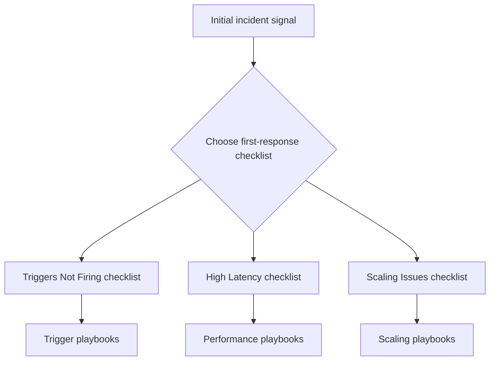
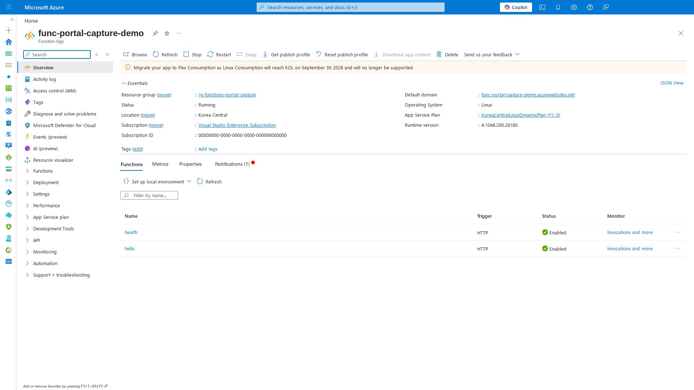
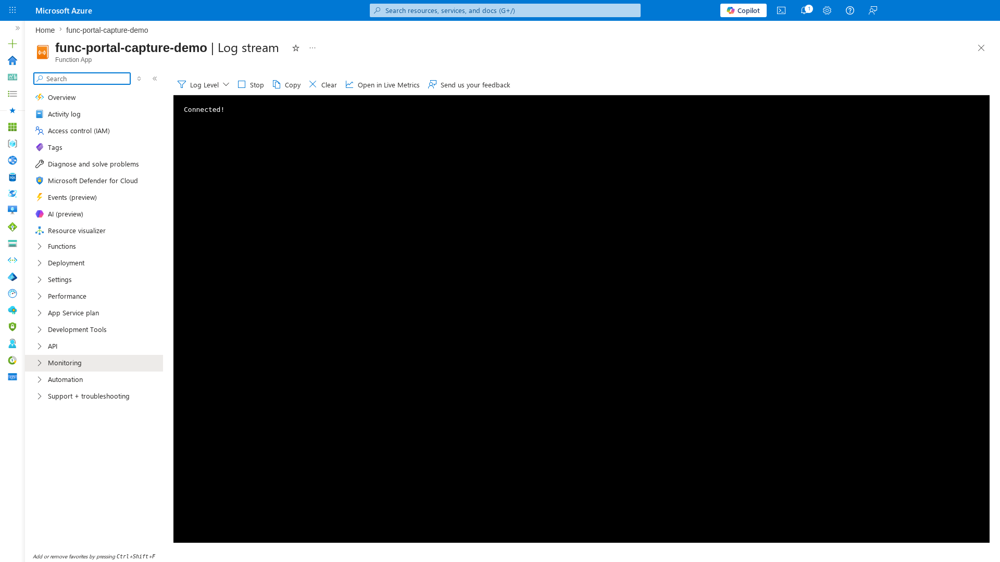
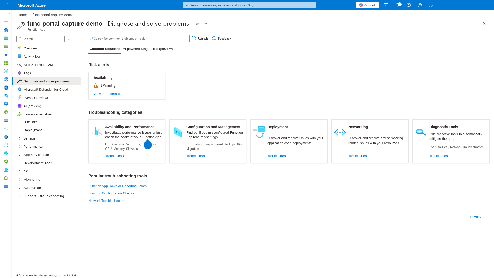

---
content_sources:

  references:
    - type: mslearn-adapted
      url: https://learn.microsoft.com/en-us/azure/azure-functions/functions-monitoring
    - type: mslearn-adapted
      url: https://learn.microsoft.com/en-us/azure/azure-functions/streaming-logs
    - type: mslearn-adapted
      url: https://learn.microsoft.com/en-us/azure/azure-functions/configure-monitoring
    - type: mslearn-adapted
      url: https://learn.microsoft.com/en-us/azure/azure-functions/functions-scale#cold-start-behavior
    - type: mslearn-adapted
      url: https://learn.microsoft.com/en-us/azure/azure-functions/dedicated-plan#always-on
    - type: mslearn-adapted
      url: https://learn.microsoft.com/en-us/azure/service-health/overview
  diagrams:
    - id: checklists
      type: graph
      source: self-generated
      justification: Flow view of checklists, synthesized from Microsoft Learn documentation cited on this page.
      based_on:
        - https://learn.microsoft.com/en-us/azure/azure-functions/functions-monitoring
        - https://learn.microsoft.com/en-us/azure/service-health/overview
---
# Checklists

Fast triage guides for the first 10 minutes of an Azure Functions investigation.

These checklists help you quickly narrow down the problem category and identify which playbook to follow for deeper analysis.

<!-- diagram-id: checklists -->

| Checklist | When to Use |
|---|---|
| [Triggers Not Firing](triggers-not-firing.md) | Functions not executing, zero invocations, trigger listener failures |
| [High Latency](high-latency.md) | Slow responses, elevated P95, timeout errors |
| [Scaling Issues](scaling-issues.md) | Queue backlog growing, executions flat, cold start spikes |

## Portal Walkthrough

Before diving into CLI and KQL, use these Portal blades to get a quick visual overview of the Function App state.

### Function App Overview

[Observed] The **Overview** blade shows the app status (**Running**), hosting plan (**KoreaCentralLinuxDynamicPlan (Y1: 0)**), runtime version (**4.1048.200.26180**), and the list of deployed functions with their trigger types and enabled status:

[Inferred] If the **Status** field shows anything other than `Running`, or if functions show `Disabled`, that is the first signal to investigate. The "Migrate your app to Flex Consumption" banner indicates this is a Linux Consumption plan approaching EOL.

### Log Stream

[Observed] The existing capture shows **Connected!** in the **Log stream** blade, with no application log entries visible:

[Not Proven] This establishes only that the Portal reports a streaming connection and that this view is empty at capture time. It does **not** establish host startup, function indexing, listener health, invocation, or a durable business outcome. The capture has no observation interval or known invocation, so it cannot establish how long the stream was silent or why. Treat it as a symptom, not discriminating evidence of a cause.

**Documented collection limits:** [Built-in streaming](https://learn.microsoft.com/en-us/azure/azure-functions/streaming-logs) reads application log files from a single instance; it does not show other instances and is unsupported on Linux Consumption. Do not use this capture as proof that built-in streaming works on the Linux Consumption plan shown above. Use **Open in Live Metrics** with Application Insights instead: Live Metrics supports all plans and multiple instances, but its log samples are not a complete execution history. Filter to the intended app/instance when an Application Insights resource is shared.

**Next checks — not a 30-second diagnosis:** Record the app/slot, plan/OS, UTC window, selected stream, instance and filters before testing. Use a safe, authorized trigger event with a correlation marker as a control; do not trigger destructive production work just to produce logs.

| Competing hypothesis | Targeted next action | Supporting / contradicting evidence |
|---|---|---|
| Host startup failure or crash loop | Inspect host lifecycle logs and **Diagnose and solve problems** for the same instance/window; compare recent deployment/configuration events. | Repeated startup failures/process exits support a loop; a completed startup followed by a correlated invocation contradicts failure to start for that instance/window. A deployment or restart event alone is insufficient. |
| Expected function was not indexed, is disabled, or its listener failed | Compare the deployed function list/enabled state with the intended artifact; inspect indexing and listener errors in host logs. Continue with [Triggers Not Firing](triggers-not-firing.md). | A named indexing/listener error supports that failure; a correlated invocation of the expected function contradicts its inability to execute in that window. A listed function alone does not prove listener health. |
| No invocation reached the function | Check trigger-source delivery/backlog, then correlate the safe test event with function start/result telemetry and its expected response or persisted outcome. | No source delivery supports an upstream gap; a matching invocation contradicts “never invoked.” An HTTP response alone does not prove the handler ran; successful invocation alone does not prove durable work. |
| Telemetry is hidden, filtered, delayed, or misconfigured | Verify the selected Application Insights resource/connection setting without copying secrets, app/instance/time filters, effective host/worker log levels, sampling and ingestion limits. Compare the control event across available collection paths. | A correlated execution/result visible elsewhere while this view is empty supports a collection/view gap; the same event visible here contradicts total collection failure for that event. Validate the collection path before interpreting missing rows. |
| Idle capacity rather than a failed host | Confirm the plan and demand: [Consumption/Flex can scale to zero](https://learn.microsoft.com/en-us/azure/azure-functions/functions-scale#cold-start-behavior); check Flex always-ready configuration. On Dedicated, check [Always On](https://learn.microsoft.com/en-us/azure/azure-functions/dedicated-plan#always-on), not serverless scale-to-zero. Correlate instance/scale evidence with the safe trigger. | Zero active instances before demand followed by startup/execution supports idle scale-to-zero; an active executing instance contradicts zero capacity at that time. Dedicated Always On disabled supports possible idling, not proof of the incident cause. |

[Inferred] A silent or disconnected stream is compatible with idle workload, the wrong view/instance, collection gaps, or runtime failure; it does not select between them. [Host log filters](https://learn.microsoft.com/en-us/azure/azure-functions/configure-monitoring#configure-log-levels) can suppress entries before they reach log destinations. Application Insights [sampling](https://learn.microsoft.com/en-us/azure/azure-functions/configure-monitoring#configure-sampling) can separately omit completed-execution telemetry; it is not an explanation for missing local file logs by itself. Host lifecycle logs and application invocation telemetry answer different questions.

Absent/delayed telemetry remains **INCONCLUSIVE**, not disproof. Set a bounded retry window based on the collection path, retain query/filter and control results, and follow the [evidence contract](../methodology/troubleshooting-method.md#evidence-and-hypothesis-contract). Capture evidence before mitigation: a restart plus a successful probe establishes **recovery for that probe/window**, not the original cause.

### Diagnose and Solve Problems

[Observed] The **Diagnose and solve problems** blade shows active risk alerts and categorized troubleshooting tools:

[Inferred] The **Availability: 1 Warning** alert is a quick indicator that the platform has detected an issue. Click **View more details** to see the specific detector findings before running manual KQL queries.

## Common first actions

Regardless of which checklist you follow, always start with these three checks:

1. **Azure Service Health** — Rule out regional platform issues
2. **Application Insights Live Metrics** — Look for current failures; an empty view does not establish health
3. **Recent deployments** — Check if anything changed in the incident window

## See Also

- [Playbooks](../playbooks/index.md)
- [KQL Query Library](../kql/index.md)
- [Methodology](../methodology/troubleshooting-method.md)

## Sources

- [Monitor Azure Functions](https://learn.microsoft.com/en-us/azure/azure-functions/functions-monitoring)
- [Stream execution logs](https://learn.microsoft.com/en-us/azure/azure-functions/streaming-logs)
- [Configure monitoring](https://learn.microsoft.com/en-us/azure/azure-functions/configure-monitoring)
- [Cold start behavior by plan](https://learn.microsoft.com/en-us/azure/azure-functions/functions-scale#cold-start-behavior)
- [Dedicated hosting: Always On](https://learn.microsoft.com/en-us/azure/azure-functions/dedicated-plan#always-on)
- [Azure Service Health overview](https://learn.microsoft.com/en-us/azure/service-health/overview)
