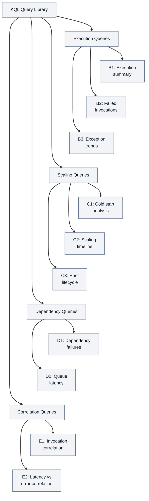

---
content_sources:

  references:
    - type: mslearn-adapted
      url: https://learn.microsoft.com/en-us/azure/azure-monitor/logs/log-query-overview
    - type: mslearn-adapted
      url: https://learn.microsoft.com/en-us/azure/azure-monitor/app/data-model
    - type: mslearn-adapted
      url: https://learn.microsoft.com/en-us/azure/data-explorer/kusto/query/
    - type: mslearn-adapted
      url: https://learn.microsoft.com/en-us/azure/azure-monitor/app/data-model-complete
    - type: mslearn-adapted
      url: https://learn.microsoft.com/en-us/azure/azure-functions/functions-monitoring
  diagrams:
    - id: kql-tables-quick-reference
      type: graph
      source: self-generated
      justification: Editorial navigation map of this library's four query categories and ten query topics, not a telemetry pipeline or a measured incident. Microsoft Learn sources provide the KQL and telemetry context, not this category taxonomy.
      based_on:
        - https://learn.microsoft.com/en-us/azure/azure-monitor/logs/log-query-overview
        - https://learn.microsoft.com/en-us/azure/azure-monitor/app/data-model
        - https://learn.microsoft.com/en-us/azure/data-explorer/kusto/query/
        - https://learn.microsoft.com/en-us/azure/azure-monitor/app/data-model-complete
        - https://learn.microsoft.com/en-us/azure/azure-functions/functions-monitoring
---
# KQL Query Library for Azure Functions

Use these KQL queries during incidents to validate hypotheses with telemetry.
Queries target Azure Functions data in Application Insights with these core tables:

- `requests`
- `traces`
- `exceptions`
- `dependencies`
- `customMetrics`

### Table Name Mapping

Azure Functions telemetry can be queried from two contexts with different table names:

| Application Insights (portal) | Log Analytics workspace | Data type |
|---|---|---|
| `requests` | `AppRequests` | HTTP and trigger invocations |
| `traces` | `AppTraces` | Log messages and custom traces |
| `exceptions` | `AppExceptions` | Unhandled and logged exceptions |
| `dependencies` | `AppDependencies` | Outbound calls to services |
| `customMetrics` | `AppMetrics` | Custom metric values |
| `performanceCounters` | `AppPerformanceCounters` | Process-level counters |

!!! note "Which table name to use"
    When querying from the **Application Insights** portal blade, use lowercase names (`requests`, `traces`). When querying from the **Log Analytics workspace** blade (or `az monitor log-analytics query`), use PascalCase names (`AppRequests`, `AppTraces`). Queries in this library use Application Insights conventions.

## Usage notes

1. Keep time range tight (`ago(30m)`, `ago(1h)`) during triage.
2. Always filter by app role name to avoid cross-app noise.
3. Save high-value queries to your incident workbook.

## KQL Tables Quick Reference

| Table | What It Contains | Use When |
|---|---|---|
| `requests` | HTTP trigger invocations | Checking request success/failure/latency |
| `traces` | Host lifecycle, custom logs | Checking startup, listeners, runtime events |
| `exceptions` | Error details with stack traces | Identifying error types and root causes |
| `dependencies` | Outbound calls to external services | Checking dependency health and latency |
| `customMetrics` | Metrics explicitly emitted by your app/SDK (for example `TelemetryClient.TrackMetric`) plus selected Azure Functions runtime metrics (for example `FunctionExecutionCount`) | Checking custom processing/latency metrics and runtime counters |

Template variable:

```kusto
let appName = "func-myapp-prod";
```

!!! tip "Operations Guide"
    For monitoring setup and alert configuration, see [Monitoring](../../operations/monitoring.md) and [Alerts](../../operations/alerts.md).

<!-- diagram-id: kql-tables-quick-reference -->


**Reading key:** Arrows group query topics by category; they do not prescribe an investigation order or establish a diagnosis. Use the keys below to read each shortened label.

| Key | Full query topic |
|---|---|
| B1 | Function execution summary |
| B2 | Failed invocations with error details |
| B3 | Exception trends |
| C1 | Cold start analysis |
| C2 | Scaling events timeline |
| C3 | Host startup/shutdown events |
| D1 | Dependency call failures |
| D2 | Queue processing latency |
| E1 | Single invocation correlation |
| E2 | Latency vs error correlation |

## Query Categories

| Category | Queries | Purpose |
|---|---|---|
| [Execution](execution/index.md) | Function summary, failed invocations, exception trends | Identify what is failing and how often |
| [Scaling](scaling/index.md) | Cold start, scaling events, host lifecycle | Understand scale behavior and startup health |
| [Dependencies](dependencies/index.md) | Dependency failures, queue processing latency | Diagnose external service issues |
| [Correlation](correlation/index.md) | Single invocation trace, latency vs errors | Connect symptoms across telemetry sources |

## See Also

- [First 10 Minutes](../first-10-minutes/index.md)
- [Playbooks](../playbooks/index.md)
- [Methodology](../methodology/troubleshooting-method.md)

## Sources

- [Azure Monitor Logs query overview](https://learn.microsoft.com/en-us/azure/azure-monitor/logs/log-query-overview)
- [Application Insights data model](https://learn.microsoft.com/en-us/azure/azure-monitor/app/data-model)
- [Kusto Query Language overview](https://learn.microsoft.com/en-us/azure/data-explorer/kusto/query/)
- [Application Insights telemetry data model](https://learn.microsoft.com/en-us/azure/azure-monitor/app/data-model-complete)
- [Monitor Azure Functions](https://learn.microsoft.com/en-us/azure/azure-functions/functions-monitoring)
