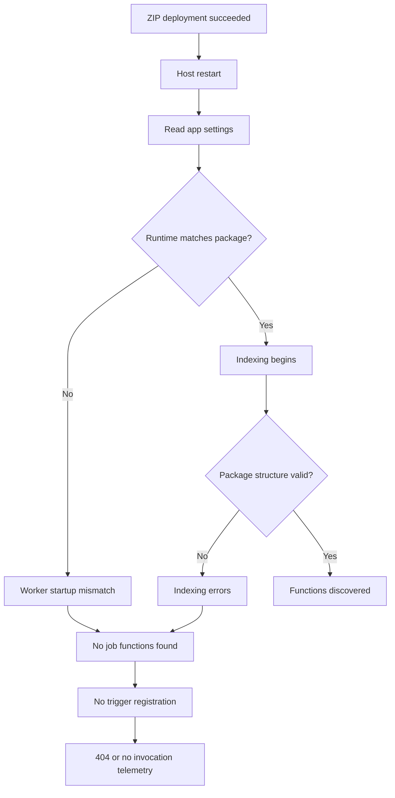
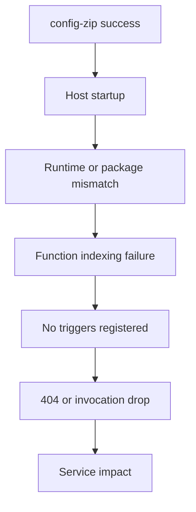
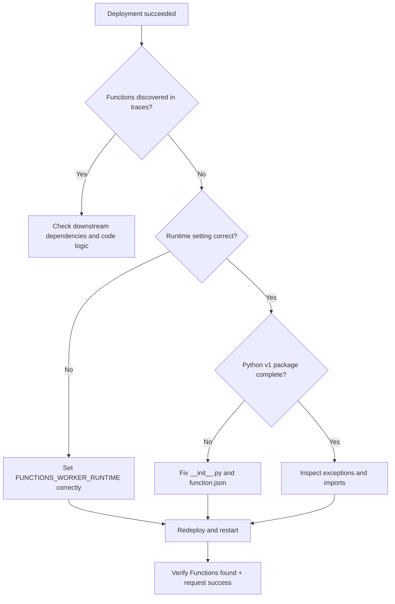

---
content_sources:
  references:
    - type: mslearn-adapted
      url: https://learn.microsoft.com/en-us/azure/azure-functions/functions-deployment-technologies
    - type: mslearn-adapted
      url: https://learn.microsoft.com/en-us/azure/azure-functions/functions-reference-python
    - type: mslearn-adapted
      url: https://learn.microsoft.com/en-us/azure/azure-functions/configure-monitoring
    - type: mslearn-adapted
      url: https://learn.microsoft.com/en-us/azure/azure-functions/monitor-functions
    - type: mslearn-adapted
      url: https://learn.microsoft.com/en-us/azure/azure-monitor/logs/log-query-overview
  diagrams:
    - id: failure-progression-model
      type: flowchart
      source: self-generated
      justification: Flow view of failure progression model, synthesized from Microsoft Learn documentation cited on this page.
      based_on:
        - https://learn.microsoft.com/en-us/azure/azure-functions/functions-deployment-technologies
        - https://learn.microsoft.com/en-us/azure/azure-functions/functions-reference-python
        - https://learn.microsoft.com/en-us/azure/azure-functions/configure-monitoring
        - https://learn.microsoft.com/en-us/azure/azure-functions/monitor-functions
        - https://learn.microsoft.com/en-us/azure/azure-monitor/logs/log-query-overview
    - id: incident-timeline-model
      type: gantt
      source: self-generated
      justification: Incident timeline model, synthesized from Microsoft Learn documentation cited on this page.
      based_on:
        - https://learn.microsoft.com/en-us/azure/azure-functions/functions-deployment-technologies
        - https://learn.microsoft.com/en-us/azure/azure-functions/functions-reference-python
        - https://learn.microsoft.com/en-us/azure/azure-functions/configure-monitoring
        - https://learn.microsoft.com/en-us/azure/azure-functions/monitor-functions
        - https://learn.microsoft.com/en-us/azure/azure-monitor/logs/log-query-overview
    - id: causal-chain
      type: flowchart
      source: self-generated
      justification: Flow view of causal chain, synthesized from Microsoft Learn documentation cited on this page.
      based_on:
        - https://learn.microsoft.com/en-us/azure/azure-functions/functions-deployment-technologies
        - https://learn.microsoft.com/en-us/azure/azure-functions/functions-reference-python
        - https://learn.microsoft.com/en-us/azure/azure-functions/configure-monitoring
        - https://learn.microsoft.com/en-us/azure/azure-functions/monitor-functions
        - https://learn.microsoft.com/en-us/azure/azure-monitor/logs/log-query-overview
    - id: step-7-triage-decision-tree
      type: flowchart
      source: self-generated
      justification: Flow view of step 7 triage decision tree, synthesized from Microsoft Learn documentation cited on this page.
      based_on:
        - https://learn.microsoft.com/en-us/azure/azure-functions/functions-deployment-technologies
        - https://learn.microsoft.com/en-us/azure/azure-functions/functions-reference-python
        - https://learn.microsoft.com/en-us/azure/azure-functions/configure-monitoring
        - https://learn.microsoft.com/en-us/azure/azure-functions/monitor-functions
        - https://learn.microsoft.com/en-us/azure/azure-monitor/logs/log-query-overview
    - id: evidence-timeline
      type: gantt
      source: self-generated
      justification: Evidence timeline, synthesized from Microsoft Learn documentation cited on this page.
      based_on:
        - https://learn.microsoft.com/en-us/azure/azure-functions/functions-deployment-technologies
        - https://learn.microsoft.com/en-us/azure/azure-functions/functions-reference-python
        - https://learn.microsoft.com/en-us/azure/azure-functions/configure-monitoring
        - https://learn.microsoft.com/en-us/azure/azure-functions/monitor-functions
        - https://learn.microsoft.com/en-us/azure/azure-monitor/logs/log-query-overview
---
# Lab Guide: Deployment Succeeded but Function Not Running

This lab reproduces a deceptive production scenario: deployment transport succeeds, but Azure Functions cannot discover triggers, so no functions execute. You will validate failure evidence using Application Insights tables only (`traces`, `requests`, `dependencies`, `exceptions`), then recover by correcting runtime and package structure.

!!! warning "Golden scenario is defined, not Azure-executed"
    The Golden scenario below is **NOT_RUN / NOT_TESTED**. No Azure run evidence
    exists for it. The historical walkthrough, timestamps, excerpts and verdict
    elsewhere on this page are unchanged historical material, not evidence for
    this new scenario. Successful deployment and app `Running` status are each
    insufficient to prove indexing, listener readiness, or actual processing.

## Portal Walkthrough

These portal blades help investigate deployment failures. All captures from a Consumption (Y1) Function App with PII masked.


## Lab Metadata

| Field | Value |
|---|---|
| Difficulty | Intermediate / Advanced |
| Duration | 45-60 min |
| Hosting plan tested | Consumption (Y1) |
| Trigger type | HTTP trigger + timer trigger |
| Azure services | Azure Functions, Azure Storage, Application Insights |
| Skills practiced | Discovery triage, startup diagnostics, runtime alignment, packaging validation |

## 1) Background

`az functionapp deployment source config-zip` confirms package upload and extraction, not runtime readiness. A successful deployment response can coexist with host indexing failure, leaving routes unavailable.

Common causes in Python workloads:

1. `FUNCTIONS_WORKER_RUNTIME` does not match the deployed language.
2. Python v1 package structure is incomplete (`function.json` or `__init__.py` missing).
3. Import/startup exceptions prevent trigger registration even though deployment succeeded.

This lab keeps deployment method constant and changes only runtime or package structure to prove causality.

### Failure progression model

<!-- diagram-id: failure-progression-model -->


### Investigation channels used in this lab

| Channel | Table | Why it matters |
|---|---|---|
| Host startup/discovery state | `traces` | Detects `No job functions found`, startup/indexing signatures |
| Trigger execution outcome | `requests` | Shows success/failure and 404 trend |
| Downstream dependency behavior | `dependencies` | Separates startup issue from external dependency issue |
| Runtime exceptions | `exceptions` | Identifies import and indexing exceptions |

### Incident timeline model

```mermaid
gantt
    title Deployment Success but Runtime Failure Timeline
    dateFormat  HH:mm
    axisFormat  %H:%M
    section Baseline
    Baseline deploy and verify         :done, a1, 03:00, 10m
    section Incident
    Fault injection                    :done, b1, 03:10, 1m
    Evidence collection                :done, b2, 03:10, 10m
    section Recovery
    Fix applied                        :done, c1, 03:20, 1m
    Recovery verification              :done, c2, 03:20, 10m
```

<!-- diagram-id: incident-timeline-model -->


## 2) Hypothesis

### Formal statement

If deployment succeeds but runtime configuration or Python package structure is invalid, then startup telemetry will show function discovery/indexing failures, function execution telemetry will collapse, and correcting runtime plus structure will restore trigger discovery and successful invocations.

### Proof criteria

1. `traces` contains discovery/startup failure signatures after successful deployment.
2. `requests` shows failure or 404 surge while discovery fails.
3. Runtime/structure correction removes discovery failures.
4. `requests` returns to healthy success profile after correction.

### Disproof criteria

1. Functions are discovered and route-mapped while requests still fail for unrelated reasons.
2. No startup/indexing/discovery signatures appear in `traces`.
3. Recovery occurs without any runtime or package correction.

### Causal chain

<!-- diagram-id: causal-chain -->


## 3) Runbook

### Golden scenario: offline definition and future execution recipe

[Not Proven] This narrower scenario tests one HTTP function on **Linux Consumption
(Y1), Functions v4, Python v2 programming model**. It is not a test of timer or
queue delivery, durable business output, other hosting plans, or independent
reproduction. Those stages are not applicable to this HTTP-response-only claim.
The [evidence contract](../methodology/troubleshooting-method.md#evidence-and-hypothesis-contract)
governs execution, provenance and verdicts.

The machine-readable predeclaration is
[`tests/fixtures/evidence/deployment-scenario.json`](https://github.com/yeongseon/azure-functions-practical-guide/blob/main/tests/fixtures/evidence/deployment-scenario.json).
Its assertions are passed unchanged into the existing offline evaluator; the
separate synthetic cases are software tests, never platform captures. No collector,
new evaluator predicate, or Azure automation is introduced.

#### Ownership and fixed controls

There is **no `labs/deployment-not-running/` directory** and no deployed lab-owned
Function App established by this definition. An authorized operator must first
provision an isolated, disposable lab resource group with
`infra/consumption/main.bicep`, following the
[Consumption infrastructure tutorial](../../language-guides/python/tutorial/consumption/05-infrastructure-as-code.md).
Use that deployment's `functionAppName`, `functionAppUrl`, and `appInsightsName`
outputs as `APP_NAME`, `APP_URL`, and `APPINSIGHTS_NAME`; do not substitute a
customer or production app. Record the resource inventory and explicit ownership
approval before writes. An already-existing app is eligible only with the same
lab ownership and permission to replace its code.

Follow the [package-by-plan matrix](../../operations/deployment.md#package-configuration-by-plan-and-os)
and its read-only precheck. Use Core Tools Python remote build consistently for
all three packages. **Do not manually set `WEBSITE_RUN_FROM_PACKAGE`** (in
particular, never `1` on Linux Y1), change runtime settings, or reapply infrastructure
during fault/recovery. Flex is out of scope and must not inherit this recipe.
Retain build/deployment logs and package digests; transport acceptance is distinct
from remote-build completion and activation. If publishing rejects the package,
this does not establish the intended accepted-deploy/indexing-failure scenario.

#### Minimal baseline -> fault -> recovery

1. **Predeclare:** assign a unique run ID, source commit/dirty diff, recipe digest,
    tool versions, region, plan/SKU, OS, configured and observed host/Python versions
    (unknown until captured), sanitized app identity and configuration. Choose a
    fresh request nonce per probe. Fix startup observation at 5 minutes per phase,
    then 10 HTTP probes, 30 seconds apart, each with a 15-second timeout. Allow
    telemetry an additional 10 minutes, querying at 1-minute intervals. These are
    experiment bounds, not platform SLAs; preserve timeouts, not just successes.
2. **Baseline/control:** create a temporary Python project with `host.json` at the
    archive root, `requirements.txt` containing `azure-functions`, and the two
    files below. Verify locally, retain the source/archive inventory and digest,
    then publish from that project directory. Require all baseline assertions
    before inducing a fault. Configure monitoring before baseline, never mid-fault.
3. **Fault:** make a second project copy, omitting **only `golden_payload.py`**.
    Keep its top-level import in `function_app.py`. This deliberate package/runtime
    dependency mismatch should produce `ModuleNotFoundError` naming
    `golden_payload` during indexing. Compare manifests to prove the single change;
    do not inject an invalid package URL, modify the runtime, or depend on random
    network failure. Publish with the same remote-build command and retain both
    upload/build results and post-deploy discovery failures, even if Core Tools
    ultimately exits nonzero during readiness checks.
4. **Recovery:** republish the exact retained baseline project (verify its digest),
    not a separately repaired source tree. Measure elapsed UTC time from recovery
    publish acceptance to the first valid nonce response, and successes/attempts
    across the full probe window. Require 10/10 matching 200 responses, restored
    listing/indexing and route readiness, plus the monitored collection control.
    Record the actual duration; no recovery measurement exists yet.
5. **Cleanup:** follow the ownership-restricted receipt procedure below, even after
    a failed or inconclusive experiment. Cleanup does not prove incident causality.

Baseline `golden_payload.py` (omit this file only in the fault copy):

```python
MARKER = "golden-baseline"
```

Baseline `function_app.py` (same bytes in all three phases):

```python
import azure.functions as func
from golden_payload import MARKER

app = func.FunctionApp()

@app.function_name(name="HttpHealth")
@app.route(route="health", methods=["GET"], auth_level=func.AuthLevel.ANONYMOUS)
def http_health(req: func.HttpRequest) -> func.HttpResponse:
    return func.HttpResponse(f"{MARKER}:{req.params.get('nonce', '')}")
```

Anonymous access is limited to this disposable, nonsensitive probe; send no secrets
or customer data. From each selected project directory, the publish operation is:

```bash
func azure functionapp publish "$APP_NAME" --python
```

Retain the exit code, stdout/stderr and deployment identifier separately. For each
phase, capture management state and the function list (including empty responses
and failed commands), then probe `"$APP_URL/api/health?nonce=$NONCE"` using curl
with `--max-time 15`, `--dump-header`, `--output`, and `--write-out` for status and
elapsed seconds. Retain body, headers, UTC start/end, nonce and exit code per probe;
do not use `--fail` to discard fault responses. Query runtime startup/indexing
traces and invocation requests for the same app, phase interval and nonce where
available. A management function list can be stale: it is not a worker or route probe.

```bash
az functionapp show --name "$APP_NAME" --resource-group "$RG" --query "{state:state,kind:kind}" --output json
az functionapp function list --name "$APP_NAME" --resource-group "$RG" --query "[].name" --output json
az functionapp config appsettings list --name "$APP_NAME" --resource-group "$RG" --query "{insightsConfigured:contains([].name, 'APPLICATIONINSIGHTS_CONNECTION_STRING'),runtime:[?name=='FUNCTIONS_WORKER_RUNTIME'].value}" --output json
```

| Command/Parameter | Purpose |
|---|---|
| `az functionapp show` | Capture management state, not worker health. |
| `az functionapp function list` | Retain the explicit function list or collection failure. |
| `az functionapp config appsettings list` | Project only monitoring presence and runtime; never print secret values. |
| `--name` | App name from the owned deployment output. |
| `--resource-group` | Approved disposable lab group. |
| `--query` | Limit published fields and avoid connection strings. |
| `--output` | Preserve structured JSON for later inspection. |

#### Predeclared assertions and disproof

The JSON uses phase-qualified signals to prevent recovery evidence satisfying a
fault assertion. Every normalized signal must cite exact raw artifact/field,
event time and transformation in `mapping.json`; summaries are derived, not primary.
The evaluator checks explicit equality only; it does not parse Azure logs or
authenticate provenance. Review that mapping before offline replay.

| Stage | Baseline and recovery assertion | Fault assertion / decisive disproof |
|---|---|---|
| Package upload | Deployment service accepted the intended artifact; remote build and package inventory retained. | Same acceptance required for fault artifact. Upload/build rejection invalidates this experiment, not proof of indexing failure. |
| Host state | Capture `Running` and host startup evidence within 5 minutes separately. | Capture `Running` independently of the worker result; if app is stopped or state unavailable, this narrower claim is undecidable. |
| Worker/indexing | Startup identifies `HttpHealth` from this package; no unresolved import failure. | A fresh indexing failure explicitly names missing `golden_payload`. A valid correlated invocation of the fault package decisively contradicts the proposed indexing block. Missing traces alone never disprove it. |
| Function metadata | Explicit list contains `HttpHealth` and agrees with fresh runtime metadata. | Retain list even if empty or stale; `captured` means a successful list response, not that emptiness proves failure. Missing list makes the run INCONCLUSIVE. |
| HTTP listener readiness | Fresh route metadata maps `GET /api/health` and controlled probes reach that route. | Explicit failed route registration/indexing plus failed probes establishes `blocked-by-indexing`. A 404 alone could be wrong routing, auth or networking; it is not this signal. |
| Actual invocation | All 10 responses are 200 with exact `golden-baseline:<nonce>` bodies and correlated invocation evidence. | Retain every probe result and positive indexing-block evidence. `blocked-by-indexing` must not be inferred from an empty requests table. Matching fault-package nonce execution is disproof, not missing telemetry. |

**Telemetry control:** retain projected app-setting presence, host.json log levels,
sampling/filter configuration, query text, table/app scope, event interval,
collection errors and actual ingestion/capture times. Baseline and recovery nonce
requests must be visible through the same collection path. Missing connection
configuration, suppressed `Host.Results`, sampling, permission errors, or ingestion
delay beyond the bounded wait means `unavailable`, not `execution-absent`.
See [monitoring configuration](https://learn.microsoft.com/en-us/azure/azure-functions/configure-monitoring)
and [ingestion latency](https://learn.microsoft.com/en-us/azure/azure-monitor/logs/data-ingestion-time).
Even with working telemetry, silence alone cannot identify non-execution; require
positive import/indexing evidence, the explicit list and client observations.

#### Outcome rules

- **NOT_RUN / NOT_TESTED:** current scenario state; source review and synthetic
    evaluator tests do not change it.
- **COMPLETE / SUPPORTED:** all required assertions and controls hold with reviewed
    current primary evidence; same-package recovery alone is insufficient causality.
    Compare package manifests and unchanged settings to discriminate routing,
    deployment rejection, storage/network issues and telemetry loss.
- **COMPLETE / CONTRADICTED:** valid controls plus decisive fault-package execution
    counter-evidence. Do not translate telemetry unavailability into contradiction.
- **COMPLETE / INCONCLUSIVE:** collection attempts finished but no discriminating
    data, no function list, ambiguous/stale data or unavailable telemetry remains.
    Completion is procedural, not proof. If collection did not finish, use PARTIAL
    (or BLOCKED/FAILED per the contract) with NOT_TESTED instead.

### Historical walkthrough (not the Golden run)

### Prerequisites

1. Azure CLI authenticated and target subscription selected.
2. Azure Functions Core Tools installed.
3. Access to create resources in target resource group.
4. Application Insights query permission.

```bash
az login --output table
az account set --subscription "<subscription-id>"
az account show --output table
func --version
python --version
```

| CLI element | Explanation |
|---|---|
| Command(s) | `az login`, `az account set`, `az account show` |
| Key flags | `--output`, `--subscription`, `--version` |
| Variables | None |
| Expected result | Azure CLI applies the configuration change; confirm the returned JSON or follow-up query shows the expected value. |


### Variables

```bash
RG="rg-func-lab-deploy"
LOCATION="koreacentral"
APP_NAME="func-deploy-lab-001"
STORAGE_NAME="stfuncdeploylab001"
APPINSIGHTS_NAME="appi-func-deploy-001"
APP_URL="https://$APP_NAME.azurewebsites.net"
```

### Step 1: Deploy baseline infrastructure

Create a Linux Consumption app with Application Insights attached.

```bash
az group create --name "$RG" --location "$LOCATION" --output table
az storage account create --name "$STORAGE_NAME" --resource-group "$RG" --location "$LOCATION" --sku Standard_LRS --kind StorageV2 --output table
az monitor app-insights component create --app "$APPINSIGHTS_NAME" --location "$LOCATION" --resource-group "$RG" --kind web --application-type web --output table
az functionapp create --name "$APP_NAME" --resource-group "$RG" --consumption-plan-location "$LOCATION" --runtime python --runtime-version 3.11 --functions-version 4 --storage-account "$STORAGE_NAME" --app-insights "$APPINSIGHTS_NAME" --output table
```

| CLI element | Explanation |
|---|---|
| Command(s) | `az group create`, `az storage account create`, `az monitor app-insights component create`, `az functionapp create` |
| Key flags | `--name`, `--location`, `--output`, `--resource-group`, `--sku`, `--kind`, `--app`, `--application-type`, `--consumption-plan-location`, `--runtime`, plus 4 more |
| Variables | `$RG`, `$LOCATION`, `$STORAGE_NAME`, `$APPINSIGHTS_NAME`, `$APP_NAME` |
| Expected result | Azure CLI returns provisioning details; confirm the resource name and successful provisioning state before continuing. |


If you need to verify the configured connection string, query it from Azure instead of using placeholders:

```bash
APPLICATIONINSIGHTS_CONNECTION_STRING="$(az monitor app-insights component show --app "$APPINSIGHTS_NAME" --resource-group "$RG" --query connectionString --output tsv)"
az functionapp config appsettings list --name "$APP_NAME" --resource-group "$RG" --query "[?name=='APPLICATIONINSIGHTS_CONNECTION_STRING'].value" --output tsv | head -c 50
```

| CLI element | Explanation |
|---|---|
| Command(s) | `az monitor app-insights component show`, `az functionapp config appsettings list` |
| Key flags | `--app`, `--resource-group`, `--query`, `--output`, `--name` |
| Variables | `$APPINSIGHTS_NAME`, `$RG`, `$APP_NAME` |
| Expected result | Azure CLI applies the configuration change; confirm the returned JSON or follow-up query shows the expected value. |


### Step 2: Deploy baseline code and verify discovery

Create and publish a known-good Python v2 app first.

```bash
mkdir -p deploy-lab && pushd deploy-lab
func init --python --model V2
cat > function_app.py << 'PYEOF'
import azure.functions as func
app = func.FunctionApp()

@app.function_name("HttpHealth")
@app.route(route="health", methods=["GET"])
def http_health(req: func.HttpRequest) -> func.HttpResponse:
    return func.HttpResponse("OK", status_code=200)
PYEOF
func azure functionapp publish "$APP_NAME" --python
popd
az functionapp config appsettings set --name "$APP_NAME" --resource-group "$RG" --settings "FUNCTIONS_WORKER_RUNTIME=python" --output table
az functionapp restart --name "$APP_NAME" --resource-group "$RG" --output table
```

| CLI element | Explanation |
|---|---|
| Command(s) | `az functionapp config appsettings set`, `az functionapp restart` |
| Key flags | `--python`, `--model`, `--name`, `--resource-group`, `--settings`, `--output` |
| Variables | `$APP_NAME`, `$RG` |
| Expected result | Azure CLI applies the configuration change; confirm the returned JSON or follow-up query shows the expected value. |


Start continuous HTTP traffic and keep it running through incident and recovery windows:

```bash
while true; do curl -s -o /dev/null -w "%{http_code}\n" "$APP_URL/api/health"; sleep 5; done &
TRAFFIC_PID=$!
```

Baseline discovery query:

```kusto
traces
| where timestamp between (datetime(2026-04-05 03:00:00Z) .. datetime(2026-04-05 03:10:00Z))
| where cloud_RoleName == "func-deploy-lab-001"
| where message has_any ("Host started", "Functions found")
| project timestamp, severityLevel, message
| order by timestamp asc
```

Sample result:

```text
timestamp                    severityLevel  message
2026-04-05T03:00:21.114Z     1              Host started (Id=xxxxxxxx-xxxx-xxxx-xxxx-xxxxxxxxxxxx)
2026-04-05T03:00:24.428Z     1              Functions found: HttpHealth
```

### Step 3: Trigger incident (runtime mismatch)

Inject the primary failure at **T0+10m (03:10 UTC)**.

Keep the background traffic loop running during this step so `requests` evidence remains reproducible.

```bash
az functionapp config appsettings set --name "$APP_NAME" --resource-group "$RG" --settings "FUNCTIONS_WORKER_RUNTIME=node" --output table
az functionapp restart --name "$APP_NAME" --resource-group "$RG" --output table
```

| CLI element | Explanation |
|---|---|
| Command(s) | `az functionapp config appsettings set`, `az functionapp restart` |
| Key flags | `--name`, `--resource-group`, `--settings`, `--output` |
| Variables | `$APP_NAME`, `$RG` |
| Expected result | Azure CLI applies the configuration change; confirm the returned JSON or follow-up query shows the expected value. |


### Step 4: Collect incident evidence (03:10-03:20 UTC)

Query A: discovery/startup failures in `traces`.

```kusto
traces
| where timestamp between (datetime(2026-04-05 03:10:00Z) .. datetime(2026-04-05 03:20:00Z))
| where cloud_RoleName == "func-deploy-lab-001"
| where message has_any ("No job functions found", "Host startup operation", "AZFD0013", "Failed to start")
| project timestamp, severityLevel, message
| order by timestamp asc
```

Sample result:

```text
timestamp                    severityLevel  message
2026-04-05T03:10:18.310Z     3              Host startup operation has been canceled
2026-04-05T03:10:18.944Z     2              No job functions found. Try making your job classes and methods public.
2026-04-05T03:10:19.501Z     3              Host startup operation has failed
```

Query B: request failure/404 profile.

```kusto
requests
| where timestamp between (datetime(2026-04-05 03:10:00Z) .. datetime(2026-04-05 03:20:00Z))
| where cloud_RoleName == "func-deploy-lab-001"
| summarize total=count(), failures=countif(success == false), notFound=countif(resultCode == "404"), p95Ms=round(percentile(duration, 95), 2) by bin(timestamp, 5m)
| extend failRatePercent=round(100.0 * failures / total, 2)
| order by timestamp asc
```

Sample result:

```text
timestamp                    total  failures  notFound  p95Ms   failRatePercent
2026-04-05T03:10:00.000Z     28     23        21        1865.42 82.14
2026-04-05T03:15:00.000Z     24     20        18        1722.08 83.33
```

Query C: exceptions tied to indexing/runtime load.

```kusto
exceptions
| where timestamp between (datetime(2026-04-05 03:10:00Z) .. datetime(2026-04-05 03:20:00Z))
| where cloud_RoleName == "func-deploy-lab-001"
| project timestamp, type, outerMessage
| order by timestamp asc
```

Sample result:

```text
timestamp                    type                  outerMessage
2026-04-05T03:10:18.950Z     FunctionInvocationException  Worker failed to initialize language worker for runtime: node
```

!!! note "Exception behavior varies by failure mode"
    The exceptions table may not always contain entries for startup failures. When the host cannot load the worker at all, failures appear primarily in `traces`. Treat `exceptions` as supporting evidence that strengthens the diagnosis, not as required proof.

Query D: dependency context to avoid false attribution.

```kusto
dependencies
| where timestamp between (datetime(2026-04-05 03:10:00Z) .. datetime(2026-04-05 03:20:00Z))
| where cloud_RoleName == "func-deploy-lab-001"
| summarize total=count(), failures=countif(success == false), p95Ms=round(percentile(duration, 95), 2) by type, target
| order by failures desc
```

Sample result:

```text
type      target                               total  failures  p95Ms
HTTP      management.azure.com                 19     0         210.54
Azure blob stfuncdeploylab001.blob.core.windows.net 31 0        75.90
```

CLI equivalent for Query A (include resource group explicitly):

```bash
az monitor app-insights query --apps "$APPINSIGHTS_NAME" --resource-group "$RG" --analytics-query "traces | where timestamp between (datetime(2026-04-05 03:10:00Z) .. datetime(2026-04-05 03:20:00Z)) | where cloud_RoleName == '$APP_NAME' | where message has_any ('No job functions found','Host startup operation','AZFD0013','Failed to start') | project timestamp, severityLevel, message | order by timestamp asc" --output table
```

| CLI element | Explanation |
|---|---|
| Command(s) | `az monitor app-insights query` |
| Key flags | `--apps`, `--resource-group`, `--analytics-query`, `--output` |
| Variables | `$APPINSIGHTS_NAME`, `$RG`, `$APP_NAME` |
| Expected result | Azure CLI returns the requested resource data; verify names, IDs, status fields, or metric values match the scenario. |


!!! tip "How to read this evidence"
    Keep the sequence strict: deployment success -> startup failure signatures -> missing route behavior in requests.
    If startup signatures are missing, do not conclude discovery failure only from 404s.

### Step 5: Apply fix and verify recovery (03:20-03:30 UTC)

Fix runtime mismatch and redeploy valid package at **T0+20m (03:20 UTC)**.

Keep the same background traffic loop running during recovery verification.

```bash
az functionapp config appsettings set --name "$APP_NAME" --resource-group "$RG" --settings "FUNCTIONS_WORKER_RUNTIME=python" --output table
pushd deploy-lab
func azure functionapp publish "$APP_NAME" --python
popd
```

| CLI element | Explanation |
|---|---|
| Command(s) | `az functionapp config appsettings set` |
| Key flags | `--name`, `--resource-group`, `--settings`, `--output`, `--python` |
| Variables | `$APP_NAME`, `$RG` |
| Expected result | Azure CLI applies the configuration change; confirm the returned JSON or follow-up query shows the expected value. |


Recovery Query E: discovery restored.

```kusto
traces
| where timestamp between (datetime(2026-04-05 03:20:00Z) .. datetime(2026-04-05 03:30:00Z))
| where cloud_RoleName == "func-deploy-lab-001"
| where message has_any ("Host started", "Functions found")
| project timestamp, severityLevel, message
| order by timestamp asc
```

Sample result:

```text
timestamp                    severityLevel  message
2026-04-05T03:20:22.088Z     1              Host started (Id=xxxxxxxx-xxxx-xxxx-xxxx-xxxxxxxxxxxx)
2026-04-05T03:20:24.607Z     1              Functions found: HttpHealth
```

Recovery Query F: request health restored.

```kusto
requests
| where timestamp between (datetime(2026-04-05 03:20:00Z) .. datetime(2026-04-05 03:30:00Z))
| where cloud_RoleName == "func-deploy-lab-001"
| summarize total=count(), failures=countif(success == false), p95Ms=round(percentile(duration, 95), 2) by bin(timestamp, 5m)
| extend failRatePercent=round(100.0 * failures / total, 2)
| order by timestamp asc
```

Sample result:

```text
timestamp                    total  failures  p95Ms   failRatePercent
2026-04-05T03:20:00.000Z     34     0         445.36  0.00
2026-04-05T03:25:00.000Z     37     0         418.79  0.00
```

### Step 6: Interpret results

- Successful deployment transport did not guarantee trigger availability.
- Runtime mismatch generated immediate startup/discovery signatures in `traces`.
- Request failures aligned with discovery failure windows.
- Fixing runtime and package alignment restored discovery and healthy requests.

### Step 7: Triage decision tree

<!-- diagram-id: step-7-triage-decision-tree -->


## 4) Experiment Log

### Golden run identity and retention (no captures yet)

| Field | Current value |
|---|---|
| Execution / hypothesis | `NOT_RUN` / `NOT_TESTED` |
| Claim / provenance / trust | Not Proven; offline definition, unverified for Azure execution |
| Azure run ID / captured_at | None; no collection attempted |
| Recovery measurement / cleanup receipt | Not available; no resources created by this scenario |
| Offline evaluation | Synthetic regression tests only; not independent reproduction |

For a future authorized run, retain sanitized primary captures under a new run ID
outside the test fixtures. The following is a **layout specification**, not existing
artifacts. Do not overwrite a prior run or fill gaps with historical excerpts.

```text
<approved-evidence-root>/<run-id>/
  identity.json              # commit, recipe digest, ownership, environment/tools
  predeclaration.json        # exact assertions and bounds saved before execution
  baseline|fault|recovery/
    <UTC>-package-manifest.json
    <UTC>-publish.stdout.txt / <UTC>-publish.stderr.txt
    <UTC>-deployment.json    # status, deployment ID, build result and exit codes
    <UTC>-app-state.json / <UTC>-function-list.json
    <UTC>-runtime.txt / <UTC>-telemetry-query.json / <UTC>-telemetry-results.json
    <UTC>-probe-<sequence>.json   # nonce, headers/body, status, duration, exit code
  mapping.json              # signal -> raw file/field, role, transformation
  evidence.json             # evaluator input; no stored verdict used as proof
  manifest.sha256           # exact sanitized bytes, retained independently
  evaluations/<evaluation-id>.json
  cleanup/<UTC>-receipt.json
```

Every artifact needs actual `captured_at` UTC, its own event/query window, run ID,
role, primary/derived/reported provenance and trust justification. Record
`evaluated_at` separately; prose edit time is Git history, never a capture date.
Sanitize CLI/runtime output before retention/publication with stable placeholders,
including IDs, hostnames, package URLs/SAS, auth headers and connection strings.
Keep restricted originals only in an approved private location, not Git. Preserve
sanitized failures and collection gaps as immutable records; hash after sanitizing.
The evaluator requires concrete UTC capture/window fields: **do not invent them
for the NOT_RUN definition**. Assemble a live evidence bundle only after collection;
synthetic fixture timestamps are explicitly fictional.

### Historical artifact inventory and results

### Artifact inventory

| Artifact | Source | Purpose |
|---|---|---|
| `deploy-lab/function_app.py` | local workspace | Baseline and recovery publish source |
| Runtime setting change | App setting | Fault injection by setting `FUNCTIONS_WORKER_RUNTIME=node` |
| Discovery query output | `traces` | Startup and indexing status |
| Request query output | `requests` | User-visible failure/success profile |
| Exception query output | `exceptions` | Runtime/indexing exception evidence |

### Timeline-consistent evidence ledger

| Time (UTC) | Phase | Signal | Observation | Interpretation |
|---|---|---|---|---|
| 03:00:00 | Baseline | Deploy | `func azure functionapp publish` completed | Transport successful |
| 03:00:24 | Baseline | `traces` | `Functions found: HttpHealth` | Discovery healthy |
| 03:05:00 | Baseline | `requests` | fail rate `0.00%` | Endpoints healthy |
| 03:10:00 | Fault injection | Config | `FUNCTIONS_WORKER_RUNTIME=node` | Intentional mismatch introduced |
| 03:10:19 | Incident | `traces` | `No job functions found` | Discovery failed |
| 03:15:00 | Incident | `requests` | fail rate `83.33%`, 404 surge | Triggers not mapped |
| 03:18:00 | Incident | `exceptions` | worker init exception | Mismatch confirmed |
| 03:20:00 | Fix | Config | runtime reset to `python` + republish from `deploy-lab` | Corrective action |
| 03:20:24 | Recovery | `traces` | `Functions found: HttpHealth` | Discovery restored |
| 03:25:00 | Recovery | `requests` | fail rate `0.00%` | Service restored |

### Baseline window snapshot (T0 to T0+10m)

| Timestamp (UTC) | Deploy status | Discovery status | Request fail rate |
|---|---:|---|---:|
| 2026-04-05T03:00:00Z | 200 | Functions found | 0.00% |
| 2026-04-05T03:05:00Z | 200 | Functions found | 0.00% |
| 2026-04-05T03:10:00Z | 200 | Baseline complete | 0.00% |

### Incident window snapshot (T0+10m to T0+20m)

| Timestamp (UTC) | Deploy status | Discovery signal | Request fail rate |
|---|---:|---|---:|
| 2026-04-05T03:10:00Z | 200 | runtime mismatch injected | 78.57% |
| 2026-04-05T03:12:00Z | 200 | `No job functions found` | 81.25% |
| 2026-04-05T03:15:00Z | 200 | startup failed loop | 83.33% |
| 2026-04-05T03:18:00Z | 200 | worker init exception | 80.95% |

### Recovery window snapshot (T0+20m to T0+30m)

| Timestamp (UTC) | Deploy status | Discovery signal | Request fail rate |
|---|---:|---|---:|
| 2026-04-05T03:20:00Z | 200 | fix applied | 0.00% |
| 2026-04-05T03:22:00Z | 200 | `Functions found` | 0.00% |
| 2026-04-05T03:25:00Z | 200 | stable startup | 0.00% |
| 2026-04-05T03:30:00Z | 200 | recovery verified | 0.00% |

### Raw excerpts (sanitized and timeline-aligned)

```text
[traces excerpt]
2026-04-05T03:00:24.428Z Information Functions found: HttpHealth
2026-04-05T03:10:18.310Z Error Host startup operation has been canceled
2026-04-05T03:10:18.944Z Warning No job functions found. Try making your job classes and methods public.
2026-04-05T03:10:19.501Z Error Host startup operation has failed
2026-04-05T03:15:19.202Z Error No job functions found.
2026-04-05T03:20:22.088Z Information Host started
2026-04-05T03:20:24.607Z Information Functions found: HttpHealth

[requests excerpt]
2026-04-05T03:05:10.001Z GET /api/health 200 success=True duration=398.22ms
2026-04-05T03:12:18.910Z GET /api/health 404 success=False duration=1731.52ms
2026-04-05T03:15:26.301Z GET /api/health 404 success=False duration=1665.11ms
2026-04-05T03:22:10.004Z GET /api/health 200 success=True duration=412.73ms
```

### Core finding

Deployment transport remained healthy throughout the run, but runtime mismatch prevented function indexing and trigger registration. Recovery required runtime correction and redeployment of a valid package; after correction, startup/discovery and request health returned to baseline.

### Verdict

| Question | Answer |
|---|---|
| Hypothesis confirmed? | Yes |
| Primary root cause | Runtime mismatch blocked discovery/indexing |
| Recovery method | Set `FUNCTIONS_WORKER_RUNTIME=python`, republish from `deploy-lab` |
| Time to detect | ~10 minutes after fault injection |

## Expected Evidence

### Before trigger (T0 to T0+10m)

| Signal | Expected value |
|---|---|
| Discovery traces | `Host started` and `Functions found` present |
| `No job functions found` in `traces` | 0 |
| Request fail rate | below 1% |

### During incident (T0+10m to T0+20m)

| Signal | Expected value |
|---|---|
| Discovery traces | repeated startup/indexing failures |
| `No job functions found` in `traces` | repeated |
| Request fail rate | above 70% with frequent 404 |
| Exceptions | optional supporting runtime/indexing signatures |

### After recovery (T0+20m to T0+30m)

| Signal | Expected value |
|---|---|
| Discovery traces | `Functions found` returns |
| `No job functions found` in `traces` | 0 |
| Request fail rate | returns below 1% |
| Verification duration | stable for at least 10 minutes |

### Evidence timeline

```mermaid
gantt
    title Evidence Timeline (UTC)
    dateFormat  HH:mm
    axisFormat  %H:%M
    section Baseline
    Baseline deploy + verify            :done, e1, 03:00, 10m
    section Incident
    Runtime mismatch injection          :done, e2, 03:10, 1m
    Incident evidence capture           :done, e3, 03:10, 10m
    section Recovery
    Runtime correction + redeploy       :done, e4, 03:20, 1m
    Recovery verification               :done, e5, 03:20, 10m
```

<!-- diagram-id: evidence-timeline -->


### Evidence chain: why this proves the hypothesis

1. Deployment succeeded in both healthy and failing windows, isolating runtime activation as the variable.
2. Discovery and startup failures appeared immediately after runtime mismatch injection.
3. Request failures and 404 spikes aligned with the discovery failure window.
4. Runtime correction removed discovery failures and restored healthy request telemetry.

## Clean Up

### Golden scenario ownership-restricted receipt

No cleanup has been executed for the NOT_RUN scenario. A future operator must
compare the pre-run ownership inventory with the disposable group's current
inventory and stop if any shared/customer resources appear. Delete only the
dedicated group created for this run; for a reused lab app, restore its approved
baseline instead of deleting a shared group. Stop probe processes owned by this
run only. Retain the deletion/restoration command, actual UTC start/end, exit code,
sanitized target inventory and final completion/failure result in the cleanup
receipt. An asynchronous delete acceptance is not a completion receipt. Cleanup
is separate from recovery, causality and independent reproduction.

### Historical walkthrough cleanup

```bash
kill "$TRAFFIC_PID"
az group delete --name "$RG" --yes --no-wait --output table
```

| CLI element | Explanation |
|---|---|
| Command(s) | `az group delete` |
| Key flags | `--name`, `--yes`, `--no-wait`, `--output` |
| Variables | `$TRAFFIC_PID`, `$RG` |
| Expected result | Azure CLI completes the removal request; verify the target no longer appears in follow-up `show` or `list` output. |


## Related Playbook

- [Deployment Failures Playbook](../playbooks/deployment-failures.md)

## See Also

- [Troubleshooting Lab Guides](../lab-guides/index.md)
- [Troubleshooting Methodology](../methodology.md)
- [First 10 Minutes Triage](../first-10-minutes/index.md)
- [KQL Guide](../kql/index.md)

## Sources

- https://learn.microsoft.com/en-us/azure/azure-functions/deployment-zip-push
- https://learn.microsoft.com/en-us/azure/azure-monitor/logs/data-ingestion-time
- https://learn.microsoft.com/en-us/azure/azure-functions/functions-deployment-technologies
- https://learn.microsoft.com/en-us/azure/azure-functions/functions-reference-python
- https://learn.microsoft.com/en-us/azure/azure-functions/configure-monitoring
- https://learn.microsoft.com/en-us/azure/azure-functions/monitor-functions
- https://learn.microsoft.com/en-us/azure/azure-monitor/logs/log-query-overview
