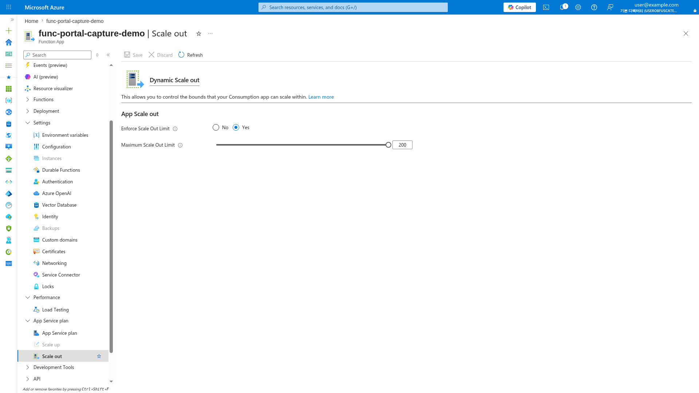
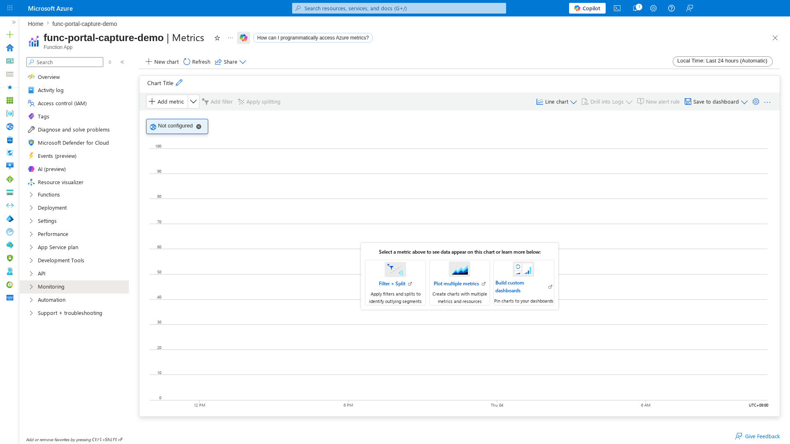
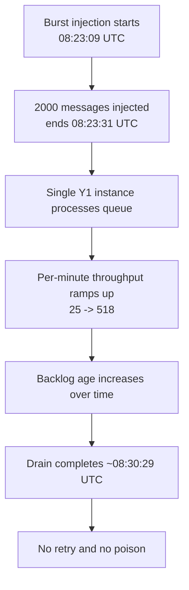
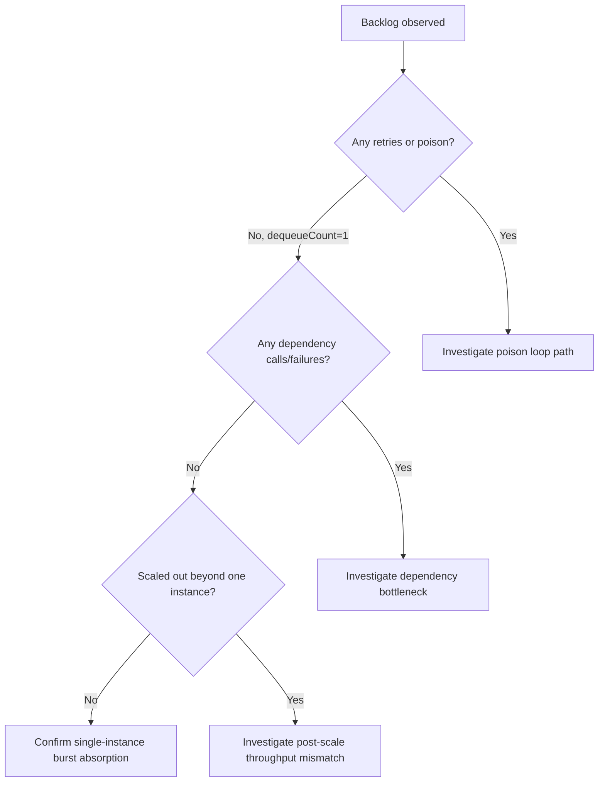
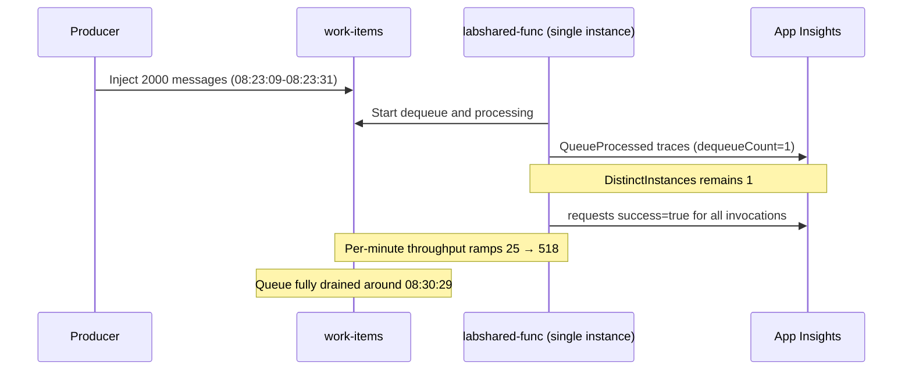

---
content_sources:
  references:
    - type: mslearn-adapted
      url: https://learn.microsoft.com/en-us/azure/azure-functions/functions-bindings-storage-queue-trigger
    - type: mslearn-adapted
      url: https://learn.microsoft.com/en-us/azure/azure-functions/functions-host-json
    - type: mslearn-adapted
      url: https://learn.microsoft.com/en-us/azure/azure-functions/functions-scale
    - type: mslearn-adapted
      url: https://learn.microsoft.com/en-us/azure/azure-functions/monitor-functions
    - type: mslearn-adapted
      url: https://learn.microsoft.com/en-us/azure/azure-monitor/logs/log-query-overview
  diagrams:
    - id: failure-progression-model-for-this-incident
      type: flowchart
      source: self-generated
      justification: Flow view of failure progression model for this incident, synthesized from Microsoft Learn documentation cited on this page.
      based_on:
        - https://learn.microsoft.com/en-us/azure/azure-functions/functions-bindings-storage-queue-trigger
        - https://learn.microsoft.com/en-us/azure/azure-functions/functions-host-json
        - https://learn.microsoft.com/en-us/azure/azure-functions/functions-scale
        - https://learn.microsoft.com/en-us/azure/azure-functions/monitor-functions
        - https://learn.microsoft.com/en-us/azure/azure-monitor/logs/log-query-overview
    - id: timeline-view
      type: gantt
      source: self-generated
      justification: Timeline view, synthesized from Microsoft Learn documentation cited on this page.
      based_on:
        - https://learn.microsoft.com/en-us/azure/azure-functions/functions-bindings-storage-queue-trigger
        - https://learn.microsoft.com/en-us/azure/azure-functions/functions-host-json
        - https://learn.microsoft.com/en-us/azure/azure-functions/functions-scale
        - https://learn.microsoft.com/en-us/azure/azure-functions/monitor-functions
        - https://learn.microsoft.com/en-us/azure/azure-monitor/logs/log-query-overview
    - id: hypothesis-decision-flow
      type: flowchart
      source: self-generated
      justification: Hypothesis decision flow, synthesized from Microsoft Learn documentation cited on this page.
      based_on:
        - https://learn.microsoft.com/en-us/azure/azure-functions/functions-bindings-storage-queue-trigger
        - https://learn.microsoft.com/en-us/azure/azure-functions/functions-host-json
        - https://learn.microsoft.com/en-us/azure/azure-functions/functions-scale
        - https://learn.microsoft.com/en-us/azure/azure-functions/monitor-functions
        - https://learn.microsoft.com/en-us/azure/azure-monitor/logs/log-query-overview
    - id: evidence-timeline
      type: sequenceDiagram
      source: self-generated
      justification: Interaction sequence for evidence timeline, synthesized from Microsoft Learn documentation cited on this page.
      based_on:
        - https://learn.microsoft.com/en-us/azure/azure-functions/functions-bindings-storage-queue-trigger
        - https://learn.microsoft.com/en-us/azure/azure-functions/functions-host-json
        - https://learn.microsoft.com/en-us/azure/azure-functions/functions-scale
        - https://learn.microsoft.com/en-us/azure/azure-functions/monitor-functions
        - https://learn.microsoft.com/en-us/azure/azure-monitor/logs/log-query-overview
    - id: evidence-timeline-2
      type: sequenceDiagram
      source: self-generated
      justification: Interaction sequence for evidence timeline 2, synthesized from Microsoft Learn documentation cited on this page.
      based_on:
        - https://learn.microsoft.com/en-us/azure/azure-functions/functions-bindings-storage-queue-trigger
        - https://learn.microsoft.com/en-us/azure/azure-functions/functions-host-json
        - https://learn.microsoft.com/en-us/azure/azure-functions/functions-scale
        - https://learn.microsoft.com/en-us/azure/azure-functions/monitor-functions
        - https://learn.microsoft.com/en-us/azure/azure-monitor/logs/log-query-overview
---
# Lab Guide: Queue Backlog Scaling on Y1 Consumption (Real Evidence)

This lab reproduces and analyzes a real queue backlog burst on Azure Functions Consumption (Y1) using telemetry collected on 2026-04-07. The objective is to prove what happened, what did not happen, and why a 2000-message burst drained in about 7.3 minutes without scale-out.

!!! warning "Retry/poison Golden scenario: NOT_RUN / NOT_TESTED"
    The separate controlled scenario below has no Azure execution, durable work
    capture, recovery timing or cleanup receipt. Its synthetic fixtures test the
    evaluator only. The historical burst did not exercise retries or durable
    downstream work and cannot validate this scenario. Historical evidence remains
    unchanged; no `last_tested` value is refreshed.

## Portal Walkthrough

These portal blades help investigate queue backlog and scaling issues. All captures from a Consumption (Y1) Function App with PII masked.






## Lab Metadata

| Field | Value |
|---|---|
| Difficulty | Intermediate to advanced |
| Duration | 45-60 minutes |
| Hosting plan tested | Azure Functions Consumption (Y1), Linux |
| Runtime | Python 3.11 / Functions v4 |
| Resource Group | `rg-lab-y1-shared` (`koreacentral`) |
| Function App | `labshared-func` |
| Storage Account | `labsharedstorage` |
| Application Insights | `labshared-insights` |
| Queue | `work-items` |
| Function code path | `apps/python/blueprints/queue_processor.py` |
| Producer path | `labs/queue-backlog-scaling/producer.py` |
| Queue connection setting | `QueueStorage` |
| Evidence date (UTC) | 2026-04-07 |

!!! info "Scope of this lab"
    This document replaces fabricated backlog data with a single real run from Y1 Consumption.
    Every metric, timestamp, and conclusion in this guide is constrained to the captured evidence listed in this lab.

## 1) Background

Queue backlog incidents are often misread as "the app is broken" or "the scale controller failed." In practice, backlog behavior is a throughput-shaping pattern where enqueue rate, per-message work time, batching, and scale decisions interact over time.

In this run, the producer injected 2000 messages in about 20.7 seconds (~97 msg/s), while each message included a configured 5-second processing delay. The workload did not fail, did not poison, and did not retry. The critical behavior was that Y1 remained on a single instance while draining.

### Workload and trigger configuration

Queue trigger behavior came from `host.json` queue settings:

```json
{
  "extensions": {
    "queues": {
      "batchSize": 16,
      "newBatchThreshold": 8,
      "maxDequeueCount": 5,
      "visibilityTimeout": "00:00:30",
      "messageEncoding": "none"
    }
  }
}
```

Application log format in `apps/python/blueprints/queue_processor.py`:

```text
QueueProcessed sequence=N ageMs=N dequeueCount=N processingMs=N instanceId=XXXX delayMs=N
```

These values are emitted in the `message` column of `traces` and must be parsed from `message`, not from `customDimensions`.

### Failure progression model for this incident

<!-- diagram-id: failure-progression-model-for-this-incident -->


### Why this scenario matters

1. It separates burst absorption from persistent failure.
2. It shows that "no scale-out" can still end in successful drain.
3. It demonstrates why message age can rise even with 100% success.
4. It prevents incorrect root-cause claims such as poison loop or dependency bottleneck when those signals are absent.

### Timeline view

```mermaid
gantt
    title Queue Backlog Burst and Drain (UTC, 2026-04-07)
    dateFormat  HH:mm:ss
    axisFormat  %H:%M:%S
    section Injection
    Producer sends 2000 messages   :done, inj, 08:23:09, 22s
    section Drain
    Single-instance drain phase    :done, drn, 08:23:09, 7m20s
    section Completion
    Queue reaches fully drained    :done, fin, 08:30:29, 1s
```

<!-- diagram-id: timeline-view -->


## 2) Hypothesis

### Primary hypothesis (H1)

If a high-burst queue workload is injected into Y1 Consumption with steady 5-second message processing, backlog growth is primarily caused by burst-vs-drain imbalance and scale lag, where scale lag manifests as no additional instances during the incident window.

### Competing hypotheses

| ID | Hypothesis | Result | Evidence summary |
|---|---|---|---|
| H1 | Scale lag/backlog due to insufficient active workers | **Confirmed** | `DistinctInstances = 1` for all processed records; drain completed without scale-out |
| H2 | Poison/retry loop dominates throughput loss | **Disproved** | `MaxDequeueCount = 1`; all 2000 messages succeeded first try |
| H3 | Processing-time regression causes slowdown | **Disproved** | `AvgProcessingMs = 5000`; processing delay remained steady as configured |
| H4 | Dependency bottleneck throttles handler | **Disproved** | This workload made no dependency calls |

### Proof criteria and observed outcome

| Criterion | Expected if true | Observed |
|---|---|---|
| Scale behavior | More than one worker if scale-out occurs | One worker only (`DistinctInstances = 1`) |
| Retry pattern | Elevated dequeue counts if poison/retry issue | All dequeue counts remained `1` |
| Processing consistency | Near configured delay if no regression | `AvgProcessingMs = 5000` |
| End-state | Eventual drain if workload is healthy | Full drain around `08:30:29 UTC` |

### Hypothesis decision flow

<!-- diagram-id: hypothesis-decision-flow -->


## 3) Runbook

### Golden scenario: retry, poison and durable work (offline definition)

[Not Proven] On **Linux Consumption (Y1), Functions v4, Python v2**, declared
per-message failures should cause Storage Queue redelivery and poison handling,
while a conditional durable write should prevent duplicate effects for a stable
work key. This is a bounded experiment, not an exactly-once delivery guarantee,
customer replay, Service Bus settlement test or Event Hubs checkpoint experiment.
Follow the [evidence contract](../methodology/troubleshooting-method.md#evidence-and-hypothesis-contract).

The predeclaration is
[`queue-scenario.json`](https://github.com/yeongseon/azure-functions-practical-guide/blob/main/tests/fixtures/evidence/queue-scenario.json).
[`synthetic-queue-cases.json`](https://github.com/yeongseon/azure-functions-practical-guide/blob/main/tests/fixtures/evidence/synthetic-queue-cases.json)
and `tests/test_queue_scenario.py` pass its assertions unchanged to
`scripts/lib/evidence_eval.py`. No new evaluator predicate, collector, retry
framework or production-app behavior is introduced. Equality labels are derived
classifications requiring human review of the raw-to-signal mapping.

#### Eligibility and frozen configuration

Use a newly approved disposable app and storage account, following the
[Consumption infrastructure tutorial](../../language-guides/python/tutorial/consumption/05-infrastructure-as-code.md).
Do **not** reuse the historical shared app/account named below. The fixed queue
name `work-items` is isolated by this dedicated account; inventory it and
`work-items-poison` before writes. Require no other consumers, local hosts,
poison processors, producers or customer messages. Retain ownership approval,
permissions, rollback and cost bounds; stop on shared resources or policy limits.
Keep host/deployment and application storage identities and roles explicitly
mapped; do not break host storage or networking to induce a processing fault.

The existing Python trigger is **`queue_processor`**, registered only when
**`QUEUE_LAB_ENABLED=true`**, bound to **`work-items`** through **`QueueStorage`**.
Follow the [existing opt-in procedure](#step-2-register-and-verify-the-queue-trigger-before-producing-messages),
not a second registration recipe. Its checked-in handler only sleeps and logs;
neither `QueueProcessed` nor the existing burst producer proves durable work.
`labs/queue-backlog-scaling/` has a producer and README, not a complete Golden
deployment or durable sink. A reviewed run-local adaptation is required before
Azure execution; it must satisfy the workload contract below. Do not claim the
reference handler already implements it or silently replace its historical behavior.

Use **Storage Queues extension 5.x** via **`Microsoft.Azure.Functions.ExtensionBundle`
4.x** (checked-in range `[4.*, 5.0.0)`). Capture the actual resolved bundle and
`Microsoft.Azure.WebJobs.Extensions.Storage.Queues` versions from host startup/
bundle inventory, along with exact host, Python, SDK, tool and dependency versions;
a range is not an observed version. Freeze the resolved inventory and built
package across phases. Unknown versions or drift invalidate `run.versions`.
Keep `maxDequeueCount=5`, `visibilityTimeout=00:00:30`, `messageEncoding=none`
and the existing batching settings. Disable application processing retries for
this experiment; inventory SDK transport retries separately. Do not add `@app.retry`
as a Queue delivery policy. Record all effective overrides, including environment
settings and dynamic concurrency; batch settings do not guarantee one global worker.

#### Run-local workload contract (not yet deployed)

Before baseline, review and retain the adapted source, frozen dependency lock,
tests and built-package inventory. Retain deployment acceptance, actual built
digest (separate from source/archive digest), resolved dependencies and a packaged
release marker correlated to startup/invocations. Keep the same built bytes active
in all phases. Deploy no fault toggle that changes between phases: only the
predeclared synthetic message modes differ. Unrelated triggers must not consume
this account's lab queues or alter the sink.

Use nonsensitive JSON containing `run_id`, `work_item_id`, `mode`, `sequence` and
`enqueuedUtc`. Freeze five work keys before execution: `<run-id>/baseline-001`,
`<run-id>/transient-001`, `<run-id>/poison-001`, `<run-id>/redelivery-001`, and
`<run-id>/recovery-001`. Producer receipts must bind each key and payload digest
to the service-assigned message ID; those message IDs cannot be invented in advance.
Never use invocation ID or dequeue count as the deduplication key.

For this narrow experiment the **entire business effect** is one immutable Blob
work record in a run-owned container, named by `run_id/work_item_id` (encode the
components consistently to avoid ambiguous paths). Use an atomic conditional
create, for example [Blob SDK `upload_blob(..., overwrite=False)`](https://learn.microsoft.com/en-us/python/api/azure-storage-blob/azure.storage.blob.blobclient#azure-storage-blob-blobclient-upload-blob), not a separate
"seen" flag followed by a second side effect. Retain the immutable record body,
dedup key, payload digest, commit time, ETag and service request ID. On an existing
record, verify its key/payload matches through an authoritative read; a mismatch
must fail, not be swallowed as a duplicate. A dedup marker written **before** an
external effect cannot establish that effect; the general idempotency sketch in
[Retries and Poison Handling](../../operations/retries-and-poison-handling.md#idempotency-requirements)
is not this experiment's commit evidence. External payments, emails or database
transactions are out of scope.

The adapted handler must log a delivery-start record with `msg.id`,
`msg.dequeue_count`, `context.invocation_id`, run/work key, mode, worker/release
identity and UTC time **before** processing; retain sanitized exception type and
invocation outcome even for failure before commit. Normal mode awaits the
conditional create/read then returns. Transient mode throws a named lab exception
before commit on dequeue counts 1 and 2, then processes normally. Poison mode
throws before commit on every delivery, including the final attempt. Redelivery
mode commits on count 1 then deliberately throws before normal return; count 2
must read the same committed key and return without a second create. These are
explicit per-delivery fault modes, not a loop retrying within one invocation.

Configure Application Insights sampling/log levels and Queue/Blob resource logs
before baseline. Retain successful/failed service operations, query scope, filter
settings, permissions and collection-health checks. The authoritative sink reader
and queue diagnostics must be validated with baseline data. If runtime deletes or
durable writes cannot be correlated safely through available diagnostics, record
the gap; an empty peek or approximate queue count is not an acknowledgement.
Never receive/dequeue messages from a diagnostic client: it changes dequeue counts.
Use non-consuming peeks and service logs; retain poison payload correlation since
the poison message has its **own** service ID/dequeue count, not the source's count.

#### Baseline -> fault -> recovery sequencing

1. **Predeclare:** retain the JSON, run identity, inventory, source/dirty diff,
    recipe digest, environment, resolved versions and capture bounds before any
    injection. Each phase lasts 15 minutes anchored to explicit restart completion;
    readiness and delivery are included, not extra unbounded waits. Poll owned
    queue/sink diagnostics every 15 seconds with a 15-second operation timeout.
    Allow 10 additional minutes for telemetry, querying every minute. These are
    experiment limits, not platform retry, readiness or ingestion guarantees.
2. **Baseline:** establish configuration/deployment acceptance, then perform exactly
    one declared app restart; observe host/listener readiness, enqueue phase work,
    then observe deliveries, durable records and queue outcomes, in that order.
    Record acceptance and restart request/completion UTC separately. Enqueue only
    `baseline-001` in normal mode after readiness. Require its delivery, one
    committed record, successful invocation and correlated runtime delete before
    fault injection. All validity controls must be eligible; stop on missing data.
3. **Fault:** confirm the same package/configuration, then perform exactly one
    declared app restart; observe host/listener readiness, enqueue phase work,
    then observe deliveries, durable records and queue outcomes, in that order.
    Record acceptance and restart request/completion UTC separately. Enqueue the
    transient, poison and redelivery keys with their fixed modes, retaining all
    producer receipts. No restart, package publish, manual deletion or fault-setting
    change during delivery. Keep the three outcomes separate even if concurrent.
4. **Recovery:** confirm the unchanged package/configuration, then perform exactly
    one declared app restart; observe host/listener readiness, enqueue phase work,
    then observe deliveries, durable records and queue outcomes, in that order.
    Record acceptance and restart request/completion UTC separately. After the
    fault window, retain unresolved work as such; do not force a poison transition.
    Enqueue `recovery-001` in normal mode, require one record and runtime delete,
    reread prior work keys, and retain the poison item without replay. Recovery
    means a new normal item completes, not that the poison payload was repaired.
5. **Evaluate and clean up:** retain all collection failures/timeouts, evaluate
    only after bounded collection ends, then execute the ownership-restricted
    cleanup receipt below even after failure. Never infer causality from restart.

Record first-observed retry, poison arrival, durable commit and deletion separately
from enqueue acceptance. For recovery record elapsed UTC from phase acceptance to
first observed valid commit and separately runtime deletion, including restart,
readiness wait, poll intervals and ingestion delay. These are **first-observed
timings**, not exact processing, propagation or readiness times. No timings exist yet.

#### Predeclared expected signals and decisive disproof

| Stage | Expected evidence | Counter-evidence or undecidable case |
|---|---|---|
| Baseline/control | Positive indexing/listener, known delivery, immutable record and runtime delete correlated | HTTP 200, ARM Running or function listing alone cannot validate this path. |
| Transient | Same source message ID, distinct invocation IDs, `dequeueCount` 1/2 fail before write, count 3 commits and is deleted | Positive unresolved-work normal return plus successful runtime deletion contradicts the intended failure/retry path. Missing retries alone is undecidable. |
| Poison | Five failed processing attempts including the first, then a correlated payload in `work-items-poison`, no durable work record | A positively traced contrary transition (for example successful processing/deletion of the always-failing payload) contradicts the prediction. Missing poison telemetry/peek is not disproof. |
| Redelivery | Commit then deliberate failed invocation on count 1; same source ID and new invocation on count 2; existing dedup key read | Redelivery itself does not mean duplicate business effects. Missing work read/acknowledgement leaves the relevant assertion undecidable. |
| Business effect | Authoritative inventory/read shows one matching immutable record for each successful key and zero for poison, within the window | Two independently retained committed effects for one key decisively contradict the bounded dedup claim; a missing record or HTTP success alone cannot decide it. |
| Acknowledgement | Successful runtime `DeleteMessage` service operation correlated to the committed source work | An invocation success or empty queue peek does not prove deletion; missing acknowledgement is INCONCLUSIVE, not successful processing or contradiction. |
| Recovery | New normal work commits/deletes, prior keys stay stable, no poison replay | Restart or status probe success without durable commit cannot establish recovery. |

Documented [Queue trigger behavior](https://learn.microsoft.com/en-us/azure/azure-functions/functions-bindings-storage-queue-trigger#poison-messages)
uses **`maxDequeueCount` default 5 (including the first attempt)** and
**`<queue>-poison`**. `DequeueCount` counts dequeues, not SDK calls or committed
effects. On success the runtime deletes the message. On ordinary invocation
failure it applies `visibilityTimeout` (default zero; explicitly 30 seconds here).
Polling/processing can delay observation beyond 30 seconds; it is not a fixed
delivery schedule. A host crash cannot apply that setting and instead leaves the
service's ten-minute invisibility timeout. This recipe does not inject a crash;
an unexpected restart invalidates `run.sequence` rather than being misclassified
as the declared transient exception. See the
[host.json settings](https://learn.microsoft.com/en-us/azure/azure-functions/functions-bindings-storage-queue#host-json-settings).

Platform redelivery, in-code application retries and SDK transport retries are
different counters/budgets. Poison handling is queue-specific, not proof of an
exactly-once downstream effect. Only the atomic record-as-effect design is tested;
no inference extends to a separate external business operation or future delivery.

All nine validity prerequisites are **control roles**: ownership, baseline,
versions/settings, activated built artifact, work identity, collection paths,
sink contract, fault isolation and restart sequencing. Missing or invalid controls
make even decisive counter-evidence **INCONCLUSIVE**. The parameterized test matrix
removes and invalidates **each** control with duplicate-effect counter-evidence;
mutation checking must kill every control-to-supporting downgrade. Do not mark
collection/isolation valid merely to force a verdict.

**Bounded results:** current execution is `NOT_RUN`, hypothesis `NOT_TESTED`; every
assertion is undecided for Azure. A COMPLETE run is SUPPORTED only when all
assertions/controls hold. Finished collection with gaps, ambiguity or conflicting
values is INCONCLUSIVE; list each undecidable assertion ID and its missing raw
signal. With valid controls, decisive discriminator counters are CONTRADICTED even
if recovery or cleanup evidence is missing, preserving evaluator precedence.
Incomplete execution is PARTIAL/BLOCKED/FAILED as appropriate and NOT_TESTED.
Cleanup debt must be disclosed independently of the hypothesis verdict.

### Historical burst runbook (not the Golden scenario)

### Prerequisites

1. Azure CLI authenticated and subscription selected.
2. Query access to Application Insights component `labshared-insights`.
3. Function app and queue resources already deployed in `rg-lab-y1-shared`.
4. Repository paths available locally:
    - `apps/python/blueprints/queue_processor.py`
    - `labs/queue-backlog-scaling/producer.py`

### Variables

```bash
SUBSCRIPTION_ID="<subscription-id>"
RG="rg-lab-y1-shared"
APP_NAME="labshared-func"
STORAGE_NAME="labsharedstorage"
AI_NAME="labshared-insights"
QUEUE_NAME="work-items"
```

### Step 1: Confirm target resources

```bash
az account set --subscription "$SUBSCRIPTION_ID"
az functionapp show \
    --resource-group "$RG" \
    --name "$APP_NAME" \
    --output table
az storage account show \
    --resource-group "$RG" \
    --name "$STORAGE_NAME" \
    --output table
az monitor app-insights component show \
    --app "$AI_NAME" \
    --resource-group "$RG" \
    --output table
```

| CLI element | Explanation |
|---|---|
| Command(s) | `az account set`, `az functionapp show`, `az storage account show`, `az monitor app-insights component show` |
| Key flags | `--subscription`, `--resource-group`, `--name`, `--output`, `--app` |
| Variables | `$SUBSCRIPTION_ID`, `$RG`, `$APP_NAME`, `$STORAGE_NAME`, `$AI_NAME` |
| Expected result | Azure CLI applies the configuration change; confirm the returned JSON or follow-up query shows the expected value. |


### Step 2: Register and verify the queue trigger before producing messages

The checked-in Python app does not register `queue_processor` by default. Follow
the [reference-app trigger selection](../../language-guides/python/index.md#default-functions-and-optional-trigger-registration):
set `QUEUE_LAB_ENABLED=true` in local `Values`, configure `QueueStorage` for a
local emulator or isolated test account, and run `func start --verbose` from
`apps/python/`. Require `queue_processor` with `queueTrigger` in the `Functions:`
list. Resolve indexing and listener startup errors before continuing, then stop
the local host so it does not consume the Azure experiment's messages.

For the deployed lab, configure `QueueStorage` with connection-string or
identity-based queue access to the same account used by the producer, then enable
registration and the intended five-second delay:

```bash
az functionapp config appsettings set \
    --resource-group "$RG" \
    --name "$APP_NAME" \
    --settings QUEUE_LAB_ENABLED=true PROCESSING_DELAY_MS=5000 \
    --output none
```

| Command/Parameter | Purpose |
|---|---|
| `az functionapp config appsettings set` | Configure the isolated queue lab without printing settings/secrets. |
| `--resource-group` | Target resource group. |
| `--name` | Target Function App. |
| `--settings` | Opt in only the queue blueprint and set the lab delay. |
| `--output` | Suppress the settings response. |

Publish from `apps/python/` using `func azure functionapp publish "$APP_NAME" --python`.
Before Step 3, check the deployed inventory:

```bash
az functionapp function list \
    --resource-group "$RG" \
    --name "$APP_NAME" \
    --query "[].name" \
    --output tsv
```

| Command/Parameter | Purpose |
|---|---|
| `az functionapp function list` | Read the deployed function inventory before injecting work. |
| `--resource-group` | Target resource group. |
| `--name` | Target Function App. |
| `--query` | Return only function names. |
| `--output` | Display names as TSV. |

Require a name ending in `/queue_processor` and healthy host/listener startup logs.
If absent, stop: check the deployed package, opt-in setting, import/indexing errors,
and queue binding configuration instead of attributing missing `QueueProcessed`
telemetry to scaling. Inventory alone does not prove message processing.

[Not Proven] Local SDK/Core Tools indexing is not an Azure workload result. The
2026-04-07 evidence below remains historical; record a new run's own timestamps
and execution evidence without replacing its validation date.

Review queue settings and processing code before evidence collection:

1. Check `host.json` queue config includes:
    - `batchSize = 16`
    - `newBatchThreshold = 8`
    - `maxDequeueCount = 5`
    - `visibilityTimeout = "00:00:30"`
    - `messageEncoding = "none"`

### Step 3: Run burst injection

Use `labs/queue-backlog-scaling/producer.py` to enqueue 2000 messages to `work-items`.

```bash
# Option A: connection-string auth
export STORAGE_CONNECTION_STRING=$(az storage account show-connection-string \
    --resource-group "$RG" \
    --name "$STORAGE_NAME" \
    --query connectionString \
    --output tsv)
python labs/queue-backlog-scaling/producer.py --count 2000 --batch-size 32 --delay-between-batches 0.05

# Option B: identity auth (requires Storage Queue Data Contributor on your user)
export STORAGE_ACCOUNT_NAME="$STORAGE_NAME"
python labs/queue-backlog-scaling/producer.py --count 2000 --use-identity
```

| Command/Parameter | Purpose |
|---|---|
| `az storage account show-connection-string` | Read the lab account connection string into a shell variable, not a shared log. |
| `--resource-group` | Target resource group. |
| `--name` | Target storage account. |
| `--query` | Select the connection string. |
| `--output` | Return the value as TSV for shell assignment. |

Reference incident timings from the 2026-04-07 real run:

| Event | Time (UTC) |
|---|---|
| Injection start | 08:23:09 |
| Injection end | 08:23:31 |
| Total sent | 2000 |
| Effective send rate | ~97 msg/s over 20.7s |

### Step 4: Collect trace-derived processing evidence

Use `parse message with *` against the `message` column.

```bash
az monitor app-insights query \
    --apps "$AI_NAME" \
    --resource-group "$RG" \
    --analytics-query "traces
| where timestamp between (datetime(2026-04-07T08:22:00Z) .. datetime(2026-04-07T08:35:00Z))
| where cloud_RoleName == 'labshared-func'
| where message has 'QueueProcessed'
| parse message with * 'sequence=' sequence:int ' ageMs=' ageMs:long ' dequeueCount=' dequeueCount:int ' processingMs=' processingMs:int ' instanceId=' instanceId:string ' delayMs=' delayMs:int
| summarize
    TotalProcessed=count(),
    AvgAgeMs=round(avg(ageMs), 0),
    MaxAgeMs=max(ageMs),
    MinAgeMs=min(ageMs),
    P50AgeMs=round(percentile(ageMs, 50), 0),
    P95AgeMs=round(percentile(ageMs, 95), 0),
    AvgProcessingMs=round(avg(processingMs), 0),
    MaxDequeueCount=max(dequeueCount),
    DistinctInstances=dcount(instanceId)"
```

| CLI element | Explanation |
|---|---|
| Command(s) | `az monitor app-insights query` |
| Key flags | `--apps`, `--resource-group`, `--analytics-query` |
| Variables | `$AI_NAME`, `$RG` |
| Expected result | Azure CLI returns the requested resource data; verify names, IDs, status fields, or metric values match the scenario. |


Per-minute drain curve:

```bash
az monitor app-insights query \
    --apps "$AI_NAME" \
    --resource-group "$RG" \
    --analytics-query "traces
| where timestamp between (datetime(2026-04-07T08:22:00Z) .. datetime(2026-04-07T08:35:00Z))
| where cloud_RoleName == 'labshared-func'
| where message has 'QueueProcessed'
| parse message with * 'sequence=' sequence:int ' ageMs=' ageMs:long ' dequeueCount=' dequeueCount:int ' processingMs=' processingMs:int ' instanceId=' instanceId:string ' delayMs=' delayMs:int
| summarize Processed=count() by Minute=bin(timestamp, 1m)
| order by Minute asc"
```

| CLI element | Explanation |
|---|---|
| Command(s) | `az monitor app-insights query` |
| Key flags | `--apps`, `--resource-group`, `--analytics-query` |
| Variables | `$AI_NAME`, `$RG` |
| Expected result | Azure CLI returns the requested resource data; verify names, IDs, status fields, or metric values match the scenario. |


Per-minute message age progression:

```bash
az monitor app-insights query \
    --apps "$AI_NAME" \
    --resource-group "$RG" \
    --analytics-query "traces
| where timestamp between (datetime(2026-04-07T08:22:00Z) .. datetime(2026-04-07T08:35:00Z))
| where cloud_RoleName == 'labshared-func'
| where message has 'QueueProcessed'
| parse message with * 'sequence=' sequence:int ' ageMs=' ageMs:long ' dequeueCount=' dequeueCount:int ' processingMs=' processingMs:int ' instanceId=' instanceId:string ' delayMs=' delayMs:int
| summarize
    AvgAgeSec=round(avg(ageMs) / 1000.0, 1),
    P50AgeSec=round(percentile(ageMs, 50) / 1000.0, 1),
    P95AgeSec=round(percentile(ageMs, 95) / 1000.0, 1),
    MaxAgeSec=round(max(ageMs) / 1000.0, 1)
    by Minute=bin(timestamp, 1m)
| order by Minute asc"
```

| CLI element | Explanation |
|---|---|
| Command(s) | `az monitor app-insights query` |
| Key flags | `--apps`, `--resource-group`, `--analytics-query` |
| Variables | `$AI_NAME`, `$RG` |
| Expected result | Azure CLI returns the requested resource data; verify names, IDs, status fields, or metric values match the scenario. |


### Step 5: Collect request-duration evidence

```bash
az monitor app-insights query \
    --apps "$AI_NAME" \
    --resource-group "$RG" \
    --analytics-query "requests
| where timestamp between (datetime(2026-04-07T08:22:00Z) .. datetime(2026-04-07T08:35:00Z))
| where cloud_RoleName == 'labshared-func'
| where name has 'queue_processor'
| summarize
    TotalInvocations=count(),
    SuccessCount=countif(success == true),
    FailCount=countif(success == false),
    AvgDurationMs=round(avg(toreal(duration / 1ms)), 2),
    P50DurationMs=round(percentile(toreal(duration / 1ms), 50), 2),
    P95DurationMs=round(percentile(toreal(duration / 1ms), 95), 2),
    MaxDurationMs=round(max(toreal(duration / 1ms)), 2)"
```

| CLI element | Explanation |
|---|---|
| Command(s) | `az monitor app-insights query` |
| Key flags | `--apps`, `--resource-group`, `--analytics-query` |
| Variables | `$AI_NAME`, `$RG` |
| Expected result | Azure CLI returns the requested resource data; verify names, IDs, status fields, or metric values match the scenario. |


!!! tip "Why request duration differs from processing delay"
    `processingMs` in the app log represents the in-handler processing delay (5000 ms).
    `requests.duration` is the end-to-end function execution time measured by the Functions host, which includes queue message deserialization, binding setup, worker dispatch overhead, and the handler itself. It is not a batch metric — each request maps to one message — but host-level overhead causes it to exceed the pure handler time.

### Step 6: Exclude dependency and poison hypotheses

**Dependency calls**: Source inspection of `apps/python/blueprints/queue_processor.py` confirms the handler performs no outbound HTTP, database, or storage dependency calls — it only parses the message, sleeps, and logs. The following scoped query validates that no dependency telemetry was emitted during the incident window:

```bash
az monitor app-insights query \
    --apps "$AI_NAME" \
    --resource-group "$RG" \
    --analytics-query "dependencies
| where timestamp between (datetime(2026-04-07T08:22:00Z) .. datetime(2026-04-07T08:35:00Z))
| where cloud_RoleName == 'labshared-func'
| where operation_Name has 'queue_processor'
| summarize DependencyCalls=count()"
```

| CLI element | Explanation |
|---|---|
| Command(s) | `az monitor app-insights query` |
| Key flags | `--apps`, `--resource-group`, `--analytics-query` |
| Variables | `$AI_NAME`, `$RG` |
| Expected result | Azure CLI returns the requested resource data; verify names, IDs, status fields, or metric values match the scenario. |


**Poison-loop check**: Trace evidence shows `MaxDequeueCount = 1` across all 2000 messages, confirming every message succeeded on its first attempt. No poison inspection step is required for this run.

## 4) Experiment Log

### Golden identity and retention (no captures yet)

| Field | Current value |
|---|---|
| Execution / hypothesis | `NOT_RUN` / `NOT_TESTED` |
| Claim / trust | Not Proven; offline definition, unverified for Azure |
| Azure run ID / captured_at | None; no collection attempted |
| Retry / poison / recovery measurements | Not available |
| Cleanup receipt | None; no resources created |
| Offline replay | Synthetic regression cases only, not independent reproduction |

Future sanitized captures belong outside test fixtures under a fresh run ID.
This is a layout specification, **not existing evidence**:

```text
<approved-evidence-root>/<run-id>/
  identity.json / predeclaration.json
  baseline|fault|recovery/
    <UTC>-config-and-versions.json / <UTC>-built-activation.json
    <UTC>-change-and-restart-receipts.json
    <UTC>-producer-receipts.json     # work key -> payload digest -> source ID
    <UTC>-deliveries.json           # message ID, dequeueCount, invocation ID
    <UTC>-exceptions-and-results.json
    <UTC>-queue-service-logs.json / <UTC>-nonconsuming-peeks.json
    <UTC>-blob-service-logs.json / <UTC>-durable-work-records.json
    <UTC>-status-probes.json        # never substituted for work records
    <UTC>-query.txt / <UTC>-results.json / <UTC>-collection-errors.json
  mapping.json                      # signal -> exact raw field and transformation
  evidence.json / manifest.sha256    # pin sanitized bytes independently
  evaluations/<evaluation-id>.json
  cleanup/<UTC>-receipt.json
```

Each artifact needs run ID, real UTC `captured_at`, event/query window, role,
primary/derived/reported provenance and trust justification. Retain failures,
filters, sampling, ingestion/capture times and every attempt. Map normalized
assertions to exact source fields with reasoning; the evaluator neither parses
service logs nor authenticates Azure provenance. Hash immutable sanitized bytes;
recollection requires a new run ID. Record `evaluated_at` separately; Git records
prose editing. Do not invent capture/window timestamps for the NOT_RUN definition.

Preserve stable placeholder correlations for message IDs, invocation IDs and work
keys. Remove real account/resource identifiers, hostnames, addresses, credentials,
SAS URLs, connection strings, authorization headers, pop receipts and customer
content before publication. Restricted originals remain in an approved private
location, never Git. Synthetic fixture clocks and labels cannot fill capture gaps.

### Historical burst evidence (unchanged)

### Run context

| Item | Value |
|---|---|
| Date | 2026-04-07 (UTC) |
| App | `labshared-func` |
| Plan | Y1 Consumption |
| Queue | `work-items` |
| Injection window | 08:23:09-08:23:31 |
| Drain completion | ~08:30:29 |

### Processing summary (App Insights traces)

| Metric | Value |
|---|---|
| TotalProcessed | 2000 |
| AvgAgeMs | 260,587 (~4.3 min) |
| MaxAgeMs | 398,417 (~6.6 min) |
| MinAgeMs | 21,893 (~22s) |
| P50AgeMs | 276,678 (~4.6 min) |
| P95AgeMs | 379,586 (~6.3 min) |
| AvgProcessingMs | 5000 |
| MaxDequeueCount | 1 |
| DistinctInstances | 1 |

Interpretation:

1. Backlog age increased because injection rate exceeded single-instance drain rate.
2. Processing delay was stable and intentional (`5000 ms`).
3. No retries occurred (`dequeueCount` never exceeded 1).
4. Y1 did not scale out for this burst (`DistinctInstances = 1`).

### Request metrics (`requests` table)

| Metric | Value |
|---|---|
| TotalInvocations | 2000 |
| SuccessCount | 2000 |
| FailCount | 0 |
| AvgDurationMs | 16,146.12 |
| P50DurationMs | 14,979.58 |
| P95DurationMs | 24,945.77 |
| MaxDurationMs | 24,979.56 |

Interpretation:

1. 100% success confirms this was not a failure-driven backlog.
2. Request duration exceeds in-handler `processingMs` because it includes host overhead (deserialization, worker dispatch, binding setup) — not because of batching.
3. Each request corresponds to one message (`TotalInvocations = 2000 = TotalProcessed`).

### Drain curve (per-minute)

| Time (UTC) | Processed | Cumulative |
|---|---:|---:|
| 08:23 | 25 | 25 |
| 08:24 | 115 | 140 |
| 08:25 | 200 | 340 |
| 08:26 | 275 | 615 |
| 08:27 | 355 | 970 |
| 08:28 | 445 | 1415 |
| 08:29 | 518 | 1933 |
| 08:30 | 67 | 2000 |

Drain interpretation:

1. Throughput ramped up over time (`25 → 518` per minute). The peak rate of 518/min exceeds the theoretical steady-state for `batchSize=16` + `newBatchThreshold=8` (max 24 concurrent × 12 completions/min = 288/min) because per-minute bins capture messages that started processing in a prior minute and completed in the current one, and because `FUNCTIONS_WORKER_PROCESS_COUNT` may allow multiple language worker processes sharing the same `WEBSITE_INSTANCE_ID`.
2. Ramp-up behavior matches burst absorption, not platform error.
3. Final minute contains only residual tail (`67`) before full drain.

### Message age over time (per-minute)

| Time (UTC) | AvgAge(s) | P50Age(s) | P95Age(s) | MaxAge(s) |
|---|---:|---:|---:|---:|
| 08:23 | 31.8 | 31.8 | 41.7 | 41.7 |
| 08:24 | 76.7 | 76.2 | 100.4 | 100.5 |
| 08:25 | 133.4 | 133.9 | 158.0 | 158.9 |
| 08:26 | 190.2 | 190.8 | 214.8 | 215.8 |
| 08:27 | 246.1 | 246.3 | 270.8 | 272.1 |
| 08:28 | 301.8 | 302.9 | 326.1 | 329.2 |
| 08:29 | 356.9 | 357.6 | 380.1 | 383.3 |
| 08:30 | 389.3 | 388.4 | 398.3 | 398.4 |

Age interpretation:

1. Age rose nearly linearly during drain.
2. Growth is expected when burst enqueue rate is higher than initial dequeue throughput.
3. This trend alone does not imply failures; it must be correlated with retry and success data.

### Evidence timeline

<!-- diagram-id: evidence-timeline -->


### Final verdict for this run

| Question | Answer |
|---|---|
| Did Y1 scale out? | No. Stayed at one instance throughout processing evidence. |
| Was there poison or retry amplification? | No. All messages were first-try success (`dequeueCount=1`). |
| Was processing time regressed? | No. Processing stayed at configured 5000 ms. |
| Was there dependency bottleneck? | No. This workload had no dependency calls. |
| Why did backlog age rise? | Burst injection rate exceeded single-instance drain rate during early drain. |
| What pattern does this represent? | Burst absorption on one worker, not persistent throughput failure. |

## Expected Evidence

### Before Trigger (Baseline)

| Signal | Expected value |
|---|---|
| Queue trigger settings | `batchSize=16`, `newBatchThreshold=8`, `maxDequeueCount=5`, `visibilityTimeout=00:00:30`, `messageEncoding=none` |
| Application log shape | `QueueProcessed sequence=... ageMs=... dequeueCount=... processingMs=... instanceId=... delayMs=...` |
| Processing delay | `processingMs` around `5000` |

### During Incident

| Signal | Expected value |
|---|---|
| Injection burst | 2000 messages in ~20.7s (`08:23:09` to `08:23:31`) |
| Drain profile | Per-minute processed count ramps `25 -> 115 -> 200 -> 275 -> 355 -> 445 -> 518` |
| Scale behavior | `DistinctInstances = 1` (no scale-out) |
| Retry/poison behavior | `MaxDequeueCount = 1` and no retry-driven amplification |
| Success rate | `SuccessCount = 2000`, `FailCount = 0` |

### After Recovery

| Signal | Expected value |
|---|---|
| End of drain | Queue fully drained around `08:30:29 UTC` |
| Total elapsed from injection start | ~7.3 minutes |
| Max observed age | ~398.4 seconds (`398,417 ms`) |
| Outcome class | Burst absorbed successfully without scale-out |

### Evidence Timeline

<!-- diagram-id: evidence-timeline-2 -->


### Evidence chain: why this proves the conclusion

1. Injection rate (~97 msg/s) created immediate pressure.
2. Trace parsing showed exactly one active instance during the full window.
3. Retry indicators stayed flat (`dequeueCount=1`), excluding poison-loop tax.
4. Processing delay remained fixed (`5000 ms`), excluding handler regression.
5. All invocations succeeded and queue drained, proving healthy but bounded single-instance throughput.

## Clean Up

### Golden ownership-restricted cleanup receipt

No cleanup has run for this definition. Stop only run-owned producers/hosts,
retain poison and work evidence first, and compare current resources against
approved pre-run inventory. Delete **only** this run's `work-items` and
`work-items-poison` queues and dedicated work-record container, or delete the
entire disposable group if exclusively owned and approved. Never clear a shared
queue, replay customer work or delete the historical shared group. Restore any
approved reused lab app's prior settings/registration; otherwise delete the owned
app with the group. Retain the exact sanitized targets, command inputs, UTC
start/end, exit codes, restoration diff and final completion/failure result.
Asynchronous acceptance is not completion. If cleanup cannot finish, list remaining
queues/items/resources, ownership and safe next action in the receipt. Recovery,
cleanup and causal verdict are separate assertions.

### Historical cleanup guidance

If this environment was dedicated to lab runs, remove resources:

```bash
az group delete --name "$RG" --yes --no-wait
```

| CLI element | Explanation |
|---|---|
| Command(s) | `az group delete` |
| Key flags | `--name`, `--yes`, `--no-wait` |
| Variables | `$RG` |
| Expected result | Azure CLI completes the removal request; verify the target no longer appears in follow-up `show` or `list` output. |


If using shared resources (`rg-lab-y1-shared`), skip deletion and only clear test queue data in your operational process.

## Related Playbook

- [Queue piling up playbook](../playbooks/queue-piling-up.md)

## See Also

- [Retries and Poison Handling](../../operations/retries-and-poison-handling.md)
- [Evidence and hypothesis contract](../methodology/troubleshooting-method.md#evidence-and-hypothesis-contract)
- [Troubleshooting methodology](../methodology.md)
- [First 10 minutes triage](../first-10-minutes/index.md)
- [KQL investigation guide](../kql/index.md)
- [Evidence map](../evidence-map.md)
- [Other lab guides](../lab-guides/index.md)

## Sources

- https://learn.microsoft.com/en-us/azure/azure-functions/functions-bindings-storage-queue-trigger
- https://learn.microsoft.com/en-us/azure/azure-functions/functions-bindings-storage-queue
- https://learn.microsoft.com/en-us/python/api/azure-storage-blob/azure.storage.blob.blobclient#azure-storage-blob-blobclient-upload-blob
- https://learn.microsoft.com/en-us/azure/azure-functions/functions-host-json
- https://learn.microsoft.com/en-us/azure/azure-functions/functions-scale
- https://learn.microsoft.com/en-us/azure/azure-functions/monitor-functions
- https://learn.microsoft.com/en-us/azure/azure-monitor/logs/log-query-overview
