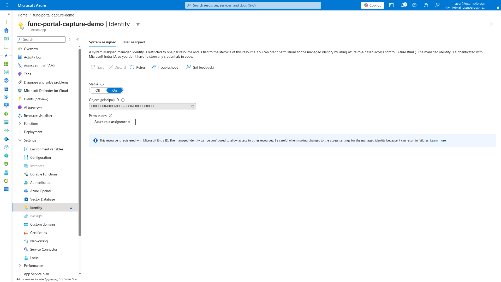
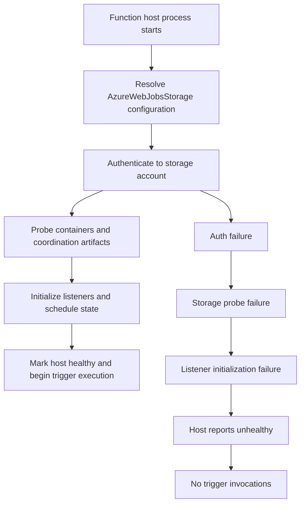
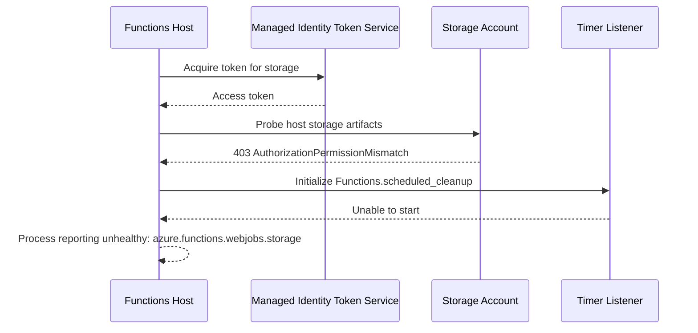
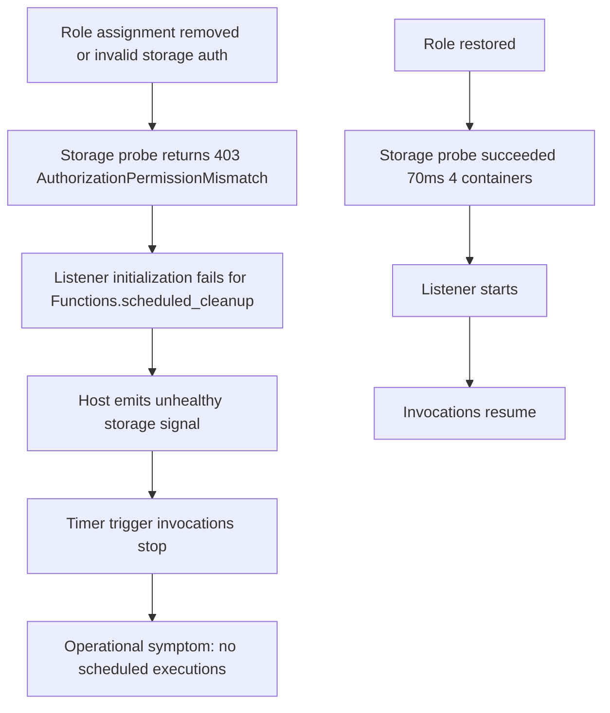
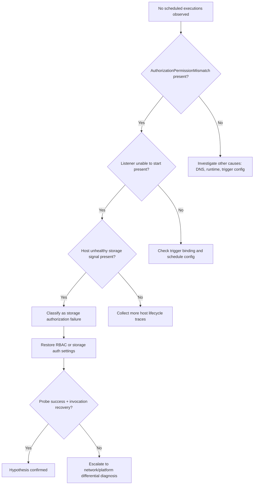
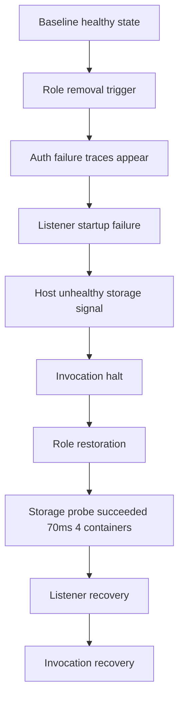

---
content_sources:
  references:
    - type: mslearn-adapted
      url: https://learn.microsoft.com/en-us/azure/azure-functions/storage-considerations
    - type: mslearn-adapted
      url: https://learn.microsoft.com/en-us/azure/azure-functions/functions-triggers-bindings
    - type: mslearn-adapted
      url: https://learn.microsoft.com/en-us/azure/azure-functions/functions-identity-based-connections-tutorial
    - type: mslearn-adapted
      url: https://learn.microsoft.com/en-us/azure/azure-functions/functions-monitoring
    - type: mslearn-adapted
      url: https://learn.microsoft.com/en-us/azure/azure-monitor/app/data-model
    - type: mslearn-adapted
      url: https://learn.microsoft.com/en-us/azure/role-based-access-control/role-assignments-cli
  diagrams:
    - id: 1-1-storage-dependency-model-for-azure-functions
      type: flowchart
      source: self-generated
      justification: Flow view of storage dependency model for azure functions, synthesized from Microsoft Learn documentation cited on this page.
      based_on:
        - https://learn.microsoft.com/en-us/azure/azure-functions/storage-considerations
        - https://learn.microsoft.com/en-us/azure/azure-functions/functions-triggers-bindings
        - https://learn.microsoft.com/en-us/azure/azure-functions/functions-identity-based-connections-tutorial
        - https://learn.microsoft.com/en-us/azure/azure-functions/functions-monitoring
        - https://learn.microsoft.com/en-us/azure/azure-monitor/app/data-model
        - https://learn.microsoft.com/en-us/azure/role-based-access-control/role-assignments-cli
    - id: 1-5-failure-progression-model
      type: sequenceDiagram
      source: self-generated
      justification: Interaction sequence for failure progression model, synthesized from Microsoft Learn documentation cited on this page.
      based_on:
        - https://learn.microsoft.com/en-us/azure/azure-functions/storage-considerations
        - https://learn.microsoft.com/en-us/azure/azure-functions/functions-triggers-bindings
        - https://learn.microsoft.com/en-us/azure/azure-functions/functions-identity-based-connections-tutorial
        - https://learn.microsoft.com/en-us/azure/azure-functions/functions-monitoring
        - https://learn.microsoft.com/en-us/azure/azure-monitor/app/data-model
        - https://learn.microsoft.com/en-us/azure/role-based-access-control/role-assignments-cli
    - id: 2-2-causal-chain
      type: flowchart
      source: self-generated
      justification: Flow view of causal chain, synthesized from Microsoft Learn documentation cited on this page.
      based_on:
        - https://learn.microsoft.com/en-us/azure/azure-functions/storage-considerations
        - https://learn.microsoft.com/en-us/azure/azure-functions/functions-triggers-bindings
        - https://learn.microsoft.com/en-us/azure/azure-functions/functions-identity-based-connections-tutorial
        - https://learn.microsoft.com/en-us/azure/azure-functions/functions-monitoring
        - https://learn.microsoft.com/en-us/azure/azure-monitor/app/data-model
        - https://learn.microsoft.com/en-us/azure/role-based-access-control/role-assignments-cli
    - id: 3-10-triage-decision-logic
      type: flowchart
      source: self-generated
      justification: Flow view of triage decision logic, synthesized from Microsoft Learn documentation cited on this page.
      based_on:
        - https://learn.microsoft.com/en-us/azure/azure-functions/storage-considerations
        - https://learn.microsoft.com/en-us/azure/azure-functions/functions-triggers-bindings
        - https://learn.microsoft.com/en-us/azure/azure-functions/functions-identity-based-connections-tutorial
        - https://learn.microsoft.com/en-us/azure/azure-functions/functions-monitoring
        - https://learn.microsoft.com/en-us/azure/azure-monitor/app/data-model
        - https://learn.microsoft.com/en-us/azure/role-based-access-control/role-assignments-cli
    - id: evidence-timeline
      type: graph
      source: self-generated
      justification: Flow view of evidence timeline, synthesized from Microsoft Learn documentation cited on this page.
      based_on:
        - https://learn.microsoft.com/en-us/azure/azure-functions/storage-considerations
        - https://learn.microsoft.com/en-us/azure/azure-functions/functions-triggers-bindings
        - https://learn.microsoft.com/en-us/azure/azure-functions/functions-identity-based-connections-tutorial
        - https://learn.microsoft.com/en-us/azure/azure-functions/functions-monitoring
        - https://learn.microsoft.com/en-us/azure/azure-monitor/app/data-model
        - https://learn.microsoft.com/en-us/azure/role-based-access-control/role-assignments-cli
---
# Lab Guide: Storage Access Failure (AzureWebJobsStorage)

This lab separates host-storage authorization from DNS, network-path and Storage
firewall failures. Use the new controlled scenario below for future execution;
the older walkthrough and excerpts remain historical material.

!!! warning "Golden scenario: NOT_RUN / NOT_TESTED"
    No Azure execution, capture, recovery measurement or cleanup receipt exists
    for this scenario. Synthetic evaluator fixtures are software tests, not Azure
    evidence. The historical timestamps, role changes, screenshots and verdicts
    below do not validate it. A **403** or a **successful post-change restart** is
    supporting evidence, not a unique root cause. Missing logs are not disproof.

---

## Portal Walkthrough

These portal blades help investigate storage access failures. All captures from a Consumption (Y1) Function App with PII masked.




## Lab Metadata

| Field | Value |
|---|---|
| Lab focus | Storage authorization failure and host startup impact |
| Runtime profile | Azure Functions v4 (Linux) |
| Plan profile | Flex Consumption (`FC1`) |
| Trigger type under test | Timer trigger (`Functions.scheduled_cleanup`) |
| Critical dependency | `AzureWebJobsStorage` |
| Auth model variants | Managed identity (RBAC) and connection string |
| Primary blast radius | Trigger listener startup and background execution |
| Lab source path | `labs/storage-access-failure/` |
| Observability data sources | Application Insights (`traces`, `requests`, `exceptions`, `dependencies`) |
| Incident signature | `AuthorizationPermissionMismatch`, listener unable to start, host unhealthy |
| Recovery signature | Storage probe succeeded (`70ms`, `4 containers`) |

!!! info "What this lab is designed to prove"
    This lab is built to test a frequent production failure mode: storage auth drift.

    It validates that when `AzureWebJobsStorage` cannot be accessed:

    - Trigger listeners fail to initialize.
    - Host health degrades (`azure.functions.webjobs.storage: Unhealthy`).
    - Timer/queue-style invocations stop even if the app endpoint still responds.

    It also validates that restoring RBAC or connection settings re-establishes storage probes and listener startup.

---

## 1) Background

Azure Functions host behavior depends on storage access for multiple control-plane and runtime tasks.

This includes:

- Trigger coordination metadata.
- Lease ownership and lock records.
- Timer schedule state persistence.
- Queue trigger checkpointing.
- Internal host coordination artifacts.

In this lab, storage access is intentionally broken so that host startup and listener behavior can be observed through deterministic evidence.

### 1.1 Storage dependency model for Azure Functions

`AzureWebJobsStorage` is not optional for most non-trivial Azure Functions apps.

Even when application code does not directly read blobs or queues, the host still needs storage for runtime operations.

<!-- diagram-id: 1-1-storage-dependency-model-for-azure-functions -->


### 1.2 Managed identity vs connection string behavior

Two dominant access models are used in Azure Functions storage integration.

| Model | How auth is done | Typical failure mode | Recovery action |
|---|---|---|---|
| Managed identity + RBAC | Token-based auth for host identity | Missing/wrong role assignment, wrong scope | Re-add role assignments at correct scope |
| Connection string key auth | Shared key in app setting | Expired/rotated key mismatch, invalid setting | Update `AzureWebJobsStorage` connection string |

For FC1 workloads, identity-based connections are commonly the default architecture choice.

In this lab, the failure trigger emulates RBAC drift in identity mode.

### 1.3 Required data-plane roles for host storage work

Use the current [identity permission boundaries](../../platform/storage-connectivity.md#identity-permission-boundaries),
not the historical four-role removal below. Host operations and the Timer's Blob
locks require **Storage Blob Data Owner**; diagnostic events additionally use
**Storage Table Data Contributor**. Queue and management-plane roles depend on
extensions; they are not universal host prerequisites. Flex deployment's
**Storage Blob Data Contributor** belongs to the deployment account/identity,
not a replacement for host permissions. See the official
[connection role table](https://learn.microsoft.com/en-us/azure/azure-functions/manage-connections#grant-permissions-to-an-identity).

### 1.4 FC1 behavior and why this scenario appears suddenly

Flex Consumption scales quickly and can instantiate new workers frequently.

That makes configuration and RBAC consistency critical:

- A hidden RBAC drift may remain unnoticed while one worker is warm.
- New worker startup forces fresh storage probes.
- The first startup after drift can suddenly expose failure.

### 1.5 Failure progression model

<!-- diagram-id: 1-5-failure-progression-model -->


### 1.6 Signal map: normal vs incident

| Signal source | Normal | Incident |
|---|---|---|
| `traces` host startup | Storage probe success messages | Repeated `AuthorizationPermissionMismatch` |
| `traces` listener logs | Listener started / schedule acquired | `The listener ... was unable to start` |
| `requests` for timer-backed work | Regular success cadence | Missing invocations or repeated failures |
| `exceptions` | Sparse or mixed errors | Dominant unauthorized exceptions |
| Health-related traces | Healthy lifecycle transitions | `Process reporting unhealthy: azure.functions.webjobs.storage` |

---

## 2) Hypothesis

The following numbered hypothesis and criteria belong to the historical
walkthrough. They do not constitute the new scenario's predeclaration. In
particular, absence of authorization errors alone is **INCONCLUSIVE**, not
falsification. The controlled scenario's assertions below supersede those criteria
for new runs without changing the historical results.

### 2.1 Formal hypothesis statement

> If Azure Functions loses required authorization to `AzureWebJobsStorage` (managed identity RBAC drift or invalid connection auth), then host storage probes fail with authorization errors, timer listeners cannot start, host health becomes unhealthy for storage, and trigger invocations halt until access is restored.

### 2.2 Causal chain

<!-- diagram-id: 2-2-causal-chain -->


### 2.3 Proof criteria

All criteria below support the hypothesis:

1. `traces` contain `AuthorizationPermissionMismatch` during incident window.
2. `traces` contain `The listener for function 'Functions.scheduled_cleanup' was unable to start.`
3. `traces` contain `Process reporting unhealthy: azure.functions.webjobs.storage`.
4. Timer invocation cadence drops to zero or error-only behavior.
5. After restoration, logs include storage probe success pattern (`70ms`, `4 containers`) and listener recovery.

### 2.4 Disproof criteria

Any of the following weakens or falsifies the hypothesis:

- Storage authorization errors are absent in the same incident window.
- Listener startup failures persist after confirmed storage role restoration.
- Invocations remain halted while probe success is stable.
- Alternative root cause has stronger evidence (network isolation, DNS resolution, extension mismatch).

### 2.5 Competing hypotheses tested in this lab

| Competing hypothesis | What would be observed | How this lab disambiguates |
|---|---|---|
| Runtime regression | Mixed failures unrelated to storage auth | Filter traces for storage auth signatures |
| Platform transient | Short sporadic errors without deterministic repetition | Look for repeated 403 and listener failure sequence |
| DNS/network issue | Connection timeout/refused patterns, not auth mismatch | Compare error codes and message families |
| App code defect | Function exceptions without host storage unhealthy traces | Correlate host-level lifecycle signals |

### 2.6 Expected lab verdict

Expected outcome for this lab run:

- Hypothesis supported during break phase.
- Hypothesis recovery path supported after role restoration.
- Evidence chain remains consistent without requiring speculative causes.

---

## 3) Runbook

### Golden scenario: host RBAC versus network failures (offline definition)

[Not Proven] On **Linux Flex Consumption (FC1), Functions v4, Python v2**, removing
one host-identity Blob permission assignment may prevent host storage access and
Timer listener startup while DNS, transport and Storage networking still permit
the path. Restoration may recover that listener and Timer execution. This is a
narrow host-storage claim, not a test of deployment failure, binding delivery,
durable business output, other plans/OS or independent reproduction.

Follow the [merged evidence contract](../methodology/troubleshooting-method.md#evidence-and-hypothesis-contract).
The exact machine-readable predeclaration is
[`storage-scenario.json`](https://github.com/yeongseon/azure-functions-practical-guide/blob/main/tests/fixtures/evidence/storage-scenario.json);
[`synthetic-storage-cases.json`](https://github.com/yeongseon/azure-functions-practical-guide/blob/main/tests/fixtures/evidence/synthetic-storage-cases.json)
and `tests/test_storage_scenario.py` exercise its assertions unchanged through
`scripts/lib/evidence_eval.py`. No collector, new predicate or firewall automation
is introduced. The evaluator checks explicit equality, not Azure authenticity;
review the raw-to-signal mapping before replay.

#### Scope and storage-role matrix

| Plan / OS | Storage consumer | Connection / authorization boundary | Scenario treatment |
|---|---|---|---|
| FC1 / Linux | Host Blob storage and Timer locks | `AzureWebJobsStorage__*`; dedicated host managed identity, Storage Blob Data Owner on host account | Only fault target. Keep diagnostic Table permission and its service path intact. |
| FC1 / Linux | Flex deployment Blob container | `functionAppConfig.deployment.storage`; separate deployment account and selected identity, Storage Blob Data Contributor | Fixed control. Host-role removal must not affect package access. No `WEBSITE_RUN_FROM_PACKAGE` or Kudu/SCM assumptions. |
| FC1 / Linux | Binding/application data storage | Extension-specific connection, identity and data roles on its own target | No Blob/Queue/Durable binding or customer data in this Timer-only workload. A binding-account denial cannot satisfy host evidence. |
| FC1 / Linux | Azure Files content | No classic content-share dependency | Not applicable. |
| Consumption, Premium, Dedicated / supported OS | Host, content, deployment and binding consumers vary | See the authoritative plan and authentication matrices | Not tested by this scenario; do not transplant its networking or role assumptions. |

Use [Storage Connectivity](../../platform/storage-connectivity.md), particularly
[host versus deployment authentication](../../platform/storage-connectivity.md#deployment-and-binding-authentication-are-separate),
[plan differences](../../platform/storage-connectivity.md#6-hosting-plan-differences),
and the [network combination matrix](../../platform/storage-connectivity.md#7-storage-network-settings-combination-matrix).
A service endpoint normally resolves publicly; a private endpoint should resolve
to its intended private address. Neither result alone proves authorization.

#### Ownership, topology and validity prerequisites

The `labs/storage-access-failure/` directory currently contains **only a README**,
not the `main.bicep` named by the historical walkthrough. The existing
`infra/flex-consumption/main.bicep` shares one storage account and identity between
host and deployment and grants extra roles: **it is not eligible unchanged** for
this single-consumer experiment. Do not execute the historical multi-role removal
as this scenario. An authorized operator must first provision and review a
disposable topology with separate host and deployment accounts/identities,
following the existing [Flex infrastructure guide](../../language-guides/python/tutorial/flex-consumption/05-infrastructure-as-code.md)
and [networking scenarios](../../platform/networking-scenarios/index.md).
Record the exact resulting recipe/diff; no deployment of that topology is claimed.

Before any write, retain explicit ownership approval, resource inventory and
restoration plan. All apps, identities, accounts, containers, DNS links, subnet
rules and diagnostic resources involved must be run-owned. Stop on shared or
unowned resources, customer data, inherited/group permissions that mask the fault,
policy restrictions or missing access. Never relax policy or add broad Owner roles.
Require exactly one effective host Blob Data Owner assignment eligible for removal;
retain its ID privately and its complete sanitized properties. Do not remove
permissions from an operator identity or the deployment identity.

Configure host logs, Application Insights and host-account Blob resource logs
**before baseline**, including successful and failed operations. Keep Table access
for diagnostic events. Retain sampling/log-level filters, diagnostic settings,
query permissions and collection health. Require a correlated baseline request
through the same host and Storage collection paths. Storage logging is collected
only where authorized and safe: if unavailable, retain the gap and stop short of
causal support; do not fabricate a matching service record.

Run-owned probes must use the app's DNS/routes and **selected host identity**.
A diagnostic host with equivalent routes can support network observations but
its own identity cannot prove host RBAC. Flex has no Kudu console. Establish and
retain an approved app-context diagnostic mechanism before baseline; if host
failure makes it unavailable, retain pre-failure captures and collection errors,
and mark the context control undecidable rather than substituting Cloud Shell.

#### Baseline -> one fault -> recovery procedure

1. **Predeclare:** save the JSON assertions, unique run ID, source commit/dirty diff,
    recipe digest, region, SKU/OS, configured and observed host/Python versions,
    extension versions, tools and sanitized connection/identity map. Freeze one
    Timer running every minute with `use_monitor=true`, `run_on_startup=false`,
    logging its packaged release marker and scheduled occurrence. Record source
    archive/lock digests separately from the **actual built deployment package**,
    resolved dependencies and deployment ID. Correlate the active release through
    runtime logs and deployment receipt. A source hash is not built-byte identity.
2. **Baseline/control:** deploy once, establish host startup and listener readiness
    separately from ARM `Running`, then require ten distinct successful scheduled
    occurrences over ten minutes. Capture DNS, TLS/connection outcomes, an approved
    harmless host-identity Blob operation on a dedicated lab diagnostic object,
    and Storage request correlation. Keep diagnostic operations identical through
    all phases; an SDK probe is not by itself a host-lock or listener check.
    Require all baseline/ownership/context/collection controls before injection.
3. **Fault:** remove **only the one inventoried run-owned Storage Blob Data Owner
    assignment** for the selected host identity on the host account. Do not remove
    Table diagnostic roles, deployment/container roles or binding permissions;
    do not rotate keys, change connection settings, DNS, routes or firewall policy.
    Retain exact operation input, UTC start/end, exit code and before/after diff.
    Perform one declared app restart after baseline, fault and restoration alike
    to compare fresh initialization; keep its timing separate from fault acceptance.
    Never treat restart as a guarantee of RBAC/cache propagation.
4. **Collect:** observe each phase for ten minutes; issue network/data probes every
    30 seconds with a 15-second timeout. Retain every attempt and positive
    host-storage/listener failure, not just failed HTTP counts or empty queries.
    Allow ten additional minutes for telemetry, querying every minute. These are
    experiment limits, not Azure propagation or readiness guarantees. If the
    removed permission still authorizes the same operation, retain it as valid
    counter-evidence for this bounded prediction, not proof that RBAC never matters.
5. **Recovery:** restore exactly the captured assignment's principal, role, scope
    and conditions. Verify that original networking and permissions match the
    pre-run snapshot; do not publish/rebuild code or reapply infrastructure.
    Capture successful host storage operations, host startup, listener readiness
    and ten distinct successful scheduled occurrences over ten minutes. Record
    elapsed UTC time from restoration acceptance to first observed successful
    operation and separately first observed Timer success, including restart,
    polling intervals and ingestion delay. These are **first-observed timings**,
    not exact permission propagation or exact readiness. No timings exist yet.
6. **Cleanup:** execute the ownership-restricted receipt below even after an
    inconclusive or failed run. A restored app alone is not cleanup completion.

Only RBAC is intentionally faulted here. DNS, network-path and Storage firewall
are competing explanations checked without changing them. A future experiment
that injects one of those faults needs its own predeclaration/run ID and isolated
rollback; this definition authorizes no broad firewall/DNS automation.

#### Predeclared observations and disproof

| Stage / signal | Baseline and recovery expectation | Fault expectation / decisive counter-evidence |
|---|---|---|
| DNS | Resolver, FQDN, CNAME chain and addresses match chosen host endpoint | Same intended endpoint resolves. Positive lookup failure or wrong-endpoint resolution contradicts an authorization-only explanation; missing DNS capture is undecidable. |
| Network path | TCP 443/TLS reaches intended host Blob endpoint; retain destination and errors | Same path reaches Storage. Positive timeout/refusal/TLS or route/NSG denial with endpoint correlation is a path alternative, not RBAC evidence. |
| Storage firewall | Actual caller path is permitted by effective rules; capture private-endpoint approval or service-endpoint subnet rule as applicable | Unchanged policy **plus actual caller/path and matching service evidence** rules out network denial. Correlated denial contradicts the RBAC-only explanation. A policy snapshot or bare HTTP response alone cannot establish this. |
| Data-plane RBAC | Same harmless operation succeeds using the selected host identity and host account | Correlate OAuth request, service/operation, `x-ms-error-code`, request ID, UTC time and effective role scope/removal. Permission denial with valid identity and permitted network supports RBAC. Same host operation authorized is decisive counter-evidence. SAS permission mismatch, expired credentials, Shared Key or another principal is not this signal. |
| Host / listener | Positive startup and Timer listener readiness; ten successful distinct scheduled occurrences | Positive host-storage error and listener failure correlated to the target account/operation. Empty `requests`, an HTTP 403 or ARM `Running` alone proves neither listener failure nor cause. |
| Recovery | Original permissions/network restored; same active built bytes; positive operations and scheduled execution | A successful post-change restart supports recovery only. Restart without restoration, unverified package identity or missing scheduled execution is insufficient. |

`run.ownership`, `baseline.readiness`, `run.storage-roles`, `fault.config-diff`,
`run.artifact`, `run.collection`, `run.probe-context` and
`fault.failure-isolation` are **control roles**: invalid/missing prerequisites
make even apparent decisive counter-evidence **INCONCLUSIVE**. Classify isolation
only after reviewing all available diagnostics: one coherent layer can contradict
the prediction; simultaneous DNS/path/authorization failures or unexplained drift
are mixed failures, not a unique cause. Do not label isolation valid to force a
verdict. Supporting `fault.response=403` never substitutes for a discriminator.

Map every normalized value to exact raw file/field, operation, identity/endpoint,
event time and transformation in `mapping.json`. `fault.authorization` needs a
permission-specific, identity- and request-correlated explanation, not just a
string match on an error family. See the
[Storage 403 diagnostic guide](https://learn.microsoft.com/en-us/troubleshoot/azure/azure-storage/blobs/authentication/storage-troubleshoot-403-errors)
and [separate DNS/transport/authorization evidence](../../platform/storage-connectivity.md#separate-dns-transport-and-authorization-evidence).

**Outcome rules:** NOT_RUN remains NOT_TESTED. A COMPLETE run supports the claim
only if all assertions and controls hold. Finished collection with missing,
delayed, conflicting or nondiscriminating data is INCONCLUSIVE. Unfinished
collection is PARTIAL (or BLOCKED/FAILED as the contract defines), hence NOT_TESTED.
With valid controls, decisive discriminator counters yield CONTRADICTED even if
recovery evidence is missing; a conflict within an assertion still makes the run
INCONCLUSIVE. This preserves the evaluator's merged contradiction precedence.
Cleanup must still be attempted and its incomplete state disclosed independently
of the causal verdict.

### Historical walkthrough (not the Golden scenario)

!!! warning "Do not reuse this as the controlled fault recipe"
    The following walkthrough changes multiple roles and references a nonexistent
    lab template. Its broader assertions, legacy four-role advice and fixed
    `70ms`/container-count expectations are not current least-privilege guidance.
    The unprojected app-settings command can expose secrets: use the current
    [read-only names-only precheck](../../platform/storage-connectivity.md#read-only-settings-precheck)
    instead; never retain or publish full setting values. Historical material is
    preserved for provenance, not promoted to trusted-current evidence.

This runbook is execution-focused and uses long-form CLI flags only.

### 3.1 Prerequisites

| Tool or access | Check command |
|---|---|
| Azure CLI | `az version` |
| Logged-in Azure session | `az account show` |
| Bash shell | `bash --version` |
| App Insights query rights | `az monitor app-insights component show --resource-group "$RG" --app "$APP_NAME"` |

### 3.2 Variables

Use the canonical variable names used across this guide:

```bash
RG="rg-lab-storage-access"
APP_NAME="func-lab-storageaccess"
LOCATION="koreacentral"
STORAGE_NAME="stlabstorageaccess"
```

Optional helper variables:

```bash
SUBSCRIPTION_ID="<subscription-id>"
LAB_PATH="labs/storage-access-failure"
```

### 3.3 Deploy infrastructure

Create or confirm resource group:

```bash
az group create \
  --name "$RG" \
  --location "$LOCATION"
```

| CLI element | Explanation |
|---|---|
| Command(s) | `az group create` |
| Key flags | `--name`, `--location` |
| Variables | `$RG`, `$LOCATION` |
| Expected result | Azure CLI returns provisioning details; confirm the resource name and successful provisioning state before continuing. |


Deploy the lab stack:

```bash
az deployment group create \
  --resource-group "$RG" \
  --template-file "$LAB_PATH/main.bicep" \
  --parameters "appName=$APP_NAME" "storageName=$STORAGE_NAME" "location=$LOCATION"
```

| CLI element | Explanation |
|---|---|
| Command(s) | `az deployment group create` |
| Key flags | `--resource-group`, `--template-file`, `--parameters` |
| Variables | `$RG`, `$LAB_PATH`, `$APP_NAME`, `$STORAGE_NAME`, `$LOCATION` |
| Expected result | Azure CLI returns provisioning details; confirm the resource name and successful provisioning state before continuing. |


Validate app and storage resources:

```bash
az functionapp show \
  --resource-group "$RG" \
  --name "$APP_NAME" \
  --output table

az storage account show \
  --resource-group "$RG" \
  --name "$STORAGE_NAME" \
  --output table
```

| CLI element | Explanation |
|---|---|
| Command(s) | `az functionapp show`, `az storage account show` |
| Key flags | `--resource-group`, `--name`, `--output` |
| Variables | `$RG`, `$APP_NAME`, `$STORAGE_NAME` |
| Expected result | Azure CLI returns the requested resource data; verify names, IDs, status fields, or metric values match the scenario. |


### 3.4 Baseline verification (pre-failure)

Confirm the app is reachable and host is stable:

```bash
az functionapp function list \
  --resource-group "$RG" \
  --name "$APP_NAME" \
  --output table
```

| CLI element | Explanation |
|---|---|
| Command(s) | `az functionapp function list` |
| Key flags | `--resource-group`, `--name`, `--output` |
| Variables | `$RG`, `$APP_NAME` |
| Expected result | Azure CLI returns the requested resource data; verify names, IDs, status fields, or metric values match the scenario. |


Capture app settings relevant to storage:

```bash
az functionapp config appsettings list \
  --resource-group "$RG" \
  --name "$APP_NAME" \
  --output json
```

| CLI element | Explanation |
|---|---|
| Command(s) | `az functionapp config appsettings list` |
| Key flags | `--resource-group`, `--name`, `--output` |
| Variables | `$RG`, `$APP_NAME` |
| Expected result | Azure CLI applies the configuration change; confirm the returned JSON or follow-up query shows the expected value. |


Check baseline host logs in short time window:

```kusto
let appName = "func-lab-storageaccess";
traces
| where timestamp > ago(30m)
| where cloud_RoleName =~ appName
| where message has_any ("Host started", "listener", "storage", "probe")
| project timestamp, severityLevel, message
| order by timestamp desc
```

Baseline expected pattern:

- No repeated 403 storage auth failures.
- Listener startup does not show persistent failure.
- Invocation cadence appears normal for timer schedule window.

### 3.5 Capture baseline evidence queries

#### 3.5.1 Function execution summary

```kusto
let appName = "func-lab-storageaccess";
requests
| where timestamp > ago(1h)
| where cloud_RoleName =~ appName
| where operation_Name startswith "Functions."
| summarize
    Invocations = count(),
    Failures = countif(success == false),
    FailureRatePercent = round(100.0 * countif(success == false) / count(), 2),
    P95Ms = round(percentile(duration, 95), 2)
  by FunctionName = operation_Name
| order by Failures desc, P95Ms desc
```

#### 3.5.2 Failed invocations with exception join

```kusto
let appName = "func-lab-storageaccess";
requests
| where timestamp > ago(2h)
| where cloud_RoleName =~ appName
| where operation_Name startswith "Functions."
| where success == false
| project timestamp, operation_Id, FunctionName = operation_Name, resultCode, duration
| join kind=leftouter (
    exceptions
    | where timestamp > ago(2h)
    | where cloud_RoleName =~ appName
    | project operation_Id, ExceptionType = type, ExceptionMessage = outerMessage
) on operation_Id
| order by timestamp desc
```

#### 3.5.3 Host startup and lifecycle events

```kusto
let appName = "func-lab-storageaccess";
traces
| where timestamp > ago(2h)
| where cloud_RoleName =~ appName
| where message has_any ("Host started", "Job host started", "listener", "storage", "unhealthy")
| project timestamp, severityLevel, message
| order by timestamp desc
```

### 3.6 Trigger the storage access failure

This phase intentionally introduces RBAC breakage for the Function App identity.

List current role assignments for app identity on storage scope:

```bash
APP_PRINCIPAL_ID=$(az functionapp identity show \
  --resource-group "$RG" \
  --name "$APP_NAME" \
  --query "principalId" \
  --output tsv)

STORAGE_ID=$(az storage account show \
  --resource-group "$RG" \
  --name "$STORAGE_NAME" \
  --query "id" \
  --output tsv)

az role assignment list \
  --assignee "$APP_PRINCIPAL_ID" \
  --scope "$STORAGE_ID" \
  --output table
```

| CLI element | Explanation |
|---|---|
| Command(s) | `az functionapp identity show`, `az storage account show`, `az role assignment list` |
| Key flags | `--resource-group`, `--name`, `--query`, `--output`, `--assignee`, `--scope` |
| Variables | `$RG`, `$APP_NAME`, `$STORAGE_NAME`, `$APP_PRINCIPAL_ID`, `$STORAGE_ID` |
| Expected result | Azure CLI returns the requested resource data; verify names, IDs, status fields, or metric values match the scenario. |


Remove required roles (failure trigger):

```bash
az role assignment delete \
  --assignee-object-id "$APP_PRINCIPAL_ID" \
  --role "Storage Account Contributor" \
  --scope "$STORAGE_ID"

az role assignment delete \
  --assignee-object-id "$APP_PRINCIPAL_ID" \
  --role "Storage Blob Data Owner" \
  --scope "$STORAGE_ID"

az role assignment delete \
  --assignee-object-id "$APP_PRINCIPAL_ID" \
  --role "Storage Queue Data Contributor" \
  --scope "$STORAGE_ID"

az role assignment delete \
  --assignee-object-id "$APP_PRINCIPAL_ID" \
  --role "Storage Table Data Contributor" \
  --scope "$STORAGE_ID"


```

| CLI element | Explanation |
|---|---|
| Command(s) | `az role assignment delete` |
| Key flags | `--assignee-object-id`, `--role`, `--scope` |
| Variables | `$APP_PRINCIPAL_ID`, `$STORAGE_ID` |
| Expected result | Azure CLI completes the removal request; verify the target no longer appears in follow-up `show` or `list` output. |


Restart Function App so host performs fresh storage initialization:

```bash
az functionapp restart \
  --resource-group "$RG" \
  --name "$APP_NAME"
```

| CLI element | Explanation |
|---|---|
| Command(s) | `az functionapp restart` |
| Key flags | `--resource-group`, `--name` |
| Variables | `$RG`, `$APP_NAME` |
| Expected result | Azure CLI completes successfully and returns JSON, table, or no output depending on the command; verify the next documented check before continuing. |


Wait for 2-5 minutes for telemetry propagation.

### 3.7 Collect incident evidence

#### 3.7.1 Storage auth and unhealthy traces

```kusto
let appName = "func-lab-storageaccess";
traces
| where timestamp > ago(1h)
| where cloud_RoleName =~ appName
| where message has_any ("AuthorizationPermissionMismatch", "Unable to access AzureWebJobsStorage", "unhealthy", "Forbidden", "Unauthorized")
| project timestamp, severityLevel, message
| order by timestamp desc
```

#### 3.7.2 Listener startup failures

```kusto
let appName = "func-lab-storageaccess";
traces
| where timestamp > ago(1h)
| where cloud_RoleName =~ appName
| where message has "The listener for function 'Functions.scheduled_cleanup' was unable to start."
| project timestamp, severityLevel, message
| order by timestamp desc
```

#### 3.7.3 Request and exception correlation

```kusto
let appName = "func-lab-storageaccess";
requests
| where timestamp > ago(1h)
| where cloud_RoleName =~ appName
| where operation_Name startswith "Functions."
| project timestamp, operation_Id, operation_Name, success, resultCode, duration
| join kind=leftouter (
    exceptions
    | where timestamp > ago(1h)
    | where cloud_RoleName =~ appName
    | project operation_Id, type, outerMessage
) on operation_Id
| order by timestamp desc
```

#### 3.7.4 Dependency failures to storage endpoints

```kusto
let appName = "func-lab-storageaccess";
dependencies
| where timestamp > ago(1h)
| where cloud_RoleName =~ appName
| where target has_any ("blob.core.windows.net", "queue.core.windows.net")
| summarize Calls=count(), Failed=countif(success == false), FailureRatePercent=round(100.0 * countif(success == false) / count(), 2), P95Ms=percentile(duration, 95) by target, resultCode
| order by Failed desc, P95Ms desc
```

### 3.8 Real incident log patterns to verify

Use these representative patterns as validation anchors. The failure phase shows event log snippets derived from live telemetry:

#### 3.8.1 Failure-phase log snippets

```text
Process reporting unhealthy: Unhealthy. Health check entries are {
  "azure.functions.web_host.lifecycle": {"status":"Healthy"},
  "azure.functions.script_host.lifecycle": {"status":"Healthy"},
  "azure.functions.webjobs.storage": {
    "status":"Unhealthy",
    "description":"Unable to access AzureWebJobsStorage",
    "errorCode":"AuthorizationPermissionMismatch"
  }
}
[2026-04-04T12:17:54Z] Storage operation failed: Status: 403 (AuthorizationPermissionMismatch) after 325ms while probing AzureWebJobsStorage.
[2026-04-04T12:15:42Z] The listener for function 'Functions.scheduled_cleanup' was unable to start.
```

#### 3.8.2 Recovery-phase log snippet

```text
[2026-04-04T12:31:08Z] Storage probe succeeded (70ms, 4 containers).
[2026-04-04T12:31:10Z] Job host started.
[2026-04-04T12:31:11Z] The listener for function 'Functions.scheduled_cleanup' started.
```

### 3.9 Interpretation checklist

| Check | Evidence source | Pass condition |
|---|---|---|
| Storage auth failure detected | `traces` | `AuthorizationPermissionMismatch` appears repeatedly |
| Listener startup failure detected | `traces` | Scheduled cleanup listener unable to start |
| Host unhealthy emitted | `traces` | `azure.functions.webjobs.storage: Unhealthy` appears |
| Invocation disruption observed | `requests` | Timer execution absent or failure-only |
| Recovery probe success detected | `traces` | `Storage probe succeeded (70ms, 4 containers)` |
| Invocation recovery observed | `requests` | Successful scheduled executions resume |

### 3.10 Triage decision logic

<!-- diagram-id: 3-10-triage-decision-logic -->


### 3.11 Recover from the induced failure

Re-add required roles:

```bash
az role assignment create \
  --assignee-object-id "$APP_PRINCIPAL_ID" \
  --role "Storage Account Contributor" \
  --scope "$STORAGE_ID"

az role assignment create \
  --assignee-object-id "$APP_PRINCIPAL_ID" \
  --role "Storage Blob Data Owner" \
  --scope "$STORAGE_ID"

az role assignment create \
  --assignee-object-id "$APP_PRINCIPAL_ID" \
  --role "Storage Queue Data Contributor" \
  --scope "$STORAGE_ID"

az role assignment create \
  --assignee-object-id "$APP_PRINCIPAL_ID" \
  --role "Storage Table Data Contributor" \
  --scope "$STORAGE_ID"

```

| CLI element | Explanation |
|---|---|
| Command(s) | `az role assignment create` |
| Key flags | `--assignee-object-id`, `--role`, `--scope` |
| Variables | `$APP_PRINCIPAL_ID`, `$STORAGE_ID` |
| Expected result | Azure CLI returns provisioning details; confirm the resource name and successful provisioning state before continuing. |


Restart the app:

```bash
az functionapp restart \
  --resource-group "$RG" \
  --name "$APP_NAME"
```

| CLI element | Explanation |
|---|---|
| Command(s) | `az functionapp restart` |
| Key flags | `--resource-group`, `--name` |
| Variables | `$RG`, `$APP_NAME` |
| Expected result | Azure CLI completes successfully and returns JSON, table, or no output depending on the command; verify the next documented check before continuing. |


Wait 2-5 minutes and re-run the incident queries.

### 3.12 Verify recovery

Recovery validation query:

```kusto
let appName = "func-lab-storageaccess";
traces
|| where timestamp > ago(10m)
| where cloud_RoleName =~ appName
| where message has_any ("Storage probe succeeded", "listener", "Host started", "Job host started")
| project timestamp, severityLevel, message
| order by timestamp desc
```

Invocation recovery query:

```kusto
let appName = "func-lab-storageaccess";
requests
|| where timestamp > ago(10m)
| where cloud_RoleName =~ appName
| where operation_Name =~ "Functions.scheduled_cleanup"
| summarize Invocations=count(), Failures=countif(success == false), LastSeen=max(timestamp)
```

Expected recovery indicators:

- Storage probe success appears.
- Listener startup failures stop.
- Scheduled trigger invocations resume.


## 4) Experiment Log

### Golden run identity and retained evidence (no captures yet)

| Field | Current value |
|---|---|
| Execution / hypothesis | `NOT_RUN` / `NOT_TESTED` |
| Claim / trust | Not Proven; offline definition, unverified for Azure |
| Azure run ID / captured_at | None; no collection attempted |
| Recovery timing / cleanup receipt | Not available; no resources created |
| Offline replay | Explicitly synthetic software regression cases only |

Future sanitized captures belong under a fresh run ID **outside test fixtures**.
This is a layout specification, not an inventory of existing evidence:

```text
<approved-evidence-root>/<run-id>/
  identity.json                  # approval, inventory, source/recipe/environment
  predeclaration.json            # assertions and bounds frozen before writes
  baseline|fault|recovery/
    <UTC>-config.json             # role/account map, selectors, rules, diff
    <UTC>-source-manifest.json / <UTC>-built-manifest.json
    <UTC>-deployment-activation.json
    <UTC>-dns.json                # resolver, chain, service, address, context
    <UTC>-connection.json         # TCP/TLS result, timeout, exit/error detail
    <UTC>-storage-operation.json  # auth type, operation, status/code, request ID
    <UTC>-host-listener.json / <UTC>-timer-occurrences.json
    <UTC>-query.txt / <UTC>-results.json / <UTC>-collection-errors.json
    <UTC>-storage-resource-logs.json
    <UTC>-change-receipt.json     # exact target, command, UTC, exit, restore diff
  mapping.json                   # signal -> raw field, role, transformation
  evidence.json                  # evaluator input assembled after collection
  manifest.sha256                # sanitized bytes; retain independently
  evaluations/<evaluation-id>.json
  cleanup/<UTC>-receipt.json
```

Each capture needs run ID, actual UTC `captured_at`, event/query interval, role,
primary/derived/reported provenance and trust justification. Record query/table
scope, inputs, log filters/sampling, ingestion/capture times and errors, including
empty results and bounded waits. Review baseline and recovery collection controls
before interpreting silence. Derived classifications need their raw inputs;
an author-entered PASS is not evidence. Record `evaluated_at` separately from
capture time; Git records prose edit time. Never invent timestamps to make the
NOT_RUN definition evaluable. Synthetic dates in tests are fictional.

Sanitize before retaining/publication: stable placeholders for account/resource/
principal IDs, addresses and hostnames; preserve cross-file correlations without
secrets, tokens, authorization headers, SAS query strings, connection strings or
customer data. Query only relevant approved Storage logs, never enumerate real
objects for convenience. Hash final sanitized bytes, keep immutable run artifacts
and independently retained digests; recollection uses a new run ID. Restricted
originals stay only in an approved private location, not Git. No historical
capture or `last_tested` value is refreshed by this offline definition.

### Historical experiment log (unchanged evidence)

This section documents artifact-centered observations and links each finding to hypothesis criteria.

### 4.1 Artifact inventory

| Category | Artifact examples |
|---|---|
| Deployment and config | `deployment.json`, `appsettings-baseline.json`, `identity-baseline.json` |
| Role assignment evidence | `roles-before.txt`, `roles-after-break.txt`, `roles-after-recovery.txt` |
| KQL exports | `kql-traces-storage-failure.json`, `kql-listener-failure.json`, `kql-recovery.json` |
| Invocation evidence | `kql-requests-before.json`, `kql-requests-during.json`, `kql-requests-after.json` |
| Incident notes | `timeline.md`, `verdict.md` |

### 4.2 Baseline evidence snapshot

#### 4.2.1 Baseline role assignments

| Role | Scope | Expected |
|---|---|---|
| Storage Account Contributor | Storage account scope | Present |
| Storage Blob Data Owner | Storage account scope | Present |
|| Storage Queue Data Contributor | Storage account scope | Present |
|| Storage Table Data Contributor | Storage account scope | Present |

#### 4.2.2 Baseline host traces

Representative pattern before break:

```text
[2026-04-04T12:05:11Z] Host started (62ms)
[2026-04-04T12:05:11Z] Job host started
[2026-04-04T12:05:12Z] Timer listener started for Functions.scheduled_cleanup
```

#### 4.2.3 Baseline invocation summary

| FunctionName | Invocations | Failures | FailureRatePercent | P95Ms |
|---|---:|---:|---:|---:|
| Functions.scheduled_cleanup | 10 | 0 | 0.00 | 245 |

### 4.3 Trigger event log

RBAC break operation timestamped:

```text
2026-04-04T12:14:58Z  Removed role: Storage Account Contributor
2026-04-04T12:15:02Z  Removed role: Storage Blob Data Owner
2026-04-04T12:15:02Z  Removed role: Storage Queue Data Contributor
2026-04-04T12:15:12Z  Function app restart initiated
```

!!! note "Role coverage in this experiment"
    This experiment removed three of the four required roles. Storage Table Data Contributor was not present in the original assignment and therefore was not removed. In production, ensure all four roles are verified.

### 4.4 During-incident KQL observations

#### 4.4.1 Host storage failure traces

| timestamp | severityLevel | message |
|---|---:|---|
| 2026-04-04T12:22:42Z | 3 | Process reporting unhealthy: azure.functions.webjobs.storage: Unhealthy |
| 2026-04-04T12:22:42Z | 3 | Unable to access AzureWebJobsStorage. Status: 403 (AuthorizationPermissionMismatch) |
| 2026-04-04T12:17:54Z | 3 | Storage operation failed: Status: 403 (AuthorizationPermissionMismatch) after 325ms while probing AzureWebJobsStorage. |

#### 4.4.2 Listener startup failure traces

| timestamp | severityLevel | message |
|---|---:|---|
| 2026-04-04T12:17:42Z | 3 | The listener for function 'Functions.scheduled_cleanup' was unable to start. |
| 2026-04-04T12:15:42Z | 3 | The listener for function 'Functions.scheduled_cleanup' was unable to start. |

#### 4.4.3 Request and exception correlation

| timestamp | operation_Id | FunctionName | resultCode | duration | ExceptionType | ExceptionMessage |
|---|---|---|---:|---:|---|---|
| 2026-04-04T12:17:54Z | xxxxxxxx-xxxx-xxxx-xxxx-xxxxxxxxxxxx | Functions.scheduled_cleanup | 500 | 8023 | System.UnauthorizedAccessException | Storage operation failed: Status: 403 (AuthorizationPermissionMismatch) |
| 2026-04-04T12:17:42Z | xxxxxxxx-xxxx-xxxx-xxxx-xxxxxxxxxxxx | Functions.scheduled_cleanup | 500 | 7988 | Microsoft.Azure.WebJobs.Host.Listeners.FunctionListenerException | The listener for function 'Functions.scheduled_cleanup' was unable to start. |

#### 4.4.4 Dependency failure concentration

| target | resultCode | Calls | Failed | FailureRatePercent | P95Ms |
|---|---:|---:|---:|---:|---:|
| `stlabstorageaccess.blob.core.windows.net` | 403 | 18 | 18 | 100.00 | 9800 |
| `stlabstorageaccess.queue.core.windows.net` | 403 | 18 | 18 | 100.00 | 8700 |

### 4.5 Recovery-phase observations

Role restoration and restart executed:

```text
2026-04-04T12:28:14Z  Added role: Storage Account Contributor
2026-04-04T12:28:18Z  Added role: Storage Blob Data Owner
2026-04-04T12:28:18Z  Added role: Storage Queue Data Contributor
2026-04-04T12:28:31Z  Function app restart initiated
```

!!! note "Role coverage in this experiment"
    This experiment restored three of the four required roles. Storage Table Data Contributor should also be verified and assigned in production scenarios for complete coverage of table-based operations.

Recovery traces:

```text
[2026-04-04T12:31:08Z] Storage probe succeeded (70ms, 4 containers). Listener initialization resumed.
[2026-04-04T12:31:10Z] Job host started
[2026-04-04T12:31:11Z] The listener for function 'Functions.scheduled_cleanup' started.
```

Recovery invocation summary:

| FunctionName | Invocations | Failures | FailureRatePercent | LastSeen |
|---|---:|---:|---:|---|
| Functions.scheduled_cleanup | 6 | 0 | 0.00 | 2026-04-04T12:39:00Z |

### 4.6 Core finding

!!! success "Key finding (validated)"
    Removing storage data-plane roles from the Function App identity produces a deterministic and reproducible failure cascade:

    - Storage probe returns `403 AuthorizationPermissionMismatch`.
    - `Functions.scheduled_cleanup` listener fails to start.
    - Host reports storage unhealthy state.
    - Scheduled execution halts.

    Restoring role assignments immediately reverses the pattern and resumes trigger execution.

### 4.7 Hypothesis verdict table

| Criterion | Result | Evidence |
|---|---|---|
| Storage auth failure exists | Supported | Repeated `AuthorizationPermissionMismatch` traces |
| Listener fails on storage issue | Supported | Listener unable to start logs |
| Host unhealthy signal appears | Supported | `azure.functions.webjobs.storage: Unhealthy` |
| Trigger execution halts | Supported | Missing or failed scheduled invocations |
| Recovery after role restore | Supported | Probe success (`70ms`, `4 containers`) and resumed invocations |

Final verdict: **Hypothesis supported**.

### 4.8 Practical implications for production operations

1. Include storage-role drift checks in deployment validation.
2. Monitor explicit host storage health messages, not only request failure rates.
3. Keep incident playbooks separated by error family (auth vs network vs runtime).
4. For FC1, treat worker startup windows as high-sensitivity points for RBAC regressions.
5. Capture recovery evidence explicitly to avoid false closure.

### 4.9 Reproducibility notes

- Use the same storage account scope for role remove/add operations.
- Allow telemetry propagation delay before concluding no-signal.
- Keep all exported evidence sanitized.
- Replace IDs with placeholders:
    - `xxxxxxxx-xxxx-xxxx-xxxx-xxxxxxxxxxxx`
    - `<subscription-id>`
    - `<tenant-id>`
    - `<object-id>`

---

## Expected Evidence

For the Golden scenario, use the predeclared observation table and phase windows
above. The following fixed patterns/timeline belong only to the historical
walkthrough, not measured outcomes or proof criteria for a new run. In particular,
failure to establish the chain is not automatically contradiction.

This section defines the expected observation pattern before, during, and after the induced incident.

### Before Trigger (Baseline)

| Evidence Source | Expected State | What to Capture |
|---|---|---|
| Role assignments | Required roles present on storage scope | Role list export |
| Host traces | No repeated storage auth failures | Host lifecycle snippet |
| Timer execution | Scheduled function runs normally | Request summary table |
| Exceptions | No dominant unauthorized exception class | Exception trend query output |

### During Incident

| Evidence Source | Expected State | Key Indicator |
|---|---|---|
| `traces` | Storage authorization failure repeats | `AuthorizationPermissionMismatch` |
| `traces` | Listener startup fails | `The listener for function 'Functions.scheduled_cleanup' was unable to start.` |
| `traces` | Host storage health degraded | `Process reporting unhealthy: azure.functions.webjobs.storage: Unhealthy` |
| `requests` | Trigger invocations stop or fail | Missing cadence / 500s |
| `exceptions` | Unauthorized/listener exceptions dominate | `System.UnauthorizedAccessException`, `FunctionListenerException` |

### After Recovery

| Evidence Source | Expected State | Key Indicator |
|---|---|---|
| Role assignments | Required roles restored | Role list confirms required storage roles are present |
| `traces` | Storage probe returns success | `Storage probe succeeded (70ms, 4 containers)` |
| `traces` | Listener starts successfully | Listener start message present |
| `requests` | Timer invocations resume | Success count increases |
| Exceptions | Unauthorized error family subsides | Incident exceptions stop repeating |

### Evidence Timeline

<!-- diagram-id: evidence-timeline -->


### Evidence Chain: Why This Proves the Hypothesis

!!! success "Falsification logic"
    Hypothesis is confirmed when the evidence chain appears in this order:

    1. RBAC break event at storage scope.
    2. Storage authorization failure (`AuthorizationPermissionMismatch`).
    3. Listener startup failure for `Functions.scheduled_cleanup`.
    4. Host unhealthy signal for `azure.functions.webjobs.storage`.
    5. Trigger execution disruption.
    6. Role restoration.
    7. Storage probe success (`70ms`, `4 containers`) and invocation recovery.

    Hypothesis is falsified if this chain cannot be established and an alternative cause explains the data better.

## Clean Up

### Golden scenario: restoration and ownership-restricted receipt

No cleanup has been executed. A future operator must first restore the one host
assignment even if collection fails, then compare network rules, DNS links,
identity attachments/roles and deployment/binding configuration with the approved
baseline. Retain effective data-plane checks as well as management-state diffs;
successful role creation alone does not prove access restoration. Stop and
escalate on unexplained differences rather than changing other resources.

After recovery capture, remove only run-created diagnostic objects and stop only
run-owned probes. Compare the disposable group's current inventory to its
ownership receipt before deleting it. If shared/unexpected resources appear, do
not delete the group: retain the blocker and obtain owner direction. For reused
approved lab resources, restore the agreed baseline instead. Never modify or
delete unrelated accounts, customer objects, shared DNS or networking.

The receipt must name sanitized targets, ownership approval, original/restored
settings and permissions, exact operations, UTC start/end, exit codes and final
verification results (including errors). Verify deletion **completion**, not
asynchronous acceptance; retain the final authorized absence/inventory check.
Cleanup is separate from causality and independent reproduction. A failed receipt
remains visible even when counter-evidence contradicts the hypothesis.

### Historical cleanup command (not a completion receipt)

```bash
az group delete \
  --name "$RG" \
  --yes \
  --no-wait
```

| CLI element | Explanation |
|---|---|
| Command(s) | `az group delete` |
| Key flags | `--name`, `--yes`, `--no-wait` |
| Variables | `$RG` |
| Expected result | Azure CLI completes the removal request; verify the target no longer appears in follow-up `show` or `list` output. |


## Related Playbook

- [Functions Failing](../playbooks/functions-failing.md)

## See Also

- [Storage connectivity and role boundaries](../../platform/storage-connectivity.md)
- [Networking scenarios](../../platform/networking-scenarios/index.md)
- [Evidence and hypothesis contract](../methodology/troubleshooting-method.md#evidence-and-hypothesis-contract)
- [Lab Guides Hub](../lab-guides/index.md)
- [KQL Query Library](../kql/index.md)
- [First 10 Minutes](../first-10-minutes/index.md)
- [Troubleshooting Methodology](../methodology.md)
- [Functions Not Executing](../playbooks/functions-not-executing.md)

## Sources

- [Host connections and identity permission table](https://learn.microsoft.com/en-us/azure/azure-functions/manage-connections#grant-permissions-to-an-identity)
- [Flex deployment storage settings](https://learn.microsoft.com/en-us/azure/azure-functions/flex-consumption-how-to#configure-deployment-settings)
- [Storage network security](https://learn.microsoft.com/en-us/azure/storage/common/storage-network-security)
- [Storage private endpoints and DNS](https://learn.microsoft.com/en-us/azure/storage/common/storage-private-endpoints)
- [Troubleshoot Storage 403 errors](https://learn.microsoft.com/en-us/troubleshoot/azure/azure-storage/blobs/authentication/storage-troubleshoot-403-errors)
- [Monitor Blob Storage](https://learn.microsoft.com/en-us/azure/storage/blobs/monitor-blob-storage)
- [Azure Functions storage considerations](https://learn.microsoft.com/en-us/azure/azure-functions/storage-considerations)
- [Azure Functions trigger and binding concepts](https://learn.microsoft.com/en-us/azure/azure-functions/functions-triggers-bindings)
- [Enable managed identity for Azure Functions](https://learn.microsoft.com/en-us/azure/azure-functions/functions-identity-based-connections-tutorial)
- [Monitor Azure Functions](https://learn.microsoft.com/en-us/azure/azure-functions/functions-monitoring)
- [Application Insights data model](https://learn.microsoft.com/en-us/azure/azure-monitor/app/data-model)
- [Assign Azure roles using Azure CLI](https://learn.microsoft.com/en-us/azure/role-based-access-control/role-assignments-cli)
