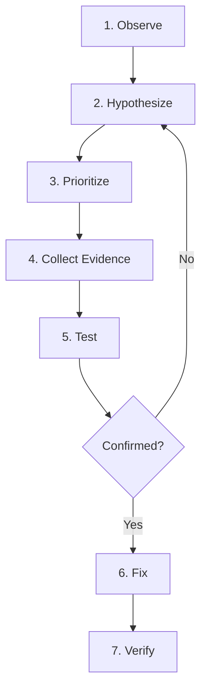
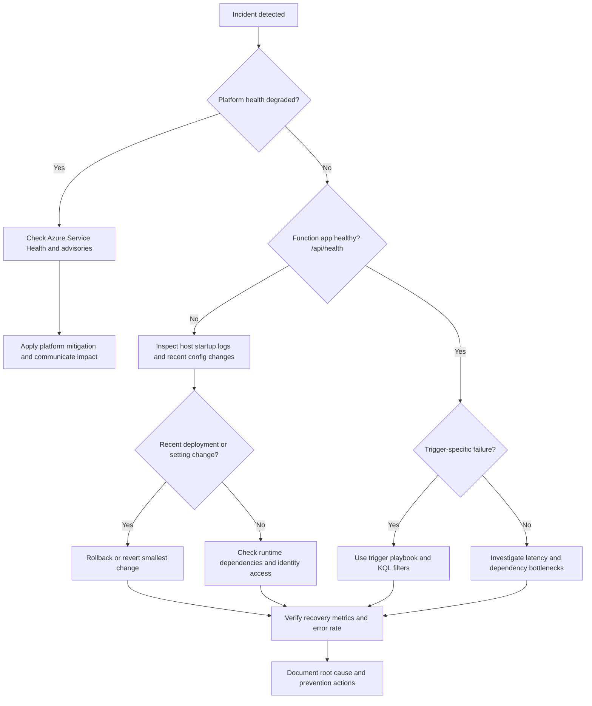

---
content_sources:
  references:
    - type: mslearn-adapted
      url: https://learn.microsoft.com/en-us/azure/azure-functions/functions-monitoring
    - type: mslearn-adapted
      url: https://learn.microsoft.com/en-us/azure/azure-functions/configure-monitoring
    - type: mslearn-adapted
      url: https://learn.microsoft.com/en-us/azure/azure-functions/functions-diagnostics
  diagrams:
    - id: the-method-step-by-step
      type: flowchart
      source: self-generated
      justification: Flow view of the method step by step, synthesized from Microsoft Learn documentation cited on this page.
      based_on:
        - https://learn.microsoft.com/en-us/azure/azure-functions/functions-monitoring
        - https://learn.microsoft.com/en-us/azure/azure-functions/configure-monitoring
        - https://learn.microsoft.com/en-us/azure/azure-functions/functions-diagnostics
    - id: troubleshooting-decision-tree
      type: flowchart
      source: self-generated
      justification: Flow view of troubleshooting decision tree, synthesized from Microsoft Learn documentation cited on this page.
      based_on:
        - https://learn.microsoft.com/en-us/azure/azure-functions/functions-monitoring
        - https://learn.microsoft.com/en-us/azure/azure-functions/configure-monitoring
        - https://learn.microsoft.com/en-us/azure/azure-functions/functions-diagnostics
content_validation:
  status: verified
  last_reviewed: 2026-10-25
  reviewer: agent
  core_claims:
    - claim: "Application Insights sampling can omit telemetry from completed function executions."
      source: https://learn.microsoft.com/en-us/azure/azure-functions/configure-monitoring#configure-sampling
      verified: true
    - claim: "Setting Host.Results to Error excludes successful execution telemetry from the requests table."
      source: https://learn.microsoft.com/en-us/azure/azure-functions/configure-monitoring#configure-log-levels
      verified: true
---

# Troubleshooting Method

Troubleshooting complex issues in Azure Functions requires more than just a list of steps. It requires a mindset that treats every failure as a mystery to be solved with evidence. The hypothesis-driven method documented here is designed to move you from ambiguous symptoms to concrete, data-backed conclusions. This structured approach is essential for identifying root causes in a serverless platform where trigger, host, and platform events can often look like application-level errors.

## Why Hypothesis-Driven Troubleshooting?

When a function fails in production, it is tempting to jump to the most familiar cause or the easiest mitigation. However, Azure Functions incidents often have multiple, overlapping causes for the same symptom.

- **Ambiguity and complexity**: A zero-invocation pattern could mean a disabled function, a broken trigger listener, a storage auth failure, or a missing Event Grid subscription.
- **Multiple causes**: Sometimes, a problem is not caused by one single failure but by a combination of configuration errors and unexpected load.
- **Checklists alone are insufficient**: While checklists are useful for ensuring basic configuration is correct, they cannot resolve complex, multi-cause scenarios. They do not handle the ambiguity of many production issues.
- **Avoiding bias**: Engineers naturally gravitate toward the last issue they solved. A structured method forces you to consider alternative explanations you might otherwise overlook.
- **Efficiency**: By listing and prioritizing hypotheses, you avoid "rabbit holes" and focus your effort on the most likely or easiest-to-test causes first.
- **Structured approach**: This methodology ensures that you do not reach a premature conclusion based on a single, misleading signal.

## The Method Step-by-Step

The following seven steps form the foundation of every investigation in this repository.

<!-- diagram-id: the-method-step-by-step -->

### 1. Observe the Symptom

The first step is to describe what you see, not what you think is happening. Avoid using labels like "the function is broken" or "it's slow." Instead, record specific observations.

- **What is happening?**: For example, "Queue trigger function has zero invocations in the last 30 minutes despite 500 messages in the queue."
- **When is it happening?**: Is the issue constant, or does it spike at a specific time of day?
- **What is the scope?**: Does it affect all functions, or only one trigger type? Is only one plan affected?
- **Be precise**: Use metrics and log timestamps to define the window of the issue. Avoid premature labeling or jumping to conclusions at this stage.

Evidence checklist:

1. Start time and detection source.
2. Affected environments and regions.
3. Last known good time.
4. Most recent deployment or config change.
5. Current customer impact.

### 2. List Competing Hypotheses

Once you have a clear symptom, generate at least two to four plausible causes. Do not settle for just one. Force yourself to consider different domains:

- **Trigger/Listener**: Is the trigger listener healthy? Is the function disabled? Is the source delivering events?
- **Application**: Is there an unhandled exception, a memory leak, or a timeout in the code?
- **Dependency**: Is storage slow? Is an external API timing out? Is DNS resolving correctly?
- **Configuration**: Did a recent deployment change an app setting, a host.json value, or an identity assignment?
- **Platform**: Is there a regional outage, a scaling limitation, or a plan-level constraint?

Each hypothesis must be independently falsifiable. State which observation would
support it and which would contradict it, under a known-working collection path.
Missing or delayed telemetry is `INCONCLUSIVE`, not disproof: Application Insights
[sampling](https://learn.microsoft.com/en-us/azure/azure-functions/configure-monitoring#configure-sampling)
and [log-level filters](https://learn.microsoft.com/en-us/azure/azure-functions/configure-monitoring#configure-log-levels)
can omit execution telemetry.

### 3. Prioritize

You cannot investigate everything at once. Rank your hypotheses based on two criteria:

- **Likelihood**: How often have we seen this before? Does it match the observed signals?
- **Ease of validation**: Use the "cheapest test" principle. If one hypothesis can be checked in 30 seconds with a single CLI command, check it first, even if it is less likely than a more complex one.

### 4. Collect Evidence

Gather the data needed to test your hypotheses. In Azure Functions, this usually involves:

| Hypothesis Type | Evidence Needed | Tool | Example Query |
|---|---|---|---|
| Request failure is application logic | 5xx trend + top exception type | Log Analytics (`AppRequests`, `AppExceptions`) | `AppRequests \| where TimeGenerated > ago(30m) \| where ResultCode startswith "5" \| summarize count() by OperationName` |
| Host startup regression after change | Startup lifecycle logs + deploy timestamp | Log Analytics (`AppTraces`) + Activity Log | `AppTraces \| where TimeGenerated > ago(30m) \| where Message has "Host started" or Message has "Starting Host"` |
| Outbound dependency timeout | Failed dependency calls by target | Application Insights (`dependencies`) | `dependencies \| where timestamp > ago(30m) \| where success == false \| summarize count(), avg(duration) by target, type` |
| Trigger listener unhealthy | Listener/lock/trigger errors | Log Analytics (`AppTraces`) | `AppTraces \| where TimeGenerated > ago(30m) \| where Message has_any ("listener", "Host lock", "trigger")` |
| Scale bottleneck on event trigger | Backlog growth vs execution flatline | Azure Monitor Metrics | `az monitor metrics list --resource "..." --metric "FunctionExecutionCount" --interval PT1M --aggregation Total --offset 30m` |

!!! note "About customMetrics"
    Most metrics in the `customMetrics` table require explicit instrumentation from your application code. Only a few runtime metrics (for example, `FunctionExecutionCount`) are automatically emitted. Queue processing metrics, latency measurements, and business metrics must be explicitly tracked.

### 5. Test

Use a minimal set of diagnostic queries and commands that can prove or disprove a hypothesis. Avoid broad, expensive "search everything" approaches during active incidents.

Testing rules:

1. Define expected result before running a query.
2. Keep time range tight (`ago(15m)`, `ago(1h)`).
3. Compare against baseline if available.
4. Log findings in incident notes.

Common test tools:

- [KQL Query Library](../kql/index.md)
- `az monitor metrics list`
- `az monitor log-analytics query`
- Health endpoint (`/api/health`)

### 6. Fix

Apply the **smallest safe change** that addresses the validated cause. During incidents, controlled reversibility is more important than broad refactoring.

Fix guidance:

- Prefer rollback when a fresh deployment introduced regression.
- If changing app settings, record before/after values (without secrets).
- Avoid simultaneous multi-variable changes.
- Use staged rollout when possible.

Examples of minimal fixes:

- Re-enable one disabled function.
- Restore one missing app setting.
- Recreate one missing Event Grid subscription.
- Roll back one deployment artifact.
- Add one missing RBAC role assignment.

### 7. Verify

Verification confirms both restoration and recurrence prevention.

Immediate verification:

- Failure rate returns to baseline.
- Throughput catches up with incoming demand.
- Health endpoint and key user paths succeed.
- No new high-severity alerts fire in observation window.

Post-incident verification:

- Add alerting for earlier detection.
- Add dashboards for leading indicators.
- Update playbook with confirmed signal and fix steps.

## Evidence and Hypothesis Contract

This Functions-local contract applies to executable labs and operational claims
in investigations, playbooks, and verification steps. It is not an annotation
requirement for navigation-only Markdown or ordinary explanatory prose. It
extends the [evidence annotation policy](../../contributing/content-contract.md#evidence-annotation-policy)
using the existing experiment log in the
[canonical lab template](../../contributing/content-contract.md#lab-guides);
no extra tracker, schema, or site tooling is
required. These recordkeeping rules are self-generated authoring policy, informed
by the Microsoft Learn monitoring sources below, not an Azure feature guarantee.
Adopting them does not declare existing labs Golden or retrospectively validate
their evidence.

### Experiment -> Evidence -> Assertion -> Hypothesis

Evidence-integrity requirements (run identity, provenance, sanitization,
retention, and honest timestamps) always apply. Experiment phases and assertion
stages depend on the declared claim: include baseline, fault, control, recovery,
and cleanup only where relevant. For an irrelevant phase or stage, write
`not applicable (reason)` in the existing notes, not a new schema or tracker.
An omitted stage is never proven; narrowing a claim cannot establish an untested
downstream outcome.

1. **Experiment:** Before execution, state the claim and competing hypotheses,
    then declare the relevant phases and controls or explain non-applicability.
    Declare each applicable assertion's expected signal, time window, and
    contradicting observation in advance.
2. **Evidence:** Collect run-owned facts without assigning a cause. Retain the
    relevant command/query inputs and sanitized outputs, including failures and
    collection gaps, for each applicable phase.
3. **Assertion:** Compare a specific claim with named evidence records using the
    predeclared criteria. Record whether it holds, is contradicted, or cannot be
    decided, with artifact/field references and reasoning.
4. **Hypothesis:** Derive the verdict from the required assertions and controls,
    not from a collector summary or a stored verdict. A replay must be traceable
    back to retained observations; a generated result is not its own proof.

For Functions, keep assertions for deployment acceptance, host startup/function
indexing, trigger invocation, and the durable business outcome (for example, a
persisted work record) separate **when those stages are relevant to the claim**.
A deployment-only claim need not test a business outcome, but must mark that
stage not applicable with a reason and cannot imply it was proven. Evidence for
one stage does not establish the others. A successful restart plus a successful
post-restart probe proves recovery
for that probe and window, **not uniquely the cause**. Causal support also needs
discriminating evidence against competing explanations and a relevant control.

### Keep Claim, Execution, and Hypothesis Separate

| Claim level | What the statement can say |
|---|---|
| `Documented` | Microsoft Learn describes the behavior; cite the direct URL. This is not a local observation. |
| `Observed` | A named run directly captured the fact; reference the artifact and window. |
| `Inferred` | Reasoning from identified observations suggests an explanation; state alternatives and limitations. Never relabel it Observed. |
| `Not Proven` | The evidence does not establish the claim; state the missing test or signal. |

Existing `[Measured]` tags qualify numeric observations; `[Correlated]` and
`[Strongly Suggested]` qualify reasoning, not causal proof. `[Unknown]` describes
a gap. Keep those tags where useful under the annotation policy rather than
replacing every paragraph with a new label.

| Execution status | Meaning |
|---|---|
| `COMPLETE` | All phases, collection, and checks applicable to the declared claim finished; non-applicable stages have explicit reasons. This does not mean the hypothesis or any omitted stage was proven. |
| `PARTIAL` | Some work ran, but required phases or captures remain incomplete; list them. |
| `BLOCKED` | A prerequisite or access boundary prevented progress; record the blocker and any steps already attempted. |
| `FAILED` | The execution or collection procedure failed; record the failure and recovery/cleanup state. An intentionally induced fault is not itself a runner failure. |
| `NOT_RUN` | No live execution was attempted; static source review or offline replay does not count. |

For overlapping incomplete statuses, use `BLOCKED` (prerequisite/access cause) before `FAILED` (procedure error) before `PARTIAL` (otherwise unfinished work); retain all contributing causes in the notes, and use `NOT_RUN` when no attempt or blocker was encountered.

| Hypothesis status | Meaning |
|---|---|
| `SUPPORTED` | A COMPLETE run's required assertions and controls support the hypothesis and discriminate against the named alternatives, within the stated scope. |
| `CONTRADICTED` | A COMPLETE run contains valid, decisive evidence that contradicts the hypothesis under the declared criteria. |
| `INCONCLUSIVE` | A COMPLETE run cannot decide because evidence is absent, delayed, ambiguous, invalid, or insufficient to distinguish alternatives. |
| `NOT_TESTED` | Execution is not COMPLETE; preserve partial observations, but do not publish a conclusive hypothesis verdict. |

When collection ran but a query returned no rows, the run can be COMPLETE while
the hypothesis is INCONCLUSIVE. If required collection never finished, execution
is PARTIAL (or BLOCKED/FAILED as applicable) and the hypothesis is NOT_TESTED;
the missing signal is still not contradiction. Record query scope, filters,
sampling, collection health, and the bounded wait/retry window before interpreting
silence. Do not wait indefinitely or convert a timeout into causal proof.

### Evidence Roles and Provenance

| Role | Purpose |
|---|---|
| `symptom` | Establish the failure being investigated, not its cause. |
| `supporting` | Consistent with a hypothesis but also compatible with alternatives. |
| `discriminating` | Distinguish the hypothesis from a named competing explanation. |
| `control` | Check the baseline or collection path while holding relevant conditions fixed. |
| `recovery` | Show the post-mitigation outcome and observation window, not unique causation. |

For each artifact, record its role and capture provenance: `primary` for direct
platform capture, `derived` for a calculation with named inputs and transformation,
or `reported` for a summary without raw records. Record trust separately:
`trusted-current` means checked against this experiment's collection contract and
environment; `trusted-historical` means an earlier capture useful only within its
original scope; `unverified` means not yet checked; `invalid` means unsuitable for
the assertion. Explain the classification and gaps. A summary, hash, or
author-entered status alone does not prove that Azure execution occurred.
Old evidence cannot satisfy assertions its collector never attempted; re-reading
or offline replay cannot promote it to a fresh trusted-current capture.

### Run Identity, Retention, and Time

Keep one compact identity record in the existing experiment log, linking a unique
`run_id` to its retained artifacts. Include the source commit actually executed
(and any uncommitted changes), lab/recipe path and revision or digest, Azure
hosting plan/SKU, OS, Functions host and language runtime versions, region, and
relevant tool versions. Identify the trigger/workload and sanitized configuration
needed to reproduce the experiment. Mark unknown values explicitly; do not guess
them or reuse a different run's environment identity.

Sanitize before publication, preserving stable placeholder correlations across
artifacts. Never commit real account/resource identifiers, secrets, or customer
data. Keep retained sanitized captures immutable under their run identity; a
recollection creates a new run, never overwrites an old one. Record artifact paths
and digests so later assertions name exact bytes. Keep restricted originals only
in an approved private location, not Git. If a published artifact needs a safety
correction, explicitly retract/supersede it through review and follow the security
policy; do not silently rewrite it and keep relying on the old assertion.

| Time field | Meaning |
|---|---|
| `captured_at` | Actual live collection time for each artifact; retain the signal's own event time and queried interval separately. |
| `evaluated_at` | Time the assertions were evaluated, including an offline replay of old captures. |
| `document_updated_at` | Time the explanatory prose was edited, not a test or capture date. |

Use actual UTC timestamps in the run/evaluation notes; document edits can be
traced through Git history rather than adding mandatory page frontmatter. Never
substitute evaluation or editing time for capture time. A replay creates a new
evaluation record referencing unchanged captures, not a new live run or independent
reproduction.

### Tutorial Validation Dates Are Execution Dates

Follow the authoritative
[Agent Rules for Validation](../../contributing/content-contract.md#agent-rules-for-validation)
for `validation.az_cli.last_tested` and `validation.bicep.last_tested`: `pass`
requires end-to-end Azure execution; a failed Azure validation attempt records
`fail` with its genuine attempt date. Source review, editing, and offline replay
never refresh these dates, and the other method's metadata is preserved.
An unexecuted method stays `not_tested` with `last_tested: null` unless it has a
genuine historical result, which retains its original date. Describe partial or
blocked work in the run notes without claiming a pass or inventing a schema
value. Regenerate the tutorial dashboard when validation frontmatter changes as
the authoritative rules require. Tutorial results remain separate from execution
and hypothesis statuses; a successful tutorial does not prove an incident cause.

## Anti-patterns to avoid

| Anti-pattern | Why It's Dangerous | Better Approach |
|---|---|---|
| Restarting without evidence | Destroys diagnostic state and erases startup timing clues | Collect `traces`, `exceptions`, and recent Activity Log first, then restart once if needed |
| Expanding incident scope without data | Pulls teams into unrelated systems and delays mitigation | Constrain scope to confirmed blast radius, then widen only with evidence |
| Applying multiple config changes at once | Creates attribution ambiguity and raises rollback risk | Apply one reversible change at a time and measure impact window |
| Declaring resolved without stability window | Causes incident reopen and underestimates latent failures | Observe at least one sustained low-error window before closeout |

## Troubleshooting decision tree

<!-- diagram-id: troubleshooting-decision-tree -->

## See Also

- [Detector Map](detector-map.md)
- [Decision Tree](../decision-tree.md)
- [Mental Model](../mental-model.md)
- [First 10 Minutes](../first-10-minutes/index.md)
- [Playbooks](../playbooks/index.md)
- [KQL Query Library](../kql/index.md)

## Sources

- [Monitor Azure Functions](https://learn.microsoft.com/en-us/azure/azure-functions/functions-monitoring)
- [Configure monitoring for Azure Functions](https://learn.microsoft.com/en-us/azure/azure-functions/configure-monitoring)
- [Troubleshoot Azure Functions](https://learn.microsoft.com/en-us/azure/azure-functions/functions-diagnostics)
