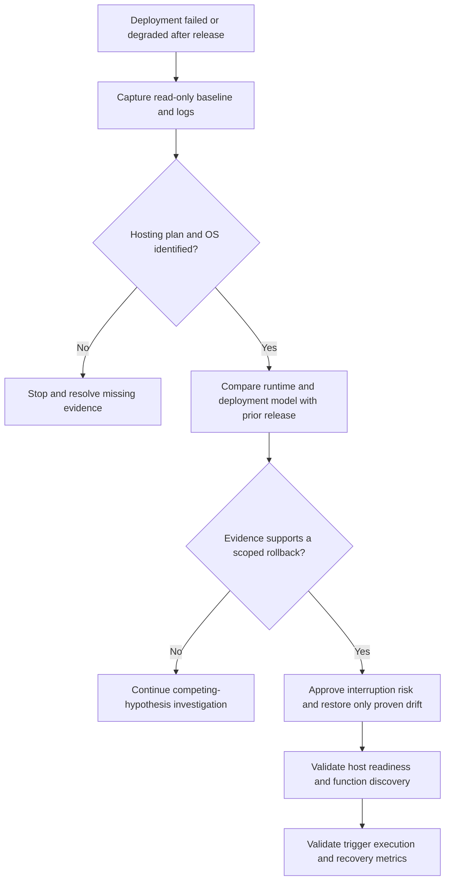
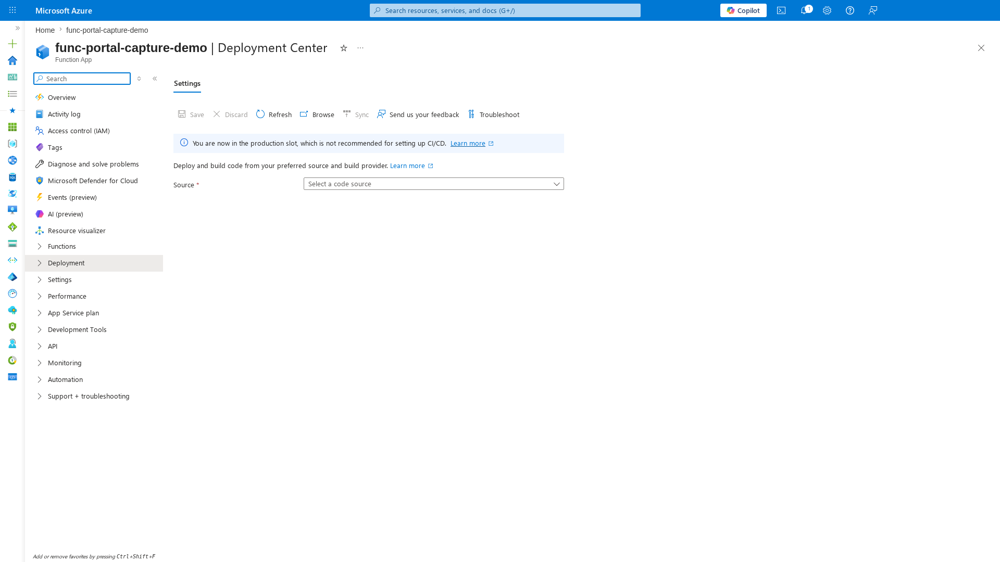
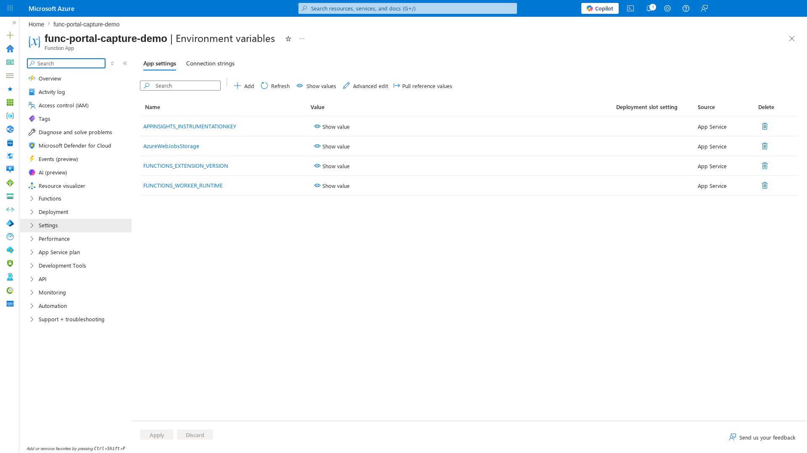

---
content_sources:
  references:
    - type: mslearn-adapted
      url: https://learn.microsoft.com/en-us/azure/azure-functions/functions-diagnostics
    - type: mslearn-adapted
      url: https://learn.microsoft.com/en-us/azure/azure-functions/functions-deployment-technologies
    - type: mslearn-adapted
      url: https://learn.microsoft.com/en-us/azure/azure-functions/deployment-zip-push
    - type: mslearn-adapted
      url: https://learn.microsoft.com/en-us/azure/azure-functions/functions-app-settings
    - type: mslearn-adapted
      url: https://learn.microsoft.com/en-us/azure/azure-functions/functions-scale
    - type: mslearn-adapted
      url: https://learn.microsoft.com/en-us/azure/azure-functions/functions-infrastructure-as-code
  diagrams:
    - id: 1-summary
      type: flowchart
      source: self-generated
      justification: Flow view of summary, synthesized from Microsoft Learn documentation cited on this page.
      based_on:
        - https://learn.microsoft.com/en-us/azure/azure-functions/functions-diagnostics
        - https://learn.microsoft.com/en-us/azure/azure-functions/functions-deployment-technologies
        - https://learn.microsoft.com/en-us/azure/azure-functions/deployment-zip-push
        - https://learn.microsoft.com/en-us/azure/azure-functions/functions-app-settings
        - https://learn.microsoft.com/en-us/azure/azure-functions/functions-scale
content_validation:
  status: verified
  last_reviewed: 2026-10-25
  reviewer: agent
  core_claims:
    - claim: "Flex Consumption runs from a package by default and must not use WEBSITE_RUN_FROM_PACKAGE."
      source: https://learn.microsoft.com/en-us/azure/azure-functions/deployment-zip-push
      verified: true
    - claim: "Linux Consumption uses a package URL, not WEBSITE_RUN_FROM_PACKAGE=1; remote build manages its package output."
      source: https://learn.microsoft.com/en-us/azure/azure-functions/functions-deployment-technologies
      verified: true
    - claim: "Flex Consumption configures runtime and deployment storage through functionAppConfig instead of legacy runtime application settings."
      source: https://learn.microsoft.com/en-us/azure/azure-functions/functions-infrastructure-as-code
      verified: true
    - claim: "Changing application settings restarts the function app by default."
      source: https://learn.microsoft.com/en-us/azure/azure-functions/functions-app-settings
      verified: true
---

# Deployment Failures
## 1. Summary
Deployment failures in Azure Functions are often deployment-success-but-runtime-failure incidents.
Transport success (artifact uploaded) does not guarantee host startup, trigger indexing, or invocation health.
This playbook prioritizes fast triage of runtime settings, deployment model fit, and package integrity.

!!! note "Verification boundary"
    The mitigation guidance was checked against the linked Microsoft Learn sources on 2026-10-25. `content_validation` records official-source review, not CLI execution or live Azure validation. No Azure deployment, configuration change, restart, or recovery experiment was performed for this revision. Existing log and result examples below are not evidence of a newly executed incident.
<!-- diagram-id: 1-summary -->

### Incident framing
- Common symptom: deployment command succeeds, but app returns `500`, `404`, or host loops on startup.
- Deployment concepts in scope: zip deploy, run-from-package, deployment slots, extension bundles, `FUNCTIONS_WORKER_RUNTIME`, `linuxFxVersion`.
- Use objective evidence first: traces, app settings snapshot, and activity log in the deployment window.
### Variables
```bash
RG="rg-functions-prod"
APP_NAME="func-orders-prod"
SUBSCRIPTION_ID="<subscription-id>"
WORKSPACE_ID="xxxxxxxx-xxxx-xxxx-xxxx-xxxxxxxxxxxx"
```
## 2. Common Misreadings
1. **"Deployment succeeded, so app is healthy"**
    - Upload success does not prove host startup success.
    - Always verify startup traces and first invocation outcomes.
2. **"404 after release is only routing"**
    - It can also indicate indexing failure or missing function metadata.
3. **"Staging is healthy, swap is safe"**
    - Slot-specific settings drift can break production immediately after swap.
4. **"Any artifact can run with current stack"**
    - On non-Flex code apps, `FUNCTIONS_WORKER_RUNTIME` and the OS-specific stack must align with the artifact. Flex uses `functionAppConfig.runtime` instead.
5. **"Extension bundle issues are rare and harmless"**
    - Bundle retrieval/version issues can prevent trigger listeners from loading.
## 3. Competing Hypotheses
### H1: Runtime mismatch
- Artifact language/runtime does not match app runtime configuration.
- Typical examples:
    - Python package + `FUNCTIONS_WORKER_RUNTIME=node`
    - Node package + unsupported Linux stack image
    - .NET isolated package with incompatible host/runtime assumptions
### H2: Missing required app settings
- Required settings are missing, empty, stale, or not sticky in slot swaps.
- Commonly implicated settings:
    - `AzureWebJobsStorage`
    - `FUNCTIONS_WORKER_RUNTIME`
    - `WEBSITE_RUN_FROM_PACKAGE`
    - trigger connection setting keys referenced in bindings
- These keys are not universally required: Flex replaces legacy runtime/package settings with `functionAppConfig`, and host storage can use identity-based `AzureWebJobsStorage__*` settings instead of a connection string.
### H3: Deployment method not suited to hosting model
- Deployment strategy conflicts with plan/runtime behavior.
- Frequent patterns:
    - mutable copy style deployment where package mount is expected
    - slot swap without settings stickiness policy
    - zip deploy sequence without verification of final mount/index state
### H4: Artifact corruption or incomplete upload
- Uploaded package is incomplete/corrupted or CI artifact differs from deployed payload.
- Typical indicators:
    - missing `host.json` at package root
    - missing/transient dependency folders
    - package hash mismatch between CI and deployment metadata
## 4. What to Check First
### First 5-minute checklist
1. Do not write settings, redeploy, swap, or restart yet. Identify hosting SKU, OS, runtime/language/version, affected app or slot, and exact release path (including remote build or container image).
2. Capture current resource configuration and settings, including **absence** of keys, slot stickiness, and deployment storage/authentication. Retrieve the pre-release known-good configuration and retained artifact/hash from the release record; a snapshot taken during failure is not a known-good baseline.
3. Preserve deployment/build logs, activity events (successful and failed), startup/indexing traces, function inventory, and invocation/backlog metrics with UTC timestamps.
4. Compare current state with that prior release. If the baseline or deployment method is unknown, stop speculative mutation and escalate.
5. Where slots are supported and used, capture both slots and their sticky settings before considering swap-back.
### Metadata snapshot command
```bash
az functionapp show \
    --resource-group $RG \
    --name $APP_NAME \
    --subscription $SUBSCRIPTION_ID \
    --query "{state:state, kind:kind, reserved:reserved, serverFarmId:serverFarmId, linuxFxVersion:siteConfig.linuxFxVersion, functionAppConfig:functionAppConfig}" \
    --output json
```

| Command/Parameter | Purpose |
|---|---|
| `az functionapp show` | Read app metadata; do not change state. |
| `--resource-group` | Target resource group. |
| `--name` | Target Function App. |
| `--subscription` | Explicit subscription scope. |
| `--query` | Include plan resource ID, OS, legacy stack, and Flex configuration. |
| `--output` | Return JSON for review. |

Resolve `PLAN_ID` from the returned `serverFarmId`, then read its SKU. Capture the full app and settings securely; outputs can contain secrets, SAS URLs, and real identifiers. Keep raw snapshots outside source control with restricted access; publish only sanitized evidence. These commands target production; for a supported non-production slot, use the corresponding slot resource and `--slot` on app commands that support it.

```bash
az appservice plan show --ids "$PLAN_ID" --query "{sku:sku, reserved:reserved}" --output json
az functionapp show --resource-group "$RG" --name "$APP_NAME" --subscription "$SUBSCRIPTION_ID" --output json > app-current.json
az functionapp config show --resource-group "$RG" --name "$APP_NAME" --subscription "$SUBSCRIPTION_ID" --output json > site-config-current.json
az functionapp config appsettings list --resource-group "$RG" --name "$APP_NAME" --subscription "$SUBSCRIPTION_ID" --output json > appsettings-current.json
```

| Command/Parameter | Purpose |
|---|---|
| `az appservice plan show` | Read the referenced plan; distinguish FC1, Y1, EP, and Dedicated SKUs. |
| `az functionapp show` | Capture full current app resource, including Flex configuration. |
| `az functionapp config show` | Capture OS-specific site/stack configuration. |
| `az functionapp config appsettings list` | Capture current values and slot-setting flags without changing them. |
| `--ids` | Fully qualified plan resource ID from the app. |
| `--resource-group` | Resource group containing the app. |
| `--name` | App being investigated. |
| `--subscription` | Subscription containing the app. |
| `--query` | Select SKU and OS fields for the plan. |
| `--output` | JSON format for secure local snapshots. |

Expected read:

- `state` should settle at `Running`.
- For non-Flex Linux code apps, `linuxFxVersion` should match the intended runtime. For Flex, inspect `functionAppConfig.runtime.name` and `.version`; an empty legacy stack field alone is not a fault.
- Linux app should report `reserved: true`.
### Slot-focused quick checks
- confirm sticky settings policy for production-critical values
- confirm `WEBSITE_RUN_FROM_PACKAGE` value validity per slot
- confirm connection settings required by bindings exist in target slot
## 5. Evidence to Collect
### Portal Walkthrough

Key portal blades for deployment failure investigation. Existing captures are from a Consumption (Y1) Function App with PII masked; they are not Flex evidence or a new validation run.






### Plan-specific interpretation

The legacy runtime/app-setting examples in sections 5–7 apply to non-Flex code apps, not a required configuration for every plan. For Flex, inspect `functionAppConfig.runtime` and `.deployment.storage`, deployment logs, and the **Flex Consumption Deployment** diagnostic under **Diagnose and solve problems**. Do not assume a Kudu console or legacy ZIP deployment history is available. For container apps on Premium/Dedicated, compare the image digest and container configuration instead of applying package-setting fixes.

### Sample Log Patterns
```text
2026-04-04T07:15:02.214Z info  Starting Host (HostId=func-orders-prod, InstanceId=xxxxxxxx-xxxx-xxxx-xxxx-xxxxxxxxxxxx)
2026-04-04T07:15:02.921Z info  Loading functions metadata
2026-04-04T07:15:03.104Z warn  WorkerConfig for runtime:python not found; configured runtime is node
2026-04-04T07:15:03.370Z error A host error has occurred during startup operation 'xxxxxxxx-xxxx-xxxx-xxxx-xxxxxxxxxxxx'
2026-04-04T07:15:03.371Z error Microsoft.Azure.WebJobs.Script: Did not find functions with language [python]
2026-04-04T07:15:08.122Z info  Stopping JobHost
2026-04-04T07:15:08.601Z info  Host started (4210ms)
2026-04-04T07:15:10.019Z warn  Failed to load extension bundle from [https://functionscdn.azureedge.net/public/ExtensionBundles/...]
2026-04-04T07:15:12.443Z error Executed 'Functions.HttpTrigger' (Failed, Id=xxxxxxxx-xxxx-xxxx-xxxx-xxxxxxxxxxxx, Duration=12ms)
```
### KQL Queries with Example Output
#### Query 1: Function execution summary (KQL library query 1)
```kusto
let appName = "func-orders-prod";
requests
| where timestamp > ago(1h)
| where cloud_RoleName =~ appName
| where operation_Name startswith "Functions."
| summarize
    Invocations = count(),
    Failures = countif(success == false),
    FailureRatePercent = round(100.0 * countif(success == false) / count(), 2),
    P95Ms = percentile(duration, 95)
  by FunctionName = operation_Name
| order by Failures desc, P95Ms desc
```
Example output:
| FunctionName | Invocations | Failures | FailureRatePercent | P95Ms |
|---|---:|---:|---:|---:|
| Functions.HttpTrigger | 42 | 39 | 92.86 | 3110.42 |
| Functions.TimerCleanup | 6 | 0 | 0.00 | 109.35 |
#### Query 2: Exceptions concentrated after deployment
```kusto
let appName = "func-orders-prod";
exceptions
| where timestamp > ago(2h)
| where cloud_RoleName =~ appName
| summarize Count=count() by type, outerMessage
| order by Count desc
```
Example output:
| type | outerMessage | Count |
|---|---|---:|
| Microsoft.Azure.WebJobs.Script.Workers.Rpc.RpcException | Exception while executing function: Functions.HttpTrigger | 61 |
| System.InvalidOperationException | Worker runtime does not match deployed payload | 48 |
#### Query 3: Host startup/shutdown timeline (adapted from KQL library query 8)
```kusto
let appName = "func-orders-prod";
traces
| where timestamp > ago(12h)
| where cloud_RoleName =~ appName
| where message has_any ("Host started", "Job host started", "Host shutdown", "Host is shutting down", "Stopping JobHost")
| project timestamp, severityLevel, message
| order by timestamp desc
```
Example output:
| timestamp | severityLevel | message |
|---|---:|---|
| 2026-04-04T07:15:08Z | 1 | Host started (4210ms) |
| 2026-04-04T07:15:08Z | 1 | Job host started |
| 2026-04-04T07:15:03Z | 3 | A host error has occurred during startup operation 'xxxxxxxx-xxxx-xxxx-xxxx-xxxxxxxxxxxx' |
### CLI Investigation Commands
#### Runtime and host metadata
```bash
az functionapp show \
    --resource-group $RG \
    --name $APP_NAME \
    --subscription $SUBSCRIPTION_ID \
    --output json
```

| CLI element | Explanation |
|---|---|
| Command(s) | `az functionapp show` |
| Key flags | `--resource-group`, `--name`, `--subscription`, `--output` |
| Variables | `$RG`, `$APP_NAME`, `$SUBSCRIPTION_ID` |
| Expected result | Azure CLI returns the requested resource data; verify names, IDs, status fields, or metric values match the scenario. |

Example output:
```json
{
  "name": "func-orders-prod",
  "state": "Running",
  "kind": "functionapp,linux",
  "siteConfig": {
    "linuxFxVersion": "PYTHON|3.11"
  }
}
```
#### App settings inspection
```bash
az functionapp config appsettings list \
    --resource-group $RG \
    --name $APP_NAME \
    --subscription $SUBSCRIPTION_ID \
    --output table
```

| CLI element | Explanation |
|---|---|
| Command(s) | `az functionapp config appsettings list` |
| Key flags | `--resource-group`, `--name`, `--subscription`, `--output` |
| Variables | `$RG`, `$APP_NAME`, `$SUBSCRIPTION_ID` |
| Expected result | Azure CLI applies the configuration change; confirm the returned JSON or follow-up query shows the expected value. |

Example output:
```text
Name                           Value
-----------------------------  -----------------------------------------
FUNCTIONS_WORKER_RUNTIME       python
AzureWebJobsStorage            DefaultEndpointsProtocol=https;...
WEBSITE_RUN_FROM_PACKAGE       1
APPINSIGHTS_INSTRUMENTATIONKEY xxxxxxxx-xxxx-xxxx-xxxx-xxxxxxxxxxxx
```
#### Control plane event history
```bash
az monitor activity-log list \
    --subscription $SUBSCRIPTION_ID \
    --resource-group $RG \
    --offset 2h \
    --status Failed \
    --output table
```

| CLI element | Explanation |
|---|---|
| Command(s) | `az monitor activity-log list` |
| Key flags | `--subscription`, `--resource-group`, `--offset`, `--status`, `--output` |
| Variables | `$SUBSCRIPTION_ID`, `$RG` |
| Expected result | Azure CLI returns the requested resource data; verify names, IDs, status fields, or metric values match the scenario. |

Example output:
```text
EventTimestamp              OperationNameValue                     Status  ResourceGroup
--------------------------  -------------------------------------  ------  -----------------
2026-04-04T07:14:51.000000Z Microsoft.Web/sites/config/write      Failed  rg-functions-prod
2026-04-04T07:14:30.000000Z Microsoft.Web/sites/publishxml/action Failed  rg-functions-prod
```
### Normal vs Abnormal Comparison
| Signal | Normal after release | Abnormal after release |
|---|---|---|
| Host startup cadence | One startup then stable | Frequent startup/shutdown cycle |
| Function indexing | All expected functions found | Missing functions or no language worker |
| `FUNCTIONS_WORKER_RUNTIME` | Matches artifact language | Mismatch with deployed package |
| `linuxFxVersion` | Compatible with package | Unsupported or drifted stack |
| `WEBSITE_RUN_FROM_PACKAGE` | Valid package setting/URL | Empty, broken, or inconsistent per slot |
| Activity log | Successful writes only | Failed config/deployment operations |
## 6. Validation and Disproof by Hypothesis
### H1: Runtime mismatch
#### Signals that support
- startup logs show worker mismatch or no functions discovered for configured runtime
- deployment appears successful but broad failures begin immediately
- `FUNCTIONS_WORKER_RUNTIME` conflicts with `linuxFxVersion`
#### Signals that weaken
- host starts cleanly and functions are indexed
- failures limited to one dependency path instead of all functions
- runtime metadata aligns with artifact language
#### What to verify
KQL:
```kusto
let appName = "func-orders-prod";
traces
| where timestamp > ago(2h)
| where cloud_RoleName =~ appName
| where message has_any ("WorkerConfig", "Did not find functions", "A host error has occurred during startup")
| project timestamp, severityLevel, message
| order by timestamp desc
```
CLI:
```bash
az functionapp show \
    --resource-group $RG \
    --name $APP_NAME \
    --subscription $SUBSCRIPTION_ID \
    --query "{linuxFxVersion:siteConfig.linuxFxVersion, kind:kind}" \
    --output json
az functionapp config appsettings list \
    --resource-group $RG \
    --name $APP_NAME \
    --subscription $SUBSCRIPTION_ID \
    --query "[?name=='FUNCTIONS_WORKER_RUNTIME']" \
    --output json
```

| CLI element | Explanation |
|---|---|
| Command(s) | `az functionapp show`, `az functionapp config appsettings list` |
| Key flags | `--resource-group`, `--name`, `--subscription`, `--query`, `--output` |
| Variables | `$RG`, `$APP_NAME`, `$SUBSCRIPTION_ID` |
| Expected result | Azure CLI applies the configuration change; confirm the returned JSON or follow-up query shows the expected value. |

Example output:
```json
{
  "linuxFxVersion": "NODE|20",
  "kind": "functionapp,linux"
}
[
  {
    "name": "FUNCTIONS_WORKER_RUNTIME",
    "value": "python"
  }
]
```
!!! tip "How to Read This"
    Language mismatch between `linuxFxVersion` and `FUNCTIONS_WORKER_RUNTIME` is a high-confidence root cause.
    It typically causes broad failures across functions, not an isolated endpoint issue.
### H2: Missing required app settings
#### Signals that support
- startup/invocation errors mention missing or null configuration values
- storage/auth initialization fails after deployment
- swap happened and slot settings differ
#### Signals that weaken
- required settings exist with non-empty values in affected slot
- restoring known-good settings does not change behavior
- incident predates any settings change
#### What to verify
KQL:
```kusto
let appName = "func-orders-prod";
exceptions
| where timestamp > ago(2h)
| where cloud_RoleName =~ appName
| where outerMessage has_any ("Missing", "not configured", "AzureWebJobsStorage", "Value cannot be null")
| project timestamp, type, outerMessage
| order by timestamp desc
```
CLI:
```bash
az functionapp config appsettings list \
    --resource-group $RG \
    --name $APP_NAME \
    --subscription $SUBSCRIPTION_ID \
    --query "[?name=='AzureWebJobsStorage' || name=='FUNCTIONS_WORKER_RUNTIME' || name=='WEBSITE_RUN_FROM_PACKAGE']" \
    --output table
```

| CLI element | Explanation |
|---|---|
| Command(s) | `az functionapp config appsettings list` |
| Key flags | `--resource-group`, `--name`, `--subscription`, `--query`, `--output` |
| Variables | `$RG`, `$APP_NAME`, `$SUBSCRIPTION_ID` |
| Expected result | Azure CLI applies the configuration change; confirm the returned JSON or follow-up query shows the expected value. |

Example output:
```text
Name                      Value
------------------------  -----
FUNCTIONS_WORKER_RUNTIME  python
WEBSITE_RUN_FROM_PACKAGE  1
AzureWebJobsStorage
```
!!! tip "How to Read This"
    Empty `AzureWebJobsStorage` is usually enough to block startup or trigger initialization.
    When this appears after swap, check sticky settings and release variable scope first.
### H3: Deployment method not suited to hosting model
#### Signals that support
- host behavior becomes unstable immediately after method change
- swap succeeds but production degrades while staging looked healthy
- package mount semantics do not match deployment approach
#### Signals that weaken
- method is stable historically on same plan and runtime
- same artifact + same method redeploy works repeatedly
- no settings drift between staging and production
#### What to verify
KQL:
```kusto
let appName = "func-orders-prod";
traces
| where timestamp > ago(3h)
| where cloud_RoleName =~ appName
| where message has_any ("Host started", "Host shutdown", "Stopping JobHost", "Run-From-Package", "ZipDeploy")
| project timestamp, severityLevel, message
| order by timestamp desc
```
CLI:
```bash
az functionapp config appsettings list \
    --resource-group $RG \
    --name $APP_NAME \
    --subscription $SUBSCRIPTION_ID \
    --query "[?name=='WEBSITE_RUN_FROM_PACKAGE']" \
    --output json
az monitor activity-log list \
    --subscription $SUBSCRIPTION_ID \
    --resource-group $RG \
    --offset 3h \
    --output table
```

| CLI element | Explanation |
|---|---|
| Command(s) | `az functionapp config appsettings list`, `az monitor activity-log list` |
| Key flags | `--resource-group`, `--name`, `--subscription`, `--query`, `--output`, `--offset` |
| Variables | `$RG`, `$APP_NAME`, `$SUBSCRIPTION_ID` |
| Expected result | Azure CLI applies the configuration change; confirm the returned JSON or follow-up query shows the expected value. |

Example output:
```text
Name                     Value
-----------------------  ---------------------------------------------
WEBSITE_RUN_FROM_PACKAGE https://<storage-account>.blob.core.windows.net/deployments/app.zip?<sas>
EventTimestamp              OperationNameValue                         Status
--------------------------  -----------------------------------------  -------
2026-04-04T07:14:30.000000Z Microsoft.Web/sites/slots/slotsswap/action Succeeded
2026-04-04T07:13:58.000000Z Microsoft.Web/sites/config/write           Succeeded
```
!!! tip "How to Read This"
    If swap succeeded but startup loops continue, compare slot-specific settings and package URL accessibility.
    If deploy method changed recently, rollback method first before deeper code rollback.
### H4: Artifact corruption or incomplete upload
#### Signals that support
- function count drops or expected functions disappear after release
- indexing/load errors appear despite correct runtime configuration
- previous artifact rollback restores service quickly
#### Signals that weaken
- artifact hash matches CI and package inspection is clean
- same artifact works in another environment
- failure pattern points to downstream dependency outage
#### What to verify
KQL:
```kusto
let appName = "func-orders-prod";
traces
| where timestamp > ago(2h)
| where cloud_RoleName =~ appName
| where message has_any ("Loading functions metadata", "Error indexing method", "No job functions found", "Failed to load")
| project timestamp, severityLevel, message
| order by timestamp desc
```
CLI:
```bash
az monitor activity-log list \
    --subscription $SUBSCRIPTION_ID \
    --resource-group $RG \
    --offset 2h \
    --status Failed \
    --output table
az functionapp show \
    --resource-group $RG \
    --name $APP_NAME \
    --subscription $SUBSCRIPTION_ID \
    --query "{state:state, defaultHostName:defaultHostName}" \
    --output json
```

| CLI element | Explanation |
|---|---|
| Command(s) | `az monitor activity-log list`, `az functionapp show` |
| Key flags | `--subscription`, `--resource-group`, `--offset`, `--status`, `--output`, `--name`, `--query` |
| Variables | `$SUBSCRIPTION_ID`, `$RG`, `$APP_NAME` |
| Expected result | Azure CLI returns the requested resource data; verify names, IDs, status fields, or metric values match the scenario. |

Example output:
```text
EventTimestamp              OperationNameValue                     Status  SubStatus
--------------------------  -------------------------------------  ------  ---------
2026-04-04T07:14:29.000000Z Microsoft.Web/sites/publishxml/action Failed  Conflict
{
  "state": "Running",
  "defaultHostName": "func-orders-prod.azurewebsites.net"
}
```
!!! tip "How to Read This"
    `state: Running` is not proof of package integrity.
    If indexing errors disappear after redeploying prior artifact, classify as package corruption/incomplete upload.
## 7. Likely Root Cause Patterns
1. **Runtime/config drift at release time**
    - stack changed (`linuxFxVersion`) without matching worker setting
    - worker setting changed without matching build target
2. **Slot configuration drift**
    - non-sticky settings differ between slots
    - run-from-package URL/token valid only in staging
3. **Extension bundle compatibility or retrieval failure**
    - host starts but specific triggers do not initialize
    - bundle version range incompatible with app/runtime expectation
4. **Artifact assembly/publish defect**
    - missing root files (`host.json`) or incomplete dependencies
    - CI artifact and deployed package hash differ
## 8. Immediate Mitigations
### Choose the recovery branch before any write

Use the section 4 baseline and [official package guidance](https://learn.microsoft.com/en-us/azure/azure-functions/deployment-zip-push). Do not change the app's language to Python or enable a new deployment mode as a generic repair.

| Confirmed hosting branch | Evidence-led recovery action |
|---|---|
| Flex Consumption (FC1, Linux) | Compare `functionAppConfig.runtime.name` / `.version` and `.deployment.storage` container/authentication with the prior release. Restore only proven resource-property drift through the reviewed resource configuration workflow and redeploy a retained known-good artifact through Flex-supported publishing. Do not add `FUNCTIONS_WORKER_RUNTIME`, `linuxFxVersion`, or `WEBSITE_RUN_FROM_PACKAGE` as a repair; Flex uses resource properties and managed package deployment. No slot swap-back. |
| Linux Consumption (Y1) | Compare legacy worker/stack settings and the captured remote-build or external-package workflow. `WEBSITE_RUN_FROM_PACKAGE=1` is unsupported; a locally built package uses a reachable package URL. Restore the prior valid URL/authentication only for an established URL workflow, or redeploy through the prior remote-build pipeline. Do not manually force a package setting when requesting remote build. No slot swap-back. |
| Windows Consumption (Y1) | Restore the prior worker/Windows stack configuration only if drift is established. `WEBSITE_RUN_FROM_PACKAGE=1` is valid for an already configured local-package workflow, not proof that a package exists. Redeploy the retained package using that workflow; consider swap-back only if the previous release remains in a supported slot and settings are verified. |
| Premium (EP, Windows or Linux) | Distinguish code package, remote build, external URL, and container deployment. For code, restore only the captured settings/OS-specific stack changes. Local-package mode supports `1`, but do not overwrite an existing URL or remote-build workflow. Restore the retained artifact or image digest; use swap-back only after checking prior slot contents and sticky settings. |
| Dedicated (Windows or Linux) | Confirm the App Service SKU and code/container model. Restore only drifted runtime/package or image configuration through the existing release workflow; local-package mode supports `1`, not a universal migration instruction. Use a verified supported slot or retained artifact/image and recheck listeners after recovery. |

### Minimal rollback from captured prior state

1. Pause competing deployments and obtain incident-owner approval. Record the exact target app/slot, known-good artifact/hash, keys or resource properties to restore, and a way to undo the attempted recovery using the current-state capture.
2. Restore **only** the values changed by the failed release. Preserve unrelated settings and slot stickiness; if a key was absent before the release, remove only that newly introduced key rather than setting it to an empty string. Do not replay a whole stale settings snapshot over newer secrets/configuration. For Flex, use the captured `functionAppConfig` values in the reviewed resource workflow, not legacy app-setting substitutions.
3. If code changed, redeploy the retained known-good artifact using the same supported build/deployment method. Keep runtime, deployment mode, and artifact compatible. A `1` setting alone cannot restore prior package bytes; a URL rollback also needs the retained blob, valid authorization, and trigger synchronization. Do not convert an existing local-package app to URL mode during incident recovery.
4. Swap back only where supported, after confirming the other slot still contains the previous release and its configuration is safe. If no trusted baseline/artifact exists, stop and escalate rather than guess runtime or package values.

!!! warning "Execution interruption"
    Application-setting changes restart the app by default; explicit restarts and code deployments can interrupt in-flight executions. Review the configured update strategy, retry/idempotency behavior, backlog impact, and maintenance window before approval. Do not append an unconditional restart after a settings update. Recovery after a restart is correlation, not proof of the root cause.

### Validate after each approved recovery action

Read function inventory again (this command does not invoke a trigger):

```bash
az functionapp function list \
    --resource-group "$RG" \
    --name "$APP_NAME" \
    --subscription "$SUBSCRIPTION_ID" \
    --output table
```

| Command/Parameter | Purpose |
|---|---|
| `az functionapp function list` | Read discovered functions and compare with the retained release manifest. |
| `--resource-group` | Group containing the recovered app. |
| `--name` | App whose function inventory is checked. |
| `--subscription` | Explicit subscription scope for the check. |
| `--output` | Tabular inventory, not an execution result. |

- **Host readiness:** confirm stable startup/listener initialization logs with no new startup exception loop. `state: Running` or upload success alone is insufficient.
- **Function discovery:** reconcile every expected function and trigger with the release manifest; apply the deployment method's documented trigger-sync procedure when required (notably external package URLs).
- **Trigger execution:** after approval, use a safe HTTP request and representative non-HTTP test event where applicable, correlating the invocation ID with completion and intended downstream effects. Avoid replaying business events without idempotency controls.
- **Recovery window:** compare failures, latency, retries, queue age/checkpoint progress, and backlog with the baseline over an agreed observation window. If the action fails, preserve evidence and undo only that action from the captured pre-action state; reassess competing hypotheses instead of repeating restarts.

## 9. Prevention
1. Add CI/CD guardrails:
    - validate `functionAppConfig.runtime` for Flex, or worker/OS-specific stack settings for non-Flex apps, against the artifact language
    - fail pipeline if required settings are missing
2. Use immutable deployment controls:
    - run-from-package with checksum verification
    - record artifact checksum and release metadata
3. Improve slot governance:
    - explicit sticky-setting policy
    - automated pre-swap settings diff check
4. Add post-deploy automated health gates:
    - startup trace validation in first 10 minutes
    - automatic rollback threshold on failure rate and startup loops
5. Manage extension bundle/runtime lifecycle intentionally:
    - pin supported extension bundle ranges
    - keep version compatibility matrix by app and plan
## See Also
- [First 10 Minutes](../first-10-minutes/index.md)
- [Methodology](../methodology.md)
- [KQL Query Library](../kql/index.md)
- [Deployment and release patterns](../../best-practices/deployment.md)
- Related Labs: [Cold Start Lab](../lab-guides/cold-start.md)
## Sources
- [Troubleshoot Azure Functions](https://learn.microsoft.com/en-us/azure/azure-functions/functions-diagnostics)
- [Deployment technologies in Azure Functions](https://learn.microsoft.com/en-us/azure/azure-functions/functions-deployment-technologies)
- [Package-based deployment by hosting plan](https://learn.microsoft.com/en-us/azure/azure-functions/deployment-zip-push)
- [Resource configuration, including functionAppConfig](https://learn.microsoft.com/en-us/azure/azure-functions/functions-infrastructure-as-code)
- [Azure Functions app settings reference](https://learn.microsoft.com/en-us/azure/azure-functions/functions-app-settings)
- [Azure Functions hosting options](https://learn.microsoft.com/en-us/azure/azure-functions/functions-scale)
