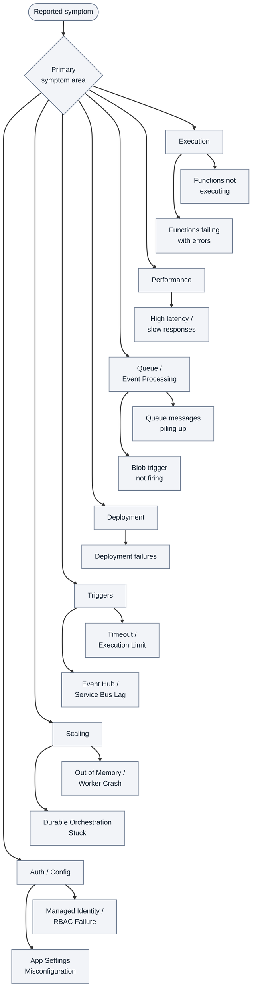

---
content_sources:

  references:
    - type: mslearn-adapted
      url: https://learn.microsoft.com/en-us/azure/azure-functions/functions-diagnostics
    - type: mslearn-adapted
      url: https://learn.microsoft.com/en-us/azure/azure-functions/functions-monitoring
    - type: mslearn-adapted
      url: https://learn.microsoft.com/en-us/azure/azure-functions/functions-diagnostics
  diagrams:
    - id: incident-playbooks
      type: graph
      source: self-generated
      justification: Guide-authored navigation from symptom areas to the playbooks linked below; Learn diagnostics and monitoring provide troubleshooting context, not this guide's category taxonomy or a root-cause classifier.
      based_on:
        - https://learn.microsoft.com/en-us/azure/azure-functions/functions-diagnostics
        - https://learn.microsoft.com/en-us/azure/azure-functions/functions-monitoring
        - https://learn.microsoft.com/en-us/azure/azure-functions/functions-diagnostics
---
# Incident Playbooks

Symptom-oriented troubleshooting guides for Azure Functions.

Each playbook follows a hypothesis-driven structure: start from the symptom, list competing hypotheses, collect evidence, validate or disprove, and identify the root cause.

<!-- diagram-id: incident-playbooks -->

**Takeaway:** Choose a symptom area, then open its playbook in the linked tables below. These are navigation categories, not confirmed causes; the playbook supplies the evidence and hypothesis checks.

---

## Execution

| Playbook | Symptom |
|----------|---------|
| [Functions Not Executing](functions-not-executing.md) | Events arrive but invocation count is near zero |
| [Functions Failing with Errors](functions-failing.md) | Exception count and 5xx increase quickly |

## Performance

| Playbook | Symptom |
|----------|---------|
| [High Latency / Slow Responses](high-latency.md) | P95 latency spikes and timeout rate increases |

## Queue / Event Processing

| Playbook | Symptom |
|----------|---------|
| [Queue Messages Piling Up](queue-piling-up.md) | Queue depth and message age rise steadily |
| [Blob Trigger Not Firing](blob-trigger-not-firing.md) | Blob uploads succeed but invocations never appear |

## Deployment

| Playbook | Symptom |
|----------|---------|
| [Deployment Failures](deployment-failures.md) | Deployment fails or app degrades immediately after release |

## Triggers

| Playbook | Symptom |
|----------|---------|
| [Timeout / Execution Limit](triggers/timeout-execution-limit.md) | Functions terminate early or hit maximum execution duration |
| [Event Hub / Service Bus Lag](triggers/event-hub-service-bus-lag.md) | Event-driven processing falls behind and checkpoint lag grows |

## Scaling

| Playbook | Symptom |
|----------|---------|
| [Out of Memory / Worker Crash](scaling/out-of-memory-worker-crash.md) | Workers restart or fail under memory pressure |
| [Durable Orchestration Stuck](scaling/durable-orchestration-stuck.md) | Durable orchestrations hang or replay excessively |

## Auth / Config

| Playbook | Symptom |
|----------|---------|
| [Managed Identity / RBAC Failure](auth-config/managed-identity-rbac-failure.md) | Identity-based access fails after RBAC or scope changes |
| [App Settings Misconfiguration](auth-config/app-settings-misconfiguration.md) | Functions fail due to missing, wrong, or stale application settings |
---

## How to Use These Playbooks

1. Identify the primary symptom your incident matches.
2. Open the corresponding playbook.
3. Follow the hypothesis-driven workflow: **What you observe → Hypotheses → Checks → Interpretation → Fix**.
4. Use inline KQL queries directly in the playbook — no need to switch to a separate query library.

!!! tip "Troubleshooting Workflow"
    Start with [First 10 Minutes](../first-10-minutes/index.md), follow [Methodology](../methodology.md), use playbook-embedded KQL queries, and map hands-on practice from [Lab Guides](../lab-guides/index.md).

## See Also

- [First 10 Minutes](../first-10-minutes/index.md)
- [Methodology](../methodology.md)
- [KQL Query Library](../kql/index.md)
- [Lab Guides](../lab-guides/index.md)
- [Evidence Map](../evidence-map.md)

## Sources

- [Microsoft Learn source 1](https://learn.microsoft.com/en-us/azure/azure-functions/functions-diagnostics)
- [Microsoft Learn source 2](https://learn.microsoft.com/en-us/azure/azure-functions/functions-monitoring)
- [Microsoft Learn source 3](https://learn.microsoft.com/en-us/azure/azure-functions/functions-diagnostics)
